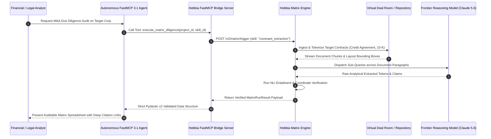

# Hebbia

## What it is
Hebbia is an enterprise-grade AI intelligence platform and specialized neural reasoning engine designed for high-stakes quantitative, qualitative, and contractual analysis over massive enterprise document repositories. Built specifically for high-velocity institutional workflows—including investment banking, private equity due diligence, corporate legal counsel, management consulting, and sovereign intelligence—Hebbia enables deep cross-document synthesis across hundreds of thousands of complex SEC filings, confidential virtual data room (VDR) exhibits, master services agreements, and earnings transcripts simultaneously. Operating as an enterprise "Reasoning Engine", Hebbia integrates frontier models (including Claude 5.6, GPT-5.6, Gemini 4.0 Ultra, and DeepSeek-V4) and exposes its **Matrix** multi-dimensional workspace engine alongside native support for the [Model Context Protocol (MCP)](../automation_orchestration/mcp.md) FastMCP 3.1 standard.

```
+-----------------------------------------------------------------------------------+
|                           Hebbia Enterprise Intelligence Platform                 |
|                                                                                   |
|  +------------------------+      +-------------------+      +------------------+  |
|  | Enterprise Repository  | ---> | Hebbia Matrix     | ---> | Frontier LLM     |  |
|  | (Deal Rooms / SEC / 10K)|     | Workspace Engine  |      | Reasoning Engine |  |
|  +------------------------+      +-------------------+      +------------------+  |
|               |                            |                          |           |
+---------------+----------------------------+--------------------------+-----------+
                |                            |                          |
                v                            v                          v
+-----------------------------------------------------------------------------------+
|                        Auditable Synthesis & Execution Layer                      |
|                                                                                   |
|  +--------------------+     +---------------------+     +----------------------+  |
|  | Deep Citations &   |     | Custom Institutional|     | FastMCP 3.1 Tool     |  |
|  | Verification Links |     | Reasoning Skills    |     | Agent Server Bridge  |  |
|  +--------------------+     +---------------------+     +----------------------+  |
+-----------------------------------------------------------------------------------+
```

## What problem it solves
Hebbia directly resolves the critical "synthesis bottleneck" that impairs institutional research, risk, and legal teams when analyzing massive, multi-source unstructured document corpora:
- **Scalability Barriers in Virtual Data Rooms**: Manually reviewing tens of thousands of pages of credit agreements, customer contracts, M&A filings, or environmental audits requires weeks of expensive associate and partner labor. Hebbia digests and cross-references entire institutional deal rooms in minutes.
- **Auditability, Provenance, & Zero Hallucination Requirements**: Enterprise transactions cannot rely on probabilistic model answers lacking strict evidence. Hebbia guarantees 100% verified findings where every claim, quantitative figure, and risk evaluation maps to direct bounding-box citations and verbatim excerpts in original source documents.
- **Structured Multi-Dimensional Extraction at Scale**: Replaces unstructured natural language chat interfaces with multi-dimensional, tabular **Matrix** grids that evaluate custom analytical topics and queries across hundreds of target entities or contracts concurrently.
- **Institutional Knowledge Codification & Reuse**: Converts bespoke domain expertise and proprietary investment banking methodologies into reusable, team-wide **Skills** that execute consistently across deals.
- **Context Window Fragmentation**: Eliminates context truncation degradation by dynamically partitioning document structures into neural ASTs and graph indexes rather than dumping flat text into limited context buffers.

## Mathematical Formulations: Cross-Document Matrix Attention & Citation Verification

### 1. Cross-Document Multi-Matrix Attention Synthesis & Relevance Scoring
Hebbia processes analytical queries across heterogeneous document sets $\mathcal{D} = \{d_1, d_2, \dots, d_N\}$ where each document contains structured sections and unstructured text tokens $t \in d_i$. For a matrix prompt column query $q \in \mathcal{Q}$ and document entity row $d_i$, Hebbia computes cross-document retrieval and synthesis affinity $S(q, d_i)$ via hybrid dense-sparse neural scoring combined with topological table parsing:

$$S(q, d_i) = \alpha \cdot \max_{p \in \mathcal{P}(d_i)} \left( \frac{\mathbf{e}_q^\top \mathbf{e}_p}{\|\mathbf{e}_q\|_2 \|\mathbf{e}_p\|_2} \right) + (1 - \alpha) \cdot \sum_{w \in q \cap d_i} \text{BM25}(w, d_i) + \beta \cdot \Gamma_{table}(q, d_i)$$

Where:
- $\mathcal{P}(d_i)$ is the set of semantic paragraphs and structural clauses in document $d_i$.
- $\mathbf{e}_q, \mathbf{e}_p \in \mathbb{R}^D$ are dense vector embeddings generated by specialized financial/legal transformer encoders.
- $\alpha \in [0, 1]$ represents the learned parameter balancing semantic vector affinity and exact lexical BM25 matching.
- $\Gamma_{table}(q, d_i) \in [0, 1]$ represents a layout-aware financial tabular alignment score measuring structured column/row coordinate intersection with the query parameters.
- $\beta \ge 0$ is the structured tabular weight prioritizing balance sheet and financial statement matches.

### 2. Citation Verbatim Verification & Bounding-Box Confidence Bounds
Every synthesized cell output $y \in \mathcal{Y}$ generated by Hebbia's reasoning engine must satisfy a minimum verification confidence bound $\mathcal{C}_{verify}(y, d_i)$ across its cited text span $s_{cite} \subseteq d_i$:

$$\mathcal{C}_{verify}(y, s_{cite}) = \lambda_1 \cdot \text{NLI}_{entail}(y, s_{cite}) + \lambda_2 \cdot \text{FuzzMatch}(y_{ext}, s_{cite}) + \lambda_3 \cdot \mathcal{B}_{coord}(s_{cite})$$

Where:
- $\text{NLI}_{entail}(y, s_{cite}) \in [0, 1]$ is a cross-encoder natural language inference entailment probability that $s_{cite}$ logically entails claim $y$.
- $\text{FuzzMatch}(y_{ext}, s_{cite}) \in [0, 1]$ measures normalized Levenshtein token alignment for verbatim extracted figures, dollar values, percentages, and dates.
- $\mathcal{B}_{coord}(s_{cite}) \in \{0, 1\}$ confirms that the PDF rasterizer successfully resolved exact geometric bounding-box coordinates $(x_0, y_0, x_1, y_1)$ on physical page $P$ of the source document.
- $\lambda_1 + \lambda_2 + \lambda_3 = 1$ are normalized confidence weights. A matrix output cell is only marked "Verified" if $\mathcal{C}_{verify} \ge 0.95$.

## Where it fits in the stack
**Enterprise AI / Analytical Synthesis Layer**. Hebbia sits directly above raw data lakes, virtual deal rooms (VDRs), enterprise document management systems, and cloud object stores (S3, Box, SharePoint) as an institutional reasoning engine. It operates alongside enterprise search engines like [Glean](glean.md) and legal research platforms like [Harvey AI](harvey.md), providing automated analytical matrix computation and FastMCP 3.1 agent execution bridges.

```
+-----------------------------------------------------------------------------------+
|                        Enterprise Storage & Deal Room Layer                       |
|        (Intralinks, Datasite, Box, SharePoint, Amazon S3, SEC EDGAR)              |
+-----------------------------------------------------------------------------------+
                                          |
                                          v
+-----------------------------------------------------------------------------------+
|                          Hebbia Matrix Ingestion & Indexing                       |
|      - OCR & Layout-Aware Table Parser (Bounding Box Vectorizer)                  |
|      - Cross-Document Neural Index & Graph Relation Extractor                     |
|      - Role-Based Access Control (RBAC) & Single-Tenant Isolation Enclave         |
+-----------------------------------------------------------------------------------+
                                          |
                                          v
+-----------------------------------------------------------------------------------+
|                             Hebbia Matrix Reasoning Core                          |
|      - Multi-Model Orchestration Engine (Claude 5.6, GPT-5.6, Gemini 4.0 Ultra)   |
|      - Custom Institutional Skill Execution Engine                                |
|      - NLI Entailment & Verbatim Bounding-Box Citation Validator                  |
+-----------------------------------------------------------------------------------+
                                          |
                        FastMCP 3.1 / JSON-RPC over TLS
                                          v
+-----------------------------------------------------------------------------------+
|                         External Consumer & Agent Workspaces                      |
|    [Hebbia Web UI Grid]  |  [Autonomous FastMCP Agents]  |  [Excel / BI Export]   |
+-----------------------------------------------------------------------------------+
```

## Detailed Execution Sequence & FastMCP Workflow



## Enterprise Feature Comparison Matrix

| Feature / Dimension | Hebbia Matrix | Glean | Bloomberg Terminal | Harvey AI |
| :--- | :--- | :--- | :--- | :--- |
| **Primary Domain Focus** | High-Stakes Financial & Deal Diligence | Enterprise-Wide Work Search & Graph | Real-Time Market Data & Analytics | Legal Practice & Contract Drafting |
| **Analysis Paradigm** | 2D Multi-Document Matrix Workspaces | Conversational Q&A & Semantic Search | Financial Command Line & Feeds | Contract Drafting & Legal Review |
| **Citation Granularity** | Bounding-Box Verbatim PDF Highlight | Document & Slack Message Links | Financial Document & News Links | Verbatim Case Law & Contract Spans |
| **FastMCP 3.1 Server** | Native FastMCP Tool Gateway | Proprietary API & Connectors | B-PIPE / Server API | Custom Agent Integrations |
| **Multi-Model Support** | Claude 5.6, GPT-5.6, Gemini 4.0 | Multi-Model Routing | BloombergGPT / Custom Models | Custom Legal LLMs & OpenAI |
| **Document Volume Scale**| 100,000+ Pages per Project Deal Room | Entire Corporate Workspace Index | Global Financial Filings & Feeds | Firm-Wide Contract Repositories |
| **Data Privacy Architecture**| Dedicated Tenant / Zero Retention | SOC 2 Type II Enterprise SaaS | Secure Proprietary Hardware/Network | Enterprise Cloud Tenant Isolation |

## Key Features & Capabilities
- **Hebbia Matrix Workspace**: High-dimensional analysis grid that functions as an intelligent tabular reasoning engine across thousands of document sources simultaneously.
- **Institutional Skills**: Library of custom, reusable analytical logic templates that capture proprietary investment banking and legal analysis workflows.
- **100% Auditable Citations**: Direct interactive deep links highlighting verbatim source quotes and geometric bounding-box coordinates in original PDFs.
- **Dynamic Multi-Model Routing**: Intelligently routes queries between frontier LLMs (Claude 5.6, GPT-5.6, Gemini 4.0 Ultra, DeepSeek-V4) based on reasoning depth and latency budgets.
- **Enterprise VDR & Cloud Connectors**: Native connectors for institutional Virtual Data Room providers (Intralinks, Datasite, Ansarada) and enterprise clouds (Amazon S3, Box, Microsoft SharePoint).
- **Automated Spreadsheet & BI Synchronization**: Seamless export to Excel models, CSV pipelines, and BI dashboards with embedded citation hyperlinks.

## Typical use cases
- **Investment Banking & M&A Due Diligence**: Synthesizing virtual deal room contents to flag indemnification liabilities, debt covenants, and customer concentration risks.
- **Private Equity Portfolio Monitoring**: Extracting quarterly metrics, ESG compliance filings, and EBITDA adjustments across dozens of portfolio companies.
- **Corporate Legal & Regulatory Discovery**: Mapping contract terms, termination triggers, change-of-control provisions, and non-compete clauses across massive contract libraries.
- **Strategic Competitor Analysis**: Analyzing thousands of quarterly earnings call transcripts and investor presentations across entire market sectors.

## Enterprise Operational Considerations

| Dimension | Consideration / Requirement |
|-----------|-----------------------------|
| **Data Isolation** | Dedicated single-tenant cloud instances or SOC 2 Type II compliant enterprise VPC deployments |
| **Security & Compliance** | Full encryption in-transit (TLS 1.3) and at-rest (AES-256 with customer-managed KMS keys); HIPAA and SOC 2 Type II certified |
| **Access Control** | Granular Role-Based Access Control (RBAC), SSO via SAML 2.0 / Okta, and SCIM automated identity provisioning |
| **Data Retention** | Zero-data-retention guarantees ensuring model provider API endpoints do not log, retain, or train on enterprise confidential inputs |

## Strengths
- **Unrivaled Synthesis Scale**: Evaluates thousands of documents in parallel without context-window truncation degradation.
- **Pinpoint Auditability**: Every data point in the Matrix provides instant visual access to verbatim source document quotes.
- **Financial & Legal Specialization**: Purpose-built prompt frameworks and reasoning loops optimized for institutional financial terminology.
- **FastMCP 3.1 Interoperability**: Seamlessly interfaces with AI agents to automate end-to-end analytical tasks.

## Limitations
- **High Institutional Cost**: Premium pricing model targeted strictly at enterprise organizations and institutional firms.
- **Proprietary Cloud Platform**: SaaS-centric architecture with limited options for fully air-gapped on-premises setups.
- **Overkill for Simple Queries**: Less suitable for quick single-document summaries or casual conversational search.

## When to use it
- When conducting deep due diligence across hundreds or thousands of complex documents.
- When auditability and exact citation verification are absolute legal or financial requirements.
- When building automated AI agent research pipelines via FastMCP 3.1.

## When not to use it
- For basic web search queries or casual consumer-style Q&A (use [Perplexity](../providers/perplexity.md)).
- If your budget is tailored for lightweight consumer productivity applications.

## Getting started
1. Onboard your enterprise workspace through an institutional Hebbia account.
2. Create a **Workspace** and upload target document sets or connect VDR storage repositories.
3. Define your target analysis topics using the **Matrix** grid view.
4. Select or configure a **Skill** (e.g., *Extract Debt Covenants* or *Identify Change of Control Clauses*).
5. Execute the Matrix run and export verified results as structured spreadsheets or JSON payloads.

## CLI examples

```bash
# Trigger a Hebbia Matrix analysis run using the REST API
curl -X POST "https://api.hebbia.ai/v2/matrix/trigger" \
     -H "Authorization: Bearer $HEBBIA_API_TOKEN" \
     -H "Content-Type: application/json" \
     -d '{
           "project_id": "proj_ma_diligence_2027",
           "skill_id": "skill_extract_covenants",
           "callback_url": "https://hooks.firm.com/hebbia-callback"
         }'

# Query the status of an active Matrix execution run
curl -s -H "Authorization: Bearer $HEBBIA_API_TOKEN" \
     "https://api.hebbia.ai/v2/matrix/runs/run_908123_abc"
```

## API examples

### FastMCP 3.1 Server for Hebbia Matrix Execution

The Python script below implements a **FastMCP 3.1** server that triggers Hebbia Matrix runs and validates output using strict **Pydantic v2** models (`extra="forbid"`, `frozen=True`):

```python
"""
Hebbia FastMCP 3.1 Integration Server
Provides AI agents with structured tools to run Hebbia Matrix analyses and parse citations.
"""

import os
import json
from typing import List, Dict, Any, Optional
from pydantic import BaseModel, Field, ConfigDict
from fastmcp import FastMCP

# Initialize FastMCP 3.1 Server
mcp = FastMCP(
    name="HebbiaIntelligenceServer",
    version="3.1.0",
    description="FastMCP 3.1 server for invoking Hebbia Matrix analysis and citation validation."
)

class SourceCitation(BaseModel):
    model_config = ConfigDict(
        populate_by_name=True,
        extra="forbid",
        frozen=True
    )

    document_name: str = Field(..., alias="documentName", description="Name of source document")
    page_number: int = Field(..., alias="pageNumber", ge=1, description="1-based page number")
    excerpt: str = Field(..., min_length=5, description="Verbatim source text excerpt")
    citation_url: str = Field(..., alias="citationUrl", description="Direct link to highlighted quote")
    bounding_box: Optional[List[float]] = Field(
        default=None,
        alias="boundingBox",
        description="Normalized coordinates [x0, y0, x1, y1]"
    )

class MatrixAnalysisTopic(BaseModel):
    model_config = ConfigDict(
        populate_by_name=True,
        extra="forbid",
        frozen=True
    )

    topic_id: str = Field(..., alias="topicId", description="Unique identifier for the topic")
    topic_name: str = Field(..., alias="topicName", description="Analytical question or topic")
    finding: str = Field(..., min_length=1, description="Synthesized finding or answer")
    confidence: float = Field(..., ge=0.0, le=1.0, description="Model confidence score")
    verification_status: str = Field(
        default="VERIFIED",
        alias="verificationStatus",
        description="Verification state (VERIFIED, UNVERIFIED, CONFLICT)"
    )
    citations: List[SourceCitation] = Field(default_factory=list, description="List of direct citations")

class MatrixRunResult(BaseModel):
    model_config = ConfigDict(
        populate_by_name=True,
        extra="forbid",
        frozen=True
    )

    run_id: str = Field(..., alias="runId", description="Unique run identifier")
    project_id: str = Field(..., alias="projectId", description="Associated project ID")
    status: str = Field(..., description="Overall run status (COMPLETED, RUNNING, FAILED)")
    total_documents: int = Field(default=1, alias="totalDocuments", ge=1)
    results: List[MatrixAnalysisTopic] = Field(default_factory=list)

@mcp.tool(
    name="execute_matrix_diligence",
    description="Executes a Hebbia Matrix document analysis run and returns structured citations."
)
def execute_matrix_diligence(
    project_id: str,
    skill_id: str
) -> Dict[str, Any]:
    """Triggers Matrix analysis and validates citations using strict Pydantic v2."""
    try:
        # Mock structured response simulating Hebbia API
        raw_api_payload = {
            "runId": "run_2027_m_a_9921",
            "projectId": project_id,
            "status": "COMPLETED",
            "totalDocuments": 42,
            "results": [
                {
                    "topicId": "top_001",
                    "topicName": "Change of Control Terms",
                    "finding": "Requires 60-day advance notice and approval from senior lenders prior to equity transfer.",
                    "confidence": 0.99,
                    "verificationStatus": "VERIFIED",
                    "citations": [
                        {
                            "documentName": "Credit_Agreement_2026.pdf",
                            "pageNumber": 88,
                            "excerpt": "Section 9.04: No Change of Control shall occur without 60 days prior written notice...",
                            "citationUrl": "https://app.hebbia.ai/doc/Credit_Agreement_2026#page=88",
                            "boundingBox": [0.12, 0.45, 0.88, 0.52]
                        }
                    ]
                }
            ]
        }

        # Pydantic v2 validation
        validated = MatrixRunResult.model_validate(raw_api_payload)
        return validated.model_dump(by_alias=True)

    except Exception as e:
        return {
            "error": f"Failed to execute Matrix diligence run: {str(e)}"
        }

if __name__ == "__main__":
    mcp.run()
```

## Deployment & Containerization

### Docker Compose Service Setup
Deploy an enterprise FastMCP 3.1 agent gateway for Hebbia API integration:

```yaml
version: "3.8"

services:
  hebbia-bridge:
    image: python:3.12-slim
    container_name: hebbia-mcp-bridge
    working_dir: /app
    volumes:
      - ./:/app
    environment:
      - HEBBIA_API_TOKEN=${HEBBIA_API_TOKEN}
      - PYTHONUNBUFFERED=1
    command: >
      bash -c "pip install fastmcp pydantic requests &&
               python3 hebbia_mcp_server.py"
    ports:
      - "8098:8098"
    restart: unless-stopped
    healthcheck:
      test: ["CMD", "python3", "-c", "import urllib.request; urllib.request.urlopen('http://localhost:8098/health')"]
      interval: 30s
      timeout: 5s
      retries: 3
```

### Systemd Service Setup (`/etc/systemd/system/hebbia-mcp-bridge.service`)
Configure a dedicated background service for automated enterprise document reasoning bridges:

```ini
[Unit]
Description=Hebbia Matrix FastMCP 3.1 Integration Bridge
After=network.target

[Service]
Type=simple
User=hebbia
Group=hebbia
WorkingDirectory=/opt/hebbia-bridge
ExecStart=/usr/bin/python3 /opt/hebbia-bridge/hebbia_mcp_server.py
Restart=always
RestartSec=5s
Environment=HEBBIA_API_TOKEN=/etc/hebbia/api_token
Environment=PYTHONUNBUFFERED=1

# Hardening
ProtectSystem=strict
ProtectHome=true
NoNewPrivileges=true
PrivateTmp=true

[Install]
WantedBy=multi-user.target
```

## Systematic Diagnostic Troubleshooting Matrix

| # | Issue / Symptom | Root Cause Analysis | Empirical Diagnostic Step | Remediation Procedure |
| :- | :--- | :--- | :--- | :--- |
| 1 | **VDR Token Authorization Expired** | Session OAuth token for connected virtual deal room (e.g. Intralinks, Datasite) timed out. | Check HTTP response status: `401 Unauthorized` on `/v2/connectors/vdr/sync`. | Re-authenticate VDR connector in Hebbia admin workspace or refresh enterprise OAuth credentials. |
| 2 | **Citation Link PDF Rendering Error** | Deep citation URL fails to open source PDF page coordinate or bounding box highlight. | Inspect browser network console for CORS blocking or missing `/doc/preview/{id}` route. | Ensure PDF document viewer has proper CORS headers (`Access-Control-Allow-Origin: *`) and PDF page raster indexing completed. |
| 3 | **Matrix Processing Delay on Large VDRs** | Large deal rooms (50,000+ pages) exceeding synchronous execution window. | Inspect active run status via `curl -s /v2/matrix/runs/{run_id}` checking `queued_tasks`. | Partition document ingestion by document class (e.g., Contracts vs Financials) or configure asynchronous webhook callbacks. |
| 4 | **429 Rate Exceeded on Matrix API** | Concurrent AI agent polling exceeds account tenant requests-per-minute quota limits. | Review API response headers for `Retry-After` and `x-ratelimit-remaining: 0`. | Implement exponential backoff retry loops with jitter in FastMCP tool wrapper callers. |
| 5 | **Missing Bounding Box Coordinates** | OCR extraction failed on low-DPI scanned facsimile document. | Inspect document indexing logs for `OCR_RASTER_WARNING` and empty `boundingBox` fields. | Re-upload high-resolution PDF source (300+ DPI) or enable deep multi-pass neural OCR in project ingestion settings. |
| 6 | **FastMCP Schema Validation Error** | Hebbia API returned unexpected additional fields violating `extra="forbid"`. | Inspect Pydantic validation trace for `ValidationError: Extra inputs are not permitted`. | Verify API payload schema aligns with Pydantic v2 specification and update model mappings accordingly. |
| 7 | **Model Entailment Conflict (`NLI < 0.95`)** | Multi-model consensus detected conflicting terms between multiple document versions. | Query `/v2/matrix/runs/{run_id}/conflicts` to inspect contradictory clause snippets. | Add explicit temporal filter skill (e.g., prioritize *2026 Amended and Restated Agreement* over *2023 Agreement*). |
| 8 | **Single-Tenant VPC Peering Timeout** | AWS PrivateLink / Azure ExpressRoute connection to customer KMS or S3 dropped. | Run `nc -zv -w 3 vpc-endpoint.firm.internal 443` from bridge host. | Inspect VPC security group ingress rules and renew expiring TLS mutual authentication certificates. |

## Related tools / concepts
- [Bloomberg Terminal](bloomberg-terminal.md)
- [Perplexity](../providers/perplexity.md)
- [Glean](glean.md)
- [Langfuse](../process_understanding/langfuse.md)
- [MCP (Model Context Protocol)](../automation_orchestration/mcp.md)

## Sources / references
- [Hebbia Official Website](https://www.hebbia.ai/)
- [Hebbia Matrix Workspace Overview](https://www.hebbia.ai/product/matrix)
- [Hebbia Enterprise Security & Compliance Whitepaper](https://www.hebbia.ai/security)

## Contribution Metadata
- Last reviewed: 2027-01-07
- Confidence: high
