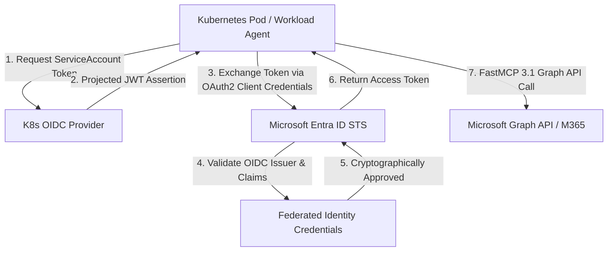

# Microsoft Entra ID

## What it is
Microsoft Entra ID (formerly Azure Active Directory) is a cloud-based identity and access management (IAM) service. As of early January 2027, it serves as the foundational enterprise security and identity layer for the Microsoft 365 ecosystem, multi-cloud SaaS platforms, and autonomous multi-agent systems, featuring native support for workload identities and secure [Model Context Protocol (MCP 3.1)](../automation_orchestration/mcp.md) / FastMCP 3.1 task protocol authentication.

## What problem it solves
It solves the critical security challenges of federated identity, Single Sign-On (SSO), and access governance in modern hybrid work and autonomous agent environments. Entra ID provides granular control over authentication, conditional access, and privileged roles for both human users and automated workloads, preventing unauthorized access and credential leakage across enterprise services.



## Where it fits in the stack
**Category**: Enterprise / Identity & Access Management. It sits at the absolute security perimeter, serving as the central authentication, authorization, and audit boundary between frontier language models (such as Claude 5.6, GPT-5.6, Gemini 4.0 Ultra, or DeepSeek-V4), custom orchestration loops, and secure API gateways like the [Microsoft Graph API](../providers/microsoft-graph.md).

## Typical use cases
- **Agentic Authentication**: Issuing secure, short-lived OAuth 2.0 access tokens to custom-built [Autonomous Agents](../agents/index.md) using Workload Identity Federation (no-secret deployments).
- **Enterprise Single Sign-On (SSO)**: Implementing centralized, federated authentication across thousands of custom and commercial SaaS platforms.
- **Conditional Access Policy Enforcement**: Dynamically blocking or requiring MFA for automated scripts based on source IP range, device compliance, or risk heuristics.
- **Identity Governance**: Automating the complete lifecycle of corporate user accounts and service principals via identity workflows and HR system feeds.

## Strengths
- **Enterprise-Grade Security**: Offers advanced threat protection, Privileged Identity Management (PIM) for just-in-time access, and cryptographically verified credentials via Microsoft Entra Verified ID.
- **Zero-Trust for Agents**: Native Workload Identity support allows containerized LLM runtimes (e.g., inside GKE or AKS) to authenticate using native cluster tokens rather than long-lived Client Secrets.
- **Deep Graph Integration**: Seamlessly couples with [Microsoft Graph API](../providers/microsoft-graph.md) to query org structures, calendars, emails, and SharePoint libraries under precise security boundaries.
- **Global Scale**: Trusted by over 90% of Fortune 500 companies with robust, high-availability geographic replication.

## Limitations
- **Licensing Complexity**: Core capabilities are highly fragmented across multiple tiers (Free, P1, P2, and specialized ID Governance add-ons), which significantly increases total cost of ownership.
- **Substantial Administrative Overhead**: Configuring complex Conditional Access Policies, multi-tenant federations, and enterprise application consents requires specialized security expertise.
- **Ecosystem Gravity**: While standard SAML/OIDC protocols are supported, the absolute deepest features and smoothest integrations are locked into the Azure and Microsoft 365 ecosystems.

## When to use it
- When implementing identity governance or SSO within an organization that uses Microsoft 365, Azure, or hybrid Windows Server environments.
- When deploying custom agentic assistants or background workflows that must programmatically access sensitive corporate data.
- When executing zero-trust architectures requiring conditional access, risk-based step-up authentication, or automated workload isolation.

## When not to use it
- For simple, non-enterprise personal projects or single-purpose apps where lightweight providers like Google, GitHub, or Auth0 are easier to implement.
- For entirely AWS-centric, Google Workspace-centric, or open-source homelab stacks that already utilize native identity tools (e.g., AWS IAM, Google Identity, or a self-hosted [Headscale](../../services/headscale.md) / OIDC solution).

## Getting started
1. **Register Your Application**: Navigate to the [Microsoft Entra Admin Center](https://entra.microsoft.com/), go to **Identity > Applications > App registrations**, and create a new registration.
2. **Configure API Permissions**: Under **API Permissions**, add required Microsoft Graph scopes (e.g., `User.Read`, `Mail.Read.All`) and seek admin consent.
3. **Set Up Workload Identity**: To secure your agents, navigate to **Certificates & secrets** and add a Federated Credential linked to your Kubernetes ServiceAccount or GitHub Actions runner.
4. **Acquire Tokens via MSAL**: Use the official Microsoft Authentication Library (MSAL) in your code to execute token exchanges securely.

## CLI examples

### Using Azure CLI (Workload / User Authentication)
```bash
# Login interactively using your Entra ID credentials
az login

# Create a service principal for an autonomous agent with a 1-year secret expiration
az ad sp create-for-rbac \
  --name "AutonomousAgent" \
  --role "Reader" \
  --scopes "/subscriptions/00000000-0000-0000-0000-000000000000"

# List all enterprise applications with a specific display name
az ad app list --display-name "AutonomousAgent"
```

### Using Microsoft Graph CLI (mgc v1.x+)
```bash
# Authenticate the Graph CLI using device code flow
mgc login

# Get the current authenticated user's profile metadata
mgc users get --user-id me

# List all secure groups available within the tenant
mgc groups list --select id,displayName,mailNickname
```


## FastMCP 3.1 Server & Identity Tools

The following FastMCP 3.1 server implementation provides tools for autonomous agents to verify token validity, fetch token assertions via Workload Identity, and evaluate Conditional Access context using **Pydantic v2** validation.

```python
import os
import uuid
import time
from typing import List, Optional, Dict
from fastmcp import FastMCP
from pydantic import BaseModel, Field, field_validator, ValidationError
import msal

# Initialize FastMCP 3.1 Server
mcp = FastMCP("Entra ID Workload Identity Server", version="3.1")

# ---------------------------------------------------------------------------
# Strict Pydantic v2 Models
# ---------------------------------------------------------------------------

class EntraAuthConfig(BaseModel):
    tenant_id: str = Field(..., description="Microsoft Entra Tenant ID UUID")
    client_id: str = Field(..., description="Application / Client ID UUID")
    authority: str = Field(default="https://login.microsoftonline.com", description="STS Endpoint Base URL")

    @field_validator("tenant_id", "client_id")
    @classmethod
    def validate_uuid_format(cls, v: str) -> str:
        try:
            uuid.UUID(v)
        except ValueError:
            raise ValueError("Must be a valid UUID string")
        return v

class WorkloadTokenRequest(BaseModel):
    scopes: List[str] = Field(default=["https://graph.microsoft.com/.default"], description="Requested OAuth2 scopes")
    assertion_token_path: str = Field(..., description="Path to projected OIDC service account token")

class TokenResponse(BaseModel):
    access_token: str = Field(..., description="OAuth2 access token string")
    expires_in: int = Field(..., description="Token lifespan in seconds")
    token_type: str = Field(default="Bearer")
    scope: str = Field(...)

# ---------------------------------------------------------------------------
# FastMCP Tools
# ---------------------------------------------------------------------------

@mcp.tool()
def acquire_workload_token(config: EntraAuthConfig, request: WorkloadTokenRequest) -> TokenResponse:
    """Acquire Entra ID access token using Workload Identity Federation (no secrets)."""
    if not os.path.exists(request.assertion_token_path):
        raise FileNotFoundError(f"Federated assertion token not found at: {request.assertion_token_path}")

    with open(request.assertion_token_path, "r") as f:
        client_assertion = f.read().strip()

    app = msal.ConfidentialClientApplication(
        client_id=config.client_id,
        authority=f"{config.authority}/{config.tenant_id}",
        client_credential={"client_assertion": client_assertion}
    )

    result = app.acquire_token_for_client(scopes=request.scopes)

    if "access_token" not in result:
        error_desc = result.get("error_description", "Unknown STS authentication failure")
        raise RuntimeError(f"Entra ID token acquisition failed: {error_desc}")

    return TokenResponse(
        access_token=result["access_token"],
        expires_in=result.get("expires_in", 3600),
        token_type=result.get("token_type", "Bearer"),
        scope=" ".join(request.scopes)
    )

if __name__ == "__main__":
    mcp.run()
```


## API examples
This example demonstrates secure federated authentication for an autonomous agent using the MSAL library, validated with **Pydantic v2** models to guarantee strict schema boundaries on the generated token and context.

### Python (MSAL Client Assertion for Workload Identity Federation with Pydantic v2)
```python
import os
from typing import Optional
from pydantic import BaseModel, Field, field_validator, ValidationError
import msal

# ---------------------------------------------------------------------------
# Strict Schema Validation with Pydantic v2
# ---------------------------------------------------------------------------

class TokenRequestContext(BaseModel):
    tenant_id: str = Field(..., min_length=36, max_length=36, description="Strict UUID format tenant ID")
    client_id: str = Field(..., min_length=36, max_length=36, description="Strict UUID format client ID")
    token_path: str = Field(..., description="The path to the local federated token assertion")

    @field_validator("tenant_id", "client_id")
    @classmethod
    def validate_uuid(cls, v: str) -> str:
        # Verify strict standard UUID format
        import uuid
        try:
            uuid.UUID(v)
        except ValueError:
            raise ValueError("Must be a valid UUID hex string")
        return v

class SecureTokenResult(BaseModel):
    access_token: str = Field(..., description="The cryptographically verified OAuth2 token")
    expires_in: int = Field(..., ge=60, le=86400, description="Expiration buffer in seconds")
    token_type: str = Field(default="Bearer", pattern="^(Bearer|bearer)$")
    id_token: Optional[str] = Field(None)

# ---------------------------------------------------------------------------
# Secure Token Fetch Routine
# ---------------------------------------------------------------------------

def get_access_token_via_federation(raw_context: dict) -> dict:
    """
    Fetches an access token from Microsoft Entra ID using Federated Workload Identites,
    employing Pydantic v2 to validate context schemas and generated tokens.
    """
    try:
        # Validate raw context inputs strictly
        context = TokenRequestContext.model_validate(raw_context)
    except ValidationError as err:
        raise ValueError(f"Invalid request context schema: {err}")

    # Read the projected token from Kubernetes workload identity path
    if not os.path.exists(context.token_path):
        raise FileNotFoundError(f"Federated assertion token not found at: {context.token_path}")

    with open(context.token_path, "r") as f:
        client_assertion = f.read().strip()

    # Initialize the MSAL confidential client application
    app = msal.ConfidentialClientApplication(
        client_id=context.client_id,
        authority=f"https://login.microsoftonline.com/{context.tenant_id}",
        client_credential={"client_assertion": client_assertion}
    )

    # Acquire token using the client credentials grant with assertion binding
    scopes = ["https://graph.microsoft.com/.default"]
    result = app.acquire_token_for_client(scopes=scopes)

    # Validate output token format with strict Pydantic v2 schema before consuming
    try:
        validated_result = SecureTokenResult.model_validate(result)
        return validated_result.model_dump()
    except ValidationError as err:
        raise RuntimeError(f"Entra ID token response failed schema validation: {err}")


if __name__ == "__main__":
    raw_config = {
        "azure_tenant_id": "00000000-1111-2222-3333-444444444444",
        "azure_client_id": "99999999-8888-7777-6666-555555555555",
        "token_path": "/var/run/secrets/azure/tokens/client-assertion"
    }

    try:
        token_data = get_access_token_via_federation({
            "tenant_id": raw_config["azure_tenant_id"],
            "client_id": raw_config["azure_client_id"],
            "token_path": raw_config["token_path"]
        })
        print(f"Token acquired. Extracted: {token_data['access_token'][:30]}...")
    except Exception as e:
        print(f"Authentication routing failed: {e}")
```

### cURL (OAuth 2.0 Client Credentials Grant Token Request)
```bash
curl -X POST https://login.microsoftonline.com/YOUR_TENANT_ID/oauth2/v2.0/token \
     -H "Content-Type: application/x-www-form-urlencoded" \
     -d "client_id=YOUR_CLIENT_ID" \
     -d "scope=https://graph.microsoft.com/.default" \
     -d "client_secret=YOUR_CLIENT_SECRET" \
     -d "grant_type=client_credentials"
```


## Operational Guardrails & Identity Security

1. **Eliminate Client Secrets**: Never use static long-lived Client Secrets in automated agent production pipelines. Mandate Workload Identity Federation (Kubernetes ServiceAccount projection or GitHub Actions OIDC).
2. **Least-Privilege Scopes**: Grant specific Graph API permissions (e.g. `User.Read.All` instead of `Directory.AccessAsUser.All`) and require explicit tenant admin consent.
3. **PIM Just-In-Time Elevation**: For admin automation tasks, require automated PIM activation requests with temporary duration limits (<4 hours) rather than standing admin permissions.
4. **Token Cache Isolation**: Cache MSAL tokens in encrypted memory or secure keyring stores. Never write unencrypted access tokens or refresh tokens to disk or log streams.


## Diagnostic & Troubleshooting Matrix

| Symptom / Error Code | Root Cause | Remediation Action |
| :--- | :--- | :--- |
| `AADSTS700016: Application with identifier 'X' was not found` | Invalid Client ID or cross-tenant application registration issue. | Check client ID string in config and verify application exists in target tenant admin console. |
| `AADSTS70021: No matching federated credentials found` | Workload identity issuer URL, subject, or audience mismatch. | Inspect Kubernetes ServiceAccount namespace and name against Entra ID App Federated Credential settings. |
| `AADSTS50105: The signed in user 'X' is not assigned to a role` | User or Service Principal lacks explicit Enterprise App assignment. | Enable "Assignment required?" flag under Enterprise Application settings or assign security group. |
| `AADSTS53003: Access has been blocked by Conditional Access policies` | Agent runtime IP address or platform profile fails policy constraints. | Exclude agent workload subnet or configure Location Named IPs in Entra ID Conditional Access. |
| `401 Unauthorized: Invalid Signature` | Access token intended for different audience or expired. | Verify requested scope matches resource URL (e.g. `https://graph.microsoft.com/.default`). |


## Related tools / concepts
- [Microsoft Graph API](../providers/microsoft-graph.md)
- [Model Context Protocol (MCP)](../automation_orchestration/mcp.md)
- [Okta](../enterprise/okta.md)
- [n8n](../../services/n8n.md)
- [Tailscale OIDC Integration](../../services/tailscale.md)
- [Vault Secret Management](../automation_orchestration/vault-mcp.md)


## Sources / References
- [Microsoft Entra Fundamentals](https://learn.microsoft.com/en-us/entra/fundamentals/)
- [Microsoft Authentication Library (MSAL) Documentation](https://learn.microsoft.com/en-us/entra/msal/)
- [Microsoft Entra Admin Center Portal](https://entra.microsoft.com/)
- [OAuth 2.0 Workload Identity Federation (RFC 7523)](https://datatracker.ietf.org/doc/html/rfc7523)


## Contribution Metadata
- Last reviewed: 2027-01-07
- Confidence: high
