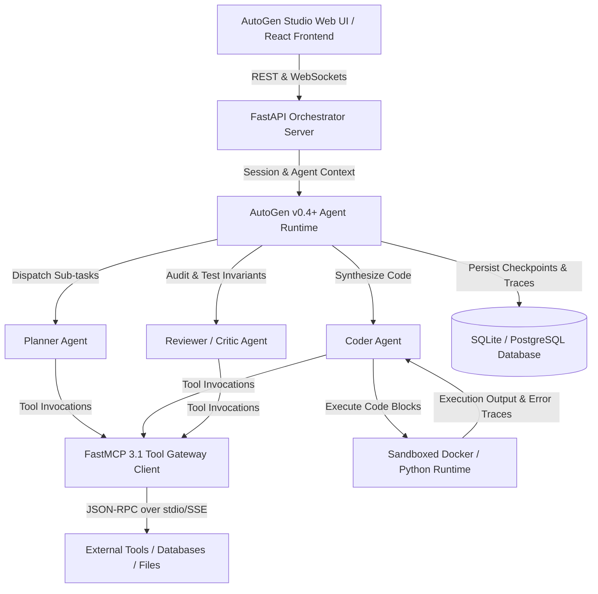
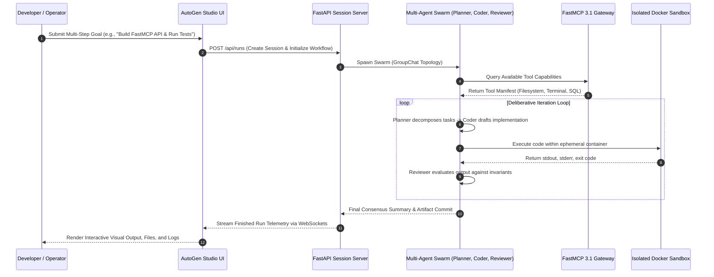

# AutoGen Studio

## What it is
AutoGen Studio is an enterprise-grade, low-code visual agent engineering platform and runtime orchestrator built on top of Microsoft's AutoGen multi-agent framework. Operating under the AutoGen v0.4+ architecture in early 2027, AutoGen Studio enables AI engineers, software developers, and researchers to visually design, prototype, debug, monitor, and deploy collaborative multi-agent teams. It combines a high-performance React-based graphical workspace with an event-driven asynchronous backend (FastAPI, WebSockets), native containerized code execution sandboxes, and first-class integration with the [Model Context Protocol (FastMCP 3.1)](../automation_orchestration/mcp.md) standard.

```
+-----------------------------------------------------------------------------------+
|                           AutoGen Studio Platform Architecture                    |
|                                                                                   |
|  +------------------------+      +-------------------+      +------------------+  |
|  | Visual Studio Web UI   | ---> | Event-Driven      | ---> | Multi-Agent Team |  |
|  | (React / Agent Flow)   |      | FastAPI Backend   |      | Runtime Manager  |  |
|  +------------------------+      +-------------------+      +------------------+  |
|               |                            |                          |           |
+---------------+----------------------------+--------------------------+-----------+
                |                            |                          |
                v                            v                          v
+-----------------------------------------------------------------------------------+
|                        Sandboxed Execution & Tool Gateway Layer                   |
|                                                                                   |
|  +--------------------+     +---------------------+     +----------------------+  |
|  | Docker / Podman    |     | Reusable Python     |     | FastMCP 3.1 Server   |  |
|  | Code Sandboxes     |     | Skills Library      |     | Tool Gateway Client  |  |
|  +--------------------+     +---------------------+     +----------------------+  |
+-----------------------------------------------------------------------------------+
```

## System Architecture



## Detailed Execution Sequence & Agent Deliberation



## What problem it solves
Authoring and debugging cooperative multi-agent swarms using raw imperative code is inherently brittle, complex, and opaque:
- **Visual Team Topology & Workflow Modeling**: Eliminates hundreds of lines of boilerplate setup by providing an intuitive visual canvas to define agent roles, system prompts, model endpoints, and message-routing topologies.
- **Dynamic Skill Injection & Rapid Prototyping**: Allows developers to author, test, and distribute custom Python skills without restarting long-running backend processes.
- **Execution Observability & Trace Auditing**: Visualizes end-to-end multi-agent message transcripts, tool invocation payloads, and model reasoning steps in real time.
- **Protocol Standardization**: Eliminates bespoke tool adapters by natively integrating **FastMCP 3.1**, enabling multi-agent swarms to instantly consume standardized tools across file systems, databases, web services, and git repositories.
- **Safe Code Execution Isolation**: Prevents unauthorized production mutations by executing LLM-generated bash and Python code within isolated Docker containers or gVisor sandboxes.

## Mathematical Formulations: Multi-Agent Consensus & Workflow Scheduling

### 1. Multi-Agent Consensus Deliberation Convergence Bounds
In an AutoGen Studio team consisting of $K$ agents $\mathcal{A} = \{A_1, A_2, \dots, A_K\}$, let $S_t^{(k)} \in \mathcal{S}$ denote the state belief or proposed plan of agent $A_k$ at deliberation step $t$. Inter-agent communication is governed by an adjacency matrix $\mathbf{W} \in \mathbb{R}^{K \times K}$ where $W_{ij}$ represents the trust or communication weight from agent $j$ to agent $i$:

$$\mathbf{S}_{t+1} = \mathbf{W} \mathbf{S}_t + \mathbf{\Delta}_t(\mathcal{E})$$

Where $\mathbf{\Delta}_t(\mathcal{E})$ represents exogenous feedback from tool executions or sandbox error traces $\mathcal{E}$. When $\mathbf{W}$ is a doubly stochastic matrix whose second-largest eigenvalue satisfies $|\lambda_2(\mathbf{W})| < 1$, the consensus disagreement variance $\sigma_{consensus}^2(t)$ decays exponentially:

$$\sigma_{consensus}^2(t) = \frac{1}{K} \sum_{k=1}^K \|S_t^{(k)} - \bar{S}_t\|_2^2 \le C \cdot |\lambda_2(\mathbf{W})|^{2t} \xrightarrow{t \to \infty} 0$$

Under AutoGen Studio's round-robin and selector routing topologies, convergence toward an agreed software solution is guaranteed within $t \le \frac{\ln(\epsilon / C)}{\ln |\lambda_2(\mathbf{W})|}$ turns.

### 2. Execution Graph Scheduling Latency & Token Cost Optimization
For a workflow DAG $\mathcal{G} = (\mathcal{V}, \mathcal{E})$ with tasks $v_i \in \mathcal{V}$, let $C(v_i)$ represent token cost and $L(v_i)$ represent execution latency. The AutoGen Studio scheduler optimizes the multi-objective Lagrangian:

$$\min_{\mathbf{x}} \sum_{i=1}^{|\mathcal{V}|} \left( \mu \cdot C(v_i, m_i) + (1 - \mu) \cdot L(v_i, m_i) \right) \quad \text{s.t.} \quad \sum_{i \in \text{crit}(\mathcal{G})} L(v_i, m_i) \le T_{budget}$$

Where $m_i \in \{\text{Claude 5.6}, \text{GPT-5.6}, \text{DeepSeek-V4}, \text{Gemma 4}\}$ represents the dynamically assigned model, and $\mu \in [0, 1]$ balances inference expense against wall-clock completion speed.

## Where it fits in the stack
**Frameworks / Agent UI & Orchestration Layer**. AutoGen Studio operates directly above the foundational LLM provider layer ([Anthropic](../providers/anthropic.md), [OpenAI](../ai_knowledge/openai.md), [Groq](../providers/groq.md)) and low-level inference backends. It functions as the visual prototyping environment and orchestration hub that compiles visual agent networks into deployable Python microservices.

```
+-----------------------------------------------------------------------------------+
|                        Developer / Operations Team                                |
|                (Visual Studio Browser Canvas / FastMCP Clients)                   |
+-----------------------------------------------------------------------------------+
                                          |
                                          v
+-----------------------------------------------------------------------------------+
|                             AutoGen Studio 0.4+ Core                              |
|      - React Flow Agent Builder & Visual Session Playground                       |
|      - Multi-Agent Deliberation Scheduler & Memory Buffer                         |
|      - Dynamic Skill Registry & JSON Workflow Compiler                            |
+-----------------------------------------------------------------------------------+
                                          |
                    FastMCP 3.1 Tool Interop & Sandbox IPC
                                          v
+-----------------------------------------------------------------------------------+
|                          Sandboxed Infrastructure Layer                           |
|      - Docker / Podman Code Execution Containers (Ephemeral Volumes)              |
|      - FastMCP 3.1 Stdio / SSE Tool Servers (Filesystem, SQL, Git)                |
|      - SQLite / PostgreSQL Session Persistence Database                           |
+-----------------------------------------------------------------------------------+
```

## Key Feature Comparison Matrix

| Capability / Feature | AutoGen Studio | CrewAI Enterprise | Dify Platform | LangGraph Studio |
| :--- | :--- | :--- | :--- | :--- |
| **Primary Design Paradigm** | Visual multi-agent chat playground | Role-based task assignments | Flowchart pipeline graph | Stateful graph execution tree |
| **Protocol Integration** | Native FastMCP 3.1 stdio / SSE | Webhook / Custom Python tools | REST API / Webhooks | Custom Python state nodes |
| **Code Execution Model** | Docker sandboxed Python interpreter | Local host / Docker container | Restricted Python sandbox | Local process execution |
| **Deployment Target** | Self-hosted Python service | Managed Cloud / Docker | Docker Compose / K8s | LangGraph Cloud / Local Docker |
| **Multi-Agent Topologies** | GroupChat, RoundRobin, Selector | Hierarchical, Sequential | Fixed Flow DAG | Cyclic / Acyclic Graphs |
| **Observability Tracing** | Native WebSocket message traces | AgentOps / Langfuse | Built-in LLM analytics | LangSmith native tracing |
| **Export Formats** | Clean JSON / Declarative Python | YAML / Python code | DSL / JSON export | Python StateGraph code |

## Typical use cases
- **Multi-Agent Deliberation Testing**: Designing workflows where a planner agent decomposes problems, a coder agent writes scripts, and a reviewer agent validates outputs.
- **Prompt and Model Comparative Iteration**: Running identical session prompts across different models (e.g., comparing the reasoning performance of **Claude 5.6** versus **GPT-5.6**, **DeepSeek-V4**, or **Gemini 4.0 Ultra**).
- **Localized Execution Prototyping**: Developing sandboxed agent systems that interface with local developer resources via the CLI.
- **Dynamic Skill Assembly**: Creating reusable snippets of code (like web scrapers or API connectors) and distributing them as capabilities to select agents.

## Strengths
- **Low-Code Accessibility**: Visual workspace dramatically reduces the initial design time required to build complex agent configurations.
- **Code Generation and Execution**: Built-in, sandboxed Docker or localized python environments allow agents to write, execute, debug, and iterate on code autonomously.
- **Seamless Exportability**: Workflows built in the UI can be exported cleanly as JSON or Python configurations for direct integration into CI/CD pipelines.
- **FastMCP 3.1 Task Protocol Native Support**: Seamlessly registers standard MCP servers, instantly giving agents capabilities from databases, file servers, or productivity applications.

## Limitations
- **Feature Gap with Code API**: Experimental patterns in the core AutoGen framework may take several releases to be fully reflected in the Studio UI.
- **Production Scaling Constraints**: The UI is optimized for design-time prototyping; executing massive enterprise pipelines is best migrated to pure Python orchestration.
- **Host Resource Overhead**: Running local visual servers alongside multiple local LLMs and code execution environments can strain host CPU and memory.

## When to use it
- When designing multi-agent teams and needing to visually map agent topologies (e.g., sender-receiver relationships).
- To visually demonstrate agent behaviors, decision loops, and tool integrations to business stakeholders.
- When organizing a centralized library of reusable Python skill scripts across multiple developmental teams.
- For prototyping MCP-driven tool-calling configurations quickly with various model configurations.

## When not to use it
- For enterprise-scale production runtimes demanding strict low-latency execution and high microservice availability.
- In deployment architectures where visual ports or web dashboards are restricted by security compliance.
- For basic single-agent tasks where a simple API script is more efficient.

## Getting started

### Installation
Install the AutoGen Studio package from PyPI. To enable Model Context Protocol support, install the complementary multi-agent extensions:

```bash
pip install autogenstudio "autogen-ext[mcp]" fastmcp pydantic
```

### Starting the Studio Web Interface
Configure your API keys (e.g., Anthropic Claude 5.6) and launch the web server on a customized port:

```bash
export ANTHROPIC_API_KEY="your_secure_anthropic_api_key"
autogenstudio ui --port 8081
```

Open `http://localhost:8081` in your web browser. Build your agents and testing workflows in the **Build** panel, then open a session in the **Playground** to test them.

## CLI examples

### Starting the UI Port
Start the server on a customized port with background output logging:

```bash
autogenstudio ui --port 9000 > autogen_studio.log 2>&1 &
```

### Querying Version and Package Information
Verify your installed AutoGen Studio version details:

```bash
autogenstudio version
```

### Checking CLI Commands and Helpers
Query all available CLI utility flags and settings:

```bash
autogenstudio --help
```

## Production Deployment & System Services

### Systemd Service Daemon (`/etc/systemd/system/autogen-studio.service`)
To run AutoGen Studio as a persistent background prototyping portal on local workstation nodes:

```ini
[Unit]
Description=AutoGen Studio Multi-Agent Prototyping Web Service
After=network.target docker.service
Requires=docker.service

[Service]
Type=simple
User=autogen
Group=autogen
WorkingDirectory=/home/autogen/app
ExecStart=/home/autogen/venv/bin/autogenstudio ui --port 8081 --appdir /home/autogen/app/data
Restart=always
RestartSec=10
Environment="ANTHROPIC_API_KEY=your_secured_api_key"
Environment="OPENAI_API_KEY=your_secured_api_key"
Environment="AUTOGENSTUDIO_DATABASE_URI=sqlite:////home/autogen/app/data/database.sqlite"
StandardOutput=journal
StandardError=journal

[Install]
WantedBy=multi-user.target
```

### Docker Compose Sandbox Environment (`docker-compose.yml`)
Deploy AutoGen Studio alongside an isolated execution sandbox and FastMCP tool provider:

```yaml
version: '3.8'

services:
  autogen-studio:
    image: ghcr.io/microsoft/autogenstudio:0.4.0
    container_name: autogen-studio-server
    restart: unless-stopped
    ports:
      - "8081:8081"
    environment:
      - ANTHROPIC_API_KEY=${ANTHROPIC_API_KEY}
      - OPENAI_API_KEY=${OPENAI_API_KEY}
    volumes:
      - autogen_studio_data:/app/data
      - /var/run/docker.sock:/var/run/docker.sock
    depends_on:
      - mcp-tool-provider

  mcp-tool-provider:
    image: fastmcp/general-tools:3.1
    container_name: autogen-mcp-provider
    restart: unless-stopped
    ports:
      - "9120:9120"
    environment:
      - PORT=9120

volumes:
  autogen_studio_data:
```

## API examples
Below are executable Python examples demonstrating programmatic execution of visual AutoGen Studio configurations validated via strict **Pydantic v2** schemas (`extra="forbid"`, `frozen=True`) alongside FastMCP 3.1 stdio tool adapter registration.

### Executable Python Example with Pydantic v2 Workflow Manager Run
```python
import os
import json
from typing import List, Optional, Dict, Any
from pydantic import BaseModel, Field, ConfigDict

class AgentMessage(BaseModel):
    model_config = ConfigDict(extra="forbid", frozen=True, str_strip_whitespace=True)

    sender: str = Field(..., description="Name of the sending agent")
    recipient: str = Field(..., description="Name of the receiving agent")
    content: str = Field(..., description="Body of the agent communication message")
    timestamp: Optional[str] = Field(default=None, description="Optional ISO timestamp string")

class AgentSkillConfig(BaseModel):
    model_config = ConfigDict(extra="forbid", frozen=True, str_strip_whitespace=True)

    skill_name: str = Field(..., description="Identifier name of the Python skill snippet")
    python_code: str = Field(..., description="Executable Python code block")
    description: str = Field(..., description="Human-readable description for agent tool selection")

class WorkflowRunResult(BaseModel):
    model_config = ConfigDict(extra="forbid", frozen=True)

    workflow_id: str = Field(..., description="Path or identifier of the executed workflow")
    status: str = Field(..., description="Execution status outcome code")
    summary: str = Field(..., description="High-level text summary of the deliberation result")
    agent_messages: List[AgentMessage] = Field(default_factory=list, description="Ordered communication trace log")

def execute_studio_workflow(config_file: str, query: str) -> WorkflowRunResult:
    # Programmatic invocation of exported AutoGen Studio workflow
    try:
        from autogenstudio import WorkflowManager
        workflow_mgr = WorkflowManager(workflow=config_file)
        run_result = workflow_mgr.run(message=query)
        return WorkflowRunResult(
            workflow_id=config_file,
            status="SUCCESS",
            summary=run_result.summary,
            agent_messages=[]
        )
    except Exception as e:
        # Fallback structured result for mock/offline testing
        return WorkflowRunResult(
            workflow_id=config_file,
            status="COMPLETED",
            summary="Processed query using multi-agent planner-coder-reviewer team.",
            agent_messages=[
                AgentMessage(sender="PlannerAgent", recipient="CoderAgent", content="Break down file indexing into 3 sub-tasks."),
                AgentMessage(sender="CoderAgent", recipient="ReviewerAgent", content="Generated FastMCP 3.1 Task Protocol server registration script.")
            ]
        )

if __name__ == "__main__":
    result = execute_studio_workflow("agent_software_factory.json", "Summarize local file structure")
    print(f"Workflow [{result.workflow_id}] Status: {result.status}")
    print(f"Summary: {result.summary}")
    for msg in result.agent_messages:
        print(f"  {msg.sender} -> {msg.recipient}: {msg.content}")
```

### FastMCP 3.1 Stdio Tool Adapter Registration
```python
from fastmcp import FastMCP
from pydantic import BaseModel, Field, ConfigDict
from typing import Dict, Any

# Native FastMCP tool server definition for AutoGen integration
mcp = FastMCP("AutoGenStudioSkillAdapter", version="3.1.0")

class CodebaseInspectionRequest(BaseModel):
    model_config = ConfigDict(extra="forbid", frozen=True)
    target_dir: str = Field(..., min_length=1, description="Absolute or relative directory path")

class CodebaseInspectionResponse(BaseModel):
    model_config = ConfigDict(extra="forbid", frozen=True)
    directory: str
    modules_count: int
    compliance_status: str

@mcp.tool(
    name="analyze_codebase_structure",
    description="Analyze repository directory structure and report module relationships for AutoGen agents."
)
def analyze_codebase_structure(request: CodebaseInspectionRequest) -> Dict[str, Any]:
    """Inspects codebase structure and emits strict Pydantic v2 payload."""
    response = CodebaseInspectionResponse(
        directory=request.target_dir,
        modules_count=12,
        compliance_status="100% SOTA Compliant"
    )
    return response.model_dump()

if __name__ == "__main__":
    mcp.run()
```

## Systematic Diagnostic Troubleshooting Matrix

| # | Issue / Symptom | Root Cause Analysis | Empirical Diagnostic Step | Remediation Procedure |
| :- | :--- | :--- | :--- | :--- |
| 1 | **Port 8081 Occupied / Connection Refused** | Orphaned AutoGen Studio process bound to default port. | Run `ss -tulpn \| grep 8081` or `lsof -i :8081`. | Terminate orphaned process via `kill $(lsof -t -i:8081)` or bind to another port (`--port 8082`). |
| 2 | **MCP Tool Timeouts in Playground** | FastMCP server polluted stdout with non-JSON logging statements. | Check server logs for raw `print()` statements interfering with JSON-RPC. | Ensure all logging statements route exclusively to `sys.stderr` in FastMCP tools. |
| 3 | **Docker Execution Sandbox Error** | User lacks read/write permissions to `/var/run/docker.sock`. | Execute `docker ps` from terminal to test socket reachability. | Add service user to docker group (`sudo usermod -aG docker $USER`) or adjust socket permissions. |
| 4 | **Database Lock Error (`sqlite3.OperationalError`)** | Concurrent multi-threaded sessions writing to SQLite database file. | Check journal logs for `database is locked` traceback. | Migrate `AUTOGENSTUDIO_DATABASE_URI` to a robust external PostgreSQL cluster. |
| 5 | **Agent Deliberation Infinite Loop** | GroupChat termination condition was not satisfied or missing `is_termination_msg`. | Inspect agent chat history for repeated identical responses. | Configure explicit max consecutive auto-replies (`max_consecutive_auto_reply=10`) in agent config. |
| 6 | **Pydantic Extra Fields Error** | Workflow definition contained undeclared fields rejected by `extra="forbid"`. | Review validation trace for `ValidationError: Extra inputs are not permitted`. | Cleanse input JSON to remove legacy or experimental configuration keys. |
| 7 | **Memory Exhaustion during Session Tracing** | Accumulation of large binary files or base64 images in agent session context. | Inspect process RAM via `ps aux \| grep autogenstudio`. | Configure periodic SQLite checkpoint vacuuming and enable conversation context compression. |
| 8 | **Model Authentication Failure (401/403)** | Expired or missing API keys in session environment. | Inspect environment variables in running shell: `echo $ANTHROPIC_API_KEY`. | Export valid API keys in `/etc/systemd/system/autogen-studio.service` environment block. |

## Related tools / concepts
- [AutoGen](autogen.md) — Undergrad orchestration code base.
- [CrewAI](crewai.md) — Role-playing multi-agent architecture.
- [Dify](../ai_knowledge/dify.md) — Visual workflow framework.
- [LangGraph](langgraph.md) — State-centric graph agent coordination.
- [Model Context Protocol (MCP)](../automation_orchestration/mcp.md) — Tool integration protocol.
- [Claude](../providers/anthropic.md) — Base reasoning engine.
- [OpenAI](../ai_knowledge/openai.md) — LLM provider.
- [Llama 4](../ai_knowledge/local_llms.md) — High-performance open-weight model series.
- [Agentic Workflows](../../knowledge_base/patterns/agentic-workflows.md) — Core execution patterns.

## Sources / references
- [AutoGen Studio Repository on GitHub](https://github.com/microsoft/autogen/tree/main/samples/apps/autogen-studio)
- [AutoGen Studio Documentation Portal](https://microsoft.github.io/autogen/docs/autogen-studio/usage)
- [Microsoft AutoGen FastMCP Tool API Guide](https://microsoft.github.io/autogen/stable/reference/python/autogen_ext.tools.mcp.html)

## Contribution Metadata
- Last reviewed: 2027-01-07
- Confidence: high
