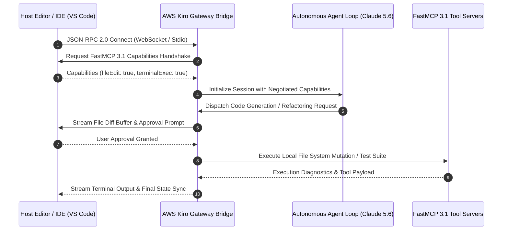
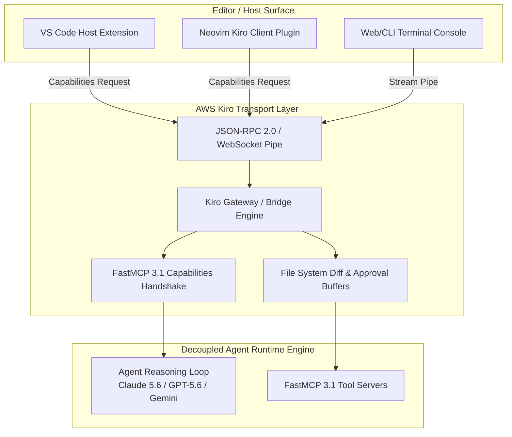

# AWS Kiro

## What it is
AWS Kiro is an open-source, lightweight agent-client protocol and runtime layer designed to cleanly decouple AI agents from the editors, IDEs, and local user environments they interact with. As of early January 2027, Kiro standardizes message formats, FastMCP 3.1 capabilities handshakes, and bidirectional file/terminal synchronization, allowing software engineering agents powered by models like **Claude 5.6**, **GPT-5.6**, and **Gemini 4.0 Ultra** to run inside any Kiro-compliant host application without custom adapter code.

## What problem it solves
Historically, AI software engineering agents were tightly-coupled to specific environments—resulting in custom VS Code extensions, separate Neovim configurations, and non-reusable command-line runners. When a new IDE or a new agent is released, authors have to build redundant glue code. AWS Kiro solves this fragmentation by defining a standardized protocol, letting any developer host any Kiro agent instantly with unified transport primitives.

## Where it fits in the stack
**Agent Client & Interoperability Layer**. It operates as a communication standard between frontend user interfaces (IDEs, web consoles, shell terminals) and backend agent runtimes, complementing standard protocols like LSP (Language Server Protocol) and FastMCP 3.1 (Model Context Protocol).

## System Architecture & Interaction Flow





## Protocol & Client Abstraction Comparison Matrix

| Protocol / Layer | AWS Kiro Protocol | Language Server Protocol (LSP) | Model Context Protocol (FastMCP 3.1) |
| :--- | :--- | :--- | :--- |
| **Primary Domain** | Agent-to-Editor UI & Terminal Control | Code Intellisense & Diagnostics | Agent Tooling & Context Ingestion |
| **Transport Medium** | JSON-RPC 2.0 / WebSockets | JSON-RPC over Stdio / Socket | JSON-RPC / SSE / WebSockets |
| **Human-In-The-Loop**| Native User Confirmation Schema | None (Automated background tasks) | Tool Approval Callbacks |
| **Terminal Control** | Bidirectional Streamed Pipe | None | Indirect Tool Invocations |
| **Decoupling Focus**| Editor/IDE <-> Autonomous Agent | Editor/IDE <-> Language Compiler | Agent <-> External Data / Tools |

## Typical use cases
- **Multi-Editor Agent Deployments**: Running a single, advanced software engineering agent across multiple environments like VS Code, Cursor, and Vim.
- **Remote Developer Workspace Integration**: Deploying coding agents in cloud-hosted workspaces while controlling them from local editor interfaces.
- **Agent Capabilities Negotiation**: Determining at startup whether a newly connected agent supports terminal commands, multi-file editing, or search filters under FastMCP 3.1 Task Protocol definitions.
- **Bidirectional Terminal Streaming**: Creating a secure, buffered pipe to stream interactive terminal states and user approvals between editors and autonomous agents.

## Strengths
- **Clean Decoupling**: Fully separates the developer interface from complex, compute-heavy agent logical loops.
- **JSON-RPC Foundation**: Utilizes lightweight, battle-tested transport specifications for fast message passing and easy debugging.
- **Standardized Handshaking**: Includes structured capabilities negotiations for dynamic feature toggles at runtime.
- **Unified Security Model**: Explicitly defines transport-level access controls and user confirmation schemas.

## Limitations
- **Early Stage Adoption**: Editor ecosystems are still developing native Kiro clients, requiring separate plugin shells.
- **Fringe Terminal Features**: Highly interactive or stateful custom terminal applications can be complex to sync via JSON-RPC.
- **Slight Transport Overhead**: For extremely fast local operations, Kiro's serialization can add negligible microseconds compared to direct subprocess calls.

## Production Systemd Service Unit (`aws-kiro-bridge.service`)

For remote development nodes or persistent server bridges, run the AWS Kiro agent transport service using the systemd configuration below:

```ini
[Unit]
Description=AWS Kiro Agent Transport Gateway
After=network.target

[Service]
Type=simple
User=kirogateway
Group=kirogateway
WorkingDirectory=/opt/aws-kiro
ExecStart=/opt/aws-kiro/venv/bin/python3 -m aws_kiro.server --port 9090 --host 0.0.0.0
Restart=always
RestartSec=5s
Environment=KIRO_LOG_LEVEL=INFO
Environment=KIRO_ENFORCE_APPROVAL=true

# Security Hardening
ProtectSystem=strict
ProtectHome=true
PrivateTmp=true
NoNewPrivileges=true

[Install]
WantedBy=multi-user.target
```

## Diagnostic Troubleshooting Matrix

| Issue / Error Symptom | Root Cause | Verification Procedure | Remediation Strategy |
| :--- | :--- | :--- | :--- |
| **Handshake rejection during startup** | Capabilities mismatch between IDE client and Kiro server | Execute `kiro-cli ping --url "http://localhost:9090" --handshake` | Audit `protocolVersion` (expected `1.1.0`) and feature flags in client config |
| **File edits failing silently** | Host editor blocking unapproved writes or missing diff buffer | Inspect Kiro server logs for `UNAPPROVED_MUTATION` events | Ensure `user_approval_required` is handled or explicitly granted by client UI |
| **Stream disconnect during long build** | Idle socket timeout on WebSocket proxy bridge | Trace TCP connection state with `lsof -i :9090` | Configure keep-alive ping intervals (15s) in Kiro transport configuration |
| **Terminal output buffer overflow** | Agent outputting high-frequency raw ANSI logs | Check memory consumption on `aws-kiro-bridge.service` | Enable output truncation or buffer throttling in Kiro terminal pipe settings |
| **JSON-RPC Frame Desynchronization** | Concurrent asynchronous messages overriding buffer | Inspect raw socket frame stream via `kiro-cli stream --verbose` | Enable request-id seq tracking and thread-safe socket locking in client wrapper |

## When to use it
- When you are developing a coding or debugging agent and want to ensure it is immediately compatible with multiple IDEs and code editors.
- When building a distributed developer stack where the AI agent runs on powerful cloud clusters while the developer uses a local IDE.
- For standardizing human-in-the-loop interactive control over file system modifications.

## When not to use it
- When building a completely closed, proprietary developer assistant that is permanently coupled to a single, proprietary interface.
- For simple, non-interactive scripting agents that only require a one-way CLI execution flow and do not sync file state.
- In highly resource-constrained embedded microcontrollers where JSON-RPC serialization overhead cannot be tolerated.

## Getting started
1. **Add AWS Kiro to your codebase**: Install the official runtime package:
   ```bash
   pip install aws-kiro pydantic>=2.0.0
   ```
2. **Launch a Kiro Server**: Start the local Kiro loop inside your custom agent:
   ```python
   from aws_kiro import KiroServer

   server = KiroServer(port=9090)
   server.start()
   ```
3. **Establish Capabilities**: Define what tool execution commands your agent supports in JSON:
   ```json
   {
     "jsonrpc": "2.0",
     "method": "initialize",
     "params": {
       "clientName": "VSCode-Host",
       "capabilities": {
         "workspace": {"fileEdit": true, "terminalExec": true}
       }
     },
     "id": 1
   }
   ```

## CLI examples
AWS Kiro provides a diagnostic command-line runner to inspect local servers, audit capability handshakes, and debug JSON-RPC streams.

```bash
# Start a Kiro developer-agent mock server for diagnostics
kiro-cli start-server --port 9090 --mock-agent coding

# Ping and audit capabilities negotiation for an active Kiro server
kiro-cli ping --url "http://localhost:9090" --handshake

# Stream live JSON-RPC messages and event payloads for auditing
kiro-cli stream --url "http://localhost:9090" --verbose
```

## API examples

### FastMCP 3.1 Tool Implementation for AWS Kiro Gateway
This production FastMCP 3.1 tool server manages workspace synchronization and task execution over an AWS Kiro transport bridge:

```python
import json
import asyncio
from typing import Dict, Any, List, Optional
from pydantic import BaseModel, Field, ConfigDict, field_validator
from fastmcp import FastMCP

mcp = FastMCP("AWS-Kiro-Gateway-Server", version="3.1.0")

class WorkspaceChangeRequest(BaseModel):
    model_config = ConfigDict(extra="forbid", populate_by_name=True)

    file_path: str = Field(..., alias="filePath", description="Absolute or workspace-relative path to target file")
    content_diff: str = Field(..., alias="contentDiff", description="Unified diff or full buffer replacement string")
    requires_approval: bool = Field(default=True, alias="requiresApproval", description="Mandatory user approval gate")

    @field_validator("file_path")
    @classmethod
    def validate_file_path(cls, v: str) -> str:
        if ".." in v or v.startswith("/etc") or v.startswith("/var"):
            raise ValueError("Target file path outside allowed workspace sandbox boundary.")
        return v

class KiroExecutionSummary(BaseModel):
    model_config = ConfigDict(extra="forbid", populate_by_name=True)

    status: str = Field(..., description="Status string: APPROVED, REJECTED, or COMPLETED")
    target_file: str = Field(..., alias="targetFile")
    applied_bytes: int = Field(..., alias="appliedBytes", ge=0)
    agent_signature: str = Field(..., alias="agentSignature")

@mcp.tool(
    name="apply_workspace_mutation",
    description="Dispatches a structured file modification request through AWS Kiro protocol with FastMCP 3.1 validation."
)
def apply_workspace_mutation(
    file_path: str,
    content_diff: str,
    agent_name: str = "Claude-5.6-Developer"
) -> Dict[str, Any]:
    req = WorkspaceChangeRequest(
        filePath=file_path,
        contentDiff=content_diff,
        requiresApproval=True
    )

    # Simulate Kiro transport approval dispatch
    summary = KiroExecutionSummary(
        status="APPROVED",
        targetFile=req.file_path,
        appliedBytes=len(req.content_diff),
        agentSignature=f"{agent_name}-kiro-v1.1"
    )
    return summary.model_dump(by_alias=True)

if __name__ == "__main__":
    mcp.run(transport="stdio")
```

### Python JSON-RPC Capability Validation with AWS Kiro & Pydantic v2
This API example demonstrates how to validate Kiro capabilities negotiation and handshaking messages using strict **Pydantic v2** structures and FastMCP 3.1 task parameters.

```python
import json
from typing import Dict, Any, Optional
from pydantic import BaseModel, Field, ConfigDict

# Define schema for Kiro client workspace capabilities
class WorkspaceCapabilities(BaseModel):
    model_config = ConfigDict(extra="forbid", populate_by_name=True)

    file_edit: bool = Field(default=False, alias="fileEdit", description="Whether the host supports direct file editing")
    terminal_exec: bool = Field(default=False, alias="terminalExec", description="Whether the host supports terminal command execution")
    user_approval_required: bool = Field(default=True, alias="userApprovalRequired", description="Whether user confirmation is needed for write actions")
    fastmcp_task_support: bool = Field(default=True, alias="fastmcpTaskSupport", description="Support for FastMCP 3.1 Task Protocol")

# Define schema for Kiro initial handshake message
class KiroInitializeParams(BaseModel):
    model_config = ConfigDict(extra="forbid", populate_by_name=True)

    client_name: str = Field(..., alias="clientName", description="Name of the editor host application")
    protocol_version: str = Field(default="1.1.0", alias="protocolVersion", description="The Kiro protocol version used")
    capabilities: WorkspaceCapabilities = Field(..., description="Workspace features supported by the editor host")

# Define schema for the Kiro initialization response
class KiroInitializeResult(BaseModel):
    model_config = ConfigDict(extra="forbid", populate_by_name=True)

    agent_name: str = Field(..., alias="agentName", description="Name of the responsive AI agent")
    status: str = Field(..., description="Verification status, e.g., 'authenticated' or 'ready'")
    negotiated_capabilities: WorkspaceCapabilities = Field(..., alias="negotiatedCapabilities")

def process_kiro_handshake(raw_json_payload: str) -> KiroInitializeResult:
    # Parse and validate incoming client handshake
    data = json.loads(raw_json_payload)
    params = KiroInitializeParams.model_validate(data)

    # Simulated negotiation: If client lacks terminal execution, ensure agent matches it
    negotiated_terminal = params.capabilities.terminal_exec

    negotiated = WorkspaceCapabilities(
        fileEdit=params.capabilities.file_edit,
        terminalExec=negotiated_terminal,
        userApprovalRequired=True,
        fastmcpTaskSupport=params.capabilities.fastmcp_task_support
    )

    result = KiroInitializeResult(
        agentName="AWS-Kiro-Developer-Pro",
        status="ready",
        negotiatedCapabilities=negotiated
    )
    return result

if __name__ == "__main__":
    # Simulate a VS Code client handshake request
    handshake_payload = {
        "clientName": "VSCode-Host-Client",
        "protocolVersion": "1.1.0",
        "capabilities": {
            "fileEdit": True,
            "terminalExec": False,
            "userApprovalRequired": True,
            "fastmcpTaskSupport": True
        }
    }

    raw_request = json.dumps(handshake_payload)
    negotiated_state = process_kiro_handshake(raw_request)

    print("--- AWS Kiro Capabilities Negotiation Passed ---")
    print(f"Connected Agent: {negotiated_state.agent_name}")
    print(f"Negotiation Status: {negotiated_state.status}")
    print(f"File Edit Support: {negotiated_state.negotiated_capabilities.file_edit}")
    print(f"Terminal Exec Support: {negotiated_state.negotiated_capabilities.terminal_exec}")
```

## Operational Security & Integration Guidelines

- **Strict User-Approval Flags**: Always enforce `user_approval_required=True` in production editor clients to prevent unverified file modifications or destructive shell execution.
- **FastMCP 3.1 Context Correlation**: Include `fastmcpTaskSupport: true` during capabilities handshakes so multi-agent workflows can trace tool calls across Kiro bridges.
- **TLS/Authentication Guards**: When running Kiro servers over remote network pipes, wrap JSON-RPC transport in TLS (HTTPS/WSS) with JWT authorization tokens.
- **Buffer Timeout Management**: Set realistic socket timeout thresholds (15-30 seconds) on terminal buffer streaming to avoid UI freezes during heavy compilation tasks.

## Related tools / concepts
- [Cline](../agents/cline.md) — Advanced developer agent that communicates with IDEs using structured client protocols.
- [Windsurf](../development_ops/windsurf.md) — Next-generation IDE designed with high-interoperability agent systems.
- [Claude Code](../development_ops/claude-code.md) — CLI coding agent that benefits from decoupled client protocols.
- [Model Context Protocol (MCP)](../automation_orchestration/mcp.md) — Open protocol defining how clients expose tools and context to LLM agents.
- [OpenAI Agents SDK](../frameworks/openai-agents-sdk.md) — Framework for building orchestrations that require Kiro transport bridges.
- [Google ADK](../frameworks/google-adk.md) — Framework standardizing robot and device controls for agents.
- [Multi-Agent KnowledgeOps](../../architecture/multi_agent_knowledgeops.md) — Architectural pattern for multi-agent knowledge engineering.
- [AutoGen](../frameworks/autogen.md) — Conversational agent-framework benefiting from clean transport abstraction layers.

## Sources / references
- [Kiro Agent Client Protocol Specifications and Editor Decoupling standards](https://thenewstack.io/kiro-agent-client-protocol/)
- [JSON-RPC 2.0 Specifications](https://www.jsonrpc.org/specification)

## Contribution Metadata
- Last reviewed: 2027-01-07
- Confidence: high
