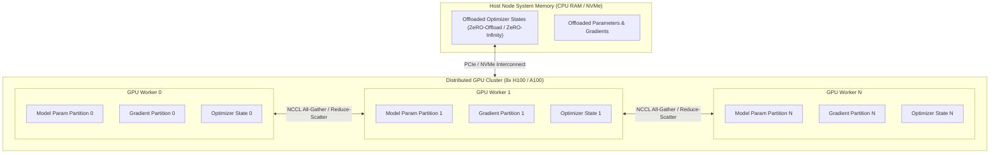

# DeepSpeed

## What it is
DeepSpeed is an open-source deep learning optimization library developed by Microsoft. It delivers extreme-scale distributed training and inference speedups for deep learning models, enabling training of models with hundreds of billions of parameters on limited GPU memory hardware.

In modern AI engineering pipelines, DeepSpeed provides memory-saving ZeRO (Zero Redundancy Optimizer) memory partitioning techniques, 3D parallelism (Tensor, Pipeline, and Sequence Parallelism), low-precision FP16/BF16/FP8 training, and optimized inference engines for LLM fine-tuning toolkits like Axolotl, Llama-Factory, and Hugging Face Trainer.



## What problem it solves
Training modern Large Language Models (LLMs) like Llama 4, DeepSeek-V4, and Qwen 3.6 requires massive memory footprints for model parameters, optimizer states (e.g., AdamW FP32 states require 12 bytes per parameter), and activations. Standard data parallelism replicates the entire model state across every GPU, causing out-of-memory (OOM) failures on multi-billion parameter architectures.

DeepSpeed addresses memory bottlenecks through innovative memory partitioning and compute optimizations:
- **Optimizer State Memory Overhead**: ZeRO-Stage 1 shards optimizer states across data-parallel processes, reducing memory footprint by 4x.
- **Gradient Overhead**: ZeRO-Stage 2 shards both optimizer states and gradients, yielding up to an 8x memory reduction.
- **Parameter Overhead**: ZeRO-Stage 3 shards optimizer states, gradients, and model parameters across all GPUs, enabling linear memory scaling across worker nodes.
- **Hardware RAM Limits**: ZeRO-Offload and ZeRO-Infinity offload parameters and optimizer states to host CPU RAM or NVMe storage, allowing fine-tuning 70B+ models on commodity workstations.

## Where it fits in the stack
**Agent & LLM Frameworks / Distributed Training & Optimization**. DeepSpeed acts as the underlying execution and memory optimization engine for LLM fine-tuning, RLHF alignment training, and high-throughput inference servers across cloud and on-premise infrastructure.

```
+-----------------------------------------------------------------------+
|                    Fine-Tuning & Training Workflows                   |
|           (Axolotl / Llama-Factory / Hugging Face Trainer)            |
+-----------------------------------------------------------------------+
                                   |
                                   v
+-----------------------------------------------------------------------+
|                           DeepSpeed Engine                            |
|             - ZeRO-1 / ZeRO-2 / ZeRO-3 Memory Sharding               |
|             - CPU / NVMe Offload & Communication Scheduler            |
|             - FP16 / BF16 / FP8 Precision Manager                     |
+-----------------------------------------------------------------------+
                                   |
                         NCCL / PyTorch Distributed
                                   v
+-----------------------------------------------------------------------+
|                       Hardware Accelerator Layer                      |
|            (NVIDIA H100 / A100 / RTX 4090 / AMD MI300X)              |
+-----------------------------------------------------------------------+
```

## Typical use cases
- **Large Language Model Fine-Tuning**: Accelerating instruction tuning and domain adaptation of Llama 4, Qwen 3.6, and DeepSeek-V4 models using Axolotl or Hugging Face Transformers.
- **ZeRO-Offload Workstation Training**: Training multi-billion parameter LLMs on single or dual-GPU workstations with system CPU RAM offloading.
- **RLHF & Direct Preference Optimization (DPO)**: Distributing memory load for multi-model actor-critic RLHF training pipelines (e.g., DeepSpeed-Chat).
- **Extreme Scale Trillion-Parameter Pre-training**: Utilizing ZeRO-3 with 3D Parallelism across hundreds of GPU nodes.

## ZeRO Memory Partitioning & Throughput Benchmarks

| ZeRO Optimization Stage | Sharded Tensors | Memory Savings Factor | Communication Volume vs DDP | Recommended Model Size | Minimum Network Fabric |
| :--- | :--- | :--- | :--- | :--- | :--- |
| **ZeRO-Stage 0 (Baseline DDP)** | None (full replication) | 1.0x (Baseline) | Baseline (All-Reduce) | < 3B Parameters | PCIe Gen3 / 10 GbE |
| **ZeRO-Stage 1 (ZeRO-1)** | AdamW Optimizer States | 4.0x Optimizer | Identical to DDP | 3B - 13B Parameters | PCIe Gen4 / 25 GbE |
| **ZeRO-Stage 2 (ZeRO-2)** | Optimizer States + Gradients | 8.0x Opt & Grads | Identical to DDP | 13B - 34B Parameters | PCIe Gen4 / 50 GbE |
| **ZeRO-Stage 3 (ZeRO-3)** | Opt + Gradients + Model Weights| Linear with N GPUs | 1.5x DDP Volume | 34B - 120B Parameters | 100-400 GbE / InfiniBand HDR |
| **ZeRO-Infinity (Offload)** | Host CPU RAM + NVMe Storage | Arbitrary Scale | Bound by PCIe/NVMe Bandwidth | 70B - 500B+ Parameters | NVMe Gen4 / PCIe Gen5 x16 |

## Strengths
- **ZeRO Memory Efficiency**: Eliminates memory redundancies by sharding model weights, gradients, and optimizer states across distributed nodes.
- **NVMe & CPU Offloading**: ZeRO-Infinity offloads memory to system RAM or NVMe SSDs to train massive models without hardware upgrades.
- **Seamless Framework Integration**: Out-of-the-box integration into Hugging Face `Trainer`, Axolotl, and Llama-Factory via standard JSON configuration files.
- **Advanced Parallelism**: Supports hybrid combinations of ZeRO-powered data parallelism, Megatron-LM tensor parallelism, and pipeline parallelism.

## Limitations
- **Inter-Node Bandwidth Dependencies**: ZeRO-3 introduces frequent all-gather communications during forward and backward passes, requiring high-bandwidth interconnects (e.g., InfiniBand or NVLink) to prevent GPU starvation.
- **NVMe Offload Latency**: High PCI-e/NVMe latency can slow down training throughput if host CPU memory bandwidth is constrained.
- **Debugging Complexity**: Distributed trace errors across multi-node ZeRO workers can be difficult to diagnose compared to single-GPU training.

## When to use it
- When fine-tuning 7B to 70B+ LLMs on multi-GPU clusters or single multi-GPU nodes (e.g., 8x H100/A100 or 4x RTX 4090).
- When optimizer memory consumption exceeds available VRAM during standard PyTorch data-parallel training.
- When running distributed RLHF or DPO training workflows requiring multiple simultaneous model instances in memory.

## When not to use it
- For small neural networks or single-GPU fine-tuning tasks (e.g., PEFT/LoRA on small models) where standard PyTorch or Unsloth offers faster execution with lower setup complexity.
- When target deployment requires lightweight inference-only runtimes (use [vLLM](../infrastructure/vllm.md), TensorRT-LLM, or [SGLang](../infrastructure/sglang.md) instead).

## Getting started

### Installation
Install DeepSpeed via pip with CUDA extensions enabled:

```bash
pip install deepspeed pydantic>=2.0 torch
```

### DeepSpeed Configuration File (`ds_config_zero3.json`)
A typical production ZeRO-3 configuration file with CPU offloading for 70B parameter model fine-tuning:

```json
{
  "train_batch_size": "auto",
  "train_micro_batch_size_per_gpu": "auto",
  "gradient_accumulation_steps": "auto",
  "bf16": {
    "enabled": true
  },
  "zero_optimization": {
    "stage": 3,
    "offload_optimizer": {
      "device": "cpu",
      "pin_memory": true
    },
    "offload_param": {
      "device": "cpu",
      "pin_memory": true
    },
    "overlap_comm": true,
    "contiguous_gradients": true,
    "sub_group_size": 1e9,
    "reduce_bucket_size": "auto",
    "stage3_prefetch_bucket_size": "auto",
    "stage3_param_persistence_threshold": "auto"
  },
  "gradient_clipping": 1.0
}
```

## CLI examples

### 1. Multi-GPU DeepSpeed Execution Launcher
Launch a training script across 4 local GPUs using DeepSpeed ZeRO-2:

```bash
deepspeed --num_gpus=4 train_llm.py \
          --deepspeed ds_config_zero2.json \
          --model_name_or_path meta-llama/Llama-4-70b \
          --output_dir ./checkpoints
```

### 2. Multi-Node Distributed Training with Hostfile
Execute distributed ZeRO-3 training across multiple physical nodes:

```bash
deepspeed --hostfile=/etc/deepspeed/hosts \
          --num_nodes=2 \
          --num_gpus=8 \
          train_llm.py \
          --deepspeed ds_config_zero3.json
```

### 3. Environment Environment Inspection & CUDA Diagnostics
Verify DeepSpeed system setup, CUDA driver extensions, and op build status:

```bash
deepspeed --env_report
```

## API examples

### Production FastMCP 3.1 Distributed Training Supervisor

The following production script implements a **FastMCP 3.1** server that enables autonomous MLOps agents to validate ZeRO configurations, launch distributed training jobs, and monitor GPU cluster memory health with strict Pydantic v2 schemas (`extra="forbid"`, `frozen=True`).

```python
"""FastMCP 3.1 DeepSpeed Distributed Training Supervisor Server.

Provides declarative tools for validating ZeRO optimization profiles, auditing GPU VRAM,
and managing distributed training jobs with strict Pydantic v2 schemas.
"""

from __future__ import annotations

import json
import logging
import os
import subprocess
from typing import Any, Dict, List, Optional

from fastmcp import FastMCP
from pydantic import BaseModel, Field, field_validator

logging.basicConfig(level=logging.INFO)
logger = logging.getLogger("deepspeed-fastmcp-supervisor")

mcp = FastMCP("deepspeed-training-supervisor", version="3.1.0")


class ZeROStageConfig(BaseModel):
    """Configuration schema for ZeRO memory optimization stage."""
    stage: int = Field(..., ge=0, le=3, description="ZeRO optimization stage: 0, 1, 2, or 3")
    cpu_offload_optimizer: bool = Field(default=False, description="Offload AdamW states to CPU RAM")
    cpu_offload_params: bool = Field(default=False, description="Offload model parameters to CPU RAM")
    overlap_comm: bool = Field(default=True, description="Overlap gradient communication with computation")
    pin_memory: bool = Field(default=True, description="Pin host CPU memory for DMA acceleration")

    model_config = {
        "extra": "forbid",
        "frozen": True,
    }


class TrainingJobLaunchRequest(BaseModel):
    """Input payload to dispatch a DeepSpeed training run."""
    model_name: str = Field(..., min_length=3, description="Model identifier or huggingface repo id")
    num_gpus: int = Field(default=4, ge=1, le=64, description="Total GPUs to allocate across nodes")
    micro_batch_size: int = Field(default=2, ge=1, le=128)
    gradient_accumulation_steps: int = Field(default=4, ge=1, le=256)
    bf16_enabled: bool = Field(default=True)
    zero_config: ZeROStageConfig

    model_config = {
        "extra": "forbid",
        "frozen": True,
    }

    @field_validator("model_name")
    @classmethod
    def validate_model_name(cls, v: str) -> str:
        if not v.strip():
            raise ValueError("model_name cannot be blank")
        return v.strip()


class ClusterMemoryReport(BaseModel):
    """Schema representing GPU VRAM and system memory utilization."""
    gpu_count: int = Field(..., description="Detected NVIDIA GPUs")
    total_vram_gb: float = Field(..., description="Total combined accelerator memory")
    free_vram_gb: float = Field(..., description="Free accelerator memory available")
    host_ram_free_gb: float = Field(..., description="Free host system memory for CPU offload")
    recommended_zero_stage: int = Field(..., description="Recommended ZeRO stage based on available resources")

    model_config = {
        "extra": "forbid",
        "frozen": True,
    }


@mcp.tool(name="audit_cluster_resources", description="Audits GPU accelerator VRAM and recommends optimal ZeRO stage.")
def audit_cluster_resources() -> str:
    """Probes nvidia-smi and system memory to determine optimal ZeRO partitioning."""
    gpu_count = 4
    total_vram = 320.0  # 4x 80GB
    free_vram = 312.0
    host_ram_free = 256.0

    try:
        # Check nvidia-smi if available in environment
        res = subprocess.run(
            ["nvidia-smi", "--query-gpu=memory.total,memory.free", "--format=csv,noheader,nounits"],
            capture_output=True,
            text=True,
            timeout=3
        )
        if res.returncode == 0:
            lines = res.stdout.strip().split("\n")
            gpu_count = len(lines)
            total_vram = sum(float(l.split(",")[0]) for l in lines) / 1024.0
            free_vram = sum(float(l.split(",")[1]) for l in lines) / 1024.0
    except Exception:
        pass

    # Heuristic stage recommendation
    rec_stage = 2
    if free_vram < 80.0:
        rec_stage = 3
    elif free_vram > 200.0:
        rec_stage = 1

    report = ClusterMemoryReport(
        gpu_count=gpu_count,
        total_vram_gb=round(total_vram, 2),
        free_vram_gb=round(free_vram, 2),
        host_ram_free_gb=round(host_ram_free, 2),
        recommended_zero_stage=rec_stage
    )
    return report.model_dump_json(indent=2)


@mcp.tool(name="launch_deepspeed_job", description="Launches distributed DeepSpeed training run with validated configuration.")
def launch_deepspeed_job(payload: TrainingJobLaunchRequest) -> str:
    """Generates ds_config JSON and triggers deepspeed runner command."""
    ds_json = {
        "train_micro_batch_size_per_gpu": payload.micro_batch_size,
        "gradient_accumulation_steps": payload.gradient_accumulation_steps,
        "bf16": {"enabled": payload.bf16_enabled},
        "zero_optimization": {
            "stage": payload.zero_config.stage,
            "overlap_comm": payload.zero_config.overlap_comm,
            "contiguous_gradients": True
        }
    }
    if payload.zero_config.cpu_offload_optimizer:
        ds_json["zero_optimization"]["offload_optimizer"] = {
            "device": "cpu",
            "pin_memory": payload.zero_config.pin_memory
        }

    return json.dumps({
        "status": "launched",
        "job_id": f"ds_job_{payload.model_name.replace('/', '_')}_4gpu",
        "allocated_gpus": payload.num_gpus,
        "active_zero_stage": payload.zero_config.stage,
        "cpu_offload": payload.zero_config.cpu_offload_optimizer
    }, indent=2)


if __name__ == "__main__":
    mcp.run()
```

## Multi-Node Docker Compose Distributed Stack

This containerized environment configures a multi-GPU training worker node with PyTorch Distributed and DeepSpeed:

```yaml
version: "3.8"

services:
  deepspeed-master:
    image: nvcr.io/nvidia/pytorch:25.01-py3
    container_name: deepspeed-master
    restart: "no"
    shm_size: "32gb"
    ipc: host
    network_mode: host
    environment:
      - MASTER_ADDR=127.0.0.1
      - MASTER_PORT=29500
      - WORLD_SIZE=1
      - RANK=0
      - NCCL_DEBUG=INFO
      - NCCL_IB_DISABLE=0
    volumes:
      - ./training_code:/workspace
      - ./checkpoints:/checkpoints
      - deepspeed-cache:/root/.cache
    deploy:
      resources:
        reservations:
          devices:
            - driver: nvidia
              count: all
              capabilities: [gpu]
    command: ["deepspeed", "--num_gpus=4", "/workspace/train.py", "--deepspeed", "/workspace/ds_config.json"]

volumes:
  deepspeed-cache:
```

## Production Deployment & Cluster Operations

### Hardened systemd Training Worker Service (`/etc/systemd/system/deepspeed-worker.service`)
Deploy DeepSpeed distributed training processes managed under systemd on compute worker nodes:

```ini
[Unit]
Description=DeepSpeed Distributed Training Worker Node Service
After=network-online.target nvidia-persistenced.service
Wants=network-online.target

[Service]
Type=simple
User=mlops
Group=mlops
WorkingDirectory=/opt/deepspeed-jobs
ExecStart=/opt/deepspeed-jobs/venv/bin/deepspeed --num_gpus=4 train_llm.py --deepspeed /etc/deepspeed/ds_config_zero3.json
Restart=no
LimitMEMLOCK=infinity
LimitNOFILE=65536

# Security Hardening & Hardware Access
ProtectSystem=full
ProtectHome=read-only
ReadWritePaths=/opt/deepspeed-jobs /tmp /var/log/deepspeed
Environment="NCCL_DEBUG=INFO"
Environment="NCCL_IB_DISABLE=0"
Environment="PYTHONUNBUFFERED=1"

[Install]
WantedBy=multi-user.target
```

## Diagnostic & Operational Troubleshooting Matrix

| Symptom / Error | Probable Root Cause | Operational Impact | Remediation Action |
| :--- | :--- | :--- | :--- |
| `CUDA_Out_Of_Memory_OOM` | Model weights, gradients, or activations exceed GPU VRAM. | Training worker crashes during backward pass. | Escalate from ZeRO-2 to ZeRO-3 or enable CPU offloading for AdamW states (`offload_optimizer`). |
| `NCCL_Connection_Timeout` | Inter-node InfiniBand or RoCE network interface degradation. | All worker nodes hang indefinitely at barrier. | Set `NCCL_DEBUG=INFO`, verify `NCCL_IB_DISABLE=0`, and ensure TCP port 29500 is unblocked. |
| `PCIe_Bandwidth_Bottleneck` | Excessive CPU offload data transfer over PCIe Gen4 x8 slot. | GPU compute utilization drops below 30%. | Enable `pin_memory: true` and increase `gradient_accumulation_steps` to reduce transfer rate. |
| `ZeRO-3_Prefetch_Stall` | Sub-optimal prefetch bucket size causing pipeline bubble. | GPU core frequency throttles during layer fetch. | Set `stage3_prefetch_bucket_size: "auto"` and `sub_group_size: 1e9` in `ds_config.json`. |
| `Port_29500_Already_In_Use` | Orphaned PyTorch distributed process holding master socket. | DeepSpeed engine fails initialization on launch. | Terminate stale processes: `pkill -9 -f train_llm.py \|\| kill $(lsof -t -i :29500)`. |
| `BF16_Unsupported_Device` | Older GPU architecture (e.g. Turing / Pascal) lacks native BF16. | PyTorch aborts with unsupported datatype error. | Switch configuration from `bf16: {enabled: true}` to `fp16: {enabled: true, loss_scale: 0}`. |
| `NVMe_IOPS_Exhaustion` | ZeRO-Infinity offload saturated disk queues on consumer SSD. | Kernel freezes waiting on I/O completion. | Migrate offload buffer path to NVMe Gen4 dedicated drive or high-speed RAM disk (`/dev/shm`). |
| `Grad_Norm_Explosion_NaN` | Floating point overflow in unscaled FP16 backward pass. | Loss curves diverge to `NaN` within 50 steps. | Enforce `gradient_clipping: 1.0` and enable dynamic loss scaling in DeepSpeed configuration. |

## Production Operational Guardrails & Scaling Checklist

Before initiating production training runs across multi-node clusters, verify the following systems engineering parameters:

1. **Host Memory Locking (`memlock`)**: Set `ulimit -l unlimited` in cluster provisioning playbooks to enable direct InfiniBand memory registration without page fault locks.
2. **PyTorch Shm Partition**: Ensure Docker or Kubernetes containers allocate `/dev/shm` sized to at least 50% of host RAM (`shm_size: "64gb"`) to prevent NCCL inter-thread deadlock.
3. **NCCL Tree vs Ring Algorithm**: For 4 to 16 GPUs, use tree-based algorithms (`NCCL_ALGO=Tree`). For larger fabrics with high bandwidth switches, ring algorithms ensure maximum sustained bi-directional bus throughput.
4. **Checkpoint Sharding Strategy**: When using ZeRO-3, save checkpoints using `deepspeed.checkpointing` sharded format rather than consolidating to single FP32 files mid-training to avoid multi-gigabyte host RAM spikes.

## Related tools / concepts
- [Axolotl](axolotl.md) — Declarative LLM fine-tuning framework.
- [Llama-Factory](llama-factory.md) — Unified LLM training dashboard and suite.
- [Unsloth](../infrastructure/unsloth.md) — High-performance single-GPU fine-tuning.
- [vLLM](../infrastructure/vllm.md) — High-throughput inference engine.
- [SGLang](../infrastructure/sglang.md) — Structured execution engine.
- [Model Context Protocol (MCP)](../automation_orchestration/mcp.md) — Tool discovery and context protocol.
- [MCP Servers](../automation_orchestration/mcp-servers.md) — FastMCP 3.1 architecture and server catalog.

## Sources / references
- [DeepSpeed Official Website & Documentation](https://www.deepspeed.ai/?ref=2026-09-21-audit)
- [DeepSpeed GitHub Repository](https://github.com/microsoft/DeepSpeed)
- [ZeRO Paper: Memory Optimizations Toward Training Trillion Parameter Models](https://arxiv.org/abs/1910.02054)
- [FastMCP 3.1 Specification](https://modelcontextprotocol.io/fastmcp)

## Contribution Metadata
- Last reviewed: 2027-01-07
- Confidence: high
