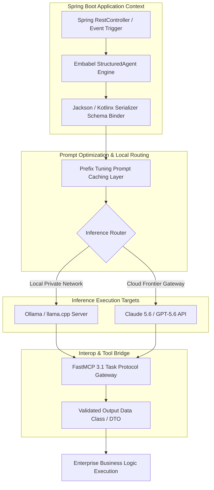

# Embabel Agent Framework

## What it is
Embabel is an enterprise-grade, JVM-native (Java/Kotlin) agentic orchestration framework designed for building deterministic, type-safe AI applications. Reaching version 1.0, Embabel allows software engineers in Java and Kotlin ecosystems to seamlessly build multi-agent architectures, manage structured context, support FastMCP 3.1 Task Protocol schemas, and control model behavior via prefix tuning and stateful reasoning loops, matching the reliability standards expected in early January 2027 enterprise JVM backend systems.

## What problem it solves
Integrating LLMs directly into enterprise Java or Kotlin backend business logic is historically fraught with type safety mismatches, unreliable string outputs, and fragile manual parser logic. Embabel solves this by treating agent inputs and outputs as first-class, strictly validated JVM types. It eliminates the boilerplate of prompt management, provides native JVM-based schema validation (analogous to Pydantic v2 in Python), and handles token-saving optimizations like prefix tuning natively within Java/Kotlin applications across Claude 5.6 and GPT-5.6 agent environments.

## Architecture & Execution Pipeline



## Where it fits in the stack
**Category**: AI Assistants & Knowledge / Frameworks. It functions as the JVM-native middleware layer that binds enterprise business logic, Spring Boot controllers, FastMCP 3.1 Task Protocol tools, and local database systems to local or remote reasoning engines (e.g., local Ollama, llama.cpp nodes, or cloud-hosted frontier models like Claude 5.6).

## Typical use cases
- **Deterministic Transaction Routing**: Analyzing customer requests within Spring Boot microservices to invoke specific database repositories or internal REST endpoints with validated parameters.
- **Automated Document Auditing**: Extracting complex structured data from invoices and compliance files directly into Kotlin Data Classes using local GPU inference.
- **Self-Healing JVM Workflows**: Operating local subagents that monitor JVM application logs, diagnose memory leak trends, and automatically initiate microservice restarts or configuration fallbacks.
- **Interactive Conversational Portals**: Building conversational assistants for internal enterprise portals that maintain multi-session memory, FastMCP 3.1 protocol states, and strict role-based access control (RBAC).

## JVM Agent Framework Comparison Matrix

| Feature / Capability | Embabel 1.0 | LangChain4j | Spring AI | Semantic Kernel (Java) |
| :--- | :--- | :--- | :--- | :--- |
| **Primary Design Focus** | Deterministic JVM Agent Loops & Prefix Caching | General-Purpose LLM Chains & Port | Spring Native Model Abstractions | Microsoft Ecosystem & Memory Integration |
| **Native Kotlin DSL Support** | First-Class (Coroutines + Data Classes) | Secondary (Wrapper classes) | Basic (Java-first design) | Limited (Java-centric builder patterns) |
| **Type Safety Enforcement** | Compile-time Data Class Schema Binding | Runtime Reflection Parsers | OutputParsers with JSON Schema | Plugin Function Parameter Annotations |
| **FastMCP 3.1 Protocol** | Native Tool & Task Protocol Support | Custom Tool Adapters | Experimental Community Modules | OpenTelemetry / Custom Plugins |
| **Prompt Optimization** | Built-in Prefix Tuning Caching | Manual Prompt Formatting | Template String Substitutions | Prompt Template Formatted Strings |
| **Spring Boot Auto-Config** | `embabel-spring-boot-starter` | Third-party Starters | Official `spring-ai-starter` | Manual Bean Wiring Required |
| **Python Interop Bridge** | Native FastMCP 3.1 Server Interop | HTTP REST Gateway | WebClient REST Endpoint | gRPC / REST Wrappers |

## Strengths
- **First-Class Spring Boot Integration**: Fully integrates with Spring's dependency injection system, auto-configurations, and standard application properties.
- **Native JVM Type Safety**: Leverage Kotlin Serialization or Jackson to enforce that model responses strictly conform to compiled classes, raising runtime exceptions immediately on compliance failures.
- **Prefix Tuning Optimization**: Internally caches and optimizes prompt prefix contexts to dramatically reduce token round-trip latencies over local networks.
- **Flexible Inference Routing**: Seamlessly routes reasoning tasks between high-performance local stacks (llama.cpp, Ollama) and cloud frontier models based on task complexity.
- **Agent Protocol Integration**: Full support for FastMCP 3.1 Task Protocol schemas within JVM execution graphs.

## Limitations
- **Platform Specialization**: Exclusively targets JVM ecosystems (Kotlin, Java, Scala); it does not provide native bindings for Node.js, Python, or Go developers.
- **Resource Footprint**: Running the enterprise Spring Boot context along with embedded model bindings can require a larger initial memory footprint compared to lightweight Python scripts.
- **Community Scale**: While highly active, the JVM-native agentic community is smaller compared to Python-dominant ecosystems like LangChain.

## When to use it
- When developing enterprise backend systems or microservices in Java/Kotlin that require robust, type-safe agentic reasoning loops.
- When you need to connect local backend applications to self-hosted inference platforms (e.g., Ollama, llama.cpp) over private enterprise networks.
- When strict type-safety, contract compliance, and compile-time validation of LLM outputs are non-negotiable requirements for production deployment.
- When implementing FastMCP 3.1 Task Protocol servers on top of enterprise JVM frameworks.

## When not to use it
- For quick, single-file exploratory scripts where Python's minimal syntax and native interactive environments are more productive.
- In client-side or frontend applications where a lightweight TypeScript framework (like Mastra) is better suited.
- If your system does not utilize the JVM runtime and is built entirely on serverless Python or Go platforms.

## Getting started
To integrate the Embabel Agent Framework 1.0 into your Kotlin or Java project, configure your build file with the core dependencies.

### Gradle Setup (Kotlin DSL)
```kotlin
plugins {
    id("org.springframework.boot") version "3.3.4"
    id("io.spring.dependency-management") version "1.1.6"
    kotlin("jvm") version "2.0.20"
    kotlin("plugin.serialization") version "2.0.20"
}

dependencies {
    implementation("ai.embabel:embabel-core:1.0.0")
    implementation("ai.embabel:embabel-spring-boot-starter:1.0.0")
    implementation("org.jetbrains.kotlinx:kotlinx-serialization-json:1.7.3")

    // Local inference connector
    implementation("ai.embabel:embabel-connector-ollama:1.0.0")

    testImplementation("org.springframework.boot:spring-boot-starter-test")
}
```

### Maven Setup (`pom.xml`)
```xml
<dependency>
    <groupId>ai.embabel</groupId>
    <artifactId>embabel-spring-boot-starter</artifactId>
    <version>1.0.0</version>
</dependency>
<dependency>
    <groupId>ai.embabel</groupId>
    <artifactId>embabel-connector-ollama</artifactId>
    <version>1.0.0</version>
</dependency>
```

## CLI examples
Embabel provides a CLI runner to bootstrap projects, manage local prompt template files, and perform direct interactive validation of model routing configurations.

### 1. Initialize a Scaffolding Project
```bash
# Bootstrap a Spring Boot & Kotlin agent template
embabel init --name my-jvm-agent --language kotlin --output-dir ./my-agent/
```

### 2. Verify Local Ollama Inference Node Connectivity
```bash
# Verify connection to local Ollama server and benchmark prompt-latency metrics
embabel test-connection --host http://localhost:11434 --model qwen3-coder:latest
```

### 3. Compile and Validate Prompt Templates
```bash
# Pre-compile prefix templates to ensure schema alignment
embabel validate-templates --src ./src/main/resources/prompts/ --schema-package com.enterprise.agent.schemas
```

## API examples

### Type-Safe Structured Response Synthesis with FastMCP 3.1 Protocol
This Kotlin example demonstrates defining a strict Kotlin Serialization schema for FastMCP 3.1 transactional audit logs, configuring the Embabel client to bind to a local Ollama service, and synthesizing a validated payload.

```kotlin
import kotlinx.serialization.Serializable
import kotlinx.serialization.json.Json
import ai.embabel.core.Embabel
import ai.embabel.core.connector.OllamaConnector
import ai.embabel.core.agent.AgentClient

// 1. Define the mandatory FastMCP 3.1 validation schema
@Serializable
data class FastMCPTransactionAudit(
    val taskId: String,
    val transactionId: String,
    val riskScore: Double,
    val flagReason: String?,
    val recommendedAction: String,
    val auditedBySubagent: String
)

fun main() {
    // 2. Instantiate local inference connector pointing to local llama.cpp / Ollama node
    val connector = OllamaConnector(
        host = "http://localhost:11434",
        defaultModel = "qwen3-coder:latest"
    )

    val embabel = Embabel.configure(connector)

    // 3. Create a stateful agent with strict schema controls
    val auditAgent = embabel.createAgent<FastMCPTransactionAudit>(
        systemPrompt = "You are an adversarial security audit subagent. Analyze the provided transaction logs and generate a FastMCP 3.1 compliant audit report."
    )

    val transactionData = """
        TASK_ID: task_sec_2027_0107
        TXN_ID: 981723-A
        AMOUNT: $14,500
        LOCATION: Unknown IP (routed via TOR exit node)
        CARD_HOLDER: Alice Smith
        ACTION: High-frequency transfer to fresh recipient account
    """.trimIndent()

    println("Executing type-safe JVM transaction analysis under FastMCP 3.1 Task Protocol...")

    // 4. Invoke the agent. Embabel guarantees the output strictly parses into the Kotlin Data Class.
    val auditResult: FastMCPTransactionAudit = auditAgent.generate(transactionData)

    // 5. Output results natively with zero manual string parsing required
    println("--- Security Audit Report ---")
    println("Task ID: ${auditResult.taskId}")
    println("Transaction ID: ${auditResult.transactionId}")
    println("Risk Score: ${auditResult.riskScore * 100}%")
    println("Reason: ${auditResult.flagReason ?: "None"}")
    println("Action: ${auditResult.recommendedAction}")
    println("Auditor: ${auditResult.auditedBySubagent}")
}
```

### Spring Boot Controller Integration (Java)
```java
package com.enterprise.agent.controller;

import ai.embabel.core.Embabel;
import ai.embabel.core.agent.StructuredAgent;
import com.enterprise.agent.schemas.TransactionAudit;
import org.springframework.beans.factory.annotation.Autowired;
import org.springframework.web.bind.annotation.*;

@RestController
@RequestMapping("/api/v1/security")
public class SecurityAuditController {

    private final StructuredAgent<TransactionAudit> securityAgent;

    @Autowired
    public SecurityAuditController(Embabel embabel) {
        // Instantiate agent injected with pre-configured Spring-managed Ollama parameters
        this.securityAgent = embabel.createAgent(TransactionAudit.class,
            "Analyze microservice logs for standard privilege escalation attempts.");
    }

    @PostMapping("/audit-log")
    public TransactionAudit auditMicroserviceLog(@RequestBody String logPayload) {
        // Automatically returns JSON-serialized output validated against the Java class definition
        return this.securityAgent.generate(logPayload);
    }
}
```

## FastMCP 3.1 Python Bridge and Validation Models

In heterogeneous microservice architectures where Python AI orchestration agents interact with JVM backends running Embabel, FastMCP 3.1 acts as the bidirectional protocol bridge.

### Python FastMCP 3.1 Gateway for Embabel Spring Boot Services
```python
import httpx
from typing import Dict, Any, Optional
from pydantic import BaseModel, Field, field_validator, ValidationError
from fastmcp import FastMCP

mcp = FastMCP(
    "embabel-jvm-bridge",
    instructions="FastMCP 3.1 gateway server bridging Python orchestration tools to Embabel Spring Boot AI microservices."
)

class EmbabelAuditRequest(BaseModel):
    task_id: str = Field(..., min_length=5, description="Unique task tracker ID")
    transaction_id: str = Field(..., min_length=3, description="Target transaction reference")
    raw_payload: str = Field(..., min_length=20, description="Raw log or JSON string payload for analysis")
    max_risk_tolerance: float = Field(default=0.85, ge=0.0, le=1.0)

    @field_validator("task_id")
    @classmethod
    def validate_task_format(cls, v: str) -> str:
        if not v.startswith("task_"):
            raise ValueError("task_id must begin with prefix 'task_'")
        return v

class EmbabelAuditResponse(BaseModel):
    task_id: str
    transaction_id: str
    risk_score: float
    flag_reason: Optional[str] = None
    recommended_action: str
    audited_by_subagent: str

@mcp.tool()
async def invoke_embabel_security_audit(request: EmbabelAuditRequest) -> Dict[str, Any]:
    """
    Submits security audit tasks to the Embabel JVM Spring Boot REST endpoint and verifies the returned payload.
    """
    jvm_endpoint = "http://localhost:8080/api/v1/security/audit-log"

    try:
        async with httpx.AsyncClient(timeout=30.0) as client:
            response = await client.post(
                jvm_endpoint,
                json=request.model_dump(),
                headers={"Content-Type": "application/json", "X-FastMCP-Version": "3.1"}
            )
            response.raise_for_status()
            raw_json = response.json()

        # Validate returned JSON against Pydantic v2 schema matching Kotlin Data Class
        validated_response = EmbabelAuditResponse.model_validate(raw_json)

        return {
            "status": "success",
            "mcp_task_id": validated_response.task_id,
            "audit_data": validated_response.model_dump()
        }
    except httpx.HTTPError as http_err:
        return {
            "status": "error",
            "error_type": "JVM_HTTP_FAILURE",
            "message": f"Failed to communicate with Embabel Spring Boot service: {str(http_err)}"
        }
    except ValidationError as val_err:
        return {
            "status": "error",
            "error_type": "SCHEMA_MISMATCH",
            "message": f"Embabel response failed FastMCP 3.1 validation: {str(val_err)}"
        }

if __name__ == "__main__":
    mcp.run()
```

## Diagnostic & Troubleshooting Guide

| Symptom / Issue | Root Cause | Diagnostic Step | Resolution / Fix |
| :--- | :--- | :--- | :--- |
| `SerializationException: Unknown field` | Mismatch between LLM output JSON keys and Kotlin Data Class properties | Inspect raw LLM JSON output in debug logs | Annotate Kotlin fields with `@Optional` or set `ignoreUnknownKeys = true` in `Json {}` configuration |
| Spring Boot Bean Creation Error | Missing `embabel.connector.ollama.host` property in `application.yml` | Check `ApplicationContext` startup stack trace | Add mandatory host and model properties to `src/main/resources/application.yml` |
| Excessive Local Latency (>10s) | Prefix tuning cache misses caused by dynamic prompt prepending | Enable Embabel debug timer log `logging.level.ai.embabel=DEBUG` | Move variable state out of prompt prefix and pass through structured arguments |
| `FastMCP 3.1 Connection Refused` | Python FastMCP bridge unable to bind to Embabel REST controller port | Test endpoint via `curl -X POST http://localhost:8080/actuator/health` | Ensure Spring Boot application process is active and CORS/RBAC permits FastMCP loopback requests |
| `OutOfMemoryError: Java heap space` | Large context windows allocated repeatedly during batch agent processing | Run `jmap -histo:live <pid>` or inspect GC logs | Increase JVM heap memory (`-Xmx4g`) and configure Embabel memory pooling |

## Operational Best Practices & Guardrails

### 1. JVM Memory Allocation & Garbage Collection
- **Heap Sizing**: Allocate a minimum of 4GB Heap space (`-Xmx4g -Xms2g`) for Spring Boot services hosting Embabel agents to account for transient Jackson AST serialization buffers.
- **GC Choice**: Use the **ZGC** (`-XX:+UseZGC`) or **G1GC** (`-XX:+UseG1GC`) garbage collector to minimize stop-the-world pauses during multi-token prompt generation cycles.

### 2. Resilience & Circuit Breaking
- **Resilience4j Integration**: Wrap `StructuredAgent.generate()` invocations with Resilience4j circuit breakers to handle local inference engine (Ollama / llama.cpp) thermal throttling gracefully.
- **Fallback Models**: Configure secondary cloud endpoints (Claude 5.6 or DeepSeek-V4) as automatic fallbacks when local GPU workers report non-200 responses.

### 3. Enterprise Security & Access Control
- **Spring Security Integration**: Protect Embabel REST endpoints using standard OAuth2/JWT tokens (`@PreAuthorize("hasRole('ROLE_AI_AGENT')")`).
- **Prompt Injection Defense**: Pre-process user inputs through Embabel's input sanitizer before passing to local or cloud LLM contexts.

## Related tools / concepts
- [LangGraph](langgraph.md) — Advanced stateful agent framework.
- [Mastra](mastra.md) — Lightweight TypeScript agent framework.
- [AG2](ag2.md) — Multi-agent conversation framework.
- [PydanticAI](pydantic-ai.md) — Python agent framework with strict schema validation.
- [Model Context Protocol (MCP)](../automation_orchestration/mcp.md) — Open standard for model-tool connections.
- [Ollama](../../services/ollama.md) — Lightweight local inference engine.
- [llama.cpp](../infrastructure/llama-cpp.md) — C/C++ engine for edge inference.
- [Qwen](../ai_knowledge/qwen.md) — SOTA open coding models.
- [Claude](../ai_knowledge/claude.md) — Frontier model family from Anthropic.
- [Microsoft Agent Framework Harness](microsoft-agent-framework-harness.md) — High-performance agent execution and evaluation framework.

## Sources / references
- [Embabel Agent Framework Official Project](https://github.com/embabel/embabel)
- [Embabel 1.0 Spring Boot and JVM Architecture Release Notes](https://www.infoq.com/news/2026/08/embabel-1/)
- [Kotlin Serialization and Type Safety Guidelines](https://kotlinlang.org/docs/serialization.html)
- [Ollama API Specification](https://github.com/ollama/ollama/blob/main/docs/api.md)

---
## Contribution Metadata
- Last reviewed: 2027-01-07
- Confidence: high
