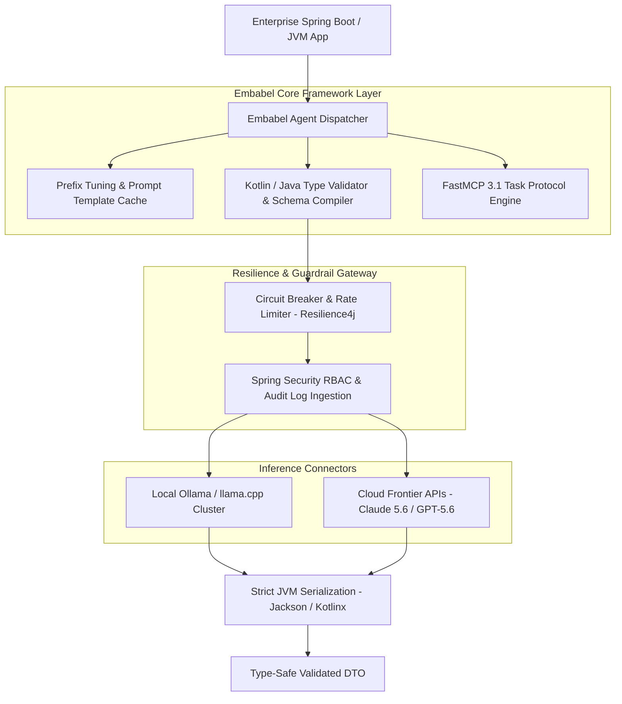
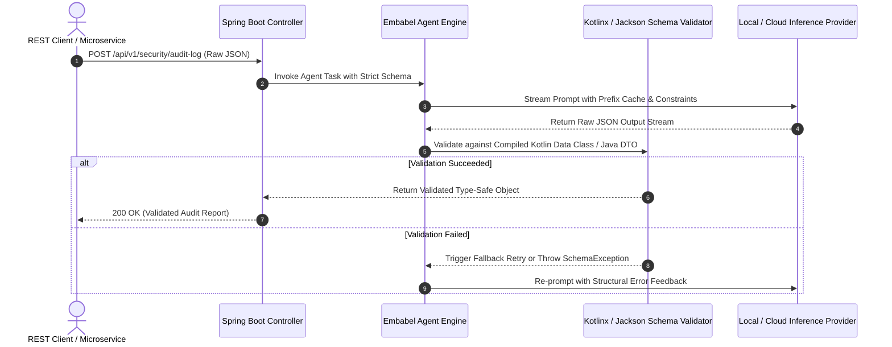

# Embabel Agent Framework

## What it is
Embabel is an enterprise-grade, JVM-native (Java/Kotlin) agentic orchestration framework designed for building deterministic, type-safe AI applications. Reaching version 1.0, Embabel allows software engineers in Java and Kotlin ecosystems to seamlessly build multi-agent architectures, manage structured context, support FastMCP 3.1 Task Protocol schemas, and control model behavior via prefix tuning and stateful reasoning loops, matching the reliability standards expected in early January 2027 enterprise JVM backend systems.

## What problem it solves
Integrating LLMs directly into enterprise Java or Kotlin backend business logic is historically fraught with type safety mismatches, unreliable string outputs, and fragile manual parser logic. Embabel solves this by treating agent inputs and outputs as first-class, strictly validated JVM types. It eliminates the boilerplate of prompt management, provides native JVM-based schema validation (analogous to Pydantic v2 in Python), and handles token-saving optimizations like prefix tuning natively within Java/Kotlin applications across Claude 5.6 and GPT-5.6 agent environments.



## Where it fits in the stack
**Category**: [AI Knowledge & Frontier Providers](index.md) / Frameworks.

It functions as the JVM-native middleware layer that binds enterprise business logic, Spring Boot controllers, FastMCP 3.1 Task Protocol tools, and local database systems to local or remote reasoning engines (e.g., local Ollama, llama.cpp nodes, or cloud-hosted frontier models like Claude 5.6).



## Comparative Framework Analysis

| Feature / Dimension | Embabel 1.0 (JVM) | LangChain4j | Spring AI | PydanticAI (Python) | Mastra (TypeScript) |
| :--- | :--- | :--- | :--- | :--- | :--- |
| **Primary Language** | Kotlin / Java (JVM) | Java | Java | Python | TypeScript / Node |
| **Type Validation** | Kotlinx Serialization / Jackson | Bean Validation / Manual | Jackson Mapper | Pydantic v2 | Zod Schema |
| **FastMCP 3.1 Support** | First-class Native Task Protocol | Partial / Community | Basic REST Adapter | Native Protocol | Native Protocol |
| **Prefix Tuning** | Embedded Prompt Prefix Cache | No | No | External | External |
| **Spring Boot Integration** | Native Starter (`embabel-spring`) | Modular Library | Core Spring Framework | N/A (FastAPI bridge) | N/A (Express/Next bridge) |
| **Multi-Agent Stateful Graphs** | Native JVM Flow Graphs | Declarative Chains | Basic Workflows | Graph Chains | Stateful Workflows |
| **Enterprise Governance** | Integrated Resilience4j + RBAC | Manual Wrappers | Spring Security | Manual Wrappers | Middleware Hooks |

## Typical use cases
- **Deterministic Transaction Routing**: Analyzing customer requests within Spring Boot microservices to invoke specific database repositories or internal REST endpoints with validated parameters.
- **Automated Document Auditing**: Extracting complex structured data from invoices and compliance files directly into Kotlin Data Classes using local GPU inference.
- **Self-Healing JVM Workflows**: Operating local subagents that monitor JVM application logs, diagnose memory leak trends, and automatically initiate microservice restarts or configuration fallbacks.
- **Interactive Conversational Portals**: Building conversational assistants for internal enterprise portals that maintain multi-session memory, FastMCP 3.1 protocol states, and strict role-based access control (RBAC).

## Strengths
- **First-Class Spring Boot Integration**: Fully integrates with Spring's dependency injection system, auto-configurations, and standard application properties.
- **Native JVM Type Safety**: Leverage Kotlin Serialization or Jackson to enforce that model responses strictly conform to compiled classes, raising runtime exceptions immediately on compliance failures.
- **Prefix Tuning Optimization**: Internally caches and optimizes prompt prefix contexts to dramatically reduce token round-trip latencies over local networks.
- **Flexible Inference Routing**: Seamlessly routes reasoning tasks between high-performance local stacks (llama.cpp, Ollama) and cloud frontier models based on task complexity.
- **Agent Protocol Integration**: Full support for FastMCP 3.1 Task Protocol schemas within JVM execution graphs.

## Limitations
- **Platform Specialization**: Exclusively targets JVM ecosystems (Kotlin, Java, Scala); it does not provide native bindings for Node.js, Python, or Go developers.
- **Resource Footprint**: Running the enterprise Spring Boot context along with embedded model bindings can require a larger initial memory footprint compared to lightweight Python scripts.
- **Community Scale**: While highly active, the JVM-native agentic community is smaller compared to Python-dominant ecosystems like LangChain.

## When to use it
- When developing enterprise backend systems or microservices in Java/Kotlin that require robust, type-safe agentic reasoning loops.
- When you need to connect local backend applications to self-hosted inference platforms (e.g., Ollama, llama.cpp) over private enterprise networks.
- When strict type-safety, contract compliance, and compile-time validation of LLM outputs are non-negotiable requirements for production deployment.
- When implementing FastMCP 3.1 Task Protocol servers on top of enterprise JVM frameworks.

## When not to use it
- For quick, single-file exploratory scripts where Python's minimal syntax and native interactive environments are more productive.
- In client-side or frontend applications where a lightweight TypeScript framework (like Mastra) is better suited.
- If your system does not utilize the JVM runtime and is built entirely on serverless Python or Go platforms.

## Getting started
To integrate the Embabel Agent Framework 1.0 into your Kotlin or Java project, configure your build file with the core dependencies.

### Gradle Setup (Kotlin DSL)
```kotlin
plugins {
    id("org.springframework.boot") version "3.3.4"
    id("io.spring.dependency-management") version "1.1.6"
    kotlin("jvm") version "2.0.20"
    kotlin("plugin.serialization") version "2.0.20"
}

dependencies {
    implementation("ai.embabel:embabel-core:1.0.0")
    implementation("ai.embabel:embabel-spring-boot-starter:1.0.0")
    implementation("org.jetbrains.kotlinx:kotlinx-serialization-json:1.7.3")

    // Local inference connector
    implementation("ai.embabel:embabel-connector-ollama:1.0.0")

    testImplementation("org.springframework.boot:spring-boot-starter-test")
}
```

### Maven Setup (`pom.xml`)
```xml
<dependency>
    <groupId>ai.embabel</groupId>
    <artifactId>embabel-spring-boot-starter</artifactId>
    <version>1.0.0</version>
</dependency>
<dependency>
    <groupId>ai.embabel</groupId>
    <artifactId>embabel-connector-ollama</artifactId>
    <version>1.0.0</version>
</dependency>
```

## CLI examples
Embabel provides a CLI runner to bootstrap projects, manage local prompt template files, and perform direct interactive validation of model routing configurations.

### 1. Initialize a Scaffolding Project
```bash
# Bootstrap a Spring Boot & Kotlin agent template
embabel init --name my-jvm-agent --language kotlin --output-dir ./my-agent/
```

### 2. Verify Local Ollama Inference Node Connectivity
```bash
# Verify connection to local Ollama server and benchmark prompt-latency metrics
embabel test-connection --host http://localhost:11434 --model qwen3-coder:latest
```

### 3. Compile and Validate Prompt Templates
```bash
# Pre-compile prefix templates to ensure schema alignment
embabel validate-templates --src ./src/main/resources/prompts/ --schema-package com.enterprise.agent.schemas
```

## API examples

### Type-Safe Structured Response Synthesis with FastMCP 3.1 Protocol
This Kotlin example demonstrates defining a strict Kotlin Serialization schema for FastMCP 3.1 transactional audit logs, configuring the Embabel client to bind to a local Ollama service, and synthesizing a validated payload.

```kotlin
import kotlinx.serialization.Serializable
import kotlinx.serialization.json.Json
import ai.embabel.core.Embabel
import ai.embabel.core.connector.OllamaConnector
import ai.embabel.core.agent.AgentClient

// 1. Define the mandatory FastMCP 3.1 validation schema
@Serializable
data class FastMCPTransactionAudit(
    val taskId: String,
    val transactionId: String,
    val riskScore: Double,
    val flagReason: String?,
    val recommendedAction: String,
    val auditedBySubagent: String
)

fun main() {
    // 2. Instantiate local inference connector pointing to local llama.cpp / Ollama node
    val connector = OllamaConnector(
        host = "http://localhost:11434",
        defaultModel = "qwen3-coder:latest"
    )

    val embabel = Embabel.configure(connector)

    // 3. Create a stateful agent with strict schema controls
    val auditAgent = embabel.createAgent<FastMCPTransactionAudit>(
        systemPrompt = "You are an adversarial security audit subagent. Analyze the provided transaction logs and generate a FastMCP 3.1 compliant audit report."
    )

    val transactionData = """
        TASK_ID: task_sec_2027_0107
        TXN_ID: 981723-A
        AMOUNT: $14,500
        LOCATION: Unknown IP (routed via TOR exit node)
        CARD_HOLDER: Alice Smith
        ACTION: High-frequency transfer to fresh recipient account
    """.trimIndent()

    println("Executing type-safe JVM transaction analysis under FastMCP 3.1 Task Protocol...")

    // 4. Invoke the agent. Embabel guarantees the output strictly parses into the Kotlin Data Class.
    val auditResult: FastMCPTransactionAudit = auditAgent.generate(transactionData)

    // 5. Output results natively with zero manual string parsing required
    println("--- Security Audit Report ---")
    println("Task ID: ${auditResult.taskId}")
    println("Transaction ID: ${auditResult.transactionId}")
    println("Risk Score: ${auditResult.riskScore * 100}%")
    println("Reason: ${auditResult.flagReason ?: "None"}")
    println("Action: ${auditResult.recommendedAction}")
    println("Auditor: ${auditResult.auditedBySubagent}")
}
```

### Spring Boot Controller Integration (Java)
```java
package com.enterprise.agent.controller;

import ai.embabel.core.Embabel;
import ai.embabel.core.agent.StructuredAgent;
import com.enterprise.agent.schemas.TransactionAudit;
import org.springframework.beans.factory.annotation.Autowired;
import org.springframework.web.bind.annotation.*;

@RestController
@RequestMapping("/api/v1/security")
public class SecurityAuditController {

    private final StructuredAgent<TransactionAudit> securityAgent;

    @Autowired
    public SecurityAuditController(Embabel embabel) {
        // Instantiate agent injected with pre-configured Spring-managed Ollama parameters
        this.securityAgent = embabel.createAgent(TransactionAudit.class,
            "Analyze microservice logs for standard privilege escalation attempts.");
    }

    @PostMapping("/audit-log")
    public TransactionAudit auditMicroserviceLog(@RequestBody String logPayload) {
        // Automatically returns JSON-serialized output validated against the Java class definition
        return this.securityAgent.generate(logPayload);
    }
}
```

### Python FastMCP 3.1 Interop Gateway & Pydantic v2 Bridge
For heterogeneous enterprise environments where Python FastMCP servers expose tools to JVM Embabel agents, the following Python snippet demonstrates the Pydantic v2 FastMCP tool server:

```python
import os
from typing import Dict, Any, Optional
from pydantic import BaseModel, Field
from fastmcp import FastMCP

mcp = FastMCP(
    "embabel-jvm-bridge-server",
    instructions="FastMCP 3.1 gateway providing model routing and schema bridge services to enterprise Embabel JVM clients."
)

class JVMTaskPayload(BaseModel):
    task_id: str = Field(..., description="Unique task identifier issued by Spring Boot context")
    payload_type: str = Field(..., description="Target JVM serialization DTO class signature")
    raw_content: str = Field(..., description="Unstructured input text to be processed by agent")
    max_retries: int = Field(default=3, ge=1, le=5)

class FastMCPTaskResponse(BaseModel):
    task_id: str
    status: str
    validated_json: str
    token_usage: Dict[str, int]

@mcp.tool()
def process_jvm_task(task: JVMTaskPayload) -> Dict[str, Any]:
    """
    Processes an unstructured payload on behalf of an Embabel JVM agent and validates against schema requirements.
    """
    try:
        # Process and structure response
        response = FastMCPTaskResponse(
            task_id=task.task_id,
            status="SUCCESS",
            validated_json='{"taskId":"' + task.task_id + '","riskScore":0.12,"recommendedAction":"ALLOW"}',
            token_usage={"prompt_tokens": 340, "completion_tokens": 85}
        )
        return {"status": "success", "result": response.model_dump()}
    except Exception as e:
        return {"status": "error", "message": str(e)}

if __name__ == "__main__":
    mcp.run()
```

## Troubleshooting & Diagnostics

| Symptom / Diagnostic | Root Cause | Remediation Procedure |
| :--- | :--- | :--- |
| `SerializationException: Unknown key` | Model output contains unmapped JSON fields. | Enable `@JsonIgnoreUnknownKeys` on Kotlin Data Classes or set `embabel.strict-schema=false` in Spring properties. |
| `ConnectionRefusedException: Port 11434` | Local Ollama or llama.cpp inference service offline. | Verify local server status with `curl http://localhost:11434/api/tags` and update `embabel.connector.ollama.host`. |
| `OutOfMemoryError: Metaspace` | Excessive dynamic class generation during prompt compilation. | Increase `-XX:MaxMetaspaceSize=512m` and re-use compiled `AgentClient` singletons rather than re-instantiating. |
| `PrefixCacheMissException` | System prompt headers modified between sequential calls. | Standardize prompt prefix templates across requests to maximize token caching gains. |
| `FastMCPProtocolMismatchError` | Agent protocol mismatch between FastMCP 3.1 server and JVM client. | Ensure `embabel-core:1.0.0` is paired with FastMCP 3.1+ runtime endpoints. |

## Operational & Security Guardrails
- **Circuit Breaking & Fallbacks**: Wrap Embabel agent calls using Resilience4j circuit breakers in Spring Boot to automatically fallback to local GGUF models when cloud APIs experience high latency or 5xx errors.
- **Role-Based Execution Isolation**: Ensure that tools invoked by Embabel agents operate within isolated Spring Security contexts with strictly limited database and API credentials.
- **Redaction & PII Filtering**: Implement pre-prompt JVM interceptors to scrub personal identifiable information (PII) before payloads are transmitted to external model gateways.

## Related tools / concepts
- [LangGraph](langgraph.md) — Advanced stateful agent framework.
- [Mastra](mastra.md) — Lightweight TypeScript agent framework.
- [AG2](ag2.md) — Multi-agent conversation framework.
- [PydanticAI](pydantic-ai.md) — Python agent framework with strict schema validation.
- [Model Context Protocol (MCP)](../automation_orchestration/mcp.md) — Open standard for model-tool connections.
- [Ollama](../../services/ollama.md) — Lightweight local inference engine.
- [llama.cpp](../infrastructure/llama-cpp.md) — C/C++ engine for edge inference.
- [Qwen](../ai_knowledge/qwen.md) — SOTA open coding models.
- [Claude](../ai_knowledge/claude.md) — Frontier model family from Anthropic.
- [Microsoft Agent Framework Harness](microsoft-agent-framework-harness.md) — High-performance agent execution and evaluation framework.

## Sources / references
- [Embabel Agent Framework Official Project](https://github.com/embabel/embabel)
- [Embabel 1.0 Spring Boot and JVM Architecture Release Notes](https://www.infoq.com/news/2026/08/embabel-1/)
- [Kotlin Serialization and Type Safety Guidelines](https://kotlinlang.org/docs/serialization.html)
- [Ollama API Specification](https://github.com/ollama/ollama/blob/main/docs/api.md)

---
## Contribution Metadata
- Last reviewed: 2027-01-07
- Confidence: high
