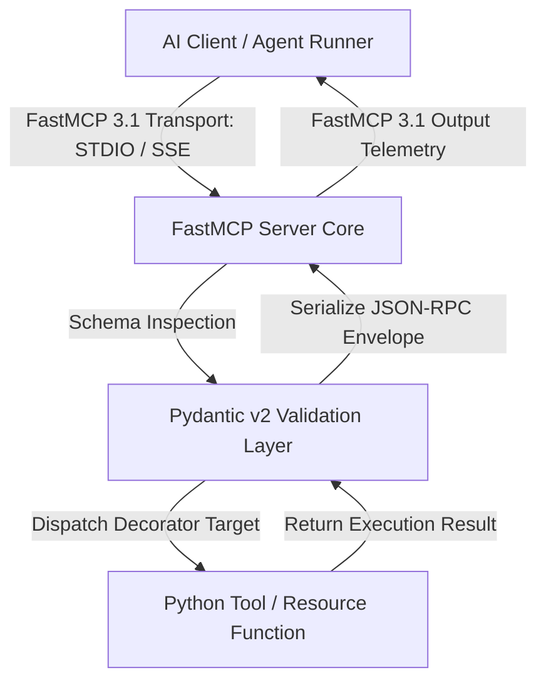
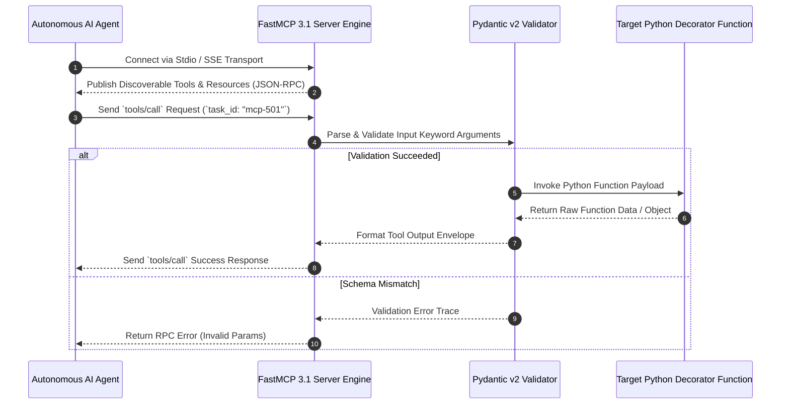

# FastMCP

## What it is
FastMCP is a high-level, developer-friendly Python and TypeScript framework created by Jeremiah Lowin (Prefect) for building Model Context Protocol ([MCP 3.1](../automation_orchestration/mcp.md)) servers. Designed to mirror the simplicity and idiomatic developer experience of FastAPI, FastMCP eliminates low-level JSON-RPC protocol handling, transport boilerplate, and manual schema definitions. In early 2027, **FastMCP 3.1** serves as the standard framework across enterprise and open-source agent ecosystems for exposing local Python functions, Pydantic v2 schemas, stateful resources, and prompt templates to AI models like Claude 5.6, GPT-5.6, and Gemini 4.0 Ultra.

## Architecture & Server Execution Flow
FastMCP handles protocol negotiation, transport abstractions (STDIO, SSE, WebSockets), parameter validation via Pydantic v2, and dynamic tool/resource routing.



## Detailed Execution Sequence



## What problem it solves
Implementing standard Model Context Protocol servers directly using low-level JSON-RPC specifications requires hundreds of lines of transport management, socket listener code, manual type conversions, and asynchronous loop handlers. FastMCP reduces this overhead to simple Python decorator definitions (`@mcp.tool()`, `@mcp.resource()`, `@mcp.prompt()`), automatically converting docstrings and Python type annotations into standard OpenAPI/JSON-RPC tool definitions.

## Where it fits in the stack
**Frameworks & Developer Tools Layer**. FastMCP operates as the core application engine for building custom tools, agent connectors, and system resource bridges that communicate over the Model Context Protocol.

## Typical use cases
- **Building Custom Agent Tools**: Wrapping local Python functions, database queries, and web scrapers as MCP tools.
- **Microservice API Gateways**: Exposing enterprise REST APIs and database functions to AI agents via FastMCP 3.1 SSE endpoints.
- **Resource Streaming**: Streaming real-time file system logs, telemetry metrics, and stateful application updates to LLM contexts.
- **Prompt Template Distribution**: Exposing dynamic prompt definitions and standardized multi-turn dialog templates to LLM orchestration layers.
- **Asynchronous Long-Running Workflows**: Triggering background compute jobs, model fine-tuning runs, and ETL pipelines with progress updates.

## Strengths
- **Minimal Boilerplate**: Write standard Python functions with type hints and docstrings; FastMCP handles everything else.
- **Full FastMCP 3.1 Compliance**: Built-in support for tool execution tracking, resource decorators, dynamic prompts, and execution context boundaries.
- **Native Pydantic v2 Integration**: Strict input validation and automatic conversion of custom Pydantic models into MCP tool schemas.
- **Flexible Transport Protocols**: Out-of-the-box support for STDIO (CLI/desktop tools) and SSE/WebSockets (remote microservices).
- **Built-In Telemetry & Context**: Access runtime execution context, request IDs, and caller identity directly within tool bodies via `Context`.

## Limitations
- **Python Async Loop Awareness**: Handlers executing heavy blocking I/O must use async routines or executor pools to avoid stalling transport loops.
- **Multi-Process Concurrency**: STDIO transport requires standard I/O isolation; multi-tenant deployments need SSE or HTTP transport gateways.
- **State Management Overhead**: In-memory state in FastMCP servers requires explicit synchronization or external state stores (e.g. Redis) when scaled horizontally.

## When to use it
- Building custom MCP servers in Python or TypeScript with minimal protocol boilerplate.
- Exposing existing Python functions, databases, or REST APIs as FastMCP 3.1 tools and resources.
- Leveraging Pydantic v2 type hints and validation for AI agent tool calling schemas.
- Exposing contextual prompt templates and streaming data sources directly to LLM context windows.
- Implementing robust enterprise agent tools with request logging, rate limiting, and structured error reporting.

## When not to use it
- Non-Python / non-TypeScript environments where official low-level SDKs for C++, Go, or Rust are required.
- Simple single-file scripts that do not interface with Model Context Protocol agents.
- Legacy architectures restricted from using modern Pydantic v2 validation layers.

## Feature Matrix & Framework Comparison

| Feature | FastMCP 3.1 | Standard MCP SDK (Python) | TypeScript MCP SDK | LangChain Tool Wrapping |
| :--- | :--- | :--- | :--- | :--- |
| **Developer API** | FastAPI-like `@mcp.tool()` | Low-level Class Handlers | Object Literals & Classes | `@tool` Decorators |
| **Schema Engine** | Native Pydantic v2 | Manual JSON Schema | Zod Schema Validation | Pydantic v1 / v2 |
| **Transports Supported** | Stdio, SSE, HTTP/WS Transports | Stdio, SSE | Stdio, SSE | Custom Middleware |
| **Task Correlation ID** | Built-in `taskId` & Execution Context | Manual Implementation | Manual Implementation | N/A |
| **OpenAPI / FastMCP 3.1** | Native FastMCP 3.1 Protocol | Basic MCP 1.0 | Basic MCP 1.0 | Custom Bridge |
| **Prompt Template API** | `@mcp.prompt()` Decorators | Manual Text Formatting | Manual Serialization | Prompt Templates |
| **Resource Subscriptions** | Dynamic URI Templates (`@mcp.resource`) | Low-level Event Handlers | Low-level Callbacks | Not Supported |
| **Context & Progress API** | Injection via `Context` object | Custom Protocol Handler | Custom Handler | Custom Callback Manager |

## Getting started
1. **Installation**:
   ```bash
   pip install fastmcp pydantic
   ```
2. **Create FastMCP Server (`server.py`)**:
   ```python
   from mcp.server.fastmcp import FastMCP

   mcp = FastMCP("My First FastMCP Server", version="3.1")

   @mcp.tool()
   def add_numbers(a: int, b: int) -> int:
       """Add two numbers together."""
       return a + b

   if __name__ == "__main__":
       mcp.run(transport="stdio")
   ```

## CLI examples
```bash
# Install FastMCP package
pip install fastmcp

# Run FastMCP server using CLI runner
fastmcp run server.py

# Run FastMCP server in SSE mode on custom port
fastmcp run server.py --transport sse --port 8000

# Inspect FastMCP server version and protocol capabilities
fastmcp --version
```

## API examples
```python
from mcp.server.fastmcp import FastMCP

mcp = FastMCP("Simple Tool Provider")

@mcp.tool()
def multiply(x: float, y: float) -> float:
    """Multiply two numbers together."""
    return x * y

if __name__ == "__main__":
    mcp.run()
```

## Advanced FastMCP 3.1 Production Implementation

### FastMCP 3.1 Enterprise Multi-Tool, Resource, Context, and Prompt Server
```python
import sys
import asyncio
import logging
from typing import Dict, Any, List, Optional
import mcp.server.fastmcp as fastmcp
from mcp.server.fastmcp import FastMCP, Context
from pydantic import BaseModel, Field, EmailStr

logging.basicConfig(level=logging.INFO, stream=sys.stderr)
logger = logging.getLogger("FastMCPProduction")

mcp = FastMCP(
    "Enterprise FastMCP 3.1 Infrastructure Server",
    version="3.1",
    instructions="Production MCP gateway for system metrics and user account management."
)

# --- Pydantic v2 Schema Models ---
class UserAccountQuery(BaseModel):
    user_id: str = Field(..., description="Unique user identifier UUID")
    include_billing: bool = Field(default=False, description="Whether to include billing records")

class SystemAlertPayload(BaseModel):
    severity: str = Field(..., description="Alert severity level: INFO, WARN, CRITICAL")
    message: str = Field(..., description="Detailed description of the event")
    target_channel: str = Field(default="#alerts-devops", description="Slack channel target")

class DataExportTask(BaseModel):
    dataset_name: str = Field(..., description="Target dataset name")
    format: str = Field(default="parquet", description="Output format: csv, json, parquet")
    record_limit: int = Field(default=1000, description="Max record limit")

# --- Tools with Runtime Context & Progress ---
@mcp.tool()
async def execute_data_export(task: DataExportTask, ctx: Context) -> Dict[str, Any]:
    """Executes background data extraction with progress reporting via FastMCP Context."""
    ctx.info(f"Starting data export for dataset '{task.dataset_name}'")
    await ctx.report_progress(0, 100)

    # Simulating staged processing
    for step in range(1, 6):
        await asyncio.sleep(0.1)
        pct = step * 20
        await ctx.report_progress(pct, 100)
        ctx.debug(f"Export step {step}/5 completed ({pct}%)")

    return {
        "status": "completed",
        "dataset": task.dataset_name,
        "format": task.format,
        "exported_records": min(task.record_limit, 850),
        "file_uri": f"s3://enterprise-exports/{task.dataset_name}.{task.format}"
    }

@mcp.tool()
def fetch_user_details(query: UserAccountQuery) -> Dict[str, Any]:
    """Retrieves full profile and entitlement details for a given user account."""
    logger.info("Executing user fetch for ID: %s", query.user_id)
    payload = {
        "user_id": query.user_id,
        "name": "Jane Doe",
        "email": "jane.doe@enterprise.org",
        "role": "Site Reliability Engineer",
        "status": "active"
    }
    if query.include_billing:
        payload["billing"] = {"tier": "Enterprise Gold", "status": "current"}
    return payload

@mcp.tool()
def dispatch_system_alert(alert: SystemAlertPayload) -> Dict[str, Any]:
    """Dispatches a structured system alert message to DevOps communication channels."""
    logger.warning("Dispatching alert [%s]: %s", alert.severity, alert.message)
    return {
        "alert_id": "ALT-99812",
        "severity": alert.severity,
        "channel": alert.target_channel,
        "status": "delivered",
        "mcp_version": "3.1"
    }

# --- Dynamic Resources ---
@mcp.resource("system://metrics/{metric_type}")
def get_system_metric(metric_type: str) -> str:
    """Dynamic resource provider for real-time host metric streams."""
    metrics_map = {
        "cpu": "cpu_utilization_pct=18.4 load_1m=0.52 load_5m=0.48",
        "memory": "mem_total_mb=32768 mem_used_mb=12400 mem_free_mb=20368",
        "disk": "disk_total_gb=500 disk_used_gb=180 disk_free_gb=320"
    }
    return metrics_map.get(metric_type.lower(), "metric_not_found")

# --- Prompts ---
@mcp.prompt("incident_triage_prompt")
def incident_triage_prompt(service_name: str, error_log: str) -> str:
    """Generates a structured prompt for incident triage and root cause analysis."""
    return f"""You are acting as lead SRE on call.
Service under investigation: {service_name}
Error Log Excerpt:
{error_log}

Please perform the following analysis:
1. Identify potential root cause candidates.
2. Recommend initial diagnostic commands to run on the cluster.
3. Assess impact severity and suggest mitigation options.
"""

if __name__ == "__main__":
    mcp.run(transport="stdio")
```

### FastMCP 3.1 Client Connector Example
```python
import asyncio
from mcp import ClientSession, StdioServerParameters
from mcp.client.stdio import stdio_client

async def run_fastmcp_client():
    server_params = StdioServerParameters(
        command="python3",
        args=["server.py"],
        env=None
    )

    async with stdio_client(server_params) as (read, write):
        async with ClientSession(read, write) as session:
            await session.initialize()

            # List available tools
            tools = await session.list_tools()
            print("Discovered Tools:", [t.name for t in tools.tools])

            # Call fetch_user_details tool
            result = await session.call_tool(
                "fetch_user_details",
                arguments={"query": {"user_id": "usr-88412", "include_billing": True}}
            )
            print("Tool Result:", result.content[0].text)

            # Read Dynamic Resource
            resource_data = await session.read_resource("system://metrics/cpu")
            print("Resource Data:", resource_data.contents[0].text)

if __name__ == "__main__":
    asyncio.run(run_fastmcp_client())
```

## Docker Compose Deployment Definition

```yaml
version: "3.8"

services:
  fastmcp-gateway:
    build:
      context: .
      dockerfile: Dockerfile
    container_name: fastmcp-gateway
    restart: unless-stopped
    ports:
      - "8000:8000"
    environment:
      - PYTHONUNBUFFERED=1
      - LOG_LEVEL=INFO
      - FASTMCP_TRANSPORT=sse
      - FASTMCP_PORT=8000
    healthcheck:
      test: ["CMD", "curl", "-f", "http://localhost:8000/health"]
      interval: 15s
      timeout: 5s
      retries: 3
    networks:
      - agent-network

networks:
  agent-network:
    driver: bridge
```

## Systemd Production Daemon Unit Definition
Save unit file to `/etc/systemd/system/fastmcp-server.service`:

```ini
[Unit]
Description=FastMCP 3.1 Enterprise Gateway Daemon
After=network.target

[Service]
Type=simple
User=fastmcp-user
WorkingDirectory=/opt/fastmcp
ExecStart=/usr/bin/python3 /opt/fastmcp/server.py --transport sse --port 8000
Restart=always
RestartSec=3s
Environment="PYTHONUNBUFFERED=1"
Environment="FASTMCP_LOG_LEVEL=INFO"

# Security Hardening Settings
NoNewPrivileges=true
ProtectSystem=full
ProtectHome=true
PrivateTmp=true

[Install]
WantedBy=multi-user.target
```

## Troubleshooting & Diagnostic Matrix

| Issue Symptom / Error | Root Cause | Verification Command | Remediation Action |
| :--- | :--- | :--- | :--- |
| **`Transport Read Error`** | STDIO stream polluted by external `print()` calls | Check python scripts for raw `print()` statements | Use `logging` writing to `sys.stderr` or file targets |
| **`Schema Generation Error`** | Complex type annotation lacks Pydantic v2 converter | `python server.py` directly to inspect stack trace | Use Pydantic `BaseModel` or explicit Primitive types for tool parameters |
| **`MCP Protocol Version Mismatch`** | Client expects basic MCP 1.0 while server advertises 3.1 | `fastmcp --version` | Update client configuration or pass standard protocol compatibility flags |
| **`Port Binding Error (SSE)`** | Port 8000 already occupied by another daemon process | `lsof -i :8000` | Change port in `mcp.run(port=8001)` or kill conflicting process |
| **`Resource URI Not Found`** | Requested dynamic resource URI does not match decorator template | Check registered patterns via `@mcp.resource` | Ensure parameter names in URI template match function argument names |
| **`Validation Exception`** | Required field missing in incoming JSON-RPC payload | Inspect JSON payload sent by agent runner | Verify agent prompt and tool schema definitions match Pydantic model constraints |
| **`Progress Callback Failure`** | FastMCP `Context` object not injected in tool signature | Inspect async tool declaration arguments | Add `ctx: Context` parameter to the tool function signature |
| **`Async Loop Timeout`** | Synchronous blocking file I/O or network call inside async tool | Profile execution loop during tool call | Use `asyncio.to_thread()` or `aiofiles` for blocking I/O calls |

## Related tools / concepts
- [Model Context Protocol (MCP)](../automation_orchestration/mcp.md) — Open protocol standard.
- [Vikunja MCP](../automation_orchestration/vikunja-mcp.md) — Production FastMCP 3.1 implementation.
- [Zapier MCP](../automation_orchestration/zapier.md) — Cloud action FastMCP bridge.
- [CrossHair](../development_ops/crosshair.md) — Symbolic contract verifier for Python functions.

## Sources / references
- [FastMCP GitHub Repository](https://github.com/jlowin/fastmcp)
- [Model Context Protocol Specification](https://modelcontextprotocol.io/)

## Contribution Metadata
- Last reviewed: 2027-01-07
- Confidence: high
