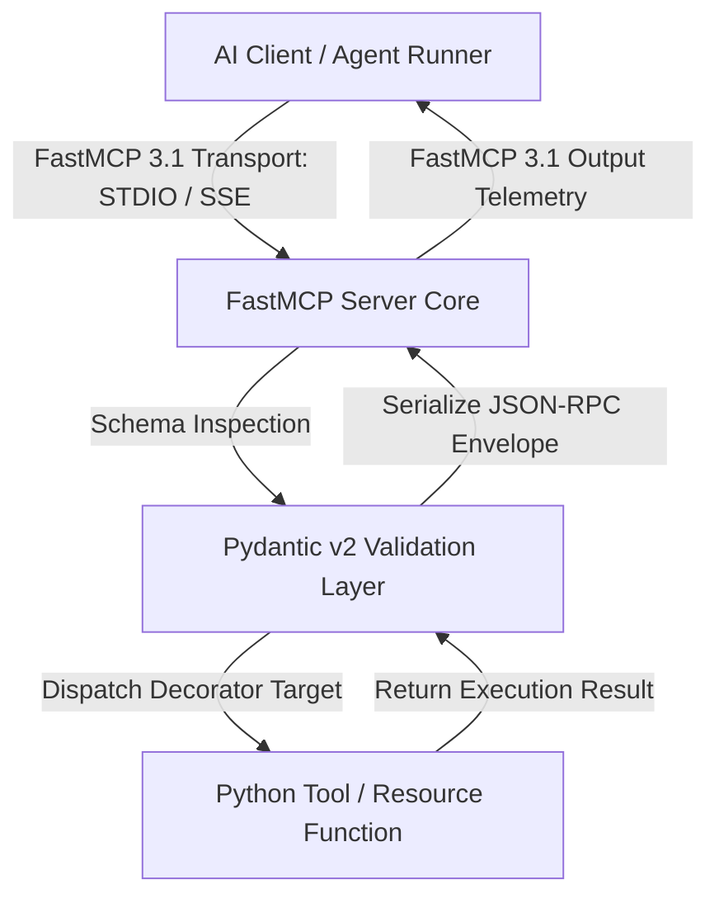
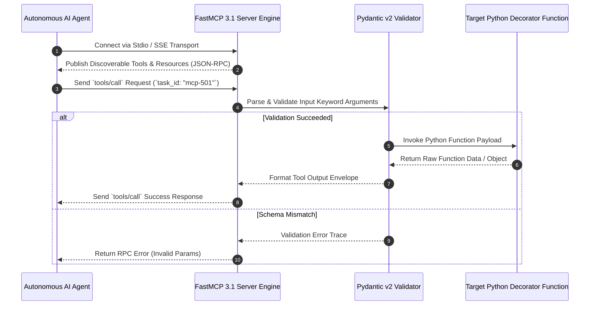

# FastMCP

## What it is
FastMCP is a high-level, developer-friendly Python and TypeScript framework created by Jeremiah Lowin (Prefect) for building Model Context Protocol ([MCP 3.1](../automation_orchestration/mcp.md)) servers. Designed to mirror the simplicity and idiomatic developer experience of FastAPI, FastMCP eliminates low-level JSON-RPC protocol handling, transport boilerplate, and manual schema definitions. In early 2027, **FastMCP 3.1** serves as the standard framework across enterprise and open-source agent ecosystems for exposing local Python functions, Pydantic v2 schemas, stateful resources, and prompt templates to AI models like Claude 5.6, GPT-5.6, and Gemini 4.0 Ultra.

## Architecture & Server Execution Flow
FastMCP handles protocol negotiation, transport abstractions (STDIO, SSE, WebSockets), parameter validation via Pydantic v2, and dynamic tool/resource routing.



## Detailed Execution Sequence



## What problem it solves
Implementing standard Model Context Protocol servers directly using low-level JSON-RPC specifications requires hundreds of lines of transport management, socket listener code, manual type conversions, and asynchronous loop handlers. FastMCP reduces this overhead to simple Python decorator definitions (`@mcp.tool()`, `@mcp.resource()`, `@mcp.prompt()`), automatically converting docstrings and Python type annotations into standard OpenAPI/JSON-RPC tool definitions.

## Where it fits in the stack
**Frameworks & Developer Tools Layer**. FastMCP operates as the core application engine for building custom tools, agent connectors, and system resource bridges that communicate over the Model Context Protocol.

## Typical use cases
- **Building Custom Agent Tools**: Wrapping local Python functions, database queries, and web scrapers as MCP tools.
- **Microservice API Gateways**: Exposing enterprise REST APIs and database functions to AI agents via FastMCP 3.1 SSE endpoints.
- **Resource Streaming**: Streaming real-time file system logs, telemetry metrics, and stateful application updates to LLM contexts.

## Strengths
- **Minimal Boilerplate**: Write standard Python functions with type hints and docstrings; FastMCP handles everything else.
- **Full FastMCP 3.1 Compliance**: Built-in support for tool execution tracking, resource decorators, dynamic prompts, and execution context boundaries.
- **Native Pydantic v2 Integration**: Strict input validation and automatic conversion of custom Pydantic models into MCP tool schemas.

## Limitations
- **Python Async Loop Awareness**: Handlers executing heavy blocking I/O must use async routines or executor pools to avoid stalling transport loops.

## When to use it
- Building custom MCP servers in Python or TypeScript with minimal protocol boilerplate.
- Exposing existing Python functions, databases, or REST APIs as FastMCP 3.1 tools and resources.
- Leveraging Pydantic v2 type hints and validation for AI agent tool calling schemas.

## When not to use it
- Non-Python / non-TypeScript environments where official low-level SDKs for C++, Go, or Rust are required.
- Simple single-file scripts that do not interface with Model Context Protocol agents.
- Legacy architectures restricted from using modern Pydantic v2 validation layers.

## Feature Matrix & Framework Comparison

| Feature | FastMCP 3.1 | Standard MCP SDK (Python) | TypeScript MCP SDK | LangChain Tool Wrapping |
| :--- | :--- | :--- | :--- | :--- |
| **Developer API** | FastAPI-like `@mcp.tool()` | Low-level Class Handlers | Object Literals & Classes | `@tool` Decorators |
| **Schema Engine** | Native Pydantic v2 | Manual JSON Schema | Zod Schema Validation | Pydantic v1 / v2 |
| **Transports Supported** | Stdio, SSE, HTTP/WS Transports | Stdio, SSE | Stdio, SSE | Custom Middleware |
| **Task Correlation ID** | Built-in `taskId` & Execution Context | Manual Implementation | Manual Implementation | N/A |
| **OpenAPI / FastMCP 3.1** | Native FastMCP 3.1 Protocol | Basic MCP 1.0 | Basic MCP 1.0 | Custom Bridge |

## Getting started
1. **Installation**:
   ```bash
   pip install fastmcp pydantic
   ```
2. **Create FastMCP Server (`server.py`)**:
   ```python
   from mcp.server.fastmcp import FastMCP

   mcp = FastMCP("My First FastMCP Server", version="3.1")

   @mcp.tool()
   def add_numbers(a: int, b: int) -> int:
       """Add two numbers together."""
       return a + b

   if __name__ == "__main__":
       mcp.run(transport="stdio")
   ```

## CLI examples
```bash
# Install FastMCP package
pip install fastmcp

# Run FastMCP server using CLI runner
fastmcp run server.py

# Inspect FastMCP server version and protocol capabilities
fastmcp --version
```

## API examples
```python
from mcp.server.fastmcp import FastMCP

mcp = FastMCP("Simple Tool Provider")

@mcp.tool()
def multiply(x: float, y: float) -> float:
    """Multiply two numbers together."""
    return x * y

if __name__ == "__main__":
    mcp.run()
```

## API & FastMCP 3.1 Production Examples

### FastMCP 3.1 Multi-Tool & Resource Server
```python
import mcp.server.fastmcp as fastmcp
from pydantic import BaseModel, Field
from typing import Dict, Any, List

mcp = fastmcp.FastMCP("Enterprise FastMCP 3.1 Infrastructure Server", version="3.1")

class HealthCheckRequest(BaseModel):
    service_name: str = Field(..., description="Target microservice ID")
    verbose: bool = Field(default=False)

@mcp.tool()
def check_service_health(request: HealthCheckRequest) -> Dict[str, Any]:
    """FastMCP 3.1 Tool that evaluates health status for internal microservices."""
    return {
        "service": request.service_name,
        "status": "healthy",
        "latency_ms": 12.4,
        "verbose": request.verbose,
        "mcp_version": "3.1"
    }

@mcp.resource("system://metrics/cpu")
def get_cpu_metrics() -> str:
    """FastMCP Resource providing real-time host system metric summaries."""
    return "cpu_usage_pct=14.2 load_1m=0.45"

if __name__ == "__main__":
    mcp.run()
```

### Programmatic FastMCP Server Runner
```python
from mcp.server.fastmcp import FastMCP
from pydantic import BaseModel

class PipelineInput(BaseModel):
    dataset_id: str
    sample_size: int = 100

def build_fastmcp_app() -> FastMCP:
    app = FastMCP("Data Pipeline FastMCP Provider")

    @app.tool()
    def process_dataset(data: PipelineInput) -> dict:
        """Process data samples under FastMCP 3.1 validation."""
        return {"processed": data.sample_size, "status": "complete"}

    return app

if __name__ == "__main__":
    app = build_fastmcp_app()
    # app.run(transport="stdio")
```

## Systemd Production Daemon Unit Definition
Save unit file to `/etc/systemd/system/fastmcp-server.service`:

```ini
[Unit]
Description=FastMCP 3.1 Enterprise Gateway Daemon
After=network.target

[Service]
Type=simple
User=fastmcp-user
WorkingDirectory=/opt/fastmcp
ExecStart=/usr/bin/python3 /opt/fastmcp/server.py
Restart=always
RestartSec=3s
Environment="PYTHONUNBUFFERED=1"

[Install]
WantedBy=multi-user.target
```

## Troubleshooting & Diagnostic Matrix

| Issue Symptom / Error | Root Cause | Verification Command | Remediation Action |
| :--- | :--- | :--- | :--- |
| **`Transport Read Error`** | STDIO stream polluted by external `print()` calls | Check python scripts for raw `print()` statements | Use `logging` or write diagnostic output to `sys.stderr` |
| **`Schema Generation Error`** | Complex type annotation lacks Pydantic v2 converter | `python server.py` directly to inspect stack trace | Use Pydantic `BaseModel` or explicit Primitive types for tool parameters |
| **`MCP Protocol Version Mismatch`** | Client expects basic MCP 1.0 while server advertises 3.1 | `fastmcp --version` | Update client configuration or pass standard protocol compatibility flags |

## Related tools / concepts
- [Model Context Protocol (MCP)](../automation_orchestration/mcp.md) — Open protocol standard.
- [Vikunja MCP](../automation_orchestration/vikunja-mcp.md) — Production FastMCP 3.1 implementation.
- [Zapier MCP](../automation_orchestration/zapier.md) — Cloud action FastMCP bridge.

## Sources / references
- [FastMCP GitHub Repository](https://github.com/jlowin/fastmcp)
- [Model Context Protocol Specification](https://modelcontextprotocol.io/)

## Contribution Metadata
- Last reviewed: 2027-01-07
- Confidence: high
