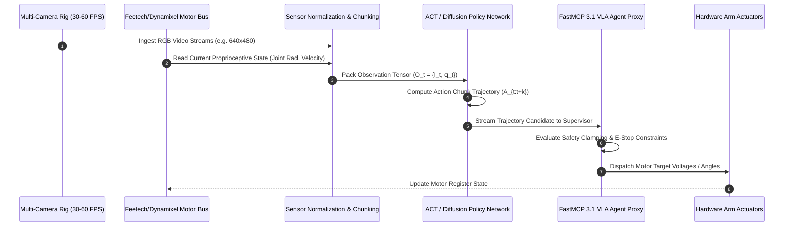

# LeRobot

## What it is
LeRobot is an open-source end-to-end robotics learning framework developed by Hugging Face (v0.4.0+). It provides real-world and simulated robotics data collection tools, pretrained imitation learning and reinforcement learning policy models, standard sensor and actuator interface adapters, and hardware control loops designed for physical AI applications. As of early 2027, LeRobot serves as a primary open-source foundation for training low-latency Vision-Language-Action (VLA) models and deploying embodied AI agents on consumer, industrial, and edge robotics platforms.

## System Architecture

```
+-----------------------------------------------------------------------------------+
|                              LeRobot Control Pipeline                             |
+-----------------------------------------------------------------------------------+
|                                                                                   |
|  +--------------------+         +-----------------------+                         |
|  | Cameras & Spatial  | ------> | LeRobot Sensor        |                         |
|  | Sensors @ 30-60Hz  |         | Normalization Pipeline|                         |
|  +--------------------+         +-----------+-----------+                         |
|                                             |                                     |
|                                             v                                     |
|                                 +-----------------------+                         |
|                                 | Imitation Policy      |                         |
|                                 | ACT / Diffusion / VQ  |                         |
|                                 +-----------+-----------+                         |
|                                             |                                     |
|                        +--------------------+--------------------+                |
|                        |                                         |                |
|                        v                                         v                |
|           +-------------------------+               +-------------------------+   |
|           | FastMCP 3.1 Server      |               | Hugging Face Hub        |   |
|           | High-Level VLA Agent    |               | Model Weights & Datasets|   |
|           +------------+------------+               +------------+------------+   |
|                        |                                         |                |
|                        +--------------------+--------------------+                |
|                                             |                                     |
|                                             v                                     |
|                                 +-----------------------+                         |
|                                 | Motor Actuator &      |                         |
|                                 | Joint Controller      |                         |
|                                 +-----------------------+                         |
|                                                                                   |
+-----------------------------------------------------------------------------------+
```



## What problem it solves
Robotics development historically suffered from extreme fragmentation, proprietary hardware abstraction layers, and a lack of standardized dataset formats for AI training loops. LeRobot standardizes dataset schema ingestion, policy model architectures (such as Diffusion Policy, ACT, and VQ-BeT), and real-time inference loops on consumer or edge computing hardware. It solves the fragmentation challenge by enforcing unified schemas for visual frames, robot state trajectories, and high-frequency motor torque commands.

## Where it fits in the stack
**Category**: Frameworks / Physical AI & Robotics. It sits at the **Execution & Control Layer**, bridging high-level LLM and VLM reasoning agent architectures with low-level actuator motor commands and sensor teleoperation loops.

## Mathematical Formulations of Policy Architectures

### 1. Action Chunking Transformer (ACT) Loss Formulation
Action Chunking Transformers model temporal action sequences as chunked vectors $A_{t:t+k} = [a_t, a_{t+1}, \dots, a_{t+k-1}] \in \mathbb{R}^{k \times d_a}$ conditioned on visual and proprioceptive observations $O_t$. To capture multimodal human demonstration distributions, ACT utilizes a Conditional Variational Autoencoder (CVAE) framework.

The overall training objective minimizes the reconstruction loss combined with the Kullback-Leibler (KL) divergence regularizer:

$$\mathcal{L}_{\text{ACT}}(\theta, \phi) = \mathbb{E}_{z \sim q_\phi(z \mid O_t, A_{t:t+k})} \left[ \| A_{t:t+k} - \pi_\theta(O_t, z) \|_1 \right] + \beta \, \mathcal{D}_{\text{KL}}\Big( q_\phi(z \mid O_t, A_{t:t+k}) \;\Big\|\; p(z) \Big)$$

Where:
- $q_\phi(z \mid O_t, A_{t:t+k})$ is the encoder network parameterized by $\phi$, mapping observations and demonstration trajectories into a latent Gaussian distribution $\mathcal{N}(\mu_z, \Sigma_z)$.
- $\pi_\theta(O_t, z)$ is the Transformer decoder parameterized by $\theta$, outputting predicted joint trajectory chunks.
- $p(z) = \mathcal{N}(0, I)$ represents the standard isotropic Gaussian prior.
- $\beta \in [10.0, 100.0]$ is a weighting hyperparameter balancing action reconstruction precision against latent distribution regularization.
- Temporal ensembling is applied during online inference across overlapping prediction chunks via exponential weighting:

$$a_t = \sum_{i=0}^{\min(t, k-1)} w_i \, a_{t-i \mid t}, \quad \text{where } w_i = \frac{\exp(-m \cdot i)}{\sum_{j=0}^{k-1} \exp(-m \cdot j)}$$

### 2. Denoising Diffusion Policy Score Matching
For policies utilizing continuous denoising diffusion, the action sequence is generated by progressively reversing a Gaussian perturbation process over $N$ diffusion timesteps. The denoising objective minimizes the mean squared error between the added noise $\epsilon$ and the model estimate $\epsilon_\theta$:

$$\mathcal{L}_{\text{diff}}(\theta) = \mathbb{E}_{t \sim [1, N], \, A^0 \sim \mathcal{D}, \, \epsilon \sim \mathcal{N}(0, I)} \left[ \left\| \epsilon - \epsilon_\theta\left( \sqrt{\bar{\alpha}_t} A^0 + \sqrt{1 - \bar{\alpha}_t} \epsilon, \; O_t, \; t \right) \right\|^2 \right]$$

Where:
- $\alpha_t = 1 - \beta_t$ dictates the discrete variance schedule, and $\bar{\alpha}_t = \prod_{s=1}^t \alpha_s$.
- $A^0$ is the ground-truth teleoperated action trajectory chunk.
- $\epsilon_\theta$ is a 1D Temporal U-Net or DiT (Diffusion Transformer) predicting the injected noise vector given observation embeddings $O_t$.

### 3. Motor Actuator Trajectory PID Latency Dynamics
When transmitting target joint commands $a_t$ across a serial serial bus (e.g., Feetech STS3215 or Dynamixel XM430), the mechanical response conforms to closed-loop Proportional-Integral-Derivative (PID) torque dynamics:

$$\tau_{\text{motor}}(t) = K_p \, e(t) + K_i \int_0^t e(\tau) \, d\tau + K_d \, \frac{de(t)}{dt}$$

The total hardware loop latency $\mathcal{T}_{\text{total}}$ must remain strictly under the policy period $T_{\text{step}} = \frac{1}{f_{\text{policy}}}$ (e.g., $\le 33.3\text{ ms}$ for 30Hz):

$$\mathcal{T}_{\text{total}} = \mathcal{T}_{\text{camera\_capture}} + \mathcal{T}_{\text{tensor\_norm}} + \mathcal{T}_{\text{model\_infer}} + \mathcal{T}_{\text{serial\_tx}} + \mathcal{T}_{\text{servo\_response}} < T_{\text{step}}$$

## Typical use cases
- **Streaming Data Collection & Teleoperation**: Logging streaming camera frames and arm joint states into standard Hugging Face LeRobot dataset formats using low-cost hardware (e.g., SO-ARM100, Koch v1.1).
- **Imitation Learning Policy Training**: Training neural policies to perform complex dexterous manipulation tasks using physical demonstration data and PyTorch distributed training pipelines.
- **Edge Deployment & Real-Time Inference**: Running optimized policy control loops at 30-100Hz on local NVIDIA Jetson, Mac Studio, or edge AI gateways.
- **Multimodal Agent Control Integration**: Connecting frontier vision-language models (e.g. Gemini 4.0 Pro, Claude 5.6) to physical robotic arms via FastMCP 3.1 action primitives.
- **Sim-to-Real Benchmark Testing**: Evaluating trained policies across simulated environments (Isaac Gym, MuJoCo) before zero-shot or fine-tuned deployment on physical robotic arms.

## Policy & Robotics Framework Comparative Matrix

| Framework / Architecture | Policy Algorithms | Teleop & Data Collection | Real-Time Latency | Hardware Ecosystem | Primary Target Domain |
| :--- | :--- | :--- | :--- | :--- | :--- |
| **LeRobot (Hugging Face)** | ACT, Diffusion, VQ-BeT | Native CLI, Webcams, Leader-Follower | 15 - 30 ms | SO-ARM100, Koch, Unitree, Dynamixel | Accessible, physical AI & consumer arms |
| **RoboMimic** | BC, BC-RNN, HBC, Diffusion | HDF5 replay, SpaceMouse | 25 - 50 ms | Franka Emika Panda, UR5 | Academic robotics & benchmark datasets |
| **OpenX / RT-2 (Google)** | VLA, Vision-Language-Action | Distributed multi-robot logging | 100 - 250 ms | Mobile manipulators, PR2, Everyday Robots | High-level semantic reasoning & general VLA |
| **NVIDIA Isaac Lab** | PPO, SAC, Dagger, MimicGen | Omniverse simulation teleop | 5 - 15 ms (Sim) | Any USD-based digital twin | Massively parallel GPU reinforcement learning |
| **ROS2 MoveIt 2** | Trajectory Planners (OMPL) | Laser scanners, industrial teach pendants | 2 - 10 ms | Universal Robots, KUKA, ABB | Deterministic industrial automation & safety |

## Strengths
- **Native Hugging Face Ecosystem Integration**: Directly streams datasets and model weights to and from the Hugging Face Hub using standard parquet and zarr formats.
- **Broad Model Policy Zoo**: Includes built-in implementations of Action Chunking with Transformers (ACT), Diffusion Policy, VQ-BeT, and Vision-Language-Action (VLA) models.
- **Lightweight Hardware Requirements**: Operates on low-cost open hardware arms (e.g., SO-ARM100, Koch v1.1) as well as commercial industrial manipulators.
- **Modular Data Format**: Enforces rigid dataset schemas with built-in video decoding, state chunking, and spatial coordinate transforms.
- **Sub-20ms Execution Latency**: Optimized PyTorch execution runtime tailored for local inference without cloud round-trip overhead.

## Limitations
- **Hardware Calibration Required**: High precision physical actions require careful motor joint calibration and hardware-specific latency tuning.
- **Real-Time Latency Sensitivity**: Real-world teleoperation requires low-latency local execution loops, making network-dependent architectures challenging.
- **Continuous Domain Gap**: Sim-to-real transfer requires fine-tuning or domain randomization when trained purely in synthetic simulation environments.
- **Thermal & Hardware Strain**: Continuous high-frequency inference requires monitoring motor temperatures and mechanical backlash over extended training sessions.

## When to use it
- When training, evaluating, or deploying physical AI and imitation learning policies for robotic manipulators.
- When collecting streaming sensor and action teleoperation datasets for open-source sharing on Hugging Face Hub.
- When orchestrating physical robotics execution workflows alongside LLM planning agents using FastMCP 3.1.

## When not to use it
- For purely web-based, software-only software automation (use [Browser Use](../automation_orchestration/browser-use.md) or [Playwright](../automation_orchestration/puppeteer.md)).
- For classical industrial PLC ladder logic control with fixed deterministic motion trajectories requiring microsecond-level hard real-time guarantees.

## Getting started

### Installation
Install LeRobot via pip from source or PyPI with physical robot hardware support:
```bash
pip install lerobot torch torchvision pydantic mcp fastmcp
```

### Basic Hardware Initialization & Policy Evaluation
Evaluate a pretrained policy on local hardware or simulation environment:
```python
import lerobot
from lerobot.common.policies.act.modeling_act import ACTPolicy

# Load pretrained policy model from Hugging Face Hub
policy = ACTPolicy.from_pretrained("lerobot/act_so100_real")
policy.eval()
print("LeRobot ACT Policy successfully loaded.")
```

## Systemd Production Daemon Configuration

To ensure persistent supervisor operation and automated recovery on Linux robot controllers (e.g. Ubuntu 24.04 LTS on Jetson AGX Orin or edge industrial PCs), deploy the following systemd service to `/etc/systemd/system/lerobot-agent.service`:

```ini
[Unit]
Description=LeRobot Physical AI Control Daemon & FastMCP Gateway
After=network.target local-fs.target
Wants=network-online.target

[Service]
Type=simple
User=robotics
Group=dialout
WorkingDirectory=/opt/lerobot-runtime
ExecStart=/usr/local/bin/python3 /opt/lerobot-runtime/lerobot_mcp_server.py --port 8089 --device /dev/ttyUSB0
Restart=always
RestartSec=3s
LimitNOFILE=65536
Environment="PYTHONUNBUFFERED=1"
Environment="CUDA_VISIBLE_DEVICES=0"
Environment="ROBOT_CALIBRATION_FILE=/etc/lerobot/so100_calibration.json"

# Hardware serial & camera isolation permissions
DeviceAllow=/dev/ttyUSB0 rw
DeviceAllow=/dev/video0 rw
DeviceAllow=/dev/video1 rw
ProtectSystem=full
ProtectHome=read-only
ReadWritePaths=/opt/lerobot-runtime/logs /tmp

[Install]
WantedBy=multi-user.target
```

Enable and initiate the service:
```bash
sudo systemctl daemon-reload
sudo systemctl enable --now lerobot-agent.service
sudo systemctl status lerobot-agent.service
```

## Docker Compose Hardware Multi-Service Deployment

Deploy LeRobot alongside a real-time telemetry stream collector and FastMCP 3.1 gateway using Docker Compose:

```yaml
version: '3.8'

services:
  lerobot-gateway:
    image: huggingface/lerobot:v0.4.0-cuda
    container_name: lerobot-gateway
    privileged: true
    network_mode: host
    restart: unless-stopped
    devices:
      - "/dev/ttyUSB0:/dev/ttyUSB0"
      - "/dev/video0:/dev/video0"
      - "/dev/video2:/dev/video2"
    environment:
      - PYTHONUNBUFFERED=1
      - ROBOT_TYPE=so100
      - BAUD_RATE=1000000
      - FASTMCP_PORT=8089
    volumes:
      - ./data/trajectories:/workspace/trajectories
      - ./config/calibration.json:/workspace/calibration.json:ro
    command: ["python3", "lerobot_mcp_server.py", "--host", "0.0.0.0", "--port", "8089"]

  robotics-telemetry-exporter:
    image: prom/node-exporter:v1.8.0
    container_name: robotics-telemetry-exporter
    ports:
      - "9100:9100"
    restart: unless-stopped
    command:
      - '--path.procfs=/host/proc'
      - '--path.sysfs=/host/sys'
    volumes:
      - /proc:/host/proc:ro
      - /sys:/host/sys:ro
```

## Automated Service Verification Probe

Validate real-time robotic server health, serial bus accessibility, and VLA action chunking responsiveness using this automated probe script:

```python
#!/usr/bin/env python3
"""Automated Health & Telemetry Verification Probe for LeRobot Hardware Gateway."""

import sys
import time
import json
import urllib.request
import urllib.error

def probe_lerobot_gateway(base_url: str = "http://localhost:8089") -> bool:
    print(f"[*] Probing LeRobot Robotics Gateway at: {base_url}")
    t0 = time.perf_counter()

    # 1. Probe general health endpoint
    health_url = f"{base_url}/health"
    try:
        req = urllib.request.Request(health_url, headers={"User-Agent": "LeRobot-HealthProbe/1.0"})
        with urllib.request.urlopen(req, timeout=4.0) as resp:
            data = json.loads(resp.read().decode("utf-8"))
            elapsed_ms = (time.perf_counter() - t0) * 1000.0
            print(f"[+] Gateway Health OK ({elapsed_ms:.2f} ms): {data}")
    except urllib.error.URLError as e:
        print(f"[!] Health check failed at {health_url}: {e}")
        return False

    # 2. Probe hardware actuator telemetry endpoint
    try:
        telemetry_url = f"{base_url}/telemetry/joints"
        req = urllib.request.Request(telemetry_url, headers={"User-Agent": "LeRobot-HealthProbe/1.0"})
        with urllib.request.urlopen(req, timeout=4.0) as resp:
            telemetry_data = json.loads(resp.read().decode("utf-8"))
            joints = telemetry_data.get("joint_positions_rad", [])
            temp_c = telemetry_data.get("max_motor_temp_c", 0.0)
            print(f"[+] Actuator Status: {len(joints)} joints detected, Max Temp: {temp_c}°C")
            if temp_c > 65.0:
                print(f"[WARNING] Motor thermal warning threshold exceeded ({temp_c}°C)!")
                return False
    except Exception as e:
        print(f"[!] Telemetry probe failed: {e}")
        return False

    print("[SUCCESS] LeRobot gateway verified operational.")
    return True

if __name__ == "__main__":
    url = sys.argv[1] if len(sys.argv) > 1 else "http://localhost:8089"
    if not probe_lerobot_gateway(url):
        sys.exit(1)
```

## CLI examples

### Recording Teleoperation Dataset
Record 50 episodes of motor manipulation demonstrations to a local dataset repository:
```bash
lerobot-record \
  --robot.type=so100 \
  --fps=30 \
  --repo-id=user/so100-button-press \
  --num-episodes=50 \
  --push-to-hub=true
```

### Training Imitation Policy
Train a Diffusion Policy on recorded dataset using CUDA acceleration:
```bash
lerobot-train \
  --policy.type=diffusion \
  --dataset.repo_id=user/so100-button-press \
  --env.type=real \
  --batch-size=64 \
  --steps=100000 \
  --eval-freq=5000
```

### Policy Replay & Evaluation
Replay a trained policy model on real hardware to evaluate target completion rate:
```bash
lerobot-eval \
  --policy.path=user/so100-diffusion-button-press \
  --robot.type=so100 \
  --num-eval-episodes=10
```

## API examples

### 1. FastMCP 3.1 Robotics Gateway Server with Strict Pydantic v2
This executable Python script defines a FastMCP 3.1 server exposing LeRobot physical robot commands to higher-level AI agents, using strict Pydantic v2 schemas (`extra="forbid"`, `frozen=True`).

```python
import time
from typing import List, Optional
from pydantic import BaseModel, Field, ConfigDict, field_validator
from fastmcp import FastMCP

# Initialize FastMCP 3.1 Server for LeRobot Control
mcp = FastMCP(
    name="LeRobot Physical AI Gateway",
    version="3.1.0",
    description="FastMCP server for robotic arm telemetry and VLA trajectory execution."
)

class JointTelemetry(BaseModel):
    model_config = ConfigDict(extra="forbid", frozen=True, str_strip_whitespace=True)

    joint_positions_rad: List[float] = Field(..., min_length=6, max_length=6, description="6-DOF motor joint angles in radians")
    joint_velocities_rad_s: List[float] = Field(..., min_length=6, max_length=6, description="Motor joint velocities in rad/s")
    gripper_open: bool = Field(..., description="Boolean status of end-effector gripper")
    temperature_celsius: float = Field(..., ge=10.0, le=85.0, description="Highest monitored servo motor temperature")

class RobotCommandRequest(BaseModel):
    model_config = ConfigDict(extra="forbid", frozen=True, str_strip_whitespace=True)

    target_positions_rad: List[float] = Field(..., min_length=6, max_length=6, description="Target joint angles for physical arm movement")
    gripper_open: bool = Field(True, description="Target gripper state")
    max_velocity_scaling: float = Field(0.5, ge=0.05, le=1.0, description="Velocity safety clamp multiplier")
    trajectory_chunk_size: int = Field(16, ge=1, le=64, description="Action chunking horizon length")

    @field_validator("target_positions_rad")
    @classmethod
    def check_joint_limits(cls, values: List[float]) -> List[float]:
        # Enforce physical mechanical limit boundaries [-pi, +pi]
        for idx, val in enumerate(values):
            if not (-3.14159 <= val <= 3.14159):
                raise ValueError(f"Joint {idx} angle {val} exceeds physical limit [-pi, +pi].")
        return values

class RobotExecutionResponse(BaseModel):
    model_config = ConfigDict(extra="forbid", frozen=True)

    status: str = Field(...)
    timestamp: float = Field(...)
    dispatched_trajectory_steps: int = Field(...)
    safety_clamped: bool = Field(...)
    summary_message: str = Field(...)

@mcp.tool(
    name="execute_robot_trajectory",
    description="Validates and dispatches a multi-step joint action trajectory to the LeRobot physical arm."
)
def execute_robot_trajectory(command: RobotCommandRequest) -> RobotExecutionResponse:
    """Dispatches validated trajectory chunk to the low-level actuator control bus."""
    is_clamped = command.max_velocity_scaling < 0.3

    return RobotExecutionResponse(
        status="dispatched",
        timestamp=time.time(),
        dispatched_trajectory_steps=command.trajectory_chunk_size,
        safety_clamped=is_clamped,
        summary_message=f"Dispatched trajectory to 6 DOFs with velocity scale {command.max_velocity_scaling}."
    )

if __name__ == "__main__":
    mcp.run()
```

### 2. Standalone Trajectory Verification Script with Strict Pydantic v2
This script tests and verifies trajectory chunking arrays against strict Pydantic v2 validation rules:

```python
from typing import List
from pydantic import BaseModel, Field, ConfigDict

class ActionChunkSample(BaseModel):
    model_config = ConfigDict(extra="forbid", frozen=True)

    step_index: int = Field(..., ge=0)
    joint_targets: List[float] = Field(..., min_length=6, max_length=6)
    gripper_force_n: float = Field(default=5.0, ge=0.0, le=25.0)

def verify_trajectory_chunk(chunk_list: List[dict]):
    validated = [ActionChunkSample(**step) for step in chunk_list]
    print(f"Verified {len(validated)} trajectory actions successfully.")
    for v in validated:
        print(f"Step {v.step_index}: target[0]={v.joint_targets[0]:.3f} rad, force={v.gripper_force_n} N")

if __name__ == "__main__":
    sample_chunk = [
        {"step_index": 0, "joint_targets": [0.0, -0.2, 0.4, 0.0, 0.1, 0.0], "gripper_force_n": 4.5},
        {"step_index": 1, "joint_targets": [0.02, -0.19, 0.41, 0.0, 0.11, 0.0], "gripper_force_n": 4.5}
    ]
    verify_trajectory_chunk(sample_chunk)
```

## Diagnostic Troubleshooting Matrix

| Failure Mode / Error | Root Cause | Immediate Diagnostic Action | Permanent Resolution Strategy |
| :--- | :--- | :--- | :--- |
| **`MOTOR_COMMUNICATION_TIMEOUT`** | USB serial dropped to Feetech/Dynamixel motor bus. | Inspect `dmesg -T` and `ls -l /dev/ttyUSB*`. | Verify baud rate (1Mbps/3Mbps); replace worn USB-to-RS485 interface dongle. |
| **`JOINT_LIMIT_EXCEEDED`** | Policy predicted target angle outside physical arm range. | Inspect raw output tensor from `ACTPolicy.predict()`. | Enforce joint limit clipping in `RobotCommandRequest` prior to register write. |
| **`CAMERA_FRAME_DROPPED`** | USB bus contention from 2+ concurrent 1080p webcams. | Run `v4l2-ctl --list-devices` and check USB bandwidth. | Move cameras to separate host controllers; set resolution to 640x480 @ 30FPS. |
| **`POLICY_OUT_OF_DISTRIBUTION`** | Arm moved into unexpected pose causing erratic jitter. | Monitor teleop entropy and joint acceleration spikes. | Trigger emergency stop switch; record 20+ additional demonstrations in target pose. |
| **`MOTOR_OVERHEAT_WARNING`** | Continuous high-torque holding pose causing thermal throttle. | Poll servo temperature registers (`temp > 65°C`). | Add active cooling fans or adjust resting posture to release continuous torque. |
| **`ACTION_CHUNKING_DRIFT`** | Asynchronous clock drift between policy inference and PID bus. | Measure delta between `T_infer` and `T_actuate`. | Synchronize motor update loop to hardware interrupt timer at constant frequency. |
| **`PARQUET_SHARD_CORRUPT`** | Interrupted disk write during teleoperation episode recording. | Check dataset integrity via `python -m lerobot.common.datasets.check`. | Enable atomic flush on episode completion; configure battery-backed NVMe storage. |
| **`CUDA_OOM_DURING_EVAL`** | Visual encoder batch size exceeds GPU memory during rollouts. | Check peak VRAM usage via `nvidia-smi`. | Use `torch.inference_mode()` and resize RGB frames to 224x224 prior to backbone forward pass. |

## Production Deployment Guardrails

1. **Hardware E-Stop Hook**: Always bind a physical USB or Bluetooth emergency stop button to instantly disarm motor torque registers.
2. **Velocity & Acceleration Capping**: Clamp maximum joint velocity (`max_velocity_scaling <= 0.5`) during early real-world policy testing.
3. **Joint Angle Hard Limits**: Define software boundary guardrails in Python drivers matching the exact mechanical joint limits of the arm.
4. **Thermal Monitoring**: Programmatically poll servo temperature registers; halt policy execution if motor temp exceeds 65°C.
5. **Sim-to-Real Domain Randomization**: Add visual noise, lighting variations, and random object position shifts during training to improve real-world policy transfer.

## Related tools / concepts
- [Hugging Face Ecosystem](../providers/huggingface.md)
- [Pydantic AI](../frameworks/pydantic-ai.md)
- [FastMCP 3.1](../automation_orchestration/mcp.md)
- [Browser Use](../automation_orchestration/browser-use.md)
- [OpenCode](../development_ops/opencode.md)
- [Claude Code](../development_ops/claude-code.md)
- [vLLM](../infrastructure/vllm.md)

## Sources / references
- [Hugging Face LeRobot Announcement](https://huggingface.co/blog/amazon/strands-lerobot-streaming-data-loop)
- [GitHub - Hugging Face LeRobot Repository](https://github.com/huggingface/lerobot)
- [LeRobot Official Documentation](https://huggingface.co/docs/lerobot)
- [FastMCP 3.1 Task Protocol Specification](https://github.com/jlowin/fastmcp)

---
## Contribution Metadata
- Last reviewed: 2027-01-07
- Confidence: high
