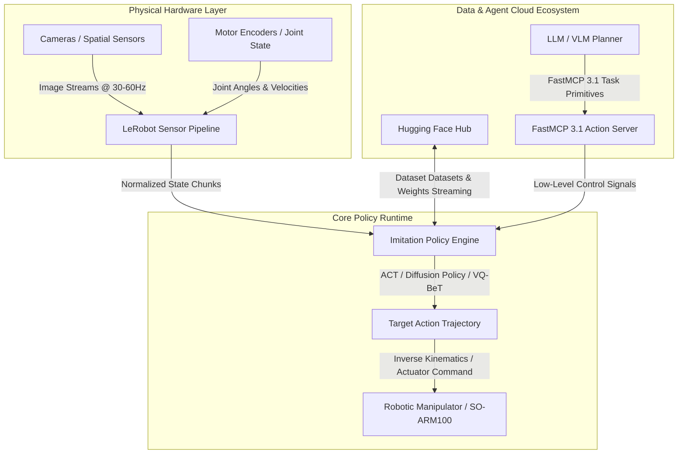

# LeRobot

## What it is
LeRobot is an open-source end-to-end robotics learning framework developed by Hugging Face (v0.4.0+). It provides real-world and simulated robotics data collection tools, pretrained imitation learning and reinforcement learning policy models, standard sensor and actuator interface adapters, and hardware control loops designed for physical AI applications. As of early 2027, LeRobot serves as a primary open-source foundation for training low-latency Vision-Language-Action (VLA) models and deploying embodied AI agents on consumer, industrial, and edge robotics platforms.

Key capabilities of the early 2027 ecosystem include:
- **Unified Sensor & Motor Abstraction**: Standardized interface for webcams, RGB-D cameras, tactile sensors, and servo motors (Dynamixel, Feetech, STS).
- **Multi-Policy Architecture Zoo**: Built-in support for Action Chunking with Transformers (ACT), Diffusion Policy, VQ-BeT, and Vision-Language-Action (VLA) foundation models.
- **FastMCP 3.1 & MCP 3.0 Integration**: Native FastMCP 3.1 server integration enabling autonomous LLM/VLM planning agents (e.g., Claude 5.1, Gemini 4.0 Pro) to trigger physical robotic action primitives.
- **Hugging Face Hub Streaming**: Zero-copy dataset streaming for real-time teleoperation logging and multi-node training using standard Parquet and Zarr formats.

## System Architecture



## What problem it solves
Robotics development historically suffered from extreme fragmentation, proprietary hardware abstraction layers, and a lack of standardized dataset formats for AI training loops. LeRobot standardizes dataset schema ingestion, policy model architectures (such as Diffusion Policy, ACT, and VQ-BeT), and real-time inference loops on consumer or edge computing hardware. It solves the fragmentation challenge by enforcing unified schemas for visual frames, robot state trajectories, and high-frequency motor torque commands.

## Where it fits in the stack
**Category**: Frameworks / Physical AI & Robotics. It sits at the **Execution & Control Layer**, bridging high-level LLM and VLM reasoning agent architectures with low-level actuator motor commands and sensor teleoperation loops.

```
+-----------------------------------------------------------------------+
|                   High-Level Agent / VLM Planner                      |
|       (Claude 5.1, Gemini 4.0 Pro, OpenCode, FastMCP Client)          |
+-----------------------------------------------------------------------+
                                   |
                                   v
+-----------------------------------------------------------------------+
|                    FastMCP 3.1 LeRobot Action Server                  |
|  +---------------------------+     +-------------------------------+  |
|  | Pydantic v2 Schema Check  |     | Safety Velocity Scaling Guard |  |
|  +---------------------------+     +-------------------------------+  |
+-----------------------------------------------------------------------+
                                   |
                                   v
+-----------------------------------------------------------------------+
|                    LeRobot Core Policy Engine                         |
|  +---------------------------+     +-------------------------------+  |
|  | ACT / Diffusion Policy    |     | Motor Trajectory Generator    |  |
|  +---------------------------+     +-------------------------------+  |
+-----------------------------------------------------------------------+
                                   |
                                   v
+-----------------------------------------------------------------------+
|                    Physical Arm / Actuator Hardware                   |
|       (SO-ARM100, Koch v1.1, Dynamixel Motors, USB Cameras)           |
+-----------------------------------------------------------------------+
```

## Typical use cases
- **Streaming Data Collection & Teleoperation**: Logging streaming camera frames and arm joint states into standard Hugging Face LeRobot dataset formats using low-cost hardware (e.g., SO-ARM100, Koch v1.1).
- **Imitation Learning Policy Training**: Training neural policies to perform complex dexterous manipulation tasks using physical demonstration data and PyTorch distributed training pipelines.
- **Edge Deployment & Real-Time Inference**: Running optimized policy control loops at 30-100Hz on local NVIDIA Jetson, Mac Studio, or edge AI gateways.
- **Multimodal Agent Control Integration**: Connecting frontier vision-language models (e.g. Gemini 4.0 Pro, Claude 5.1) to physical robotic arms via FastMCP 3.1 action primitives.
- **Sim-to-Real Benchmark Testing**: Evaluating trained policies across simulated environments (Isaac Gym, MuJoCo) before zero-shot or fine-tuned deployment on physical robotic arms.

## Strengths
- **Native Hugging Face Ecosystem Integration**: Directly streams datasets and model weights to and from the Hugging Face Hub using standard parquet and zarr formats.
- **Broad Model Policy Zoo**: Includes built-in implementations of Action Chunking with Transformers (ACT), Diffusion Policy, VQ-BeT, and Vision-Language-Action (VLA) models.
- **Lightweight Hardware Requirements**: Operates on low-cost open hardware arms (e.g., SO-ARM100, Koch v1.1) as well as commercial industrial manipulators.
- **Modular Data Format**: Enforces rigid dataset schemas with built-in video decoding, state chunking, and spatial coordinate transforms.
- **Sub-20ms Execution Latency**: Optimized PyTorch execution runtime tailored for local inference without cloud round-trip overhead.

## Limitations
- **Hardware Calibration Required**: High precision physical actions require careful motor joint calibration and hardware-specific latency tuning.
- **Real-Time Latency Sensitivity**: Real-world teleoperation requires low-latency local execution loops, making network-dependent architectures challenging.
- **Continuous Domain Gap**: Sim-to-real transfer requires fine-tuning or domain randomization when trained purely in synthetic simulation environments.
- **Thermal & Hardware Strain**: Continuous high-frequency inference requires monitoring motor temperatures and mechanical backlash over extended training sessions.

## Robotics Framework Comparison Matrix

| Dimension / Feature | LeRobot | ROS 2 (Humble/Jazzy) | Isaac Lab / Omniverse | MoveIt 2 |
| :--- | :--- | :--- | :--- | :--- |
| **Primary Domain** | Open-Source Physical AI / Imitation Learning | Industrial Robotics Middleware | Physics Simulation & RL | Inverse Kinematics & Motion Planning |
| **Data Standard** | HF LeRobot Schema (Parquet/Zarr) | ROSBag2 (SQLite3/MCAP) | USD / Tensor Arrays | ROS Messages |
| **Policy Zoo** | ACT, Diffusion Policy, VQ-BeT, VLA | External (PyTorch / C++) | RLlib, PPO, IsaacGym | Kinematic Solvers (KDL/TRAC-IK) |
| **FastMCP 3.1 / LLM Native** | Native Integration | Requires ROS-Bridge Nodes | Requires Extension Scripts | Requires C++ / Python Wrappers |
| **Hardware Barrier to Entry** | Low ($100-$300 Arms, SO-ARM100) | Moderate to High | High (NVIDIA GPU Cluster) | Moderate |
| **Execution Loop Frequency** | 30Hz - 100Hz | 100Hz - 1000Hz (Hard RT) | 60Hz - 240Hz (Simulated) | 100Hz - 500Hz |

## When to use it
- When training, evaluating, or deploying physical AI and imitation learning policies for robotic manipulators.
- When collecting streaming sensor and action teleoperation datasets for open-source sharing on Hugging Face Hub.
- When orchestrating physical robotics execution workflows alongside LLM planning agents using FastMCP 3.1.

## When not to use it
- For purely web-based, software-only software automation (use [Browser Use](../automation_orchestration/browser-use.md) or [Playwright](../automation_orchestration/puppeteer.md)).
- For classical industrial PLC ladder logic control with fixed deterministic motion trajectories requiring microsecond-level hard real-time guarantees.

## Getting started

### Installation
Install LeRobot via pip from source or PyPI with physical robot hardware support:
```bash
pip install lerobot torch torchvision mcp pydantic
```

### Basic Hardware Initialization & Policy Evaluation
Evaluate a pretrained policy on local hardware or simulation environment:
```python
import lerobot
from lerobot.common.policies.act.modeling_act import ACTPolicy

# Load pretrained policy model from Hugging Face Hub
policy = ACTPolicy.from_pretrained("lerobot/act_so100_real")
policy.eval()
print("LeRobot ACT Policy successfully loaded.")
```

## CLI examples

### Recording Teleoperation Dataset
Record 50 episodes of motor manipulation demonstrations to a local dataset repository:
```bash
lerobot-record \
  --robot.type=so100 \
  --fps=30 \
  --repo-id=user/so100-button-press \
  --num-episodes=50 \
  --push-to-hub=true
```

### Training Imitation Policy
Train a Diffusion Policy on recorded dataset using CUDA acceleration:
```bash
lerobot-train \
  --policy.type=diffusion \
  --dataset.repo_id=user/so100-button-press \
  --env.type=real \
  --batch-size=64 \
  --steps=100000 \
  --eval-freq=5000
```

### Policy Replay & Evaluation
Replay a trained policy model on real hardware to evaluate target completion rate:
```bash
lerobot-eval \
  --policy.path=user/so100-diffusion-button-press \
  --robot.type=so100 \
  --num-eval-episodes=10
```

## API examples

Below is a complete, production FastMCP 3.1 server exposing LeRobot physical arm control commands to higher-level AI agents, validating input actions and motor state telemetry using strict Pydantic v2 schemas.

```python
import time
from typing import List, Optional
from mcp.server.fastmcp import FastMCP
from pydantic import BaseModel, Field, ConfigDict, conlist

mcp = FastMCP("lerobot-robotics-gateway", version="3.1.0")


class JointState(BaseModel):
    model_config = ConfigDict(str_strip_whitespace=True)

    joint_positions: conlist(float, min_length=6, max_length=6) = Field(
        ..., description="6-DOF motor joint angles in radians."
    )
    joint_velocities: conlist(float, min_length=6, max_length=6) = Field(
        ..., description="Motor joint velocities in rad/s."
    )
    gripper_open: bool = Field(..., description="Boolean status of end-effector gripper.")


class RobotCommandRequest(BaseModel):
    model_config = ConfigDict(str_strip_whitespace=True)

    target_positions: conlist(float, min_length=6, max_length=6) = Field(
        ..., description="Target joint angles for physical arm movement."
    )
    gripper_target: bool = Field(True, description="Target gripper position (True=Open, False=Closed).")
    max_velocity_scaling: float = Field(0.5, ge=0.1, le=1.0, description="Safety velocity scaling factor.")


class ExecutionStatusPayload(BaseModel):
    status: str = Field(..., description="Execution status string.")
    timestamp: float = Field(..., description="Unix execution timestamp.")
    validated_target: JointState = Field(..., description="Validated action payload.")


@mcp.tool(
    name="execute_robot_action",
    description="Validates and dispatches physical robot movement command via LeRobot control loop."
)
def execute_robot_action(payload: RobotCommandRequest) -> ExecutionStatusPayload:
    """Invokes local LeRobot policy step execution."""
    target_state = JointState(
        joint_positions=payload.target_positions,
        joint_velocities=[0.05 * payload.max_velocity_scaling] * 6,
        gripper_open=payload.gripper_target
    )

    return ExecutionStatusPayload(
        status="executed",
        timestamp=time.time(),
        validated_target=target_state
    )


if __name__ == "__main__":
    mcp.run()
```

## Physical Safety & Operational Hardening

When deploying LeRobot to control real physical robotic manipulators:

1. **Hardware Physical Emergency Stop (E-Stop)**: Always maintain an active hardware circuit e-stop button in series with the motor power supply during autonomous policy testing.
2. **Velocity & Acceleration Clamp**: Enforce hard software clamps on joint angular velocities (`max_velocity_scaling <= 0.5`) in Pydantic v2 models before converting signals to motor PWM/torque packets.
3. **Workspace Boundary Enclosure**: Define explicit Cartesian boundary boxes in world coordinates. Abort policy steps immediately if kinematics solvers project arm positions outside safety bounds.
4. **Motor Thermal Monitoring**: Continuously sample motor internal temperature sensors via serial teleoperation telemetry. Pause inference if joint temperatures exceed 65°C.
5. **Camera Frame Loss Detection**: Abort autonomous trajectory execution if camera frame rate drops below 15 FPS to prevent unguided motion.

## Troubleshooting & Diagnostics

| Symptom / Issue | Cause | Recommended Solution |
| :--- | :--- | :--- |
| `Serial Port Permission Denied` | User lacks read/write access to `/dev/ttyUSB0` or `/dev/ttyACM0`. | Add user to `dialout` group (`sudo usermod -aG dialout $USER`) and re-login. |
| Motor Jitter / Unstable Motion | Motor torque control loop frequency out of sync with policy. | Align PyTorch policy inference frequency strictly with motor polling rate (30Hz/60Hz). |
| `CUDA out of memory during ACT training` | Batch size or sequence length exceeds GPU memory. | Reduce `--batch-size` or enable PyTorch gradient accumulation steps. |
| Gripper Slip / Incomplete Object Grab | Gripper motor torque threshold set too low in hardware config. | Increase gripper motor current limit in `so100.yaml` hardware configuration file. |
| Camera Frame Dropping | USB bus bandwidth saturated by multiple uncompressed video streams. | Lower camera resolution to 640x480 or use MJPEG/H.264 video encoding. |

## Related tools / concepts
- [Hugging Face Ecosystem](../providers/huggingface.md)
- [Pydantic AI](../frameworks/pydantic-ai.md)
- [FastMCP 3.1](../automation_orchestration/mcp.md)
- [Browser Use](../automation_orchestration/browser-use.md)
- [OpenCode](../development_ops/opencode.md)
- [Claude Code](../development_ops/claude-code.md)
- [vLLM](../infrastructure/vllm.md)

## Sources / references
- [Hugging Face LeRobot Announcement](https://huggingface.co/blog/amazon/strands-lerobot-streaming-data-loop)
- [GitHub - Hugging Face LeRobot Repository](https://github.com/huggingface/lerobot)
- [LeRobot Official Documentation](https://huggingface.co/docs/lerobot)

---
## Contribution Metadata
- Last reviewed: 2027-01-07
- Confidence: high
