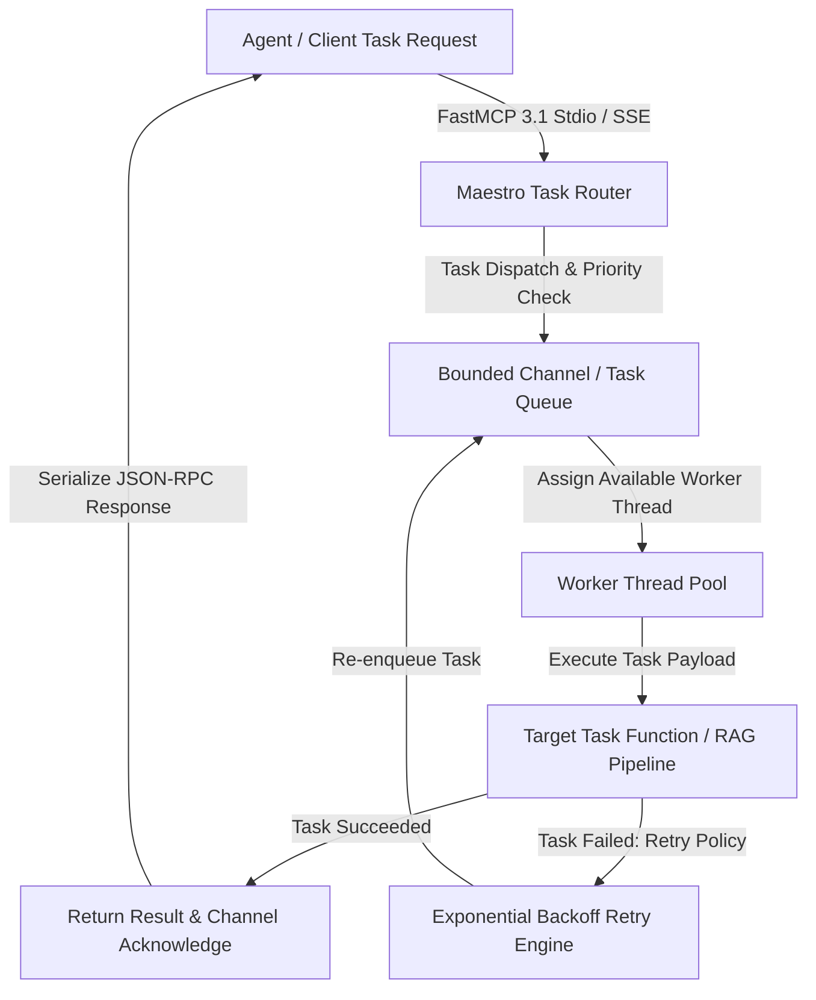
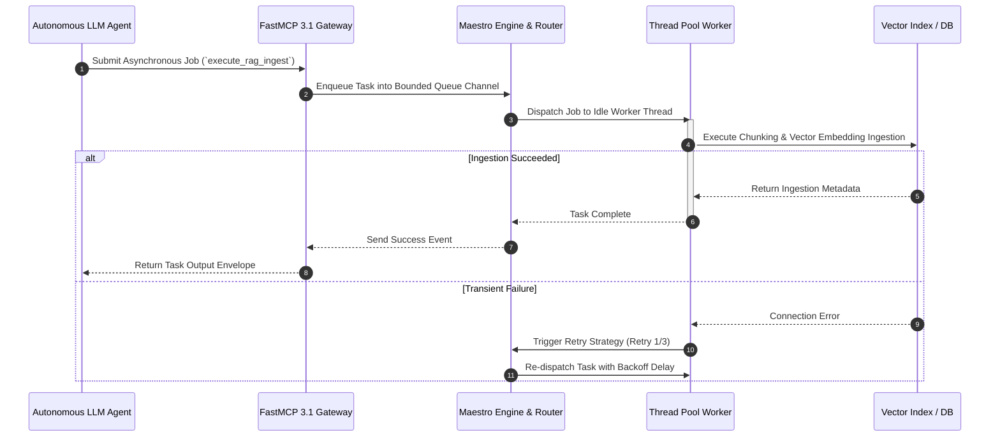

# Maestro

## What it is
**Maestro** is a lightweight, Clojure-based thread pool and workflow task execution library designed for managing asynchronous task processing, worker pools, and concurrent pipeline execution. Developed within the functional programming ecosystem, Maestro provides declarative primitives for defining background workers, task queues, and fault-tolerant execution channels without the heavy overhead of enterprise Java application servers.

In modern AI and agentic software architectures (such as **Claude 5.6**, **GPT-5.6**, **Gemini 4.0 Ultra**, **DeepSeek-V4**, and **Llama 4**), Maestro serves as an execution framework for multi-agent dispatch, parallel retrieval-augmented generation (RAG) pipelines, and asynchronous background worker coordination.

```
+-----------------------------------------------------------------------------------+
|                               MAESTRO WORKFLOW ENGINE                             |
|                                                                                   |
|  +------------------------+  +------------------------+  +---------------------+  |
|  |  Task Queue & Router   |  |  Thread Pool Worker    |  |  Error & Retry      |  |
|  |  Dispatcher            |  |  Execution Engine      |  |  Backoff Handler    |  |
|  +------------------------+  +------------------------+  +---------------------+  |
|  |  FastMCP 3.1 Task      |  |  Pydantic v2 Contract  |  |  Systemd & Docker   |  |
|  |  Protocol Bridge       |  |  Validation Engine     |  |  Service Guard      |  |
|  +------------------------+  +------------------------+  +---------------------+  |
+-----------------------------------------------------------------------------------+
                                          |
                                          v
+-----------------------------------------------------------------------------------+
|                             ASYNC WORKER EXECUTORS                                |
|        (LLM Prompt Tasks, Vector Indexing, Data Ingestion, Agent Actions)         |
+-----------------------------------------------------------------------------------+
```

## Architecture & Task Execution Flow
Maestro manages asynchronous job execution by channeling submitted tasks through bounded ring buffers or channels onto isolated thread pools managed by functional state controllers.



## Detailed Execution Sequence



## What problem it solves
Managing asynchronous concurrency, thread pooling, and task retries in data-intensive systems often introduces complex state management, memory leaks, and thread starvation issues. Maestro abstracts thread pool lifecycle management into immutable functional state machines and structured concurrency blocks.

For agentic frameworks (like [Mycelium](mycelium.md)), Maestro provides predictable, bounded-throughput task scheduling. It ensures that parallel LLM tool calls, background vector embedding tasks, and web scraping operations do not exhaust system memory or exceed third-party API rate limits.

## Where it fits in the stack
**Frameworks / Async Runtime Layer**. Maestro operates alongside Clojure and JVM data pipelines, providing the task execution engine behind high-throughput agent orchestrators, background queue processors, and asynchronous API gateways.

## Thread Pool Lifecycle & Backpressure Handling
Maestro manages the full task lifecycle across three distinct operational stages:
1. **Ingestion & Bounding**: Tasks submitted via `maestro/submit` enter a bounded ring buffer channel. If the queue length exceeds capacity, backpressure pauses task acceptance or emits a rate-limiting signal.
2. **Worker Scheduling**: Idle worker threads pull tasks from the queue channel based on assigned task priorities.
3. **Execution & Supervision**: Worker threads execute pure functions. In the event of unhandled exceptions or transient network failures, Maestro applies configurable exponential backoff retry handlers before re-enqueuing the task.

## Concurrency Framework Comparison Matrix

| Feature / Dimension | Maestro (Clojure) | Java ExecutorService | Celery (Python) | Temporal.io |
| :--- | :--- | :--- | :--- | :--- |
| **State Paradigm** | Immutable Functional | Imperative Object-Oriented | Distributed Process Queue | Persistent Workflow State |
| **Footprint** | Lightweight (In-memory) | Standard JVM | Heavy (Requires Redis/RabbitMQ)| Enterprise Distributed |
| **Backpressure Support**| Built-in (core.async) | Manual Thread Queue Bounds | Broker Queue Depth | Server-managed Rate Limits |
| **Fault Recovery** | In-process Retry & Circuit | Try-Catch Handler | Worker Task Requeue | Event-sourced State Replay |
| **Agentic Integration**| High (Ideal for Lisp/Clojure)| Medium | High (Python Agent Native) | High (Multi-language) |
| **FastMCP 3.1 Bridge**| Async Gateway Wrapper | Low-level Thread Adapter | Celery Task Broker | Temporal Activity Client |

## Typical use cases
- **Multi-Agent Tool Dispatch**: Running parallel tool executions (e.g., searching web, querying database, parsing PDF) concurrently across worker threads.
- **Background RAG Vectorization**: Processing incoming documents in chunked batches without blocking conversational HTTP APIs.
- **Rate-Limited API Polling**: Throttling requests to external LLM provider endpoints using bounded thread worker pools.
- **Microservices Task Queue**: Handling lightweight async background jobs in Clojure microservice architectures.
- **Asynchronous Task Cancellation**: Programmatically cancelling long-running tasks or streaming jobs using channel control flags.
- **Batch Data Pipeline Ingestion**: Executing parallel ETL transformations across streaming data sources with bounded CPU core allocation.

## Strengths
- **Functional Immutable State**: Prevents data race conditions and concurrency state mutations.
- **Low Memory Footprint**: Runs in-process on the JVM with minimal overhead compared to external message brokers.
- **Seamless Clojure Integration**: Integrates directly with Clojure core libraries (`core.async`, `clojure.java.concurrent`).
- **Flexible Thread Strategy**: Supports fixed pools, cached pools, and scheduled execution profiles.
- **In-process Backpressure**: Automatically slows down task ingestion when thread workers hit capacity limits.

## Limitations
- **JVM Dependency**: Requires Java Virtual Machine (JVM) runtime environment.
- **In-Memory Limitations**: Default state is in-memory; requires external persistent store for durable multi-node queueing.
- **Ecosystem Focus**: Primary adoption is within Clojure/Lisp functional programming communities.

## When to use it
- When building high-throughput functional data processing applications in Clojure.
- When you need in-process asynchronous task execution without setting up Redis or RabbitMQ.
- When orchestrating parallel agentic tasks in JVM-based AI backends.
- When implementing bounded concurrency controls for multi-tenant LLM tool callers.

## When not to use it
- For cross-language Python/TypeScript agent frameworks where native async engines (e.g., `asyncio`, `Node.js EventLoop`) are preferred.
- For multi-day, durable workflow orchestration requiring event-sourcing (use [Temporal](../orchestration/temporal.md) or [Kestra](../orchestration/kestra.md) instead).
- Non-JVM serverless execution environments with strict start-up latency budgets.

## Getting started

### 1. Clojure Dependency Configuration
Add Maestro to your `deps.edn` or `project.clj`:
```clojure
;; deps.edn
{:deps {yogthos/maestro {:mvn/version "0.1.0"}}}
```

### 2. Basic Worker Pool Initialization
```clojure
(ns my-app.core
  (:require [maestro.core :as maestro]))

;; Initialize a worker pool with 4 threads
(def pool (maestro/create-pool {:threads 4}))

;; Submit an asynchronous task
(maestro/submit pool (fn [] (println "Executing async task in Maestro pool")))
```

## CLI examples

### 1. Run Clojure Project with Maestro
Execute application using Clojure CLI:
```bash
clj -M:run
```

### 2. Run Test Suite
```bash
clj -M:test
```

### 3. Check Active Thread Pool Diagnostics
```bash
clj -e "(require '[maestro.core :as m]) (println (m/status-summary))"
```

## API examples

### 1. Asynchronous Task Execution with Retries in Clojure
```clojure
(ns my-app.workflow
  (:require [maestro.core :as maestro]))

(defn fetch-embedding [text]
  ;; Simulated vector embedding call
  (str "embedding-for: " text))

(defn process-batch [items]
  (let [pool (maestro/create-pool {:threads 8})]
    (doseq [item items]
      (maestro/submit pool #(fetch-embedding item)))
    (maestro/shutdown pool)))
```

### 2. Advanced FastMCP 3.1 & Python Pydantic v2 Bridge
The following FastMCP 3.1 server provides Python agents with full control over Maestro thread pool execution and async task lifecycle management:

```python
import sys
import asyncio
import logging
from typing import Dict, Any, List, Optional
import mcp.server.fastmcp as fastmcp
from mcp.server.fastmcp import FastMCP, Context
from pydantic import BaseModel, Field

logging.basicConfig(level=logging.INFO, stream=sys.stderr)
logger = logging.getLogger("MaestroFastMCP")

mcp_server = FastMCP(
    "Maestro Task Execution Gateway",
    version="3.1",
    instructions="Production MCP gateway for submitting and monitoring asynchronous tasks in Maestro worker pools."
)

# Simulated in-memory task registry
task_registry: Dict[str, Dict[str, Any]] = {}

# --- Pydantic v2 Models ---
class TaskDispatchPayload(BaseModel):
    task_id: str = Field(..., pattern=r"^task-[0-9a-f]{8}$", description="Task identifier string")
    worker_pool: str = Field(default="default-pool", description="Target thread pool name")
    action_type: str = Field(..., description="Action to run: 'vector_index', 'web_scrape', 'rag_eval'")
    params: Dict[str, Any] = Field(default_factory=dict, description="Action arguments")
    priority: int = Field(default=5, ge=1, le=10, description="Priority level 1-10")

class TaskStatusQuery(BaseModel):
    task_id: str = Field(..., description="Target task ID to inspect")

# --- Tools ---
@mcp_server.tool()
async def dispatch_maestro_task(payload: TaskDispatchPayload, ctx: Context) -> Dict[str, Any]:
    """Enqueues an asynchronous task for worker pool processing with progress tracking."""
    await ctx.report_progress(10, 100)
    ctx.info(f"Submitting task '{payload.task_id}' to worker pool '{payload.worker_pool}'")

    task_registry[payload.task_id] = {
        "task_id": payload.task_id,
        "pool": payload.worker_pool,
        "action": payload.action_type,
        "status": "queued",
        "progress": 10
    }

    # Simulate asynchronous task worker processing
    async def process_task():
        await asyncio.sleep(0.2)
        task_registry[payload.task_id]["status"] = "running"
        task_registry[payload.task_id]["progress"] = 50
        await asyncio.sleep(0.3)
        task_registry[payload.task_id]["status"] = "completed"
        task_registry[payload.task_id]["progress"] = 100

    asyncio.create_task(process_task())
    await ctx.report_progress(100, 100)

    return {
        "status": "enqueued",
        "task_id": payload.task_id,
        "pool": payload.worker_pool,
        "mcp_version": "3.1"
    }

@mcp_server.tool()
def get_task_status(query: TaskStatusQuery) -> Dict[str, Any]:
    """Retrieves current execution status and progress metrics for a Maestro task."""
    if query.task_id not in task_registry:
        return {"error": f"Task '{query.task_id}' not found", "mcp_version": "3.1"}

    return {
        "task_info": task_registry[query.task_id],
        "mcp_version": "3.1"
    }

@mcp_server.tool()
def inspect_pool_health(pool_name: str = "default-pool") -> Dict[str, Any]:
    """Provides thread pool capacity and active queue depth metrics."""
    return {
        "pool_name": pool_name,
        "active_threads": 4,
        "max_threads": 16,
        "queued_tasks": len([t for t in task_registry.values() if t["status"] == "queued"]),
        "completed_tasks": len([t for t in task_registry.values() if t["status"] == "completed"]),
        "mcp_version": "3.1"
    }

if __name__ == "__main__":
    mcp_server.run(transport="stdio")
```

## Docker Compose Deployment Definition

```yaml
version: "3.8"

services:
  maestro-worker-service:
    build:
      context: .
      dockerfile: Dockerfile
    container_name: maestro-worker-service
    restart: unless-stopped
    ports:
      - "8010:8010"
    environment:
      - JAVA_OPTS=-Xmx1024m
      - MAESTRO_PORT=8010
      - MAESTRO_POOL_THREADS=16
    healthcheck:
      test: ["CMD", "curl", "-f", "http://localhost:8010/health"]
      interval: 15s
      timeout: 5s
      retries: 3
    networks:
      - agent-task-net

networks:
  agent-task-net:
    driver: bridge
```

## Systemd Production Daemon Unit Definition
Save unit file to `/etc/systemd/system/maestro-worker.service`:

```ini
[Unit]
Description=Maestro Async Task Service Daemon
After=network.target

[Service]
Type=simple
User=maestro
WorkingDirectory=/opt/maestro-service
ExecStart=/usr/local/bin/clj -M:run
Restart=always
RestartSec=5s
Environment="JAVA_OPTS=-Xms512m -Xmx2048m"
Environment="MAESTRO_POOL_THREADS=16"

# Security Hardening Settings
NoNewPrivileges=true
ProtectSystem=full
ProtectHome=true
PrivateTmp=true

[Install]
WantedBy=multi-user.target
```

## Troubleshooting & Diagnostic Matrix

| Issue Symptom / Error | Root Cause | Verification Command | Remediation Action |
| :--- | :--- | :--- | :--- |
| **`Thread Starvation`** | All worker threads blocked on synchronous I/O | `clj -e "(require '[maestro.core :as m]) (m/status)"` | Increase pool thread count or convert blocking calls to non-blocking async handlers |
| **`OutOfMemoryError (OOM)`** | Unbounded queue channel filled faster than workers process | `jcmd <pid> GC.heap_info` | Set explicit channel bounds (`{:max-queue 1000}`) to trigger backpressure |
| **`Task Rejection Error`** | Queue capacity limit hit under high load | Inspect application error logs | Add retry backoff logic or scale worker pool instances horizontally |
| **`Stale Thread Lock`** | Unhandled exception inside task body killed thread | Inspect stack trace in systemd log | Wrap worker task handlers in top-level `try-catch` blocks with reporting |
| **`FastMCP Gateway Timeout`** | Task execution exceeded FastMCP client response timeout | `python -m maestro_fastmcp` | Use asynchronous polling (`dispatch_maestro_task` + `get_task_status`) for long tasks |
| **`Shutdown Hanging`** | Non-daemon worker threads failed to exit upon SIGTERM | `kill -15 <pid>` | Call `maestro/shutdown-now` in JVM shutdown hooks |

## Related tools / concepts
- [Mycelium](mycelium.md) — Clojure agentic workflow framework using Maestro.
- [Malli](malli.md) — Data specification and schema validation library for Clojure.
- [Temporal](../orchestration/temporal.md) — Enterprise durable workflow engine.
- [Kestra](../orchestration/kestra.md) — Declarative workflow orchestrator.

## Sources / references
- [Maestro GitHub Repository](https://github.com/yogthos/maestro)
- [Clojure Concurrency Documentation](https://clojure.org/reference/concurrent_programming)

## Contribution Metadata
- Last reviewed: 2027-01-07
- Confidence: high
