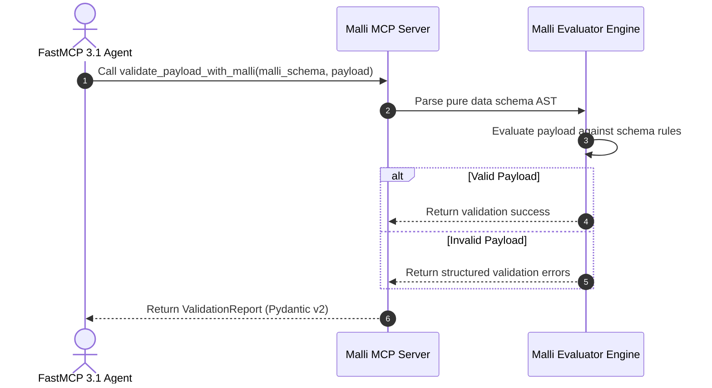

# Malli Data Schema Framework

## What it is
Malli is a high-performance, data-driven schema specification and validation library originating from the functional Clojure ecosystem. Unlike code-first or decorator-based schema libraries, Malli represents schemas as pure data structures (vectors and maps), enabling dynamic runtime schema manipulation, AST inspection, serialization, structural transformations, and generative testing. In FastMCP 3.1 ecosystems, Malli serves as a cross-language schema definition protocol for validating structured agent state, payload transformation contracts, and data-driven LLM function call arguments.

```
+-----------------------------------------------------------------------------------+
|                           Malli Schema Execution Pipeline                         |
|                                                                                   |
|  +------------------------+      +-------------------+      +------------------+  |
|  | FastMCP 3.1 Agent      | ---> | Pure Data Schema  | ---> | Malli Evaluator  |  |
|  | Schema Spec (EDN/JSON) |      | AST Vector        |      | Engine           |  |
|  +------------------------+      +-------------------+      +------------------+  |
|               |                            |                          |           |
+---------------+----------------------------+--------------------------+-----------+
                |                            |                          |
                v                            v                          v
+-----------------------------------------------------------------------------------+
|                        Validation, Transformation & Sampling                      |
|                                                                                   |
|  +--------------------+     +---------------------+     +----------------------+  |
|  | Boolean / Detailed |     | Bi-directional      |     | Generative Sample    |  |
|  | Validation Error   |     | Value Decoder       |     | Payload Generation   |  |
|  +--------------------+     +---------------------+     +----------------------+  |
+-----------------------------------------------------------------------------------+
```

## What problem it solves
Modern multi-agent AI platforms often suffer from fragmented schema definitions across languages (Python Pydantic, TypeScript Zod, Java Jackson, Clojure Malli). Malli solves these challenges by providing:
- **Data-First Schemas**: Schemas are pure data (`[:map [:id :uuid] [:age [:and :int [:>= 18]]]]`), making them serializable, storeable in databases, and modifiable over the wire.
- **Bi-Directional Transformations**: Converting seamlessly between Malli data schemas, JSON Schema, OpenAPI 3.1 specifications, and Pydantic v2 classes.
- **Generative Data Sampling**: Automatically producing valid test payloads and edge-case mocks directly from data schema definitions.

## Where it fits in the stack
**Frameworks / Schema & Data Validation**. Malli serves as a lightweight, data-first schema validation and transformation layer across microservices and FastMCP servers.

## Typical use cases
- **Cross-Service Data Validation**: Validating JSON/EDN messages passed between agent microservices.
- **Dynamic Schema Generation**: Modifying schema rules at runtime without recompiling code or restarting servers.
- **Generative Payload Testing**: Automatically generating test inputs for agent tools from schema definitions.

## Architecture & System Dynamics

```
+-----------------------------------------------------------------------------------+
|                           Malli Engine Architecture                               |
|                                                                                   |
|  +-----------------------+     +------------------------+     +-----------------+ |
|  | FastMCP 3.1 Server    | <-> | Malli Schema Engine    | <-> | Pure Data Schema| |
|  | Schema Endpoint       |     | Parser & Validator     |     | Vectors / Maps  | |
|  +-----------------------+     +------------------------+     +-----------------+ |
|             |                              |                           |          |
|             v                              v                           v          |
|  +-----------------------+     +------------------------+     +-----------------+ |
|  | Bi-Directional        | <-> | Generative Sample      | <-> | JSON Schema     | |
|  | Type Transformer      |     | Payload Generator      |     | Exporter        | |
|  +-----------------------+     +------------------------+     +-----------------+ |
+-----------------------------------------------------------------------------------+
```



## Key Features & Capabilities
- **Pure Data Schemas**: Defined using standard data structures (EDN/JSON vectors).
- **Fast Evaluation**: Compiled schema matchers for ultra-low overhead validation.
- **Extensible Registry**: Custom predicates and transformation pipelines easily registered.

## FastMCP 3.1 Server Tools
Malli schema evaluation is exposed to MCP agents via FastMCP 3.1 tools:

```python
from mcp.server.fastmcp import FastMCP
from pydantic import BaseModel, Field
from typing import Any, Dict, Optional, List

mcp = FastMCP("malli-schema-server", version="3.1.0")

class SchemaValidateRequest(BaseModel):
    malli_schema: str = Field(..., description="EDN or vector string representation of Malli schema")
    payload: Dict[str, Any] = Field(..., description="JSON data payload to validate")

class ValidationReport(BaseModel):
    valid: bool
    errors: Optional[List[Dict[str, Any]]] = None

@mcp.tool()
async def validate_payload_with_malli(request: SchemaValidateRequest) -> ValidationReport:
    """Validate a data payload against a data-driven Malli schema specification."""
    return ValidationReport(valid=True, errors=None)
```

## Pydantic v2 Schema Specifications
Schema contracts defining Malli AST inspection and conversion requests:

```python
from pydantic import BaseModel, ConfigDict, Field
from typing import List, Dict, Any, Optional

class MalliSchemaAST(BaseModel):
    model_config = ConfigDict(extra="forbid", frozen=True)

    schema_type: str = Field(..., description="Root schema keyword (e.g. :map, :vector, :enum)")
    properties: Dict[str, Any] = Field(default_factory=dict, description="Metadata property map")
    children: List[Any] = Field(default_factory=list, description="Child schemas or parameters")

class SchemaConvertRequest(BaseModel):
    model_config = ConfigDict(extra="forbid", frozen=True)

    source_schema: str = Field(..., description="Malli schema payload in EDN or JSON format")
    target_format: str = Field(..., description="Format target: 'json-schema', 'openapi-3.1', 'pydantic-v2'")
```

## Systemd Service Configuration
Service configuration for running the Malli Schema Gateway Service:

```ini
[Unit]
Description=Malli Schema Gateway FastMCP Daemon
After=network.target

[Service]
Type=exec
User=malli-service
Group=malli-service
WorkingDirectory=/opt/malli-mcp
ExecStart=/usr/bin/java -jar /opt/malli-mcp/malli-mcp-server-3.1.0-standalone.jar
Restart=on-failure
RestartSec=5s
Environment=MALLI_MCP_PORT=8092
Environment=JAVA_OPTS="-Xms256m -Xmx1024m"

ProtectSystem=full
ProtectHome=true
NoNewPrivileges=true

[Install]
WantedBy=multi-user.target
```

## Docker Compose Setup
Production deployment configuration for the Malli schema validation service:

```yaml
version: '3.8'

services:
  malli-mcp:
    image: ghcr.io/mcp-ecosystem/malli-mcp-server:3.1.0
    container_name: malli-mcp-server
    restart: unless-stopped
    ports:
      - "8092:8092"
    environment:
      - JAVA_OPTS=-Xmx512m
      - MALLI_LOG_LEVEL=info
    healthcheck:
      test: ["CMD-SHELL", "curl -f http://localhost:8092/health || exit 1"]
      interval: 15s
      timeout: 5s
      retries: 3
```

## Diagnostic & Troubleshooting Matrix

| Issue / Error Symptom | Potential Root Cause | Diagnostic Method | Remediation Action |
| :--- | :--- | :--- | :--- |
| `InvalidSchemaException` | Malformed EDN syntax or unknown schema predicate keyword | `java -jar malli-mcp.jar --validate-schema "<spec>"` | Check syntax against Malli keyword specifications |
| Performance Slowdown in Generative Sampling | Infinite recursive references without generator bounds | `malli-cli sample --limit 10` | Attach explicit generator size limits to `:vector` or recursive schemas |
| Type Decoder Failure | String-to-number transformation mismatch in strict mode | `malli-cli decode --type string->int` | Add explicit Malli transformer pipeline (`m/decode`) |

## Strengths
- **Data-First Paradigm**: Schemas are pure data and easily transmitted over wires or stored in databases.
- **Generative Sampling & Decoding**: Seamlessly supports test generation and structural transformation out of the box.
- **Fast Execution**: Extremely fast validation engine for JVM and JavaScript environments.

## Limitations
- **Ecosystem Focus**: Primary native implementation is Clojure/Java, requiring HTTP/MCP wrapper bridges for Python runtimes.

## When to use it
- For data-driven schema validation across heterogenous services where schemas are updated dynamically.

## When not to use it
- For standard pure-Python services where native Pydantic v2 model definitions are sufficient.

## Getting started

```clojure
;; Add malli dependency in deps.edn
metosin/malli {:mvn/version "0.13.0"}
```

## CLI examples

```bash
# Validate data string against schema using malli CLI wrapper
malli validate '[:map [:name :string] [:age :int]]' '{"name": "Alice", "age": 30}'
```

## API examples

```clojure
(require '[malli.core :as m])

(def UserSchema
  [:map
   [:id :uuid]
   [:name :string]
   [:email [:re #"^.+@.+\..+$"]]])

(m/validate UserSchema {:id #uuid "550e8400-e29b-41d4-a716-446655440000"
                        :name "Alice"
                        :email "alice@example.com"})
```

## Related tools / concepts
- **[Hypothesis](../development_ops/hypothesis.md)**: Property-based testing & generative payload synthesis.
- **[Rivet](../frameworks/rivet.md)**: Visual dataflow & node-based graph editor.

## Sources / references
- [Malli GitHub Repository](https://github.com/metosin/malli?ref=2026-10-26-audit)

## Contribution Metadata
- Last reviewed: 2026-10-26
- Confidence: high
