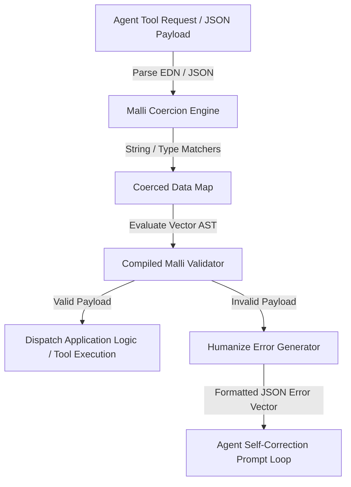
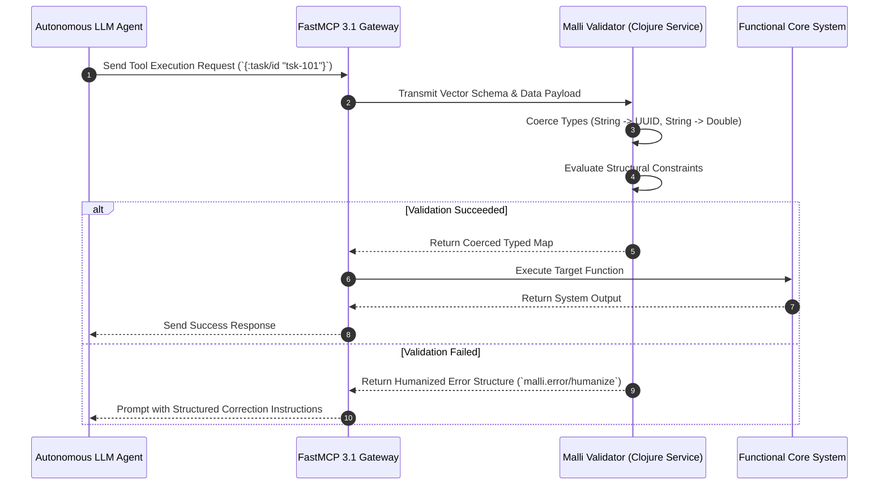

# Malli

## What it is
**Malli** is a data-driven, high-performance specification and schema validation library for Clojure and ClojureScript. Designed around first-class data structures (Malli schemas are pure Clojure vectors), Malli provides declarative schema definition, fast data validation, value coercion, JSON Schema transformation, and property-based test generation via [Hypothesis](../development_ops/hypothesis.md) or Clojure's test.check.

In modern multi-agent systems and agentic platforms (**Claude 5.6**, **GPT-5.6**, **Gemini 4.0 Ultra**, **DeepSeek-V4**, and **Llama 4**), Malli provides runtime boundary validation and schema serialization, ensuring structured tool calls, agent responses, and FastMCP 3.1 task payloads satisfy strict type contracts before execution.

```
+-----------------------------------------------------------------------------------+
|                                 MALLI SCHEMA ENGINE                               |
|                                                                                   |
|  +------------------------+  +------------------------+  +---------------------+  |
|  |  Data Vector Schema    |  |  Runtime Coercion      |  |  JSON Schema & OpenAPI|  |
|  |  Declarations          |  |  Validation Engine     |  |  Export Generators  |  |
|  +------------------------+  +------------------------+  +---------------------+  |
|  |  FastMCP 3.1 Task      |  |  Pydantic v2 Interop   |  |  Property-Based     |  |
|  |  Protocol Validator    |  |  Contract Engine       |  |  Value Generators   |  |
|  +------------------------+  +------------------------+  +---------------------+  |
+-----------------------------------------------------------------------------------+
                                          |
                                          v
+-----------------------------------------------------------------------------------+
|                             AGENT / APPLICATION BOUNDARY                          |
|         (Structured LLM Outputs, Tool Arguments, API Endpoints, Databases)         |
+-----------------------------------------------------------------------------------+
```

## Architecture & Schema Validation Flow
Malli processes validation by compiling pure vector AST declarations into optimized validator functions that execute against incoming nested data structures.



## Detailed Execution Sequence



## What problem it solves
LLM tool execution and multi-agent message routing require strict structural contracts to prevent runtime type exceptions and invalid parameter passing. Traditional schema libraries often rely on opaque class hierarchies or slow reflection, making dynamically configured schema generation difficult.

Malli represents schemas as pure data structures (e.g., `[:map [:user/id :uuid] [:user/email :string]]`), allowing AI agents to generate, inspect, transform, and validate API payload schemas dynamically at runtime.

## Where it fits in the stack
**Frameworks / Schema & Contract Layer**. Malli provides boundary validation for Clojure backends, agent frameworks (like [Mycelium](mycelium.md)), and microservice API routes. It serves the functional Clojure ecosystem in much the same way [Pydantic](pydantic.md) serves Python.

## Clojure Vector Schema Syntax & Custom Registries
Malli schemas are pure data vectors that compose recursively:
- **Primitives**: `:string`, `:int`, `:double`, `:boolean`, `:keyword`, `:uuid`, `:qualified-keyword`.
- **Combinators**: `[:map ...]`, `[:vector ...]`, `[:set ...]`, `[:tuple ...]`, `[:enum ...]`, `[:maybe ...]`, `[:and ...]`, `[:or ...]`.
- **Properties Map**: `{optional: true}`, `{min: 1}`, `{max: 100}`, `{description: "User display name"}`.
- **Custom Schema Registries**: Registering global domain types into a Malli registry map:
  ```clojure
  (def custom-registry
    (m/default-schemas
      {:user/id :uuid
       :user/role [:enum :admin :operator :guest]}))
  ```

## Property-Based Test Generation & Hypothesis Interop
Because Malli schemas are declarative data structures, Malli can automatically instantiate random, structurally valid test data streams using Clojure's `test.check` generator library. This enables end-to-end property testing for multi-agent workflows and allows cross-language fuzz testing when paired with Python's [Hypothesis](../development_ops/hypothesis.md) framework.

## Schema & Validation Library Comparison Matrix

| Feature / Dimension | Malli (Clojure) | Clojure Spec | Pydantic v2 (Python) | Zod (TypeScript) |
| :--- | :--- | :--- | :--- | :--- |
| **Representation** | Pure Data Vectors | Macro Definitions | Python Classes | TypeScript Chainable AST |
| **Serializable** | Yes (Pure EDN / JSON) | No (Functions/Macros)| Via JSON Schema export | Via Zod-to-JSON-Schema |
| **Value Coercion** | Built-in (HTTP/JSON)| Manual wrappers | Built-in (Type casting) | Built-in (Coerce methods)|
| **Performance** | Fast (Ahead-of-time) | Medium | Native C/Rust core | Fast V8 execution |
| **Generator Support**| Automatic test.check| Automatic test.check| Via Hypothesis strategy| Via polyfills / plugins |
| **FastMCP 3.1 Bridge**| EDN Vector Translation | Custom Macro Wrapper | Native Pydantic v2 | Zod Schema Adapter |

## Typical use cases
- **Structured LLM Tool Call Validation**: Validating that JSON tool call parameters emitted by LLMs conform to declared tool schemas.
- **Dynamic OpenAPI / JSON Schema Generation**: Exporting Clojure Malli schemas to standard JSON Schema specs for LLM prompt injection.
- **API Endpoint Coercion**: Converting incoming HTTP request string queries into typed Clojure integers, UUIDs, and keywords.
- **Database Entity Contracts**: Enforcing entity relationships and column constraints in functional data pipelines.
- **Agent Payload Contract Negotiation**: Exposing schema definitions as EDN data structures over FastMCP 3.1 endpoints.
- **Multi-tenant Domain Boundary Checks**: Dynamically loading customer-specific Malli schemas from EDN files or database records without re-compiling source code.

## Strengths
- **Data-Driven Architecture**: Schemas are pure Clojure data vectors, allowing simple manipulation, filtering, and programmatic creation.
- **High Performance**: Compiles schema validators into optimized execution functions for high throughput.
- **Rich Ecosystem Generators**: Automatically produces sample data values and property-based test generators from schema definitions.
- **Extensible Coercion**: Supports custom string, JSON, and database coercion matchers out of the box.
- **Bi-directional Transformations**: Easily converts back and forth between Malli vector definitions, JSON Schemas, and OpenAPI 3.1 specs.

## Limitations
- **Language Focus**: Primary design is tailored for Clojure and ClojureScript.
- **Learning Curve**: Requires familiarity with Clojure vector syntax and functional schema transformation patterns.
- **Interoperability Overhead**: Calling Malli validators from non-JVM runtimes requires JSON/EDN socket bridges or REST endpoints.

## When to use it
- When developing Clojure backends or multi-agent systems requiring strict, data-driven validation.
- When you need to generate dynamic JSON Schemas at runtime to guide LLM response structures.
- For high-throughput Clojure microservices where schema validation performance is critical.
- When sharing schema declarations as data vectors between client and server layers.

## When not to use it
- In purely Python-based AI agent stacks (use [Pydantic v2](pydantic.md) or [PydanticAI](pydantic-ai.md) instead).
- In TypeScript or Node.js microservices (use Zod or TypeBox instead).
- Legacy JVM applications constrained to old Java reflection frameworks.

## Getting started

### 1. Clojure Dependency Setup
Add Malli to your `deps.edn`:
```clojure
{:deps {metosin/malli {:mvn/version "0.14.0"}}}
```

### 2. Basic Validation Example
```clojure
(ns my-app.schema
  (:require [malli.core :as m]))

(def UserSchema
  [:map
   [:id :uuid]
   [:name :string]
   [:email [:re #"^[^@]+@[^@]+$"]]
   [:role {:optional true} [:enum :admin :user]]])

;; Validate a map
(m/validate UserSchema {:id #uuid "d290f1ee-6c54-4b01-90e6-d701748f0851"
                        :name "Alice"
                        :email "alice@example.com"})
;; => true
```

## CLI examples

### 1. Run Clojure Validation Tests
```bash
clj -M:test
```

### 2. Export Malli Schema to JSON Schema via Clojure REPL
```bash
clj -e "(require '[malli.json-schema :as json-schema]) (println (json-schema/transform [:map [:x :int]]))"
```

### 3. Generate Random Sample Data from Malli Schema
```bash
clj -e "(require '[malli.generator :as mg]) (println (mg/generate [:map [:user/id :uuid] [:user/score :int]]))"
```

## API examples

### 1. Coercion & Schema Generation in Clojure
```clojure
(ns my-app.coercion
  (:require [malli.core :as m]
            [malli.transform :as mt]
            [malli.error :as me]))

(def OrderSchema
  [:map
   [:order-id :uuid]
   [:quantity :int]
   [:price :double]])

;; Coerce string values from HTTP parameters into typed Clojure values
(defn parse-and-validate-order [raw-input]
  (let [coerced (m/decode OrderSchema raw-input (mt/string-transformer))]
    (if (m/validate OrderSchema coerced)
      {:status :success :data coerced}
      {:status :error :errors (me/humanize (m/explain OrderSchema coerced))})))
```

### 2. Advanced FastMCP 3.1 & Python Pydantic v2 Bridge
The following FastMCP 3.1 Python server translates EDN-styled Malli schema vectors into dynamic Pydantic v2 schemas for cross-language verification:

```python
import sys
import json
import logging
from typing import Dict, Any, List, Optional
import mcp.server.fastmcp as fastmcp
from mcp.server.fastmcp import FastMCP, Context
from pydantic import BaseModel, Field, create_model

logging.basicConfig(level=logging.INFO, stream=sys.stderr)
logger = logging.getLogger("MalliBridgeFastMCP")

mcp_server = FastMCP(
    "Malli Schema Bridge Server",
    version="3.1",
    instructions="Bridges Clojure Malli data vector schemas into FastMCP 3.1 validation models."
)

class MalliSchemaBridgeRequest(BaseModel):
    schema_name: str = Field(..., description="Target schema identifier (e.g. 'UserTaskSchema')")
    vector_schema: List[Any] = Field(..., description="Malli vector schema definition (e.g. [':map', [':id', ':string']])")
    data_payload: Dict[str, Any] = Field(..., description="Input JSON payload to validate")

@mcp_server.tool()
async def validate_malli_payload(request: MalliSchemaBridgeRequest, ctx: Context) -> Dict[str, Any]:
    """Validates an incoming JSON dictionary against a Clojure Malli vector schema representation."""
    await ctx.report_progress(10, 100)
    ctx.info(f"Parsing Malli schema vector for '{request.schema_name}'")

    # Map primitive Malli types to Python types
    type_map = {
        ":string": str,
        ":int": int,
        ":double": float,
        ":boolean": bool,
        ":uuid": str
    }

    fields = {}
    if len(request.vector_schema) > 1 and request.vector_schema[0] == ":map":
        for entry in request.vector_schema[1:]:
            if isinstance(entry, list) and len(entry) >= 2:
                field_key = str(entry[0]).lstrip(":")
                field_type_str = str(entry[1])
                target_type = type_map.get(field_type_str, str)
                fields[field_key] = (target_type, ...)

    await ctx.report_progress(50, 100)
    ctx.info("Building dynamic Pydantic v2 model from Malli fields...")

    try:
        DynamicModel = create_model(request.schema_name, **fields)
        validated_instance = DynamicModel(**request.data_payload)

        await ctx.report_progress(100, 100)
        return {
            "valid": True,
            "schema_name": request.schema_name,
            "validated_data": validated_instance.model_dump(),
            "mcp_version": "3.1"
        }
    except Exception as exc:
        ctx.warning(f"Validation failed for schema '{request.schema_name}': {exc}")
        return {
            "valid": False,
            "schema_name": request.schema_name,
            "errors": str(exc),
            "mcp_version": "3.1"
        }

if __name__ == "__main__":
    mcp_server.run(transport="stdio")
```

## Docker Compose Deployment Definition

```yaml
version: "3.8"

services:
  malli-validator-service:
    build:
      context: .
      dockerfile: Dockerfile
    container_name: malli-validator-service
    restart: unless-stopped
    ports:
      - "8009:8009"
    environment:
      - JVM_OPTS=-Xmx512m
      - PORT=8009
    healthcheck:
      test: ["CMD", "curl", "-f", "http://localhost:8009/health"]
      interval: 15s
      timeout: 5s
      retries: 3
    networks:
      - agent-schema-net

networks:
  agent-schema-net:
    driver: bridge
```

## Systemd Production Daemon Unit Definition
Save unit file to `/etc/systemd/system/malli-validator.service`:

```ini
[Unit]
Description=Malli Schema Validator Microservice
After=network.target

[Service]
Type=simple
User=malli-user
WorkingDirectory=/opt/malli-service
ExecStart=/usr/bin/java -jar /opt/malli-service/target/malli-service-standalone.jar
Restart=always
RestartSec=3s
Environment="PORT=8009"
Environment="JVM_OPTS=-Xmx512m"

# Security Hardening Settings
NoNewPrivileges=true
ProtectSystem=full
ProtectHome=true
PrivateTmp=true

[Install]
WantedBy=multi-user.target
```

## Troubleshooting & Diagnostic Matrix

| Issue Symptom / Error | Root Cause | Verification Command | Remediation Action |
| :--- | :--- | :--- | :--- |
| **`Schema Parsing Exception`** | Invalid vector AST structure | `clj -e "(require '[malli.core :as m]) (m/schema [:map])"` | Ensure vector declarations start with valid schema type keyword (`:map`, `:vector`, `:tuple`) |
| **`Coercion Mismatch`** | Raw string cannot be coerced to target keyword/UUID | Inspect raw input map in REPL | Verify transformer matchers (`mt/string-transformer` or `mt/json-transformer`) are explicitly passed |
| **`Humanize Error Null`** | Custom schema lacks explanation formatter | `m/explain schema data` | Check schema syntax or register custom error formatter for domain types |
| **`JVM Memory Pressure`** | Massive schema generation loop in property tests | `top -b -n 1 \| grep java` | Bound generator size using `mg/generate schema {:size 10}` |
| **`JSON Schema Export Failure`** | Custom predicate function cannot be serialized | Inspect schema for inline lambda functions | Use named Malli registry properties instead of opaque anonymous functions |
| **`FastMCP Bridge Type Error`** | Unmapped Clojure keyword in Python interop bridge | Inspect `type_map` dictionary in FastMCP server | Register custom type handler in Python Pydantic bridge |

## Related tools / concepts
- [Mycelium](mycelium.md) — Clojure multi-agent framework utilizing Malli schemas.
- [Maestro](maestro.md) — Thread pool and task execution engine for Clojure.
- [Pydantic](../frameworks/pydantic.md) — Python data validation and settings management.
- [PydanticAI](../frameworks/pydantic-ai.md) — Agent framework built on Pydantic schemas.

## Sources / references
- [Malli GitHub Repository](https://github.com/metosin/malli)
- [Metosin Malli Documentation](https://cljdoc.org/d/metosin/malli/CURRENT)

## Contribution Metadata
- Last reviewed: 2027-01-07
- Confidence: high
