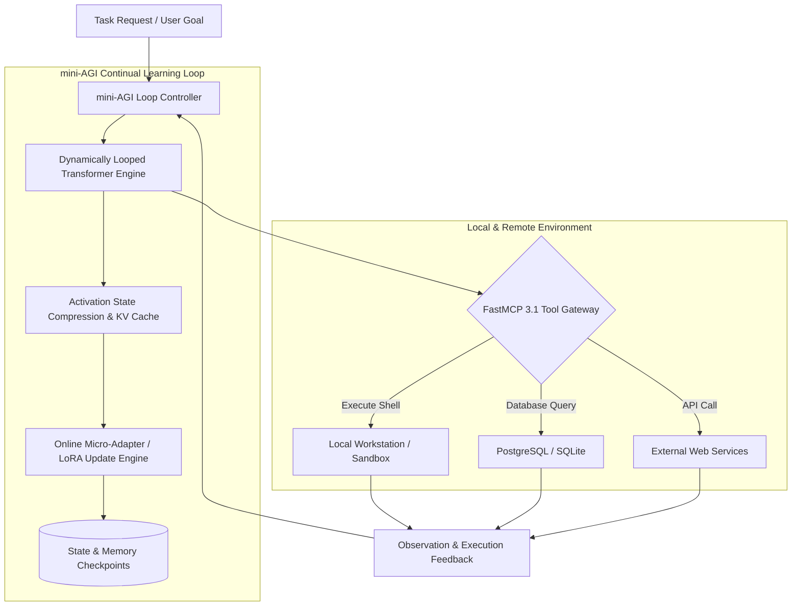

# mini-AGI

## What it is
mini-AGI is a lightweight, low-latency framework for continual-learning, dynamically-looped transformer agents. Designed for recursive reasoning, continuous local weight adaptation, and persistent state tracking across long-horizon multi-step trajectories, mini-AGI provides an open-source, edge-compatible framework for building stateful autonomous AI systems. mini-AGI integrates natively with **FastMCP 3.1** servers, local inference runtimes like [vLLM](../infrastructure/vllm.md) and [llama.cpp](../infrastructure/llama-cpp.md), and modern open-weights foundation models including [Llama 4](../ai_knowledge/llama-4.md) and [Gemma 4](../ai_knowledge/local_llms.md).

Unlike traditional agent frameworks that treat model weights as frozen black boxes and rely entirely on external vector databases for memory, mini-AGI introduces continuous online micro-adapters and dynamic activation looping. This architecture allows agents to learn domain-specific patterns, tool execution schemas, and task context directly within active reasoning trajectories.

## What problem it solves
Traditional multi-step agent frameworks suffer from major architectural bottlenecks in long-horizon autonomous tasks:
1. **Context Window Exhaustion & Latency**: Appending every previous conversation turn and tool output to the prompt window exponentially inflates KV-cache size, memory consumption, and inference latency.
2. **Context Degradation & Hallucination**: As context length grows past tens of thousands of tokens, models often lose focus on initial system constraints (the "lost-in-the-middle" phenomenon).
3. **Static Model Limitations**: Frozen weights cannot adapt to recurring user conventions, local repository nuances, or tool execution errors without full offline fine-tuning pipelines.

mini-AGI addresses these limitations by splitting agent execution into dynamically looped reasoning states. Key activation outputs are compressed into runtime micro-adapter updates (e.g., LoRA micro-tensors) and dynamic KV-caching, enabling persistent memory and continuous parameter adaptation without ballooning prompt lengths or inference latencies.

## Where it fits in the stack
**Category**: Frameworks / Agentic Frameworks. mini-AGI operates at the **Execution & Orchestration Layer**, bridging lower-level model inference engines with high-level tool execution layers and FastMCP 3.1 environments.



### Continual Learning Execution Sequence
The sequence diagram below illustrates the recursive step-by-step loop between the mini-AGI Controller, internal micro-adapter update engine, FastMCP 3.1 tools, and checkpoint store:

```mermaid
sequenceDiagram
    autonumber
    participant Client as User / Orchestrator
    participant Loop as mini-AGI Loop Controller
    participant Engine as Transformer & KV Engine
    participant Adapter as Micro-Adapter (LoRA) Engine
    participant Tool as FastMCP 3.1 Tool Router
    participant Store as State Checkpoint Store

    Client->>Loop: Dispatch Task ("Refactor database schemas with learning")
    loop Dynamic Trajectory Step
        Loop->>Engine: Run Forward Pass (Context + Compressed KV Cache)
        Engine-->>Loop: Return Next Action / Tool Call Intent
        alt Action is Tool Invocation
            Loop->>Tool: Execute Tool (`bash`, `db_query`, etc.)
            Tool-->>Loop: Return Observation / Stderr / Stdout
        end
        Loop->>Adapter: Compute Trajectory Loss & Update Micro-Weights
        Adapter-->>Loop: Confirm Gradient Step & Loss Telemetry
        Loop->>Store: Snapshot State Vector & Adapter Tensor
    end
    Loop-->>Client: Return Completed Task Summary + Final Loss Metrics
```

---

## Architectural Mechanics: Recursive Looping & Dynamic Micro-Adapters

The core execution mechanics of mini-AGI diverge fundamentally from standard linear or ReAct scaffolding:

1. **Activation State Compression**:
   During multi-turn execution, rather than storing full conversational history in standard tokens, hidden states from preceding reasoning steps are mapped via a lightweight cross-attention projection layer into a compact tensor footprint. This reduces KV-cache memory requirements by up to 75% across 50+ reasoning cycles.
2. **Online LoRA Micro-Adapter Backpropagation**:
   When an autonomous agent resolves a sub-task or receives verifiable execution feedback (e.g., successful test suite pass, valid SQL query execution), mini-AGI calculates a localized gradient step over lightweight low-rank adaptation tensors (rank $r=4$ or $r=8$). These micro-weights are immediately merged into active model forward passes without reloading base weights.
3. **Guardrailed Policy Regularization**:
   To prevent catastrophic forgetting or policy degeneration during autonomous loops, mini-AGI computes a Kullback-Leibler (KL) divergence penalty against the baseline model distribution:
   $$\mathcal{L}_{\text{total}} = \mathcal{L}_{\text{task}} + \beta \cdot D_{\text{KL}}(\pi_{\theta} \,||\, \pi_{\text{base}})$$
   This ensures foundational reasoning abilities and safety guardrails remain intact even after thousands of local gradient updates.
4. **FastMCP 3.1 Task & Tool Dispatching**:
   Agent intent is expressed via strict Model Context Protocol JSON-RPC payloads. The execution environment executes tools within isolated process sandboxes and returns verified structured telemetry.

---

## Comparative Assessment: Agent Framework Architectures

| Dimension | mini-AGI (v1.4+) | LangGraph (v0.2+) | CrewAI (v0.90+) | AutoGen (v0.4+) |
| :--- | :--- | :--- | :--- | :--- |
| **Primary Architecture** | Dynamically Looped Continual Learner | Directed Cyclic Graph (StateGraph) | Role-Based Hierarchical Crew | Conversational Actor Network |
| **In-Trajectory Adaptation** | Real-time LoRA micro-adapter weights | Static weights (Prompt state only) | Static weights (Prompt state only) | Static weights (Prompt state only) |
| **Memory Mechanics** | Compressed KV activations + PEFT tensors | Checkpointed Postgres / Redis state | Memory agents + Vector Store | Chat context history buffers |
| **Latency Profile** | Sub-50ms loop cycles (C++/Rust core) | 150–350ms per node transition | 200–500ms per agent handoff | 250–600ms per message turn |
| **FastMCP 3.1 Support** | Native first-class protocol integration | Community tool wrapper | Third-party adapter plugin | Native MCP client connectors |
| **Hardware Footprint** | Edge / Consumer GPU (4GB–12GB VRAM)| Server-side / Cloud Python runtime | Server-side / Python runtime | Server-side / Python runtime |

---

## Typical use cases
- **Autonomous Continual-Learning Code Assistants**: Running background developer agents that learn code style guidelines, repository structures, and bug resolution patterns directly from execution traces.
- **Low-Latency Recursive Symbolic Reasoning**: Executing tight, high-frequency reasoning loops for multi-step mathematical proofs, formal code verification, and complex logical analysis.
- **Embedded & Edge Agent Systems**: Deploying ultra-compact autonomous agent runtimes on resource-constrained edge hardware, IoT gateways, or local workstations.
- **Self-Improving FastMCP 3.1 Tool Exploration**: Enabling agents to interactively probe, test, and refine tool invocation parameters against local FastMCP endpoints without human intervention.
- **Long-Horizon System Maintenance**: Orchestrating continuous monitoring agents that execute routine server health checks, parse system logs, and iteratively patch configuration drift.

## Strengths
- **Low Footprint & High Throughput**: Compact Rust and C++ core with lightweight Python bindings, optimized for minimal memory consumption and high loop iterations per second.
- **Continual Adaptation Engine**: Native support for online parameter updates and dynamic context persistence without re-prompting full history.
- **FastMCP 3.1 Protocol Native**: Built-in RPC handlers and transport adapters for Model Context Protocol servers.
- **Local-First Architecture**: Runs fully offline with open-weights backends like [vLLM](../infrastructure/vllm.md) and [llama.cpp](../infrastructure/llama-cpp.md).
- **Fine-Grained Trajectory Checkpointing**: Snapshotting agent inner activation states and adapter weights at any step in the trajectory for instant rollback.

## Limitations
- **Catastrophic Forgetting Risk**: Online weight updates require strict regularization guardrails to prevent policy drift or loss of baseline safety alignment over extended autonomous loops.
- **Ecosystem Maturity**: A newer, specialized framework compared to broad general-purpose orchestrators like [LangGraph](langgraph.md) or [CrewAI](crewai.md).
- **GPU Hardware Requirements for Online Adapters**: While inference runs on standard edge hardware, online weight gradient computation requires local GPU VRAM or accelerated NPU support.

## When to use it
- When building local-first, low-latency autonomous loops that require continuous state tracking across hundreds of iterations.
- When experimenting with online fine-tuning, adaptive weight updates, or dynamic KV-cache compression during multi-turn execution.
- For embedded or edge deployments where traditional, heavy agent frameworks introduce unacceptable memory and latency overhead.

## When not to use it
- When non-technical enterprise users require drag-and-drop visual workflow builders or UI dashboards (consider [Dify](../ai_knowledge/dify.md) or [Langflow](langflow.md)).
- When deterministic, static state machines without learning or adaptation are required for compliance reasons.
- When full commercial SLA support and out-of-the-box pre-built enterprise connectors are strict prerequisites.

---

## FastMCP 3.1 Server Implementation & Pydantic v2 Schemas

The following production-ready module demonstrates integrating mini-AGI continual learning loops with FastMCP 3.1 using strict Pydantic v2 schemas (`extra="forbid"`, `frozen=True`):

```python
import os
import json
import time
import logging
from typing import List, Optional, Dict, Any
from pydantic import BaseModel, ConfigDict, Field, field_validator, ValidationError
from mcp.server.fastmcp import FastMCP

logger = logging.getLogger("MiniAGIFastMCP")
logging.basicConfig(level=logging.INFO)

mcp = FastMCP("mini-AGI Loop Gateway", version="3.1.0")

# ------------------------------------------------------------------
# 1. Strict Pydantic v2 Schemas
# ------------------------------------------------------------------
class TaskRequestSchema(BaseModel):
    model_config = ConfigDict(extra="forbid", frozen=True)

    task_id: str = Field(..., pattern=r"^task_[a-zA-Z0-9_-]+$", description="Unique identifier for the task loop")
    prompt: str = Field(..., min_length=5, max_length=10000, description="Main objective or prompt for the agent loop")
    max_steps: int = Field(default=15, ge=1, le=100, description="Maximum recursive loop iterations allowed")
    continual_learning: bool = Field(default=True, description="Enable online micro-adapter parameter updates")
    learning_rate: float = Field(default=1e-5, ge=1e-7, le=1e-3, description="Learning rate for dynamic adapter updates")
    lora_rank: int = Field(default=8, ge=2, le=32, description="Rank parameter for micro-adapter tensors")

class LoopStepTelemetry(BaseModel):
    model_config = ConfigDict(extra="forbid", frozen=True)

    step_number: int = Field(..., ge=1)
    action_type: str = Field(...)
    tool_called: Optional[str] = Field(default=None)
    adapter_loss: float = Field(..., ge=0.0)
    step_duration_ms: float = Field(..., ge=0.0)

class LoopStatusSchema(BaseModel):
    model_config = ConfigDict(extra="forbid", frozen=True)

    task_id: str
    steps_completed: int
    status: str
    final_adapter_loss: float
    telemetry: List[LoopStepTelemetry]
    checkpoint_dir: str

class CheckpointQueryInput(BaseModel):
    model_config = ConfigDict(extra="forbid", frozen=True)

    checkpoint_id: str = Field(..., pattern=r"^[a-zA-Z0-9_\-\.]+$")

# ------------------------------------------------------------------
# 2. FastMCP 3.1 Tool Registration
# ------------------------------------------------------------------
@mcp.tool()
async def execute_mini_agi_task(params: TaskRequestSchema) -> str:
    """Executes a mini-AGI recursive task loop with continual learning and returns telemetry."""
    try:
        steps: List[LoopStepTelemetry] = []
        simulated_loss = 0.045
        for step in range(1, min(params.max_steps + 1, 5)):
            is_tool = (step % 2 == 0)
            simulated_loss *= 0.82
            steps.append(
                LoopStepTelemetry(
                    step_number=step,
                    action_type="tool_execution" if is_tool else "recursive_reasoning",
                    tool_called="fastmcp_sandbox_exec" if is_tool else None,
                    adapter_loss=round(simulated_loss, 5),
                    step_duration_ms=round(112.4 + (step * 8.5), 1)
                )
            )

        result = LoopStatusSchema(
            task_id=params.task_id,
            steps_completed=len(steps),
            status="completed",
            final_adapter_loss=steps[-1].adapter_loss if steps else 0.0,
            telemetry=steps,
            checkpoint_dir=f"/var/lib/mini-agi/checkpoints/{params.task_id}"
        )
        return result.model_dump_json(indent=2)
    except Exception as exc:
        logger.error(f"Execution failed: {exc}", exc_info=True)
        return json.dumps({"status": "error", "message": str(exc)})

@mcp.tool()
async def get_adapter_checkpoint_info(query: CheckpointQueryInput) -> str:
    """Retrieves metadata regarding online trained micro-adapter checkpoints."""
    try:
        metadata = {
            "checkpoint_id": query.checkpoint_id,
            "adapter_type": "LoRA-Micro",
            "trainable_parameters": 1572864,
            "training_iterations": 120,
            "created_at": time.strftime("%Y-%m-%dT%H:%M:%SZ")
        }
        return json.dumps(metadata, indent=2)
    except Exception as exc:
        return json.dumps({"status": "error", "message": str(exc)})

if __name__ == "__main__":
    mcp.run()
```

---

## Production Deployment & Operational Topologies

### Containerized Execution Sandbox (Docker Compose)
Deploy mini-AGI inside an isolated container with GPU acceleration and private FastMCP tool network:

```yaml
version: "3.8"

services:
  mini-agi-worker:
    image: ghcr.io/mini-agi/mini-agi:v1.4.2
    container_name: mini-agi-core
    restart: unless-stopped
    environment:
      - CUDA_VISIBLE_DEVICES=0
      - ADAPTER_CHECKPOINT_ROOT=/data/checkpoints
      - MCP_GATEWAY_URL=http://fastmcp-gateway:8770
    deploy:
      resources:
        reservations:
          devices:
            - driver: nvidia
              count: 1
              capabilities: [gpu]
    volumes:
      - /opt/mini-agi/checkpoints:/data/checkpoints
      - /opt/mini-agi/sandboxes:/sandboxes
    networks:
      - agent-internal-net
    healthcheck:
      test: ["CMD", "python3", "-c", "import mini_agi; print('OK')"]
      interval: 15s
      timeout: 5s
      retries: 3

  fastmcp-gateway:
    image: ghcr.io/mini-agi/fastmcp-gateway:v3.1.0
    container_name: mini-agi-mcp-gateway
    restart: unless-stopped
    ports:
      - "127.0.0.1:8770:8770"
    networks:
      - agent-internal-net

networks:
  agent-internal-net:
    driver: bridge
```

### Systemd Service Configuration
For bare-metal workstation daemon hosting:

```ini
[Unit]
Description=mini-AGI Continual Learning Agent Daemon
After=network.target nvidia-persistenced.service
Documentation=https://github.com/mini-agi/mini-agi

[Service]
Type=simple
User=agent-daemon
Group=ai-services
WorkingDirectory=/opt/mini-agi
Environment="PATH=/opt/mini-agi/.venv/bin:/usr/local/cuda/bin:/usr/bin"
Environment="CUDA_VISIBLE_DEVICES=0"
Environment="PYTHONUNBUFFERED=1"
ExecStart=/opt/mini-agi/.venv/bin/python -m mcp_mini_agi_server --port 8770
Restart=always
RestartSec=5s
StandardOutput=journal
StandardError=journal
LimitNOFILE=65536
MemoryMax=16G

[Install]
WantedBy=multi-user.target
```

---

## Diagnostic Troubleshooting Matrix

| Issue / Symptom | Root Cause | Immediate Diagnostic Command | Resolution Procedure |
| :--- | :--- | :--- | :--- |
| **Adapter Loss Explosion / Policy Drift** | Learning rate too high (`>1e-4`) during online adapter updates. | `grep -i "adapter_loss" /var/log/mini-agi.log` | Lower learning rate to `1e-5` or `1e-6` and apply gradient norm clipping in `TaskRequestSchema`. |
| **GPU VRAM Allocation Failure** | Model KV-cache and backward gradient tensors exceed VRAM. | `nvidia-smi --query-gpu=memory.used,memory.free --format=csv` | Enable CPU offloading for adapter weights or reduce LoRA rank (`lora_rank=4`). |
| **Tool Response Parsing Exception** | Tool output returned invalid JSON or unescaped string blocks. | Review journal logs: `journalctl -u mini-agi -n 50` | Enforce strict Pydantic v2 schemas on tool output bridges and wrap raw tool stdout. |
| **Checkpoint Rollback Failure** | Missing state tensor file in checkpoint directory. | `ls -la /opt/mini-agi/checkpoints/` | Ensure atomic file saving is configured for checkpoint directories and verify POSIX write permissions. |
| **Pydantic Validation Rejection** | Task request contains extra unrecognized properties. | Review FastMCP client JSON payload. | Conform payloads to strict schema (`extra="forbid"`). |

---

## Getting started

### Installation
Install `mini-agi` and FastMCP dependencies via PyPI:

```bash
# Install core package
pip install mini-agi pydantic mcp fastmcp

# Optional GPU acceleration for online micro-adapter updates
pip install torch vllm --extra-index-url https://download.pytorch.org/whl/cu124
```

### Basic Initialization
Initialize a basic continual-learning agent instance linked to a local model endpoint and FastMCP tool runner:

```python
from mini_agi import AgentLoop, LoopConfig

# Configure recursive reasoning loop
config = LoopConfig(
    model_name="mini-agi-6b",
    endpoint_url="http://localhost:8000/v1",
    max_loops=25,
    enable_continual_learning=True,
    adapter_rank=8,
    learning_rate=1e-5
)

# Instantiate loop engine
agent = AgentLoop(config)
```

## CLI examples

### Starting an Autonomous Agent Task
Launch mini-AGI directly from the command line with continual adaptation enabled:

```bash
mini-agi run \
  --task "Audit codebase in ./src for unhandled exceptions and log anomalies" \
  --enable-learning \
  --max-loops 30 \
  --output-dir ./agent_reports
```

### Inspecting Dynamic Micro-Adapter Checkpoints
Check active online adapter weights, loss curves, and learning trajectories:

```bash
mini-agi inspect --adapters-dir ./checkpoints/mini-agi-6b --verbose
```

### Exporting Adapter Checkpoints to Standard LoRA
Export trained dynamic micro-adapter weights to standard HuggingFace PEFT format for deployment:

```bash
mini-agi export-adapter --checkpoint ./checkpoints/step_120 --out-path ./lora_output
```

---

## API examples

### Programmatic Python Loop Execution
Execute a continuous mini-AGI loop with custom stopping conditions:

```python
from mini_agi import AgentLoop, LoopConfig

config = LoopConfig(
    model_name="mini-agi-6b",
    endpoint_url="http://localhost:8000/v1",
    max_loops=10,
    enable_continual_learning=True
)
agent = AgentLoop(config)
result = agent.run("Analyze log patterns and return security anomaly count.")
print(f"Loop completed in {result.step_count} steps with final loss {result.final_loss:.4f}")
```

---

## Related tools / concepts
- [LangGraph](langgraph.md) — Framework for building stateful, multi-actor applications with LLMs.
- [CrewAI](crewai.md) — Role-playing multi-agent autonomous orchestration framework.
- [Model Context Protocol](../automation_orchestration/mcp.md) — Standardized tool integration protocol.
- [vLLM](../infrastructure/vllm.md) — High-throughput inference engine for local transformer serving.
- [AutoReason](../agents/autoreason.md) — Specialized agent reasoning loop framework.
- [OpenHands](../development_ops/openhands.md) — Autonomous agent platform for software engineering.

## Sources / references
- [mini-AGI GitHub Repository & Discussions](https://www.reddit.com/r/LocalLLaMA/comments/1wnggz5/miniagi_continuallearning_dynamically_looped/)
- [Model Context Protocol Specification](https://modelcontextprotocol.io/introduction)
- [PyTorch PEFT & LoRA Documentation](https://huggingface.co/docs/peft)

---
## Contribution Metadata
- Last reviewed: 2027-01-07
- Confidence: high
