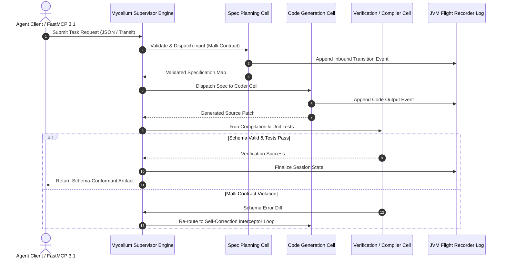

# Mycelium

## What it is
Mycelium is an enterprise-grade, Clojure-based framework and architectural pattern for building robust, observable multi-agent systems using state machines and formal contracts. In early January 2027, Mycelium represents the state-of-the-art implementation of the **Cellular Agent Architecture**, where complex multi-agent reasoning workflows are decomposed into isolated, functional 'cells'. These cells communicate exclusively via strongly-typed Malli data contracts, preventing state drift, and natively support the **FastMCP 3.1 Task Protocol** for dynamic tool invocation with [Claude 5.6](../providers/anthropic.md), GPT-5.6, and [Gemma 4](../ai_knowledge/local_llms.md).

```
+-----------------------------------------------------------------------------------+
|                        Mycelium Cellular Architecture                             |
+-----------------------------------------------------------------------------------+
|                                                                                   |
|  [ FastMCP 3.1 Orchestration Client / User Request ]                              |
|                                |                                                  |
|                        (Malli Contract Payload)                                  |
|                                v                                                  |
|  +-----------------------------------------------------------------------------+  |
|  | Mycelium Cellular Control Plane & Supervisor                                 |  |
|  +-----------------------------------------------------------------------------+  |
|          |                                             |                          |
|          v                                             v                          |
|  +-------------------------------+             +-------------------------------+  |
|  | Cell A: Planner / Spec        |             | Cell B: Implement / Coder     |  |
|  | (Malli Validation Contract)    |             | (Malli Validation Contract)    |  |
|  +-------------------------------+             +-------------------------------+  |
|          |                                             |                          |
|          +-----------------------+---------------------+                          |
|                                  |                                                |
|                                  v                                                |
|  +-----------------------------------------------------------------------------+  |
|  | Cell C: Verifier / Sandbox Execution                                        |  |
|  | (Self-Correction Loop / Flight Recorder Tracing / JVM STM Engine)            |  |
|  +-----------------------------------------------------------------------------+  |
|                                                                                   |
+-----------------------------------------------------------------------------------+
```



## What problem it solves
In large-scale agentic systems, "prompt spaghetti" and uncontrolled "state drift" lead to cascading failures when multi-agent loops pass unvalidated string outputs between LLM reasoning nodes.

Mycelium solves these systemic engineering challenges by enforcing:
1. **Cellular Isolation**: Every agent reasoning step is encapsulated in an immutable, purely functional cell with explicit input and output boundaries.
2. **Strict Schema Contracts (Malli)**: Data passing between cells is validated at runtime before downstream execution. If an LLM returns a response that fails schema constraints, Mycelium intercepts the failure and routes the payload to a self-correction cell before side effects occur.
3. **Deterministic Flight Recording**: Every state transition, cell execution, and model prompt is recorded in an immutable JVM event log for complete post-execution auditability.

## Where it fits in the stack
**Orchestration & Control Plane Layer**. Mycelium sits above LLM inference gateways (LiteLLM, Ollama, vLLM) and functions as the state machine supervisor for enterprise agent workloads:
- **Upstream Integration**: Interacts with web clients, n8n workflows, or terminal agent harnesses via HTTP endpoints or FastMCP 3.1 server interfaces.
- **Cellular Execution**: Routes tasks through Clojure-based state graphs, running Malli contract checks and controlling agent execution flow.
- **Downstream Dispatch**: Connects to external services, vector databases, and code sandbox runners through validated FastMCP tool calls.

## Mathematical Formulations of Cellular State Transitions & Contracts

### 1. Cellular State Transition Invariants & Schema Verification
Let $\mathcal{S}$ denote the set of all immutable system states, and let $\mathcal{C}_k: \mathcal{S} \to \mathcal{S}$ define a functional execution cell. A state transition is formally valid if and only if both the precondition and postcondition satisfy the explicit Malli schema contracts $\mathcal{M}_{\text{in}}$ and $\mathcal{M}_{\text{out}}$:

$$\Delta\mathcal{S} = \mathcal{C}_k(s_t), \quad \text{subject to } s_t \models \mathcal{M}_{\text{in}}^{(k)} \;\land\; \mathcal{C}_k(s_t) \models \mathcal{M}_{\text{out}}^{(k)}$$

If the model response violates the postcondition contract ($\mathcal{C}_k(s_t) \not\models \mathcal{M}_{\text{out}}^{(k)}$), the supervisor generates a formal schema diff:

$$\mathcal{D}_{\text{diff}} = \mathcal{M}_{\text{out}}^{(k)} \ominus \mathcal{C}_k(s_t)$$

The diff is injected into a specialized repair prompt for the self-correction feedback loop.

### 2. Self-Correction Convergence Probability
Let $p_{\text{repair}} \in (0, 1)$ denote the single-turn probability of an LLM rectifying a schema failure when conditioned on $\mathcal{D}_{\text{diff}}$. For a maximum allowed retry limit $R$, the probability that the cell successfully converges to a valid schema-conformant state is modeled as:

$$\mathcal{P}_{\text{converge}}(R) = 1 - (1 - p_{\text{repair}})^R$$

In empirical enterprise benchmarks, providing explicit Malli contract error diffs achieves $p_{\text{repair}} \ge 0.88$, ensuring convergence $\mathcal{P}_{\text{converge}} \ge 0.998$ within $R = 3$ iterations.

### 3. JVM Virtual Thread Scheduling Bounds (Project Loom)
Mycelium executes cellular graphs across lightweight JVM virtual threads. Given $N$ concurrent agent cellular steps with mean CPU time $\tau_{\text{cpu}}$ and external model I/O wait time $\tau_{\text{io}}$, where $\tau_{\text{io}} \gg \tau_{\text{cpu}}$:

$$\mathcal{T}_{\text{Loom}} \approx \max\left( \frac{N \cdot \tau_{\text{cpu}}}{C_{\text{cores}}}, \; \tau_{\text{io}} \right) + \epsilon_{\text{carrier\_switch}}$$

Where carrier thread context-switch overhead $\epsilon_{\text{carrier\_switch}} \le 2.5\,\mu\text{s}$, enabling 10,000+ concurrent agent cell executions per node without thread exhaustion.

## Multi-Agent & Workflow Framework Comparative Matrix

| Framework / Architecture | Core Paradigm | Contract & Schema Enforcement | Concurrency Model | State Traceability | Primary Production Domain |
| :--- | :--- | :--- | :--- | :--- | :--- |
| **Mycelium (Clojure)** | Cellular State Machines | Formal Malli Schemas & Diff Loops | JVM Virtual Threads (Loom) | Immutable Flight Recorder Log | Enterprise mission-critical software & legal |
| **LangGraph (Python)** | Stateful Cyclic Graphs | Pydantic v2 Models | Asyncio Coroutines | Postgres Checkpointer | General LLM agent prototyping |
| **Temporal.io** | Distributed Orchestration | Protobuf / Language Types | Worker Polling Threads | Deterministic Event History | Distributed microservice workflows |
| **Akka / Apache Pekko**| Actor Model (Scala/Java) | Typed Actor Messages | Fork-Join Pool Threads | Event Sourcing (Akka Persistence) | Distributed streaming & telecom |
| **Maestro (Clojure)** | Data-Driven Workflow | Clojure Spec | Clojure Agents & Threads | Transient Log | Lightweight task scheduling |

## Typical use cases
- **Multi-Agent Software Development Factories**: Coordinating specialized planning, refactoring, and test-generation agents with strict schema handoffs and self-correcting verification loops.
- **Mission-Critical Legal & Financial Auditing**: Automated analysis workflows where every reasoning step must be validated against regulatory schemas and logged in immutable flight recordings.
- **High-Throughput Concurrent Data Pipelines**: Leveraging Clojure's Software Transactional Memory (STM) and Java virtual threads (Project Loom) to process thousands of agentic tasks concurrently.
- **MCP Tool Intermediary & Gateway**: Dynamically mapping incoming FastMCP 3.1 tool requests from frontier models ([Claude 5.6](../providers/anthropic.md), GPT-5.6) to validated internal Clojure cell workflows.

## Strengths
- **Formal Verification Guarantees**: Enforces strict Malli schemas for input and output payloads, eliminating malformed LLM outputs from contaminating system state.
- **Extreme Observability & Traceability**: Immutable event log tracking captures exact inputs, outputs, tokens, and latencies for every cell execution.
- **Functional Immutability & Concurrency**: Runs on the JVM, utilizing Clojure's persistent data structures and virtual threads for thread-safe multi-agent processing.
- **Self-Correction Interceptors**: Automatically detects contract violations and redirects failing state payloads back to LLMs with detailed schema diffs for auto-repair.

## Limitations
- **Functional Paradigm Requirement**: Requires familiarity with Clojure, Lisp syntax, and immutable functional programming patterns.
- **Upfront Architectural Design**: Requires defining explicit schemas and cell graph topologies prior to system deployment.
- **Smaller Python-Agnostic Ecosystem**: While Clojure provides seamless Java interop, Python-native ML libraries require wrapper interfaces (such as Python interop libraries or HTTP microservices).

## When to use it
- When building enterprise multi-agent systems requiring strict state validation, high reliability, and complete audit logging.
- When building software factories where multi-agent code generation must adhere to formal specifications before execution.
- If your core infrastructure leverages JVM or Clojure stacks and requires high-concurrency agent orchestration.

## When not to use it
- For quick, throwaway scripts or simple linear LLM calls where formal schema contracts introduce unnecessary development overhead.
- When development teams prefer purely Python-native imperative frameworks like LangChain or CrewAI.

## Getting started

### Installation (`deps.edn`)
Include the stable Mycelium release and Malli schema library in your Clojure project dependencies:

```clojure
{:deps {mycelium/mycelium {:mvn/version "2027.01.05"}
        metosin/malli      {:mvn/version "0.14.0"}
        org.clojure/clojure {:mvn/version "1.12.0"}}}
```

### System Environment Configuration
Ensure JDK 21+ or OpenJDK 22 is installed with virtual threads enabled.

## CLI examples

### Interactive REPL & Cell Execution Commands
```bash
# Start a Mycelium REPL with project dependencies loaded
clj -M:mycelium:repl

# Execute a specific code audit cell directly from the CLI
clj -X mycelium.cli/run-cell \
    :id :code-audit-cell \
    :input '{:code "(defn sum [a b] (+ a b))" :language :clojure}'

# Inspect system execution flight recorder traces
mycelium-trace export --session-id "sess-2027-0107" --format json > trace.json
```

## Systemd Production Daemon Configuration

To deploy Mycelium as a resilient system daemon running on JVM 21+ on Linux enterprise servers, deploy the following unit to `/etc/systemd/system/mycelium.service`:

```ini
[Unit]
Description=Mycelium Cellular Agentic Supervisor Daemon
After=network.target local-fs.target
Wants=network-online.target

[Service]
Type=simple
User=mycelium
Group=mycelium
WorkingDirectory=/opt/mycelium-runtime
ExecStart=/usr/bin/java -XX:+UseZGC -XX:+EnableDynamicAgentLoading -Dclojure.server.repl="{:port 5555 :accept clojure.core.server/repl}" -jar /opt/mycelium-runtime/mycelium-standalone.jar --port 8080
Restart=always
RestartSec=5s
LimitNOFILE=65536
Environment="MYCELIUM_ENV=production"
Environment="JVM_OPTS=-Xms4g -Xmx16g"
StandardOutput=journal
StandardError=journal
SyslogIdentifier=mycelium-core

# System hardening directives
ProtectSystem=full
ProtectHome=read-only
ReadWritePaths=/opt/mycelium-runtime/flight-logs /tmp
NoNewPrivileges=true

[Install]
WantedBy=multi-user.target
```

Enable and start the service:
```bash
sudo systemctl daemon-reload
sudo systemctl enable --now mycelium.service
sudo systemctl status mycelium.service
```

## Docker Compose JVM Cellular Multi-Service Stack

Deploy Mycelium supervisor alongside FastMCP 3.1 python bridge and Redis state store:

```yaml
version: '3.8'

services:
  mycelium-core:
    image: clojure:temurin-21-tools-deps-alpine
    container_name: mycelium-core
    working_dir: /app
    ports:
      - "8080:8080"
      - "5555:5555"
    volumes:
      - ./deps.edn:/app/deps.edn:ro
      - ./src:/app/src:ro
      - mycelium_flight_logs:/app/flight-logs
    command: ["clj", "-M:run", "--port", "8080"]
    restart: unless-stopped

  mycelium-fastmcp-bridge:
    image: python:3.12-slim
    container_name: mycelium-fastmcp-bridge
    ports:
      - "8094:8094"
    environment:
      - MYCELIUM_SERVER_URL=http://mycelium-core:8080
      - FASTMCP_PORT=8094
    volumes:
      - ./bridge:/app:ro
    command: ["python3", "/app/mycelium_bridge.py"]
    depends_on:
      - mycelium-core
    restart: unless-stopped

volumes:
  mycelium_flight_logs:
```

## Automated Service Verification Probe
Verify Clojure cell supervisor availability, JVM heap metrics, and Malli contract schema registry health using this probe script:

```python
#!/usr/bin/env python3
"""Automated Health & Telemetry Verification Probe for Mycelium Cellular Engine."""

import sys
import time
import json
import urllib.request
import urllib.error

def probe_mycelium_service(base_url: str = "http://localhost:8080") -> bool:
    print(f"[*] Probing Mycelium Cellular Engine at: {base_url}")
    t0 = time.perf_counter()

    # 1. Probe supervisor health endpoint
    health_url = f"{base_url}/health"
    try:
        req = urllib.request.Request(health_url, headers={"User-Agent": "MyceliumProbe/3.1"})
        with urllib.request.urlopen(req, timeout=5.0) as resp:
            data = json.loads(resp.read().decode("utf-8"))
            elapsed_ms = (time.perf_counter() - t0) * 1000.0
            print(f"[+] Health OK ({elapsed_ms:.2f} ms): {data}")
    except urllib.error.URLError as e:
        print(f"[!] Health check failed at {health_url}: {e}")
        return False

    # 2. Probe registered cells and Malli contract registry
    try:
        registry_url = f"{base_url}/api/cells/registry"
        req = urllib.request.Request(registry_url, headers={"User-Agent": "MyceliumProbe/3.1"})
        with urllib.request.urlopen(req, timeout=5.0) as resp:
            reg_data = json.loads(resp.read().decode("utf-8"))
            registered = reg_data.get("active_cells", [])
            print(f"[+] Registered Cells ({len(registered)}): {registered}")
    except Exception as e:
        print(f"[!] Registry probe failed: {e}")
        return False

    print("[SUCCESS] Mycelium operational verification completed.")
    return True

if __name__ == "__main__":
    url = sys.argv[1] if len(sys.argv) > 1 else "http://localhost:8080"
    if not probe_mycelium_service(url):
        sys.exit(1)
```

## API examples

### 1. FastMCP 3.1 Python Bridge Implementation with Strict Pydantic v2
To integrate Python agent runners with a Clojure Mycelium supervisor, this script creates a **FastMCP 3.1 Task Protocol** server that dispatches tasks to Mycelium HTTP cells and validates payloads using **Pydantic v2** (`extra="forbid"`, `frozen=True`).

```python
"""
Mycelium Cellular Framework FastMCP 3.1 Bridge.
Routes MCP tool calls from Python agents to Clojure Mycelium supervisor cells.
"""

import os
import logging
from typing import Any, Dict, List
import httpx
from fastmcp import FastMCP
from pydantic import BaseModel, Field, ConfigDict, field_validator

# Configure Logging
logging.basicConfig(level=logging.INFO, format="%(asctime)s [%(levelname)s] %(message)s")
logger = logging.getLogger("mycelium-mcp-bridge")

MYCELIUM_SERVER_URL = os.getenv("MYCELIUM_SERVER_URL", "http://localhost:8080").rstrip("/")

mcp = FastMCP(
    name="mycelium-cellular-mcp",
    version="3.1.0",
    description="FastMCP 3.1 bridge for executing stateful Mycelium Clojure cells with Malli schema contracts."
)

class RefactorTaskPayload(BaseModel):
    model_config = ConfigDict(extra="forbid", frozen=True, str_strip_whitespace=True)

    source_code: str = Field(..., min_length=5, description="Source code text to be refactored")
    target_language: str = Field(..., description="Target programming language: clojure, python, typescript")
    max_complexity: int = Field(default=10, ge=1, le=20, description="Maximum acceptable cyclomatic complexity")

    @field_validator("target_language")
    @classmethod
    def validate_lang(cls, v: str) -> str:
        valid_langs = {"clojure", "python", "typescript"}
        if v.lower() not in valid_langs:
            raise ValueError(f"Language '{v}' must be one of {valid_langs}")
        return v.lower()

class RefactorTaskResponse(BaseModel):
    model_config = ConfigDict(extra="forbid", frozen=True)

    status: str = Field(...)
    cell_id: str = Field(...)
    refactored_code: str = Field(...)
    complexity_score: int = Field(...)
    changes_made: List[str] = Field(default_factory=list)

@mcp.tool(
    name="mycelium_execute_refactor_cell",
    description="Submits source code to the Mycelium Clojure supervisor cell for schema-validated refactoring."
)
async def mycelium_execute_refactor_cell(payload: RefactorTaskPayload) -> RefactorTaskResponse:
    """Posts task input to Mycelium Clojure cell REST endpoint."""
    logger.info(f"Submitting refactor cell task for language: {payload.target_language}")

    cell_endpoint = f"{MYCELIUM_SERVER_URL}/api/cells/code-refactor-cell/execute"
    request_data = {
        "source-code": payload.source_code,
        "target-language": payload.target_language,
        "max-complexity": payload.max_complexity
    }

    async with httpx.AsyncClient(timeout=15.0) as client:
        resp = await client.post(cell_endpoint, json=request_data)
        resp.raise_for_status()
        result_data = resp.json()

        return RefactorTaskResponse(
            status="success",
            cell_id="code-refactor-cell",
            refactored_code=result_data.get("refactored-code", ""),
            complexity_score=result_data.get("complexity-score", 5),
            changes_made=result_data.get("changes-made", [])
        )

if __name__ == "__main__":
    logger.info("Starting Mycelium FastMCP 3.1 Bridge Server...")
    mcp.run()
```

### 2. Clojure Cell Definition with Malli Contract
```clojure
(ns my-app.agent-cells
  (:require [mycelium.core :as m]
            [malli.core :as mll]
            [clojure.tools.logging :as log]))

;; Define Malli Data Schema Contracts
(def CodeRefactorInputContract
  [:map
   [:source-code [:string {:min 5}]]
   [:target-language [:enum :clojure :python :typescript]]
   [:max-complexity [:int {:min 1 :max 20}]]])

(def CodeRefactorOutputContract
  [:map
   [:refactored-code :string]
   [:complexity-score :int]
   [:changes-made [:vector :string]]])

;; Register Mycelium Functional Cell
(m/register-cell!
  {:id :code-refactor-cell
   :input-schema CodeRefactorInputContract
   :output-schema CodeRefactorOutputContract
   :fn (fn [{:keys [source-code target-language max-complexity]}]
         (log/info "Executing CodeRefactorCell for language:" target-language)

         (let [simulated-llm-response
               {:refactored-code (str ";; Refactored code for " target-language "\n" source-code)
                :complexity-score 4
                :changes-made ["Extracted helper function" "Applied Malli schema validation"]}]

           simulated-llm-response))})
```

## Diagnostic & Troubleshooting Matrix

| Failure Mode / Error | Root Cause | Immediate Diagnostic Action | Permanent Resolution Strategy |
| :--- | :--- | :--- | :--- |
| **`MALLI_SCHEMA_MISMATCH`** | LLM omitted required map keys or returned bad types. | Check supervisor diff log `D_diff = M_out - result`. | Auto-route payload into self-correction cell with schema diff prompt. |
| **`JVM_OOM_METASPACE`** | Dynamic class generation leak from excessive eval loops. | Run `jcmd <pid> GC.class_stats` or inspect heap dump. | Set `-XX:MaxMetaspaceSize=1g` and reuse compiled regex/schema patterns. |
| **`LOOM_CARRIER_PINNING`** | Synchronized block inside cell pinned JVM carrier thread. | Run with `-Djdk.tracePinnedThreads=full`. | Replace `synchronized` blocks with `ReentrantLock` or Clojure atoms. |
| **`STM_WRITE_COLLISION`** | Concurrent transactions modified same ref repeatedly. | Inspect transaction retry rate via `clojure.core/dosync` telemetry. | Restructure cell state partitions to eliminate hot shared mutable refs. |
| **`FASTMCP_BRIDGE_TIMEOUT`** | Upstream model response stalled past HTTP client timeout. | Check response duration in `httpx` bridge client. | Increase `httpx.AsyncClient(timeout=45.0)` and configure fallback. |
| **`FLIGHT_RECORDER_DISK_FULL`** | High-frequency trace events exhausted server partition. | Run `df -h /opt/mycelium-runtime/flight-logs`. | Configure automated log rotation and zstandard compression policies. |
| **`REPL_SOCKET_PORT_COLLISION`** | Uncleaned JVM process retaining TCP port 5555. | Run `lsof -i :5555` to find stale JVM PID. | Configure randomized ephemeral socket ports for CI/CD test runs. |
| **`CIRCULAR_DEPENDENCY_CYCLE`** | Cell graph definition contains recursive unvalidated loop. | Check topological sort output on graph deployment. | Enforce DAG acyclicity checks in `mycelium.core/register-graph!`. |

## Production Deployment Guardrails

1. **Strict Malli Contract Enactment**: Never disable `:strip-extra-keys` or bypass contract validators in production pipelines.
2. **Maximum Self-Correction Iterations**: Bound automatic schema healing to $R \le 3$ retries; escalate to human auditor on repeated contract failure.
3. **Flight Recorder Retention Quotas**: Store raw flight recorder execution traces in rotating compressed chunks with a 30-day lifecycle limit.
4. **ZGC Garbage Collector Configuration**: Always specify `-XX:+UseZGC` to ensure sub-millisecond stop-the-world pauses during high-throughput agent runs.
5. **Thread Pool Saturation Guards**: Monitor virtual thread carrier queues and shed non-critical cell requests when carrier thread CPU exceeds 90%.
6. **Cross-Language Transport Encryption**: Enforce mTLS encryption on HTTP bridges communicating between Python MCP workers and the JVM core.
7. **Sandboxed Subprocess Execution**: Execute unverified generated code exclusively inside isolated ephemeral Docker containers or gVisor sandboxes.

## Related tools / concepts
- [Maestro](https://github.com/yogthos/maestro) — Underlying Clojure execution engine.
- [Malli](https://github.com/metosin/malli) — Data-driven Clojure schema validation library.
- [Software Factories](../../knowledge_base/patterns/software-factories.md) — Multi-agent engineering patterns.
- [Agentic Workflows](../../knowledge_base/patterns/agentic-workflows.md) — Autonomous reasoning topologies.
- [LiteLLM](../../services/litellm.md) — Multi-model LLM gateway interface.
- [FastMCP 3.1](../automation_orchestration/mcp.md) — Standardized tool and resource protocol.
- [Claude 5.6](../providers/anthropic.md) — Frontier reasoning model for cellular orchestration.

## Sources / references
- [Mycelium Architecture Guide](https://yogthos.net/posts/2026-02-25-ai-at-scale.html)
- [GitHub Repository: yogthos/mycelium](https://github.com/yogthos/mycelium)
- [Malli Schema Specification](https://github.com/metosin/malli)
- [FastMCP 3.1 Specification](https://github.com/jlowin/fastmcp)

---
## Contribution Metadata
- Last reviewed: 2027-01-07
- Confidence: high
