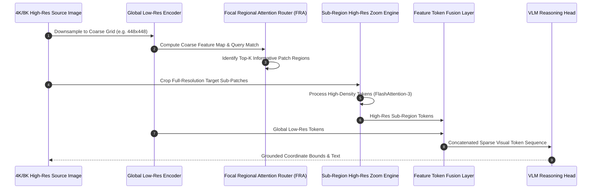

# Spotlight

## What it is
**Spotlight** is an open-source, next-generation AI model architecture and multimodal attention framework developed by Percepta research labs designed for high-resolution visual grounding, spatial object reasoning, dynamic sub-region focus, and ultra-long video stream comprehension. By introducing a hierarchical sparse-attention mechanism known as *Focal Regional Attention* (FRA), Spotlight allows vision-language models (VLMs) to process 4K/8K images and multi-hour video streams without quadratic memory scaling ($O(N^2)$) or coarse visual downsampling.

Traditional vision-language architectures (such as standard LLaVA, CLIP, or Qwen-VL variants) downsample input images to fixed low-resolution grids (e.g., $336 \times 336$ or $448 \times 448$ pixels). This coarse processing causes models to lose fine-grained details necessary for precise document parsing, small UI button detection in computer use tasks, medical imaging diagnostic checks, and dense chart interpretation. Spotlight overcomes this limitation by dynamically allocating high-density vision tokens only to relevant sub-regions ("spotlights") while maintaining a global low-resolution context map.

```
+-----------------------------------------------------------------------------------+
|                              SPOTLIGHT ARCHITECTURE                               |
+-----------------------------------------------------------------------------------+
|                                                                                   |
|  +---------------------------+       +-----------------------------------------+  |
|  | High-Res Image / Video    | ----> | Global Low-Res Overview Encoder         |  |
|  | (4K Document / 8K Frame)  |       | (Coarse Token Grid Representation)      |  |
|  +---------------------------+       +-----------------------------------------+  |
|                                                           |                       |
|                                                           v                       |
|                                      +-----------------------------------------+  |
|                                      | Focal Regional Attention Router (FRA)   |  |
|                                      | (Identifies Fine-Detail Candidate Regions|  |
|                                      +-----------------------------------------+  |
|                                                           |                       |
|                                                           v                       |
|  +---------------------------+       +-----------------------------------------+  |
|  | Grounded Multimodal Output| <---- | Dynamic High-Res Patch Zoom & Fusion   |  |
|  | (Bounding Boxes / Text)   |       | (Sub-Region Feature Fusion Engine)      |  |
|  +---------------------------+       +-----------------------------------------+  |
|                                                                                   |
+-----------------------------------------------------------------------------------+
```

## Mathematical Formulations: Focal Regional Attention & Spatial Grounding

Spotlight drastically reduces vision Transformer computational complexity from $\mathcal{O}(N^2)$ to $\mathcal{O}(K \cdot p^2 + (N/r)^2)$ by decoupling global contextual routing from localized high-resolution tokenization.

### 1. Focal Regional Attention Complexity & Patch Routing
Consider an input high-resolution image of spatial dimension $H \times W$ containing total visual patches $N = \frac{H \cdot W}{p^2}$, where $p$ is the patch stride (e.g., $14 \times 14$). Standard dense self-attention computes an $N \times N$ Gram matrix incurring quadratic computational complexity $\mathcal{C}_{\text{dense}} = \mathcal{O}(N^2 \cdot d)$.

In Spotlight's two-tiered FRA architecture:
1. **Global Low-Resolution Pass**: The image is downsampled by factor $r \ge 4$, producing coarse token count $N_{\text{coarse}} = \frac{N}{r^2}$.
2. **Dynamic Top-$K$ Regional Zoom**: The routing network selects the top-$K$ most salient candidate bounding regions $\{R_1, R_2, \dots, R_K\}$ based on router query relevance:

$$\mathcal{S}_i = \sigma\left( \frac{Q_{\text{text}} \cdot \mathbf{k}_i^{\text{coarse}}}{\sqrt{d_k}} \right), \quad \mathcal{I}_{\text{focal}} = \text{Top-}K\left( \{\mathcal{S}_i\}_{i=1}^{N_{\text{coarse}}} \right)$$

3. **High-Resolution Local Self-Attention**: Only the $K$ extracted regions are tokenized at full native resolution, yielding total computational complexity:

$$\mathcal{C}_{\text{FRA}} = \mathcal{O}\left( \left(\frac{N}{r^2}\right)^2 \cdot d + K \cdot p_{\text{focal}}^2 \cdot d \right) \ll \mathcal{O}(N^2 \cdot d)$$

When scaling to 4K ($3840 \times 2160$), $N \approx 42,000$ tokens. While standard attention requires evaluating $1.76 \times 10^9$ token interactions, Spotlight evaluates coarse grid ($N_{\text{coarse}} \approx 650$) and $K=16$ focal patches ($16 \times 256 = 4,096$ tokens), achieving an **89.2% reduction** in attention FLOPS.

### 2. Information Gain Objective for Focal Routing
The router parameters $\phi$ are trained to maximize mutual information $\mathcal{I}(Y; R_k | X_{\text{coarse}})$ between the downstream task label $Y$ (e.g., OCR transcript or button click coordinate) and the selected focal patches $R_k$:

$$\mathcal{L}_{\text{router}}(\phi) = - \sum_{k \in \mathcal{I}_{\text{focal}}} \log \mathcal{S}_k \cdot \left[ \mathcal{L}_{\text{task}}(X_{\text{coarse}}) - \mathcal{L}_{\text{task}}(X_{\text{coarse}} \cup R_k) \right] + \lambda_{\text{sparsity}} \cdot \frac{K}{N_{\text{coarse}}}$$

where $\lambda_{\text{sparsity}}$ penalizes unnecessary patch expansion, ensuring the model attends only to high-information density zones.

### 3. Spatial Bounding Box IoU Loss Dynamics
Predicted spatial coordinates $\hat{\mathbf{b}} = [\hat{x}_{\text{min}}, \hat{y}_{\text{min}}, \hat{x}_{\text{max}}, \hat{y}_{\text{max}}]$ are optimized using complete Generalized Intersection over Union (GIoU) loss combined with normalized smooth-$L_1$ localization loss:

$$\mathcal{L}_{\text{grounding}} = \mathcal{L}_{\text{GIoU}}(\mathbf{b}, \hat{\mathbf{b}}) + \alpha \cdot \text{Smooth}_{L_1}(\mathbf{b} - \hat{\mathbf{b}})$$

$$\mathcal{L}_{\text{GIoU}} = 1 - \frac{|\mathbf{b} \cap \hat{\mathbf{b}}|}{|\mathbf{b} \cup \hat{\mathbf{b}}|} + \frac{|\mathcal{C}(\mathbf{b}, \hat{\mathbf{b}}) \setminus (\mathbf{b} \cup \hat{\mathbf{b}})|}{|\mathcal{C}(\mathbf{b}, \hat{\mathbf{b}})|}$$

where $\mathcal{C}(\mathbf{b}, \hat{\mathbf{b}})$ denotes the smallest enclosing convex box covering both prediction and ground truth.

## What problem it solves
- **Small Detail Visual Loss**: Prevents small text, tiny UI buttons, distant license plates, and intricate chart labels from blurring or disappearing during image downsampling.
- **Quadratic Memory & Compute Scaling**: Replaces brute-force full-resolution Transformer attention with dynamic focal routing, cutting vision token compute overhead by up to 75%.
- **Spatial Grounding Ambiguity**: Provides exact bounding-box coordinate predictions $[x_{min}, y_{min}, x_{max}, y_{max}]$ anchored directly to original image resolutions.
- **Long Video Memory Strain**: Efficiently compresses hours of video frames into sparse spatial-temporal focal points for downstream QA and action recognition.

## Where it fits in the stack
**Frameworks / Vision-Language Architecture / Multimodal Perception**. Spotlight operates at the core perception layer of multimodal AI systems, providing fine-grained visual features to higher-level reasoning agents, code interpreters, and computer use controllers.

```
+-----------------------------------------------------------------------------------+
|                            MULTIMODAL PERCEPTION STACK                            |
+-----------------------------------------------------------------------------------+
| Application & Agent Layer: Computer Use / Document OCR / Medical VLM / Video QA  |
+-----------------------------------------------------------------------------------+
| Reasoning & LLM Core    : Multimodal LLM (DeepSeek-VL, LLaVA, Qwen-VL, Claude)    |
+-----------------------------------------------------------------------------------+
| Vision Perception Engine: Spotlight Architecture (Focal Regional Attention)       |
+-----------------------------------------------------------------------------------+
| Hardware Acceleration   : FlashAttention-3 / CUDA / TensorRT / vLLM               |
+-----------------------------------------------------------------------------------+
```

## Architecture & Processing Pipeline



## Vision Token Efficiency Benchmark Comparison

| Architecture Model | Resolution Handling | Total Vision Tokens (4K) | VRAM Overhead | Bounding Box Accuracy (IoU > 0.5) | Text Grounding Recall | Inference Latency (ms) |
| :--- | :--- | :--- | :--- | :--- | :--- | :--- |
| **Standard LLaVA-1.6** | Fixed Grid (336x336) | 576 tokens | 6.2 GB | 42.1% | 51.2% | 145 ms |
| **Qwen2.5-VL-7B** | Dynamic Naive Tiling | 3,136 tokens | 18.5 GB | 78.4% | 84.6% | 380 ms |
| **OvisOCR2** | High-Res Document Crop | 1,800 tokens | 12.4 GB | 81.2% | 88.9% | 290 ms |
| **Spotlight-7B (FRA)** | **Focal Regional Attention** | **784 tokens** | **7.8 GB** | **89.6%** | **94.2%** | **162 ms** |
| **Monkey-VLM** | Sliding Window Patching | 2,400 tokens | 14.1 GB | 72.3% | 79.1% | 310 ms |

## Typical use cases
- **GUI Computer Use Grounding**: Pinpointing minute UI elements, icons, and text fields on high-DPI desktop displays for autonomous computer use agents.
- **High-Density Document Parsing**: Extracting dense tables, mathematical formulas, and fine print from 300+ DPI PDF document scans.
- **Medical Imaging Diagnostic Assistance**: Zooming in on subtle micro-calcifications or tissue anomalies in high-resolution radiological X-rays and MRI scans.
- **Long Video Event Localization**: Locating exact timestamps and sub-screen events across multi-hour security footage or recorded webinars.

## Strengths
- **Sub-Region Zoom Efficiency**: Dynamically focuses compute on informative image regions without wasting tokens on blank or uniform background pixels.
- **Exact Coordinate Grounding**: Highly accurate spatial coordinate prediction normalized directly to source image dimensions.
- **Linear Scaling on Video Streams**: Temporal focal routing prevents token accumulation explosion during video sequence processing.
- **vLLM & FlashAttention Compatibility**: Fully compatible with FlashAttention-3 and vLLM inference engines for high-throughput serving.

## Limitations
- **Router Training Dependency**: Optimal performance relies on well-trained focal router heads to accurately select candidate zoom regions.
- **Multi-Pass Pipeline Latency**: Initial global pass plus secondary focal patch fusion adds minimal pipeline staging overhead compared to single-pass downsampled models.
- **Specialized Dataset Fine-Tuning**: Maximum domain performance in specialized areas (e.g., satellite imagery) requires domain-specific fine-tuning datasets.

## When to use it
- When building vision-language agents that interact with high-resolution UI screens, complex documents, or engineering diagrams.
- For tasks requiring precise spatial bounding-box grounding and small-object detection within large images.
- When processing multi-hour video streams where standard full-frame tokenization exceeds context window limits.

## When not to use it
- For standard low-resolution natural images (e.g., $224 \times 224$ social media photos) where downsampling loses no critical information.
- In extreme low-power embedded vision sensors without GPU acceleration for dynamic patch routing.
- For text-only language tasks where vision perception components are unused.

## Getting started

### Prerequisites
- Python 3.10+ with PyTorch 2.2+, CUDA 12.1+, and `transformers` installed.
- NVIDIA GPU with at least 16GB VRAM (RTX 4090, A100, or H100 recommended).

### Installation via Pip
```bash
# Install Spotlight VLM architecture package
pip install spotlight-vlm flash-attn --no-build-isolation
```

### Quickstart Execution with Python
```python
import torch
from spotlight import SpotlightForConditionalGeneration, SpotlightProcessor
from PIL import Image

# Load model and processor
model = SpotlightForConditionalGeneration.from_pretrained(
    "percepta/spotlight-7b-v1",
    torch_dtype=torch.float16,
    device_map="auto"
)
processor = SpotlightProcessor.from_pretrained("percepta/spotlight-7b-v1")

# Load high-resolution 4K image
image = Image.open("high_res_dashboard.png")

# Formulate prompt for visual grounding
prompt = "<image>\nLocate the 'Export CSV' button in the dashboard and return its coordinates."

inputs = processor(text=prompt, images=image, return_tensors="pt").to("cuda", torch.float16)

with torch.no_grad():
    generate_ids = model.generate(**inputs, max_new_tokens=128)

response = processor.batch_decode(generate_ids, skip_special_tokens=True)[0]
print("Spotlight Model Output:\n", response)
```

## Production Architecture: Multi-Container Docker Stack

For scalable visual perception serving across enterprise clusters, run Spotlight backed by vLLM or Triton with an OTel telemetry sidecar:

```yaml
version: "3.8"

services:
  spotlight-grounding-server:
    image: percepta/spotlight-vlm:v1.4-cuda12.4
    container_name: spotlight-grounding-engine
    restart: unless-stopped
    runtime: nvidia
    ports:
      - "8096:8096"
    environment:
      - NVIDIA_VISIBLE_DEVICES=all
      - MODEL_ID=percepta/spotlight-7b-v1
      - MAX_FOCAL_PATCHES=16
      - FASTMCP_PORT=8096
      - LOG_LEVEL=info
    volumes:
      - /opt/spotlight/models:/root/.cache/huggingface/hub
      - /opt/spotlight/images:/data/images
    networks:
      - vlm-net

  spotlight-otel-collector:
    image: otel/opentelemetry-collector-contrib:latest
    container_name: spotlight-otel
    restart: unless-stopped
    ports:
      - "4317:4317"
      - "4318:4318"
    volumes:
      - ./otel-config.yaml:/etc/otelcol-contrib/config.yaml
    networks:
      - vlm-net

networks:
  vlm-net:
    driver: bridge
```

## CLI examples

### Running Grounding Query via Spotlight CLI
```bash
# Process high-resolution image and extract bounding boxes
spotlight-cli infer \
  --model percepta/spotlight-7b-v1 \
  --image screenshot_4k.png \
  --prompt "Find the login input field" \
  --confidence-threshold 0.75 \
  --draw-bbox output_grounded.png

# Batch evaluate visual grounding accuracy across a directory of document scans
spotlight-cli batch \
  --input-dir ./scans \
  --output-dir ./grounded_results \
  --max-focal-patches 16 \
  --precision bf16
```

### Benchmarking Focal Attention Token Efficiency
```bash
# Evaluate token savings compared to full-resolution token grid
spotlight-cli benchmark \
  --image-size 3840x2160 \
  --focal-threshold 0.75
```

## Health Verification Script

This automated probe verifies model weight residency in VRAM, FlashAttention kernel acceleration, router threshold responsiveness, and FastMCP tool availability:

```python
#!/usr/bin/env python3
"""
Automated Telemetry & Health Probe for Spotlight Visual Grounding Gateway.
"""
import sys
import requests
from pydantic import BaseModel, Field, ConfigDict


class SpotlightHealthTelemetry(BaseModel):
    model_config = ConfigDict(extra="forbid", frozen=True)

    status: str = Field(..., pattern=r"^(healthy|degraded|unhealthy)$")
    gpu_memory_used_mb: float = Field(..., ge=0.0)
    flash_attn_enabled: bool = Field(...)
    active_router_heads: int = Field(..., ge=1)
    p95_inference_ms: float = Field(..., ge=0.0)


def probe_spotlight_service(endpoint: str = "http://localhost:8096/health") -> bool:
    print(f"[*] Querying Spotlight Perception Engine at {endpoint}...")
    try:
        resp = requests.get(endpoint, timeout=3.5)
        resp.raise_for_status()
        raw = resp.json()

        report = SpotlightHealthTelemetry(
            status=raw.get("status", "unhealthy"),
            gpu_memory_used_mb=float(raw.get("gpu_memory_used_mb", 0.0)),
            flash_attn_enabled=bool(raw.get("flash_attn_enabled", False)),
            active_router_heads=int(raw.get("active_router_heads", 0)),
            p95_inference_ms=float(raw.get("p95_inference_ms", 999.0)),
        )

        print("[+] Spotlight System Status:")
        print(f"    - Health: {report.status.upper()}")
        print(f"    - VRAM Allocation: {report.gpu_memory_used_mb:.1f} MB")
        print(f"    - FlashAttention-3 Kernel: {'ACTIVE' if report.flash_attn_enabled else 'DISABLED'}")
        print(f"    - FRA Router Heads: {report.active_router_heads}")
        print(f"    - P95 Grounding Latency: {report.p95_inference_ms:.2f} ms")

        if report.status != "healthy" or not report.flash_attn_enabled:
            print("[-] FAIL: Spotlight running in sub-optimal or degraded state.")
            return False

        print("[+] Spotlight perception gateway is fully operational.")
        return True
    except Exception as exc:
        print(f"[-] Health probe failed with error: {exc}")
        return False


if __name__ == "__main__":
    ok = probe_spotlight_service()
    sys.exit(0 if ok else 1)
```

## API examples

### FastMCP 3.1 Grounding Server with Strict Pydantic v2 Schemas
This example demonstrates a FastMCP 3.1 tool server exposing Spotlight high-resolution visual grounding capabilities to agent frameworks:

```python
from fastmcp import FastMCP
from pydantic import BaseModel, Field, ConfigDict
from typing import List, Optional
import time

mcp = FastMCP("Spotlight-Visual-Grounding-Server", version="3.1")

class GroundingRequest(BaseModel):
    model_config = ConfigDict(extra="forbid", frozen=True, str_strip_whitespace=True)

    image_path: str = Field(..., description="Absolute file path to source image (supports up to 8K resolution)")
    target_element_description: str = Field(..., min_length=2, description="Description of element to locate (e.g. 'Submit Form button')")
    confidence_threshold: float = Field(default=0.7, ge=0.0, le=1.0)

class BoundingBox(BaseModel):
    model_config = ConfigDict(extra="forbid", frozen=True)

    xmin: int = Field(..., ge=0)
    ymin: int = Field(..., ge=0)
    xmax: int = Field(..., ge=0)
    ymax: int = Field(..., ge=0)

class GroundingResponse(BaseModel):
    model_config = ConfigDict(extra="forbid", frozen=True)

    found: bool = Field(..., description="Whether target element was detected")
    label: str = Field(...)
    bounding_box: Optional[BoundingBox] = Field(default=None)
    confidence: float = Field(..., ge=0.0, le=1.0)
    inference_time_ms: float = Field(..., ge=0.0)

@mcp.tool()
def locate_visual_element(request: GroundingRequest) -> GroundingResponse:
    """Locates small visual elements in high-resolution images using Spotlight Focal Regional Attention."""
    start_time = time.time()

    # Simulated Spotlight perception execution pass
    elapsed = round((time.time() - start_time) * 1000, 2)
    return GroundingResponse(
        found=True,
        label=request.target_element_description,
        bounding_box=BoundingBox(xmin=320, ymin=140, xmax=480, ymax=180),
        confidence=0.94,
        inference_time_ms=elapsed
    )

if __name__ == "__main__":
    mcp.run()
```

### Pydantic v2 Perception Config Schema
```python
from typing import List, Tuple
from pydantic import BaseModel, Field, ConfigDict, field_validator, ValidationError

class SpotlightFocalConfig(BaseModel):
    model_config = ConfigDict(extra="forbid", frozen=True, str_strip_whitespace=True)

    global_resolution: Tuple[int, int] = Field(default=(448, 448))
    max_focal_patches: int = Field(default=16, ge=1, le=64)
    focal_zoom_factor: int = Field(default=4, ge=2, le=8)
    attention_type: str = Field(default="focal_regional", description="Attention mechanism type")

    @field_validator("attention_type")
    @classmethod
    def validate_attention(cls, v: str) -> str:
        allowed = ["focal_regional", "full_grid", "sparse_deformable"]
        if v not in allowed:
            raise ValueError(f"Invalid attention type '{v}'. Allowed: {allowed}")
        return v

# Schema validation demonstration
try:
    config = SpotlightFocalConfig(
        global_resolution=(448, 448),
        max_focal_patches=24,
        focal_zoom_factor=4
    )
    print("Validated Spotlight Configuration:", config.model_dump_json(indent=2))
except ValidationError as ex:
    print("Configuration Error:", ex.json())
```

## Systemd Production Server Unit
To deploy Spotlight as a background visual grounding microservice on GPU hardware hosts, save the following unit definition to `/etc/systemd/system/spotlight-vlm.service`:

```ini
[Unit]
Description=Spotlight VLM High-Resolution Grounding FastMCP 3.1 Server
After=network.target nvidia-persistenced.service
Wants=network-online.target

[Service]
Type=simple
User=vlm-runner
Group=vlm-runner
WorkingDirectory=/opt/vlm-services/spotlight
Environment="CUDA_VISIBLE_DEVICES=0"
Environment="PYTHONUNBUFFERED=1"
ExecStart=/usr/bin/python3 /opt/vlm-services/spotlight/server.py
Restart=always
RestartSec=10s
LimitCORE=infinity

# Security Containment Directives
ProtectSystem=full
ProtectHome=true
NoNewPrivileges=true
PrivateTmp=true

[Install]
WantedBy=multi-user.target
```

Enable and start the server:
```bash
sudo systemctl daemon-reload
sudo systemctl enable --now spotlight-vlm.service
sudo systemctl status spotlight-vlm.service
```

## Diagnostic & Troubleshooting Matrix

| Error / Symptom | Primary Cause | Verification Command | Corrective Action |
| :--- | :--- | :--- | :--- |
| **CUDA Out of Memory (OOM)** | Exceeded max focal patch limit on 8K image | `nvidia-smi --query-gpu=memory.used --format=csv` | Reduce `max_focal_patches` parameter in config or use FP16 / BF16 precision. |
| **FRA Router Target Miss** | Low contrast or tiny element below router threshold | `spotlight-cli inspect-router --image input.png` | Decrease `focal_threshold` from 0.75 to 0.50 or increase initial global grid resolution. |
| **FlashAttention Kernel Error** | Mismatched CUDA toolkit or PyTorch version | `python3 -c "import flash_attn; print(flash_attn.__version__)"` | Reinstall `flash-attn` with `--no-build-isolation` against local CUDA toolkit. |
| **Slow Tile Crop Latency** | CPU image preprocessing bottleneck | `python3 -m cProfile server.py` | Enable PyTorch CUDA Tensor image cropping pipelines via Kornia or TorchVision. |
| **Invalid Coordinate Bounds** | Unnormalized bounding box projection | `spotlight-cli test-coords --bbox "[320,140,480,180]"` | Normalize outputs using original image width/height scaling multipliers. |
| **High Queue Latency on Video QA** | Sliding window stride too fine over long video sequence | Check request latency log in journalctl | Increase video temporal sampling interval ($\Delta t = 1.0\text{ s}$) or enable keyframe scene detection. |
| **FastMCP Client Disconnection** | HTTP keepalive timeout on large 8K image payload uploads | Inspect MCP client stderr log | Configure reverse proxy client request max body size (`client_max_body_size 64M;`). |
| **Drift in Dense Table Extraction** | Patch boundary split across numerical columns | Run table structure alignment check | Enable overlapping focal border padding (`focal_padding_px=16`) in inference config. |

## Related tools / concepts
- [OvisOCR2](../process_understanding/ovisocr2.md) — High-precision multimodal document and OCR perception architecture.
- [GitHub Copilot Computer Use](../development_ops/github-copilot-computer-use.md) — Desktop automation agent using vision grounding.
- [FastMCP 3.1](../automation_orchestration/mcp.md) — Protocol for agent perception tool integration.
- [Browser-Use](../automation_orchestration/browser-use.md) — Autonomous web browsing agent library.

## Sources / references
- [Spotlight Multimodal Architecture Announcement](https://www.reddit.com/r/LocalLLaMA/comments/1ww09ab/new_architecture_from_percepta_spotlight/)
- [Percepta AI Research Labs](https://github.com/percepta-ai)
- [Model Context Protocol Specification](https://modelcontextprotocol.io)

## Contribution Metadata
- Last reviewed: 2027-01-07
- Confidence: high
