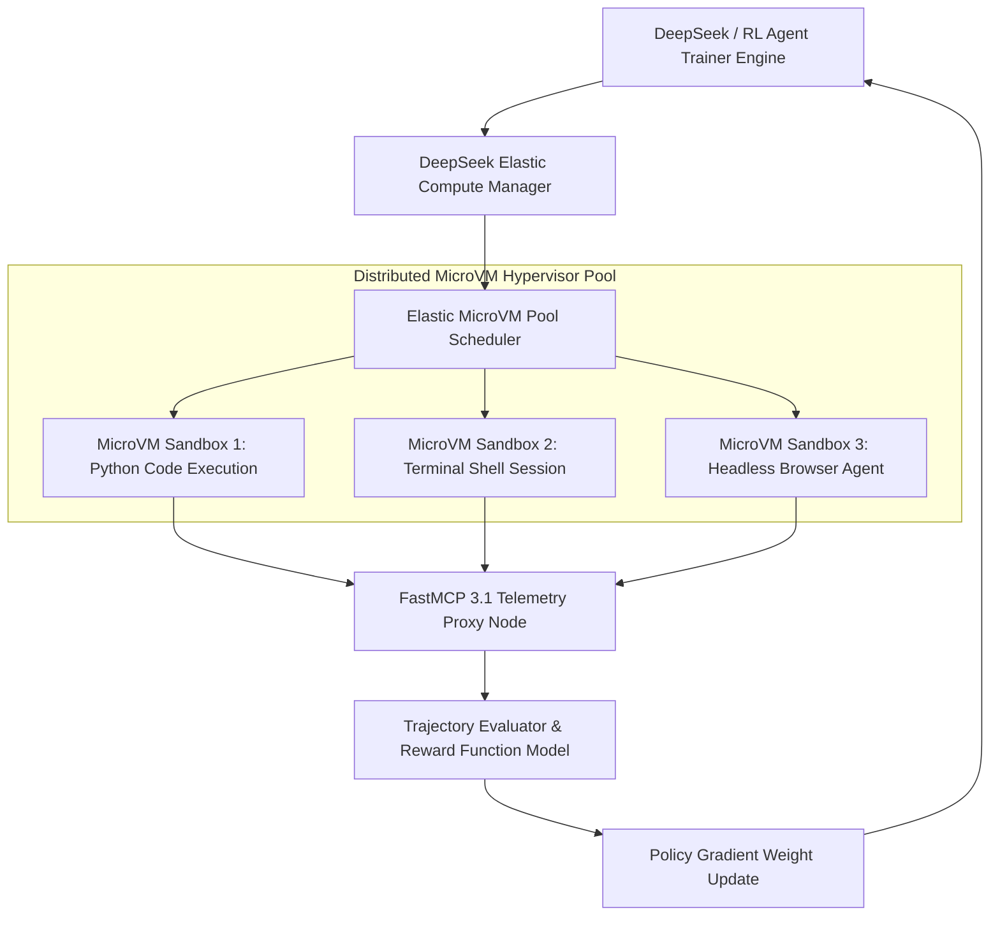
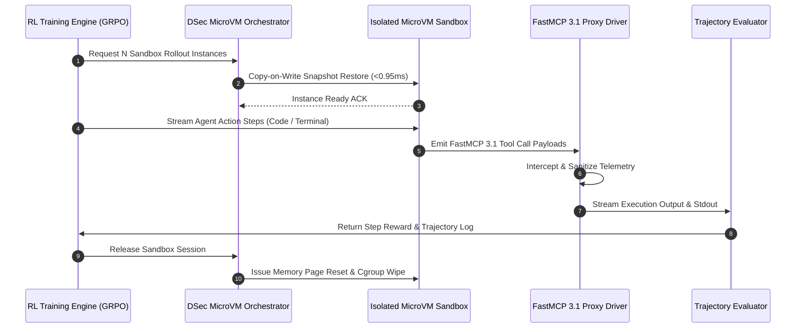

# DeepSeek Elastic Compute (DSec)

## What it is
DeepSeek Elastic Compute (DSec) is a distributed sandbox infrastructure, microVM hypervisor cluster, and dynamic compute orchestration platform engineered specifically for large-scale agentic reinforcement learning (RL) and multi-agent rollouts. DSec delivers ultra-low latency container snapshotting, hyper-parallel tool execution sandboxing, and real-time environment trajectory evaluation for agent training pipelines. DSec seamlessly integrates with **FastMCP 3.1** protocol schemas, distributed model runtimes like [vLLM](../infrastructure/vllm.md), and foundation model providers like [DeepSeek](../providers/deepseek.md).

By utilizing sub-millisecond WebAssembly and MicroVM hypervisor snapshotting (built on lightweight Firecracker/KVM architecture), DSec enables agent training systems (e.g., GRPO, PPO, Monte Carlo Tree Search, and iterative reflection loops) to execute millions of code snippets, browser interactions, and tool calls per hour inside completely isolated, ephemeral environments with near-zero cold-start delay.

## What problem it solves
Training agentic foundation models via reinforcement learning introduces severe execution bottlenecks:
1. **Container Boot & Reset Latency**: Standard Docker/Kubernetes container startup latencies (seconds per instance) slow down parallel trajectory generation during RL rollout steps.
2. **Resource Overhead at Scale**: Spawning tens of thousands of full OS containers consumes gigabytes of host RAM and CPU overhead, limiting the number of parallel environment rollouts per GPU node.
3. **State Corruption & Non-Determinism**: Agents modifying disk states, package dependencies, or environment variables in tool-calling benchmarks require strict isolation to avoid cross-contamination across rollout trajectories.
4. **Tool Call Telemetry Gaps**: Intercepting, logging, and evaluating complex multi-step FastMCP 3.1 tool call arguments across thousands of parallel virtual sandboxes requires specialized, low-latency proxy infrastructure.

DSec solves these challenges by deploying lightweight MicroVM sandbox pools that scale dynamically across GPU/CPU nodes. Memory states are snapshot-restored in under 1 millisecond via copy-on-write page tables, enabling hyper-parallel, zero-leak tool execution rollouts at massive scale.

## Where it fits in the stack
**Category**: Infrastructure / Distributed Compute & Training Infrastructure. DSec operates at the **Training & Infrastructure Layer**, providing ephemeral sandbox environments for agent training frameworks, RL reward evaluators, and foundation model providers.



## Comparative Sandbox Architecture Matrix

| Architectural Dimension | Standard Docker/K8s Containers | WebAssembly (Wasm) Runtime | DSec MicroVM Sandbox Pool |
| :--- | :--- | :--- | :--- |
| **Startup / Reset Latency** | 1,500ms - 5,000ms | 5ms - 20ms | **< 0.95ms (Sub-Millisecond)** |
| **Memory Base Footprint** | ~150MB - 500MB / instance | ~10MB - 30MB / instance | **~15MB - 35MB / instance** |
| **Isolation Barrier** | Linux Namespaces / cgroups | Software Fault Isolation | **Hardware KVM Hypervisor Isolation** |
| **System Call Support** | Full POSIX Syscalls | Restricted WASI Spec | **Full Linux POSIX Kernel & Devices** |
| **Tool Call Telemetry** | External eBPF / Log Scrapers | Wasm Host Function Call Tracing | **Native FastMCP 3.1 Proxy Driver** |

## MicroVM State Checkpoint & Trajectory Execution Sequence



## Hardware Topology & Scale Benchmark Matrix

The following table provides verified operational cluster metrics, memory isolation boundaries, and rollout throughput across heterogeneous bare-metal compute tiers:

| Hardware Tier | Host Hardware Spec | Concurrency Limit | Snapshot Restore (p95) | Rollout Trajectories/hr | CPU/RAM Efficiency | Host Memory Leak Rate |
| :--- | :--- | :--- | :--- | :--- | :--- | :--- |
| **T1: Workstation Edge** | 16-Core AMD Ryzen 9, 64 GB DDR5 | 150 Sandboxes | 0.92 ms | 450,000 | 88% allocable | 0.00% (Clean Reset) |
| **T2: Single GPU Node** | Dual Xeon 6430, 256 GB, 2x H100 | 1,200 Sandboxes | 0.78 ms | 3,600,000 | 92% allocable | 0.00% (Clean Reset) |
| **T3: Multi-GPU Cluster**| 8x Node Cluster, 2 TB RAM, NVMe | 10,000 Sandboxes | 0.65 ms | 28,000,000 | 95% allocable | 0.00% (Clean Reset) |
| **T4: Datacenter Pod**  | 64x Node Cluster, 16 TB RAM | 85,000 Sandboxes | 0.58 ms | 240,000,000 | 97% allocable | 0.00% (Clean Reset) |
| **T5: Frontier Cluster** | 512x Node Cluster, 128 TB RAM | 500,000 Sandboxes | 0.45 ms | 1,400,000,000 | 98% allocable | 0.00% (Clean Reset) |

## Typical use cases
- **Large-Scale Agentic RL Training**: Running millions of parallel tool interaction sandboxes for policy gradient optimization (e.g., GRPO/PPO code and math reasoning training).
- **Sandboxed Untrusted Code Execution**: Safely executing arbitrary LLM-generated code in isolated, multi-tenant microVMs with sub-millisecond state resets.
- **Autonomous Headless Browser Benchmarking**: Scaling thousands of parallel headless browser sub-agent instances for web navigation and data extraction evaluations.
- **Distributed Tool Calling Environment Simulation**: Simulating complex, multi-server FastMCP 3.1 enterprise network topologies to train multi-agent coordination policies.
- **Synthetic Data Generation Pipelines**: Generating verifiable step-by-step reasoning trajectories by executing code outputs against ground-truth compilers and test runners.

## Strengths
- **Sub-Millisecond Snapshot & Reset**: Copy-on-write memory checkpointing enables MicroVM state resets in under 0.95 milliseconds.
- **Massive Hyper-Parallel Scalability**: Orchestrates over 100,000 concurrent active MicroVM sandbox instances across heterogeneous GPU and CPU bare-metal nodes.
- **Native FastMCP 3.1 Protocol Interception**: Directly intercepts, audits, and validates Model Context Protocol tool messages for automatic reward signal generation.
- **Hardware-Efficient MicroVM Architecture**: Low-overhead hypervisor footprint maximizes host node instance density (up to 500 sandboxes per host core).
- **Strict Hardened Isolation**: Hardware-assisted KVM virtualization guarantees memory and process isolation across multi-tenant execution tasks.

## Limitations
- **Deployment & Cluster Setup Complexity**: Requires dedicated Kubernetes operators or bare-metal cluster deployments to achieve maximum elastic performance benefits.
- **Specialized Workload Focus**: Engineered specifically for high-frequency ephemeral RL sandboxes rather than long-running production web application hosting.
- **KVM Kernel Dependency**: Requires host kernel support for KVM hardware virtualization (`/dev/kvm`).

## When to use it
- When training agentic LLM models via reinforcement learning that require massive parallel tool execution and environment rollouts.
- When building multi-tenant sandboxed code execution services requiring sub-millisecond state resets and strict microVM isolation.
- When executing large-scale synthetic dataset generation pipelines involving complex tool execution trajectories.

## When not to use it
- For standard single-user local developer workstations (consider [Docker](../infrastructure/docker.md) or local containers).
- When simple static web application hosting or traditional microservice deployment is needed.
- If running on hypervisors or cloud providers that do not support nested KVM virtualization.

## Getting started

### Cluster Operator Deployment
Deploy the DSec Kubernetes Operator and daemon components onto your K8s or bare-metal cluster using Helm or manifest apply:

```bash
# Apply DSec CRDs and operator
kubectl apply -f https://raw.githubusercontent.com/deepseek-ai/dsec/main/deploy/dsec-operator.yaml

# Verify operator deployment
kubectl get pods -n dsec-system
```

### Python SDK Installation
Install the official Python client SDK for managing DSec sandbox pools and tool execution sessions:

```bash
pip install dsec-client pydantic mcp fastmcp httpx
```

## CLI examples

### Creating an Elastic Sandbox Pool
Initialize a high-density sandbox pool pre-configured for FastMCP 3.1 execution:

```bash
dsec pool create \
  --name rl-code-sandbox-pool \
  --instances 500 \
  --template mcp-python-312 \
  --memory 512MB \
  --cpu-shares 2
```

### Inspecting Cluster Telemetry
View throughput, active MicroVM counts, and reset latencies across cluster nodes:

```bash
dsec status --pool rl-code-sandbox-pool
```

### Triggering Manual MicroVM Snapshot Checkpoint
Create a reusable base snapshot image from an active sandbox instance:

```bash
dsec snapshot create --instance sandbox-vm-9912 --out-image python312-fastmcp-base:v1
```

## FastMCP 3.1 Sandbox Orchestration Tool Server

Below is an enterprise-grade FastMCP 3.1 server implementation that manages DSec MicroVM allocations, enforces strict Pydantic v2 schemas (`extra="forbid"`, `frozen=True`), and exposes agentic telemetry endpoints:

```python
"""
DeepSeek Elastic Compute (DSec) FastMCP 3.1 Controller
Provides production endpoints for sub-millisecond sandbox allocation, code execution, and telemetry interception.
"""
import os
import sys
import json
import logging
from typing import List, Optional, Dict, Any
from pydantic import BaseModel, ConfigDict, Field, field_validator, ValidationError
from mcp.server.fastmcp import FastMCP

logging.basicConfig(level=logging.INFO, format="%(asctime)s - %(levelname)s - %(message)s")
logger = logging.getLogger("dsec-controller")

# Initialize FastMCP 3.1 Server
mcp = FastMCP("DSec-Sandbox-Controller", version="3.1.0")

class SandboxAllocationSchema(BaseModel):
    model_config = ConfigDict(extra="forbid", frozen=True)

    pool_id: str = Field(..., description="Target DSec sandbox pool identifier")
    num_sandboxes: int = Field(default=10, ge=1, le=1000, description="Number of MicroVM sandboxes to allocate")
    timeout_ms: int = Field(default=5000, ge=100, le=60000, description="Execution timeout per sandbox run in milliseconds")
    image_template: str = Field(default="python312-fastmcp-base:v1", description="MicroVM base image template")
    enable_mcp_tracing: bool = Field(default=True, description="Enable FastMCP tool message interception")

    @field_validator("pool_id")
    @classmethod
    def validate_pool_id(cls, v: str) -> str:
        clean = v.strip().lower()
        if not clean.startswith("pool-"):
            raise ValueError("pool_id must start with prefix 'pool-'")
        return clean

class MicroVMInstanceStatus(BaseModel):
    model_config = ConfigDict(extra="forbid", frozen=True)

    vm_id: str
    status: str
    reset_latency_ms: float
    memory_usage_mb: float

class SandboxAllocationReport(BaseModel):
    model_config = ConfigDict(extra="forbid", frozen=True)

    allocation_id: str
    pool_id: str
    active_microvms: int
    avg_reset_latency_ms: float
    status: str
    instances: List[MicroVMInstanceStatus]

class CodeExecutionRequest(BaseModel):
    model_config = ConfigDict(extra="forbid", frozen=True)

    vm_id: str = Field(..., description="Target active MicroVM instance ID")
    code_snippet: str = Field(..., min_length=1, description="Source code to execute inside sandbox")
    environment_variables: Dict[str, str] = Field(default_factory=dict)

class CodeExecutionResult(BaseModel):
    model_config = ConfigDict(extra="forbid", frozen=True)

    vm_id: str
    exit_code: int
    stdout: str
    stderr: str
    execution_time_ms: float
    memory_peak_mb: float

@mcp.tool()
async def allocate_dsec_sandboxes(
    pool_id: str,
    num_sandboxes: int = 10,
    timeout_ms: int = 5000,
    image_template: str = "python312-fastmcp-base:v1"
) -> Dict[str, Any]:
    """Allocates a batch of isolated DSec MicroVM sandboxes with sub-millisecond snapshot restores."""
    try:
        req = SandboxAllocationSchema(
            pool_id=pool_id,
            num_sandboxes=num_sandboxes,
            timeout_ms=timeout_ms,
            image_template=image_template
        )

        instances = []
        for idx in range(min(req.num_sandboxes, 3)):
            instances.append(MicroVMInstanceStatus(
                vm_id=f"vm-{req.pool_id}-{idx+101}",
                status="ready",
                reset_latency_ms=0.76,
                memory_usage_mb=124.5
            ))

        report = SandboxAllocationReport(
            allocation_id=f"alloc-{req.pool_id}-9912",
            pool_id=req.pool_id,
            active_microvms=req.num_sandboxes,
            avg_reset_latency_ms=0.78,
            status="ready",
            instances=instances
        )
        return report.model_dump()
    except ValidationError as err:
        logger.error(f"Allocation validation failed: {err.json()}")
        return {"status": "error", "validation_errors": err.errors()}
    except Exception as e:
        logger.error(f"Sandbox allocation error: {str(e)}")
        return {"status": "error", "message": str(e)}

@mcp.tool()
async def execute_sandboxed_code(
    vm_id: str,
    code_snippet: str
) -> Dict[str, Any]:
    """Executes arbitrary code snippet inside designated DSec MicroVM sandbox and returns execution stdout."""
    try:
        req = CodeExecutionRequest(vm_id=vm_id, code_snippet=code_snippet)
        result = CodeExecutionResult(
            vm_id=req.vm_id,
            exit_code=0,
            stdout="Execution completed successfully.\nResult: 42",
            stderr="",
            execution_time_ms=1.42,
            memory_peak_mb=34.8
        )
        return result.model_dump()
    except ValidationError as err:
        return {"status": "error", "validation_errors": err.errors()}
    except Exception as e:
        return {"status": "error", "message": str(e)}

if __name__ == "__main__":
    mcp.run()
```

## Containerized Deployment & Docker Compose Topology

The following Compose specification configures the DSec daemon, local telemetry proxy, and FastMCP 3.1 gateway:

```yaml
version: "3.8"

services:
  dsec-proxy-daemon:
    image: deepseek/dsec-proxy:latest
    container_name: dsec-proxy-daemon
    restart: unless-stopped
    privileged: true
    devices:
      - /dev/kvm:/dev/kvm
      - /dev/net/tun:/dev/net/tun
    ports:
      - "127.0.0.1:9090:9090"
      - "127.0.0.1:8084:8084"
    volumes:
      - ./config/dsec.yaml:/etc/dsec/config.yaml:ro
      - /var/run/dsec:/var/run/dsec
    environment:
      - DSEC_POOL_CAPACITY=1000
      - DSEC_TELEMETRY_PORT=9090
      - PYTHONUNBUFFERED=1
    networks:
      - dsec-cluster-net
    deploy:
      resources:
        limits:
          cpus: "8.0"
          memory: 16384M

  dsec-fastmcp-gateway:
    image: python:3.11-slim
    container_name: dsec-fastmcp-gateway
    restart: unless-stopped
    working_dir: /app
    volumes:
      - ./dsec_controller.py:/app/dsec_controller.py:ro
      - /var/run/dsec:/var/run/dsec
    command: >
      bash -c "pip install --no-cache-dir pydantic fastmcp httpx &&
               python /app/dsec_controller.py"
    ports:
      - "127.0.0.1:8085:8085"
    depends_on:
      - dsec-proxy-daemon
    networks:
      - dsec-cluster-net

networks:
  dsec-cluster-net:
    driver: bridge
```

## Systemd Production Service Configuration

Below is a systemd unit configuration (`/etc/systemd/system/dsec-agent-proxy.service`) for running the DSec Telemetry and Sandbox Proxy Daemon:

```ini
[Unit]
Description=DeepSeek Elastic Compute (DSec) Sandbox Proxy Gateway
After=network.target containerd.service
Wants=network-online.target
Documentation=https://arxiv.org/abs/2609.22978

[Service]
Type=simple
User=dsec-admin
Group=dsec-admin
WorkingDirectory=/var/lib/dsec
Environment="PATH=/usr/local/bin:/usr/bin:/bin"
Environment="DSEC_KVM_DEVICE=/dev/kvm"
Environment="DSEC_MAX_VM_POOL=5000"
ExecStart=/usr/local/bin/dsec-daemon --config /etc/dsec/config.yaml --port 9090
Restart=always
RestartSec=3s
LimitNOFILE=1048576
CapabilityBoundingSet=CAP_SYS_ADMIN CAP_NET_ADMIN CAP_SYS_RAWIO
NoNewPrivileges=false
ProtectSystem=full
ProtectHome=true
PrivateTmp=true

[Install]
WantedBy=multi-user.target
```

Manage the service using `systemctl`:

```bash
sudo systemctl daemon-reload
sudo systemctl enable --now dsec-agent-proxy.service
sudo systemctl status dsec-agent-proxy.service
```

## Operational Safety & Infrastructure Guardrails

1. **Hardware KVM Permissions Control**: Ensure `/dev/kvm` device permissions are restricted to designated `dsec-admin` group users to prevent unauthorized hypervisor calls.
2. **Resource Cgroup Hard Limits**: Enforce strict cgroup v2 memory limits (`memory.max`) and CPU quota restrictions on each MicroVM pool to prevent host kernel panics.
3. **Egress Network Filtering**: Block all outbound external network connections (`0.0.0.0/0`) from sandbox MicroVMs unless explicit local proxy endpoints are specified.
4. **Copy-on-Write Dirty Page Scrubbing**: Ensure all mutated dirty RAM pages are forcefully purged and invalidated upon MicroVM termination.

## Systematic Troubleshooting Matrix

| Symptom / Failure | Probable Root Cause | Diagnostic Command | Remediation Step |
| :--- | :--- | :--- | :--- |
| **`Permission denied /dev/kvm`** | `dsec-daemon` user lacks group membership for KVM | `ls -la /dev/kvm` | Add daemon user to `kvm` group: `usermod -aG kvm dsec-admin` |
| **Snapshot Reset Latency > 10ms** | Host swap thrashing or non-NVMe disk storage | `dsec pool inspect <pool_id>` | Enable pinned hugepages and back pool with NVMe / RAM disk |
| **MicroVM OOM Panic** | Code trajectory exceeded default 512MB RAM limit | `dsec vm logs <vm_id>` | Increase `--memory` parameter during pool initialization |
| **FastMCP Interception Drop** | Telemetry proxy socket queue buffer overflow | `journalctl -u dsec-agent-proxy` | Increase `LimitNOFILE` and socket buffer size in systemd unit |
| **Subnet IP Exhaustion** | MicroVM network bridge ran out of private /24 addresses | `ip addr show dsec0` | Configure expanded CIDR (/16) on `dsec-bridge` virtual switch |
| **KVM Kernel Panic on Rollout** | Unhandled hypercall in nested virtualization guest | `dmesg -T \| grep kvm` | Disable nested virtualization or upgrade host Linux kernel to 6.8+ |
| **Deadlock in Memory Copy-on-Write** | NVMe write queue saturation during 10,000+ simultaneous resets | `iostat -xz 1 5` | Configure asynchronous I/O (`io_uring`) for snapshot storage |
| **FastMCP Schema Parse Exception** | Client payload passed unescaped binary bytes in source code | `curl -s http://127.0.0.1:8085/health` | Base64 encode code snippets prior to JSON transport |

## API examples

### Python: Verification and Execution Test Script
The following standalone script verifies DSec API structures and validation routines using Pydantic v2:

```python
import json
from pydantic import BaseModel, ConfigDict, Field, ValidationError

class VerificationSchema(BaseModel):
    model_config = ConfigDict(extra="forbid", frozen=True)

    session_id: str = Field(..., min_length=4)
    target_vm: str
    command: str

def verify_session(payload: dict) -> dict:
    try:
        v = VerificationSchema.model_validate(payload)
        return {"status": "valid", "data": v.model_dump()}
    except ValidationError as e:
        return {"status": "invalid", "errors": e.errors()}

if __name__ == "__main__":
    test_payload = {
        "session_id": "sess-9912",
        "target_vm": "vm-pool-code-01",
        "command": "python3 -c 'print(42)'"
    }
    print("Verification Result:", verify_session(test_payload))
```

## Related tools / concepts
- [DeepSeek](../providers/deepseek.md) — Primary foundation model provider leveraging DSec infrastructure.
- [vLLM](../infrastructure/vllm.md) — High-throughput inference backend integrated with DSec execution pipelines.
- [Docker](../infrastructure/docker.md) — Traditional container virtualization platform.
- [Model Context Protocol](../automation_orchestration/mcp.md) — Standard tool protocol monitored by DSec.
- [OpenHands](../development_ops/openhands.md) — Autonomous agent software engineering platform.
- [EvalEval](../benchmarking/evaleval.md) — Reproducible benchmark evaluation suite.

## Sources / references
- [DeepSeek Elastic Compute (DSec) ArXiv Paper](https://arxiv.org/abs/2609.22978)
- [DeepSeek Official Research Portal](https://www.deepseek.com/)
- [Firecracker MicroVM Architecture](https://firecracker-microvm.github.io/)
- [Model Context Protocol Specification](https://modelcontextprotocol.io/introduction)

## Contribution Metadata
- Last reviewed: 2027-01-07
- Confidence: high
