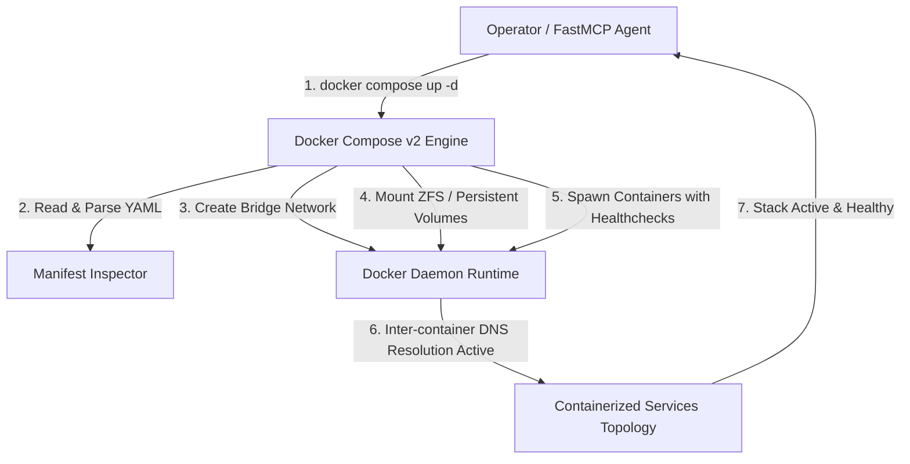

# Docker Compose

## What it is
Docker Compose is a declarative container orchestration tool for defining and running multi-container applications using YAML configuration files. As of 2027, Docker Compose v2 (integrated natively into the Docker CLI as `docker compose`) serves as the standard runtime orchestration standard for local microservice topologies, self-hosted AI stacks, edge deployments, and reproducible development environments.

```
+-----------------------------------------------------------------------------------+
|                                DEVELOPER / OPERATOR                               |
|                  (CLI / CI/CD Pipeline / FastMCP Orchestrator Agent)              |
+-----------------------------------------------------------------------------------+
                                          |
                                          | docker compose up -d
                                          v
+-----------------------------------------------------------------------------------+
|                              DOCKER COMPOSE V2 ENGINE                             |
|                                                                                   |
|  +------------------------+  +------------------------+  +---------------------+  |
|  |  YAML Specification    |  |  Network Management    |  |  Volume Persistence |  |
|  |  Parsing & Validation  |  |  (Isolated Bridge DNS) |  |  (Named Bind Mounts)|  |
|  +------------------------+  +------------------------+  +---------------------+  |
|  |  GPU & Device          |  |  Healthcheck &         |  |  FastMCP 3.1 Stack  |  |
|  |  Allocation (CUDA)     |  |  Dependency Ordering   |  |  Manager Engine     |  |
|  +------------------------+  +------------------------+  +---------------------+  |
+-----------------------------------------------------------------------------------+
                                          |
                                          | Docker Engine Socket (/var/run/docker.sock)
                                          v
+-----------------------------------------------------------------------------------+
|                           CONTAINERIZED SERVICE TOPOLOGY                          |
|                                                                                   |
|  +--------------------+    +-----------------------+    +----------------------+  |
|  | Local LLM Engine   |    | Vector Database       |    | Web UI / API Gateway |  |
|  | (vLLM / Ollama)    |<-->| (Qdrant / Milvus)     |<-->| (Open WebUI)         |  |
|  +--------------------+    +-----------------------+    +----------------------+  |
+-----------------------------------------------------------------------------------+
```

## What problem it solves
Orchestrating multi-service applications manually via isolated `docker run` commands requires writing complex shell scripts with fragile network port bindings, environment variable passing, volume attachments, container startup ordering, and GPU hardware device allocations. Docker Compose solves this operational complexity by allowing developers to declare complete multi-container architectures—including dependencies (`depends_on` with health checks), custom networks, volume mounts, secret files, and hardware acceleration rules—in a single, version-controlled `docker-compose.yml` manifest.

## Where it fits in the stack
**Infrastructure / Container Orchestration**. Docker Compose operates directly on top of the Docker Daemon or Podman container engine, serving as the single-host orchestration layer for local development workstations, home labs, staging servers, and edge IoT devices.

## Multi-Container Stack Lifecycle & Network Architecture



## Container Orchestration Comparison Matrix

| Feature / Dimension | Docker Compose v2 | Kubernetes / K3s | Docker Swarm | Systemd Units | Podman Compose |
| :--- | :--- | :--- | :--- | :--- | :--- |
| **Scope** | Single-Host Orchestration| Multi-Node Cluster | Multi-Node Cluster | Single Host / OS | Rootless Single Host |
| **Configuration** | YAML (`docker-compose.yml`) | Kubernetes Manifests | Compose YAML | Ini Service Files | Compose YAML |
| **Networking** | Internal Bridge DNS | Ingress / Service Mesh | Swarm Overlay | Host Networking | CNI / Netavark |
| **GPU Allocation** | Native CUDA Passthrough | NVIDIA GPU Operator | Basic Device Mount | Host Driver Access | CDI Devices |
| **Learning Curve** | Extremely Low | High | Medium | Low | Low |
| **Auto-Healing** | Single-host Container Restart| Multi-node Pod Reschedule| Container Reschedule| Systemd Restart | Systemd Unit Integration |
| **Memory Footprint**| Extremely Lightweight | High (Control Plane) | Moderate | Minimal | Minimal (Daemonless) |

## Typical use cases
- **Multi-Service AI & Local RAG Stacks**: Spinning up connected local inference engines (Ollama, vLLM), vector databases (Qdrant, Milvus, Chroma), and user interfaces (Open WebUI) in unified topologies.
- **FastMCP Server Environments**: Running Model Context Protocol servers alongside supporting caching layers (Redis, Valkey) and relational storage (PostgreSQL).
- **Homelab Application Management**: Managing self-hosted web applications (Nextcloud, Paperless-ngx, Authentik, Immich) with automated restart policies.
- **Reproducible CI/CD Integration Testing**: Spawning ephemeral multi-container environments in GitHub Actions or GitLab CI for integration test runs.
- **Tactical Offline Deployments**: Launching air-gapped field kits combining offline LLMs, Kiwix knowledge bases, and local search endpoints on ruggedized workstations.

## Detailed Multi-Container Production Topology Architecture

| Component Layer | Container Service | Primary Storage Path | Health Check Mechanism | Restart Policy | Network Scope |
| :--- | :--- | :--- | :--- | :--- | :--- |
| **Inference Engine** | `vllm/vllm-openai:v0.6.6` | `/mnt/tank/models` | `curl -f http://localhost:8000/health` | `unless-stopped` | `backend-mesh` |
| **Vector Index** | `qdrant/qdrant:v1.12.0` | `/mnt/tank/apps/qdrant` | `curl -f http://localhost:6333/healthz` | `unless-stopped` | `backend-mesh` |
| **Caching Layer** | `redis:7.2-alpine` | `/mnt/tank/apps/redis` | `redis-cli ping` | `always` | `backend-mesh` |
| **Workflow Engine** | `n8nio/n8n:latest` | `/mnt/tank/apps/n8n` | `curl -f http://localhost:5678/healthz` | `unless-stopped` | `public-gateway` |
| **MCP Agent Bridge** | `custom/fastmcp:3.1` | `/mnt/tank/apps/fastmcp` | `python -m mcp.healthcheck` | `always` | `backend-mesh` |
| **Reverse Proxy** | `traefik:v3.2` | `/mnt/tank/apps/traefik` | `traefik healthcheck` | `always` | `public-gateway` |
| **Log Aggregator** | `grafana/promtail:2.9.2`| `/var/log` | `promtail -check-syntax` | `unless-stopped` | `monitoring` |

## Operational SLA & Homelab Reliability Tiers

| SLA Tier | Target Uptime | Container Restart Policy | Storage Redundancy | Typical Stack Services |
| :--- | :--- | :--- | :--- | :--- |
| **Tier 1 (Core Ingress & Auth)**| 99.9% (<8h/yr) | `restart: always` | NVMe ZFS Mirror | Authentik, Traefik, DNS AdGuard |
| **Tier 2 (Primary AI & Vector)**| 99.5% (<44h/yr) | `restart: unless-stopped` | NVMe Striped ZFS | vLLM Engine, Qdrant, FastMCP |
| **Tier 3 (Workflow & Archival)**| 99.0% (<3.6d/yr) | `restart: on-failure` | RAIDZ2 HDD Pool | Paperless-ngx, n8n, Nextcloud |
| **Tier 4 (Ephemeral Testing)** | Best Effort | `restart: "no"` | Local Temp Volume | CI Runners, Playwright Suites |

## Production Multi-Service AI Inference Topology (Docker Compose)

The following `docker-compose.yml` manifest deploys a resilient, production-grade local AI inference and knowledge extraction stack with GPU reservations, health-dependent sequencing, and isolated bridge networks:

```yaml
version: '3.8'

networks:
  backend-mesh:
    internal: true
  public-gateway:
    driver: bridge

volumes:
  vllm_cache:
    driver: local
  qdrant_storage:
    driver: local
  redis_data:
    driver: local

services:
  redis-broker:
    image: redis:7.2-alpine
    container_name: local-redis-broker
    restart: always
    command: redis-server --appendonly yes --requirepass "homelab-cache-secret"
    volumes:
      - redis_data:/data
    networks:
      - backend-mesh
    healthcheck:
      test: ["CMD", "redis-cli", "-a", "homelab-cache-secret", "ping"]
      interval: 10s
      timeout: 3s
      retries: 5

  vllm-engine:
    image: vllm/vllm-openai:v0.6.6
    container_name: local-vllm
    restart: unless-stopped
    environment:
      - HUGGING_FACE_HUB_TOKEN=${HF_TOKEN}
    volumes:
      - vllm_cache:/root/.cache/huggingface
    deploy:
      resources:
        reservations:
          devices:
            - driver: nvidia
              count: all
              capabilities: [gpu]
    command: >
      --model Qwen/Qwen2.5-Coder-32B-Instruct-AWQ
      --tensor-parallel-size 1
      --max-model-len 16384
      --enforce-eager
      --port 8000
    networks:
      - backend-mesh
    healthcheck:
      test: ["CMD", "curl", "-f", "http://localhost:8000/health"]
      interval: 20s
      timeout: 10s
      retries: 10
      start_period: 120s

  vector-qdrant:
    image: qdrant/qdrant:v1.12.0
    container_name: local-qdrant
    restart: unless-stopped
    volumes:
      - qdrant_storage:/qdrant/storage
    networks:
      - backend-mesh
    healthcheck:
      test: ["CMD", "curl", "-f", "http://localhost:6333/healthz"]
      interval: 15s
      timeout: 5s
      retries: 3

  fastmcp-orchestrator:
    image: python:3.11-slim
    container_name: fastmcp-orchestrator
    restart: always
    depends_on:
      vllm-engine:
        condition: service_healthy
      vector-qdrant:
        condition: service_healthy
      redis-broker:
        condition: service_healthy
    networks:
      - backend-mesh
      - public-gateway
    ports:
      - "8000:8000"
    volumes:
      - ./orchestrator:/app:ro
    working_dir: /app
    command: >
      bash -c "pip install --no-cache-dir fastmcp pydantic redis httpx &&
               python /app/server.py"
```

## Strengths
- **Declarative Infrastructure-as-Code**: Defines all service configurations, ports, networks, and environment variables in a readable YAML manifest.
- **Single-Command Stack Lifecycle**: Spawns, monitors, updates, or teardowns complete multi-container applications with single commands (`docker compose up -d`, `docker compose down`).
- **Automatic Service DNS Resolution**: Automatically creates isolated bridge networks where containers communicate seamlessly using service names as hostname DNS targets.
- **Native GPU & Hardware Passthrough**: Provides direct support for allocating NVIDIA CUDA GPUs, Intel Arc GPUs, or host devices directly to designated container services.
- **Modular Project Structuring**: Supports `include:` directives to compose large distributed architectures from modular sub-manifests without massive YAML drift.

## Limitations
- **Single-Host Boundary**: Designed specifically for single-node container orchestration; not designed to replace multi-node production Kubernetes clusters (e.g., K3s, EKS).
- **No Native Cross-Host Auto-Healing**: Lacks multi-node load balancing, cross-host pod rescheduling, and rolling update strategies available in Kubernetes.
- **YAML Configuration Creep**: Large stacks spanning dozens of microservices can result in unwieldy YAML manifests without modular `include:` directive structuring.

## When to use it
- When your application requires multiple interdependent containerized services running on a single developer machine, homelab server, or cloud VM instance.
- When team consistency across development, staging, and edge environments is critical.
- When building self-contained AI stacks that bundle local inference engines with vector stores and FastMCP servers.
- When spinning up ephemeral integration test environments in CI pipelines.

## When not to use it
- For enterprise multi-node production clusters requiring advanced ingress routing, service meshes, zero-downtime rolling updates, and horizontal auto-scaling (use Kubernetes/K3s).
- For isolated single-container applications where a simple `docker run` command or systemd unit file is sufficient.

## Systemd Service Unit Configuration

The following systemd service unit defines an automated, scheduled Docker Compose stack manager daemon (`docker-compose-stack.service`):

```ini
[Unit]
Description=Docker Compose AI Services Stack Daemon
After=docker.service network.target
Wants=docker.service

[Service]
Type=oneshot
RemainAfterExit=yes
User=root
WorkingDirectory=/opt/ai-stack
ExecStart=/usr/bin/docker compose up -d
ExecStop=/usr/bin/docker compose down
ExecReload=/usr/bin/docker compose pull && /usr/bin/docker compose up -d
Restart=on-failure
RestartSec=15s
StandardOutput=journal
StandardError=journal

[Install]
WantedBy=multi-user.target
```

## Getting started

### Installation
Docker Compose v2 comes pre-packaged with Docker Desktop and standard Docker Engine repository packages (`docker-compose-plugin`). Verify installation:

```bash
docker compose version
```

### Declarative `docker-compose.yml` Stack Architecture
Create a `docker-compose.yml` file in your repository root defining a local RAG stack:

```yaml
name: local-ai-stack

services:
  llm-engine:
    image: ollama/ollama:latest
    container_name: local-ollama
    ports:
      - "11434:11434"
    volumes:
      - ollama_storage:/root/.ollama
    deploy:
      resources:
        reservations:
          devices:
            - driver: nvidia
              count: all
              capabilities: [gpu]
    restart: unless-stopped

  vector-db:
    image: qdrant/qdrant:latest
    container_name: local-qdrant
    ports:
      - "6333:6333"
    volumes:
      - qdrant_storage:/qdrant/storage
    healthcheck:
      test: ["CMD", "curl", "-f", "http://localhost:6333/healthz"]
      interval: 10s
      timeout: 5s
      retries: 3
    restart: unless-stopped

volumes:
  ollama_storage:
  qdrant_storage:
```

## CLI examples

```bash
# Start all services defined in docker-compose.yml in detached background mode
docker compose up -d

# Stream real-time logs for all services or a target service
docker compose logs -f llm-engine

# Stop and remove all containers, networks, and ephemeral volumes created by the stack
docker compose down -v

# Rebuild container images before restarting the stack
docker compose up -d --build

# Check running status and health of all stack containers
docker compose ps

# Inspect detailed resource utilization metrics across containers
docker compose top
```

## API examples

### FastMCP 3.1 & Pydantic v2 Docker Compose Stack Manager

The following complete implementation demonstrates managing Docker Compose stacks programmatically via Python within a FastMCP 3.1 server with strict Pydantic v2 schemas (`extra="forbid"`, `frozen=True`):

```python
import subprocess
import json
from typing import List, Optional
from pydantic import BaseModel, Field, field_validator, ConfigDict
from mcp.server.fastmcp import FastMCP

# Define strict Pydantic v2 schemas for Docker Compose stack management requests and responses
class StackManageRequest(BaseModel):
    model_config = ConfigDict(extra="forbid", frozen=True)

    compose_file_path: str = Field(default="docker-compose.yml", description="Path to the docker-compose.yml manifest file.")
    action: str = Field(..., description="Action to execute: 'up', 'down', 'restart', 'ps', or 'pull'.")
    build_images: bool = Field(default=False, description="Whether to force rebuild images before starting services.")
    target_service: Optional[str] = Field(default=None, description="Optional single service target.")

    @field_validator("action")
    @classmethod
    def validate_action(cls, v: str) -> str:
        allowed = {"up", "down", "restart", "ps", "pull"}
        if v not in allowed:
            raise ValueError(f"Action must be one of {allowed}")
        return v

class StackServiceStatus(BaseModel):
    model_config = ConfigDict(extra="forbid", frozen=True)

    service_name: str = Field(..., description="Name of the service defined in compose.")
    container_id: str = Field(..., description="Docker container ID.")
    status: str = Field(..., description="Current running state (e.g., running, exited, starting).")
    health: Optional[str] = Field(default=None, description="Container health status if defined.")

class StackManageResponse(BaseModel):
    model_config = ConfigDict(extra="forbid", frozen=True)

    action: str = Field(..., description="Executed action.")
    success: bool = Field(..., description="Whether command executed successfully.")
    output: str = Field(..., description="STDOUT or STDERR from Docker Compose CLI.")
    services: List[StackServiceStatus] = Field(default_factory=list, description="List of container statuses.")

# Initialize FastMCP 3.1 server
mcp = FastMCP("docker-compose-stack-manager", version="3.1.0")

@mcp.tool()
async def manage_docker_stack(request: StackManageRequest) -> StackManageResponse:
    """Executes lifecycle management commands for Docker Compose multi-container stacks with strict validation."""
    cmd = ["docker", "compose", "-f", request.compose_file_path]

    if request.action == "up":
        cmd.extend(["up", "-d"])
        if request.build_images:
            cmd.append("--build")
        if request.target_service:
            cmd.append(request.target_service)
    elif request.action == "down":
        cmd.extend(["down"])
    elif request.action == "restart":
        cmd.extend(["restart"])
        if request.target_service:
            cmd.append(request.target_service)
    elif request.action == "ps":
        cmd.extend(["ps", "--format", "json"])
    elif request.action == "pull":
        cmd.extend(["pull"])

    res = subprocess.run(cmd, capture_output=True, text=True)
    success = (res.returncode == 0)
    output = res.stdout if success else res.stderr

    parsed_services = []
    if request.action == "ps" and success and output.strip():
        for line in output.strip().splitlines():
            try:
                data = json.loads(line)
                parsed_services.append(
                    StackServiceStatus(
                        service_name=data.get("Service", "unknown"),
                        container_id=data.get("ID", ""),
                        status=data.get("State", ""),
                        health=data.get("Health", "")
                    )
                )
            except Exception:
                pass

    return StackManageResponse(
        action=request.action,
        success=success,
        output=output.strip(),
        services=parsed_services
    )

if __name__ == "__main__":
    mcp.run()
```

## Diagnostic & Operational Troubleshooting Matrix

| Symptom / Error | Root Cause | Remediation Step |
| :--- | :--- | :--- |
| **CUDA Driver Error / Device Not Found** | Missing `nvidia-container-toolkit` plugin on Docker host. | Install `nvidia-container-toolkit` and restart Docker daemon. |
| **Port Collision / Already Allocated** | Host port bound in `ports:` section is in use by another daemon. | Modify host port mapping in `docker-compose.yml` (e.g., `8080:80`). |
| **Container Fails Healthcheck Loop** | Service startup time exceeds healthcheck retries or threshold. | Increase `start_period` or `retries` parameter in compose file. |
| **ZFS Volume Mount Permission Denied** | UID/GID mismatch between container user and ZFS host dataset path. | Chown target host path to match container UID (e.g. `1000:1000`). |
| **Inter-Container DNS Resolution Fails**| Services are joined to differing isolated custom networks. | Place communicating services on the same defined bridge network. |
| **Orphan Containers Persisting** | Renamed service in YAML left original container running in background.| Run `docker compose up -d --remove-orphans`. |
| **Docker Engine Socket Permission Denied**| Invoking user is not a member of the `docker` UNIX group. | Add user via `sudo usermod -aG docker $USER` and reload session. |
| **Failed to create network: Pool overlaps**| Docker bridge network subnet conflicts with existing LAN or VPN CIDR.| Define custom CIDR subnet pool in `networks:` block (e.g. `172.28.0.0/16`). |
| **Docker Daemon Out of Inodes** | High container churn left millions of untracked dangling overlay layers.| Run `docker system prune -a --volumes` to recover inode capacity. |

## Production Operational Best Practices

### 1. GPU Allocation & Driver Resilience
Ensure host NVIDIA drivers and `nvidia-container-toolkit` are installed before specifying GPU device reservations in `docker-compose.yml`. Use `count: all` or specify explicit GPU indices (`device_ids: ['0']`) for targeted inference workloads.

### 2. Healthcheck Dependent Startup
Always couple `depends_on` directives with `condition: service_healthy` to ensure database and inference engines finish initialization before dependent Web APIs or agent services attempt connections.

### 3. Environment & Secret Isolation
Store sensitive database credentials and API keys in `.env` files or Docker Compose secret mounts (`secrets:`) rather than hardcoding credentials inside version-controlled Compose manifests.

### 4. Logging Rotation Limits
Configure default logging drivers with `max-size: "50m"` and `max-file: "3"` in `docker-compose.yml` to prevent runaway debug output from consuming the host root filesystem.

### 5. Deterministic Image Pinning
Avoid relying solely on `:latest` tags in mission-critical homelab services; pin specific semantic tags (e.g., `vllm/vllm-openai:v0.6.6`) to prevent surprise regressions during automated stack pulls.

## Related tools / concepts
- [Docker](docker.md) — Single-container engine runtime substrate.
- [Podman](podman.md) — Daemonless container engine alternative.
- [K3s](k3s.md) — Lightweight Kubernetes distribution for multi-node production orchestration.
- [FastMCP](../automation_orchestration/mcp.md) — Model Context Protocol orchestration gateway.
- [vLLM](vllm.md) — High-throughput open-weights serving engine.

## Sources / references
- [Docker Compose Documentation](https://docs.docker.com/compose/?ref=2026-09-21-audit)
- [Docker Specification Overview](https://docs.docker.com/engine/)
- [NVIDIA Container Toolkit Installation Guide](https://docs.nvidia.com/datacenter/cloud-native/container-toolkit/latest/install-guide.html)

## Contribution Metadata
- Last reviewed: 2027-01-07
- Confidence: high
