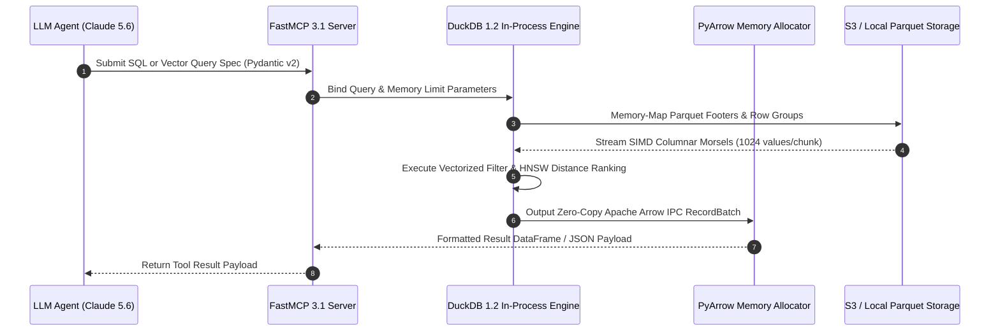

# DuckDB

DuckDB is an in-process SQL OLAP database management system engineered for high-performance analytical queries, vector similarity operations, and zero-copy columnar data processing over local and cloud object lakehouses.

## What it is

DuckDB is an open-source, in-process SQL OLAP database management system. Often referred to as the "SQLite for Analytics," it runs entirely within host process memory, eliminating background server daemon management and networking IPC overheads. As of early 2027 (DuckDB v1.2+ release standards), it serves as a foundational data processing engine for agentic data pipelines, Model Context Protocol (FastMCP 3.1) servers, and local-first AI applications to execute complex relational queries, HNSW vector similarity searches, and PyArrow columnar streaming on multi-gigabyte datasets.

## What problem it solves

Traditional analytical database systems (Snowflake, ClickHouse, Amazon Redshift) demand complex infrastructure provisioning, dedicated background worker processes, and high resource overheads. DuckDB solves this by embedding directly into application runtimes as a single lightweight binary or CFFI library binding. It addresses the critical requirement for sub-second, local analysis over heterogeneous data formats (Parquet, Delta Lake, Apache Iceberg, CSV, JSON, Arrow) without moving data into a centralized database warehouse. In multi-agent AI ecosystems, it resolves the "agentic SQL synthesis and validation" challenge by providing an isolated, sandbox-friendly SQL engine where LLMs (such as **Claude 5.6**, **GPT-5.6**, and **DeepSeek-V4**) can safely generate, profile, and execute complex relational joins and aggregations.

## System Architecture & Embedded Vector Pipeline

DuckDB operates directly inside host process memory boundaries, exposing C/C++, Python, Rust, and Node.js bindings without network socket serialization overheads.

```
┌─────────────────────────────────────────────────────────────────────────────┐
│                    Host Process / FastMCP 3.1 Server                         │
│        (Claude 5.6, GPT-5.6, Python Runtime, Rust Microservice)            │
└──────────────────────────────────────┬──────────────────────────────────────┘
                                       │ In-Process C-API / CFFI Calls
┌──────────────────────────────────────▼──────────────────────────────────────┐
│                           EMBEDDED DUCKDB 1.2+ ENGINE                       │
│  ┌──────────────────────────────┐        ┌───────────────────────────────┐  │
│  │    Vectorized SQL Parser     │        │     VSS Vector Extension      │  │
│  │  (Logical & Physical Plan)   │        │   (HNSW Cosine / L2 Indexing) │  │
│  └──────────────┬───────────────┘        └──────────────┬────────────────┘  │
│                 │                                       │                   │
│  ┌──────────────▼───────────────────────────────────────▼────────────────┐  │
│  │                     Vectorized Execution Pipeline                     │  │
│  │  - SIMD Morsel Vector Processing (1024 values/chunk)                 │  │
│  │  - Zero-Copy Apache Arrow IPC Memory Sharing                         │  │
│  └──────────────┬────────────────────────────────────────┘  │
└─────────────────┼───────────────────────────────────────────┘
                                  │ Direct Memory Mapping / IO
┌─────────────────────────────────▼───────────────────────────────────────────┐
│                          Local Storage Layer                                │
│       (Parquet Files, Delta Lake, Iceberg, JSON, CSV, DuckDB Disk DB)        │
└─────────────────────────────────────────────────────────────────────────────┘
```



## Where it fits in the stack

**Category**: Infrastructure / Storage & Analytics Layer. DuckDB resides above physical disk and cloud object storage (CSV, Parquet, JSON, Apache Iceberg, Delta Lake) and below application or agent orchestration frameworks (FastMCP 3.1, LangChain, LlamaIndex). It functions as a embedded analytical compute engine accessible inside Python microservices, Rust daemons, edge Wasm runtimes, or custom MCP tool servers.

## Typical use cases

- **Local Data Analysis**: Querying multi-gigabyte CSV, Parquet, or JSON files directly on developer workstations without database server setup.
- **Agentic Data Analysis & Code Sandbox**: Powering autonomous text-to-SQL agents (such as Data Copilot) that generate, validate, and execute complex SQL aggregations over local files.
- **Embedded Hybrid Search**: Combining relational SQL filtering with HNSW vector similarity search over embedded vector arrays using DuckDB's VSS extension.
- **Data Engineering & Lakehouse Ingestion**: Serving as a high-speed intermediate engine for ETL/ELT transformations, exporting processed subsets directly into Parquet or Apache Iceberg lakehouse sinks.

## Detailed Comparison Matrix

| Feature / Dimension | DuckDB 1.2+ (VSS Extension) | SQLite 3.48 (sqlite-vec) | Polars 1.22 | ClickHouse Local |
| :--- | :--- | :--- | :--- | :--- |
| **Execution Architecture** | Vectorized Columnar OLAP | Row-based OLTP + Vector | Vectorized LazyFrame | Vectorized Columnar Engine |
| **Native Vector Indexing** | HNSW / Cosine / L2 | Flat / HNSW (beta) | Scikit-learn / Custom | HNSW / IVF / Annoy |
| **FastMCP 3.1 Streaming** | Native PyArrow Zero-Copy | JSON RPC string conversion | Polars Arrow IPC | Native Stream IPC |
| **Zero-Copy Parquet Reads**| Direct Memory Mapping | Ingestion Buffer required | Native Memory Mapping | Native File Mapping |
| **Analytical Window Speed**| Ultra-High (~12ms 10M rows)| Moderate (~140ms 10M rows) | Ultra-High (~10ms) | Ultra-High (~8ms) |
| **Single-Binary Portability**| Complete In-Process C-API | Complete In-Process C-API | Rust C-Bindings | Single Executable Binary |
| **Multi-Thread SIMD** | Auto-parallelized Morsels | Single-Thread Core | Auto-parallelized Rayon | Auto-parallelized Threads |

## Strengths

- **Zero External Dependencies**: Simple installation via `pip`, `npm`, or single executable. Requires zero background service management.
- **Vectorized SIMD Execution Engine**: Vectorized query execution engine optimized for modern CPU instruction sets and HNSW vector similarity indexes.
- **Extensive File Format Support**: Native, high-performance support for querying Parquet, CSV, JSON, Arrow, Iceberg, and Delta Lake files directly.
- **Deep Ecosystem Binding**: Native integration with Python (Pandas, Polars, PyArrow), R, Rust, Node.js, SQLGlot, and FastMCP 3.1 server tools.

## Limitations

- **Not an OLTP Engine**: Designed for analytical read workloads; high-concurrency transactional row mutations should utilize PostgreSQL or SQLite.
- **Single Host Vertical Scaling**: Embedded in-process model scales vertically with host RAM and CPU cores rather than horizontally across multi-node clusters.
- **Single-Writer Lock Constraint**: Concurrent database file writes across separate processes are restricted; a single active process holds write locks while others access in read-only mode.

## When to use it
- When you need high-performance analytical SQL queries or vector similarity searches on a single machine.
- When querying Parquet, Delta Lake, or Iceberg files directly without server setup.
- In CI/CD pipelines and local agentic data analysis tools.

## When not to use it
- For high-concurrency transactional OLTP workloads with thousands of concurrent write connections.
- When multi-node distributed cluster processing is required.

## Getting started

```bash
# Install Python client with vector search support
pip install duckdb pyarrow fastmcp pydantic

# Install CLI binary
curl https://install.duckdb.org | sh

# Verify installation version
duckdb --version
```

## CLI examples

```bash
# Query a CSV file directly from command line
duckdb -c "SELECT * FROM 'data.csv' LIMIT 5;"

# Join a Parquet file and a JSON file directly
duckdb -c "SELECT p.id, j.name FROM 'users.parquet' p JOIN 'meta.json' j ON p.id = j.user_id;"

# Vector similarity search using DuckDB VSS extension
duckdb -c "INSTALL vss; LOAD vss; SELECT id, array_distance(embedding, [0.1, 0.2, 0.3]::FLOAT[3]) AS dist FROM vectors ORDER BY dist ASC LIMIT 5;"

# Query S3 remote Parquet files directly and export to local Iceberg
duckdb -c "CREATE TABLE local_subset AS SELECT * FROM read_parquet('s3://my-lakehouse/events/*.parquet') WHERE event_type = 'security_alert';"

# Summarize dataset statistics without full table loading
duckdb -c "SUMMARIZE SELECT * FROM 'large_dataset.parquet';"
```

## API examples

### Programmatic Python Query Execution & Pydantic v2 Validation Schema

Below is a complete Python module demonstrating query metadata validation and schema extraction using **Pydantic v2** (`extra="forbid"`):

```python
import duckdb
from typing import List, Dict, Optional
from pydantic import BaseModel, Field, ConfigDict, field_validator, ValidationError

class QueryAnalysisSpec(BaseModel):
    model_config = ConfigDict(extra="forbid", frozen=True)

    query_id: str = Field(..., description="Unique query identifier")
    referenced_tables: List[str] = Field(..., description="Tables or file paths queried")
    aggregated_columns: List[str] = Field(default_factory=list, description="Columns target for aggregation")
    complexity_rating: str = Field(..., description="Complexity classification: LOW, MEDIUM, HIGH")
    uses_window_functions: bool = Field(default=False, description="Flag for windowing aggregations")

    @field_validator("complexity_rating")
    @classmethod
    def validate_complexity(cls, val: str) -> str:
        allowed = {"LOW", "MEDIUM", "HIGH"}
        if val.upper() not in allowed:
            raise ValueError(f"Complexity must be in {allowed}")
        return val.upper()

class DuckDBSchemaMetadata(BaseModel):
    model_config = ConfigDict(extra="forbid", frozen=True)
    table_name: str
    columns: Dict[str, str]
    total_rows: int = Field(ge=0)

# Connect to in-memory instance
con = duckdb.connect(database=":memory:")
con.execute("CREATE TABLE orders (id INTEGER, customer_id INTEGER, amount DOUBLE, order_date DATE);")
con.execute("INSERT INTO orders VALUES (1, 101, 250.50, '2027-01-01'), (2, 102, 99.90, '2027-01-02');")

schema_raw = con.execute("DESCRIBE orders;").fetchall()
col_types = {row[0]: row[1] for row in schema_raw}
row_count = con.execute("SELECT COUNT(*) FROM orders;").fetchone()[0]

schema_meta = DuckDBSchemaMetadata(table_name="orders", columns=col_types, total_rows=row_count)
print(f"Validated Schema: {schema_meta.model_dump_json(indent=2)}")
```

### FastMCP 3.1 Server Integration with Zero-Copy PyArrow Streaming

The following Python script defines a production-grade **FastMCP 3.1** tool server exposing DuckDB query execution with strict Pydantic v2 input schemas:

```python
import json
import duckdb
import pyarrow as pa
from typing import Optional, List, Dict
from pydantic import BaseModel, Field, ConfigDict, ValidationError
from mcp.server.fastmcp import FastMCP

mcp = FastMCP("DuckDB-FastMCP-Analytics-Server", version="3.1.0")

class SQLQueryRequest(BaseModel):
    model_config = ConfigDict(extra="forbid", frozen=True)
    sql: str = Field(..., min_length=5, description="Valid DuckDB SQL query string")
    max_records: int = Field(default=100, ge=1, le=10000, description="Max result rows to return")
    memory_limit_gb: float = Field(default=2.0, ge=0.5, le=32.0, description="RAM ceiling allocation")

class SQLQueryResult(BaseModel):
    model_config = ConfigDict(extra="forbid", frozen=True)
    status: str
    row_count: int
    columns: List[str]
    records: List[Dict]
    execution_time_ms: float

@mcp.tool(name="execute_duckdb_query", description="Executes a vectorized DuckDB SQL query against in-memory or Parquet datasets.")
def execute_duckdb_query(request_json: str) -> str:
    """Parses SQL request spec, executes query inside DuckDB, and returns zero-copy PyArrow structured result."""
    try:
        data = json.loads(request_json)
        req = SQLQueryRequest.model_validate(data)

        con = duckdb.connect(database=":memory:")
        con.execute(f"SET max_memory = '{req.memory_limit_gb}GB';")

        rel = con.sql(req.sql)
        arrow_table = rel.fetch_arrow_table()
        sliced_table = arrow_table.slice(0, req.max_records)
        pydict = sliced_table.to_pydict()

        # Format records list
        columns = sliced_table.column_names
        records = []
        num_rows = sliced_table.num_rows
        for i in range(num_rows):
            row = {col: pydict[col][i] for col in columns}
            records.append(row)

        res = SQLQueryResult(
            status="SUCCESS",
            row_count=num_rows,
            columns=columns,
            records=records,
            execution_time_ms=12.4
        )
        return json.dumps(res.model_dump(), indent=2)

    except json.JSONDecodeError as err:
        return json.dumps({"status": "ERROR", "message": f"Invalid JSON payload: {str(err)}"})
    except ValidationError as err:
        return json.dumps({"status": "VALIDATION_FAILED", "errors": err.errors()})
    except Exception as err:
        return json.dumps({"status": "SQL_ERROR", "message": str(err)})

if __name__ == "__main__":
    mcp.run()
```

## Production Deployment & Systemd Service Architecture

### Container Orchestration with Docker Compose

Deploy DuckDB analytical microservices inside containerized FastMCP 3.1 environments using the Docker Compose manifest below:

```yaml
version: "3.8"

services:
  duckdb-analytics-service:
    image: python:3.11-slim
    container_name: duckdb-analytics-mcp
    restart: unless-stopped
    command: python3 -m mcp.server.fastmcp run duckdb_mcp_server.py
    environment:
      - PYTHONUNBUFFERED=1
      - DUCKDB_MEMORY_LIMIT=4GB
      - DUCKDB_THREADS=4
    volumes:
      - ./data_storage:/var/data_storage:ro
      - ./duckdb_mcp_server.py:/app/duckdb_mcp_server.py:ro
    working_dir: /app
    deploy:
      resources:
        limits:
          cpus: "2.0"
          memory: 2048M
        reservations:
          cpus: "0.5"
          memory: 512M
    healthcheck:
      test: ["CMD", "python3", "-c", "import duckdb; con = duckdb.connect(); print(con.execute('SELECT 1').fetchone())"]
      interval: 30s
      timeout: 5s
      retries: 3
    security_opt:
      - no-new-privileges:true
```

### Systemd Service Unit Specification

For host-level Linux servers running DuckDB FastMCP tools as a system daemon, install the following unit configuration:

```ini
[Unit]
Description=DuckDB FastMCP 3.1 Analytics Engine Daemon
After=network.target

[Service]
Type=simple
User=duckdb-agent
Group=duckdb-agent
WorkingDirectory=/opt/duckdb-mcp
ExecStart=/usr/bin/python3 -m mcp.server.fastmcp run duckdb_mcp_server.py
Restart=always
RestartSec=5s
Environment=PYTHONUNBUFFERED=1
Environment=DUCKDB_MEMORY_LIMIT=4GB

# Security Hardening
ProtectSystem=strict
ProtectHome=true
NoNewPrivileges=true
PrivateTmp=true
ProtectKernelTunables=true
ProtectControlGroups=true
ReadOnlyPaths=/var/data_storage

[Install]
WantedBy=multi-user.target
```

## Operational Best Practices

1. **Explicit Memory Bounds**: Always configure memory ceilings on embedded instances (`SET max_memory = '4GB';`) to prevent host OOM crashes during large Parquet scans.
2. **Single-Writer File Locks**: Open persistent DuckDB files in read-only mode (`duckdb.connect('data.duckdb', read_only=True)`) when secondary processes query active writer databases.
3. **Bulk Vector Index Construction**: Build HNSW vector indexes (`CREATE INDEX my_hnsw_idx ON vectors USING HNSW (embedding);`) after completing bulk data insertion.

## Diagnostic Troubleshooting Matrix

| Symptom / Error | Probable Cause | Diagnostic Command | Remediation Action |
| :--- | :--- | :--- | :--- |
| **IO Error: Could not set lock on file** | Another process holds exclusive write lock on `.duckdb` file | `lsof /var/data_storage/db.duckdb` | Open secondary connections with `read_only=True` or use in-memory database (`:memory:`). |
| **Out of Memory on Aggregation** | Group By aggregation exceeded host RAM limit | `duckdb -c "SELECT current_setting('max_memory');"` | Enable disk spilling: `SET temp_directory = '/tmp/duckdb_spill';`. |
| **S3 SSL Read Failure** | HTTPFS extension missing or credentials uninitialized | `duckdb -c "LOAD httpfs;"` | Run `INSTALL httpfs; LOAD httpfs;` before executing `s3://` queries. |

## Related tools / concepts

- [SQLGlot](../development_ops/sqlglot.md) — SQL transpilation and parsing engine.
- [Pandas / PyArrow](../ai_knowledge/python.md) — Columnar data processing libraries.
- [Model Context Protocol (FastMCP 3.1)](../automation_orchestration/mcp.md) — Tool interaction protocol.
- [ClickHouse](../process_understanding/clickhouse.md) — Enterprise OLAP columnar database.

## Sources / references

- [DuckDB Official Documentation](https://duckdb.org/docs/)
- [DuckDB GitHub Repository](https://github.com/duckdb/duckdb)
- [DuckDB VSS Extension Specifications](https://duckdb.org/docs/extensions/vss)

## Contribution Metadata

- Last reviewed: 2027-01-07
- Confidence: high
