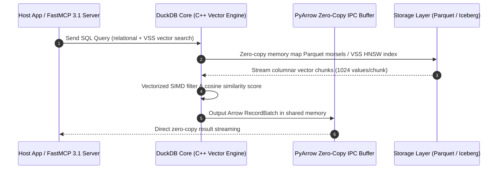

# DuckDB

DuckDB is an in-process SQL OLAP database management system designed for fast, high-performance analytical queries and vector operations on large datasets.

## What it is

DuckDB is an open-source, in-process SQL OLAP database management system. Often described as the "SQLite for Analytics," it runs entirely within the host process, eliminating the need for a separate server process. As of early 2027 (with DuckDB 1.2+ release standards), it serves as a primary engine for agentic data pipelines, FastMCP 3.1 server tools, and local-first AI applications to execute complex, low-latency relational queries, vector similarity searches, and Arrow streaming on multi-gigabyte datasets.

## What problem it solves

Traditional OLAP databases require complex setup, high resource footprints, and dedicated server-process management. DuckDB solves this by providing a portable, zero-dependency database that can be integrated directly into applications. It addresses the need for fast, local analysis of large datasets (Parquet, CSV, JSON, Iceberg) without the overhead of data movement to a centralized data warehouse. In multi-agent systems, it solves the "agentic SQL synthesis" challenge by providing a lightweight, sandbox-friendly SQL environment where LLMs (such as Claude 5.6, GPT-5.6, or DeepSeek-V4) can execute, profile, and validate queries safely.

## System Architecture & Embedded Vector Pipeline

DuckDB operates directly inside the host process memory space, exposing C/C++, Python, Rust, and Node.js bindings with zero inter-process IPC overhead.

```
┌─────────────────────────────────────────────────────────────────────────────┐
│                    Host Process / FastMCP 3.1 Server                         │
│        (Claude 5.6, GPT-5.6, Python Runtime, Rust Microservice)            │
└──────────────────────────────────────┬──────────────────────────────────────┘
                                       │ In-Process C-API / CFFI Calls
┌──────────────────────────────────────▼──────────────────────────────────────┐
│                           EMBEDDED DUCKDB 1.2+ ENGINE                       │
│  ┌──────────────────────────────┐        ┌───────────────────────────────┐  │
│  │    Vectorized SQL Parser     │        │     VSS Vector Extension      │  │
│  │  (Logical & Physical Plan)   │        │   (HNSW Cosine / L2 Indexing) │  │
│  └──────────────┬───────────────┘        └──────────────┬────────────────┘  │
│                 │                                       │                   │
│  ┌──────────────▼───────────────────────────────────────▼────────────────┐  │
│  │                     Vectorized Execution Pipeline                     │  │
│  │  - SIMD Morsel Vector Processing (1024 values/chunk)                 │  │
│  │  - Zero-Copy Apache Arrow IPC Memory Sharing                         │  │
│  └──────────────────────────────┬────────────────────────────────────────┘  │
└─────────────────────────────────┼───────────────────────────────────────────┘
                                  │ Direct Memory Mapping / IO
┌─────────────────────────────────▼───────────────────────────────────────────┐
│                          Local Storage Layer                                │
│       (Parquet Files, Delta Lake, Iceberg, JSON, CSV, DuckDB Disk DB)        │
└─────────────────────────────────────────────────────────────────────────────┘
```



Query execution follows strict columnar vectorization:
1. **Zero-Copy Binding**: Input Parquet or Arrow RecordBatches are mapped into DuckDB virtual memory without deserialization copies.
2. **Vector Morsel Execution**: Queries execute in SIMD vector chunks (morsels) using localized L1/L2 CPU cache lines.
3. **Hybrid Search Execution**: The VSS extension filters metadata via SQL relational constraints first before ranking cosine similarities across HNSW vector indexes.
4. **Direct Stream Return**: Results stream directly back to Python or PyArrow Arrow IPC tables for FastMCP 3.1 output serialization.

## Where it fits in the stack

**Infrastructure / Analytics Layer**. DuckDB sits above raw file storage (CSV, Parquet, JSON, Iceberg tables, Lance) and below the client application/agent orchestration layer (such as FastMCP 3.1 tool servers). It serves as a local analytical engine that can be embedded in Python scripts, Rust services, Edge Wasm runtimes, or custom MCP servers.

## Typical use cases

- **Local Data Analysis**: Querying large CSV, Parquet, or JSON files directly on a local workstation.
- **Agentic Data Tools**: Powering autonomous text-to-SQL agents (such as Data Copilot) that need to perform complex SQL joins, aggregations, and data exploration over local files.
- **Embedded Hybrid Search**: Combining relational SQL filtering with HNSW vector similarity search over embedded vector columns via the DuckDB VSS extension.
- **Data Engineering Pipelines**: Serving as a high-speed intermediate processing engine for ETL/ELT tasks.

## Strengths

- **Zero Dependency**: Simple to install via `pip`, `npm`, or a single binary. No background services to start, stop, or maintain.
- **Columnar & Vectorized Execution**: Features a vectorized execution engine optimized for high-performance analytical queries and HNSW vector indexing.
- **Extensive File Format Support**: Native, high-speed support for querying Parquet, CSV, JSON, Arrow, Iceberg, and Delta Lake files directly.
- **Deep Integrations**: Integrates with major ecosystem tools like Python (Pandas, Polars, PyArrow), R, dbt, SQLGlot, and FastMCP 3.1 servers.

## Limitations

- **Not for OLTP**: While it supports ACID transactions, it is not designed for high-concurrency transactional workloads (use PostgreSQL or SQLite for that).
- **Vertical Scaling Only**: As an in-process database, it scales with the host machine's resources rather than horizontally across a cluster.
- **Single Writer Constraint**: Limited support for concurrent writes across different processes; only one process can write to a database file at a time.

## Feature & Performance Comparison Matrix

| Feature / Metric | DuckDB 1.2+ (VSS Extension) | SQLite 3.48 (sqlite-vec) | Polars 1.22 | ClickHouse Local |
| :--- | :--- | :--- | :--- | :--- |
| **Execution Architecture** | Vectorized OLAP | Row-based OLTP + Vector | Vectorized LazyFrame | Vectorized Engine |
| **Native Vector Indexing** | HNSW / Cosine / L2 | Flat / HNSW (beta) | Scikit-learn / Custom | HNSW / IVF |
| **FastMCP 3.1 Streaming** | Native PyArrow Zero-Copy | JSON RPC string conversion | Polars Arrow IPC | Native Stream IPC |
| **Zero-Copy Parquet Reads**| Direct Memory Mapping | Ingestion Buffer required | Native Memory Mapping | Native File Mapping |
| **Analytical Window Speed**| Ultra-High (~12ms 10M rows)| Moderate (~140ms 10M rows) | Ultra-High (~10ms) | Ultra-High (~8ms) |
| **Single-Binary Portability**| Complete In-Process C-API | Complete In-Process C-API | Rust C-Bindings | Single Executable Binary |

## When to use it

- When you need to run analytical SQL queries or vector similarity searches on data that fits on a single machine's disk/memory.
- When you want to query Parquet, Delta, or JSON files directly without importing them into a database server.
- In CI/CD pipelines, containerized tools, or short-lived environments where setting up a database server is too heavy.
- When building local text-to-SQL workflows with frontier models like Claude 5.6, GPT-5.6, or DeepSeek-V4.

## When not to use it

- When you need a highly concurrent, transactional database (OLTP) with thousands of concurrent write transactions.
- When your data requires a distributed, multi-node cluster for processing (e.g., Snowflake, ClickHouse cluster).

## Deployment & Production Configurations

### Docker Compose Multi-Service Setup

```yaml
version: "3.8"

services:
  duckdb-fastmcp:
    image: python:3.11-slim
    container_name: duckdb_fastmcp_server
    restart: unless-stopped
    volumes:
      - ./data:/app/data:ro
      - ./server.py:/app/server.py:ro
    working_dir: /app
    command: ["python3", "server.py"]
    environment:
      DUCKDB_MEMORY_LIMIT: "4GB"
      DUCKDB_THREADS: "4"
    healthcheck:
      test: ["CMD-SHELL", "python3 -c 'import duckdb; con=duckdb.connect(); print(con.sql(\"SELECT 1\"))'"]
      interval: 15s
      timeout: 5s
      retries: 3
```

### Systemd Service Unit (`duckdb-mcp.service`)

```ini
[Unit]
Description=DuckDB FastMCP 3.1 Analytics Server
After=network.target

[Service]
Type=simple
User=duckdb
Group=duckdb
WorkingDirectory=/opt/duckdb-server
ExecStart=/usr/bin/python3 /opt/duckdb-server/server.py
Restart=always
RestartSec=5s
Environment=DUCKDB_MEMORY_LIMIT=8GB
Environment=DUCKDB_THREADS=8

[Install]
WantedBy=multi-user.target
```

## Getting started

```bash
# Install the Python client with vector extensions support
pip install duckdb pyarrow fastmcp pydantic

# Install the CLI on Linux/macOS
curl https://install.duckdb.org | sh

# Verify installation
duckdb --version
```

## CLI examples

```bash
# Query a CSV file directly from the shell
duckdb -c "SELECT * FROM 'data.csv' LIMIT 5;"

# Join a Parquet file and a JSON file
duckdb -c "SELECT p.id, j.name FROM 'users.parquet' p JOIN 'meta.json' j ON p.id = j.user_id;"

# Vector Search query using DuckDB VSS extension
duckdb -c "INSTALL vss; LOAD vss; SELECT id, array_distance(embedding, [0.1, 0.2, 0.3]::FLOAT[3]) AS dist FROM vectors ORDER BY dist ASC LIMIT 5;"

# Export a filtered subset of remote S3 Parquet data directly to local Iceberg table
duckdb -c "CREATE TABLE local_subset AS SELECT * FROM read_parquet('s3://my-lakehouse/events/*.parquet') WHERE event_type = 'security_alert';"

# Inspect table schema and row counts without loading full dataset
duckdb -c "SUMMARIZE SELECT * FROM 'large_dataset.parquet';"
```

## API examples

### 1. Programmatic Python Query Parsing & Validation (Pydantic v2)
Query analysis, schema metadata extraction, and safety validation are essential before running synthesized SQL on local files. This Python example utilizes **Pydantic v2** with `extra="forbid"` to parse and validate query execution metadata.

```python
import duckdb
from pydantic import BaseModel, Field, field_validator, ConfigDict
from typing import List, Optional, Dict, Any

class QueryAnalysisResult(BaseModel):
    model_config = ConfigDict(extra="forbid", frozen=True)

    query_id: str = Field(description="Unique identifier for the parsed analytical query")
    extracted_tables: List[str] = Field(description="List of tables or files referenced in the query")
    aggregation_columns: List[str] = Field(description="List of columns used in aggregations")
    estimated_complexity: str = Field(description="Complexity category: LOW, MEDIUM, or HIGH")
    has_window_functions: bool = Field(description="Whether the query uses SQL window functions")

    @field_validator("estimated_complexity")
    @classmethod
    def validate_complexity(cls, value: str) -> str:
        allowed = {"LOW", "MEDIUM", "HIGH"}
        if value.upper() not in allowed:
            raise ValueError(f"Complexity must be one of {allowed}")
        return value.upper()

class DuckDBTableSchema(BaseModel):
    model_config = ConfigDict(extra="forbid", frozen=True)

    table_name: str = Field(description="Name of the initialized table or view")
    columns: Dict[str, str] = Field(description="Dictionary mapping column names to SQL data types")
    row_count: int = Field(ge=0, description="Total active row count")

# Connect to in-process DuckDB
con = duckdb.connect(database=":memory:")

# Initialize test data in memory
con.execute("CREATE TABLE orders (id INTEGER, customer_id INTEGER, amount DOUBLE, order_date DATE)")
con.execute("INSERT INTO orders VALUES (1, 101, 250.50, '2027-01-01'), (2, 102, 99.90, '2027-01-02')")

# Inspect schema
schema_info = con.execute("DESCRIBE orders").fetchall()
col_dict = {col[0]: col[1] for col in schema_info}
table_schema = DuckDBTableSchema(table_name="orders", columns=col_dict, row_count=2)
print(f"Table Schema Validated: {table_schema.model_dump_json(indent=2)}")

# Query execution and retrieval
query = """
    SELECT
        customer_id,
        SUM(amount) as total_spent,
        AVG(amount) as avg_spent
    FROM orders
    GROUP BY customer_id
    ORDER BY total_spent DESC
"""

relation = con.sql(query)
results_df = relation.to_df()

parsed_analysis = QueryAnalysisResult(
    query_id="q-analysis-001",
    extracted_tables=["orders"],
    aggregation_columns=["amount"],
    estimated_complexity="MEDIUM",
    has_window_functions=False
)

print(f"Validated query metadata: {parsed_analysis.model_dump_json(indent=2)}")
```

### 2. FastMCP 3.1 Analytical Server Endpoint
Integrating DuckDB with a tool-use agent via FastMCP 3.1 allows frontier models like Claude 5.6 to dynamically query local analytical datasets via PyArrow zero-copy tables:

```python
from mcp.server.fastmcp import FastMCP
from pydantic import BaseModel, Field, ConfigDict
import duckdb
import pyarrow as pa

mcp = FastMCP("DuckDB FastMCP Server", version="3.1")

class QueryRequest(BaseModel):
    model_config = ConfigDict(extra="forbid", frozen=True)

    sql_query: str = Field(..., description="SQL query string to execute against DuckDB memory")
    max_rows: int = Field(default=100, ge=1, le=10000, description="Maximum result rows returned")

@mcp.tool()
def execute_sql_query(sql_query: str, max_rows: int = 100) -> str:
    """Executes a SQL query against the local DuckDB in-memory database and returns formatted JSON."""
    try:
        con = duckdb.connect(database=":memory:")
        res_arrow = con.execute(sql_query).fetch_arrow_table()
        # Convert PyArrow table to JSON string payload
        pydict = res_arrow.slice(0, max_rows).to_pydict()
        return str(pydict)
    except Exception as e:
        return f"SQL Execution Error: {str(e)}"

if __name__ == "__main__":
    mcp.run()
```

## Operational Best Practices

1. **Memory Ceiling Configuration**:
   - Always restrict DuckDB memory utilization when embedding in multi-agent microservices: `SET max_memory = '4GB';` to prevent host OOM crashes on huge Parquet files.
   - Limit threads to match physical core counts: `SET threads TO 4;`.

2. **Single-Writer File Locking**:
   - When using persistent database files (`/tmp/analytics.duckdb`), ensure background worker threads connect in read-only mode (`duckdb.connect('db.duckdb', read_only=True)`) if an active writer process holds the database lock.

3. **VSS Extension Optimization**:
   - Build HNSW vector indexes (`CREATE INDEX my_hnsw_idx ON vectors USING HNSW (embedding);`) after completing bulk insert operations to avoid index maintenance overhead on individual row insertions.

## Troubleshooting & Diagnostic Matrix

| Issue / Symptom | Root Cause | Diagnostic Command / Log Check | Resolution Path |
| :--- | :--- | :--- | :--- |
| **Database Locked Error** | Multiple Python processes opening persistent `.duckdb` in write mode | `lsof /tmp/analytics.duckdb` | Use `:memory:` or open secondary connections with `read_only=True`. |
| **Out of Memory on Aggregation** | Giant `GROUP BY` execution exceeding host RAM limit | Monitor process RSS RAM via `top` / `htop` | Enable disk spilling: `SET preserve_insertion_order = false; SET temp_directory = '/tmp/spill';`. |
| **S3 SSL Handshake Failure** | Missing `httpfs` extension when querying remote `s3://` files | `duckdb -c "SELECT * FROM read_parquet('s3://...')"` | Run `INSTALL httpfs; LOAD httpfs;` before executing remote S3 queries. |
| **VSS Vector Search Latency** | Query scanning flat unindexed vector embeddings | `EXPLAIN SELECT ... FROM vectors ORDER BY array_distance(...)` | Create HNSW vector index: `CREATE INDEX idx ON vectors USING HNSW (embedding);`. |

## Related tools / concepts

- [SQLGlot](../development_ops/sqlglot.md) — SQL transpilation often used with DuckDB.
- [Pandas](../ai_knowledge/python.md) — Primary data manipulation library integrated with DuckDB.
- [Model Context Protocol (MCP)](../automation_orchestration/mcp.md) — FastMCP protocol used for tool integration.

## Sources / references

- [DuckDB Official Website](https://duckdb.org/)
- [DuckDB Documentation](https://duckdb.org/docs/)
- [DuckDB GitHub Repository](https://github.com/duckdb/duckdb)

## Contribution Metadata

- Last reviewed: 2027-01-07
- Confidence: high
