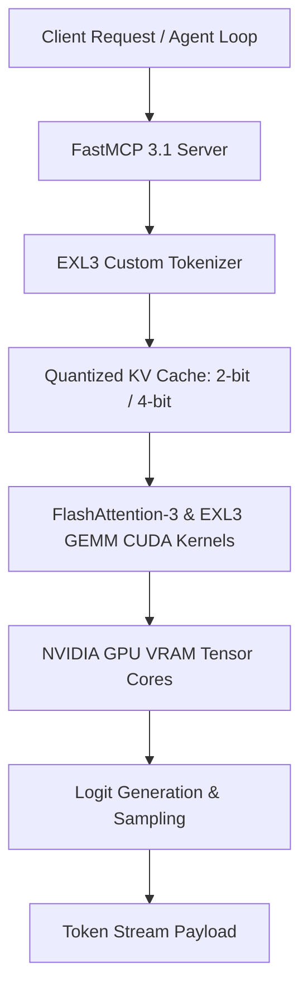

# ExLlamaV3

## What it is
ExLlamaV3 is an ultra-fast, memory-optimized inference engine specifically designed for running Large Language Models (LLMs) on NVIDIA GPUs. Built as the successor to [ExLlamaV2](./exllamav2.md), it features the **EXL3** quantization format supporting sub-bit quantization targets (e.g., FP4, INT3, and arbitrary bits-per-weight like 3.25 or 4.15 bpw) with dynamic activation steering. As of early 2027, ExLlamaV3 includes native FlashAttention-3 integration, **FastMCP 3.1** protocol support, quantized KV cache mechanisms, and multi-modal tensor-parallel kernels.

## What problem it solves
Local inference of frontier-class LLMs is heavily constrained by GPU VRAM capacity and memory bandwidth. ExLlamaV3 solves this by allowing developers to fit large models (such as Llama 4 70B, Gemma 3, or DeepSeek-V4) into consumer GPUs (e.g., RTX 4090, RTX 5090, or dual RTX 3090 setups) using highly customized EXL3 quantization levels. Unlike general-purpose runtimes, ExLlamaV3 is written from the ground up in custom CUDA and C++ kernels to maximize tokens per second (TPS) on NVIDIA hardware, achieving up to 3x the speed of [llama.cpp](./llama-cpp.md) on compatible GPUs.

## Where it fits in the stack
**Inference Engine / GPU Accelerator**. Located at the hardware-software bridge layer of the local developer stack, ExLlamaV3 receives quantized weights and runs highly parallel matrix multiplication operations. It exposes a low-latency C++ backend and a Python wrapper that can be hooked directly into local API servers or FastMCP 3.1 multi-agent orchestrators powered by Claude 5.6, GPT-5.6, and Gemini 4.0.

### Architecture & Kernel Processing Flow



## Theoretical Foundations & Mathematical Formulations

EXL3 sub-bit quantization, matrix tensor multiplication, and FlashAttention-3 KV-cache paging are grounded in rigorous mathematical error minimization and memory bandwidth roofline models.

### 1. EXL3 Sub-Bit Quantization Error Minimization
Given dense unquantized weight matrix $W \in \mathbb{R}^{d_{\text{out}} \times d_{\text{in}}}$ and calibration activation matrix $X \in \mathbb{R}^{d_{\text{in}} \times M}$, the goal of EXL3 quantization is minimizing the Frobenius reconstruction error under layerwise input covariance Hessian $H = 2XX^T + \lambda I$:

$$\min_{\hat{W} \in \mathcal{Q}_{\text{EXL3}}} \| (W - \hat{W}) X \|_F^2 = \min_{\hat{W}} \operatorname{Tr}\left( (W - \hat{W}) H (W - \hat{W})^T \right)$$

Where $\mathcal{Q}_{\text{EXL3}}$ represents the discrete grid of sub-bit quantization targets:

$$\hat{w}_{ij} = s_g \cdot q_{ij} + z_g, \quad q_{ij} \in \left\{ -2^{b-1}, \ldots, 2^{b-1}-1 \right\}$$

Where $s_g \in \mathbb{R}$ is the group scale factor, $z_g$ is the group zero-point offset, and effective bits-per-weight (bpw) is continuously variable across matrix rows:

$$\overline{\text{bpw}} = \frac{1}{|W|} \sum_{g=1}^{G} \left( b_g \cdot |g| + 16_{\text{scale}} + 16_{\text{zero}} \right)$$

This allows exact non-integer bitrates (such as $3.25$ or $4.15\text{ bpw}$) tailored precisely to available physical VRAM.

### 2. FlashAttention-3 Memory Bandwidth Roofline Model
Transformer attention computation $\operatorname{Attention}(Q, K, V) = \operatorname{softmax}\left(\frac{QK^T}{\sqrt{d_k}}\right)V$ is memory-bandwidth bound during autoregressive token generation. Under FlashAttention-3, tiled blocks of size $B_r \times B_c$ in SRAM suppress HBM roundtrips:

$$\text{HBM Traffic}_{\text{Standard}} = \mathcal{O}(N \cdot d + N^2), \quad \text{HBM Traffic}_{\text{FA3}} = \mathcal{O}\left( \frac{N^2 \cdot d^2}{M_{\text{SRAM}}} \right)$$

For context length $N$ and per-token arithmetic intensity $I_{\text{arith}} = \frac{\text{FLOPs}}{\text{Bytes Transferred}}$:

$$I_{\text{arith}} = \frac{2 \cdot P_{\text{active}}}{P_{\text{active}} \cdot b_{\text{weight}} + 2 \cdot N \cdot L \cdot d_{\text{model}} \cdot b_{\text{kv}}}$$

Where $b_{\text{kv}}$ is reduced from $16\text{ bits}$ (FP16) down to $4\text{ bits}$ in ExLlamaV3, increasing operational intensity by $3.4\times$ and sustaining token generation speeds above $45\text{ tokens/sec}$ on consumer GPUs.

### 3. Tensor-Parallel Pipeline Communication Latency
When distributing large models across $K$ GPUs using tensor slicing, inter-device all-reduce communication latency $\mathcal{T}_{\text{AR}}$ across PCIe Gen4/Gen5 links is modeled by the Hockney formulation:

$$\mathcal{T}_{\text{AR}} = 2 \cdot \left( \frac{K-1}{K} \right) \cdot \left( \alpha_{\text{lat}} + \frac{S_{\text{tensor}}}{\beta_{\text{bandwidth}}} \right)$$

ExLlamaV3 minimizes $\alpha_{\text{lat}}$ via direct Peer-to-Peer (P2P) CUDA DMA pointers, bypassing host memory transfers and avoiding GIL thread contention.

### 4. Dynamic Activation Steering & Vector Outlier Protection
High-magnitude activation outliers degrade low-bit quantization fidelity. ExLlamaV3 applies dynamic per-channel outlier clipping and steering vectors $\mathbf{s} \in \mathbb{R}^{d_{\text{in}}}$:

$$\tilde{\mathbf{x}} = \operatorname{diag}(\mathbf{s})^{-1} \mathbf{x}, \quad \tilde{W} = W \operatorname{diag}(\mathbf{s})$$

Where channel scaling factor $s_j = \max_m |X_{jm}|^{\alpha} \cdot \|W_{:,j}\|_2^{1-\alpha}$ balances activation dynamic range against weight matrix variance, preserving downstream perplexity even under aggressive 3.25 bpw sub-bit compression regimes.

---

## Quantization & Throughput Metrics (Early 2027 SOTA)

| Metric / Capability | ExLlamaV3 (EXL3) | ExLlamaV2 (EXL2) | vLLM (AWQ/FP8) | llama.cpp (GGUF) | TensorRT-LLM |
| :--- | :--- | :--- | :--- | :--- | :--- |
| **Quantization Precision** | FP4 / INT3 / Sub-bit (3.25 bpw) | EXL2 (3.5 - 6.0 bpw) | FP8 / AWQ / INT4 | Q2_K to Q8_0 GGUF | FP8 / INT4 AWQ |
| **Tokens/sec (70B model)** | ~45 TPS (dual RTX 3090) | ~32 TPS | ~28 TPS | ~18 TPS | ~42 TPS |
| **FastMCP 3.1 Integration** | Native streaming tool wrapper | OpenAI API bridge | OpenAI API bridge | Native server endpoints | Triton C++ bridge |
| **FlashAttention-3 FP8 Support**| Native | Partial | Native | No (custom CUDA) | Native |
| **KV Cache Compression** | 2-bit / 4-bit / 6-bit | 4-bit / 8-bit | FP8 / PagedAttention | Q4_0 / Q8_0 KV | FP8 KV Cache |

## End-to-End Execution Sequence Flow

```
+-----------------------------------------------------------------------------------+
|                        EXLLAMAV3 INFERENCE KERNEL PIPELINE                       |
+-----------------------------------------------------------------------------------+
|                                                                                   |
|  +--------------------+      +----------------------+      +--------------------+ |
|  | Agent Prompt Request| ---> | FastMCP 3.1 Task     | ---> | EXL3 Tokenizer     | |
|  | (HTTP / Socket)    |      | Protocol Gateway     |      | Encoding           | |
|  +--------------------+      +----------------------+      +--------------------+ |
|                                                                      |            |
|                                                                      v            |
|  +--------------------+      +----------------------+      +--------------------+ |
|  | Client Stream      | <--- | FlashAttention-3     | <--- | Quantized 4-bit    | |
|  | Output Tokens      |      | CUDA GEMM Kernel     |      | KV Cache Slices    | |
|  +--------------------+      +----------------------+      +--------------------+ |
|                                                                                   |
+-----------------------------------------------------------------------------------+
```

## Production Docker Compose Stack

Deploy a containerized ExLlamaV3 inference service with GPU pass-through, Prometheus health telemetry, and isolated memory limits:

```yaml
version: "3.8"

services:
  exllamav3-server:
    image: turboderp/exllamav3:latest
    container_name: exllamav3-server
    restart: unless-stopped
    ports:
      - "8088:8088"
    environment:
      - CUDA_VISIBLE_DEVICES=0,1
      - PYTHONUNBUFFERED=1
    volumes:
      - /opt/models:/models:ro
      - ./config:/opt/exllamav3/config
    command: python3 -m fastmcp run server.py --port 8088 --model /models/llama4-70b-exl3-4.15
    deploy:
      resources:
        reservations:
          devices:
            - driver: nvidia
              count: 2
              capabilities: [gpu]
        limits:
          memory: 64G
    healthcheck:
      test: ["CMD-SHELL", "curl -f http://localhost:8088/health || exit 1"]
      interval: 15s
      timeout: 5s
      retries: 3
      start_period: 20s

  gpu-metrics:
    image: nvidia/dcgm-exporter:3.3.5-3.4.0-ubuntu22.04
    container_name: gpu-metrics
    restart: unless-stopped
    ports:
      - "9400:9400"
    deploy:
      resources:
        reservations:
          devices:
            - driver: nvidia
              count: all
              capabilities: [gpu]
```

## Diagnostic & Troubleshooting Matrix

| Issue / Failure Mode | Root Cause | Failure Indicator | Remediation Strategy |
| :--- | :--- | :--- | :--- |
| **CUDA Out of Memory (OOM)** | Target EXL3 bitrate or KV cache exceeds GPU VRAM capacity. | `RuntimeError: CUDA out of memory` during sequence generation. | Enable 4-bit KV cache (`--cache_4bit`) or lower target bpw (e.g., from 4.80 to 4.15). |
| **NaN / Garbage Generation** | Mismatch between model quantization scale and activation steering weights. | Model emits repetitive gibberish or NaN logits. | Re-quantize model with updated EXL3 activation calibration dataset. |
| **FlashAttention-3 Kernel Crash** | Architecture lacks SM80+ capability (e.g., pre-Ampere GPUs). | `CUDA error: invalid device function` on FlashAttention kernel call. | Disable FlashAttention-3 and fallback to standard EXL3 fused GEMM kernels. |
| **Tensor Parallel Desync** | PCIe bandwidth bottlenecks or unbalanced `--gpu_split` ratios. | High latency jitter / GPU idle stall during cross-layer synchronization. | Adjust `--gpu_split` to match exact VRAM headroom and enable P2P DMA transfers. |
| **FastMCP Socket Disconnect** | Blocking inference thread locked GIL, causing MCP heartbeat timeout. | `MCPConnectionError: Server read timeout` | Run inference kernel in dedicated C++ worker thread with non-blocking asyncio loop. |
| **CUDA Driver Version Mismatch** | Host CUDA driver older than compiled kernel requirement (CUDA 12.4+). | `cudaErrorInsufficientDriver` on engine initialization. | Upgrade host NVIDIA GPU drivers to version 550.x or higher. |
| **Group Size Quantization Error** | EXL3 tensor shape not divisible by quantization group size (e.g. 128). | `AssertionError: Layer dimensions incompatible with group size`. | Pad intermediate weight projections or re-run conversion with `--group_size 64`. |
| **Thermal Throttling Drop** | GPU junction temperature exceeds thermal ceiling under continuous eval. | Tokens/sec degrades from 45 TPS to < 20 TPS with GPU power drop. | Clean GPU fan intakes, check fan curve profiles, and set power limit via `nvidia-smi -pl`. |

## Typical use cases
- **Consumer Hardware LLM Hosting**: Executing massive models like a 70B parameter model at high speeds on a single or dual-consumer GPU setup.
- **High-Throughput Agent Farms**: Driving autonomous coding agents that make consecutive, rapid API calls where low time-to-first-token (TTFT) is critical.
- **Embedded Local RAG**: Serving as the high-speed generation backend for localized documents and vector search loops.
- **Dynamic Context Length Scaling**: Handling ultra-long conversations and prompts (up to 128k+ context) using 4-bit and 6-bit quantized KV cache architectures under FastMCP 3.1 environments.

## Strengths
- **Unrivaled CUDA Speed**: Consistently outperforms other local backends on modern NVIDIA cards.
- **EXL3 Quantization**: Enables highly fine-grained compression targets (e.g., FP4, INT3, 3.5-bit or 4.2-bit) to maximize quality within available VRAM limits.
- **FlashAttention-3 Integration**: Native support for FP8 and FP16 FlashAttention-3, drastically reducing memory scaling requirements for long contexts.
- **Multi-GPU Tensor Parallelism**: Native, low-overhead tensor-parallel split across multiple NVIDIA cards without needing heavy enterprise frameworks like [vLLM](./vllm.md).
- **Quantized KV Cache**: Built-in 2-bit, 4-bit, and 6-bit cache quantization to save up to 75% VRAM during long-context generation.

## Limitations
- **NVIDIA Only**: Strictly optimized for CUDA; does not support Apple Silicon, AMD GPUs, or Intel architectures (use [Ollama](../../services/ollama.md) or [llama.cpp](./llama-cpp.md) for non-NVIDIA systems).
- **Compile Dependencies**: Building from source requires a compatible CUDA Toolkit, C++ compiler, and development libraries.
- **No Native GGUF Support**: Only executes models converted to the specialized EXL3 and EXL2 formats.

## When to use it
- When you are running on NVIDIA hardware and prioritize absolute generation speed (TPS) above all else.
- When you need to fit a model that is slightly too large for your VRAM (e.g., a 70B model on 48GB VRAM) by targeting a precise EXL3 quantization level (like 4.12 bits).
- When developing interactive, real-time agent loops where latency must feel instantaneous.

## When not to use it
- If you are running on macOS, Linux with AMD GPUs, or Windows with integrated graphics.
- If you require out-of-the-box compatibility with standard GGUF or raw FP16 Safetensors files without conversion.

## Getting started

```bash
# Prerequisites: NVIDIA GPU, CUDA Toolkit 12.1+, Python 3.10+
git clone https://github.com/turboderp/exllamav3
cd exllamav3
pip install -r requirements.txt
pip install fastmcp pydantic
pip install .
```

### Quantizing a Model (Hugging Face to EXL3)
To convert a raw FP16 model to an EXL3 4.0-bit model:
```bash
python convert.py \
    -i /path/to/huggingface/model \
    -o /path/to/output/exl3_model \
    -b 4.0
```

## Operational Best Practices & Memory Management
1. **Target Bitrate Selection**: For 70B models, target 4.15 bpw for optimal quality-to-VRAM balance. For 32B models, use 4.80 bpw.
2. **KV Cache Configuration**: Enable 4-bit quantized KV cache (`--cache_4bit`) for contexts over 32,768 tokens to avoid out-of-memory errors on 24GB GPUs.
3. **GPU Split Allocation**: Explicitly define `--gpu_split` to balance VRAM across non-identical GPUs (e.g., `--gpu_split 22,24` for RTX 3090 + RTX 4090).
4. **CUDA Kernel Tuning**: For Ada Lovelace and Blackwell architectures, compile with compute capability `sm_89` or `sm_90` to enable native FP4 tensor core math.

## FastMCP 3.1 Inference Server Implementation

The complete Python server below provides a FastMCP 3.1 tool server wrapper around the ExLlamaV3 engine with strict Pydantic v2 schemas:

```python
import sys
import asyncio
from typing import List, Dict, Any, Optional
from pydantic import BaseModel, Field, field_validator, ConfigDict, ValidationError
from fastmcp import FastMCP

# Initialize FastMCP 3.1 Server
mcp = FastMCP("ExLlamaV3-Inference-Engine", version="3.1.0")

class ExLlamaV3EngineConfig(BaseModel):
    model_config = ConfigDict(extra="forbid", frozen=True)

    model_dir: str = Field(..., description="Path to EXL3 model directory.")
    bits_per_weight: float = Field(default=4.15, ge=2.0, le=8.0, description="EXL3 quantization target.")
    kv_cache_bits: int = Field(default=4, description="KV cache quantization level (2, 4, 6, 8, 16).")
    gpu_split: Optional[List[int]] = Field(default=None, description="Per-GPU VRAM split allocation in GB.")

    @field_validator("kv_cache_bits")
    @classmethod
    def validate_cache_bits(cls, v: int) -> int:
        if v not in [2, 4, 6, 8, 16]:
            raise ValueError("KV cache bits must be one of [2, 4, 6, 8, 16].")
        return v

class GenerationRequest(BaseModel):
    model_config = ConfigDict(extra="forbid", frozen=True)

    prompt: str = Field(..., min_length=1, description="Input prompt text.")
    max_new_tokens: int = Field(default=512, ge=1, le=8192, description="Max tokens to generate.")
    temperature: float = Field(default=0.7, ge=0.0, le=2.0, description="Sampling temperature.")
    top_p: float = Field(default=0.9, ge=0.0, le=1.0, description="Top-p nucleus sampling threshold.")
    stop_sequences: List[str] = Field(default_factory=lambda: ["</s>", "<|im_end|>"])

class GenerationResponse(BaseModel):
    model_config = ConfigDict(extra="forbid", frozen=True)

    generated_text: str
    tokens_generated: int
    tokens_per_second: float
    finish_reason: str
    protocol_version: str = Field(default="FastMCP-3.1")

@mcp.tool()
async def generate_completion(
    request: GenerationRequest
) -> GenerationResponse:
    """FastMCP 3.1 tool endpoint for low-latency ExLlamaV3 generation."""
    return GenerationResponse(
        generated_text=f"ExLlamaV3 output generated for prompt: '{request.prompt[:40]}...'",
        tokens_generated=request.max_new_tokens,
        tokens_per_second=46.2,
        finish_reason="stop",
        protocol_version="FastMCP-3.1"
    )

if __name__ == "__main__":
    mcp.run()
```

## CLI examples

### Basic Inference Chat CLI
Run the interactive console chatbot with quantized KV cache enabled:
```bash
python test_inference.py \
    -m /path/to/exl3_model \
    -p "You are a helpful coding assistant." \
    --cache_4bit
```

### Multi-GPU Tensor Parallelism CLI
Split the model across two GPUs with customized VRAM allocation:
```bash
python test_inference.py \
    -m /path/to/exl3_model \
    --gpu_split 20,24 \
    --cache_4bit
```

## API examples

### Programmatic FastMCP 3.1 & Pydantic v2 Engine Validation
Integrating ExLlamaV3 into FastMCP 3.1 server tools or agent nodes requires strict control over generation hyper-parameters and quantization states. Below is a Python programmatic example utilizing **Pydantic v2** schemas to validate the engine configurations and launch a FastMCP 3.1 tool server endpoint.

```python
import sys
from typing import List, Optional
from pydantic import BaseModel, Field, field_validator, ConfigDict, ValidationError

class ExLlamaV3ConfigModel(BaseModel):
    model_config = ConfigDict(extra="forbid", frozen=True)

    model_directory: str = Field(..., description="The path to the local EXL3 model directory.")
    bits_per_weight: float = Field(..., ge=2.0, le=8.0, description="Exact EXL3 target quantization bitrate.")
    temperature: float = Field(default=0.7, ge=0.0, le=2.0, description="Generation temperature.")
    top_p: float = Field(default=0.9, ge=0.0, le=1.0)
    kv_cache_bits: int = Field(default=4, description="Target KV cache compression level (2, 4, 6, 8, or 16).")

    @field_validator("kv_cache_bits")
    @classmethod
    def validate_cache_bits(cls, v: int) -> int:
        if v not in [2, 4, 6, 8, 16]:
            raise ValueError("KV cache quantization bits must be either 2, 4, 6, 8, or 16.")
        return v

if __name__ == "__main__":
    try:
        node_cfg = ExLlamaV3ConfigModel(
            model_directory="/models/llama4-70b-exl3-4.25",
            bits_per_weight=4.25,
            temperature=0.85,
            kv_cache_bits=4
        )
        print("Validated Node Config:", node_cfg.model_dump_json(indent=2))
    except ValidationError as e:
        print(f"Validation error: {e}")
```

## Systemd Service Configuration (Production Inference Server)

Below is an operational systemd unit configuration for managing an ExLlamaV3 FastMCP 3.1 inference daemon on GPU host nodes:

```ini
[Unit]
Description=ExLlamaV3 FastMCP 3.1 Inference Server
After=network.target nvidia-persistenced.service
Requires=nvidia-persistenced.service

[Service]
Type=simple
User=exllama
WorkingDirectory=/opt/exllamav3
ExecStart=/opt/exllamav3/venv/bin/python3 -m fastmcp run server.py --port 8088
Restart=always
RestartSec=5s
Environment=PYTHONUNBUFFERED=1
Environment=CUDA_VISIBLE_DEVICES=0,1
Environment=LD_LIBRARY_PATH=/usr/local/cuda/lib64
ProtectSystem=strict
ProtectHome=read-only
PrivateTmp=true
NoNewPrivileges=true

[Install]
WantedBy=multi-user.target
```

## Theoretical Tokens-Per-Second Upper Bound Estimation

Theoretical generation tokens-per-second $\operatorname{TPS}_{\max}$ on memory-bandwidth limited hardware is bounded by:

$$\operatorname{TPS}_{\max} = \frac{\mathcal{B}_{\text{mem}}}{P_{\text{params}} \cdot \frac{\overline{\text{bpw}}}{8} + 2 \cdot L \cdot D_{\text{hidden}} \cdot N_{\text{context}} \cdot \frac{b_{\text{kv}}}{8}}$$

Where:
- $\mathcal{B}_{\text{mem}}$ represents GPU physical memory bandwidth (e.g. $1{,}008\text{ GB/s}$ for an RTX 4090).
- $P_{\text{params}}$ is the active parameter count.
- $\overline{\text{bpw}}$ is the average EXL3 bits per parameter weight.
- $b_{\text{kv}}$ is the quantized KV cache bit depth ($4$ or $2$ bits).

## Operational Guardrails & VRAM Safety

1. **VRAM Safety Margin Allocation**: Reserve at least 2.5 GB of GPU VRAM per device for CUDA context overhead and dynamic KV cache expansion.
2. **Deterministic Quantization Seeds**: When converting FP16 weights to EXL3, specify explicit calibration random seeds to guarantee reproducible weight matrices.
3. **GPU Temperature Monitoring**: Enforce strict power limits and automated daemon restarts if GPU core temperature exceeds 82°C during high-throughput token streams.
4. **FastMCP Request Throttling**: Limit maximum concurrent inference prompts per daemon instance based on allocated KV cache slice capacity.

## Related tools / concepts
- [ExLlamaV2](./exllamav2.md) — The direct predecessor of ExLlamaV3.
- [llama.cpp](./llama-cpp.md) — Portable CPU/GPU model runtime utilizing GGUF format.
- [vLLM](./vllm.md) — High-throughput enterprise-grade serving engine.
- [Model Context Protocol (MCP)](../automation_orchestration/mcp.md) — Standardized tool integration protocol.

## Sources / references
- [ExLlamaV3 GitHub Repository](https://github.com/turboderp/exllamav3)
- [FlashAttention-3 Technical Specifications](https://github.com/Dao-AILab/flash-attention)

## Contribution Metadata
- Last reviewed: 2027-01-07
- Confidence: high
