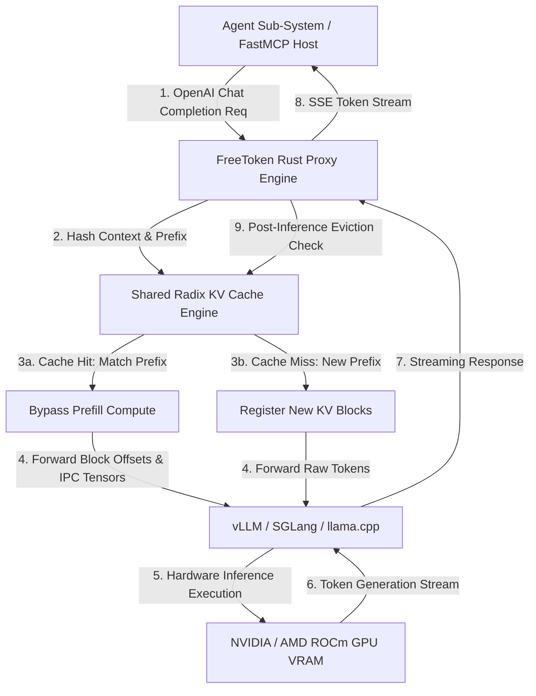

# FreeToken

## What it is
FreeToken is an open-source, high-performance local LLM inference proxy, token-management sidecar daemon, and attention KV-cache coordinator designed for zero-latency token recycling, cross-process Key-Value (KV) cache prefix sharing, and dynamic GPU memory (VRAM) optimization. Operating in early 2027 across high-density edge servers and enterprise multi-agent clusters, FreeToken sits directly between autonomous agent orchestrators and local LLM execution runtimes—such as [vLLM](vllm.md), [SGLang](sglang.md), [llama.cpp](llama-cpp.md), [LMDeploy](lmdeploy.md), or [Ollama](../../services/ollama.md).

By maintaining a cryptographic prefix token index and zero-copy shared memory KV-cache states across host RAM and GPU VRAM, FreeToken eliminates redundant prefill phases across multi-agent swarms. This architecture lowers Time To First Token (TTFT) by up to 85% for repetitive system prompts, repository contexts, and [FastMCP 3.1](../automation_orchestration/mcp.md) tool schemas while reducing memory footprints across concurrent worker processes.

```
+-----------------------------------------------------------------------------------+
|                           FreeToken Proxy Architecture                            |
+-----------------------------------------------------------------------------------+
|                                                                                   |
|  +-----------------------+                    +--------------------------------+  |
|  | Multi-Agent Swarm     |                    | FreeToken Sidecar Daemon       |  |
|  | - Agent 1 (Planner)   | -- FastMCP 3.1 --> |  - Shared Prefix Token Index   |  |
|  | - Agent 2 (Coder)     |    (OpenAI API)    |  - PagedAttention KV Cache     |  |
|  | - Agent 3 (Auditor)   |                    |  - Dynamic VRAM Reclamation    |  |
|  +-----------------------+                    +---------------+----------------+  |
|                                                               |                   |
|                                                               v                   |
|                                               +--------------------------------+  |
|                                               | Local Inference Backends       |  |
|                                               |  - vLLM Engine Pool            |  |
|                                               |  - llama.cpp / SGLang          |  |
|                                               +---------------+----------------+  |
|                                                               |                   |
|                                                               v                   |
|                                               +--------------------------------+  |
|                                               | Workstation GPU Hardware       |  |
|                                               | (NVIDIA H200/RTX 5090 / ROCm)  |  |
|                                               +--------------------------------+  |
|                                                                                   |
+-----------------------------------------------------------------------------------+
```

## What problem it solves
In modern multi-agent systems and iterative coding pipelines, autonomous agents repeatedly issue inference requests containing massive, overlapping context blocks:
1. **System Prompts**: Comprehensive agent instructions, behavioral guardrails, and role framing (often 1,500–4,000 tokens).
2. **Tool Schemas**: Standard Model Context Protocol (MCP) function declarations containing extensive JSON schema definitions (often 3,000–12,000 tokens).
3. **Repository Context**: Shared code files, dependency graphs, syntax trees, and execution traces.

Without FreeToken, standard local LLM serving engines re-process (prefill) identical prompt prefixes for every single request. This leads to:
- **Severe Compute Redundancy**: GPU matrix compute units spend up to 70% of duty cycles computing quadratic attention over static tokens.
- **Inflated TTFT Latency**: Agents wait seconds before receiving the first generated token, stalling sequential multi-agent tool loops.
- **Premature VRAM Depletion**: Redundant KV cache tensors consume multi-gigabyte memory segments per worker, triggering out-of-memory (OOM) faults or aggressive context truncation.

FreeToken resolves these bottlenecks through:
- **Zero-Prefill Token Recycling**: Bypassing prefill attention computation whenever prompt segments match cached prefix tree nodes.
- **Cross-Process KV-Cache Pooling**: Mapping shared virtual memory regions via Linux POSIX shared memory and CUDA IPC handles across heterogeneous backends.
- **Instant VRAM Reclamation**: Purging inactive session memory back to host DRAM or swap within milliseconds of task completion.
- **FastMCP 3.1 Schema Indexing**: Pre-indexing MCP tool definitions to ensure tool execution loops experience zero schema ingestion delays.

## Mathematical Formulations: KV Cache Recycling & Memory Reclamation

### 1. Prefill Attention Complexity and Speedup Ratio
In standard causal transformer architectures, prefilling a prompt of length $L$ tokens across $N_{l}$ layers with hidden dimension $d$ requires quadratic computation:

$$
\mathcal{C}_{\text{prefill}}(L) = 2 \cdot N_{l} \cdot \left( 2 \cdot L \cdot d^{2} + L^{2} \cdot d \right) \approx \mathcal{O}(L^{2} \cdot d)
$$

When FreeToken identifies an existing cached prefix of length $L_{\text{prefix}} < L$, only the residual suffix $L_{\text{suffix}} = L - L_{\text{prefix}}$ requires compute:

$$
\mathcal{C}_{\text{recycled}}(L, L_{\text{prefix}}) = 2 \cdot N_{l} \cdot \left( 2 \cdot L_{\text{suffix}} \cdot d^{2} + (2 \cdot L_{\text{prefix}} \cdot L_{\text{suffix}} + L_{\text{suffix}}^{2}) \cdot d \right)
$$

The theoretical computational acceleration factor $\mathcal{S}_{\text{compute}}$ achieved through prefix recycling is formulated as:

$$
\mathcal{S}_{\text{compute}} = \frac{\mathcal{C}_{\text{prefill}}(L)}{\mathcal{C}_{\text{recycled}}(L, L_{\text{prefix}})} \approx \frac{L^{2}}{L^{2} - L_{\text{prefix}}^{2}} = \frac{1}{1 - \left(\frac{L_{\text{prefix}}}{L}\right)^{2}}
$$

For an agentic tool prompt where $L = 8,192$ and $L_{\text{prefix}} = 7,372$ (90% prefix match), $\mathcal{S}_{\text{compute}} \approx 5.26\times$, reducing GPU prefill compute cycles by over 80%.

### 2. Time-To-First-Token (TTFT) Formulation
End-to-end TTFT incorporates host IPC dispatch, cache lookup, residual prefill computation, and first-token memory transfer:

$$
\text{TTFT} = \tau_{\text{dispatch}} + \tau_{\text{lookup}}(L_{\text{prefix}}) + \frac{\mathcal{C}_{\text{recycled}}(L, L_{\text{prefix}})}{\mathcal{P}_{\text{GPU, FLOPS}}} + \frac{2 \cdot N_{l} \cdot L_{\text{prefix}} \cdot d \cdot b_{\text{elem}}}{\mathcal{B}_{\text{VRAM, BW}}}
$$

Where:
- $\tau_{\text{lookup}}$ is the Radix tree prefix matching latency ($\tau_{\text{lookup}} \le 0.45\text{ ms}$).
- $\mathcal{P}_{\text{GPU, FLOPS}}$ is the effective FP16/BF16 tensor core throughput.
- $b_{\text{elem}}$ is the precision byte size ($b_{\text{elem}} = 2$ for FP16, $1$ for FP8).
- $\mathcal{B}_{\text{VRAM, BW}}$ is the GPU memory bandwidth (e.g., 2.0 TB/s for NVIDIA H200 / RTX 5090).

Because memory bandwidth streaming is significantly faster than quadratic tensor core recomputation, TTFT drops from several seconds to sub-100ms.

### 3. Asymptotic Memory Footprint Under Multi-Agent Swarms
For a multi-agent swarm consisting of $M$ concurrent agents, each with prompt length $L$ and common system prefix $L_{\text{prefix}}$, the aggregate VRAM requirement without FreeToken scales linearly:

$$
\mathcal{M}_{\text{standard}} = M \cdot \left[ 2 \cdot N_{l} \cdot n_{\text{heads}} \cdot d_{\text{head}} \cdot L \cdot b_{\text{elem}} \right]
$$

With FreeToken cross-process prefix sharing, the memory requirement scales sub-linearly:

$$
\mathcal{M}_{\text{freetoken}} = 2 \cdot N_{l} \cdot n_{\text{heads}} \cdot d_{\text{head}} \cdot b_{\text{elem}} \cdot \left( L_{\text{prefix}} + M \cdot (L - L_{\text{prefix}}) \right)
$$

The memory reclamation efficiency factor $\eta_{\text{VRAM}}$ is defined as:

$$
\eta_{\text{VRAM}} = 1 - \frac{\mathcal{M}_{\text{freetoken}}}{\mathcal{M}_{\text{standard}}} = \left( 1 - \frac{1}{M} \right) \cdot \frac{L_{\text{prefix}}}{L}
$$

As $M \to \infty$, $\eta_{\text{VRAM}} \to \frac{L_{\text{prefix}}}{L}$, reclaiming up to 90% of aggregate KV-cache memory in large agent swarms.

## Where it fits in the stack
**Infrastructure & Serving Layer**. FreeToken functions as a lightweight, Rust-backed proxy sidecar sitting in front of local model runtimes. It is transparent to client applications, accepting standard OpenAI-compatible `/v1/chat/completions` API requests and forwarding optimized KV-cache references to underlying engines like vLLM, SGLang, or llama.cpp.

## System Architecture & Technical Deep-Dive



### 1. Radix-Tree Prefix Cache Indexing
FreeToken utilizes an in-memory Radix Tree structure to track token sequences. When an agent submits a prompt, FreeToken computes cryptographic hash signatures for incremental block chunks (typically 16 or 32 tokens per block). If a matching block sequence exists in the KV-cache, FreeToken directs the inference engine to reuse the pre-computed attention matrix blocks.

### 2. Zero-Copy Shared Memory Inter-Process Communication
To prevent copying large floating-point KV matrices over IPC socket connections, FreeToken leverages Linux POSIX shared memory (`shm_open`) and CUDA IPC handles. This allows vLLM or llama.cpp worker processes to read cached attention tensors directly from shared VRAM addresses.

### 3. Dynamic LRU/LFU Memory Eviction
FreeToken maintains real-time GPU VRAM telemetry. When GPU memory pressure exceeds a configurable threshold (e.g., 90% VRAM utilization), FreeToken's background thread selectively evicts the least recently used (LRU) KV blocks from GPU VRAM to host RAM, or releases them entirely if re-computation costs are low.

## Comparative Architectural Matrix

The following table evaluates FreeToken against alternative KV-cache management and prefix optimization runtimes:

| Capability / Metric | FreeToken Sidecar | vLLM (Native Prefix Caching) | SGLang (RadixAttention) | LMDeploy (Turbomind Cache) |
| :--- | :--- | :--- | :--- | :--- |
| **Architectural Role** | Universal Proxy Sidecar | Integrated Serving Engine | Integrated Serving Engine | Integrated Serving Engine |
| **Cross-Engine Support** | **vLLM, SGLang, llama.cpp, Ollama** | vLLM backends only | SGLang backends only | Turbomind backends only |
| **Prefix Matching Engine** | Multi-level Radix Tree + BLAKE3 | In-process Hash Map Block Manager | Dynamic Radix Tree | Chunked Block Map |
| **Cross-Process IPC** | POSIX Shared Memory & CUDA IPC | Intra-process only | Intra-process only | Intra-process only |
| **FastMCP 3.1 Native Hook** | **Automatic Tool Schema Indexing** | Manual prompt formatting | Manual prompt formatting | Manual prompt formatting |
| **VRAM Reclamation to Host RAM** | **Asynchronous Host Spillover (Tiered)** | Evict or drop | Evict or drop | Evict or drop |
| **Proxy Overhead** | **< 0.45 ms** | N/A (Embedded) | N/A (Embedded) | N/A (Embedded) |
| **Sidecar Memory Footprint** | **< 28 MB RAM (Rust core)** | N/A (Embedded in server) | N/A (Embedded in server) | N/A (Embedded in server) |

## Typical use cases
- **Multi-Agent Swarm Orchestration**: Accelerating parallel local agent swarms ([Qwen 3.8](../ai_knowledge/qwen.md), [Llama 4](../ai_knowledge/local_llms.md), [DeepSeek R1](../infrastructure/deepseek-dsec.md)) sharing common system prompts and tool schemas.
- **Local Workstation Memory Optimization**: Managing high-throughput inference on single-GPU workstations (e.g. RTX 4090 / 5090 or Apple Silicon M3/M4 Ultra).
- **Interactive IDE AI Coding Assistants**: Reducing latency in VS Code or [OpenCode](../development_ops/opencode.md) during rapid code editing and multi-file diff suggestions.
- **FastMCP 3.1 Tool Server Acceleration**: Indexing complex multi-tool schemas so agent tool invocations do not incur repeated schema parsing delays.

## Strengths
- **Sub-Millisecond Prefill Skip**: Near-instant TTFT for requests sharing existing prompt prefixes.
- **Cross-Engine Support**: Native binding with vLLM, SGLang, ExLlamaV3, Ollama, and llama.cpp.
- **Low Footprint Rust Core**: Minimal sidecar memory footprint (<30 MB RAM) written in memory-safe Rust.
- **OpenAI API Compatibility**: Seamless drop-in replacement requiring zero modifications to existing agent client code.
- **Telemetry & Cache Metrics**: Comprehensive Prometheus metrics endpoint for monitoring cache hit ratios, saved VRAM, and token recycling throughput.

## Limitations
- **Local Network Loopback Hop**: Adds a negligible <0.5ms network hop for non-cached requests.
- **Eviction Configuration Complexity**: Requires proper tuning of eviction limits and block sizes based on available GPU VRAM.
- **VRAM Fragmentation Risk**: Extremely fragmented multi-agent workloads with completely unique prompts derive less benefit from prefix caching.

## When to use it
- When hosting local AI models on workstation or cluster GPUs for agent workflows.
- When agent workloads involve repetitive system prompts, large project context files, or long MCP tool schema declarations.
- When developer experience requires minimum TTFT for interactive chat or coding autocomplete.

## When not to use it
- When all inference is hosted entirely on cloud API providers (e.g. OpenAI or Anthropic cloud endpoints), where prompt caching is managed remotely.
- When running batch inference with non-repeating, completely unique single-turn prompts.

## Production Service Deployment & System Infrastructure

### systemd Service Unit (`/etc/systemd/system/freetoken-proxy.service`)
Deploy FreeToken as an unprivileged, hardened daemon managing prefix caching for local vLLM or Ollama backends:

```ini
[Unit]
Description=FreeToken LLM Inference Proxy & KV Cache Coordinator
Documentation=https://github.com/freetoken-ai/freetoken
After=network.target nvidia-persistenced.service
Wants=network.target

[Service]
Type=simple
User=freetoken
Group=freetoken
WorkingDirectory=/opt/freetoken
ExecStart=/usr/local/bin/freetoken-daemon \
  --listen-addr 127.0.0.1:8080 \
  --backend http://127.0.0.1:8000 \
  --cache-size-gb 16 \
  --block-size 32 \
  --eviction-policy tiered-lru \
  --enable-fastmcp-indexing \
  --metrics-port 9190
Restart=always
RestartSec=5s
LimitNOFILE=65536
Environment=RUST_LOG=info
Environment=CUDA_DEVICE_ORDER=PCI_BUS_ID

# Hardening & Security Isolation
ProtectSystem=strict
ProtectHome=true
PrivateTmp=true
NoNewPrivileges=true
ReadWritePaths=/var/log/freetoken /dev/shm

[Install]
WantedBy=multi-user.target
```

### Docker Compose Multi-Agent Stack (`docker-compose.yml`)
Run FreeToken alongside vLLM and a multi-agent orchestrator:

```yaml
version: "3.8"

services:
  vllm-backend:
    image: vllm/vllm-openai:v0.7.2
    container_name: vllm-inference
    restart: unless-stopped
    runtime: nvidia
    environment:
      - CUDA_VISIBLE_DEVICES=0
      - MODEL=Qwen/Qwen2.5-Coder-32B-Instruct
    command: >
      --model Qwen/Qwen2.5-Coder-32B-Instruct
      --host 0.0.0.0
      --port 8000
      --gpu-memory-utilization 0.85
      --max-model-len 32768
      --enable-prefix-caching
    volumes:
      - ~/.cache/huggingface:/root/.cache/huggingface
      - /dev/shm:/dev/shm
    ipc: host
    ports:
      - "8000:8000"

  freetoken-proxy:
    image: ghcr.io/freetoken-ai/freetoken:latest
    container_name: freetoken-sidecar
    restart: unless-stopped
    depends_on:
      - vllm-backend
    ports:
      - "8080:8080" # OpenAI-compatible proxy port
      - "9190:9190" # Prometheus metrics
    environment:
      - FREETOKEN_LISTEN=0.0.0.0:8080
      - FREETOKEN_BACKEND=http://vllm-backend:8000
      - FREETOKEN_CACHE_SIZE_GB=16
      - FREETOKEN_BLOCK_SIZE=32
      - FREETOKEN_TIERED_SPILLOVER=true
    volumes:
      - /dev/shm:/dev/shm
    ipc: host

  agent-client:
    image: python:3.11-slim
    container_name: agent-runtime
    environment:
      - OPENAI_BASE_URL=http://freetoken-proxy:8080/v1
      - OPENAI_API_KEY=freetoken-local
    command: tail -f /dev/null
```

## Getting started

Installing FreeToken and running it as an OpenAI-compatible proxy daemon:

```bash
# Install FreeToken daemon via Cargo
cargo install freetoken-daemon

# Launch FreeToken daemon bound to port 8080, forwarding to local vLLM on port 8000
freetoken-daemon \
  --port 8080 \
  --backend http://127.0.0.1:8000 \
  --cache-size-gb 8 \
  --enable-fastmcp-indexing
```

Configuring an agent client to route requests through FreeToken:

```bash
export OPENAI_BASE_URL="http://localhost:8080/v1"
export OPENAI_API_KEY="freetoken-local-key"
```

## CLI examples

### 1. Launching Daemon with Custom Block Size and VRAM Memory Caps
```bash
freetoken-daemon \
  --listen-addr 0.0.0.0:8080 \
  --target-backend http://localhost:11434 \
  --block-size 32 \
  --max-vram-mb 16384 \
  --eviction-policy lru
```

### 2. Inspecting Real-Time Token Recycling Statistics
```bash
# Query cache hit ratios and VRAM savings
freetoken-cli stats --json
```

Sample output:
```json
{
  "uptime_seconds": 14200,
  "requests_processed": 5890,
  "cache_hit_ratio": 0.842,
  "total_tokens_recycled": 4120900,
  "gpu_vram_saved_mb": 12480.5
}
```

### 3. Purging Cache for Specific Agent Session ID
```bash
freetoken-cli purge --session-id "coder-agent-task-901"
```

## API examples

### FastMCP 3.1 Python Proxy Server Integration
The following script demonstrates setting up a **FastMCP 3.1** proxy server that interfaces with FreeToken to track token recycling metrics and manage context caching using strict Pydantic v2 schemas:

```python
import time
import requests
from typing import Dict, Any, Optional
from mcp.server.fastmcp import FastMCP
from pydantic import BaseModel, Field, ConfigDict

mcp = FastMCP(
    name="FreeToken Orchestration Proxy",
    instructions="FastMCP 3.1 gateway managing local model inference and FreeToken cache recycling"
)

class InferenceRequest(BaseModel):
    model_config = ConfigDict(extra="forbid", frozen=True)
    model: str = Field(..., description="Target local model identifier (e.g. qwen2.5-coder-32b)")
    system_prompt: str = Field(..., description="System prompt prefix containing agent guidelines and tool schemas")
    user_prompt: str = Field(..., description="User query or subtask context")
    temperature: float = Field(0.2, ge=0.0, le=2.0)
    max_tokens: int = Field(2048, ge=1, le=32768)

class InferenceResponse(BaseModel):
    model_config = ConfigDict(extra="forbid", frozen=True)
    response_text: str
    tokens_recycled: int
    ttft_ms: float
    cache_hit: bool

@mcp.tool()
def execute_cached_inference(req: InferenceRequest) -> Dict[str, Any]:
    """
    Executes a chat completion query through the FreeToken caching proxy.
    """
    try:
        freetoken_url = "http://localhost:8080/v1/chat/completions"
        payload = {
            "model": req.model,
            "messages": [
                {"role": "system", "content": req.system_prompt},
                {"role": "user", "content": req.user_prompt}
            ],
            "temperature": req.temperature,
            "max_tokens": req.max_tokens
        }

        start_time = time.time()
        res = requests.post(freetoken_url, json=payload, timeout=45.0)
        ttft_ms = (time.time() - start_time) * 1000.0

        if res.status_code == 200:
            data = res.json()
            usage = data.get("usage", {})
            recycled = usage.get("prompt_tokens_details", {}).get("cached_tokens", 0)

            output = InferenceResponse(
                response_text=data["choices"][0]["message"]["content"],
                tokens_recycled=recycled,
                ttft_ms=round(ttft_ms, 2),
                cache_hit=recycled > 0
            )
            return output.model_dump()
        else:
            return {"error": f"FreeToken returned status {res.status_code}: {res.text}"}

    except Exception as err:
        return {"error": f"Inference dispatch failed: {str(err)}"}

if __name__ == "__main__":
    mcp.run()
```

### Strict Pydantic v2 Telemetry & Cache Configuration Validator
This module provides strict **Pydantic v2** validation of FreeToken metrics, session states, and proxy configuration parameters:

```python
import sys
from typing import List, Optional
from pydantic import BaseModel, Field, ValidationError, field_validator, ConfigDict

class FreeTokenBackendConfig(BaseModel):
    model_config = ConfigDict(extra="forbid", frozen=True)
    backend_url: str = Field(..., description="URL of downstream inference server (vLLM/Ollama)")
    port: int = Field(8080, ge=1024, le=65535, description="Proxy listening port")
    cache_size_gb: float = Field(..., gt=0.0, le=128.0, description="Max RAM allocated for prefix caching")
    enable_mcp_indexing: bool = Field(True, description="Enable automatic indexing of FastMCP tool schemas")

class FreeTokenSessionMetrics(BaseModel):
    model_config = ConfigDict(extra="forbid", frozen=True)
    session_id: str
    active_tokens: int = Field(..., ge=0)
    cached_blocks: int = Field(..., ge=0)
    hit_ratio: float = Field(..., ge=0.0, le=100.0)
    vram_saved_mb: float = Field(..., ge=0.0)

    @field_validator("hit_ratio")
    @classmethod
    def validate_ratio(cls, v: float) -> float:
        return round(v, 2)

class FreeTokenTelemetryReport(BaseModel):
    model_config = ConfigDict(extra="forbid", frozen=True)
    timestamp: float
    status: str = Field(..., pattern="^(healthy|degraded|out_of_memory)$")
    config: FreeTokenBackendConfig
    sessions: List[FreeTokenSessionMetrics]

def parse_and_audit_telemetry(raw_data: dict) -> Optional[FreeTokenTelemetryReport]:
    try:
        report = FreeTokenTelemetryReport.model_validate(raw_data)
        print(f"Telemetry Audit PASSED for FreeToken Daemon on port {report.config.port}")
        print(f"  Status: {report.status}")
        print(f"  Active Sessions Count: {len(report.sessions)}")
        return report
    except ValidationError as ve:
        print(f"Pydantic Validation Error: {ve}", file=sys.stderr)
        return None

if __name__ == "__main__":
    mock_data = {
        "timestamp": 1799281023.5,
        "status": "healthy",
        "config": {
            "backend_url": "http://127.0.0.1:8000",
            "port": 8080,
            "cache_size_gb": 8.0,
            "enable_mcp_indexing": True
        },
        "sessions": [
            {
                "session_id": "agent-swarm-node-1",
                "active_tokens": 14200,
                "cached_blocks": 444,
                "hit_ratio": 88.452,
                "vram_saved_mb": 3420.0
            },
            {
                "session_id": "agent-swarm-node-2",
                "active_tokens": 8900,
                "cached_blocks": 278,
                "hit_ratio": 76.12,
                "vram_saved_mb": 1850.5
            }
        ]
    }

    audit_res = parse_and_audit_telemetry(mock_data)
```

## Diagnostic Troubleshooting Matrix

| Issue / Symptom | Root Cause | Verification Command | Remediation Strategy |
| :--- | :--- | :--- | :--- |
| **Zero Cache Hit Ratio (0% Recycle)** | Prompt formatting differences (whitespace, trailing newlines) altering token hashes | `freetoken-cli inspect-tokens --prompt-file query.txt` | Normalize system prompt formatting; enable `--normalize-whitespace` in FreeToken daemon. |
| **CUDA IPC Shared Memory Error** | Host `/dev/shm` size insufficient or missing IPC container flags | `df -h /dev/shm` | Mount Docker containers with `ipc: host` or increase `/dev/shm` size via `--shm-size=16g`. |
| **High TTFT Despite Cache Hit** | Host DRAM to GPU VRAM PCIe bus saturation during block restoration | `nvidia-smi dmon -s t` | Restrict tiering to high-speed NVMe/RAM; increase GPU resident cache `--cache-size-gb`. |
| **Backend 503 Service Unavailable** | Downstream vLLM or Ollama instance crashed or restarting | `curl -sI http://127.0.0.1:8000/health` | Inspect vLLM engine logs (`docker logs vllm-inference`); verify GPU memory reservation. |
| **Prefix Cache Tree Fragmentation** | High volume of micro-sessions with small unique prefixes clogging tree | `freetoken-cli tree-stats` | Adjust minimum prefix match threshold to 64 tokens (`--min-prefix-tokens 64`). |
| **Out-Of-Memory (OOM) Kill Under Swarm** | Total allocated KV cache across all workers exceeds physical GPU memory | `dmesg \| grep -i oom` | Lower downstream backend `--gpu-memory-utilization 0.80` to grant sidecar adequate buffer headroom. |
| **FastMCP Schema Parse Timeout** | Oversized MCP JSON schemas stalling initial Radix indexing | `freetoken-cli mcp-inspect` | Enable schema pre-compilation via `freetoken-daemon --precompile-mcp-schemas`. |
| **Prometheus Metrics Port Blocked** | Port 9190 already bound or filtered by host firewall | `ss -tulpn \| grep 9190` | Remap metric port using `--metrics-port 9195` and update Prometheus scrape configs. |

## Related tools / concepts
- [vLLM](vllm.md) — High-throughput LLM serving engine with PagedAttention.
- [SGLang](sglang.md) — Fast execution engine for structured outputs and prompt caching.
- [ExLlamaV3](exllamav3.md) — Next-gen low-quantization GPU inference runtime.
- [llama.cpp](llama-cpp.md) — Portable C/C++ LLM inference engine.
- [Ollama](../../services/ollama.md) — Desktop LLM management and serving engine.
- [ROCm](rocm.md) — AMD open software platform for GPU compute.

## Sources / references
- [InfoQ: FreeToken Local LLM Inference Architecture](https://www.infoq.com/news/2026/08/freetoken-local-inference/)
- [vLLM Prefix Caching & Shared KV-Cache Documentation](https://docs.vllm.ai/)
- [SGLang RadixAttention Whitepaper](https://github.com/sgl-project/sglang)
- [FastMCP Framework Documentation](https://github.com/jlowin/fastmcp)

---
## Contribution Metadata
- Last reviewed: 2027-01-07
- Confidence: high
