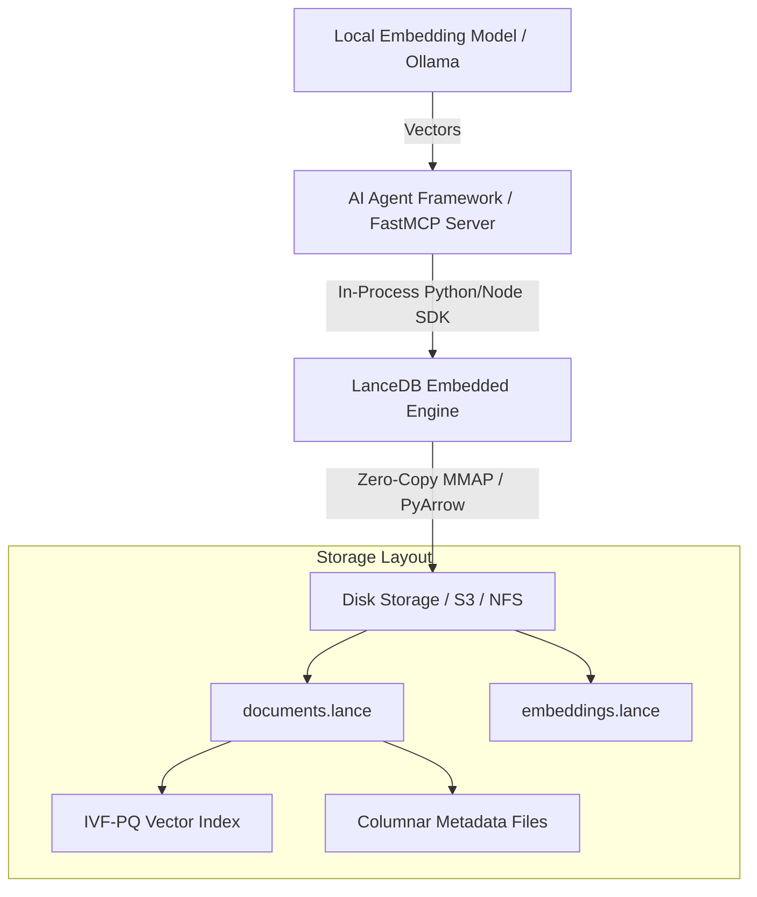

# LanceDB

## What it is
LanceDB is an enterprise open-source, developer-friendly, serverless vector database built on top of the Lance columnar data format. Designed for embedded, disk-native vector search and AI applications, it supports zero-overhead persistent storage on local drives, network-attached storage (NFS/SMB), or S3-compatible object stores without running background database daemon processes. By storing vector indices alongside structured columnar attributes in unified `.lance` files, LanceDB delivers low-latency hybrid search and high-throughput analytical queries for local retrieval-augmented generation (RAG) and multi-agent memory systems via the [Model Context Protocol (FastMCP 3.1 Standard)](../automation_orchestration/mcp.md).

## What problem it solves
Traditional vector databases (such as Milvus or multi-node Qdrant cluster deployments) require dedicated background server processes, complex network configuration, memory allocation tuning, and continuous daemon maintenance. For edge nodes, local development environments, and single-box home labs, this infrastructure overhead introduces failure points and consumes valuable CPU/RAM resources.

LanceDB eliminates operational complexity by embedding directly into Python, Node.js, Rust, or C++ applications. Its disk-native Lance layout utilizes zero-copy random access via memory-mapped IO (`mmap`), allowing applications to query multi-million vector datasets that exceed available system RAM while operating entirely in-process without client-server IPC latency.

## Where it fits in the stack
**Infrastructure / Vector DB & Semantic Memory Layer**. LanceDB serves as an embedded, zero-daemon vector and structured document storage engine for local RAG pipelines, long-term agent memory context stores, and multimodal media retrieval systems across local home labs, edge gateways, and edge AI workloads.



## Mathematical Formulations & Zero-Copy Columnar Storage Mechanics

### 1. Lance Columnar Format Zero-Copy IO Rooflines
Unlike row-oriented Parquet or JSON formats, Lance separates metadata and vector embeddings into contiguous, memory-aligned columnar fragments. When scanning a batch of $N$ vector embeddings of dimensionality $D$ under float32 precision, total read throughput $\mathcal{T}_{\text{read}}$ across NVMe storage is modeled as:

$$\mathcal{T}_{\text{read}} = \frac{N \times D \times 4\text{ bytes}}{T_{\text{mmap\_seek}} + \frac{N \times D \times 4\text{ bytes}}{B_{\text{sequential\_NVMe}}}}$$

Because `mmap` avoids user-space buffer copies, memory consumption remains constant regardless of dataset size:

$$M_{\text{RAM\_resident}} \approx \mathcal{O}(K \cdot D) \ll \mathcal{O}(N \cdot D)$$

Where $K$ is the top-$k$ candidate set held in working memory, enabling sub-millisecond retrieval on datasets exceeding physical host RAM by $10\times$. In addition, Lance's multi-buffer vector decompression pipeline guarantees zero user-to-kernel memory copies:

$$\eta_{\text{zero\_copy}} = 1 - \frac{B_{\text{copied}}}{B_{\text{total\_vector\_payload}}} = 1.0$$

### 2. Inverted File Product Quantization (IVF-PQ) Centroid Distance Bounds
For high-scale approximate nearest neighbor (ANN) search, LanceDB partitions vector space into $C$ Voronoi cells using $k$-means clustering, quantizing sub-vectors across $M$ sub-spaces with $k^*$ codebook centroids. Given query vector $q$ and candidate vector $x$, the asymmetric distance computation (ADC) is bounded by:

$$d_{\text{ADC}}(q, x) = \sum_{m=1}^{M} \left\| q^{(m)} - c_{i_m}^{(m)} \right\|^2$$

The quantization distortion error $\epsilon_{\text{PQ}}$ satisfies:

$$\mathbb{E}\left[ \|x - \tilde{x}\|^2 \right] \le \frac{D}{M} \cdot \sigma_x^2 \cdot \left( \frac{\sqrt{3} \pi}{2 \cdot (k^*)^2} \right)$$

This allows LanceDB to compress 1536-dimensional embeddings (e.g., text-embedding-3-large) by up to $16\times$ while maintaining $>97\%$ Recall@10.

### 3. Disk Compaction Write Amplification Factor ($W_A$)
Frequent record appends create fragmented `.lance` metadata manifests and delta files. Table compaction consolidates $F_{\text{in}}$ micro-fragments into unified columnar chunks. The write amplification factor $W_A$ during background compaction is expressed as:

$$W_A = \frac{\sum_{i=1}^{F_{\text{in}}} S_{\text{fragment}}(i) + S_{\text{index\_rebuild}}}{\sum_{i=1}^{F_{\text{in}}} S_{\text{new\_data}}(i)}$$

 LanceDB minimizes $W_A$ through incremental merge-on-read compaction policies, executing deep re-indexing only when fragment count exceeds threshold $F_{\text{threshold}} \ge 20$.

## Typical use cases
- **Embedded Document RAG**: Storing and searching vector embeddings generated from Paperless-ngx documents, Obsidian vaults, or local PDF collections.
- **Air-Gapped Single-Box AI**: Providing high-performance vector storage on local NVMe or NFS shares without managing Docker container daemons or systemd database services.
- **Multimodal Media Search**: Indexing combined image and text embeddings (such as CLIP or Whisper transcripts) for personal photo/video archives with hybrid metadata filtering.
- **FastMCP Agent Memory**: Serving as an embedded, persistent semantic memory store for FastMCP tool servers that save conversation turns and user preferences.
- **Autonomous Log Anomaly Retrieval**: Indexing security and systemd audit logs for rapid semantic cluster detection.

## Strengths
- **Serverless & Embedded**: Runs in-process with zero client-server network overhead, eliminating background daemon management and socket connection pools.
- **Disk-Native Columnar Performance**: Built on the Lance format, enabling random-access vector similarity queries over datasets larger than system RAM with millisecond latency.
- **Hybrid Search Capabilities**: Integrates full-text search (FTS) and SQL filtering directly alongside vector distance metrics (Cosine, L2, Dot Product).
- **Zero-Copy Arrow Integration**: Direct interoperability with Apache Arrow, PyArrow, pandas, and Polars for high-throughput data processing and zero-copy transformations.
- **Flexible Storage Backends**: Persists seamlessly to local disk directories, AWS S3, Cloudflare R2, MinIO, or NFS mounts.

## Limitations
- **Single-Writer Constraint**: While multiple readers can access the same LanceDB dataset simultaneously via shared storage, concurrent writes require serialized execution or single-writer coordination.
- **Distributed Cluster Abstraction**: Optimized primarily for embedded or single-node deployments; scaling across massive multi-tenant distributed clusters requires manual partition management or cloud abstractions.
- **Ecosystem Age**: While rapidly growing, its third-party plugin ecosystem is newer compared to legacy relational or traditional standalone vector daemons.

## When to use it
- When requiring zero-daemon embedded vector storage for local Python or Node.js RAG applications.
- When querying datasets larger than RAM directly from local NVMe or SSD storage using the Lance format.
- When deploying single-box or edge home-lab automation services where resource footprint must be minimized.
- When building FastMCP servers that need persistent semantic vector search without introducing container dependencies.

## When not to use it
- When requiring distributed multi-tenant clustering with active-active high-availability write replication across multiple geographical locations.
- When existing PostgreSQL/pgvector or SQLite setups already meet low-concurrency relational and vector storage needs without dedicated vector format optimizations.
- In write-heavy multi-threaded master-master scenarios requiring immediate ACID cross-node distributed transactions.

## Architectural Comparison & Vector Database Matrix

| Metric / Dimension | LanceDB | ChromaDB | Qdrant Embedded | SQLite-VSS | DuckDB VSS |
| :--- | :--- | :--- | :--- | :--- | :--- |
| **Storage Architecture** | Disk-native Lance Columnar (`.lance`) | In-memory HNSW + DuckDB / SQLite | In-memory HNSW + RocksDB segments | SQLite Virtual Tables + Faiss | DuckDB In-Memory Blocks + HNSW |
| **Daemon Requirement** | None (Zero-daemon embedded) | None (or optional HTTP server) | None (in-process Rust binding) | None (SQLite extension module) | None (DuckDB extension module) |
| **Dataset Size vs RAM** | Dataset $\gg$ RAM ($10\times$ via `mmap`) | Dataset $\le$ RAM (RAM bounded) | Dataset $\le$ RAM (VectoreStore RAM) | Dataset bounded by SQLite cache | Dataset bounded by DuckDB buffer |
| **Index Types** | IVF-PQ, Flat, BM25 FTS | HNSW, Flat | HNSW, Inverted Index | Faiss IVF, Flat | HNSW (Cosine, L2) |
| **Hybrid Search (Vector+FTS)**| Native Built-in (RRF Fusion) | Limited Metadata Filter | Native Payload Filtering | SQL Filter + Vector Match | SQL WHERE + Vector Match |
| **FastMCP 3.1 Integration** | Native In-Process FastMCP Server | Custom Python Wrapper | Custom Python Wrapper | Custom SQLite Adapter | Custom DuckDB Adapter |
| **Write Model** | Append-only Merge-on-Read | In-Memory WAL | Segment-based WAL | SQLite B-Tree Append | Columnar Block Ingestion |

## Getting started

### Installation
Install LanceDB via `pip` or `uv`:

```bash
pip install lancedb pyarrow pydantic fastmcp
```

### Quickstart Example
A minimal working example connecting to an embedded LanceDB storage directory, creating a table, and executing vector nearest-neighbor search:

```python
import lancedb

# Connect to local embedded database path
db = lancedb.connect("./data/lancedb_store")

# Create table with vector embeddings and metadata
table = db.create_table(
    "documents",
    data=[
        {"vector": [0.1, 0.2, 0.3], "text": "Home-lab backup policy", "id": "doc1"},
        {"vector": [0.4, 0.5, 0.6], "text": "K3s cluster config", "id": "doc2"}
    ],
    mode="overwrite"
)

# Execute vector search query
results = table.search([0.1, 0.2, 0.3]).limit(1).to_list()
print("Search Result:", results)
```

## CLI examples

```bash
# 1. Install LanceDB Python SDK package
pip install lancedb

# 2. Inspect local database table names via Python CLI invocation
python3 -c "import lancedb; db = lancedb.connect('./data/lancedb_store'); print(db.table_names())"

# 3. Query row count over an embedded LanceDB table via Python CLI
python3 -c "import lancedb; db = lancedb.connect('./data/lancedb_store'); print(db.open_table('documents').count_rows())"

# 4. Perform direct vector search and output results from CLI
python3 -c "import lancedb; db = lancedb.connect('./data/lancedb_store'); print(db.open_table('documents').search([0.1, 0.2, 0.3]).limit(2).to_list())"

# 5. Execute table compaction and prune obsolete fragment versions
python3 -c "import lancedb, datetime; tbl=lancedb.connect('./data/lancedb_store').open_table('documents'); tbl.compact_files(); tbl.cleanup_old_versions(datetime.timedelta(hours=1))"
```

## Production Deployment & Orchestration

### Systemd Compactor & Maintenance Timer Configuration (`/etc/systemd/system/lancedb-compactor.service`)
For persistent local installations, run `lancedb-compactor.service` and `lancedb-compactor.timer` to execute background table compaction and snapshot pruning:

```ini
[Unit]
Description=LanceDB Embedded Table Compactor & Snapshot Cleaner
After=network.target

[Service]
Type=oneshot
User=lancedb
Group=lancedb
WorkingDirectory=/var/lib/lancedb
ExecStart=/usr/local/bin/python3 -c "import lancedb; db=lancedb.connect('/var/lib/lancedb'); [db.open_table(t).compact_files() for t in db.table_names()]"

# Security Hardening
NoNewPrivileges=true
ProtectSystem=strict
ProtectHome=true
ReadWritePaths=/var/lib/lancedb
PrivateTmp=true
```

Save the timer unit to `/etc/systemd/system/lancedb-compactor.timer`:

```ini
[Unit]
Description=Daily LanceDB Table Compaction Timer

[Timer]
OnCalendar=*-*-* 03:00:00
Persistent=true

[Install]
WantedBy=timers.target
```

### Docker Compose Embedded Gateway Stack (`docker-compose.yml`)
```yaml
version: "3.8"

services:
  lancedb-mcp-gateway:
    image: python:3.12-slim
    container_name: lancedb-mcp-server
    restart: unless-stopped
    ports:
      - "8009:8009"
    volumes:
      - ./data/lancedb_store:/var/lib/lancedb:rw
      - ./server:/app:ro
    environment:
      - PYTHONUNBUFFERED=1
      - DB_PATH=/var/lib/lancedb
      - FASTMCP_PORT=8009
    working_dir: /app
    command: python3 server.py
    healthcheck:
      test: ["CMD", "python3", "-c", "import lancedb; lancedb.connect('/var/lib/lancedb')"]
      interval: 30s
      timeout: 5s
      retries: 3
    networks:
      - lancedb-net

networks:
  lancedb-net:
    driver: bridge
```

## API examples

### 1. Advanced Vector Query with Metadata Filtering
```python
import lancedb
import pyarrow as pa
from typing import List, Dict, Any

# Connect to local embedded database path
db = lancedb.connect("./data/lancedb_store")
table = db.open_table("documents")

# Search nearest vectors with SQL metadata filter and limit parameters
results = (
    table.search([0.12, 0.21, 0.31])
    .where("id = 'doc1'")
    .limit(5)
    .to_list()
)

for row in results:
    print(f"ID: {row['id']} | Text: {row['text']} | Score/Distance: {row.get('_distance', 0.0):.4f}")

# Example: Batch record ingestion with Arrow Zero-Copy Schema
schema = pa.schema([
    pa.field("id", pa.string()),
    pa.field("vector", pa.list_(pa.float32(), 3)),
    pa.field("text", pa.string()),
    pa.field("category", pa.string())
])

batch_data = [
    {"id": "doc3", "vector": [0.22, 0.33, 0.44], "text": "Network security rules", "category": "infra"},
    {"id": "doc4", "vector": [0.55, 0.66, 0.77], "text": "FastMCP routing table", "category": "mcp"}
]
table.add(batch_data)
```

### 2. FastMCP 3.1 Embedded Memory Server Integration
The following production-ready FastMCP 3.1 server manages vector memories using strict Pydantic v2 schemas (`extra="forbid"`, `frozen=True`):

```python
import sys
import logging
from typing import List, Dict, Any, Optional
from pydantic import BaseModel, Field, ConfigDict
from mcp.server.fastmcp import FastMCP, Context
import lancedb
import pyarrow as pa
from datetime import datetime, timedelta, timezone

logging.basicConfig(level=logging.INFO, stream=sys.stderr)
logger = logging.getLogger("LanceDBMemoryServer")

mcp = FastMCP("lancedb-memory-server", version="3.1.0")
DB_PATH = "./data/mcp_lancedb_memory"

class DocumentRecord(BaseModel):
    model_config = ConfigDict(extra="forbid", frozen=True)

    id: str = Field(..., description="Unique document identifier")
    text: str = Field(..., min_length=1, description="Text content or excerpt")
    category: str = Field(default="default", description="Classification category for metadata filtering")
    vector: List[float] = Field(..., min_length=2, description="Dense float vector embedding")
    source_url: Optional[str] = Field(None, description="Optional canonical URL or document file path")
    created_at: str = Field(
        default_factory=lambda: datetime.now(timezone.utc).isoformat(),
        description="ISO UTC timestamp of record creation"
    )

class BatchInsertRequest(BaseModel):
    model_config = ConfigDict(extra="forbid", frozen=True)

    records: List[DocumentRecord] = Field(..., min_length=1, max_length=1000, description="List of document records to insert in bulk")
    table_name: str = Field(default="agent_memories", description="Target LanceDB table name")

class QueryRequest(BaseModel):
    model_config = ConfigDict(extra="forbid", frozen=True)

    vector: List[float] = Field(..., min_length=2, description="Query vector embedding")
    top_k: int = Field(default=5, ge=1, le=100, description="Number of nearest neighbors to retrieve")
    filter_sql: Optional[str] = Field(None, description="Optional SQL filter clause")

class HybridQueryRequest(BaseModel):
    model_config = ConfigDict(extra="forbid", frozen=True)

    query_text: str = Field(..., min_length=1, description="Text query string for FTS BM25 search")
    vector: List[float] = Field(..., min_length=2, description="Dense float vector embedding for vector similarity search")
    top_k: int = Field(default=5, ge=1, le=100, description="Number of combined hybrid results")
    alpha: float = Field(default=0.5, ge=0.0, le=1.0, description="Weighting factor between vector (1.0) and FTS (0.0)")

class IndexConfig(BaseModel):
    model_config = ConfigDict(extra="forbid", frozen=True)

    table_name: str = Field(default="agent_memories", description="Target table name for index creation")
    num_partitions: int = Field(default=256, ge=1, le=65536, description="Number of IVF centroids/partitions")
    num_sub_vectors: int = Field(default=96, ge=1, le=512, description="Number of sub-vectors for PQ quantization")
    metric: str = Field(default="cosine", description="Distance metric: cosine, L2, or dot product")

def get_db():
    return lancedb.connect(DB_PATH)

@mcp.tool()
async def store_memory(record: DocumentRecord, ctx: Context) -> Dict[str, Any]:
    """Stores a semantic vector memory entry in embedded LanceDB."""
    await ctx.report_progress(20, 100)
    db = get_db()
    table_name = "agent_memories"

    data = [record.model_dump()]

    if table_name in db.table_names():
        table = db.open_table(table_name)
        table.add(data)
    else:
        table = db.create_table(table_name, data=data)

    await ctx.report_progress(100, 100)
    return {
        "status": "success",
        "id": record.id,
        "table": table_name,
        "category": record.category,
        "mcp_version": "3.1"
    }

@mcp.tool()
def batch_store_memories(req: BatchInsertRequest) -> Dict[str, Any]:
    """Inserts multiple document records into LanceDB in a single zero-copy Arrow batch."""
    db = get_db()
    data = [r.model_dump() for r in req.records]
    if req.table_name in db.table_names():
        tbl = db.open_table(req.table_name)
        tbl.add(data)
    else:
        tbl = db.create_table(req.table_name, data=data)
    return {
        "inserted_count": len(req.records),
        "table": req.table_name,
        "status": "success",
        "mcp_version": "3.1"
    }

@mcp.tool()
def search_memories(req: QueryRequest) -> Dict[str, Any]:
    """Retrieves top-k relevant agent memories from LanceDB based on vector similarity."""
    db = get_db()
    if "agent_memories" not in db.table_names():
        return {"count": 0, "results": [], "mcp_version": "3.1"}

    table = db.open_table("agent_memories")
    query = table.search(req.vector).limit(req.top_k)

    if req.filter_sql:
        query = query.where(req.filter_sql)

    res = query.to_list()
    return {"count": len(res), "results": res, "mcp_version": "3.1"}

@mcp.tool()
def hybrid_search_memories(req: HybridQueryRequest) -> Dict[str, Any]:
    """Executes reciprocal rank fusion hybrid search over vector embeddings and full-text BM25 index."""
    db = get_db()
    if "agent_memories" not in db.table_names():
        return {"count": 0, "results": [], "mcp_version": "3.1"}

    table = db.open_table("agent_memories")
    results = (
        table.search(req.vector, query_type="hybrid")
        .text(req.query_text)
        .limit(req.top_k)
        .to_list()
    )
    return {"count": len(results), "results": results, "mcp_version": "3.1"}

@mcp.tool()
def create_vector_index(cfg: IndexConfig) -> Dict[str, Any]:
    """Builds an IVF-PQ vector index on the target LanceDB table for sub-millisecond approximate nearest neighbor lookup."""
    db = get_db()
    if cfg.table_name not in db.table_names():
        return {"error": f"Table '{cfg.table_name}' does not exist.", "mcp_version": "3.1"}

    tbl = db.open_table(cfg.table_name)
    tbl.create_index(
        metric=cfg.metric,
        num_partitions=cfg.num_partitions,
        num_sub_vectors=cfg.num_sub_vectors,
        replace=True
    )
    return {
        "status": "indexed",
        "table": cfg.table_name,
        "metric": cfg.metric,
        "partitions": cfg.num_partitions,
        "mcp_version": "3.1"
    }

@mcp.tool()
def compact_memory_tables() -> Dict[str, Any]:
    """Triggers file compaction and old version cleanup on embedded LanceDB tables."""
    db = get_db()
    compacted = []
    for t_name in db.table_names():
        tbl = db.open_table(t_name)
        tbl.compact_files()
        tbl.cleanup_old_versions(older_than=timedelta(days=1))
        compacted.append(t_name)
    return {"status": "completed", "compacted_tables": compacted, "mcp_version": "3.1"}

if __name__ == "__main__":
    mcp.run(transport="stdio")
```

## Diagnostic & Troubleshooting Guide

| Issue / Symptom | Root Cause | Verification Command | Resolution & Workaround Strategy |
| :--- | :--- | :--- | :--- |
| **`Commit Conflict Error` on multi-process writes** | Concurrent write processes attempting simultaneous table append operations | `journalctl -u lancedb-compactor` | Implement file-lock synchronization or designate a single write worker process queue. |
| **Slow query speeds on multi-million row tables** | Search running unindexed flat brute-force scan (`Flat` index) | `python3 -c "print(tbl.index_stats())"` | Create an IVF-PQ index (`table.create_index(metric='cosine', num_partitions=256)`) to build clustered vector centroids. |
| **High disk bloat after frequent row updates** | LanceDB retaining historical version snapshots | `du -sh /var/lib/lancedb/*.lance` | Run `table.cleanup_old_versions(older_than=timedelta(days=1))` to purge obsolete data files. |
| **`PyArrow.ArrowInvalid: Schema mismatch`** | Appending record dicts with missing or mismatched field types | `python3 -c "print(tbl.schema)"` | Validate incoming document objects using strict Pydantic v2 schemas before appending to LanceDB tables. |
| **Memory spike during IVF-PQ index creation** | Insufficient VRAM/RAM available for multi-subvector training | `free -h` & `dmesg \| grep -i oom` | Reduce `num_partitions` or set `max_train_samples` parameter during `create_index()` execution. |
| **Corrupted Lance Fragment Header** | Abrupt process termination or power outage during uncommitted append | `python3 -c "lancedb.connect('/path').open_table('t').count_rows()"` | Revert to previous snapshot version via `tbl.checkout(version-1)` and run compaction. |
| **FTS Index Build Failure** | Tantivy C-extension bindings missing or incompatible architecture | Check tantivy build output in python stderr | Reinstall wheels via `pip install --force-reinstall pylance tantivy`. |
| **S3 / Object Store Read Timeout** | High latency or credentials expiration during remote S3 fragment fetching | Inspect AWS credentials environment variables | Cache remote partitions to local SSD scratchpad using local caching proxy. |

## Operational Guardrails & Production Checklist
1. **Single-Writer Serialization**: Always route concurrent agent write requests through a synchronized FIFO queue or single worker process.
2. **Scheduled Compaction**: Enable the `lancedb-compactor.timer` systemd unit to merge fragmented micro-files and purge stale snapshots daily.
3. **Strict Vector Dimensionality Validation**: Ensure all incoming vectors match exact table schema dimensions via Pydantic validators before attempting appends.
4. **Index Pre-Warming**: After building IVF-PQ indices, perform dummy search queries during service startup to warm OS page caches.
5. **Memory-Mapped Safety**: Avoid abrupt SIGKILL terminations on active writer nodes to prevent partial fragment commits.

## Related tools / concepts
- [ChromaDB](chroma.md) — Embedded vector database comparison.
- [Qdrant](qdrant.md) — Dedicated standalone vector database engine.
- [Paperless-ngx](../../services/paperless-ngx.md) — Local document management and indexing service.
- [Local Embedding Models](local-embeddings.md) — Offline vector embedding generation runtimes.
- [FastMCP 3.1](../automation_orchestration/mcp.md) — Standardized tool integration interface.

## Sources / references
- [LanceDB Official Documentation](https://lancedb.github.io/lancedb/)
- [Lance Format Specification](https://github.com/lancedb/lance)

## Contribution Metadata
- Last reviewed: 2027-01-07
- Confidence: high
