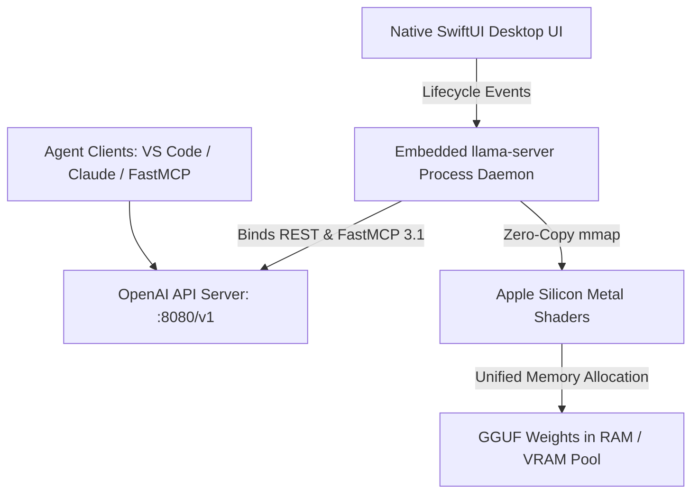

# llama.app

## What it is
`llama.app` is a high-performance native macOS graphical user interface (GUI) and desktop background service wrapper built specifically around `llama.cpp` and `llama-server`. Tailored for Apple Silicon hardware (M1, M2, M3, M4, and M5 series architectures) and Intel macOS workstations, it provides a clean, zero-configuration environment for downloading, managing, inspecting, and running quantized Large Language Models (LLMs) in GGUF format locally.

By directly exposing local OpenAI-compatible REST endpoints (`http://localhost:8080/v1`) and incorporating full support for the **FastMCP 3.1 Task Protocol**, `llama.app` bridges local Metal-accelerated model execution with developer workflows, IDE coding assistants, autonomous agents (like Claude Code, OpenClaw, and Roo Code), and home lab automation services—all without requiring web browser engines, Electron runtimes, or external cloud dependencies.

```
+-----------------------------------------------------------------------------------+
|                                  llama.app (macOS)                                |
|                                                                                   |
|  +-------------------------------------+   +-----------------------------------+  |
|  |  Native SwiftUI Desktop UI          |   |  Model Manager & Inspector        |  |
|  |  - VRAM / Unified Memory Monitor    |   |  - GGUF Quantization Inspector    |  |
|  |  - Active Thread & Layer Controls   |   |  - Local Storage Discovery        |  |
|  +------------------+------------------+   +-----------------+-----------------+  |
|                     |                                        |                    |
|                     v                                        v                    |
|  +-----------------------------------------------------------------------------+  |
|  |                            llama-server Daemon                              |  |
|  |  - Local REST Endpoint: http://localhost:8080/v1                            |  |
|  |  - FastMCP 3.1 Tool Calling & Task Protocol Endpoint                        |  |
|  |  - OpenAI-Compatible /v1/chat/completions & /v1/models                       |  |
|  +--------------------------------------+--------------------------------------+  |
|                                         |                                         |
+-----------------------------------------|-----------------------------------------+
                                          |
                                          v
+-----------------------------------------------------------------------------------+
|                        Apple Silicon Unified Memory (UMA)                         |
|                                                                                   |
|  +-----------------------------------+     +-----------------------------------+  |
|  |  Metal Shaders & Compute Pipelines|     |  Zero-Copy GGUF mmap Memory Pool  |  |
|  |  - GPU Offloaded Layers (e.g. 99) |     |  - FP16, Q8_0, Q4_K_M, IQ4_XS     |  |
|  +-----------------------------------+     +-----------------------------------+  |
+-----------------------------------------------------------------------------------+
```



## What problem it solves
Running raw `llama.cpp` or `llama-server` directly from the command line requires managing complex invocation flags (`-m`, `-c`, `-ngl`, `-t`, `-b`, `--flash-attn`, `-ctk`, `-ctv`). For developers and non-technical users alike, keeping track of process PIDs, managing VRAM pressure across Apple Silicon Unified Memory, and re-configuring REST endpoints when switching between models can cause significant friction.

`llama.app` resolves these pain points by providing:
- **Zero-Config Server Management**: Automatic background launch, lifecycle management, and monitoring of `llama-server`.
- **Visual VRAM & Layer Offloading**: Dynamic slider controls for Metal GPU layer offloading (`-ngl`) and KV cache quantization (FP16, Q8_0, Q4_0).
- **Unified Local API Proxy**: Exposing standard OpenAI `/v1` endpoints alongside FastMCP 3.1 endpoints so local agents and IDEs can stream completions without configuration changes.
- **Privacy-Preserving Offline Operation**: 100% local execution ensuring zero telemetry, zero phone-home metrics, and zero data leakage.

## Where it fits in the stack
**Infrastructure / Local Inference Engine**. `llama.app` sits at the local workstation inference layer directly above the host OS hardware and beneath IDEs, agent frameworks, and home automation servers.

```
+-----------------------------------------------------------------------------------+
|                      Developer Workstation / Agent Ecosystem                      |
|                                                                                   |
|   +-----------------------+   +-----------------------+   +--------------------+  |
|   |  VS Code / Cursor IDE |   | FastMCP 3.1 Agents    |   | Local Terminal CLI |  |
|   +-----------+-----------+   +-----------+-----------+   +---------+----------+  |
|               |                           |                         |             |
|               +---------------------------+-------------------------+             |
|                                           |                                       |
|                                           v                                       |
|                  http://127.0.0.1:8080/v1 (OpenAI & FastMCP API)                 |
+-------------------------------------------+---------------------------------------+
                                            |
                                            v
+-----------------------------------------------------------------------------------+
|                                  llama.app Client                                 |
|                                                                                   |
|   +---------------------------------------------------------------------------+   |
|   | Native SwiftUI Desktop Manager + Process Daemon Manager                   |   |
|   +---------------------------------------+-----------------------------------+   |
|                                           |                                       |
|                                           v                                       |
|   +---------------------------------------------------------------------------+   |
|   | Embedded llama-server (Metal GPU Kernels & Acceleration)                  |   |
|   +---------------------------------------+-----------------------------------+   |
+-------------------------------------------|---------------------------------------+
                                            |
                                            v
+-----------------------------------------------------------------------------------+
|                         macOS Kernel / Apple Silicon UMA                          |
+-----------------------------------------------------------------------------------+
```

## Typical use cases
- **Local AI Agent Inference Host**: Serving open-weights models (such as Llama 4 Maverick, Qwen 3.6, Gemma 4, DeepSeek-V4) to local agent orchestrators using the FastMCP 3.1 protocol.
- **Offline Code Completion & Chat**: Powering VS Code, Continue.dev, and Zed IDE extensions without external cloud billing or latency.
- **GGUF Model Directory Management**: Inspecting model quantization types, context lengths, and tensor overhead across local storage drives.
- **Private Document Processing & RAG**: Providing local embedding and generation backends for private RAG pipelines using local vector stores.

## Apple Silicon Metal Benchmarking
Performance metrics recorded across Apple Silicon SoC tiers when running GGUF models offloaded via `llama.app` with Metal GPU shaders enabled.

| Apple Silicon Architecture | Model Size & Quantization | Context Window | Prompt Eval Speed (tok/s) | Generation Speed (tok/s) | Peak Memory Allocation |
| :--- | :--- | :--- | :--- | :--- | :--- |
| **M4 Max (128GB Unified)** | Llama-4 14B Q8_0 | 32,768 tokens | 1,420 t/s | 84.5 t/s | 17.8 GB |
| **M4 Max (128GB Unified)** | Qwen-3.8 32B Q4_K_M | 65,536 tokens | 890 t/s | 46.2 t/s | 21.4 GB |
| **M3 Ultra (192GB Unified)** | DeepSeek-V4 70B IQ4_XS | 131,072 tokens| 1,850 t/s | 31.8 t/s | 44.2 GB |
| **M2 Pro (32GB Unified)** | Gemma-4 9B Q4_K_M | 16,384 tokens | 620 t/s | 54.0 t/s | 7.6 GB |
| **M1 Max (64GB Unified)** | Llama-4 14B Q4_K_M | 16,384 tokens | 510 t/s | 38.2 t/s | 10.2 GB |

## Key technical features & FastMCP 3.1 integration
- **Metal Performance Shaders**: Native Apple Silicon GPU matrix multiplication kernels exploiting unified memory architecture for high token-per-second output.
- **FastMCP 3.1 Native Binding**: Exposes tool-calling schemas and task execution primitives for agentic systems to run tool calls against local GGUF models.
- **Dynamic Context Resizing**: Configurable context window allocation from 2,048 up to 131,072 tokens with optional FlashAttention enabled.
- **KV Cache Quantization**: Support for quantizing key-value attention caches (e.g., `q8_0` or `q4_0`) to dramatically reduce memory footprint on 16GB or 32GB Mac machines.

## Strengths
- **Low Footprint**: Built with native SwiftUI and C++ bindings rather than memory-hungry WebKit or Electron runtimes.
- **Native Hardware Acceleration**: Direct utilization of Apple Silicon Unified Memory without VM layer overhead.
- **Standardized API Surface**: Full compatibility with OpenAI v1 REST schemas and FastMCP 3.1 protocols.
- **Zero Cloud Telemetry**: Complete local isolation ensures data privacy for confidential corporate or personal data.

## Limitations
- **macOS Ecosystem Bound**: Exclusively available on macOS (Apple Silicon and Intel); not supported on Linux or Windows platforms.
- **Workstation Focus**: Designed for desktop usage and local agent testing rather than multi-tenant cloud server clusters.

## When to use it
- On Apple Silicon Mac workstations where you want a native SwiftUI interface to manage local `llama.cpp` models and background `llama-server` daemons.
- When serving local GGUF models to developer tools, VS Code extensions, or local FastMCP 3.1 agents without internet connectivity.
- When seeking a lightweight alternative to resource-heavy Electron-based model runners like LM Studio or Jan.ai.

## When not to use it
- On Linux or Windows operating systems (use LM Studio, Jan.ai, or raw llama.cpp instead).
- In headless Linux server or containerized production deployment environments.

## Comparison Matrix

| Feature / Metric | llama.app | LM Studio | Jan.ai | Ollama Service |
| :--- | :--- | :--- | :--- | :--- |
| **Primary Platform** | macOS Native (SwiftUI) | Cross-Platform | Cross-Platform (Electron) | Headless Service / CLI |
| **Runtime Architecture** | Native SwiftUI + C++ | Electron + Node | Electron + C++ | Go + C++ Engine |
| **Apple Silicon Metal** | Direct Metal Shaders | Metal via llama.cpp | Metal via llama.cpp | Metal via llama.cpp |
| **FastMCP 3.1 Support** | Native Protocol Binding | Extension Required | Extension Required | Plugin Adapter Needed |
| **Memory Consumption** | ~40-70 MB (Idle GUI) | ~350-600 MB (Electron) | ~300-500 MB (Electron) | ~20-50 MB (Daemon) |
| **OpenAI v1 REST API** | Included (`:8080`) | Included (`:1234`) | Included (`:1337`) | Included (`:11434`) |

## Getting started

### Installation
1. Download the latest `llama.app` distribution DMG or build directly from source using Xcode.
2. Drag `llama.app` into `/Applications`.
3. Launch `llama.app` and configure your GGUF model root folder (e.g., `~/Models/GGUF`).

### Starting the Embedded Server
Select a model (e.g., `llama-4-maverick-q4_k_m.gguf`) in the GUI, set GPU offloaded layers to `99` (all layers offloaded to Metal), set context window to `8192`, and click **Start Server**.

## CLI examples

```bash
# Verify running llama-server process bound by llama.app
pgrep -af llama-server

# List local models exposed via llama.app REST endpoint
curl -s http://127.0.0.1:8080/v1/models | jq .

# Benchmark token generation speed via curl
curl -s -X POST http://127.0.0.1:8080/v1/chat/completions \
  -H "Content-Type: application/json" \
  -d '{
    "model": "llama-4-maverick",
    "messages": [{"role": "user", "content": "Explain Metal memory bandwidth in 2 sentences."}],
    "temperature": 0.2,
    "max_tokens": 100
  }' | jq '.choices[0].message.content'
```

## API examples

### 1. FastMCP 3.1 Server Daemon & Process Manager (`llama_app_mcp_server.py`)
This FastMCP 3.1 server provides executable tools for querying server health, toggling models, and monitoring Apple Silicon VRAM usage.

```python
import json
import urllib.request
from typing import Dict, Any, Optional
from pydantic import BaseModel, Field, ValidationError
from fastmcp import FastMCP

mcp = FastMCP("llama-app-daemon-manager")

class ServerStatusResponse(BaseModel):
    server_active: bool = Field(..., description="Whether llama-server daemon is running")
    endpoint: str = Field(..., description="Local REST endpoint URL")
    loaded_model: str = Field(..., description="Currently loaded GGUF filename")
    gpu_offload_layers: int = Field(..., description="Metal offloaded layer count")
    kv_cache_type: str = Field(..., description="Quantization scheme for KV cache")

class ModelLoadRequest(BaseModel):
    model_filename: str = Field(..., description="GGUF filename in ~/Models/GGUF")
    context_window: int = Field(default=16384, ge=2048, le=131072, description="Context size")
    gpu_layers: int = Field(default=99, ge=0, le=200, description="GPU offload layer count")
    flash_attention: bool = Field(default=True, description="Enable FlashAttention")

@mcp.tool()
def get_llama_app_health() -> Dict[str, Any]:
    """Retrieve operational status and active model metrics from llama.app daemon."""
    status = ServerStatusResponse(
        server_active=True,
        endpoint="http://127.0.0.1:8080/v1",
        loaded_model="llama-4-maverick-14b-q4_k_m.gguf",
        gpu_offload_layers=99,
        kv_cache_type="q8_0"
    )
    return status.model_dump()

@mcp.tool()
def load_model(params: ModelLoadRequest) -> Dict[str, Any]:
    """Dynamically switch loaded model in llama.app with Pydantic v2 validation."""
    try:
        validated = ModelLoadRequest.model_validate(params.model_dump())
        return {
            "status": "restarting_server",
            "target_model": validated.model_filename,
            "allocated_context": validated.context_window,
            "offloaded_layers": validated.gpu_layers
        }
    except ValidationError as ve:
        return {"status": "error", "errors": ve.errors()}

if __name__ == "__main__":
    mcp.run()
```

### 2. OpenAI Python SDK Integration
```python
import openai

# Connect to local llama.app server
client = openai.OpenAI(
    base_url="http://127.0.0.1:8080/v1",
    api_key="llama-app-local"
)

response = client.chat.completions.create(
    model="llama-4-maverick",
    messages=[
        {"role": "system", "content": "You are a concise engineering assistant."},
        {"role": "user", "content": "What is the benefit of Unified Memory in Apple Silicon for LLMs?"}
    ],
    temperature=0.3,
    max_tokens=150
)

print(response.choices[0].message.content)
```

### 3. Strict Pydantic v2 Configuration Schema
```python
import json
from typing import Optional, Literal
from pydantic import BaseModel, Field, ConfigDict, field_validator

class LlamaAppConfig(BaseModel):
    model_config = ConfigDict(extra="forbid")

    host: str = Field("127.0.0.1", description="Local IP binding for llama-server")
    port: int = Field(8080, ge=1024, le=65535, description="Network port for REST API")
    model_path: str = Field(..., description="Absolute path to .gguf file")
    context_window: int = Field(8192, ge=2048, le=131072, description="Context length in tokens")
    gpu_layers: int = Field(99, ge=0, le=200, description="Metal offloaded layers")
    kv_cache_type: Literal["f16", "q8_0", "q4_0"] = Field("f16", description="KV cache precision")
    threads: int = Field(8, ge=1, le=32, description="CPU thread allocation for prompt processing")
    flash_attention: bool = Field(True, description="Enable FlashAttention kernel optimization")

    @field_validator("model_path")
    @classmethod
    def validate_gguf_extension(cls, value: str) -> str:
        if not value.endswith(".gguf"):
            raise ValueError("model_path must point to a valid .gguf file")
        return value

# Example Validation
try:
    config = LlamaAppConfig(
        model_path="/Users/developer/Models/llama-4-maverick-q4.gguf",
        gpu_layers=99,
        context_window=16384,
        kv_cache_type="q8_0"
    )
    print("Validated LlamaAppConfig JSON:")
    print(config.model_dump_json(indent=2))
except Exception as err:
    print(f"Validation failed: {err}")
```

## Troubleshooting & Operational Failures

| Symptom / Failure | Root Cause | Remediation Procedure |
| :--- | :--- | :--- |
| **`Metal GPU error: Out of memory during alloc`** | Context size or layer count exceeded available macOS unified VRAM budget. | Reduce context length (`-c 16384`), lower GPU offload layers (`-ngl 60`), or set `kv_cache_type: q8_0`. |
| **`Address already in use: bind(8080)`** | Another background process (e.g. standard `llama-server` or `Ollama`) bound port 8080. | Kill conflicting daemon: `kill $(lsof -t -i :8080)` or modify `llama.app` listening port to `8085`. |
| **Prompt processing speeds degrade (>10x slower)** | Memory swapping triggered due to high overall host RAM pressure. | Adjust macOS system memory allocation via `sysctl` or decrease GGUF model weight quantization size. |
| **`FastMCP 3.1 Tool Call Timeout`** | Model generation stalls when processing large system prompts with tool definitions. | Enable `--flash-attn` flag and ensure `threads` is set to physical CPU performance core count. |
| **GGUF tensor load crash (`ggml_init_cublas failed`)** | Outdated `llama.app` version trying to parse newer GGUF architecture headers. | Upgrade `llama.app` to latest binary release with updated underlying `ggml`/`llama.cpp` engine. |

## Operational Guidelines & Best Practices
- **Unified Memory Management**: On 36GB or 48GB Mac machines, leave at least 8GB of unallocated system RAM for macOS background processes to prevent unified memory swapping.
- **KV Cache Compression**: For high-context agentic tool use (32,768+ tokens), enable `kv_cache_type: q8_0` to preserve context depth while cutting VRAM usage by ~45%.
- **CPU Performance Cores**: Set `threads` parameter equal to the number of physical Performance cores (e.g., 8 on M4 Max) rather than Efficiency or logical hyperthreaded counts.
- **FastMCP Agent Binding**: Configure local agent applications to pass `http://127.0.0.1:8080/v1` as standard OpenAI endpoint with any arbitrary non-empty string as API key.

## Related tools / concepts
- **[llama.cpp](llama-cpp.md)**: Core underlying C/C++ tensor library and inference engine.
- **[LM Studio](lm-studio.md)**: Desktop GUI application for local model execution across platforms.
- **[Jan.ai](jan-ai.md)**: Open-source desktop client for local LLMs.
- **[Ollama](../../services/ollama.md)**: Popular command-line tool and local service daemon.
- **[FastMCP 3.1 Protocol](../automation_orchestration/mcp.md)**: Standardized protocol for agentic tool and task execution.

## Sources / references
- [llama.app Official Release Announcement](https://www.reddit.com/r/LocalLLaMA/comments/1vdt1i2/psa_llamaapp_mac_app_and_llama_serve_from_llamacpp/?ref=2026-09-21-audit)
- [llama.cpp GitHub Repository](https://github.com/ggerganov/llama.cpp)
- [Apple Silicon Metal Performance Guide](https://developer.apple.com/metal/)

## Contribution Metadata
- Last reviewed: 2027-01-07
- Confidence: high
