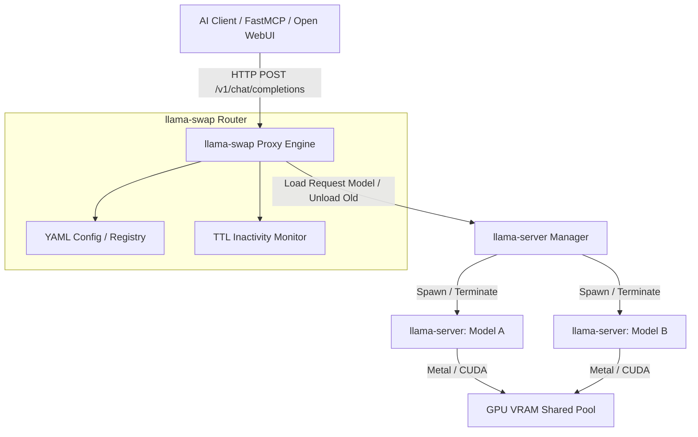

# llama-swap

## What it is
llama-swap is an open-source, lightweight model proxy and routing engine designed to dynamically hot-swap local GGUF models on demand behind a single OpenAI-compatible API endpoint. Built primarily for resource-constrained home labs, edge deployments, and developer workstations running `llama.cpp` backends, it automatically manages loading, serving, and unloading model processes based on incoming API request parameters.

By managing backend process lifecycles and isolating model loading from client API logic, llama-swap provides an intelligent abstraction layer for hosting multiple LLMs on consumer hardware without manual intervention.

## What problem it solves
Running multiple local LLMs concurrently requires significant VRAM or RAM, which quickly exhausts hardware capacity on consumer GPUs or single-board computers. Manually starting and stopping different model server instances creates operational friction, consumes admin effort, and breaks automated agent workflows that expect an always-available, unified API endpoint.

llama-swap solves this by transparently intercepting OpenAI-compatible API calls, inspecting the requested model parameter, gracefully unloading active models from GPU memory, and spinning up requested models dynamically—all without requiring manual server reconfiguration or breaking client connections.

## Architectural Overview

```
+-----------------------------------------------------------------------------------+
|                                 CLIENT LAYER                                      |
|   Open WebUI  /  Cursor IDE  /  FastMCP 3.1 Pipelines  /  LangChain / AutoGen    |
+-----------------------------------------------------------------------------------+
                                         |
                       HTTP POST /v1/chat/completions
                                         v
+-----------------------------------------------------------------------------------+
|                                 LLAMA-SWAP PROXY                                  |
|                                                                                   |
|  +--------------------+   +-----------------------+   +------------------------+  |
|  | Request Router     |   | Inactivity TTL Monitor|   | Model Registry Config  |  |
|  | - Intercept model  |-->| - Idle timer resets   |-->| - Ports & binary args  |  |
|  | - Match vs active  |   | - Auto SIGTERM on idle|   | - GGUF model paths     |  |
|  +--------------------+   +-----------------------+   +------------------------+  |
|            |                                                                      |
|            +-------------------+--------------------+                             |
|                                |                    |                             |
|                                v                    v                             |
|                     [Model Match Active?]     [Model Swap Needed]                 |
|                                |                    |                             |
|                        Direct Proxy Pass     1. Graceful SIGTERM old process       |
|                                              2. Wait for VRAM release             |
|                                              3. Spawn new llama-server binary     |
|                                              4. Buffer incoming HTTP requests     |
|                                              5. Forward payload to new backend    |
+-----------------------------------------------------------------------------------+
                                         |
                                         v
+-----------------------------------------------------------------------------------+
|                             BACKEND EXECUTION LAYER                               |
|                                                                                   |
|  +----------------------------------+     +------------------------------------+  |
|  | llama-server: Qwen-Coder (8081)    |     | llama-server: Llama-3-8B (8082)    |  |
|  | - GGUF model loaded in VRAM      |  OR | - GGUF model loaded in VRAM        |  |
|  | - Context: 8192, Flash Attention |     | - Context: 4096, Metal/CUDA        |  |
|  +----------------------------------+     +------------------------------------+  |
+-----------------------------------------------------------------------------------+
                                         |
                                         v
+-----------------------------------------------------------------------------------+
|                              SHARED HARDWARE POOL                                 |
|                          Single Consumer GPU / Metal VRAM                         |
+-----------------------------------------------------------------------------------+
```



## Where it fits in the stack
**Infrastructure / Model Routing & Serving**. llama-swap sits between AI clients, agents, and IDE extensions and underlying `llama.cpp` server backends, acting as a dynamic, VRAM-conscious proxy and process orchestration layer.

## Mathematical Formulations: VRAM Bounds, Swap Latency & Cache Eviction

Operating model hot-swapping efficiently requires balancing GPU memory ceilings and swap penalties.

### 1. VRAM Memory Allocation Bounds
Let $V_{\text{total}}$ represent the total physical VRAM available on the target GPU. For any requested model $m_k$, its required VRAM $V_{\text{req}}(m_k)$ is partitioned into weight parameters, KV cache allocation, and CUDA runtime context:

$$
V_{\text{req}}(m_k) = V_{\text{weights}}(m_k) + V_{\text{kv}}(c_{\text{ctx}}, b_{\text{batch}}, n_{\text{layers}}) + V_{\text{overhead}}
$$

Where $V_{\text{kv}} = 2 \times n_{\text{layers}} \times n_{\text{heads}} \times d_{\text{head}} \times c_{\text{ctx}} \times b_{\text{batch}} \times \text{precision\_bytes}$. llama-swap guarantees safe single-model execution by enforcing:

$$
V_{\text{req}}(m_k) \le V_{\text{total}} - V_{\text{reserve}}
$$

Where $V_{\text{reserve}}$ (typically 512 MB to 1 GB) prevents CUDA Out-Of-Memory (OOM) faults caused by runtime memory fragmentation.

### 2. Cold-Start Model Swap Latency Model
When a request triggers a model transition from $m_i \to m_j$, the total swap delay $T_{\text{swap}}$ is modeled as:

$$
T_{\text{swap}} = T_{\text{sigterm}}(m_i) + T_{\text{drain}} + T_{\text{mmap\_read}}(m_j) + T_{\text{gpu\_vram\_transfer}}(m_j) + T_{\text{health\_check}}
$$

Where:
- $T_{\text{mmap\_read}} = \frac{\text{FileSize}_{\text{GGUF}}}{B_{\text{disk\_throughput}}}$
- $T_{\text{gpu\_vram\_transfer}} = \frac{V_{\text{weights}}(m_j)}{B_{\text{PCIe\_throughput}}}$

With PCIe 4.0 x16 ($B_{\text{PCIe}} \approx 31.5 \text{ GB/s}$) and NVMe SSDs ($B_{\text{disk}} \approx 5.0 \text{ GB/s}$), loading an 8B Q4_K_M GGUF (~4.8 GB) incurs $T_{\text{swap}} \approx 1.2 - 2.5 \text{ seconds}$.

### 3. Least Recently Used (LRU) Inactivity Eviction Policy
To reclaim GPU memory automatically without disrupting active agent loops, llama-swap tracks time-since-last-request $\Delta t = t_{\text{current}} - t_{\text{last\_request}}$. Eviction is governed by the step decision function:

$$
E(m_k) = \begin{cases}
1 & \text{if } \Delta t > \tau_{\text{ttl}} \text{ and } Q_{\text{active}} = 0 \\
0 & \text{otherwise}
\end{cases}
$$

Where $\tau_{\text{ttl}}$ is the configured time-to-live threshold and $Q_{\text{active}}$ is the count of currently in-flight streaming requests.

## Feature & Operational Comparison

| Feature / Metric | llama-swap | Ollama | vLLM | LiteLLM |
| :--- | :--- | :--- | :--- | :--- |
| **Primary Target** | GGUF hot-swapping proxy | All-in-one local runner | High-throughput enterprise | API gateway & proxy |
| **Model Format** | Raw GGUF via `llama-server` | Custom Modelfiles / GGUF | Safetensors / PyTorch | Multi-provider HTTP |
| **Hot-Swapping Mechanism** | Process SIGTERM & spawn | Built-in VRAM unloader | Requires pre-allocated VRAM | Proxies to external |
| **Memory Footprint** | Minimal (~15MB Go proxy) | Medium (~300MB daemon) | High (Multi-GB framework) | Low-Medium (Python/Go) |
| **Startup Overhead** | Minimal (Direct binary start) | Medium (API layer abstraction) | High (CUDNN/TensorRT init) | Zero (Pure Proxy) |
| **Concurrency Strategy** | Request queuing during swap | Internal model queuing | Continuous batching | Client-side fan-out |
| **Configuration Style** | Declarative YAML | CLI / Modelfile | CLI / Python config | YAML proxy config |

## Typical use cases
- **Multi-Model Home Lab Serving**: Hosting specialized code-completion, reasoning, and conversational models on a single GPU without triggering VRAM out-of-memory errors.
- **OpenAI API Proxying**: Intercepting requests from tools like Open WebUI, LiteLLM, LibreChat, or Cursor to dynamically load target models on demand.
- **Automated Memory Reclamation**: Automatically unloading idle models after a configurable Time-To-Live (TTL) timeout to free system resources for other workloads.
- **Multi-Agent Orchestration**: Allowing multi-agent workflows (e.g. CrewAI, AutoGen, or FastMCP pipelines) to switch between different model sizes (7B, 14B, 32B) seamlessly.
- **Cost Reduction on Edge Hardware**: Eliminating the need to deploy multiple dedicated physical GPU nodes for distinct conversational and coding assistants.

## Strengths
- **VRAM & Hardware Optimization**: Maximizes memory efficiency by ensuring only active models reside in VRAM.
- **Drop-in OpenAI Compatibility**: Works seamlessly with standard OpenAI client SDKs, LangChain, LlamaIndex, and agent frameworks.
- **Zero-Downtime Configuration**: Allows dynamic model registry updates without restarting the proxy engine.
- **Resource Reclaim Automation**: Automatically unloads idle models after custom inactivity timeouts to conserve electricity and memory.
- **Transparent Request Buffering**: Queues incoming requests during model swaps to prevent client-side connection drops.

## Limitations
- **Load Latency Penalty**: Switching models introduces initial startup latency while loading multi-gigabyte GGUF weights into system/GPU memory.
- **Single-User / Low-Concurrency Focus**: Optimized for individual home labs, developer workstations, or small teams rather than multi-tenant high-throughput production clusters.
- **Process Management Dependencies**: Requires valid local executable paths for underlying `llama-server` or `llama.cpp` binaries.

## When to use it
- When operating home lab hardware with limited VRAM (e.g., 8GB–24GB GPUs) that cannot hold multiple models simultaneously.
- When agent workflows require access to specialized models (e.g., Qwen-Coder vs Llama-3) on demand.
- When requiring automatic idle model unloading to conserve power and VRAM.
- When seeking a unified OpenAI API endpoint for a collection of local GGUF models.

## When not to use it
- When running enterprise inference clusters where all models must remain warm with zero load latency.
- When using high-concurrency model servers like vLLM or TGI that manage continuous batching across shared multi-GPU setups.
- In distributed environments where models are distributed across separate physical worker nodes.

## Getting started

### Installation & Execution
To set up llama-swap on a home lab server:

```bash
# Install llama-swap CLI / binary via Go
go install github.com/sammcj/llama-swap@latest

# Start llama-swap with a configuration file
llama-swap --config config.yaml
```

### Configuration Example
Example `config.yaml`:
```yaml
port: 8080
ttl: 300 # Unload model after 5 minutes of inactivity
models:
  llama-3:
    cmd: "llama-server -m /models/llama-3-8b.gguf --port 8081 -ngl 99 -c 8192"
    port: 8081
  qwen-coder:
    cmd: "llama-server -m /models/qwen2.5-coder-7b.gguf --port 8082 -ngl 99 -c 8192"
    port: 8082
```

## CLI examples

```bash
# Check running llama-swap status and active model
llama-swap status

# Pre-warm a specific model endpoint via HTTP POST
curl -X POST http://localhost:8080/v1/models/llama-3/load

# Send a chat completion request that triggers automatic model swap
curl http://localhost:8080/v1/chat/completions \
  -H "Content-Type: application/json" \
  -d '{
    "model": "qwen-coder",
    "messages": [{"role": "user", "content": "Write a Python script to sort a list."}]
  }'
```

## Operational Best Practices & Troubleshooting

### Cold Start Latency Mitigation
When switching models, `llama-server` must map GGUF files into host RAM and load layer weights into GPU VRAM (using CUDA or Metal).
1. **mmap Optimization**: Ensure `--mmap` is enabled in `llama-server` arguments so OS page caching reduces subsequent reload delays.
2. **Layer Offloading (`-ngl`)**: Tune `-ngl` parameters per model in `config.yaml` to prevent fallback to slow CPU system memory.
3. **Pre-warming API**: Call `/v1/models/<name>/load` before starting agent execution phases to hide cold start latencies during workflow setup.

### Port Collision and Stale PID Cleanup
If `llama-swap` terminates abruptly, underlying child `llama-server` processes may continue holding backend ports.
```bash
# Inspect processes occupying llama-swap ports
lsof -i :8081 -i :8082

# Clean up orphaned llama-server processes
pkill -f llama-server
```

### VRAM Memory Fragmentation
Frequent hot-swapping on Linux NVIDIA systems can cause VRAM fragmentation or residual memory allocation delay.
- Configure `ttl` to at least 180–300 seconds to avoid unnecessary rapid cycle switching.
- Set environment variables `CUDA_MODULE_LOADING=LAZY` in the `llama-swap` systemd unit to minimize CUDA runtime initialization overhead.

## API examples

### 1. Pydantic v2 Schema for llama-swap Configuration & Status Validation
Enforce strict validation (`extra="forbid"`, `frozen=True`) for declarative model configuration and telemetry tracking:

```python
from typing import Dict, Optional, List, Literal
from pydantic import BaseModel, ConfigDict, Field

class ModelEndpointConfig(BaseModel):
    model_config = ConfigDict(extra="forbid", frozen=True)

    cmd: str = Field(..., description="Execution command for launching backend llama-server instance")
    port: int = Field(..., ge=1024, le=65535, description="Local port for the backend instance")
    args: Optional[List[str]] = Field(default_factory=list, description="Additional CLI arguments for llama-server")
    ttl_override: Optional[int] = Field(default=None, ge=0, description="Custom TTL override for specific model")

class LlamaSwapConfig(BaseModel):
    model_config = ConfigDict(extra="forbid", frozen=True)

    port: int = Field(default=8080, ge=1024, le=65535, description="Proxy listening port")
    ttl_seconds: int = Field(default=300, ge=0, description="Idle timeout before unloading model")
    models: Dict[str, ModelEndpointConfig] = Field(..., description="Registry of available models")

class ModelSwapStatus(BaseModel):
    model_config = ConfigDict(extra="forbid", frozen=True)

    active_model: Optional[str] = Field(default=None, description="Currently loaded model name in VRAM")
    status: Literal["idle", "loading", "ready", "error"] = Field(..., description="State of the model server")
    uptime_seconds: int = Field(default=0, ge=0, description="Seconds active model has been loaded")
    port: Optional[int] = Field(default=None, description="Active backend port")

if __name__ == "__main__":
    cfg = LlamaSwapConfig(
        port=8080,
        ttl_seconds=300,
        models={
            "qwen-coder": ModelEndpointConfig(
                cmd="llama-server -m /models/qwen2.5-coder.gguf --port 8081",
                port=8081,
                args=["-c", "8192", "-ngl", "99"]
            ),
            "llama-3": ModelEndpointConfig(
                cmd="llama-server -m /models/llama-3-8b.gguf --port 8082",
                port=8082,
                args=["-c", "4096", "-ngl", "99"]
            )
        }
    )
    status = ModelSwapStatus(active_model="qwen-coder", status="ready", uptime_seconds=142, port=8081)
    print(f"llama-swap configured on port {cfg.port} with {len(cfg.models)} model(s). Active: {status.active_model}")
    print("Serialized Config:\n", cfg.model_dump_json(indent=2))
```

### 2. FastMCP 3.1 Task Protocol Integration
Exposing dynamic model hot-swapping and status monitoring directly into MCP agent pipelines:

```python
from typing import Dict, Any
from mcp.server.fastmcp import FastMCP
import urllib.request
import json

mcp = FastMCP("llama-swap-manager", version="3.1.0")

PROXY_URL = "http://localhost:8080"

@mcp.tool()
def swap_model(model_name: str) -> Dict[str, Any]:
    """Pre-loads or swaps target GGUF model via llama-swap proxy endpoint."""
    url = f"{PROXY_URL}/v1/models/{model_name}/load"
    req = urllib.request.Request(url, method="POST")
    try:
        with urllib.request.urlopen(req, timeout=60) as resp:
            data = json.loads(resp.read().decode("utf-8"))
            return {"status": "success", "requested_model": model_name, "details": data}
    except Exception as e:
        return {"status": "error", "message": str(e)}

@mcp.tool()
def get_proxy_status() -> Dict[str, Any]:
    """Queries current status and loaded model in llama-swap proxy."""
    url = f"{PROXY_URL}/status"
    try:
        with urllib.request.urlopen(url, timeout=10) as resp:
            data = json.loads(resp.read().decode("utf-8"))
            return {"status": "success", "info": data}
    except Exception as e:
        return {"status": "error", "message": str(e)}

@mcp.tool()
def unload_current_model() -> Dict[str, Any]:
    """Forces unloading of currently active model from GPU VRAM."""
    url = f"{PROXY_URL}/v1/models/unload"
    req = urllib.request.Request(url, method="POST")
    try:
        with urllib.request.urlopen(req, timeout=15) as resp:
            data = json.loads(resp.read().decode("utf-8"))
            return {"status": "success", "unloaded": True, "details": data}
    except Exception as e:
        return {"status": "error", "message": str(e)}

if __name__ == "__main__":
    mcp.run()
```

## Systemd Service Unit Configuration

Manage the llama-swap routing proxy as a reliable Linux system daemon (`/etc/systemd/system/llama-swap.service`):

```ini
[Unit]
Description=llama-swap Dynamic GGUF Model Proxy Service
After=network.target local-fs.target
Wants=local-fs.target

[Service]
Type=simple
User=llmrunner
Group=ai-infrastructure
WorkingDirectory=/opt/llama-swap
Environment="PATH=/usr/local/bin:/usr/bin:/bin"
Environment="CUDA_MODULE_LOADING=LAZY"
ExecStart=/usr/local/bin/llama-swap --config /etc/llama-swap/config.yaml
ExecReload=/bin/kill -HUP $MAINPID
Restart=always
RestartSec=5s
LimitNOFILE=65536
LimitMEMLOCK=infinity
KillMode=mixed
TimeoutStopSec=30s

[Install]
WantedBy=multi-user.target
```

## Docker Compose Multi-Container Stack

Serve multiple GGUF backends with llama-swap proxy and health monitoring:

```yaml
version: "3.8"

services:
  llama-swap:
    image: ghcr.io/sammcj/llama-swap:latest
    container_name: llama_swap_proxy
    ports:
      - "8080:8080"
    volumes:
      - ./config.yaml:/etc/llama-swap/config.yaml:ro
      - /models:/models:ro
      - /var/run/docker.sock:/var/run/docker.sock
    environment:
      - LLAMA_SWAP_CONFIG=/etc/llama-swap/config.yaml
    restart: unless-stopped
    healthcheck:
      test: ["CMD", "curl", "-f", "http://localhost:8080/status"]
      interval: 15s
      timeout: 5s
      retries: 3

  model-cache-cleaner:
    image: alpine:latest
    container_name: llama_cache_monitor
    command: >
      sh -c "while true; do
        sync && echo 3 > /proc/sys/vm/drop_caches 2>/dev/null || true;
        sleep 3600;
      done"
    restart: unless-stopped
```

## Systematic Diagnostic & Troubleshooting Matrix

| Issue / Symptom | Root Cause | Diagnostic & Resolution Strategy |
| :--- | :--- | :--- |
| **CUDA Out of Memory (OOM) during Swap** | Prior `llama-server` process did not release VRAM before new process spawned. | Verify SIGTERM propagation in proxy logs. Add `sleep 2` or check `nvidia-smi` to ensure memory clears before spawning next binary. |
| **Port Address Already in Use (EADDRINUSE)** | Zombie `llama-server` PID holding designated port (e.g. 8081). | Run `lsof -i :8081` and execute `kill -9 <PID>`. Configure unique non-overlapping ports per model definition in `config.yaml`. |
| **Client HTTP Timeout during First Request** | Large model (32B/70B) cold load takes longer than client socket timeout. | Increase client-side timeout in Open WebUI/FastMCP to $\ge 120$s. Pre-warm model using `/v1/models/<name>/load`. |
| **Failed to mmap GGUF Weights** | File system permissions or missing OS memory lock capability (`mlock`). | Verify file readability with `ls -lh /models`. Ensure user is in `ai-infrastructure` group and set `LimitMEMLOCK=infinity`. |
| **High CPU Usage with Low GPU Utilization** | Missing `-ngl 99` flag in `cmd`, causing layers to run on host CPU instead of CUDA/Metal. | Inspect model invocation string in `config.yaml` to confirm `-ngl` (number of GPU layers) is passed. |
| **Model Fails to Unload after Inactivity** | Persistent HTTP keep-alive connections or active SSE streams keeping $Q_{\text{active}} > 0$. | Ensure clients close inactive SSE event streams. Decrease `ttl` in `config.yaml` to force clean shutdown. |
| **Corrupted GGUF Format Error** | Incomplete download or incompatible GGUF file quantization version. | Re-validate SHA256 checksum of GGUF file and confirm `llama-server --version` matches model architecture. |
| **404 Not Found on Requested Model** | Model string mismatch between client request and `config.yaml` key. | Query `curl http://localhost:8080/v1/models` to inspect exact registered model IDs and align client prompts. |

## Related tools / concepts
- [llama.cpp](llama-cpp.md) — Core backend execution engine for GGUF models.
- [Ollama](../../services/ollama.md) — Alternative local model runner with built-in model management.
- [Model Routing Guide](../../knowledge_base/model_routing_guide.md) — Architectural patterns for local model routing.
- [LM Studio](lm-studio.md) — Cross-platform desktop local inference application.
- [vLLM](vllm.md) — High-throughput continuous batching inference server.
- [ExLlamaV3](exllamav3.md) — High-performance quantized inference backend for modern GPUs.

## Sources / references
- [llama-swap GitHub Repository](https://github.com/sammcj/llama-swap)
- [llama.cpp Server Documentation](https://github.com/ggerganov/llama.cpp/tree/master/examples/server)
- [GGUF Specification Guide](https://github.com/ggerganov/ggml/blob/master/docs/gguf.md)

---
## Contribution Metadata
- Last reviewed: 2027-01-07
- Confidence: high
