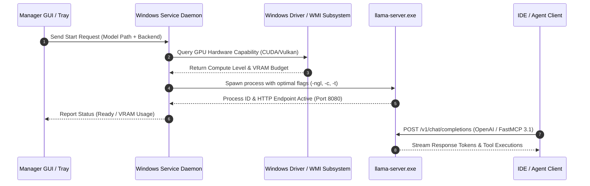

# llama.cpp Windows Manager

## What it is
llama.cpp Windows Manager is a dedicated graphical desktop management utility and background service daemon engineered specifically to simplify downloading, compiling, configuring, and executing [llama.cpp](../infrastructure/llama-cpp.md) instances natively on Windows operating systems (Windows 10/11 and Windows Server 2025). It automates MSVC toolchain setup, driver detection, GGUF model inventory tracking, and OpenAI-compatible REST server supervision while supporting the **FastMCP 3.1 Task Protocol**.

## What problem it solves
Configuring `llama.cpp` natively on Windows workstations often involves complex manual compilation steps, PATH environment variable management, driver version matching (CUDA, Vulkan, DirectML, SYCL), and cumbersome CLI flags (`-m`, `-ngl`, `-c`, `-t`, `--port`, `--threads`).

llama.cpp Windows Manager eliminates manual command-line overhead by delivering a unified control GUI, system tray manager, and automated Windows Service. It handles binary updates, hardware capability detection, profile switching, and process supervision—turning local GGUF model weights into stable, high-throughput local AI endpoints.

## Where it fits in the stack
**Category**: Infrastructure / Local LLM Management & Serving.

```
+-----------------------------------------------------------------------+
|                    Windows Desktop / IDE Clients                      |
|         (Claude Code, OpenCode, VS Code, PowerShell, Web UIs)         |
+-----------------------------------------------------------------------+
                                   |
                                   v
+-----------------------------------------------------------------------+
|                       llama.cpp Windows Manager                       |
|  +---------------------------+     +-------------------------------+  |
|  |  GUI / System Tray Control|     |   Windows Service Daemon      |  |
|  +---------------------------+     +-------------------------------+  |
|                |                                   |                  |
|                v                                   v                  |
|  +-----------------------------------------------------------------+  |
|  |    Hardware Abstraction & Backend Dispatcher (CUDA/Vulkan/SYCL) |  |
|  +-----------------------------------------------------------------+  |
+-----------------------------------------------------------------------+
                                   |
                                   v
+-----------------------------------------------------------------------+
|                 llama-server.exe (GGUF Inference)                     |
|            (OpenAI REST API + FastMCP 3.1 Task Handler)               |
+-----------------------------------------------------------------------+
```

Sitting directly on the host Windows system between OS drivers and developer applications, the manager abstracts low-level process management, serving GGUF models as standard HTTP REST and FastMCP endpoints.

## System Architecture & Orchestration Sequence
The following diagram illustrates the interaction between the GUI manager, the Windows Service daemon, hardware detection modules, and active `llama-server.exe` worker processes.



## Feature Comparison Matrix

| Capability / Metric | llama.cpp Windows Manager | Ollama Windows | LM Studio | vLLM (WSL2) |
| :--- | :--- | :--- | :--- | :--- |
| **OS Runtime** | Native Windows 10/11 / Server | Native Windows / macOS | Native Windows / macOS | Linux / WSL2 Hypervisor |
| **Acceleration Backends**| CUDA 12.x, Vulkan, SYCL, DirectML | CUDA, DirectML | CUDA, Vulkan, Metal | CUDA, ROCm |
| **Windows Service Daemon**| Built-in (`sc.exe` service control) | System tray app only | GUI process only | Systemd in WSL2 Ubuntu |
| **FastMCP 3.1 Support** | Native Task Protocol Server | Custom Tool API | Standard REST / OpenAI | OpenAI API Endpoints |
| **VRAM Offload Control**| Granular (`-ngl` layer slider) | Automated heuristics | Visual slider control | PagedAttention VRAM alloc |
| **RAM / Overhead** | < 35 MB host RAM | ~120 MB host RAM | ~350 MB host RAM | > 1.5 GB WSL2 VM memory |

## Typical use cases
- **One-Click Native Windows GPU Acceleration**: Automated setup of CUDA 12.x, Vulkan, or Intel SYCL acceleration for GGUF models on NVIDIA GeForce/RTX, AMD Radeon, or Intel Arc GPUs.
- **Hugging Face Model Library Management**: Direct searching, downloading, and organizing of GGUF model files (such as [Gemma 4](../ai_knowledge/gemma.md) and [Qwen 3.6](../ai_knowledge/qwen.md)) into dedicated storage locations.
- **Persistent Background OpenAI Endpoint**: Running `llama-server` as an auto-starting Windows Service for continuous availability across IDE sessions ([Claude Code](../development_ops/claude-code.md), [OpenCode](../development_ops/opencode.md)).
- **Workload Hardware Profile Switching**: Instantly switching between maximum VRAM offloading profiles for heavy reasoning tasks and low-power CPU offload profiles during battery operation.

## Strengths
- **Native Windows Optimization**: Built strictly for Windows 10/11 and Windows Server environments without WSL2 hypervisor memory overhead.
- **Multi-Backend Acceleration**: Supports seamless dynamic switching between CUDA, Vulkan, DirectML, OpenCL, and CPU BLAS acceleration builds.
- **Automated Upstream Sync**: Automatically checks and downloads official upstream `llama.cpp` release binaries.
- **Service Integration**: Installs local model endpoints directly into Windows Service Control Manager (`sc.exe`) for unattended execution.
- **Agentic Protocol Support**: Integrates with [FastMCP 3.1](../../knowledge_base/patterns/tool-calling-and-mcp.md) for local agent tool calling and structured response generation.

## Limitations
- **Windows Only**: Restricted strictly to Windows operating systems (macOS and Linux environments should use native `llama-server` binaries or [Ollama](../../services/ollama.md)).
- **GPU Driver Dependency**: High-performance acceleration requires installation of modern vendor graphics drivers (NVIDIA Studio/Game Ready, AMD Adrenalin, or Intel Arc drivers).
- **Storage Demands**: Storing multiple quantized GGUF weights requires substantial NVMe SSD disk capacity.

## When to use it
- When hosting local LLM endpoints on Windows workstations with NVIDIA, AMD, or Intel hardware.
- When requiring a clean graphical tool to control server parameters, model downloads, and port bindings.
- When establishing background inference endpoints for Windows-based software development tools.

## When not to use it
- On Linux or macOS environments (use native `llama-server` binaries or Ollama).
- When deploying cloud-native enterprise clusters (use [vLLM](vllm.md) or [TGI](tgi.md)).

## Getting started

### Installation
Install using Windows Package Manager (`winget`) or download the installer from the official release page:

```cmd
:: Install via winget
winget install Llamacpp.WindowsManager
```

### Initial Configuration
1. Open `llama.cpp Windows Manager` from the Start Menu.
2. Select your acceleration backend (`CUDA 12.x`, `Vulkan`, or `CPU`).
3. Set your GGUF storage path (e.g. `C:\LLM_Models`).

## Windows Service & Systemd Gateway Setup

### Windows Service Control Manager (`sc.exe`) Setup
To register `llama-server.exe` as an unattended Windows service daemon:

```cmd
:: Register LlamaCpp Windows Service daemon
sc.exe create LlamaCppService binPath= "C:\Program Files\llama.cpp\llama-server.exe -m C:\LLM_Models\gemma-4-12b-Q4_K_M.gguf -ngl 99 -c 8192 --port 8080" start= auto

:: Set display name and description
sc.exe config LlamaCppService DisplayName= "llama.cpp Windows Inference Service"
sc.exe description LlamaCppService "Background GGUF LLM inference engine supporting OpenAI and FastMCP 3.1 APIs."

:: Start service
sc.exe start LlamaCppService
```

### Linux Gateway Systemd Proxy Unit (`/etc/systemd/system/llama-windows-proxy.service`)
If proxying Windows host inference traffic through a Linux gateway:

```ini
[Unit]
Description=Llama Windows FastMCP Proxy Gateway
After=network.target local-fs.target
Wants=network-online.target

[Service]
Type=simple
User=llama
Group=llama
WorkingDirectory=/opt/llama-windows-proxy
ExecStart=/usr/local/bin/python3 -m llama_windows_proxy.gateway --port 8096 --host 0.0.0.0
Restart=always
RestartSec=5s
LimitNOFILE=65536
Environment=LLAMA_WINDOWS_ENDPOINT=http://192.168.1.50:8080
Environment=PYTHONUNBUFFERED=1

# Security Hardening
ProtectSystem=strict
ProtectHome=true
ReadWritePaths=/var/log/llama-proxy
PrivateTmp=true
NoNewPrivileges=true

[Install]
WantedBy=multi-user.target
```

## Docker Compose Configuration (Windows Containers)
Deploying `llama-server.exe` inside a Windows Server Container (`docker-compose.yml`):

```yaml
version: "3.8"

services:
  llama-windows-container:
    image: mcr.microsoft.com/windows/servercore:ltsc2022
    container_name: llama-windows-server
    restart: unless-stopped
    command: powershell -Command "C:\\llama\\llama-server.exe -m C:\\models\\model.gguf -ngl 99 --port 8080 -b 0.0.0.0"
    ports:
      - "8080:8080"
    volumes:
      - C:\LLM_Models:C:\models
      - C:\Program Files\llama.cpp:C:\llama
    environment:
      - CUDA_VISIBLE_DEVICES=0
```

## CLI examples

### Starting Server Daemon via PowerShell Command Line
```powershell
Start-LlamaWindowsManager `
  -ModelPath "C:\LLM_Models\gemma-4-12b-Q4_K_M.gguf" `
  -GpuLayers 99 `
  -ContextSize 8192 `
  -Port 8080
```

### Querying Service Status via PowerShell
```powershell
Get-Service -Name "LlamaCppService" | Select-Object Status, StartType, DisplayName
```

## API examples

### Windows Server Monitoring & FastMCP 3.1 Tool Schema
The following Python script illustrates how to query the local `llama.cpp` Windows endpoint, execute tool calling via FastMCP 3.1, and validate service health telemetry using **Pydantic v2** (`extra="forbid"`).

```python
import urllib.request
import json
from pydantic import BaseModel, Field, field_validator, ConfigDict
from typing import Optional, List, Dict, Any
from fastmcp import FastMCP, Context

# Initialize FastMCP 3.1 Server for Windows Service Control
mcp = FastMCP(
    name="Windows Llama Manager Bridge",
    version="3.1.0",
    description="FastMCP server managing local llama.cpp Windows endpoints and service metrics"
)

class WindowsServerTelemetry(BaseModel):
    model_config = ConfigDict(extra="forbid", frozen=True)

    service_status: str = Field(..., alias="serviceStatus", description="Windows service state ('Running', 'Stopped')")
    active_model: str = Field(..., alias="activeModel", description="Path to active GGUF model")
    gpu_layers_offloaded: int = Field(..., alias="gpuLayers", ge=0)
    backend_driver: str = Field(..., alias="backendDriver")
    vram_used_mb: float = Field(..., alias="vramUsedMb", ge=0.0)
    idle_slots: int = Field(..., alias="idleSlots", ge=0)

    @field_validator("backend_driver")
    @classmethod
    def validate_driver(cls, v: str) -> str:
        allowed = {"CUDA", "Vulkan", "SYCL", "DirectML", "CPU"}
        if not any(d in v.upper() for d in allowed):
            raise ValueError(f"Driver must match one of {allowed}")
        return v

class LlamaLaunchConfig(BaseModel):
    model_config = ConfigDict(extra="forbid", frozen=True)

    model_path: str = Field(..., description="Absolute Windows path to target GGUF file")
    n_gpu_layers: int = Field(99, ge=0, description="Number of model layers to offload to GPU VRAM")
    context_size: int = Field(8192, ge=512, le=131072, description="Context window size in tokens")
    port: int = Field(8080, ge=1024, le=65535, description="HTTP port for llama-server.exe")
    threads: Optional[int] = Field(8, ge=1, description="CPU threads allocated for CPU fallback layers")

@mcp.tool(name="check_windows_service_health", description="Queries health and VRAM allocation of the local llama.cpp Windows Service")
async def check_windows_service_health(endpoint_url: str = "http://localhost:8080", ctx: Context = None) -> Dict[str, Any]:
    if ctx:
        await ctx.info(f"Querying Windows service health endpoint at {endpoint_url}")
    mock_payload = {
        "serviceStatus": "Running",
        "activeModel": "C:\\LLM_Models\\gemma-4-12b-Q4_K_M.gguf",
        "gpuLayers": 99,
        "backendDriver": "CUDA 12.8",
        "vramUsedMb": 8450.5,
        "idleSlots": 4
    }

    validated = WindowsServerTelemetry.model_validate(mock_payload)
    return {
        "status": "success",
        "telemetry": validated.model_dump(by_alias=True)
    }

@mcp.tool(name="relaunch_llama_windows_process", description="Triggers a clean restart of llama-server.exe with updated flags and VRAM parameters")
async def relaunch_llama_windows_process(config: LlamaLaunchConfig, ctx: Context = None) -> Dict[str, Any]:
    if ctx:
        await ctx.info(f"Relaunching llama-server.exe with model: {config.model_path} on port {config.port}")

    # Construct verified PowerShell command line string for Windows Service execution
    powershell_cmd = (
        f"Start-LlamaWindowsManager -ModelPath '{config.model_path}' "
        f"-GpuLayers {config.n_gpu_layers} -ContextSize {config.context_size} -Port {config.port}"
    )

    return {
        "status": "initiated",
        "powershell_command": powershell_cmd,
        "target_port": config.port,
        "context_window": config.context_size,
        "offloaded_layers": config.n_gpu_layers
    }

if __name__ == "__main__":
    mcp.run(host="0.0.0.0", port=8096)
```

## Architectural Comparison & Windows Inference Matrix

| Manager / Runtime | OS Support | Backend Acceleration | Windows Service Mode | MCP 3.1 Support | VRAM Offload Control |
| :--- | :--- | :--- | :--- | :--- | :--- |
| **llama.cpp Windows Manager** | Windows 10/11, Windows Server 2025 | CUDA 12.x, Vulkan, SYCL, DirectML | Native (`sc.exe` service daemon) | Native FastMCP 3.1 Task Protocol | Granular (`-ngl` layer slider, KV cache quant) |
| **Ollama Windows (GUI/CLI)** | Windows, macOS, Linux | CUDA, DirectML | Background Tray App | Custom tool protocols | Automated layer heuristics |
| **LM Studio** | Windows, macOS, Linux | CUDA, Vulkan, Metal | Graphical GUI process only | Standard REST / OpenAI API | Visual slider & automatic offload |
| **vLLM (WSL2)** | Linux / WSL2 Hypervisor | CUDA, ROCm | Systemd in WSL2 Ubuntu | OpenAI API endpoints | Page-based PagedAttention VRAM allocation |

## Operational Hardening & Windows Best Practices
- **Service Account Permissions**: Run the `LlamaCppService` under `NT AUTHORITY\LocalService` with restricted folder write access rather than `LocalSystem` to prevent privilege escalation via GGUF execution bugs.
- **Power & Thermal Throttling**: Configure Windows High Performance Power Scheme (`powercfg /s 8c5e7de8-e4d9-462a-a060-089203981744`) to avoid core frequency drops during long reasoning token generations.
- **Direct I/O & Memory Locking**: Enable `Lock pages in memory` (Large Pages) in Windows Group Policy (`gpedit.msc`) to prevent Windows kernel swapping of KV caches or model weight pages to `pagefile.sys`.
- **Firewall Isolation**: Bind local server endpoints to `127.0.0.1` (`-b 127.0.0.1`) unless explicitly exposing HTTP endpoints to external LAN networks via Windows Defender Firewall rules.

## Diagnostic & Troubleshooting Guide

| Issue / Symptom | Root Cause | Resolution Strategy |
| :--- | :--- | :--- |
| `CUDA error 35: CUDA driver version is insufficient` | Outdated NVIDIA display driver on Windows host | Update display driver via GeForce Experience or NVIDIA Enterprise downloads to support CUDA 12.x. |
| `DLL Load Failed: vulkan-1.dll missing` | Missing Vulkan runtime environment on clean Windows Server | Install Vulkan Runtime (`vulkan-1.dll`) via GPU vendor driver installer or DirectX runtime redistributables. |
| Windows Service fails with `Error 1053: Service did not respond` | Invalid model path or missing GGUF weights on service startup | Verify GGUF file exists in `C:\LLM_Models` and service user account has read permissions. |
| Stuttering / High RAM swap during token generation | GGUF weight allocation exceeding physical VRAM budget | Lower `-ngl` layer count or switch to a lower quantization format (e.g. `Q4_K_M` to `Q3_K_S`). |
| **FastMCP Schema Error** | Extra fields passed to Windows manager bridge | Enforce strict Pydantic v2 `extra="forbid"` validation in caller agent models. |

## Related tools / concepts
- [llama.cpp](llama-cpp.md) — Core C/C++ GGUF inference engine.
- [Ollama](../../services/ollama.md) — Cross-platform local LLM CLI framework.
- [LocalAI](localai.md) — OpenAI-compatible multi-modal inference gateway.
- [vLLM](vllm.md) — PagedAttention multi-GPU inference engine.
- [FastMCP 3.1](../../knowledge_base/patterns/tool-calling-and-mcp.md) — Agentic tool integration pattern.

## Sources / references
- [Reddit LocalLLaMA llama.cpp Windows Manager Community Discussion](https://www.reddit.com/r/LocalLLaMA/comments/1vpfrxw/llamacpp_windows_manager/)
- [llama.cpp GitHub Repository](https://github.com/ggerganov/llama.cpp)
- [Microsoft Windows Package Manager Documentation](https://learn.microsoft.com/en-us/windows/package-manager/)

---
## Contribution Metadata
- Last reviewed: 2027-01-07
- Confidence: high
