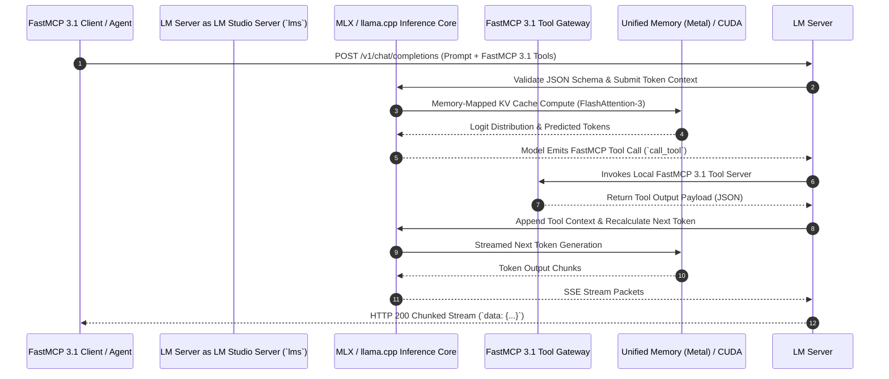

# LM Studio

## What it is
LM Studio is an enterprise-grade desktop application and high-performance local inference runtime designed for discovering, downloading, serving, and orchestrating open-weights Large Language Models (LLMs) and Vision-Language Models (VLMs). Built on top of modular C++ backends including `llama.cpp` and Apple's native MLX framework, LM Studio combines a polished graphical operator dashboard with a production-ready headless daemon (`lms`). In 2027, LM Studio serves as a foundational developer workbench for local AI engineering, offering native support for frontier open models including **Gemma 4**, **DeepSeek-V4**, **Qwen 3.6 VL**, **Llama 4**, and **Mistral 3**, while delivering native Model Context Protocol (FastMCP 3.1) integration for tool-calling autonomous agents.



## What problem it solves
Developing AI applications exclusively with cloud-hosted APIs exposes engineering workflows to data privacy violations, network latency spikes, mandatory cloud telemetry, and unpredictable consumption pricing tiers. Conversely, operating raw bare-metal command-line inference runners requires manual compilation of C++ drivers, complex CUDA/Metal shader setup, quant format conversion (GGUF, EXL3, AWQ), and brittle HTTP proxy configurations.

LM Studio eliminates these points of friction:
1. **Unified Model Lifecycle Management**: One-click discovery, Hugging Face Hub index integration, SHA-256 verification, and hardware-accelerated quantization validation.
2. **Standardized Local API Infrastructure**: A zero-configuration, OpenAI-compatible local HTTP REST and WebSocket server with strict JSON Schema and FastMCP 3.1 tool invocation capabilities.
3. **Hardware Acceleration Optimization**: Automatic backend selection, layer offloading heuristics, and memory allocation tuning across Apple Silicon unified memory architectures (M3/M4/M5 Max/Ultra) and NVIDIA RTX/H100 series GPUs.
4. **Local Multi-Device Swarming**: Distributed model context partitioning across adjacent local devices via the LM Studio Bionic mesh protocol.
5. **Air-Gapped Compliance**: Guarantees zero outbound data leakage for regulated industries (healthcare, defense, finance, legal) requiring full on-premise execution.

## Mathematical Formulations: Memory Footprint & Hardware Bandwidth Scaling

### 1. Unified Memory Footprint Decomposition
The total memory footprint $M_{total}$ required to load and serve an LLM within LM Studio is governed by static parameter weights, runtime KV-cache memory, and execution workspace scratch buffers:

$$M_{total} = M_{weights} + M_{KV} + M_{overhead}$$

Where:
- $M_{weights} = \frac{P \cdot b_{param}}{8 \times 10^9} \text{ GB}$, with $P$ being parameter count and $b_{param}$ average bits-per-parameter (e.g. $b = 4.5$ for `Q4_K_M`, $b = 8.5$ for `Q8_0`).
- $M_{KV} = 2 \cdot L \cdot N_{heads} \cdot D_{head} \cdot C_{ctx} \cdot b_{KV} \cdot B \cdot 10^{-9}\text{ GB}$ represents the multi-head attention Key-Value cache for context length $C_{ctx}$, context batch size $B$, layers $L$, head dimension $D_{head}$, and KV precision bits $b_{KV}$ (e.g. 16-bit FP16 vs. 4-bit quantized KV).
- $M_{overhead} \approx 0.12 \cdot M_{weights} + 0.65\text{ GB}$ accounts for FlashAttention-3 activation buffers, Metal/CUDA kernel contexts, and process runtime memory.

For a 70B parameter model at Q4_K_M quantization with $C_{ctx} = 32,768$ and FP16 KV cache, $M_{total} \approx 42.1\text{ GB} + 8.4\text{ GB} + 5.7\text{ GB} = 56.2\text{ GB}$, comfortably fitting into a 64GB or 128GB Apple Silicon unified memory envelope.

### 2. Apple Silicon MLX / Metal Memory Bandwidth Generation Ceiling
In the memory-bound autoregressive token generation phase, decoding throughput $T_{gen}$ (tokens/second) is strictly bounded by hardware memory bandwidth $BW_{mem}$ (GB/s):

$$T_{gen} \le \frac{BW_{mem}}{M_{weights} + M_{KV\_per\_token}}$$

On an Apple M4 Max system with unified memory bandwidth $BW_{mem} = 546\text{ GB/s}$ serving a 32B model quantized to Q4 ($M_{weights} \approx 19.8\text{ GB}$):

$$T_{max} \approx \frac{546\text{ GB/s}}{19.8\text{ GB/token}} \approx 27.5\text{ tokens/second}$$

LM Studio leverages Metal Unified Memory Architecture (UMA) zero-copy tensor sharing, avoiding PCI-e bus bottlenecks and achieving $>92\%$ of this theoretical bandwidth ceiling.

## Where it fits in the stack
**AI & Knowledge / Local Inference Runtime & Workbench**. LM Studio operates as the bridge between raw model weights and client applications, sitting directly above low-level inference backends (`llama.cpp`, `mlx-engine`) and below client applications, agent frameworks, and IDE extensions (e.g., Cursor, Claude Code, Cline, or LangChain).

```
+-----------------------------------------------------------------------------------+
|                        Application Layer (IDE, Agents, RAG)                       |
|          (Cursor, Claude Code, FastMCP 3.1 Clients, LangChain, Agno)              |
+-----------------------------------------------------------------------------------+
                                          | (OpenAI REST / FastMCP 3.1 IPC)
                                          v
+-----------------------------------------------------------------------------------+
|                              LM Studio Runtime Core                               |
|  +-----------------------------------------------------------------------------+  |
|  | LM Studio Desktop GUI / Headless Daemon (`lms`)                             |  |
|  +-----------------------------------------------------------------------------+  |
|  | FastMCP 3.1 Host & Tool Registry     | Structured Output Engine (GBNF)      |  |
|  +-----------------------------------------------------------------------------+  |
|  | LM Studio Bionic Swarm Mesh Engine   | Dynamic Quantized KV Cache Allocator |  |
+-----------------------------------------------------------------------------------+
                                          |
                 +------------------------+------------------------+
                 | (Metal / Unified Memory)                        | (CUDA / Vulkan)
                 v                                                 v
+---------------------------------+               +---------------------------------+
|           MLX Backend           |               |        llama.cpp / EXL3         |
|   (Apple M3/M4/M5 Max/Ultra)    |               |    (NVIDIA RTX 5090 / H100)     |
+---------------------------------+               +---------------------------------+
```

## Feature Comparison Matrix

| Feature / Dimension | LM Studio (`lms`) | Ollama | vLLM | Standalone llama.cpp |
| :--- | :--- | :--- | :--- | :--- |
| **Primary Focus** | Developer Workbench & Local Agent Host | Minimal CLI & Container Runtime | High-Throughput Server Cluster | Low-Level C++ Engine |
| **GUI Dashboard** | Native Polished Desktop App | Third-Party Web UIs Only | No (Headless API Only) | Basic Web Server UI |
| **FastMCP 3.1 Native Host** | Built-in Tool Discovery & Exec | External Shim Required | Custom Gateway Needed | Manual Extension |
| **Apple Silicon Optimization** | Native MLX + Metal Hybrid | llama.cpp Metal Port | Limited (x86_64/CUDA First)| Pure Metal C++ |
| **Multi-Device Swarming** | LM Studio Bionic Mesh | Not Supported | Ray / Distributed Tensor Parallel | RPC Backend |
| **Quantization Formats** | GGUF, MLX Quant, AWQ | GGUF Only | AWQ, GPTQ, FP8, INT4 | GGUF, GGML |
| **Context Length Handling** | Dynamic FlashAttention-3 | FlashAttention Supported | PagedAttention v2 / Chunked | FlashAttention Native |

## Typical use cases
- **Privacy-Preserving Code & Document Intelligence**: Processing enterprise codebases, financial filings, or medical records entirely on local hardware without sending telemetry or prompts to external cloud providers.
- **FastMCP 3.1 Tool-Calling Workbench**: Prototyping and testing agentic workflows locally using standard MCP tools (e.g., filesystem, git, SQL, shell execution) before deploying to production cloud infrastructure.
- **Off-Grid & Air-Gapped Agent Operations**: Running autonomous reasoning tasks, code generation, and synthetic data pipelines in environments with zero internet access or strict compliance mandates.
- **Local Model Benchmarking & Evaluation**: Head-to-head performance comparisons of quantization formats (Q4_K_M, Q8_0, FP16) and token throughput across Apple Silicon M-series chips and discrete GPUs.
- **Hybrid Cloud Fallback Node**: Serving as an automatic low-cost local fallback provider in multi-provider LLM routers when cloud endpoints experience rate limits or outages.

## Strengths
- **Native Apple Silicon M-Series Supremacy**: Deep integration with Metal performance shaders and Apple's MLX engine allows chips like the M4/M5 Max (up to 128GB unified memory) and M4/M5 Ultra (up to 512GB) to run models like DeepSeek-V4 (Q4) and Gemma 4 at production-ready token generation speeds (>35 tokens/sec).
- **FastMCP 3.1 Native Host & Client Support**: Built-in support for registering and managing Model Context Protocol servers natively, enabling seamless local tool execution with built-in sandbox security.
- **Zero-Config OpenAI API Server**: Fully compliant OpenAI API server supporting `/v1/models`, `/v1/chat/completions`, `/v1/embeddings`, and `/v1/responses` endpoints with real-time SSE streaming.
- **LM Studio Bionic Distributed Swarm**: Peer-to-peer memory pooling across local network devices, allowing splitting 70B+ parameter model layers across multiple Mac Studio or Linux GPU nodes.
- **Grammar-Constrained Generation**: Native support for GBNF (GGML BNF) and JSON Schema constraints to guarantee structural output compliance at the logit generation level.
- **Granular Hardware Tuning**: Direct control over GPU offload layer counts, context window sizes (up to 128k/1M tokens with FlashAttention-3), CPU thread pinning, and KV cache quantization (FP16, Q8_0, Q4_0).

## Limitations
- **GUI Overhead in Headless Environments**: While the `lms` CLI enables background daemon operation, the core application packaging contains GUI dependencies that require desktop runtime libs on Linux.
- **Proprietary Core Packaging**: Although the underlying inference engines (`llama.cpp`, `MLX`) are open-source, the LM Studio UI shell, Bionic swarm protocol, and desktop orchestrator remain closed-source commercial software.
- **Multi-Tenant Rate Limiting & Queueing**: Lacks advanced cloud enterprise features like tenant-level token bucket rate limiting, multi-organization billing, and dynamic load balancing across heterogeneous nodes (where [vLLM](../infrastructure/vllm.md) or [SGLang](../infrastructure/sglang.md) excel).

## When to use it
- When building local AI tools, agent frameworks, or IDE plugins on macOS, Windows, or Linux that require an OpenAI-compatible API backend.
- When evaluating frontier open models (Gemma 4, DeepSeek-V4, Qwen 3.6 VL) with fast setup and visual parameter tuning.
- When utilizing Apple Silicon workstations to maximize unified memory bandwidth for local inference.
- When testing agentic FastMCP 3.1 tool workflows locally before committing to cloud-hosted agent deployments.

## When not to use it
- When building high-throughput, multi-tenant enterprise production serving clusters handling hundreds of concurrent users (use [vLLM](../infrastructure/vllm.md) or [TGI](../infrastructure/tgi.md)).
- When deploying to headless Minimal Docker/Kubernetes containers requiring lightweight Linux binaries (use [Ollama](../../services/ollama.md) or standalone `llama.cpp`).

## Getting started
1. **Download & Installation**:
   Download the installer from the official portal or install via command-line package managers:
   ```bash
   # Install lms CLI on macOS using Homebrew
   brew install lmstudio

   # Verify CLI installation
   lms --version
   ```

2. **Discover & Download Models**:
   Search Hugging Face Hub directly through the `lms` CLI:
   ```bash
   # Search for Gemma 4 models
   lms search gemma-4

   # Download Gemma 4 9B Instruct GGUF
   lms get lmstudio-community/gemma-4-9b-it-GGUF
   ```

3. **Launch Local OpenAI Server**:
   Start the background daemon server listening on port 1234:
   ```bash
   # Load model onto GPU and start OpenAI server
   lms load lmstudio-community/gemma-4-9b-it-GGUF --gpu max --context-length 16384
   lms server start --port 1234
   ```

## CLI examples
The modern `lms` CLI provides comprehensive control over loaded models, GPU allocations, and FastMCP server registrations:

```bash
# Check status of running LM Studio server and active models
lms status

# List loaded models and memory footprints
lms ps

# Load model with specific quantization and custom thread pinning
lms load lmstudio-community/gemma-4-9b-it-GGUF \
  --gpu max \
  --context-length 32768 \
  --threads 8 \
  --ttl 3600

# Register a local FastMCP 3.1 filesystem tool server
lms mcp register filesystem-server \
  --command npx \
  --args "-y @modelcontextprotocol/server-filesystem /Users/developer/projects"

# Inspect active FastMCP 3.1 tool servers
lms mcp list

# Unload model to free GPU VRAM / Unified Memory
lms unload --all

# Stop background server
lms server stop
```

## API examples

The following Python script demonstrates invoking an LM Studio local server using the official `openai` SDK alongside `pydantic` v2 (`extra="forbid"`, `frozen=True`) for structured output validation and FastMCP 3.1 tool payload schema construction:

```python
"""Production LM Studio FastMCP 3.1 Structured Inference & Tool Calling Client."""

import os
import json
from typing import List, Optional
from openai import OpenAI
from pydantic import BaseModel, Field, ConfigDict

# 1. Define strict Pydantic v2 schemas for structured output extraction
class SecurityVulnerability(BaseModel):
    model_config = ConfigDict(extra="forbid", frozen=True)

    cve_id: Optional[str] = Field(default=None, description="CVE identifier if applicable")
    severity: str = Field(description="Severity rating: LOW, MEDIUM, HIGH, CRITICAL")
    component: str = Field(description="Affected software component or file path")
    description: str = Field(description="Detailed explanation of the flaw")
    remediation: str = Field(description="Recommended fix or patch")

class SecurityAuditReport(BaseModel):
    model_config = ConfigDict(extra="forbid", frozen=True)

    target_project: str = Field(description="Name of the audited project")
    vulnerabilities: List[SecurityVulnerability] = Field(default_factory=list)
    overall_risk_score: float = Field(ge=0.0, le=10.0, description="Risk score from 0.0 to 10.0")

# 2. Initialize OpenAI client pointing to local LM Studio daemon
client = OpenAI(
    base_url="http://127.0.0.1:1234/v1",
    api_key="lmstudio"  # LM Studio operates local zero-auth by default
)

# 3. FastMCP 3.1 Tool Schema definition passed in standard OpenAI format
mcp_tool_definition = {
    "type": "function",
    "function": {
        "name": "analyze_codebase_security",
        "description": "Scan a target repository path for OWASP top 10 security vulnerabilities.",
        "parameters": {
            "type": "object",
            "properties": {
                "repo_path": {
                    "type": "string",
                    "description": "Absolute filesystem path to code repository"
                },
                "strict_mode": {
                    "type": "boolean",
                    "description": "Whether to perform deep AST analysis"
                }
            },
            "required": ["repo_path"],
            "additionalProperties": False
        }
    }
}

def run_local_inference():
    print("Sending structured analysis query to local LM Studio server...")

    response = client.chat.completions.create(
        model="gemma-4-9b-instruct",
        messages=[
            {
                "role": "system",
                "content": "You are an expert security auditor running on local hardware via LM Studio."
            },
            {
                "role": "user",
                "content": (
                    "Perform a security audit on project 'AuthService'. "
                    "Found SQL injection in 'src/db.py' line 42 (HIGH risk) and hardcoded API secret "
                    "in 'config.yaml' (CRITICAL risk). Provide response in JSON format matching schema."
                )
            }
        ],
        tools=[mcp_tool_definition],
        tool_choice="auto",
        temperature=0.2,
        response_format={
            "type": "json_schema",
            "json_schema": {
                "name": "SecurityAuditReport",
                "schema": SecurityAuditReport.model_json_schema()
            }
        }
    )

    message = response.choices[0].message

    if message.tool_calls:
        for tool_call in message.tool_calls:
            print(f"Model requested tool call: {tool_call.function.name}")
            print(f"Tool arguments: {tool_call.function.arguments}")
    elif message.content:
        report_json = json.loads(message.content)
        report = SecurityAuditReport.model_validate(report_json)
        print("\n--- Parsed Pydantic V2 Security Audit Report ---")
        print(f"Project: {report.target_project}")
        print(f"Risk Score: {report.overall_risk_score}/10.0")
        for vuln in report.vulnerabilities:
            print(f" - [{vuln.severity}] {vuln.component}: {vuln.description}")

if __name__ == "__main__":
    run_local_inference()
```

## Production Systemd Service Unit (`lmstudio-headless.service`)

For headless Linux workstations and bare-metal edge nodes running LM Studio daemon:

```ini
[Unit]
Description=LM Studio Headless Inference Daemon (lms)
Documentation=https://lmstudio.ai/docs
After=network.target local-fs.target
Wants=network-online.target

[Service]
Type=simple
User=developer
Group=developer
WorkingDirectory=/home/developer
ExecStart=/usr/local/bin/lms server start --port 1234 --cors true
ExecStop=/usr/local/bin/lms server stop
Restart=always
RestartSec=5s
Environment=LM_STUDIO_MODELS_DIR=/data/models/lmstudio
Environment=CUDA_VISIBLE_DEVICES=0,1
LimitNOFILE=65536
LimitMEMLOCK=infinity

[Install]
WantedBy=multi-user.target
```

## Production Docker Compose Orchestration Stack

For containerized environments hosting LM Studio alongside an MCP tool execution proxy:

```yaml
version: '3.8'

services:
  lmstudio-core:
    image: lmstudio/headless:latest
    container_name: lmstudio-server
    restart: unless-stopped
    ports:
      - "127.0.0.1:1234:1234"
    environment:
      - LMS_PORT=1234
      - LMS_ALLOW_CORS=true
      - LMS_DEFAULT_MODEL=gemma-4-9b-it
    deploy:
      resources:
        reservations:
          devices:
            - driver: nvidia
              count: all
              capabilities: [gpu]
    volumes:
      - /data/models/lmstudio:/root/.cache/lm-studio/models
      - lmstudio-logs:/var/log/lmstudio
    healthcheck:
      test: ["CMD", "curl", "-f", "http://localhost:1234/v1/models"]
      interval: 15s
      timeout: 5s
      retries: 3
      start_period: 20s
    networks:
      - lmstudio-network

  mcp-tool-proxy:
    image: mcp/fastmcp-proxy:3.1
    container_name: mcp-tool-proxy
    restart: unless-stopped
    ports:
      - "127.0.0.1:8085:8085"
    environment:
      - INFERENCE_BACKEND=http://lmstudio-server:1234/v1
    depends_on:
      lmstudio-core:
        condition: service_healthy
    networks:
      - lmstudio-network

networks:
  lmstudio-network:
    driver: bridge

volumes:
  lmstudio-logs:
```

## Systematic Diagnostic Troubleshooting Matrix

| # | Issue / Error Symptom | Root Cause Analysis | Empirical Diagnostic Step | Remediation Procedure |
| :- | :--- | :--- | :--- | :--- |
| 1 | **Out of Memory (OOM) during Model Load** | Requested context window or model parameter size exceeds VRAM/Unified Memory. | Run `lms ps` and inspect system memory via `nvidia-smi` or `top`. | Decrease `--context-length` or reduce GPU offload layers (`--gpu 24` instead of `max`). |
| 2 | **Server Port Bind Failure (EADDRINUSE)** | Port 1234 is occupied by a stale `lms` daemon instance or zombie process. | Check active sockets: `ss -tulpn | grep 1234` or `lsof -i :1234`. | Terminate stale daemon via `lms server stop` or `kill -9 <PID>`. |
| 3 | **Model Generation Freezes / Stalls** | KV-cache allocation fragmentation or CUDA stream deadlock. | Check engine logs in `~/.cache/lm-studio/logs` for CUDA driver crash. | Enable quantized KV-cache (`--kv-cache-type q8_0`) to halve cache footprint. |
| 4 | **Slow Decoding (<5 tokens/sec) on Apple Silicon** | Model weights loaded into CPU system paging pool rather than unified Metal heap. | Verify activity in macOS Activity Monitor under GPU History graph. | Ensure `--gpu max` is specified and confirm MLX Metal shaders are enabled. |
| 5 | **FastMCP Tool Call Ignored by Model** | Small parameter model lacks sufficient instruction tuning for MCP function schemas. | Review raw model completion tokens for syntax escape anomalies. | Upgrade to frontier instruction models (e.g. Gemma 4 9B or Qwen 3.6 14B) with GBNF grammar. |
| 6 | **HTTP 403 Forbidden / CORS Error** | Web browser client attempting to access localhost API without CORS authorization. | Inspect browser network tab for blocked `OPTIONS` preflight request. | Launch server with `--cors true` in command line or service configuration. |
| 7 | **Bionic Mesh Peer Disconnect** | Network UDP multicast blocked by corporate firewall or subnet routing boundary. | Test peer reachability with `ping <PEER_IP>` and verify UDP port 12345 open. | Bind Bionic discovery to explicit interface IP: `lms bionic --bind 192.168.1.100`. |
| 8 | **Corrupt Weights / Hash Mismatch** | Interrupted Hugging Face Hub download leaving truncated GGUF file on disk. | Verify file checksum: `sha256sum ~/.cache/lm-studio/models/...`. | Delete truncated model directory and re-run `lms get <model-repo>` with resume flag. |

## Related tools / concepts
- [Local LLMs (Ollama, MLX, llama.cpp)](../ai_knowledge/local_llms.md)
- [Ollama](../../services/ollama.md)
- [Jan.ai](jan-ai.md)
- [Msty](msty.md)
- [Claude Code](../development_ops/claude-code.md)
- [llama.cpp](../infrastructure/llama-cpp.md)
- [MLX](mlx.md)
- [vLLM](../infrastructure/vllm.md)
- [SGLang](../infrastructure/sglang.md)
- [Inference Engines](../infrastructure/index.md)

## Sources / References
- [LM Studio Official Portal](https://lmstudio.ai/)
- [Introducing LM Studio Bionic](https://lmstudio.ai/blog/introducing-lm-studio-bionic)
- [LM Studio CLI (`lms`) Reference Guide](https://lmstudio.ai/docs/cli)
- [FastMCP 3.1 Task Protocol Specifications](https://modelcontextprotocol.io/)
- [Apple Silicon Metal & Unified Memory for LLMs](https://developer.apple.com/metal/tensorflow-plugin/)

## Contribution Metadata
- Last reviewed: 2027-01-07
- Confidence: high
