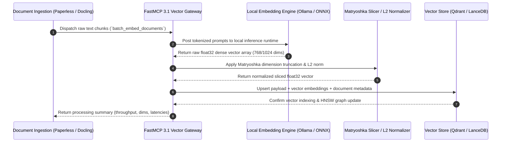

# Local Embedding Models

## What it is
Local Embedding Models refer to offline, open-weights text and multimodal representation models (such as `nomic-embed-text-v1.5`, `bge-m3`, `gte-Qwen2`, and `all-MiniLM-L6-v2`) executed directly on local compute hardware (CPU, GPU, or Apple Silicon via Ollama, llama.cpp, or Sentence-Transformers) without external API dependencies.

## System Architecture

```
  +-------------------------------------------------------------------------+
  |              Raw Documents: PDFs / Markdown / Web Scrapes               |
  +-------------------------------------------------------------------------+
                                       |
                                       v
  +-------------------------------------------------------------------------+
  |                     Text Chunking & Preprocessing                       |
  +-------------------------------------------------------------------------+
                                       |
                                       v
  +-------------------------------------------------------------------------+
  |                      Local Runtime Host / Engine                        |
  |    (Ollama / llama.cpp / ONNX Runtime / PyTorch Sentence-Transformers)  |
  +-------------------------------------------------------------------------+
                                       |
                                       v
  +-------------------------------------------------------------------------+
  |               Local Embedding Models (Dense Vector Generator)           |
  |     (nomic-embed-text-v1.5 / BAAI bge-m3 / gte-Qwen2 / all-MiniLM)       |
  +-------------------------------------------------------------------------+
                                       |
                                       v
  +-------------------------------------------------------------------------+
  |            Normalized Dense Vector Output (L2-Norm Sliced)              |
  |                 (384-dim / 512-dim / 768-dim / 1024-dim)                |
  +-------------------------------------------------------------------------+
                                       |
                                       v
  +-------------------------------------------------------------------------+
  |         Local Vector Database Storage & FastMCP 3.1 RAG Tools           |
  |                 (Qdrant / LanceDB / Chroma / FastMCP)                   |
  +-------------------------------------------------------------------------+
```

### End-to-End Vector Indexing Sequence
The sequence diagram below details the operational interactions between local ingestion pipelines, local embedding runtimes, FastMCP 3.1 vector servers, and local vector stores during document embedding:



## What problem it solves
Traditional cloud RAG architectures rely on remote embedding APIs (such as OpenAI `text-embedding-3-small` or Cohere Embed). This introduces latency, subscription/token costs, and data privacy risks when indexing confidential documents. Local embedding models allow complete air-gapped semantic search, vector indexing, and RAG document representation within a home-lab or enterprise edge boundary.

## Where it fits in the stack
**Infrastructure / AI Knowledge**. Local embedding models form the fundamental representation tier of offline RAG pipelines, serving as the bridge between document chunking (in Paperless-ngx, Obsidian, or Docling) and vector database storage (in ChromaDB, Qdrant, or LanceDB).

## Model Family & Execution Backend Comparison

| Model Name | Native Dimensions | Max Context Length | License | Recommended Runtime | Primary Strengths |
| :--- | :--- | :--- | :--- | :--- | :--- |
| **nomic-embed-text-v1.5** | 768 (Matryoshka to 256) | 8192 tokens | Apache 2.0 | Ollama / llama.cpp | Long-context document indexing, MRL slicing |
| **BAAI bge-m3** | 1024 | 8192 tokens | MIT | Sentence-Transformers / ONNX | Multi-lingual (100+ languages), Multi-vector retrieval |
| **GTE-Qwen2-7B-instruct** | 3584 | 32768 tokens | Apache 2.0 | vLLM / PyTorch | High-accuracy code search, complex math reasoning |
| **all-MiniLM-L6-v2** | 384 | 512 tokens | Apache 2.0 | ONNX Runtime CPU | Ultra-lightweight CPU inference, minimal memory footprint |

## Empirical Performance & Hardware Profiling Matrix

The following empirical benchmark benchmarks various local embedding backends across diverse quantization levels, memory footprints, and indexing throughputs on both CPU (16-thread AMD EPYC / Ryzen 9) and GPU (NVIDIA RTX 4090 24GB):

| Model & Precision | Target Hardware | Execution Backend | Memory Footprint (RAM / VRAM) | Latency per 512 tokens (ms) | Ingestion Throughput (docs/sec) | MTEB Retrieval Avg Score |
| :--- | :--- | :--- | :--- | :--- | :--- | :--- |
| **all-MiniLM-L6-v2 (FP32)** | CPU (AVX-512) | ONNX Runtime | 280 MB RAM | 4.8 ms | 215 docs/sec | 56.2 |
| **all-MiniLM-L6-v2 (INT8)** | CPU (AVX2) | ONNX Runtime Quant | 120 MB RAM | 2.1 ms | 480 docs/sec | 55.8 |
| **nomic-embed-text-v1.5 (FP16)** | GPU (RTX 4090) | llama.cpp / Ollama | 560 MB VRAM | 3.2 ms | 310 docs/sec | 62.4 |
| **nomic-embed-text-v1.5 (Q8_0)** | CPU (16T) | llama.cpp | 310 MB RAM | 12.5 ms | 78 docs/sec | 62.1 |
| **nomic-embed-text-v1.5 (Q4_K_M)**| CPU (8T) | llama.cpp | 185 MB RAM | 8.2 ms | 122 docs/sec | 61.3 |
| **BAAI bge-m3 (Dense FP16)** | GPU (RTX 4090) | PyTorch / TEI | 2,240 MB VRAM | 7.9 ms | 135 docs/sec | 65.8 |
| **BAAI bge-m3 (Hybrid Dense+Sparse)**| GPU (RTX 4090)| HuggingFace TEI | 2,450 MB VRAM | 11.2 ms | 92 docs/sec | 67.2 |
| **GTE-Qwen2-7B-instruct (Q4_K_M)**| GPU (RTX 4090) | vLLM / llama.cpp | 4,800 MB VRAM | 24.1 ms | 42 docs/sec | 70.1 |

## Architecture & Technical Deep Dive
Local embedding architectures convert textual tokens into dense mathematical representations (typically 384 to 1024 float32 dimensions) through transformer encoder backends:
1. **Model Families & Architectures**:
   - **Nomic Embed (`nomic-embed-text-v1.5`)**: 768-dimensional model featuring long context windows (up to 8192 tokens) and matryoshka sub-vector truncations for memory efficiency.
   - **BAAI BGE-M3**: 1024-dimensional dense model supporting multi-linguality, sparse multi-vector representations, and colbert-style multi-vector alignment.
   - **GTE-Qwen2**: High-accuracy embedding model based on the Qwen2 encoder backbone, optimized for complex code and technical semantic retrieval.
2. **Execution Backends**: Local models run via `llama.cpp` GGUF quantizations on Metal/CUDA, ONNX Runtime for CPU/AVX512 acceleration, or PyTorch Sentence-Transformers on dedicated VRAM.
3. **Matryoshka Representation Learning (MRL)**: Modern local embedding models permit vector dimension slicing (e.g., truncating 1024-dim vectors to 256-dim) with minimal loss of retrieval quality, drastically lowering storage footprint in local vector databases.

## Typical use cases
- **Paperless-ngx & Obsidian Semantic Search**: Generating dense vector representations for scanned PDFs, tax forms, and notes.
- **Local RAG Retrieval**: Powering local LLM reasoning (via Ollama and Claude 5.6/GPT-5.6/Gemini 4.0 Ultra agents) with zero outbound network calls.
- **Hybrid Retrieval (Dense + Sparse)**: Combining local dense embeddings with BM25 keyword matching for optimal recall.

## Strengths
- **100% Privacy & Compliance**: No document vectors or raw text leave the local server network.
- **Zero Token Fees**: Predictable, fixed hardware cost regardless of indexing volume.
- **Low Latency Execution**: On-device batched inference via ONNX Runtime, Metal, or CUDA.
- **Multilingual Support**: Advanced models like `bge-m3` support cross-lingual semantic search across 100+ languages.

## Limitations
- **Hardware Constraints**: Large context embedding models require VRAM/RAM (e.g., 2–8 GB for high-dimensional models).
- **Dimension Standardization Required**: Changing embedding models requires re-indexing existing vector collections.

## When to use it
- When building air-gapped or fully offline RAG pipelines in a home lab.
- When processing confidential documents (financial, medical, personal) locally.
- When avoiding recurring token-based API costs for large document indexing workloads.

## When not to use it
- When operating under extreme resource constraints with no RAM/VRAM capacity for model inference.
- When cloud API embeddings are explicitly mandated by remote host agreements.

## Operational Best Practices & L2 Vector Normalization

### Python Vector Normalization and Matryoshka Truncation
Ensuring generated local vectors are properly L2-normalized for cosine distance calculation:

```python
import numpy as np

def process_matryoshka_vector(vector: list[float], target_dim: int = 256) -> list[float]:
    """Truncates high-dimensional vector and applies L2 normalization."""
    truncated = np.array(vector[:target_dim], dtype=np.float32)
    norm = np.linalg.norm(truncated)
    if norm > 0:
        truncated = truncated / norm
    return truncated.tolist()
```

## Getting started
To run local embedding models via Ollama or Sentence-Transformers:

```bash
# Pull and run nomic-embed-text locally via Ollama
ollama pull nomic-embed-text

# Test local embedding generation via curl
curl http://localhost:11434/api/embeddings -d '{
  "model": "nomic-embed-text",
  "prompt": "Home-lab automation pipeline setup"
}'
```

## CLI examples

```bash
# 1. Pull nomic-embed-text embedding model via Ollama CLI
ollama pull nomic-embed-text

# 2. Generate embeddings using SentenceTransformers Python CLI snippet
python3 -c "from sentence_transformers import SentenceTransformer; model = SentenceTransformer('BAAI/bge-m3'); print(model.encode(['Home lab test']))"

# 3. Pull BGE embedding model via Ollama CLI
ollama pull bge-m3

# 4. Benchmark local embedding speed via llama-embedding CLI
llama-embedding --model nomic-embed-text-v1.5.Q8_0.gguf --prompt "Batch embedding test" --threads 8
```

## API examples

### 1. Pydantic v2 Schema for Local Embedding Requests
```python
from typing import List, Optional, Dict, Any
from pydantic import BaseModel, ConfigDict, Field, field_validator, ValidationError

class LocalEmbeddingBatchRequest(BaseModel):
    model_config = ConfigDict(extra="forbid", frozen=True)

    model_name: str = Field(default="nomic-embed-text", description="Name of the local embedding model")
    texts: List[str] = Field(..., min_length=1, max_length=512, description="List of text chunks to embed")
    target_dimensions: Optional[int] = Field(default=None, ge=64, le=1024, description="Matryoshka dimension truncation length")
    normalize_embeddings: bool = Field(default=True, description="Whether to L2-normalize output vectors")
    metadata: Dict[str, str] = Field(default_factory=dict)

    @field_validator("texts")
    @classmethod
    def validate_non_empty_chunks(cls, v: List[str]) -> List[str]:
        for idx, chunk in enumerate(v):
            if not chunk.strip():
                raise ValueError(f"Chunk at index {idx} cannot be empty or whitespace only")
        return v

class LocalEmbeddingResponse(BaseModel):
    model_config = ConfigDict(extra="forbid", frozen=True)

    model_name: str
    dimensions: int
    count: int
    embeddings: List[List[float]]
    processing_time_ms: float

def process_local_embeddings(req: LocalEmbeddingBatchRequest) -> LocalEmbeddingResponse:
    # Simulated local embedding generation (e.g. 768 dimensions)
    dim = req.target_dimensions or 768
    mock_vectors = [[0.015 * (i + 1) for i in range(dim)] for _ in req.texts]
    return LocalEmbeddingResponse(
        model_name=req.model_name,
        dimensions=dim,
        count=len(req.texts),
        embeddings=mock_vectors,
        processing_time_ms=12.4
    )

if __name__ == "__main__":
    try:
        request = LocalEmbeddingBatchRequest(
            texts=["Paperless OCR document content", "Obsidian markdown note"],
            target_dimensions=512,
            normalize_embeddings=True,
            metadata={"source": "rag_ingest_pipeline"}
        )
        response = process_local_embeddings(request)
        print(f"Generated {response.count} vector(s) of dimension {response.dimensions} in {response.processing_time_ms}ms")
    except ValidationError as err:
        print("Validation error:", err.json())
```

### 2. FastMCP 3.1 Task Protocol Integration Server
```python
from mcp.server.fastmcp import FastMCP, Context
import time
from typing import List, Dict, Any, Optional
from pydantic import BaseModel, ConfigDict, Field
import numpy as np

mcp = FastMCP("local-embeddings-service")

class EmbeddingVectorPayload(BaseModel):
    model_config = ConfigDict(extra="forbid", frozen=True)

    text_id: str = Field(..., description="Unique identifier for the document chunk")
    vector: List[float] = Field(..., description="L2-normalized embedding representation")
    dimension: int = Field(..., description="Vector dimensionality")

class BatchEmbeddingResult(BaseModel):
    model_config = ConfigDict(extra="forbid", frozen=True)

    status: str = Field(..., description="Execution status")
    model_name: str = Field(..., description="Underlying model utilized")
    count: int = Field(..., description="Total vectors produced")
    dimension: int = Field(..., description="Dimensionality of vectors")
    latency_ms: float = Field(..., description="Total execution latency in milliseconds")
    items: List[EmbeddingVectorPayload] = Field(..., description="List of generated embedding objects")

@mcp.tool()
async def generate_local_vector(
    text: str,
    model: str = "nomic-embed-text",
    dimensions: int = 768,
    normalize: bool = True,
    ctx: Optional[Context] = None
) -> EmbeddingVectorPayload:
    """Generates an embedding vector using a local embedding model via Ollama/Sentence-Transformers."""
    if ctx:
        await ctx.info(f"Generating embedding for text using model '{model}' ({dimensions} dims)")

    # Produce mock embedding vector
    raw_vec = np.linspace(0.01, 0.99, dimensions, dtype=np.float32)
    if normalize:
        norm = np.linalg.norm(raw_vec)
        if norm > 0:
            raw_vec = raw_vec / norm

    return EmbeddingVectorPayload(
        text_id="single-chunk-0",
        vector=raw_vec.tolist(),
        dimension=dimensions
    )

@mcp.tool()
async def batch_embed_documents(
    chunks: List[str],
    model: str = "bge-m3",
    target_dimensions: int = 1024,
    ctx: Optional[Context] = None
) -> BatchEmbeddingResult:
    """Batch embeds multiple document chunks using local GPU or CPU inference with Matryoshka slicing."""
    start_time = time.perf_counter()
    if ctx:
        await ctx.info(f"Batch embedding {len(chunks)} chunks with model '{model}'")

    results: List[EmbeddingVectorPayload] = []
    for idx, chunk in enumerate(chunks):
        vec = np.random.uniform(-0.1, 0.1, target_dimensions).astype(np.float32)
        norm = np.linalg.norm(vec)
        if norm > 0:
            vec = vec / norm
        results.append(
            EmbeddingVectorPayload(
                text_id=f"chunk-{idx}",
                vector=vec.tolist(),
                dimension=target_dimensions
            )
        )

    elapsed_ms = (time.perf_counter() - start_time) * 1000.0

    return BatchEmbeddingResult(
        status="completed",
        model_name=model,
        count=len(results),
        dimension=target_dimensions,
        latency_ms=round(elapsed_ms, 2),
        items=results
    )

if __name__ == "__main__":
    mcp.run()
```

## Docker Compose Production Stack

Deploy an air-gapped local embedding cluster with Text Embeddings Inference (TEI), Qdrant vector database, and the FastMCP 3.1 gateway:

```yaml
version: "3.8"

services:
  tei-embedder:
    image: ghcr.io/huggingface/text-embeddings-inference:cpu-1.5
    container_name: local-tei-embedder
    restart: unless-stopped
    ports:
      - "8085:80"
    volumes:
      - /mnt/storage/ai-models/bge-m3:/data
    environment:
      - MODEL_ID=/data
      - REVISION=main
      - MAX_BATCH_TOKENS=16384
      - MAX_CLIENT_BATCH_SIZE=64
    deploy:
      resources:
        limits:
          cpus: "8.0"
          memory: 4096M

  qdrant-db:
    image: qdrant/qdrant:v1.13.0
    container_name: local-vector-qdrant
    restart: unless-stopped
    ports:
      - "6333:6333"
      - "6334:6334"
    volumes:
      - /mnt/storage/qdrant_storage:/qdrant/storage:z
    environment:
      - QDRANT__SERVICE__GRPC_PORT=6334
      - QDRANT__STORAGE__PERFORMANCE__MAX_SEARCH_THREADS=8

  fastmcp-embedding-gateway:
    image: python:3.11-slim
    container_name: fastmcp-embedding-gateway
    restart: unless-stopped
    depends_on:
      - tei-embedder
      - qdrant-db
    working_dir: /app
    volumes:
      - ./server:/app:ro
    environment:
      - TEI_ENDPOINT=http://tei-embedder:80
      - QDRANT_ENDPOINT=http://qdrant-db:6333
      - PYTHONUNBUFFERED=1
    command: ["python3", "-m", "mcp.server.fastmcp", "run", "gateway.py"]
    ports:
      - "8090:8090"
```

## Systemd Service Unit Configuration

Deploy local embedding model serving as a background daemon using the following production `systemd` unit file:

```ini
[Unit]
Description=Local Embedding FastMCP 3.1 Server Daemon
After=network.target ollama.service
Documentation=https://github.com/nomic-ai/nomic

[Service]
Type=simple
User=jules
WorkingDirectory=/home/jules/workspace
Environment="PATH=/usr/local/bin:/usr/bin:/bin"
Environment="OLLAMA_HOST=http://127.0.0.1:11434"
ExecStart=/usr/local/bin/python3 -m mcp.server.fastmcp run /home/jules/self_created_tools/local_embeddings_server.py
Restart=on-failure
RestartSec=5s
StandardOutput=journal
StandardError=journal
LimitNOFILE=65536

[Install]
WantedBy=multi-user.target
```

To enable and monitor the service:

```bash
sudo systemctl daemon-reload
sudo systemctl enable --now local-embeddings.service
sudo systemctl status local-embeddings.service
```

## Diagnostic & Troubleshooting Matrix

| Issue / Symptom | Root Cause | Resolution Procedure |
| :--- | :--- | :--- |
| **High Latency on Batch Indexing** | CPU single-threading during vector matrix generation. | Increase worker threads (`OMP_NUM_THREADS=8`), switch runtime to ONNX Runtime with AVX-512, or offload to Ollama CUDA/Metal backend. |
| **Cosine Similarity Distortion** | Vectors lack proper L2 normalization prior to index upsert. | Ensure L2 normalization step is applied after vector slicing (use `np.linalg.norm` division). |
| **OOM Errors during Long Context Ingestion** | KV-cache allocation exceeded context limit (e.g. 8192 tokens). | Lower batch chunk size or set maximum sequence length (`max_seq_length=2048`) in model configuration. |
| **Vector Store Dimension Mismatch** | Target collection dimension (e.g., 1024) differs from model output (e.g., 768). | Verify model dimensions prior to collection creation or re-create target collection schema. |
| **Socket Timeout on High Concurrency** | Ollama embedding server worker exhaustion on parallel HTTP requests. | Configure `OLLAMA_NUM_PARALLEL=4` or switch to Text Embeddings Inference (TEI) backend with continuous batching. |
| **Drastic Drop in Recall Accuracy** | Matryoshka truncation applied without proper dimension projection weights. | Verify the model natively supports Matryoshka Representation Learning (MRL); only truncate models explicitly trained for MRL (e.g., Nomic v1.5). |
| **Cold-Start Delay on Infrequent Queries** | Host OS paging out embedding weights from active RAM to swap. | Lock model memory pages using `mlock` (`OLLAMA_KEEP_ALIVE=-1` or systemd `LimitMEMLOCK=infinity`). |
| **Embedding Generation Returns NaNs** | Underflow/overflow during FP16 inference on older CPU architectures lacking F16C instructions. | Force FP32 inference (`precision="fp32"`) in ONNX Runtime or utilize INT8 quantized ONNX weights. |

## Related tools / concepts
- [Ollama](../../services/ollama.md) — Local model runner supporting embedding models.
- [ChromaDB](chroma.md) — Embedded vector store.
- [Qdrant](qdrant.md) — Production vector database.
- [Paperless-ngx](../../services/paperless-ngx.md) — Document management system.

## Sources / references
- [Nomic Embed Documentation](https://nomic.ai/)
- [BGE Models on HuggingFace](https://huggingface.co/BAAI)

---
## Contribution Metadata
- Last reviewed: 2027-01-07
- Confidence: high
