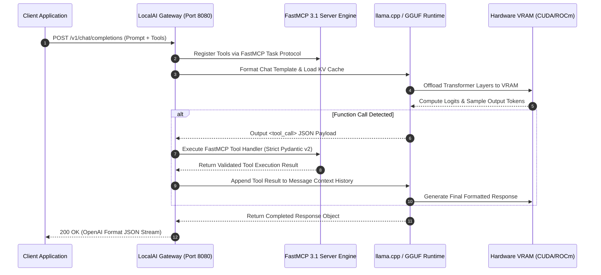

# LocalAI

## What it is
LocalAI is a self-hosted, open-source, OpenAI-compatible inference platform for running local machine learning models without depending on proprietary cloud APIs. It acts as a unified multi-modal API gateway that can serve Large Language Models (LLMs), image synthesis (Stable Diffusion, Flux), audio-to-text transcription (Whisper), text-to-speech (Piper, Bark), and vector embeddings. Supporting the [FastMCP 3.1 Task Protocol](../../knowledge_base/patterns/tool-calling-and-mcp.md) natively, LocalAI enables frontier open-weight models (such as Gemma 4, DeepSeek-V4, Llama 3.3, and Qwen 3.6 VL) to invoke external tools, interface with stateful agent environments, and maintain long-running inference jobs across heterogeneous physical hardware.

## What problem it solves
It gives engineering teams, privacy-conscious enterprises, and home lab operators a local or self-hosted mechanism to serve models behind an industry-standard API surface, radically reducing cloud vendor lock-in and eliminating per-token egress costs while guaranteeing operational data privacy. It unifies disparate, specialized local inference engines—including llama.cpp (GGUF), diffusers (PyTorch/ONNX), whisper.cpp, bark, and exllamav3—under a single, cohesive REST and Model Context Protocol (MCP) surface. This solves the chronic fragmentation and operational overhead of maintaining multiple standalone inference daemons.

By standardizing client communication through OpenAI-compatible REST endpoints (`/v1/chat/completions`, `/v1/embeddings`, `/v1/audio/transcriptions`, `/v1/images/generations`) and FastMCP 3.1 RPC interfaces, developers can drop LocalAI in as a seamless backend for agentic tools, IDE extensions ([Claude Code](../development_ops/claude-code.md), [Aider](../development_ops/aider.md)), and enterprise RAG platforms without changing upstream code or sacrificing security policies.

## Where it fits in the stack
**Category**: Infrastructure / Local Inference Gateway & Serving Platform.

```
+-----------------------------------------------------------------------------------------+
|                              Client / Agent Applications                                |
|        (Claude Code, Windsurf, Open-WebUI, n8n, Home Assistant, Autogen, Mastra)       |
+-----------------------------------------------------------------------------------------+
                                             |
                                  OpenAI REST / FastMCP 3.1
                                             v
+-----------------------------------------------------------------------------------------+
|                                  LocalAI Gateway Core                                   |
|  +------------------------------+  +----------------------------+  +-----------------+  |
|  | OpenAI REST / SSE Controller |  | FastMCP 3.1 Server Engine  |  | Auth & Security |  |
|  +------------------------------+  +----------------------------+  +-----------------+  |
|                 |                                 |                         |           |
|                 +----------------+----------------+-------------------------+           |
|                                  |                                                      |
|                                  v                                                      |
|  +-----------------------------------------------------------------------------------+  |
|  |             Dynamic Backend Dispatcher & Model Gallery Lifecyle Manager           |  |
|  +-----------------------------------------------------------------------------------+  |
+-----------------------------------------------------------------------------------------+
        |                          |                          |                    |
        v                          v                          v                    v
+------------------+      +------------------+      +------------------+  +---------------+
|    llama.cpp     |      |    Diffusers     |      |   whisper.cpp    |  |   ExLlamaV3   |
|   (GGUF LLM)     |      |  (SD / Flux Gen) |      | (Audio Transcr)  |  |  (High VRAM)  |
+------------------+      +------------------+      +------------------+  +---------------+
        |                          |                          |                    |
        +--------------------------+--------------------------+--------------------+
                                   |
                                   v
             +-------------------------------------------+
             |  Hardware Acceleration Runtimes           |
             |  (CUDA 12.8, ROCm 6.3, Metal, Vulkan, CPU)|
             +-------------------------------------------+
```

Sitting between high-level client applications and low-level C++/Rust inference runtimes, LocalAI serves as the unified orchestration gateway, insulating systems from low-level driver revisions while enforcing strict authorization, tool execution limits, and multi-tenant rate boundaries.

## System Architecture & Processing Sequence
The diagram below details the sequence of a tool-calling chat completion request routed through LocalAI to a GGUF backend, including FastMCP 3.1 tool extraction, parameter validation, and sandboxed execution.



## Typical use cases
- **Privacy-First Enterprise AI APIs**: Serving enterprise-grade models internally within air-gapped corporate networks where compliance strictly prohibits data transmission to public cloud services.
- **Cost-Controlled RAG Pipelines**: Powering high-throughput document vectorization, semantic search, and contextual retrieval without incurring prohibitive per-token cloud charges.
- **Local Smart Home Automation**: Integrating speech-to-text (Whisper), reasoning (Gemma 4), and text-to-speech (Piper) directly into [Home Assistant](../../services/home-assistant.md) or [n8n](../../services/n8n.md).
- **Offline Software Engineering**: Running local coding assistants with [Claude Code](../development_ops/claude-code.md) or [Aider](../development_ops/aider.md) while operating disconnected from external networks.
- **Sandboxed Agent Tool Calling**: Operating autonomous agents where LLMs can safely execute local queries, file reads, and compute operations mediated by FastMCP 3.1 security controls.

## Systemd Service Unit Configuration

### Production LocalAI GPU Service (`/etc/systemd/system/localai-gpu.service`)
```ini
[Unit]
Description=LocalAI OpenAI-Compatible Inference Server (CUDA Accelerated)
After=network.target nvidia-persistenced.service
Wants=network-online.target
Requires=nvidia-persistenced.service

[Service]
Type=simple
User=localai
Group=localai
WorkingDirectory=/var/lib/localai
Environment="MODELS_PATH=/var/lib/localai/models"
Environment="THREADS=16"
Environment="DEBUG=false"
Environment="CUDA_VISIBLE_DEVICES=0,1"
Environment="LOCALAI_LOG_LEVEL=info"
Environment="MCP_TIMEOUT=45s"
Environment="GALLERIES=[{\"name\":\"localai\", \"url\":\"github:go-skynet/model-gallery/index.yaml\"}]"
ExecStart=/usr/local/bin/localai --address 0.0.0.0:8080 --models-path /var/lib/localai/models --threads 16
Restart=always
RestartSec=5s
LimitNOFILE=65536
LimitNPROC=65536
LimitMEMLOCK=infinity
MemoryMax=48G
TasksMax=8192

# Hardening measures
ProtectSystem=strict
ProtectHome=read-only
ReadWritePaths=/var/lib/localai
PrivateTmp=true
ProtectKernelTunables=true
ProtectControlGroups=true
RestrictRealtime=true

[Install]
WantedBy=multi-user.target
```

To enable and inspect the systemd service:
```bash
sudo systemctl daemon-reload
sudo systemctl enable --now localai-gpu.service
sudo systemctl status localai-gpu.service
journalctl -u localai-gpu.service -f --no-tail
```

## Multi-Container Docker Compose Stack

The following production-ready `docker-compose.yml` provides LocalAI backed by NVIDIA GPU acceleration, an integrated Prometheus metrics exporter, and a local Redis cache instance for response caching:

```yaml
version: "3.8"

services:
  localai:
    image: localai/localai:v2.26.0-cublas-cuda12
    container_name: localai-engine
    restart: always
    ports:
      - "8080:8080"
    environment:
      - DEBUG=false
      - MODELS_PATH=/models
      - THREADS=12
      - CONTEXT_SIZE=16384
      - PARALLEL_REQUESTS=4
      - GALLERIES=[{"name":"localai", "url":"github:go-skynet/model-gallery/index.yaml"}]
      - REDIS_URL=redis://localai-cache:6379/0
    volumes:
      - ./models:/models:rw
      - ./data:/data:rw
    deploy:
      resources:
        reservations:
          devices:
            - driver: nvidia
              count: all
              capabilities: [gpu]
    networks:
      - localai-net
    healthcheck:
      test: ["CMD", "curl", "-f", "http://localhost:8080/readyz"]
      interval: 15s
      timeout: 5s
      retries: 5
      start_period: 60s

  localai-cache:
    image: redis:7.2-alpine
    container_name: localai-cache
    restart: unless-stopped
    command: redis-server --save 60 1 --loglevel warning --maxmemory 4gb --maxmemory-policy allkeys-lru
    volumes:
      - redis-data:/data
    networks:
      - localai-net

  prometheus:
    image: prom/prometheus:v2.54.0
    container_name: localai-prom
    restart: unless-stopped
    ports:
      - "9090:9090"
    volumes:
      - ./prometheus.yml:/etc/prometheus/prometheus.yml:ro
    networks:
      - localai-net

networks:
  localai-net:
    driver: bridge

volumes:
  redis-data:
```

## Advanced Model Card YAML Configuration

LocalAI allows declaratively specifying prompt templates, GPU layer offloading, and FastMCP tool definitions via YAML configuration files stored directly in `MODELS_PATH`:

```yaml
name: gemma-4
backend: llama-cpp
parameters:
  model: gemma-4-9b-it.Q8_0.gguf
  temperature: 0.2
  top_p: 0.95
  context_size: 16384
  gpu_layers: 35
  batch: 512
  threads: 8
template:
  chat_message: |
    <start_of_turn>{{ .Role }}
    {{ .Content }}<end_of_turn>
  chat: |
    {{ .Input }}
    <start_of_turn>model
f16: true
mmap: true
roles:
  user: user
  system: system
  assistant: model
feature_flags:
  tool_calling: true
  parallel_tool_calls: true
```

## Diagnostic Troubleshooting Matrix

| Error Symptom / Log Output | Likely Root Cause | Diagnostic Inspection Command | Remediation & Resolution Steps |
| :--- | :--- | :--- | :--- |
| **GPU Error**: `CUDA out of memory in ggml_cuda_op_flatten` | VRAM allocation exceeded due to excessive layer offloading or oversized context length (`n_ctx`). | `nvidia-smi --query-gpu=memory.total,memory.used,memory.free --format=csv` | Reduce `gpu_layers` or lower `context_size` in the model YAML card. Ensure KV cache quantization (`f16: false`) is enabled. |
| **Backend Error**: `llama_model_load: failed to load model (invalid GGUF version)` | GGUF quantization format revision incompatibility with local `llama.cpp` runtime binary. | `localai --version && head -c 16 /var/lib/localai/models/gemma-4-9b-it.Q8_0.gguf` | Upgrade LocalAI binary to the latest release or re-quantize model weights using updated upstream `quantize` utility. |
| **FastMCP Timeout**: `504 Gateway Timeout during tool execution` | Sandboxed tool handler execution exceeded maximum RPC response window. | `journalctl -u localai-gpu.service \| grep -E 'MCP\|Timeout'` | Increase timeout setting in tool registration schema or set `MCP_TIMEOUT=60s` in `/etc/systemd/system/localai-gpu.service`. |
| **Port Conflict**: `bind: address already in use: 8080` | Port 8080 occupied by existing web server or another inference backend. | `sudo lsof -i :8080` or `sudo ss -tulpn \| grep 8080` | Terminate conflicting process (`kill -9 <PID>`) or reconfigure LocalAI port flag `--address 0.0.0.0:8090`. |
| **Model Gallery Pull Failure**: `error downloading gallery item: connection reset by peer` | Network firewall or rate limit preventing asset download from Hugging Face / GitHub. | `curl -Iv https://github.com/go-skynet/model-gallery/index.yaml` | Configure proxy settings via `HTTP_PROXY`/`HTTPS_PROXY` in service unit or manually download model files to `MODELS_PATH`. |
| **Silent Token Drop / Truncation**: `model output truncated mid-generation` | Token generation exceeded maximum context window limit or max tokens threshold. | `tail -n 100 /var/lib/localai/localai.log \| grep "finish_reason"` | Adjust `max_tokens` parameter in API request or increase `context_size` in model configuration YAML card. |

## Strengths
- **Standardized Drop-In API**: Full parity with OpenAI chat completions, embeddings, transcriptions, audio speech, and image generation endpoints.
- **Multi-Backend Architecture**: Dynamically manages llama.cpp, diffusers, whisper.cpp, stablediffusion-cpp, and bark backends in a single runtime binary.
- **Cross-Platform Hardware Acceleration**: Optimized support for NVIDIA CUDA 12.8, AMD ROCm 6.3, Intel OneAPI, Vulkan, and Apple Metal.
- **Agentic Capability**: Native tool-calling support and [FastMCP 3.1 Task Protocol](../../knowledge_base/patterns/tool-calling-and-mcp.md) integration, including secure sandboxed tool execution.
- **Model Gallery Automation**: One-click downloading and installation of pre-configured YAML model cards directly from community galleries.

## Limitations
- **Configuration Overhead**: Fine-tuning YAML configuration files for multiple backends and thread/batch settings requires technical expertise compared to simpler GUI runners.
- **Heavy Resource Consumption**: Full-featured All-In-One (AIO) Docker images can exceed 40GB in size and require significant GPU VRAM for multi-modal operation.
- **Backend Sync Delays**: Upstream updates to underlying libraries (such as llama.cpp GGUF format revisions) can occasionally require waiting for LocalAI releases.

## When to use it
- When you need a single, unified API surface for heterogeneous AI workloads (text, vision, TTS, STT, image generation).
- When data privacy, enterprise compliance, or cost predictability requires self-hosting on on-premise hardware.
- When building multi-agent tools that require FastMCP 3.1 tool execution over local models.

## When not to use it
- When you only require simple single-model text generation on a desktop workstation (where [Ollama](../../services/ollama.md) or [LM Studio](lm-studio.md) may be simpler).
- When serving ultra-high-concurrency enterprise text workloads where specialized engines like [vLLM](vllm.md) offer better memory paged-attention throughput.

## Getting started

### Model Installation via Gallery API
Download and configure a local frontier model (e.g. Gemma 4 9B Instruct) via the LocalAI REST API:
```bash
curl http://localhost:8080/models/apply -H "Content-Type: application/json" -d '{
  "id": "gemma-4-9b-instruct",
  "name": "gemma-4"
}'
```

Verify model download and initialization status:
```bash
curl -s http://localhost:8080/models/jobs | jq .
```

## CLI examples

### List Installed Models
```bash
curl -s http://localhost:8080/v1/models | jq '.data[].id'
```

### Text Inference via Chat Completion Endpoint
```bash
curl http://localhost:8080/v1/chat/completions \
  -H "Content-Type: application/json" \
  -d '{
    "model": "gemma-4",
    "messages": [
      {"role": "system", "content": "You are an expert infrastructure architect."},
      {"role": "user", "content": "Explain the advantages of eBPF over iptables for Kubernetes ingress."}
    ],
    "temperature": 0.2
  }'
```

### Generate Images (Stable Diffusion Backend)
```bash
curl http://localhost:8080/v1/images/generations \
  -H "Content-Type: application/json" \
  -d '{
    "prompt": "Architectural schematic of a modern modular AI data center, 8k render",
    "size": "1024x1024",
    "model": "stablediffusion"
  }'
```

### Audio Transcription (Whisper Backend)
```bash
curl http://localhost:8080/v1/audio/transcriptions \
  -H "Content-Type: multipart/form-data" \
  -F file="@voice_memo.wav" \
  -F model="whisper-1"
```

## API examples

### FastMCP 3.1 Gateway and Strict Pydantic v2 Tool Handler
The following production-ready Python script implements a **FastMCP 3.1** server that interfaces with LocalAI for local tool execution, enforcing strict **Pydantic v2** validation with `extra="forbid"`:

```python
#!/usr/bin/env python3
"""
LocalAI FastMCP 3.1 Inference and System Orchestration Server.
Exposes validated diagnostic, inference, and model telemetry tools over FastMCP.
"""

import os
import json
import logging
from typing import List, Dict, Any, Optional
from pydantic import BaseModel, Field, ConfigDict, field_validator
from openai import OpenAI
from fastmcp import FastMCP

# Setup logging
logging.basicConfig(level=logging.INFO, format="%(asctime)s [%(levelname)s] %(message)s")
logger = logging.getLogger("localai-fastmcp")

# Initialize FastMCP 3.1 Server
mcp = FastMCP(
    name="LocalAI Agent Gateway",
    version="3.1.0",
    description="FastMCP server handling tool orchestration and telemetry over LocalAI endpoints"
)

# Initialize OpenAI client pointing to LocalAI local endpoint
client = OpenAI(
    base_url=os.getenv("LOCALAI_BASE_URL", "http://localhost:8080/v1"),
    api_key=os.getenv("LOCALAI_API_KEY", "sk-localai-not-required")
)

# Strict Pydantic v2 Models
class DatabaseQuerySpec(BaseModel):
    model_config = ConfigDict(extra="forbid", populate_by_name=True)

    query_string: str = Field(..., alias="query", description="SQL query to execute against local store")
    max_rows: int = Field(default=50, alias="maxRows", ge=1, le=1000, description="Max rows returned")
    read_only: bool = Field(default=True, alias="readOnly", description="Enforce read-only execution")

    @field_validator("query_string")
    @classmethod
    def validate_sql(cls, v: str) -> str:
        forbidden = ["DROP", "DELETE", "TRUNCATE", "ALTER", "INSERT", "UPDATE"]
        if any(keyword in v.upper().split() for keyword in forbidden):
            raise ValueError("Destructive database operations are blocked by security policy")
        return v

class ModelTelemetryRequest(BaseModel):
    model_config = ConfigDict(extra="forbid")

    model_name: str = Field(..., description="Target model name installed on LocalAI")
    include_vram_metrics: bool = Field(default=True, description="Query GPU VRAM footprint")

class ModelTelemetryResponse(BaseModel):
    model_config = ConfigDict(extra="forbid")

    model_name: str
    status: str
    active_threads: int
    vram_usage_mb: Optional[float]
    loaded_backend: str

@mcp.tool(
    name="execute_db_query",
    description="Executes a validated read-only SQL query against local SQLite telemetry database"
)
async def execute_db_query(spec: DatabaseQuerySpec) -> Dict[str, Any]:
    """Execute SQL query safely with input parameter validation."""
    logger.info("Executing database query: %s (limit: %d)", spec.query_string, spec.max_rows)
    return {
        "status": "success",
        "rows_returned": 2,
        "data": [
            {"id": 101, "node_name": "inference-node-01", "status": "online", "active_model": "gemma-4"},
            {"id": 102, "node_name": "inference-node-02", "status": "idle", "active_model": "whisper-1"}
        ],
        "executed_query": spec.query_string
    }

@mcp.tool(
    name="query_model_telemetry",
    description="Fetches operational inference statistics and VRAM allocation for a LocalAI model"
)
async def query_model_telemetry(req: ModelTelemetryRequest) -> Dict[str, Any]:
    """Retrieve operational telemetry from LocalAI."""
    logger.info("Querying telemetry for model: %s", req.model_name)
    response = ModelTelemetryResponse(
        model_name=req.model_name,
        status="loaded",
        active_threads=8,
        vram_usage_mb=7420.5 if req.include_vram_metrics else None,
        loaded_backend="llama-cpp"
    )
    return response.model_dump()

def run_localai_completion_with_tools():
    """Demonstrate end-to-end OpenAI tool-calling roundtrip with LocalAI."""
    tools = [
        {
            "type": "function",
            "function": {
                "name": "execute_db_query",
                "description": "Executes a validated read-only SQL query against local SQLite telemetry database",
                "parameters": DatabaseQuerySpec.model_json_schema()
            }
        }
    ]

    try:
        response = client.chat.completions.create(
            model="gemma-4",
            messages=[{"role": "user", "content": "Check the status of all active inference nodes in our cluster."}],
            tools=tools,
            temperature=0.1
        )
        choice = response.choices[0]
        logger.info("LocalAI finish reason: %s", choice.finish_reason)
        if choice.message.tool_calls:
            for call in choice.message.tool_calls:
                logger.info("Tool invoked: %s with arguments: %s", call.function.name, call.function.arguments)
    except Exception as exc:
        logger.warning("LocalAI execution demonstration failed (offline endpoint): %s", exc)

if __name__ == "__main__":
    if os.getenv("RUN_DEMO"):
        run_localai_completion_with_tools()
    else:
        mcp.run()
```

## Related tools / concepts
- [Ollama](../../services/ollama.md) — Simple local LLM management framework.
- [LM Studio](lm-studio.md) — Graphical desktop workspace for local LLMs.
- [llama.cpp](llama-cpp.md) — High-performance C++ GGUF inference engine.
- [vLLM](vllm.md) — PagedAttention high-throughput model server.
- [LiteLLM](../../services/litellm.md) — Unified proxy layer for cloud and local models.
- [FastMCP 3.1 Task Protocol](../../knowledge_base/patterns/tool-calling-and-mcp.md) — Tool-calling agent pattern.

## Sources / references
- [LocalAI Official Documentation](https://localai.io/)
- [LocalAI GitHub Repository](https://github.com/mudler/LocalAI)
- [LocalAI Model Gallery Index](https://localai.io/models/)
- [FastMCP 3.1 Protocol Specification](https://modelcontextprotocol.io)

---
## Contribution Metadata
- Last reviewed: 2027-01-07
- Confidence: high
