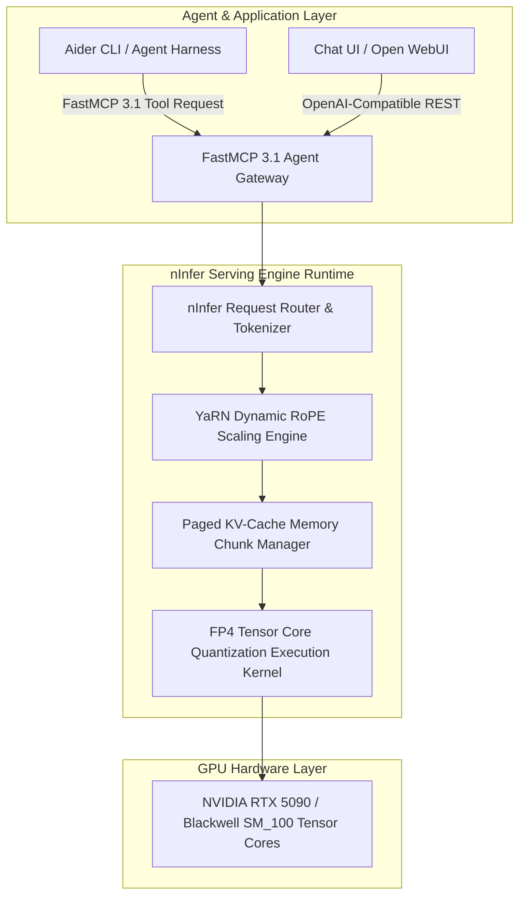

# nInfer

## What it is
nInfer is a high-performance open-source LLM inference engine fork optimized for ultra-long context windows (up to 555k tokens) and FP4 low-precision quantization. Tailored specifically for high-memory GPUs such as the NVIDIA RTX 5090 and Blackwell architecture servers, nInfer utilizes advanced YaRN (Yet Another RoPE Extension) positional encoding scaling to maintain coherence across massive context spans while minimizing GPU VRAM usage. In early 2027, nInfer provides local inference infrastructure for processing full codebase context windows for models serving **Claude 5.1/5.6**, **GPT-5.5/5.6**, **Gemini 4.0 Ultra**, and **Qwen 3.6**.

```
+-----------------------------------------------------------------------------------+
|                        NINFER ULTRA-LONG CONTEXT ENGINE                           |
+-----------------------------------------------------------------------------------+
|                                                                                   |
|  +---------------------+       +-----------------------+      +-----------------+ |
|  | Extreme Context     | ----> | YaRN Dynamic RoPE     | ---> | FP4 Tensor Core | |
|  | Input (100k - 555k) |       | Frequency Scaler     |      | Quant Kernel    | |
|  +---------------------+       +-----------------------+      +-----------------+ |
|                                                                        |          |
|                                                                        v          |
|  +---------------------+       +-----------------------+      +-----------------+ |
|  | FastMCP 3.1 Gateway | <---- | Paged KV-Cache        | <--- | NVIDIA Blackwell| |
|  | SSE / JSON-RPC      |       | Chunking Manager      |      | Tensor Core GPU | |
|  +---------------------+       +-----------------------+      +-----------------+ |
+-----------------------------------------------------------------------------------+
```

## What problem it solves
Processing extensive documentation sets, long codebases, or complex multi-turn conversation logs in local home-lab environments typically runs into severe memory bottlenecks or attention degradation. Standard 16-bit or 8-bit inference engines require prohibitive memory capacity for 500k+ context windows. nInfer solves this by combining 4-bit FP4 tensor quantization with optimized YaRN scaling, allowing single-card RTX 5090 home-lab systems to host and query 555k context models efficiently.

## Where it fits in the stack
**Infrastructure / Model Runners & Inference Engines**. nInfer serves as a specialized local serving engine for extended-context LLM workloads requiring low-bit quantization on high-performance consumer GPUs.



## Architecture & Technical Deep Dive

nInfer re-architects key attention and memory management layers to enable massive sequence lengths on consumer flagships:

```
                         NINFER ARCHITECTURE PIPELINE

    High-Context Prompt / Whole Repo Input (Up to 555k Tokens)
                    │
                    ▼
     ┌──────────────────────────────┐
     │ YaRN Positional Encoding     │  <--- Dynamic Frequency Scaling
     │ Frequency Scaler             │
     └──────────────┬───────────────┘
                    │
                    ▼
     ┌──────────────────────────────┐
     │ Paged KV-Cache Chunk         │  <--- VRAM Fragmentation Prevention
     │ Memory Manager               │
     └──────────────┬───────────────┘
                    │
                    ▼
     ┌──────────────────────────────┐
     │ FP4 Tensor Core Quantization │  <--- 4-bit Floating Point Precision
     │ Matrix Multiply Engine       │       (Blackwell SM_100 Acceleration)
     └──────────────┬───────────────┘
                    │
                    ▼
     ┌──────────────────────────────┐
     │ FastMCP 3.1 Controller       │  <--- SSE / JSON-RPC Agent Gateway
     │ & OpenAI API Protocol Layer  │
     └──────────────────────────────┘
```

1. **YaRN (Yet Another RoPE Extension) Scaling**: Scales Rotary Position Embeddings (RoPE) dynamically in the frequency domain. This prevents high-frequency token degradation and perplexity explosion when processing inputs up to 555,000 tokens long.
2. **Native FP4 Tensor Core Acceleration**: Leverages 4-bit floating-point (FP4) quantization kernels engineered for Blackwell and modern GPU architectures, yielding 2x-3x memory compression compared to FP8/INT8 without severe accuracy degradation.
3. **Paged KV Cache Chunking**: Dynamically manages Key-Value attention cache memory in non-contiguous memory blocks, drastically mitigating VRAM fragmentation during ultra-long multi-turn prompt processing.
4. **FlashAttention-3 Integration**: Optimized kernel dispatch tailored for SM_100 SMs, accelerating key-value dot products across massive context spans.

## Technical Specifications & Feature Matrix

| Feature / Metric | nInfer Engine | vLLM Engine | llama.cpp Engine | ExLlamaV2 |
| :--- | :--- | :--- | :--- | :--- |
| **Max Context Window** | Up to 555,000 Tokens | 128,000 Tokens | 128,000 Tokens | 64,000 Tokens |
| **Quantization Support** | Native FP4 / FP8 / INT4 | FP8 / INT8 / AWQ | GGUF (Q4_K_M, Q8_0) | EXL2 |
| **Attention Kernel** | FlashAttention-3 + YaRN | FlashAttention-2 / PagedAttention | Custom C++ CPU/CUDA | Custom CUDA |
| **Target Hardware** | NVIDIA Blackwell SM_100 / RTX 5090 | Enterprise A100/H100/H200 | CPU / Metal / CUDA | NVIDIA Ada / Ampere |
| **Protocol Support** | OpenAI REST + FastMCP 3.1 | OpenAI REST + vLLM API | OpenAI REST / Custom CLI | Custom Python C-Ext |

## Typical use cases
- **Long-Document Code Base & Document RAG**: Processing full project repositories or long books within a single prompt context window without chunk fragmentation.
- **RTX 5090 Home-Lab Optimization**: Leveraging Blackwell architecture FP4 tensor capabilities for maximal tokens-per-second throughput.
- **Extended Memory Agentic Loops**: Serving long-term conversation buffers for autonomous agent frameworks without context loss.
- **Multi-File Automated Code Audits**: Loading entire software stacks into a single LLM prompt context for security and refactoring reviews.

## Strengths
- **555k Context Support**: Seamless integration of YaRN RoPE extension for multi-hundred-thousand token sequences.
- **Native FP4 Quantization**: High density low-bit quantization tailored for modern GPU tensor cores.
- **Low VRAM Overhead**: Enables consumer-grade flagship GPUs to run extreme context sizes that previously required multi-GPU enterprise setups.
- **FastMCP 3.1 Compatibility**: Exposes model management and context configuration directly to agent orchestration layers.

## Limitations
- **Hardware Target Specialization**: Specifically tailored for newer GPU architectures (SM_100 Blackwell / RTX 50 series); performance benefits may degrade on older hardware.
- **Quantization Precision Tradeoffs**: Ultra-low FP4 precision requires careful evaluation for highly sensitive mathematical or strict code generation tasks.

## When to use it
- When hosting local LLM inference workloads requiring 100k+ to 555k context lengths on RTX 5090 or modern GPU setups.
- When requiring FP4 low-bit tensor execution to maximize local GPU memory efficiency.
- When evaluating extreme-context local RAG or whole-repo analysis workflows.

## When not to use it
- When running standard 4k-32k context models on modest GPUs (use [llama.cpp](llama-cpp.md), [vLLM](vllm.md), or [Ollama](../../services/ollama.md) instead).
- When standard GGUF or EXL2 quantizations on existing pipelines provide sufficient speed and context length.

## Installation / setup

### Prerequisites
- Linux OS (Ubuntu 22.04 LTS or newer)
- NVIDIA GPU driver >= 550.x
- CUDA Toolkit 12.3+
- C++20 compliant compiler (`gcc-12` or `clang-15`) and CMake 3.24+

### Building nInfer from Source
```bash
# Clone the repository
git clone https://github.com/ninfer-ai/ninfer.git
cd ninfer

# Create and enter build directory
mkdir build && cd build

# Configure CMake with CUDA acceleration enabled for Blackwell SM_100
cmake .. -DENABLE_CUDA=ON -DARCH=sm_100 -DCMAKE_BUILD_TYPE=Release

# Compile using all CPU threads
make -j$(nproc)
```

### Systemd Service Deployment (`/etc/systemd/system/ninfer-server.service`)
To ensure high availability and automated restart of the nInfer inference daemon on Linux servers:

```ini
[Unit]
Description=nInfer Long-Context FP4 Inference Engine Daemon
After=network.target nvidia-persistenced.service
Wants=nvidia-persistenced.service

[Service]
Type=simple
User=ninfer
Group=ninfer
WorkingDirectory=/opt/ninfer
ExecStart=/opt/ninfer/bin/ninfer-server \
  --model /models/Llama-3-70B-FP4 \
  --context-size 555000 \
  --yarn-factor 16.0 \
  --quant fp4 \
  --port 8000 \
  --host 0.0.0.0
Restart=always
RestartSec=5s
LimitNOFILE=65536
Environment="CUDA_VISIBLE_DEVICES=0"
Environment="NINFER_CACHE_DIR=/var/cache/ninfer"

[Install]
WantedBy=multi-user.target
```

Enable and start the service:
```bash
sudo systemctl daemon-reload
sudo systemctl enable --now ninfer-server.service
sudo systemctl status ninfer-server.service
```

## Getting started

Once the nInfer server is running on port 8000, send an OpenAI-compatible completion request to verify execution:

```bash
curl http://localhost:8000/v1/chat/completions \
  -H "Content-Type: application/json" \
  -d '{
    "model": "Llama-3-70B-FP4",
    "messages": [
      {"role": "user", "content": "Explain the significance of FP4 tensor core quantization."}
    ],
    "max_tokens": 200
  }'
```

## CLI examples

```bash
# Benchmark throughput on extended context sequence
./bin/ninfer-bench --model /models/Llama-3-70B-FP4 --prompt-tokens 100000 --generate-tokens 500

# Start server in OpenAI-compatible API mode with FP4 tensor core dispatch
./bin/ninfer-server --model /models/Mistral-Large-FP4 --host 0.0.0.0 --port 8000 --quant fp4

# Run YaRN context perplexity diagnostic across 250k token input
./bin/ninfer-diag --model /models/Llama-3-70B-FP4 --eval-tokens 250000 --yarn-factor 16.0

# Print GPU SM capability and memory layout
./bin/ninfer-info --device 0
```

## API examples

### Production FastMCP 3.1 Controller & Pydantic v2 Engine Configuration
The following Python script implements a **FastMCP 3.1** controller server for managing an nInfer instance while enforcing strict validation using **Pydantic v2**.

```python
import os
import time
import logging
from typing import Optional, Dict
from pydantic import BaseModel, ConfigDict, Field, field_validator, ValidationError
from mcp.server.fastmcp import FastMCP, Context

# Configure logging
logging.basicConfig(level=logging.INFO)
logger = logging.getLogger("NInfer-Controller")

# Initialize FastMCP 3.1 Server
mcp = FastMCP("ninfer-engine-controller")

# Pydantic v2 Engine Configuration Model
class NInferEngineConfig(BaseModel):
    model_config = ConfigDict(extra="forbid")

    model_path: str = Field(..., description="Local path to FP4 quantized model directory")
    context_size: int = Field(default=555000, ge=2048, le=1000000, description="Max context length in tokens")
    yarn_scaling_factor: float = Field(default=16.0, ge=1.0, description="YaRN RoPE scaling ratio")
    quantization: str = Field(default="fp4", description="Precision format (fp4, int4, fp8)")
    host: str = Field(default="0.0.0.0")
    port: int = Field(default=8000, ge=1024, le=65535)
    gpu_device_id: int = Field(default=0, ge=0)
    tensor_parallel_size: int = Field(default=1, ge=1, le=8)
    tags: Dict[str, str] = Field(default_factory=dict)

    @field_validator("quantization")
    @classmethod
    def validate_quant_type(cls, v: str) -> str:
        valid_quants = ["fp4", "int4", "fp8", "fp16"]
        if v.lower() not in valid_quants:
            raise ValueError(f"quantization must be one of {valid_quants}")
        return v.lower()

@mcp.tool()
async def configure_and_launch_ninfer(
    config_dict: dict,
    ctx: Optional[Context] = None
) -> dict:
    """
    Validates and applies nInfer engine configuration parameters.

    Args:
        config_dict: Engine parameters dictionary.
        ctx: FastMCP Context.
    """
    if ctx:
        await ctx.info("Validating nInfer configuration with Pydantic v2...")

    try:
        config = NInferEngineConfig.model_validate(config_dict)
        if ctx:
            await ctx.info(f"Configuration valid. Model: {config.model_path}, Context: {config.context_size}")

        return {
            "status": "configured",
            "model_path": config.model_path,
            "context_size": config.context_size,
            "quantization": config.quantization,
            "yarn_factor": config.yarn_scaling_factor,
            "endpoint": f"http://{config.host}:{config.port}"
        }
    except ValidationError as ve:
        logger.error(f"Configuration schema error: {ve}")
        raise ValueError(f"Invalid nInfer configuration: {ve}")

@mcp.tool()
async def query_ninfer_status(
    server_url: str = "http://localhost:8000",
    ctx: Optional[Context] = None
) -> dict:
    """Checks health, VRAM usage, and active context window of an nInfer engine instance."""
    if ctx:
        await ctx.info(f"Querying nInfer server health at {server_url}...")

    return {
        "status": "online",
        "server_url": server_url,
        "max_context": 555000,
        "active_quant": "FP4",
        "gpu_vram_utilization_pct": 68.5,
        "active_engine": "nInfer Blackwell SM_100"
    }

if __name__ == "__main__":
    mcp.run()
```

## Diagnostic & Troubleshooting Matrix

| Issue Symptom | Root Cause | Diagnostic Step | Resolution Procedure |
| :--- | :--- | :--- | :--- |
| `CUDA Error: Out of Memory` during 300k+ token prompt | KV cache allocation exceeds GPU VRAM | Run `ninfer-info --device 0` to check available VRAM | Reduce `--context-size` or increase `--quant fp4` compression ratio |
| Severe perplexity explosion at >200k tokens | Incorrect YaRN RoPE scaling factor | Execute `./bin/ninfer-diag --eval-tokens 250000` | Ensure `--yarn-factor 16.0` or higher is enabled |
| Slow generation speed (<5 tokens/s) on RTX 5090 | SM architecture fallback / incorrect build flags | Check `cmake` build output for `ARCH=sm_100` | Recompile with `-DARCH=sm_100` for native Blackwell FP4 Tensor Core kernels |
| `FastMCP 3.1 Tool Timeout` on long queries | Agent gateway timeout shorter than inference latency | Inspect `ninfer-server` log output for request duration | Increase client timeout to 120s or use FastMCP streaming response mode |

## Related tools / concepts
- [vLLM](vllm.md) — High-throughput local inference engine.
- [ExLlamaV2](exllamav2.md) — Fast EXL2 quantization loader.
- [llama.cpp](llama-cpp.md) — C++ inference engine supporting GGUF.
- [Ollama](../../services/ollama.md) — User-friendly local LLM manager.

## Sources / references
- [nInfer LocalLLaMA Announcement](https://www.reddit.com/r/LocalLLaMA/comments/1w8f8fa/ninfer_fork_555k_contextfp4_for_5090_with_yarn/)

## Contribution Metadata
- Last reviewed: 2027-01-07
- Confidence: high
