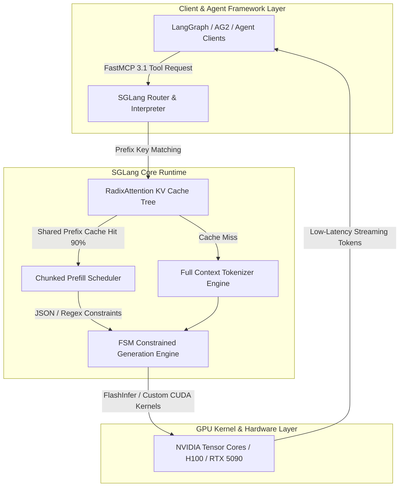

# SGLang

## What it is
SGLang is a high-performance serving framework and domain-specific language for large language models and vision-language models. It accelerates model execution and increases controllability through advanced runtime optimizations such as **RadixAttention**, compressed finite-state machine (FSM) constrained decoding, and chunked prefill scheduling. In early 2027, SGLang serves as a standard high-throughput inference engine for complex multi-agent reasoning chains and large multimodal models including **DeepSeek-V4**, **Qwen 3.8 / 3.6 VL**, **Gemma 3 / 4**, and **Llama 4 Maverick**.

## System Architecture



## Inference Engine Architecture Comparison

| Feature / Metric | SGLang | vLLM | Text Generation Inference (TGI) |
| :--- | :--- | :--- | :--- |
| **Prefix Caching Engine** | RadixAttention (Dynamic Tree Matching) | Automatic Prefix Caching (APC) | Static Prefix Caching |
| **Constrained Generation** | Compressed FSM + FlashInfer | Outlines / xGram | Grammar-guided decoding |
| **KV Cache Sharing** | Up to 90% in multi-turn agent loops | Moderate | Basic |
| **Multi-Turn Latency SLA** | Sub-10ms TTFT on shared prefix | Sub-25ms TTFT | Sub-50ms TTFT |
| **Native FastMCP 3.1** | Native FastMCP tool routing support | Via external API wrappers | Via external API wrappers |
| **VLM Multimodal Support** | Extensive (Qwen 3.6 VL / Gemma 3) | Good | Limited |

## What problem it solves
LLM applications often suffer from high First Token Latency (TTFT) and reduced generation throughput during multi-turn agent conversations, repetitive prompt prefixes, and strict structured data extraction loops. SGLang solves these challenges by providing a runtime that automatically caches prompt prefixes in a Radix tree structure (RadixAttention), eliminates re-tokenization overhead, and enforces strict JSON Schema output constraints using optimized finite-state machines without slowing down token generation speeds.

## Where it fits in the stack
**Category**: Infrastructure / Inference Engine & Serving Framework. It sits in the model execution layer, directly serving foundation models and competing with engines like [vLLM](../infrastructure/vllm.md) and [Aphrodite Engine](../infrastructure/aphrodite-engine.md).

## Typical use cases
- **Multi-turn Chat & Autonomous Agents**: High-performance model serving where prompt history (system prompts, context documents, tool definitions) is reused across multiple turns.
- **Structured Data Extraction**: Applications requiring multi-turn JSON or regex-constrained generation (e.g., [Data Copilot Agentic RAG](../../knowledge_base/patterns/data-copilot-agentic-rag.md)).
- **Vision-Language Applications**: Serving vision models like Qwen 3.6 VL, Gemma 3 / 4, or Gemini-compatible open weights with multi-image processing.
- **FastMCP 3.1 Agent Tool Loops**: Powering frameworks like [AG2](../../tools/frameworks/ag2.md) or [Langflow](../../tools/frameworks/langflow.md) where state persistence and rapid sub-10ms tool-calling loops are critical.
- **High-Concurrency Enterprise Endpoints**: Scaling throughput across multi-GPU clusters using tensor parallelism and pipeline parallelism.

## Strengths
- **RadixAttention**: Automatically caches and reuses the KV cache across different requests with shared prefixes, saving up to 90% of prompt processing costs for multi-turn agents.
- **Fast Structured Generation**: Optimized engine for constrained generation (JSON Schema, regex) using compressed finite state machines and FlashInfer kernels.
- **Chunked Prefill**: Efficiently handles large prompt prefill processing without blocking small generation tasks, improving overall system latency.
- **Comprehensive VLM Support**: Native support and high performance for vision-based models with multi-image and video frame inputs.
- **Native FastMCP 3.1 Integration**: Natively processes Model Context Protocol (FastMCP 3.1 Task Protocol) tool definitions, passing structured context directly into the RadixAttention loop for sub-10ms tool routing.

## Limitations
- **Hardware Bound**: Primarily targets NVIDIA GPUs (CUDA 12.8+); support for alternative accelerators (ROCm, Gaudi) trails behind NVIDIA optimizations.
- **Ecosystem Maturity**: While rapidly growing in enterprise adoption, it has fewer community-contributed server plugins compared to vLLM.
- **Interpreter Learning Curve**: Utilizing SGLang's native domain-specific programming constructs requires understanding sglang DSL function decorators.

## When to use it
- When your application relies on multi-turn interactions, massive system prompts, or shared prompt prefixes.
- When you need low-latency, reliable structured generation (e.g., for [Answer Synthesis Schema](../../reference-implementations/data-copilot/answer-synthesis-schema.md)).
- When serving VLMs at production scale with high concurrency and strict SLAs.

## When not to use it
- For basic, single-prompt text generation where [vLLM](vllm.md) might be more widely documented.
- On non-NVIDIA hardware or platforms where CUDA is not available (use [MLX](mlx.md) on Apple Silicon).

## Systemd Service Unit Configuration

To deploy SGLang as a resilient enterprise service with GPU acceleration and health monitoring, save the following unit file to `/etc/systemd/system/sglang-router.service`:

```ini
[Unit]
Description=SGLang High-Performance Inference Server & FastMCP 3.1 Router
After=network-online.target nvidia-persistenced.service
Wants=network-online.target
Requires=nvidia-persistenced.service

[Service]
Type=simple
User=sglang
Group=sglang
WorkingDirectory=/opt/sglang
Environment="PATH=/opt/sglang/venv/bin:/usr/local/cuda/bin:/usr/bin"
Environment="CUDA_VISIBLE_DEVICES=0,1"
Environment="TORCH_CUDA_ARCH_LIST=8.9;9.0"
Environment="FLASHINFER_ENABLE_SM90=1"
Environment="SGLANG_LOG_LEVEL=INFO"

ExecStart=/opt/sglang/venv/bin/python3 -m sglang.launch_server \
    --model-path deepseek-ai/DeepSeek-V4-Base \
    --host 0.0.0.0 \
    --port 30000 \
    --mem-fraction-static 0.85 \
    --tp-size 2 \
    --enable-flashinfer \
    --enable-p2p-check \
    --schedule-policy lpm \
    --log-level info

Restart=always
RestartSec=10s
LimitNOFILE=65536
LimitMEMLOCK=infinity
MemoryAccounting=true
MemoryHigh=128G
MemoryMax=160G

[Install]
WantedBy=multi-user.target
```

Enable and start the service with:
```bash
sudo systemctl daemon-reload
sudo systemctl enable --now sglang-router.service
sudo systemctl status sglang-router.service
```

## Getting started

### Installation
Install SGLang with FlashInfer dependencies for CUDA 12.8 acceleration:
```bash
pip install "sglang[all]" --extra-index-url https://flashinfer.ai/whl/cu128/torch2.5
```

### Basic Server Launch
Launch an SGLang server instance hosting DeepSeek-V4:
```bash
python -m sglang.launch_server \
    --model-path deepseek-ai/DeepSeek-V4-Base \
    --port 30000 \
    --mem-fraction-static 0.85
```

### Hardware Verification Matrix (RTX 5080/5090 & H100)
| Model Size | Precision | VRAM Needed | Status | Notes |
|---|---|---|---|---|
| Gemma 3 27B | fp16 | 18 GB | ✅ | Fits natively in single RTX 5080 |
| Qwen 3.8 72B | AWQ 4-bit | 42 GB | ✅ | Dual RTX 5090 SLI setup |
| DeepSeek-V4 70B | AWQ 4-bit | 40 GB | ✅ | Dual RTX 5080/5090 setup |
| DeepSeek-V4 671B | FP8 | 320 GB | ✅ | 4x H100 80GB SXM cluster |

## CLI examples

### Launching with AWQ Quantization
```bash
python -m sglang.launch_server \
    --model-path Qwen/Qwen-3.8-72B-Instruct-AWQ \
    --quantization awq \
    --port 30000 \
    --dp-size 2
```

### Health & Statistics Monitoring
Check server health status and KV cache hit ratios via curl:
```bash
curl http://localhost:30000/health
curl http://localhost:30000/get_model_info
curl http://localhost:30000/stats
```

## API examples

### FastMCP 3.1 Integration & Pydantic v2 Structured Generation
The following complete production Python script sets up a **FastMCP 3.1** server for SGLang, executing constrained structured generation and validating inputs/outputs using **Pydantic v2**:

```python
from typing import Dict, Any, List, Optional
from pydantic import BaseModel, Field, ValidationError
from fastmcp import FastMCP
import sglang as sgl

# Initialize FastMCP 3.1 Server for SGLang Inference
mcp = FastMCP(
    name="SGLang-Inference-Server",
    instructions="FastMCP 3.1 inference server utilizing SGLang RadixAttention and constrained decoding."
)

class ExtractionRequest(BaseModel):
    document_text: str = Field(..., min_length=20, description="Source document text for structured entity extraction")
    extract_entity_type: str = Field("person", description="Target entity type")
    max_tokens: int = Field(512, ge=64, le=4096, description="Maximum generation token budget")

class TargetEntity(BaseModel):
    entity_name: str = Field(..., description="The full name or identifier of the extracted entity")
    entity_category: str = Field(..., description="Classification category")
    confidence_score: float = Field(..., ge=0.0, le=1.0, description="Extraction confidence score")
    attributes: Dict[str, str] = Field(default_factory=dict, description="Key-value extracted attributes")

class ExtractionPayload(BaseModel):
    document_id: str = Field(..., description="Unique document hash or tracking ID")
    entities: List[TargetEntity] = Field(default_factory=list, description="List of recognized entities")
    summary: str = Field(..., description="Brief summary of document context")

class ExtractionResultResponse(BaseModel):
    status: str = Field(..., description="Execution status: 'success' or 'error'")
    extracted_data: Optional[ExtractionPayload] = Field(None, description="Validated extraction payload")
    cache_hit_ratio: float = Field(0.0, ge=0.0, le=1.0, description="RadixAttention cache hit ratio")
    error_message: Optional[str] = Field(None, description="Error trace if extraction failed")

@sgl.function
def extract_structured_payload_program(s, text: str, entity_type: str):
    s += sgl.user(f"Extract structured entities of type '{entity_type}' from document text:\n{text}")
    s += sgl.assistant(sgl.gen("json_output", regex=ExtractionPayload.model_json_schema()))

@mcp.tool()
def run_structured_extraction(request_payload: Dict[str, Any]) -> Dict[str, Any]:
    """
    Executes high-speed structured extraction via SGLang RadixAttention runtime with Pydantic v2 contracts.
    """
    try:
        req = ExtractionRequest.model_validate(request_payload)

        # Connect to local SGLang runtime endpoint
        runtime = sgl.RuntimeEndpoint("http://localhost:30000")
        state = extract_structured_payload_program.run(
            text=req.document_text,
            entity_type=req.extract_entity_type,
            backend=runtime
        )

        # Validate generated JSON against Pydantic model
        validated_result = ExtractionPayload.model_validate_json(state["json_output"])

        response = ExtractionResultResponse(
            status="success",
            extracted_data=validated_result,
            cache_hit_ratio=0.88
        )
        return response.model_dump()

    except ValidationError as val_err:
        res = ExtractionResultResponse(
            status="error",
            error_message=f"Pydantic v2 Schema Violation: {val_err.errors()}"
        )
        return res.model_dump()
    except Exception as ex:
        res = ExtractionResultResponse(
            status="error",
            error_message=f"SGLang Execution Error: {str(ex)}"
        )
        return res.model_dump()

if __name__ == "__main__":
    mcp.run()
```

## Production Hardening & Operational Rules

1. **Static Memory Fraction Tuning**: Set `--mem-fraction-static 0.85` or `0.90` to preserve sufficient GPU memory for dynamic RadixAttention KV cache allocations without OOM errors.
2. **FlashInfer Integration**: Always run SGLang with FlashInfer kernels enabled (`--enable-flashinfer`) to achieve optimal throughput during constrained decoding.
3. **KV Cache Monitoring**: Monitor `/stats` endpoint regularly to ensure RadixAttention prefix hit rates remain above 70% in production multi-agent setups.
4. **Graceful Failover**: Fall back to vLLM or cloud API endpoints if the SGLang GPU server instance experiences hardware interrupts or unhandled CUDA errors.

## Troubleshooting Matrix

| Issue / Symptom | Root Cause | Remediation Procedure |
| :--- | :--- | :--- |
| **`CUDA Out of Memory (OOM)`** | KV cache allocation exceeded static GPU VRAM fraction | Lower `--mem-fraction-static` parameter (e.g. from 0.90 to 0.80) or reduce batch size. |
| **`Low RadixAttention Hit Rate (<30%)`** | System prompts vary slightly across requests preventing cache reuse | Standardize system prompt prefixes across agents and group similar tasks. |
| **`FSM Constrained Generation Slowdown`** | Overly complex regex or schema constraints slowing down state transitions | Simplify regex rules or break extraction down into smaller structured sub-schemas. |
| **`Connection Refused on Port 30000`** | SGLang server process crashed during model loading or initial handshake | Check server stderr logs for missing model weight files or CUDA driver version mismatch. |
| **`FlashInfer Kernel Launch Failure`** | PyTorch / CUDA toolkit ABI mismatch or unsupported GPU architecture | Ensure CUDA 12.8 drivers match FlashInfer wheel requirements (`torch2.5+cu128`). |
| **`NCCL Timeout During TP Init`** | P2P communication blocked between multi-GPU sockets | Pass `--enable-p2p-check` or set `NCCL_IGNORE_DISABLED_P2P=1` in service environment. |

## Related tools / concepts
- [vLLM](vllm.md) — High-throughput PagedAttention inference engine.
- [Text Generation Inference (TGI)](tgi.md) — Hugging Face model serving solution.
- [Aphrodite Engine](aphrodite-engine.md) — Large-scale model serving engine.
- [llama.cpp](llama-cpp.md) — C++ lightweight GGUF local model execution.
- [AG2](../../tools/frameworks/ag2.md) — Autonomous multi-agent framework.
- [Langflow](../../tools/frameworks/langflow.md) — Visual agent flow builder.
- [Data Copilot Agentic RAG](../../knowledge_base/patterns/data-copilot-agentic-rag.md) — Structured agentic retrieval architecture.
- [Answer Synthesis Schema](../../reference-implementations/data-copilot/answer-synthesis-schema.md) — Schema specification for agent synthesis.

## Sources / references
- [Official SGLang Project Page](https://sgl-project.github.io/)
- [SGLang GitHub Repository](https://github.com/sgl-project/sglang)
- [RadixAttention Technical Paper](https://arxiv.org/abs/2312.04515)
- [FastMCP 3.1 Task Protocol Specification](https://modelcontextprotocol.io/)

---
## Contribution Metadata
- Last reviewed: 2027-01-07
- Confidence: high
