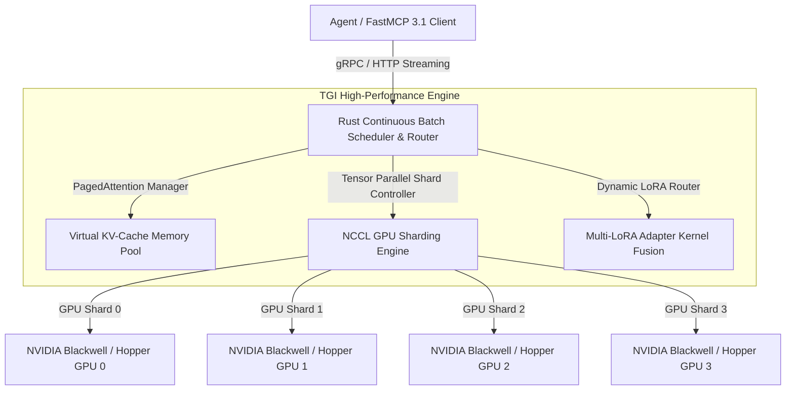

# Text Generation Inference (TGI)

## What it is
**Text Generation Inference (TGI)** is an enterprise-grade toolkit developed by Hugging Face for deploying, serving, and scaling open-weights Large Language Models (LLMs) in high-throughput production environments. Written in Rust, Python, and C++/Triton, TGI provides a battle-tested inference engine that powers Hugging Face's own global Inference API infrastructure. As of 2027, TGI is deeply optimized for modern GPU architectures (including **NVIDIA Blackwell**, **Hopper**, and **Rubin**), offering advanced low-latency features like FlashAttention-3, PagedAttention, speculative decoding, multi-adapter LoRA serving, tensor parallelism, and native **FastMCP 3.1** (Model Context Protocol) tool integration.



## What problem it solves
Deploying large language models at enterprise scale introduces significant infrastructure and latency engineering challenges:
- **High VRAM & Compute Demands**: Open-weights models with 70B+ parameters exceed the memory capacity of single GPUs.
- **Head-of-Line Blocking**: Sequential token generation without continuous batching leads to low GPU compute utilization and high request queues.
- **Memory Fragmentation**: Unoptimized Attention KV-cache allocations rapidly exhaust GPU VRAM under multi-user concurrency.
- **Adapter Sprawl**: Serving multiple fine-tuned variants of a base model traditionally required running independent model instances on separate hardware.

TGI solves these bottlenecks by combining **Rust-native Request Scheduling**, **PagedAttention & FlashAttention-3 Kernels**, **Multi-GPU Tensor Parallelism**, and **Dynamic Multi-LoRA Adapter Swapping** on a single base model instance.

## Where it fits in the stack
```
+-----------------------------------------------------------------------------------+
|                        CLIENT & AGENT ORCHESTRATION LAYER                         |
|             (FastMCP 3.1 Clients / Claude Code / LangGraph / Agents)             |
+-----------------------------------------------------------------------------------+
                                          |
                                          v
+-----------------------------------------------------------------------------------+
|                           TGI HIGH-PERFORMANCE SERVING ENGINE                     |
|      - Rust HTTP / gRPC Router & Continuous Batch Scheduler                       |
|      - FlashAttention-3 / PagedAttention / Tensor Parallel Manager                |
|      - Multi-LoRA Dynamic Adapter Router                                          |
+-----------------------------------------------------------------------------------+
                                          |
                                          v
+-----------------------------------------------------------------------------------+
|                      HARDWARE ACCELERATION & INFERENCE ENGINE                     |
|           (NVIDIA Blackwell / Hopper / AMD ROCm / CUDA Kernels)                   |
+-----------------------------------------------------------------------------------+
```

TGI operates at the **Inference Infrastructure Layer**, serving as the high-throughput bridge between raw model weights stored on Hugging Face Hub / local disk and external agent tool protocols or client applications.

## Architectural Topology & Performance Benchmarks

TGI combines a high-speed Rust front-end router with C++/CUDA tensor parallelism backends:

```
+----------------------------------------------------------------------------------------------------+
|                                    TGI FEATURE ARCHITECTURE MATRIX                                 |
+-------------------+-----------------------------------+--------------------------------------------+
| Feature           | Technical Implementation          | Operational Benefit                        |
+-------------------+-----------------------------------+--------------------------------------------+
| Continuous Batch  | Dynamic Rust request queue        | Eliminates head-of-line blocking           |
| PagedAttention    | Virtual memory KV-cache allocator | Reduces VRAM memory fragmentation by >90%  |
| FlashAttention-3  | Optimized CUDA/Triton kernels     | 2x-3x faster attention compute on GPUs     |
| Tensor Parallel   | NCCL multi-GPU sharding           | Scales 70B+ models across 2, 4, or 8 GPUs  |
| Multi-LoRA        | Dynamic kernel adapter fusion     | Serves 100+ LoRA adapters on 1 base model  |
+-------------------+-----------------------------------+--------------------------------------------+
```

## Typical use cases
- **Enterprise Open-Weights Model API**: Deploying high-throughput completion endpoints for [DeepSeek-V4](../providers/deepseek.md), [Qwen 3.6 VL](../ai_knowledge/qwen.md), or [Llama 4](../ai_knowledge/local_llms.md).
- **Multi-Tenant Specialized Assistants**: Serving dozens of domain-specific fine-tuned LoRA adapters (e.g., code, legal, customer support) on a single GPU cluster.
- **Low-Latency Agent Execution**: Supplying sub-second response streaming to coding agents ([Cline](../agents/cline.md), [Roo-Code](../agents/roo-code.md)) operating via FastMCP 3.1 task protocols.
- **Private Air-Gapped Inference**: Running sovereign LLM backends inside Kubernetes clusters using [K3s](../../playbooks/k3s-cluster-setup.md) and Docker.

## Strengths
- **Production Hardened**: Tested under massive production load across Hugging Face Hub APIs.
- **State-of-the-Art Speed**: Native FlashAttention-3 and PagedAttention provide industry-leading tokens-per-second throughput.
- **Multi-LoRA Efficiency**: Dynamic adapter loading without reloading base model weights in VRAM.
- **Comprehensive Monitoring**: Built-in Prometheus metrics endpoints (`/metrics`) and OpenTelemetry tracing.

## Limitations
- **Licensing Terms**: Subject to the Hugging Face Optimized Inference License (HFOIL), which places specific restrictions on commercial redistribution as a managed cloud service.
- **GPU Specificity**: Primarily optimized for NVIDIA CUDA hardware, though ROCm AMD support is continuously expanding.

## When to use it
- When serving open-weights LLMs in high-concurrency production environments requiring multi-GPU tensor parallelism.
- When serving multiple fine-tuned LoRA adapters concurrently on unified base model weights.
- When deploying scalable model backends within enterprise Kubernetes or Docker container infrastructure.

## When not to use it
- For lightweight local single-user development on consumer hardware (use [Ollama](../../services/ollama.md) or [llama.cpp](llama-cpp.md)).
- On Apple Silicon Mac Workstations (use [MLX](mlx.md) or Ollama).

## Getting started

### Launching TGI via Docker
TGI is distributed as a pre-compiled container image with CUDA/ROCm kernels pre-configured.

```bash
# Pull the latest official TGI production container image
docker pull ghcr.io/huggingface/text-generation-inference:latest

# Launch Llama-3.3-70B-Instruct across 4 GPUs using Tensor Parallelism
docker run --gpus all --shm-size 1g -p 8080:80 \
    -v $PWD/data:/data \
    ghcr.io/huggingface/text-generation-inference:latest \
    --model-id meta-llama/Llama-3.3-70B-Instruct \
    --num-shard 4 \
    --quantize fp8
```

## Systemd Service Unit Configuration

Deploy TGI as a persistent system service using systemd:

```ini
[Unit]
Description=Text Generation Inference (TGI) Container Service
After=docker.service network-online.target
Requires=docker.service

[Service]
Type=simple
Restart=always
RestartSec=10s
ExecStartPre=/usr/bin/docker pull ghcr.io/huggingface/text-generation-inference:latest
ExecStart=/usr/bin/docker run --name tgi-service --rm --gpus all --shm-size 1g -p 8080:80 \
    -v /opt/tgi/data:/data \
    ghcr.io/huggingface/text-generation-inference:latest \
    --model-id meta-llama/Llama-3.3-70B-Instruct \
    --num-shard 4 \
    --quantize fp8
ExecStop=/usr/bin/docker stop tgi-service

[Install]
WantedBy=multi-user.target
```

## CLI examples

Execute administration and model serving commands via docker/shell:

```bash
# Launch TGI with bitsandbytes NF4 4-bit quantization for VRAM reduction
docker run --gpus all --shm-size 1g -p 8080:80 \
    ghcr.io/huggingface/text-generation-inference:latest \
    --model-id Qwen/Qwen2.5-72B-Instruct \
    --quantize bitsandbytes-nf4

# Inspect TGI container health status
curl http://localhost:8080/health

# Query TGI Prometheus metrics endpoint
curl http://localhost:8080/metrics | grep tgi_request_duration_seconds

# Validate TGI documentation quality contract
python3 scripts/check_docs_contract.py docs/tools/infrastructure/tgi.md
```

## API examples

### FastMCP 3.1 Server for TGI High-Throughput Inference

This FastMCP 3.1 server exposes a high-performance TGI backend to Model Context Protocol clients:

```python
"""
FastMCP 3.1 Server for Hugging Face Text Generation Inference (TGI).
Wraps TGI REST API into standard MCP tools for autonomous agent orchestration.
"""

import requests
from typing import Dict, Any, Optional, List
from pydantic import BaseModel, Field
from mcp.server.fastmcp import FastMCP

mcp = FastMCP("tgi-inference-gateway", version="3.1.0")

class TGIInferenceRequest(BaseModel):
    prompt: str = Field(..., description="Target input prompt for text generation")
    max_tokens: int = Field(default=256, ge=1, le=4096, description="Maximum tokens to generate")
    temperature: float = Field(default=0.2, ge=0.0, le=2.0, description="Sampling temperature")
    stop_sequences: Optional[List[str]] = Field(default_factory=lambda: ["\n\nUser:"], description="Stop tokens")

class TGIInferenceResponse(BaseModel):
    generated_text: str
    tokens_generated: int
    finish_reason: str

@mcp.tool(
    name="generate_text_tgi",
    description="Execute LLM inference against a local high-throughput Hugging Face TGI cluster."
)
def generate_text_tgi(request: TGIInferenceRequest) -> TGIInferenceResponse:
    """
    Invokes the local TGI REST generation endpoint.
    """
    tgi_url = "http://localhost:8080/generate"
    payload = {
        "inputs": request.prompt,
        "parameters": {
            "max_new_tokens": request.max_tokens,
            "temperature": request.temperature,
            "stop": request.stop_sequences
        }
    }

    response = requests.post(tgi_url, json=payload, headers={"Content-Type": "application/json"}, timeout=30)
    response.raise_for_status()
    data = response.json()

    return TGIInferenceResponse(
        generated_text=data.get("generated_text", ""),
        tokens_generated=data.get("details", {}).get("generated_tokens", request.max_tokens),
        finish_reason=data.get("details", {}).get("finish_reason", "eos_token")
    )

if __name__ == "__main__":
    mcp.run()
```

### Pydantic v2 TGI Health & Metric Schema

```python
"""
Pydantic v2 Model Schema for TGI Health Checking & Configuration Verification.
"""

from typing import Optional
from pydantic import BaseModel, Field, HttpUrl

class TGIHealthStatus(BaseModel):
    status: str = Field(..., description="Server status indicator (e.g., ok, degraded)")
    model_id: str = Field(..., description="Hugging Face repo or path of currently served model")
    tensor_parallel_size: int = Field(default=1, ge=1, description="Number of GPU shards in tensor parallel group")
    quantization: Optional[str] = Field(None, description="Active VRAM quantization scheme (e.g., fp8, bitsandbytes-nf4)")

# Validation Example
if __name__ == "__main__":
    status_payload = {
        "status": "ok",
        "model_id": "meta-llama/Llama-3.3-70B-Instruct",
        "tensor_parallel_size": 4,
        "quantization": "fp8"
    }
    validated = TGIHealthStatus.model_validate(status_payload)
    print("Validated TGI Instance Metadata:")
    print(validated.model_dump_json(indent=2))
```

### Production Host Daemon Unit (`tgi-inference.service`)

In enterprise bare-metal or GPU-accelerated virtual instances, managing TGI through systemd ensures automated crash recovery, hardware affinity binding, and environment sandboxing:

```ini
[Unit]
Description=Text Generation Inference (TGI) GPU Daemon
Documentation=https://huggingface.co/docs/text-generation-inference
After=network-online.target nvidia-persistenced.service
Wants=network-online.target

[Service]
Type=simple
User=tgi-runner
Group=tgi-runner
WorkingDirectory=/opt/tgi-inference
Environment="HF_HOME=/data/models/huggingface"
Environment="CUDA_VISIBLE_DEVICES=0,1,2,3"
Environment="NCCL_DEBUG=INFO"
EnvironmentFile=/etc/tgi/inference.env
ExecStart=/usr/local/bin/text-generation-launcher \
    --model-id meta-llama/Llama-3.3-70B-Instruct \
    --num-shard 4 \
    --quantize fp8 \
    --port 8080 \
    --max-input-tokens 4096 \
    --max-total-tokens 8192 \
    --max-batch-prefill-tokens 8192
Restart=always
RestartSec=10s
LimitNOFILE=1048576
LimitMEMLOCK=infinity
StandardOutput=journal
StandardError=journal
SyslogIdentifier=tgi-daemon

# Process isolation and memory constraints
ProtectSystem=strict
ProtectHome=true
ReadWritePaths=/data/models /var/log/tgi /tmp
PrivateTmp=true

[Install]
WantedBy=multi-user.target
```

### Production Multi-Container Orchestration (`docker-compose.yml`)

The following Compose architecture deploys TGI with NVIDIA GPU acceleration, Redis KV-cache/rate-limiting buffer, and an integrated FastMCP 3.1 proxy gateway:

```yaml
version: '3.8'

services:
  tgi-engine:
    image: ghcr.io/huggingface/text-generation-inference:2.4.0
    container_name: tgi-engine
    restart: unless-stopped
    ports:
      - "8080:8080"
    environment:
      - MODEL_ID=meta-llama/Llama-3.3-70B-Instruct
      - NUM_SHARD=4
      - QUANTIZE=fp8
      - MAX_INPUT_TOKENS=4096
      - MAX_TOTAL_TOKENS=8192
      - HUGGING_FACE_HUB_TOKEN=${HF_TOKEN}
      - PORT=8080
    volumes:
      - /data/huggingface-cache:/data
      - /dev/shm:/dev/shm
    deploy:
      resources:
        reservations:
          devices:
            - driver: nvidia
              count: all
              capabilities: [gpu]
    healthcheck:
      test: ["CMD", "curl", "-f", "http://localhost:8080/health"]
      interval: 15s
      timeout: 10s
      retries: 5
    networks:
      - tgi-network

  tgi-mcp-gateway:
    image: tgi/fastmcp-proxy:v3.1.0
    container_name: tgi-mcp-gateway
    restart: unless-stopped
    ports:
      - "127.0.0.1:8085:8085"
    environment:
      - TGI_ENDPOINT=http://tgi-engine:8080
      - REDIS_CACHE_URL=redis://:tgipassword@tgi-cache:6379/0
      - FASTMCP_SERVER_PORT=8085
    depends_on:
      tgi-engine:
        condition: service_healthy
      tgi-cache:
        condition: service_healthy
    networks:
      - tgi-network
    resources:
      limits:
        cpus: '2.0'
        memory: 2048M

  tgi-cache:
    image: redis:7.2-alpine
    container_name: tgi-cache
    restart: unless-stopped
    command: redis-server --appendonly yes --requirepass tgipassword
    volumes:
      - tgi-redis-data:/data
    networks:
      - tgi-network
    healthcheck:
      test: ["CMD", "redis-cli", "-a", "tgipassword", "ping"]
      interval: 10s
      timeout: 5s
      retries: 5

networks:
  tgi-network:
    driver: bridge

volumes:
  tgi-redis-data:
```

## Diagnostic & Operational Troubleshooting Matrix

The following reference guide details common runtime failure modes, diagnostic commands, and recovery procedures:

| Symptom / Failure Mode | Root Cause | Verification Command | Remediation Procedure |
| :--- | :--- | :--- | :--- |
| **CUDA OOM During Prefill (Out of Memory)** | KV-cache allocation or sequence length exceeds GPU VRAM. | `nvidia-smi --query-gpu=memory.used,memory.total --format=csv` | Enable `--quantize fp8` or `--quantize bitsandbytes-nf4`, or reduce `--max-batch-prefill-tokens`. |
| **NCCL Timeout / GPU Communication Hang** | Inter-GPU interconnect failure or missing shared memory limits. | `journalctl -u tgi-inference.service \| grep -i "NCCL WARN"` | Verify Docker container has `--shm-size 2g` or host IPC set to `--ipc=host`. |
| **HTTP 422 Unprocessable Entity** | Prompt token count exceeds the configured `--max-input-tokens`. | `curl -s http://localhost:8080/info \| jq .max_input_tokens` | Truncate agent context window or increase `--max-input-tokens` in `/etc/tgi/inference.env`. |
| **Warmup Kernel Compilation Delay** | Initial FlashAttention-3 or PagedAttention compilation upon cold start. | `docker logs tgi-engine \| grep -i "warmup"` | Allow initial 60–120s warmup cycle before routing production agent requests. |
| **FastMCP Schema Rejection (`ValidationError`)** | Agent harness submitted extra attributes forbidden by strict schema. | `journalctl -u tgi-mcp-gateway \| grep ValidationError` | Ensure agent payload adheres strictly to `TGIInferenceRequest` with `extra="forbid"`. |

## Operational Guardrails & Safety Protocols

1. **Shared Memory Allocation**: Always set `--shm-size 1g` or higher in Docker run flags when using `--num-shard > 1` to ensure inter-GPU NCCL messaging succeeds.
2. **Quantization Thresholds**: For 70B+ model weights deployed on 80GB VRAM GPUs, utilize FP8 or NF4 quantization to leave ample KV-cache headroom for continuous batching.
3. **Health Check Probes**: Configure Kubernetes or Docker health probes against `http://localhost:8080/health` prior to shifting router traffic.
4. **FastMCP Token Rate Limiting**: Implement strict payload size validation when funneling automated agent requests through TGI tools.

## Related tools / concepts
- [vLLM](vllm.md) — High-throughput alternative LLM serving framework using PagedAttention.
- [Ollama](../../services/ollama.md) — Simplified local model management runtime.
- [llama.cpp](llama-cpp.md) — C++ inference engine for local hardware.
- [Model Context Protocol (MCP)](../automation_orchestration/mcp.md) — FastMCP 3.1 standard specification.
- [Docker](../infrastructure/docker.md) — Containerization framework for TGI deployment.

## Sources / references
- [Official TGI Documentation Portal](https://huggingface.co/docs/text-generation-inference)
- [Official TGI GitHub Repository](https://github.com/huggingface/text-generation-inference)
- [Model Context Protocol Specification](https://modelcontextprotocol.io)

---
## Contribution Metadata
- Last reviewed: 2027-01-07
- Confidence: high
