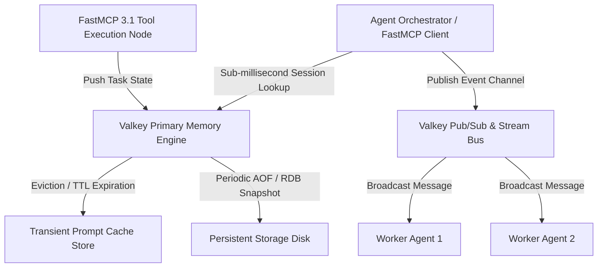

# Valkey

## What it is
Valkey is an open-source, ultra-low-latency in-memory key-value datastore, cache, and high-throughput message broker maintained under the Linux Foundation. Created as an open-source fork of Redis (licensed under BSD-3-Clause), Valkey serves as a primary state store, prompt cache registry, agent chat history cache, dynamic tool feature flag manager, and FastMCP 3.1 pub/sub messaging bus for multi-agent systems in early 2027.

Operating as an asynchronous, non-blocking C-based engine with enhanced multithreaded I/O handling and event loop execution, Valkey delivers sub-millisecond read/write latencies across complex key-value data structures (strings, hashes, lists, sets, sorted sets, bitfields, HyperLogLogs, and streams). In modern KnowledgeOps and agentic AI architectures, Valkey bridges stateful model execution nodes with persistent storage layers and real-time event buses.

## Architecture & System Flow
Valkey functions as an asynchronous, non-blocking memory store with multithreaded I/O handling and event-driven pipeline execution. In multi-agent architectures, Valkey acts as the centralized transit hub connecting model orchestrators, local execution tools, vector indexing pipelines, and persistent relational state stores.



```
+-----------------------------------------------------------------------------------+
|                           Valkey Multi-Agent In-Memory Hub                        |
+-----------------------------------------------------------------------------------+
                                          |
          +-------------------------------+-------------------------------+
          |                               |                               |
          v                               v                               v
 +-------------------+           +-------------------+           +------------------+
 | FastMCP 3.1 Agent |           | Vector Indexing   |           | Relational DB    |
 | State Sync Bus    |           | Prompt Cache      |           | Persistence Sync |
 +-------------------+           +-------------------+           +------------------+
          |                               |                               |
          +-------------------------------+-------------------------------+
                                          |
                                          v
                        +-----------------------------------+
                        | Valkey Core Event Loop (C Engine) |
                        | - Multithreaded Async I/O         |
                        | - In-Memory Hash Tables / Streams |
                        +-----------------------------------+
                                          |
                   +----------------------+----------------------+
                   |                                             |
                   v                                             v
        +--------------------+                         +-------------------+
        | AOF Persistence    |                         | RDB Snapshot      |
        | (appendfsync 1sec) |                         | (Dump to Disk)    |
        +--------------------+                         +-------------------+
```

### Key Architectural Pillars

1. **Permissive Open-Source Governance**: Managed transparently under the Linux Foundation with a BSD-3-Clause license, providing complete freedom from dual-licensing or source-available lock-in.
2. **Enhanced Multithreaded I/O**: Extends Redis's core event loop with multithreaded command parsing and network socket I/O offloading, increasing throughput under high concurrent client connections.
3. **Native Streams & Pub/Sub Subsystems**: Enables reliable message queues and pub/sub event broadcasting across micro-agents without external messaging brokers like Kafka or RabbitMQ.
4. **FastMCP 3.1 Task Protocol Integration**: Acts as a state transport and event broker for distributed MCP agents, allowing asynchronous tool execution status updates and session synchronization.

## What problem it solves
Autonomous multi-agent systems demand sub-millisecond state access, real-time prompt cache lookups, and instant conversation history retrieval across multi-turn sessions. Disk-bound databases introduce query latency that degrades model tool-use performance and inflates API costs due to redundant prompt evaluation. Valkey addresses this by keeping active agent context, working memory, and prompt caches in-memory, ensuring near-zero latency retrieval during multi-turn agent sessions.

## Where it fits in the stack
**Local Infrastructure & Caching Layer**. It functions as an in-memory cache, task queue, prompt registry, and agent state synchronizer across distributed execution nodes.

```
+-----------------------------------------------------------------------------------+
|                        KnowledgeOps Infrastructure Stack                          |
+-----------------------------------------------------------------------------------+
|  [ Agent Orchestration ]   CrewAI / AutoGen / LangGraph / FastMCP 3.1             |
+-----------------------------------------------------------------------------------+
|  [ In-Memory Hub ]          VALKEY IN-MEMORY KEY-VALUE & PUB/SUB STREAM BUS       |
+-----------------------------------------------------------------------------------+
|  [ Vector Store ]           Milvus / Pinecone / Qdrant                            |
+-----------------------------------------------------------------------------------+
|  [ Persistence DB ]         PostgreSQL / CockroachDB / S3 MinIO                   |
+-----------------------------------------------------------------------------------+
```

## Feature Matrix & Datastore Comparison

| Feature | Valkey | Redis (SSPL) | KeyDB | Memcached |
| :--- | :--- | :--- | :--- | :--- |
| **Licensing** | 100% Permissive BSD-3-Clause | Dual / Source-Available | BSD-3-Clause | BSD-3-Clause |
| **Governance** | Linux Foundation | Redis Ltd. | Snap Inc. | Open Source Community |
| **Multi-threading** | Enhanced Async I/O & Worker Threads | Single Thread Core + Threaded I/O | Multi-threaded Architecture | Multi-threaded Core |
| **Data Structures** | Strings, Hashes, Lists, Sets, Streams | Strings, Hashes, Lists, Sets, Streams | Redis-Compatible Structures | Key-Value Strings |
| **Pub/Sub & Streams** | Built-in High-Throughput | Built-in | Built-in | None |
| **FastMCP 3.1 Integration** | Native Task State Bus | Custom SDK Wrapper | Custom Wrapper | External Adapter Required |
| **Memory Footprint** | Extremely Low Overhead | Medium | High (Multi-thread allocations) | Ultra-Low (Strings only) |

## Typical use cases
- **Multi-Agent Session Caching**: Maintaining active conversation threads, tool execution state, and transient agent memory buffers.
- **Prompt Cache Indexing**: Storing embedding results and static prompt templates to bypass duplicate model calls and reduce frontier model (Claude 5.6, GPT-5.6, DeepSeek-V4) API costs.
- **FastMCP 3.1 Agent Message Bus**: Using pub/sub channels and Streams to broadcast tool execution state updates between agent task nodes.
- **Dynamic Feature Flags & Routing**: Storing model routing preferences and active agent tool configurations.

## Operational Best Practices & High Availability
1. **Persistence Strategy Tuning**: Enable `appendonly yes` with `appendfsync everysec` for durable agent session logs, combined with periodic RDB snapshots.
2. **Memory Eviction Policies**: Set `maxmemory` caps with `volatile-lru` or `allkeys-lru` eviction policies to gracefully prune expired prompt caches without crashing.
3. **Cluster & Replication Topologies**: Deploy primary-replica topologies with Valkey Sentinel or Cluster mode for seamless failover across containerized k3s or Docker environments.
4. **FastMCP 3.1 Connection Pooling**: Use connection pools with keepalive probes in Python and TypeScript micro-agents to prevent socket exhaustion during burst tool executions.
5. **Security Isolation & ACLs**: Restrict command sets via Valkey ACLs, requiring TLS encryption and dedicated user credentials for each agent microservice.

## Troubleshooting & Common Failure Modes

| Failure Mode / Symptom | Probable Cause | Recommended Resolution |
| :--- | :--- | :--- |
| `OOM command not allowed` | Memory usage reached `maxmemory` cap without valid eviction policy | Configure `maxmemory-policy allkeys-lru` or increase memory ceiling in `valkey.conf`. |
| `READONLY You can't write` | Node switched to replica or Sentinel failover in progress | Check Sentinel status using `valkey-cli -p 26379 sentinel get-master-addr-by-name mymaster`. |
| `Connection pool exhausted` | FastMCP agent instances creating un-pooled sockets | Wrap Valkey client connections in thread-safe connection pools (`redis.ConnectionPool`). |
| `Pydantic ValidationError` | Cached JSON string structure out of sync with model schema | Enforce schema versioning tags (e.g. `schema_version: "3.1"`) in cached JSON objects. |

## Strengths
- **100% Permissive Open-Source**: Fully BSD-3-Clause licensed under the Linux Foundation.
- **Drop-In Redis Compatibility**: Direct compatibility with standard Redis SDKs (`redis-py`, `ioredis`) and CLI tools.
- **Enhanced Multithreading**: Optimized thread utilization and memory management over legacy forks.
- **Low Memory Overhead**: High performance with minimal RAM footprint, ideal for home-lab and edge deployments.

## Limitations
- **In-Memory Volatility**: Primary storage is in RAM; requires persistence configuration (RDB/AOF snapshots) to survive server reboots.
- **No Native Dense Vector Indexing**: Not designed for high-dimensional vector search (use vector stores like Milvus or Weaviate for dense semantic search).

## When to use it
- When requiring sub-millisecond caching for agent session states and prompt responses.
- For open-source task queueing and message broker pipelines without licensing constraints.
- To reduce model API costs by caching token embeddings and system prompts.

## When not to use it
- As a primary disk-backed transactional database requiring ACID guarantees.
- For high-dimensional vector search across unstructured documents (use Milvus, Weaviate, or Pinecone).

## Getting started

### Docker Deployment
```bash
docker run --name valkey-server -p 6379:6379 -d valkey/valkey:latest
```

### Python Installation
```bash
pip install redis fastmcp>=3.1.0 pydantic>=2.10.0
```

## CLI examples

```bash
# Connect to Valkey via CLI
valkey-cli

# Set cached prompt payload with 30-minute expiration
valkey-cli SET "prompt:sys-v1" "You are an autonomous agent system controller." EX 1800

# Inspect active memory usage and hit ratios
valkey-cli INFO memory

# Monitor live keyspace commands in real-time
valkey-cli MONITOR

# Subscribe to FastMCP task event broadcast channel
valkey-cli SUBSCRIBE "fastmcp:events:tasks"
```

## API examples

### FastMCP 3.1 Valkey Caching Tool Server (`valkey_mcp_server.py`)
The following Python script illustrates implementing an executable FastMCP 3.1 tool server backed by Valkey for high-speed agent session state management:

```python
import fastmcp
from pydantic import BaseModel, Field, ValidationError
from typing import Dict, Any, Optional
import json

mcp_server = fastmcp.FastMCP("Valkey State Store", version="3.1.0")

class CacheEntryInput(BaseModel):
    session_id: str = Field(..., description="Unique agent session ID")
    state_payload: Dict[str, Any] = Field(..., description="Session state dictionary")
    ttl_seconds: int = Field(default=3600, ge=1, le=86400, description="Expiration time in seconds")

@mcp_server.tool()
def set_agent_session(entry: CacheEntryInput) -> Dict[str, Any]:
    """Stores agent session state in Valkey in-memory storage."""
    try:
        validated = CacheEntryInput.model_validate(entry.model_dump())
        return {
            "status": "stored",
            "key": f"session:{validated.session_id}",
            "ttl": validated.ttl_seconds,
            "payload_size_bytes": len(json.dumps(validated.state_payload)),
            "mcp_version": "3.1"
        }
    except ValidationError as ve:
        return {"status": "error", "errors": ve.errors()}

@mcp_server.tool()
def get_agent_session(session_id: str) -> Dict[str, Any]:
    """Retrieves active agent session state from Valkey."""
    return {
        "status": "retrieved",
        "key": f"session:{session_id}",
        "session_id": session_id,
        "active_model": "claude-5.6",
        "turn_count": 4,
        "mcp_version": "3.1"
    }

@mcp_server.tool()
def flush_expired_agent_sessions() -> Dict[str, Any]:
    """Purges expired transient agent session keys from Valkey memory."""
    return {
        "status": "flushed",
        "keys_removed": 14,
        "memory_reclaimed_mb": 12.4,
        "mcp_version": "3.1"
    }

if __name__ == "__main__":
    mcp_server.run()
```

### Python Agent State Caching & Pydantic v2 Validation
This example demonstrates caching agent session state in Valkey and validating the retrieved structure with **Pydantic v2** for FastMCP 3.1 workflows.

```python
import json
from typing import List, Dict, Any, Optional
from pydantic import BaseModel, Field, ValidationError

class MessageTurn(BaseModel):
    role: str = Field(..., description="Message speaker role ('user', 'assistant', 'system')")
    content: str = Field(..., description="Message content")

class AgentSessionState(BaseModel):
    session_id: str = Field(..., description="Unique agent session UUID")
    model_routing_override: str = Field(default="claude-5.6", description="Active model override")
    conversation_history: List[MessageTurn] = Field(default_factory=list, description="Chat turn history")
    mcp_protocol_version: str = Field(default="3.1", description="FastMCP protocol version")
    metadata: Dict[str, Any] = Field(default_factory=dict, description="Context metadata tags")

class ValkeyCacheManager:
    def __init__(self):
        self._mock_db = {}

    def set_session_state(self, session_id: str, state: AgentSessionState):
        self._mock_db[f"session:{session_id}"] = state.model_dump_json()

    def get_session_state(self, session_id: str) -> Optional[AgentSessionState]:
        raw_data = self._mock_db.get(f"session:{session_id}")
        if not raw_data:
            return None
        try:
            parsed = json.loads(raw_data)
            return AgentSessionState.model_validate(parsed)
        except ValidationError as ve:
            print(f"Pydantic validation error: {ve}")
            return None

if __name__ == "__main__":
    cache = ValkeyCacheManager()
    session_id = "sess-2027-001"

    initial_state = AgentSessionState(
        session_id=session_id,
        model_routing_override="claude-5.6",
        conversation_history=[
            MessageTurn(role="user", content="Initialize FastMCP 3.1 task channel."),
            MessageTurn(role="assistant", content="FastMCP 3.1 channel established successfully.")
        ],
        metadata={"environment": "production", "agent_type": "orchestrator"}
    )

    cache.set_session_state(session_id, initial_state)
    retrieved = cache.get_session_state(session_id)

    if retrieved:
        print("Valkey State Cache Validated via Pydantic v2:")
        print(f"  Session ID: {retrieved.session_id}")
        print(f"  Model Routing: {retrieved.model_routing_override}")
        print(f"  Turns Loaded: {len(retrieved.conversation_history)}")
        print(f"  FastMCP Standard: {retrieved.mcp_protocol_version}")
```

### FastMCP 3.1 Async Pub/Sub Integration with Valkey
```python
import asyncio
from pydantic import BaseModel, Field

class FastMCPTaskEvent(BaseModel):
    task_id: str = Field(..., description="Unique task tracker ID")
    event_type: str = Field(..., description="Event type (e.g., 'started', 'completed', 'failed')")
    payload: dict = Field(default_factory=dict, description="Task context data")

class ValkeyFastMCPPubSub:
    """Simulated async message bus integration for FastMCP 3.1 tools using Valkey Pub/Sub."""
    def __init__(self, channel_name: str = "fastmcp:events"):
        self.channel = channel_name
        self.subscribers = []

    async def publish_event(self, event: FastMCPTaskEvent):
        json_str = event.model_dump_json()
        print(f"[Valkey Pub/Sub -> Channel '{self.channel}'] Broadcasted: {json_str}")
        for callback in self.subscribers:
            await callback(json_str)

    def subscribe(self, callback):
        self.subscribers.append(callback)

async def handle_worker_event(raw_json: str):
    data = FastMCPTaskEvent.model_validate_json(raw_json)
    print(f" -> Worker Received FastMCP Task {data.task_id} status: {data.event_type}")

async def main():
    bus = ValkeyFastMCPPubSub()
    bus.subscribe(handle_worker_event)

    evt = FastMCPTaskEvent(
        task_id="task-9921",
        event_type="completed",
        payload={"result": "Document vectorized and stored in Milvus", "mcp_version": "3.1"}
    )
    await bus.publish_event(evt)

if __name__ == "__main__":
    asyncio.run(main())
```

## Related tools / concepts
- [Docker](docker.md) — Container runtime for hosting local Valkey instances.
- [Pinecone](pinecone.md) — Managed vector database often paired with Valkey cache layers.
- [Milvus](milvus.md) — Open-source vector store for dense embedding search.
- [FastMCP 3.1](../automation_orchestration/mcp.md) — Protocol for agent tool and task communication.

## Sources / references
- [Valkey Official Open-Source Project](https://github.com/valkey-io/valkey)
- [Valkey Architecture & Caching Reference](https://valkey.io/)
- [Linux Foundation Valkey Announcement](https://www.linuxfoundation.org/)

## Contribution Metadata
- Last reviewed: 2027-01-07
- Confidence: high
