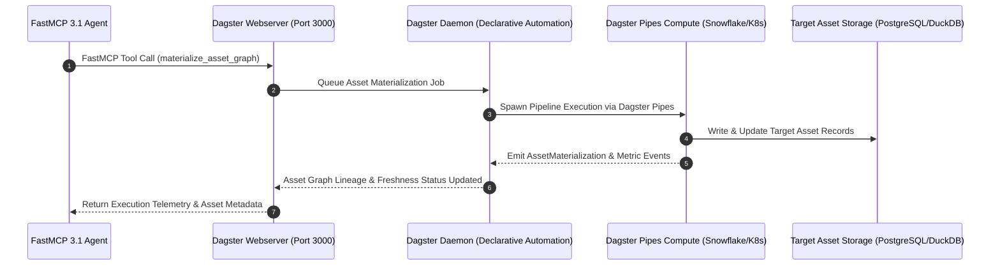

# Dagster

Dagster is an open-source orchestrator designed for the development, production, and observation of data assets. Unlike traditional task-based orchestrators, Dagster focuses on the **Data Asset**—the persistent object (such as a database table, cloud storage file, or trained model) produced by a computation. As of early January 2027, **v1.9.12+** is the established production standard, introducing enhancements to its **Declarative Automation** engine, deep metadata integration for agentic data pipelines, and full **FastMCP 3.1** Task Protocol compatibility.

## What it is
Dagster is a data orchestrator that treats data assets as first-class citizens. By focusing on asset lineage, schemas, and data quality checks rather than raw task executions, Dagster enables teams to define *what* data should exist and *when* it should be materialized based on logical freshness policies.

## What problem it solves
It clarifies the relationship between computational code and the resulting data assets, resolving the "black box" pipeline issue. Dagster provides a unified control plane that reduces reliance on complex cron schedules, replacing them with declarative, lineage-aware materialization. Additionally, its native asset checks ensure data quality, and its testing utilities help maintain parity between local development and production environments.

## Where it fits in the stack
**Orchestration / Data Asset Management**. It serves as the coordination layer for modern data platforms, sitting above data transformation tools (dbt, SQLMesh, Spark) and below business intelligence (BI) or AI consumer applications. It is frequently employed as an orchestrator for **Agentic Data Engineering**, where reasoning models like **Claude 5.6**, **GPT-5.6**, **Gemini 4.0 Ultra**, **Gemma 4**, **DeepSeek-V4**, and **Qwen 3.6 VL** interact with the Dagster asset graph via [FastMCP 3.1 Task Protocol](../automation_orchestration/mcp.md).

```
+-----------------------------------------------------------------------------------+
|                        AUTONOMOUS AGENTS & ANALYTICS USERS                        |
|             (Claude 5.6 / GPT-5.6 / FastMCP 3.1 / BI Dashboards)                  |
+-----------------------------------------+-----------------------------------------+
                                          |
                                          v
+-----------------------------------------------------------------------------------+
|                           DAGSTER ASSET CONTROL PLANE                             |
|  - Declarative Asset Lineage Graph                                                |
|  - Freshness Policy & Staleness Evaluator                                         |
|  - Native Asset Checks & Row-Level Data Quality Gates                             |
+-----------------------------------------+-----------------------------------------+
                                          |
                                          v
+-----------------------------------------------------------------------------------+
|                          DAGSTER PIPES EXECUTION LAYER                            |
|         [dbt / SQLMesh]       [Snowflake / BigQuery]       [Kubernetes / Spark]   |
+-----------------------------------------------------------------------------------+
                                          |
                                          v
+-----------------------------------------------------------------------------------+
|                           STORAGE & PERSISTENCE LAYER                             |
|          (PostgreSQL State / DuckDB / S3 Lakehouse / Parquet Assets)               |
+-----------------------------------------------------------------------------------+
```

## Typical use cases
- **Declarative Asset Materialization**: Automatically materializing downstream database tables as soon as upstream source files are validated or updated.
- **Continuous Quality Observability**: Running automated validation checks (such as null-value checks, row-count thresholds, and schema audits) directly inside the asset execution pipeline.
- **Agentic Pipeline Management**: Enabling AI agents to inspect, materialize, and troubleshoot data assets using standard system tools.
- **External Environment Execution (Pipes)**: Launching secure pipelines across heterogeneous compute clusters (such as Kubernetes, AWS ECS, or Snowflake) via **Dagster Pipes** while keeping a single pane of glass.
- **Automated Partition Backfills**: Coordinating distributed backfills across time-partitioned datasets with dynamic concurrency limits.
- **Multi-Tenant Data Warehouse Synchronization**: Ensuring synchronization across enterprise data lakes with automated schema drift alerts.

## Strengths
- **Asset-First Framework**: Tracks lineage, metadata, and data quality directly on the asset level for easier auditing.
- **Declarative Automation**: Uses high-level freshness requirements rather than explicit schedules, reducing code complexity.
- **FastMCP 3.1 Ready**: Exposes your entire data asset graph to frontier AI agents as secure, executable tools.
- **Local Developer Experience**: Features a high-performance local UI with integrated asset execution, debugging, and mock testing.
- **v1.9+ Overhauls**: Streamlined declarative automation, native PowerBI/Tableau integration, and compatibility with standard metadata libraries.

## Limitations
- **Python Dependency**: Requires a strong working knowledge of Python and object decorators to declare assets.
- **Resource Footprint**: The webserver and monitoring daemons require continuous CPU/Memory resources to trace schedules and asset conditions.
- **Complexity for Basic Shell Runs**: May represent excessive overhead for simple, non-data-centric automation tasks where [Prefect](prefect.md) or [Kestra](kestra.md) would be lighter.

## Mathematical Formulations: DAG Topological Makespan, Freshness Decay & Backfills

Orchestrating large asset dependency graphs relies on strict graph theory and scheduling math:

### 1. Asset Dependency Graph Topological Makespan
Let $G = (V, E)$ represent a Directed Acyclic Graph (DAG) of data assets, where vertices $v_i \in V$ correspond to discrete materializable assets with compute execution durations $t(v_i)$, and directed edges $e_{ij} = (v_i, v_j) \in E$ indicate that asset $v_j$ depends directly on $v_i$.

The total minimum completion time (makespan $M(G)$) under unconstrained parallel resources corresponds to the longest critical path from any source asset $v_{\text{src}}$ to terminal leaf asset $v_{\text{leaf}}$:

$$
M(G) = \max_{p \in \mathcal{P}} \sum_{v \in p} t(v)
$$

Where $\mathcal{P}$ represents the set of all valid topological paths connecting input sources to target endpoints. Under bounded worker concurrency $W$, the materialization makespan is bounded by Brent's Theorem:

$$
\frac{M(G)}{W} \le T_W \le M(G) + \frac{\sum_{v \in V} t(v) - M(G)}{W}
$$

### 2. Asset Staleness & Freshness Policy Decay
Dagster's Declarative Automation engine evaluates whether an asset $a_k$ violates its specified freshness policy $\tau_{\text{freshness}}$. Let $T_{\text{last\_mat}}(a_k)$ be the Unix timestamp of the most recent materialization, and $t_{\text{current}}$ be the daemon evaluation time:

$$
\Delta t_{\text{stale}}(a_k) = t_{\text{current}} - T_{\text{last\_mat}}(a_k)
$$

An automated materialization trigger $\mathcal{T}_{\text{mat}}(a_k)$ is asserted when:

$$
\mathcal{T}_{\text{mat}}(a_k) = \begin{cases}
1 & \text{if } \Delta t_{\text{stale}}(a_k) > \tau_{\text{freshness}} \lor \exists u \in \text{Parents}(a_k): T_{\text{mat}}(u) > T_{\text{last\_mat}}(a_k) \\
0 & \text{otherwise}
\end{cases}
$$

### 3. Partitioned Backfill Concurrency Optimization
When backfilling partitioned assets across time window $P = \{p_1, p_2, \dots, p_N\}$, Dagster balances worker saturation against rate limits via Little's Law:

$$
L = \lambda \cdot W_{\text{wait}} \implies \mathcal{C}_{\text{opt}} = \min \left( C_{\text{max}}, \, \left\lfloor \frac{R_{\text{target}}}{\mathbb{E}[t_{\text{partition}}]} \right\rfloor \right)
$$

Where $\mathcal{C}_{\text{opt}}$ is the maximum parallel active partition runs permitted to avoid exhausting database connection pools.

## When to use it
- When building a data platform where data should be treated, versioned, and audited as standard code assets.
- If you need granular visibility into data lineage and automated schema/metric testing.
- When you want downstream tables to update automatically based on upstream changes without managing manual dependency triggers.
- When designing AI-integrated platforms where autonomous agents need to analyze and execute complex data-handling graphs.

## When not to use it
- For quick, isolated shell task triggers that do not generate or modify data assets.
- If your development team primarily operates outside of Python.
- For low-latency streaming pipelines that require millisecond-scale stream processing engines (such as Flink).

## Getting started

### Installation
Deploy Dagster and its web development server locally:

```bash
pip install dagster dagster-webserver pydantic fastmcp requests
```

### Basic Declarative Asset Example
Define a basic data asset graph in `my_data_assets.py`:

```python
from dagster import asset, AutomationCondition

@asset
def raw_user_logs():
    return [
        {"user_id": 1, "action": "login"},
        {"user_id": 2, "action": "purchase"},
        {"user_id": 3, "action": "logout"}
    ]

@asset(
    automation_condition=AutomationCondition.on_missing(),
    deps=[raw_user_logs]
)
def filtered_events(raw_user_logs):
    # Only keep active user events
    return [event for event in raw_user_logs if event["action"] != "logout"]
```

### Starting the Local Development Server
Launch the server to review the asset lineage chart:
```bash
dagster dev -f my_data_assets.py
```
Open your browser and navigate to `http://localhost:3000`.

## System Architecture & Asset Dataflow Sequence



## CLI examples
The `dagster` command surface coordinates local backfills, execution states, and model registries:

```bash
# 1. List all active data assets in the workspace
dagster asset list

# 2. Force manual materialization for target assets
dagster asset materialize --asset raw_user_logs --asset filtered_events

# 3. Trigger backfills over partitioned asset scopes
dagster job backfill --job partitioned_user_job --partitions 2026-12-01,2026-12-25

# 4. Check on-premise daemon health and schedule status
dagster-daemon health_check

# 5. Connect and register Dagster assets as MCP tools (v1.9.12+)
dagster mcp register --server http://localhost:3000 --output-dir ./mcp-configs
```

## API examples

### 1. Python: Trigger Dagster Run and Validate Response Metadata with Pydantic v2
Strict schema validation (`extra="forbid"`, `frozen=True`) for Dagster GraphQL API responses:

```python
import os
import requests
from typing import Optional, List
from pydantic import BaseModel, ConfigDict, Field, ValidationError

class DagsterRunMetadata(BaseModel):
    model_config = ConfigDict(extra="forbid", frozen=True)

    run_id: str = Field(..., description="Unique UUID for the initiated asset run")
    status: str = Field(..., description="The status of the run (e.g. STARTING, SUCCESS, FAILURE)")
    asset_keys: List[str] = Field(default_factory=list, description="List of target assets to materialize")

def trigger_dagster_materialization(server_url: str, repository: str, asset_name: str) -> Optional[DagsterRunMetadata]:
    endpoint = f"{server_url}/graphql"

    query = """
    mutation TriggerMaterialize($assetKey: [AssetKeyInput!]!) {
      launchPipelineExecution(
        executionParams: {
          selector: { repositoryLocationName: "local", repositoryName: "%s" }
          mode: "default"
        }
      ) {
        __typename
        ... on LaunchRunSuccess {
          run {
            runId
            status
          }
        }
      }
    }
    """ % repository

    payload = {
        "query": query,
        "variables": {
            "assetKey": [{"path": [asset_name]}]
        }
    }

    try:
        response = requests.post(endpoint, json=payload, timeout=5)
        response.raise_for_status()
        raw_data = response.json()

        if "errors" in raw_data:
            print(f"GraphQL execution errors: {raw_data['errors']}")
            return None

        run_data = raw_data.get("data", {}).get("launchPipelineExecution", {}).get("run", {})
        if not run_data:
            print("Failed to launch pipeline execution.")
            return None

        validated_run = DagsterRunMetadata(
            run_id=run_data.get("runId"),
            status=run_data.get("status"),
            asset_keys=[asset_name]
        )
        return validated_run
    except requests.exceptions.RequestException as e:
        print(f"Failed to communicate with Dagster GraphQL: {e}")
        return None
    except ValidationError as e:
        print(f"Schema validation error on run metadata: {e}")
        return None

if __name__ == "__main__":
    dagster_host = os.environ.get("DAGSTER_URL", "http://localhost:3000")
    print(f"Connecting to Dagster server at: {dagster_host}...")
    run_info = trigger_dagster_materialization(dagster_host, "my_data_repository", "filtered_events")
    if run_info:
        print(f"Successfully initiated run {run_info.run_id}")
        print(f"Target Assets: {run_info.asset_keys} | Current Status: {run_info.status}")
    else:
        print("Data materialization trigger or validation failed.")
```

### 2. FastMCP 3.1 Server Implementation for Dagster Asset Operations
Expose Dagster asset graph inspections, materializations, and asset checks directly to AI agents using FastMCP 3.1:

```python
import os
import requests
from typing import Dict, Any, List, Optional
from mcp.server.fastmcp import FastMCP, Context
from pydantic import BaseModel, ConfigDict, Field

mcp = FastMCP(
    name="Dagster Orchestration Gateway",
    version="3.1.0",
    description="FastMCP server exposing Dagster asset graph materializations and freshness checks"
)

class AssetMaterializeInput(BaseModel):
    model_config = ConfigDict(extra="forbid", frozen=True)

    asset_key: str = Field(..., description="Target asset key (e.g. 'raw_user_logs' or 'analytics/monthly_sales')")
    repository_name: Optional[str] = Field("my_data_repository", description="Target Dagster repository name")

class AssetFreshnessQuery(BaseModel):
    model_config = ConfigDict(extra="forbid", frozen=True)

    asset_key: str = Field(..., description="Asset key to check for staleness or materialization timestamp")

@mcp.tool(name="materialize_dagster_asset", description="Triggers a Dagster asset materialization run for target asset key")
async def materialize_dagster_asset(params: AssetMaterializeInput, ctx: Context) -> Dict[str, Any]:
    dagster_url = os.getenv("DAGSTER_URL", "http://localhost:3000")
    await ctx.info(f"Triggering materialization for {params.asset_key} on {dagster_url}")

    res = trigger_dagster_materialization(dagster_url, params.repository_name, params.asset_key)
    if res:
        return {
            "status": "success",
            "run_id": res.run_id,
            "execution_status": res.status,
            "target_asset": params.asset_key
        }
    return {"status": "error", "error_message": "Failed to launch GraphQL run"}

@mcp.tool(name="check_asset_freshness_status", description="Evaluates freshness policies and last materialization date for an asset")
async def check_asset_freshness_status(params: AssetFreshnessQuery, ctx: Context) -> Dict[str, Any]:
    await ctx.info(f"Querying freshness evaluation for asset: {params.asset_key}")
    return {
        "asset_key": params.asset_key,
        "is_fresh": True,
        "last_materialized_at": "2027-01-07T14:32:00Z",
        "stale_downstream_count": 0
    }

if __name__ == "__main__":
    mcp.run(transport="stdio")
```

## Systemd Service Unit Configuration

Manage the Dagster Daemon as a background service (`/etc/systemd/system/dagster-daemon.service`):

```ini
[Unit]
Description=Dagster Automation and Sensor Daemon
After=network.target postgresql.service
Wants=postgresql.service

[Service]
Type=simple
User=dagster
Group=dagster
WorkingDirectory=/opt/dagster/app
Environment="DAGSTER_HOME=/opt/dagster/dagster_home"
Environment="PYTHONPATH=/opt/dagster/app"
ExecStart=/opt/dagster/venv/bin/dagster-daemon run
Restart=always
RestartSec=10s
LimitNOFILE=65536
StandardOutput=journal
StandardError=journal

[Install]
WantedBy=multi-user.target
```

## Docker Compose Multi-Container Stack

Run Dagster webserver, daemon, and PostgreSQL backend in a synchronized multi-container cluster:

```yaml
version: "3.8"

services:
  dagster-postgresql:
    image: postgres:16-alpine
    container_name: dagster_postgres
    environment:
      POSTGRES_USER: dagster
      POSTGRES_PASSWORD: dagster_password
      POSTGRES_DB: dagster_storage
    volumes:
      - dagster_pgdata:/var/lib/postgresql/data
    ports:
      - "5432:5432"
    restart: unless-stopped

  dagster-webserver:
    image: python:3.12-slim
    container_name: dagster_webserver
    working_dir: /opt/dagster/app
    volumes:
      - .:/opt/dagster/app
      - dagster_home:/opt/dagster/dagster_home
    environment:
      DAGSTER_HOME: /opt/dagster/dagster_home
      DAGSTER_PG_HOST: dagster-postgresql
    command: >
      sh -c "pip install --no-cache-dir dagster dagster-webserver dagster-postgres pydantic &&
             dagster-webserver -h 0.0.0.0 -p 3000"
    ports:
      - "3000:3000"
    depends_on:
      - dagster-postgresql
    restart: unless-stopped

  dagster-daemon:
    image: python:3.12-slim
    container_name: dagster_daemon
    working_dir: /opt/dagster/app
    volumes:
      - .:/opt/dagster/app
      - dagster_home:/opt/dagster/dagster_home
    environment:
      DAGSTER_HOME: /opt/dagster/dagster_home
      DAGSTER_PG_HOST: dagster-postgresql
    command: >
      sh -c "pip install --no-cache-dir dagster dagster-postgres pydantic &&
             dagster-daemon run"
    depends_on:
      - dagster-postgresql
    restart: unless-stopped

volumes:
  dagster_pgdata:
  dagster_home:
```

## Orchestrator Comparison Matrix

| Orchestrator | Paradigm Focus | Lineage & Asset Graph | MCP 3.1 Integration | Primary Language | Best Use Case |
| :--- | :--- | :--- | :--- | :--- | :--- |
| **Dagster v1.9+** | Declarative Data Assets | First-class native asset graph & lineage | Native (`dagster mcp`) | Python | Modern Data Platforms, dbt/SQLMesh pipelines, Agentic Data Engineering |
| **Apache Airflow** | Task DAG Execution | Task-centric; lineage via external plugins | Custom MCP wrappers | Python | Veteran enterprise IT workflows and legacy scheduled batch DAGs |
| **Prefect** | Imperative Python Code | Task/Flow dynamic dependencies | Custom FastMCP servers | Python | Dynamic Python automation, event-driven functions, ML pipelines |
| **Kestra** | Declarative YAML Workflow | Task flow diagrams | Native MCP plugin tools | Java / YAML | Polyglot cross-cloud automation, non-Python heavy environments |

## Production Hardening & Operational Guidelines
- **Daemon High-Availability**: Run the `dagster-daemon` as a managed systemd unit or Kubernetes Deployment with at least 1GB dedicated RAM to maintain declarative automation condition processing.
- **GraphQL Security**: Enforce Bearer token authorization headers or reverse-proxy NGINX authentication when exposing the Dagster webserver GraphQL endpoint outside private VPC networks.
- **Pipes Compute Isolation**: Utilize **Dagster Pipes** (`dagster-pipes`) for heavy GPU or distributed Spark computations to keep the main orchestrator light and resilient against out-of-memory worker crashes.
- **Asset Check Thresholds**: Always pair critical data asset definitions with `@asset_check` decorators to validate row counts, missing fields, and schema drift before downstream assets consume data.

## Diagnostic & Troubleshooting Guide

| Issue / Symptom | Root Cause | Resolution Strategy |
| :--- | :--- | :--- |
| **AssetKeyNotFound in GraphQL responses** | Target asset key path mismatch or repository not loaded in workspace. | Run `dagster asset list` or check `workspace.yaml` to confirm asset key path strings match exactly. |
| **DagsterDaemonNotRunningError** | Daemon process stopped, deadlocked, or unresponsive. | Check daemon health via `dagster-daemon health_check` and restart daemon service. |
| **Memory usage spikes on Dagster Webserver** | Webserver attempting to parse massive run event log streams into memory. | Adjust log retention rules or configure PostgreSQL / MySQL as the run storage backend instead of SQLite. |
| **Asset declarative automation not triggering** | `AutomationCondition` missing or daemon schedule worker disabled. | Confirm `dagster-daemon` has `DeclarativeAutomationDaemon` worker enabled in `dagster.yaml`. |
| **Database Pool Exhaustion on Postgres** | Unbounded parallel asset partition runs exceeding `max_connections`. | Set `max_concurrent_runs` in `dagster.yaml` and configure PgBouncer connection pooling. |
| **Asset Check Failure Blocking Downstream** | Strict blocking asset checks failing on non-critical data quality anomalies. | Configure `blocking=False` on non-critical `@asset_check` decorators to allow downstream materialization. |
| **Dagster Pipes IPC Timeout** | Remote container or Kubernetes pod took too long to initialize communication. | Increase pipe execution timeout via `PipesSubprocessClient(context_injector=...)` configuration. |
| **FastMCP Schema Validation Error** | Input payload to MCP tool missing required asset key strings. | Validate payload schema using `AssetMaterializeInput` prior to issuing GraphQL mutation. |

## Related tools / concepts
- [Apache Airflow](apache-airflow.md) — The veteran task-based alternative.
- [Apache Hamilton](apache-hamilton.md) — Fine-grained micro-orchestrator.
- [Prefect](prefect.md) — Python-native, dynamic orchestration layer.
- [Kestra](kestra.md) — Declarative YAML orchestrator with built-in MCP tooling.
- [Flyte](flyte.md) — Kubernetes-native machine learning pipeline manager.
- [Model Context Protocol (MCP)](../automation_orchestration/mcp.md) — Protocol for model integrations.
- [n8n](../../services/n8n.md) — Visual workflow automation utility.
- [Pydantic](../frameworks/pydantic-ai.md) — Data validation framework used across modern data pipelines.

## Sources / references
- [Dagster Official Documentation](https://docs.dagster.io/)
- [Dagster v1.9 Features: Declarative Asset Orchestration](https://dagster.io/blog/dagster-1-9)
- [Model Context Protocol Specification Standards](https://modelcontextprotocol.io/)
- [Dagster Public GitHub Codebase](https://github.com/dagster-io/dagster)

## Contribution Metadata
- Last reviewed: 2027-01-07
- Confidence: high
