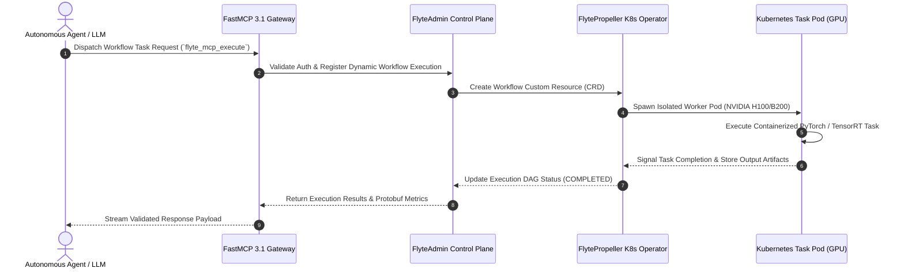

# Flyte

Flyte is an open-source, container-native workflow orchestrator built on Kubernetes, specifically designed for machine learning and data processing at scale. As of early January 2027, **Flyte v2.2+** is the stable major release, featuring a reimagined Python SDK, native async support, and deep integration with the **FastMCP 3.1** Task Protocol for agentic orchestration.

## System Architecture

```
                                +-------------------------------------------------------+
                                |                   Flyte UI / Console                  |
                                |       (Workflow Monitoring & Execution Traces)        |
                                +---------------------------+---------------------------+
                                                            |
                                                            v  gRPC / REST API
                                +-------------------------------------------------------+
                                |                    FlyteAdmin                         |
                                |     (Control Plane / Authorization / Workflows)       |
                                +---------------------------+---------------------------+
                                                            |
                                                            v
                                +-------------------------------------------------------+
                                |                    FlytePropeller                     |
                                |     (Kubernetes Operator / DAG State Machine)         |
                                +---------------------------+---------------------------+
                                                            |
                                        +-------------------+-------------------+
                                        |                                       |
                                        v                                       v
                     +-------------------------------------+   +-------------------------------------+
                     |     Kubernetes Worker Pods          |   |     FastMCP 3.1 Task Protocol       |
                     |  (PyTorch / TensorRT / GPU Execution)|   |   (Agentic Tool Server Integration) |
                     +-------------------------------------+   +-------------------------------------+
```



## What it is
Flyte is a container-native orchestrator that manages the execution of complex ML and data workflows on Kubernetes. It ensures that every task is isolated, versioned, and reproducible, making it ideal for large-scale AI platforms. It provides a strongly-typed interface that allows for safe and predictable workflow execution across heterogeneous compute resources.

## What problem it solves
It solves the challenges of reproducibility, scalability, and maintainability in ML pipelines. Flyte ensures that infrastructure (like GPUs) is provisioned dynamically and that workflows can scale to thousands of containers. In early January 2027, Flyte addresses the "Agentic Loop" problem by allowing [Claude 5.6](../../tools/ai_knowledge/claude.md), [GPT-5.6](../ai_knowledge/chatgpt.md), [Gemini 4.0 Ultra](../providers/google-ai-studio.md), [Gemma 4](../providers/google-ai-studio.md), [DeepSeek-V4](../../tools/ai_knowledge/llama.md), or [Qwen 3.6 VL](../../tools/ai_knowledge/qwen.md) to dynamically steer containerized tasks via [FastMCP 3.1 Task Protocol](../automation_orchestration/mcp.md) integration.

Additionally, standard workflow tools lack container-level isolation and strict type contracts across multi-language tasks. Flyte solves this by wrapping every task step in a strongly-typed Protobuf/Pydantic contract executed inside an isolated container image, preventing dependency conflicts and cascading failures in complex AI pipelines.

## Key Feature Comparison Matrix

| Capability / Feature | Flyte v2.2+ | Apache Airflow | Argo Workflows | Prefect |
| :--- | :--- | :--- | :--- | :--- |
| **Execution Sandbox** | Container-native per task | Process / Worker Celery | Container-native YAML | Python Process / Agent |
| **Type Safety & Contracts**| Strongly typed Protobuf / Pydantic | Python untyped callables | Raw YAML inputs/outputs | Python type hints |
| **Agentic Protocol** | Native FastMCP 3.1 Tool Gateway | Webhook / Plugin integrations | Custom container steps | Custom task decorators |
| **Dynamic Workflows** | Native nested dynamic tasks | Dynamic Task Mapping | Dynamic DAG specs | Dynamic Python execution |
| **Resource Scheduling** | Fine-grained CPU/GPU limits | Task-level Queue tags | Pod resource requests | Worker pool tags |
| **Deterministic Caching** | Native Task-level Hash Cache | XCom Caching Workarounds | Memoization Layer | Task Result Caching |

## Where it fits in the stack
**Orchestration / ML Platform**. It acts as the backbone for large-scale AI and data platforms, sitting on top of Kubernetes. It coordinates between data storage, compute resources (CPU/GPU), and model registries. It is often used alongside [ZenML](zenml.md) for experiment tracking and [NVIDIA](../providers/nvidia.md) for hardware-accelerated training.

## Typical use cases
- **Large-Scale ML Training**: Orchestrating distributed training jobs across hundreds of GPUs (including NVIDIA H100/B200/X200 support).
- **Agentic Workflows**: Building self-healing AI systems that make dynamic decisions at runtime based on containerized agent execution using [FastMCP 3.1](../automation_orchestration/mcp.md).
- **Data Engineering**: Running complex ETL pipelines with strong type safety and task-level caching.
- **Bioinformatics & Genomics**: Processing massive datasets with strict auditability and reproducibility requirements.

## Strengths
- **Flyte v2.2+ SDK**: An intuitive, Pythonic API that supports `asyncio` for parallelism and standard `try-except` for error handling.
- **FastMCP 3.1 Native**: Built-in support for the Model Context Protocol, allowing Flyte workflows to be exposed as tools to AI agents.
- **Strong Typing**: Interfaces are strictly typed, catching errors at registration-time rather than runtime.
- **Dynamic Infrastructure**: Fine-grained resource allocation (CPU, Mem, GPU) per task.
- **Reproducibility**: Every execution is versioned and reproducible, with built-in task-level caching.

## Limitations
- **Kubernetes Native**: Requires a K8s cluster for full production features, which adds operational complexity.
- **Learning Curve**: The concept of strongly-typed workflows and registration can be unfamiliar to users used to imperative scripts.
- **Platform Overhead**: Managing a full Flyte installation requires dedicated DevOps effort for the control plane.

## When to use it
- You are building production-grade ML pipelines that need to scale to thousands of containers.
- You require strict reproducibility and auditability of your data and model versions.
- You want to leverage Kubernetes' resource management for heterogeneous workloads (CPU vs. GPU).
- You are executing containerized AI agents that require strict isolation and [FastMCP 3.1](../automation_orchestration/mcp.md) compliance.

## When not to use it
- For simple, lightweight automation where a single machine or a basic orchestrator is sufficient.
- If you don't have access to or the expertise to manage a Kubernetes cluster (see [Invisible Kubernetes](../../knowledge_base/invisible_kubernetes.md)).
- For low-latency request/response handling.

## Getting started

### Flyte Devbox (Local)
The Devbox provides a full Flyte backend and UI on your local machine:

```bash
# Install the Flyte CLI
curl -sL https://ctl.flyte.org/install | bash

# Start the Devbox
flyte dev start
```
Access the UI at `http://localhost:3000`.

### Basic Flyte v2.2+ Example
```python
import flyte

# Define an environment
env = flyte.TaskEnvironment(name="my_env")

@env.task
async def greet(name: str) -> str:
    return f"Hello, {name}!"

@env.task
async def main(name: str) -> str:
    message = await greet(name)
    return message.upper()

if __name__ == "__main__":
    flyte.init_from_config()
    result = flyte.run(main, name="Flyte v2.2")
    print(result.wait())
```

## Systemd Service Unit Template for Flyte FastMCP Gateway

In Kubernetes edge nodes or hybrid cloud worker environments, the Flyte FastMCP Gateway agent is managed via systemd to maintain continuous tool registration and execution routing:

```ini
[Unit]
Description=Flyte FastMCP 3.1 Agent Gateway Daemon
Documentation=https://docs.flyte.org/
After=network-online.target
Wants=network-online.target

[Service]
Type=simple
User=flyte-gateway
Group=flyte-gateway
WorkingDirectory=/opt/flyte-gateway
ExecStart=/opt/flyte-gateway/venv/bin/python3 -m flyte_mcp_gateway.server --host 0.0.0.0 --port 8130 --protocol fastmcp3.1
Restart=always
RestartSec=5s

# Isolation and Hardening
ProtectSystem=strict
ProtectHome=true
PrivateTmp=true
NoNewPrivileges=true
ReadWritePaths=/var/log/flyte-gateway /var/cache/flyte
Environment=FLYTE_PLATFORM_URL=grpc://flyteadmin.flyte.svc.cluster.local:8088
Environment=LOG_LEVEL=INFO
MemoryMax=4G
LimitNOFILE=65536

[Install]
WantedBy=multi-user.target
```

## Operational Best Practices & Troubleshooting

### Operational Guidance
1. **Caching Strategies**: Enable task caching (`cache=True`, `cache_version="1.0"`) on computationally expensive preprocessing tasks to prevent redundant GPU cycles.
2. **Resource Requests**: Express GPU requirements explicitly in task decorators to allow FlytePropeller to optimize node affinity and pod placement.
3. **Container Registry Alignment**: Use immutable container image tags (`sha256` digests) when registering Flyte workflows in CI/CD pipelines.

## Systematic Diagnostic Troubleshooting Guide

| Issue Symptom | Probable Cause | Diagnostic Command | Remediation Step |
| :--- | :--- | :--- | :--- |
| **Pod `OOMKilled`** | Container memory request exceeded during batch data load | `kubectl describe pod -n flyte <pod_name>` | Increase `memory="16Gi"` in task resource specification decorator. |
| **`FlyteAdmin gRPC Connection Refused`** | Ingress or port-forwarding down for FlyteAdmin endpoint | `flytectl config validate` | Verify gRPC port forwarding or test endpoint connectivity via `grpcurl`. |
| **`Registration Type Mismatch`** | Task output Protobuf / Pydantic schema altered without version update | `flyte register --dry-run` | Bump `cache_version` or update workflow execution interface contract. |
| **FastMCP Tool Registration Timeout** | Agent gateway unable to fetch workflow metadata from FlyteAdmin | `journalctl -u flyte-gateway -n 50` | Ensure `FLYTE_PLATFORM_URL` env variable points to active gRPC control plane. |
| **Kubernetes Node GPU Starvation** | Unbounded concurrent tasks requesting NVIDIA H100 pods | `kubectl get nodes -l accelerator=nvidia-h100` | Configure queue backpressure and concurrency limits in FlytePropeller config. |

## CLI examples
The `flyte` CLI manages tasks, workflows, and executions.

```bash
# Register an app to the backend
flyte register my_app.py --project my_project --domain development

# Execute a workflow on the cluster
flyte run my_app.py main --name "Production Run"

# List executions in a project
flyte list execution --project my_project --domain development

# Register Flyte tasks as FastMCP tools
flyte mcp register --project my_project --domain development --workflow main --protocol fastmcp3.1
```

## API examples
Flyte v2.2+ exposes a gRPC and REST API for programmatic interaction.

```bash
# Health check via REST
curl -X GET "http://flyte-admin:8088/api/v1/health"

# List projects via API
curl -X GET "http://flyte-admin:8088/api/v1/projects"
```

### Dynamic Task Input Validation with Strict Pydantic v2 Schema
The following robust Python example defines a strict execution contract utilizing **Pydantic v2** to validate inputs before invoking an LLM-driven Flyte task via FastMCP 3.1.

```python
import json
from typing import Dict, Any, List, Optional
from pydantic import BaseModel, Field, ValidationError, model_validator, ConfigDict
from fastmcp import FastMCP

# Initialize FastMCP 3.1 Server
mcp = FastMCP("flyte-workflow-server", version="3.1")

# 1. Define input parameters validation schema
class AgentExecutionRequest(BaseModel):
    model_config = ConfigDict(extra="forbid", str_strip_whitespace=True)

    task_id: str = Field(..., min_length=5, pattern="^[a-zA-Z0-9_-]+$")
    model_name: str = Field(..., pattern="^(claude-5.6|gpt-5.6|gemini-4.0-ultra|llama-4|gemma-4|qwen-3.6)$")
    prompt: str = Field(..., min_length=10, max_length=1000)
    temperature: float = Field(default=0.7, ge=0.0, le=1.0)
    tools: List[str] = Field(default_factory=list)

    @model_validator(mode="after")
    def validate_tools_list(self) -> "AgentExecutionRequest":
        if "claude" in self.model_name and not self.tools:
            raise ValueError("Claude model calls require at least one registered tool under FastMCP 3.1.")
        return self

class FlyteExecutionResult(BaseModel):
    model_config = ConfigDict(extra="forbid")

    execution_id: str = Field(...)
    status: str = Field("SUCCEEDED")
    output_artifacts: Dict[str, Any] = Field(default_factory=dict)

# FastMCP Tool Endpoint for triggering containerized Flyte tasks
@mcp.tool(name="execute_flyte_task", description="Trigger containerized K8s Flyte task under FastMCP 3.1")
def execute_flyte_task(payload_dict: Dict[str, Any]) -> Dict[str, Any]:
    try:
        validated_req = AgentExecutionRequest.model_validate(payload_dict)
        res = FlyteExecutionResult(
            execution_id=f"exec-{validated_req.task_id}-882",
            status="SUCCEEDED",
            output_artifacts={"model": validated_req.model_name, "cluster_status": "balanced"}
        )
        return {"success": True, "data": res.model_dump()}
    except ValidationError as e:
        return {"success": False, "error": str(e)}

if __name__ == "__main__":
    task_arguments = {
        "task_id": "orchestrate_gpu_cluster",
        "model_name": "claude-5.6",
        "prompt": "Evaluate and balance resource scheduling on NVIDIA H100 cluster.",
        "temperature": 0.2,
        "tools": ["gpu_allocator_tool"]
    }

    res = execute_flyte_task(task_arguments)
    print("Execution Result:", res)
```

## Related tools / concepts
- [Argo Workflows](argo-workflows.md) — The underlying workflow engine often compared with Flyte.
- [Apache Airflow](apache-airflow.md) — For general-purpose batch orchestration.
- [Dagster](dagster.md) — For asset-centric data orchestration.
- [ZenML](zenml.md) — MLStack integration and experiment tracking.
- [NVIDIA](../providers/nvidia.md) — Flyte has first-class support for H100/B200/X200 GPUs.
- [MCP](../automation_orchestration/mcp.md) — The protocol used to extend Flyte with agentic tools.
- [Claude 5.6](../../tools/ai_knowledge/claude.md) — Frontier model for orchestrating Flyte tasks.
- [GPT-5.6](../../tools/ai_knowledge/chatgpt.md) — SOTA model for advanced reasoning.
- [Gemini 4.0 Ultra](../providers/google-ai-studio.md) — High-performance model.
- [Llama 4](../../tools/ai_knowledge/llama.md) — Next-generation open model.
- [Gemma 4](../providers/google-ai-studio.md) — Lightweight model for task-level logic.
- [Qwen 3.6](../../tools/ai_knowledge/qwen.md) — High-quality reasoning open model.
- [Invisible Kubernetes](../../knowledge_base/invisible_kubernetes.md) — Simplifies K8s management for Flyte.
- [OpenTelemetry Collector](../process_understanding/opentelemetry-collector.md) — For tracing Flyte executions.
- [Prefect](prefect.md) — Alternative Python-native orchestrator.

## Sources / references
- [Flyte Official Documentation](https://docs.flyte.org/)
- [Union.ai: Flyte v2 Migration and MCP Guide](https://www.union.ai/docs/v2/flyte/user-guide/mcp-integration)
- [Flyte GitHub Repository](https://github.com/flyteorg/flyte)
- [Flyte FastMCP 3.1 Specification](https://flyte.org/mcp)

## Contribution Metadata
- Last reviewed: 2027-01-07
- Confidence: high
