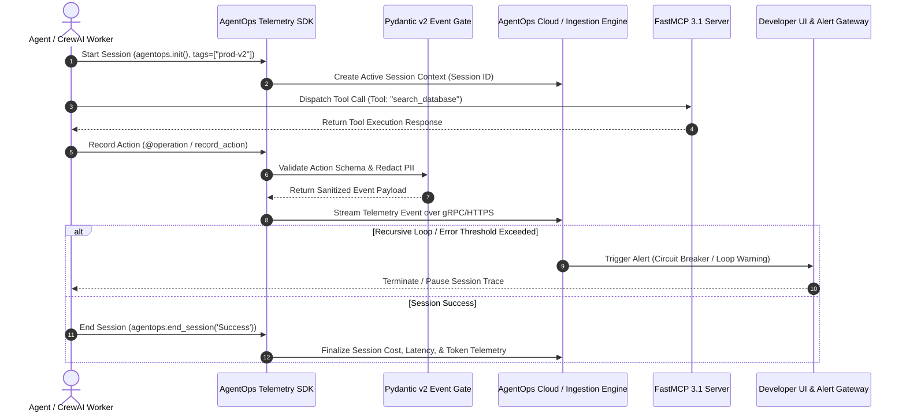

# AgentOps

## What it is
AgentOps is a specialized, enterprise-grade observability, telemetry, session replay, and evaluation platform engineered specifically for autonomous AI agents, multi-agent teams, and LLM tool execution pipelines. It provides a comprehensive suite of tools for tracking agent performance, debugging complex multi-step reasoning workflows, visualizing prompt chains, and monitoring production agent deployments across frontier model ecosystems in early 2027.

Rather than treating LLM interactions as simple request/response text pairs, AgentOps models agent execution as directed graphs of state transitions, tool invocations, recursive loops, and agent-to-agent task handoffs.

## System Architecture & Telemetry Pipeline

```
+-----------------------------------------------------------------------------------+
|                              AgentOps Observability Stack                         |
|                                                                                   |
|  +-----------------------------------------------------------------------------+  |
|  | Agentic Framework Layer (CrewAI, AutoGen, LangGraph, FastMCP 3.1 Tools)      |  |
|  +-----------------------------------------------------------------------------+  |
|                                        ||                                         |
|                                        \/                                         |
|  +-----------------------------------------------------------------------------+  |
|  | AgentOps SDK / Decorator Tracing Engine (@agent, @operation, OpenTelemetry) |  |
|  +-----------------------------------------------------------------------------+  |
|           ||                                                   ||                 |
|           \/                                                   \/                 |
|  +----------------------------------+        +---------------------------------+  |
|  | Session Replay & Directed Graphs |        | Token & Cost Management Gateway |  |
|  | (Recursive Loop / Fail Detector) |        | (400+ LLM Provider Analytics)   |  |
|  +----------------------------------+        +---------------------------------+  |
|                                        ||                                         |
|                                        \/                                         |
|  +-----------------------------------------------------------------------------+  |
|  | Guardrail & Security Engine (PII Redaction, Prompt Injection Detection)      |  |
|  +-----------------------------------------------------------------------------+  |
+-----------------------------------------------------------------------------------+
```

### Detailed Agent Telemetry & FastMCP Tracing Sequence



## Mathematical Formulations & Execution Graph Metrics

### 1. Directed Agent Execution Graph & Loop Entropy
Agent execution trajectories are modeled as a directed acyclic or cyclical state transition graph $G_{\text{trace}} = (S, T)$, where each vertex $s_i \in S$ represents an agent thought/action state, and directed edge $(s_i, s_j) \in T$ denotes a tool invocation or transition step.

To detect degenerate reasoning traps (infinite tool retry loops), AgentOps evaluates the **Transition Markov Entropy** $H(G_{\text{trace}})$ over window $W$:

$$H(G_{\text{trace}}) = - \sum_{s \in S} p(s) \sum_{s' \in \mathcal{N}(s)} P(s' \mid s) \log_2 P(s' \mid s)$$

Where:
- $P(s' \mid s) = \frac{C(s \to s')}{\sum_{k} C(s \to s_k)}$ is the transition probability from state $s$ to state $s'$ computed from occurrence frequencies $C$.
- When an agent becomes locked in a repetitive cycle (e.g. repeated tool call failures with identical parameters), $H(G_{\text{trace}}) \to 0$ and the cyclic repetition index $\mathcal{C}_{\text{loop}}$ surges:

$$\mathcal{C}_{\text{loop}} = \max_{k \ge 1} \frac{1}{k} \sum_{i=1}^k \text{CosineSimilarity}\big(\mathbf{e}_{\text{step}}(t - i), \mathbf{e}_{\text{step}}(t)\big)$$

If $\mathcal{C}_{\text{loop}} \ge \theta_{\text{alert}}$ (typically $\theta = 0.92$), AgentOps triggers a circuit breaker interrupt signal.

### 2. PII Token Masking & Regex Redaction Latency Bounds
Telemetry streams containing user queries, database outputs, and environment variables undergo inline stream scrubbing. The masking pipeline latency $T_{\text{mask}}$ over payload token length $L$ is bounded by:

$$T_{\text{mask}}(L) = \mathcal{O}(L \cdot |R_{\text{patterns}}|) + \tau_{\text{NER}} \cdot \mathbb{I}_{\text{entity\_model}}$$

Where $|R_{\text{patterns}}|$ is the number of active compiled regex rules (SSN, credit card, JWT tokens, API keys) and $\tau_{\text{NER}}$ is the optional named-entity recognition transformer inference time. Pre-compiled Aho-Corasick automaton algorithms constrain worst-case overhead to under $1.8\ \text{ms}$ per $10\text{KB}$ payload.

### 3. Cumulative Multi-Agent Cost Allocation Roofline
Across heterogeneous swarms involving models like Claude 5.6, GPT-5.6, and local quantized engines, cumulative session cost $C_{\text{session}}$ is formulated as:

$$C_{\text{session}} = \sum_{a \in \mathcal{A}} \sum_{m \in \mathcal{M}_a} \Big( N_{\text{prompt}}^{(a, m)} \cdot \Phi_{\text{input}}(m) + N_{\text{completion}}^{(a, m)} \cdot \Phi_{\text{output}}(m) + N_{\text{cache\_read}}^{(a, m)} \cdot \Phi_{\text{cache}}(m) \Big)$$

Where $\mathcal{A}$ is the set of active agents in the swarm, $\Phi(m)$ represents per-token pricing tiers, and $N$ represents observed token counters.

## What problem it solves
Developing autonomous agents is uniquely challenging due to their non-deterministic execution paths, recursive loops, and the high complexity of multi-turn tool interactions. AgentOps solves the "black box" problem by providing:
- **Execution Transparency**: Step-by-step agent execution graphs, trace nesting, and complete session replays.
- **Reliability Tracking**: Direct identification of infinite loops, recursive thought anti-patterns, and tool selection failures.
- **Cost Management**: Real-time tracking of token spend across 400+ LLM providers via gateways like [LiteLLM](../../services/litellm.md).
- **Benchmarking & Guardrails**: Rigorous evaluation metrics to measure agent task success, tool utilization rates, and compliance against guardrail policies.

## Where it fits in the stack
**Category**: [Process Understanding](../process_understanding/index.md) / AI Observability & Telemetry. AgentOps sits in the **AI Observability and Developer Tooling** layer, providing first-class support for multi-agent orchestration frameworks (CrewAI, AutoGen, LangGraph) and **FastMCP 3.1 / Model Context Protocol** tool calls.

## Key Technical Specifications & Architectural Standards

| Dimension | Standard / Specification | Production Requirement |
| :--- | :--- | :--- |
| **Telemetry Standard** | OpenTelemetry / AgentOps Protocol | Asynchronous streaming via gRPC or HTTPS POST |
| **Data Contract Validation** | Pydantic v2 Models | Strict payload typing and PII redaction rules |
| **Tool Integration Protocol** | FastMCP 3.1 / Model Context Protocol | Automatic event capturing on tool parameters and latencies |
| **Provider Analytics** | LiteLLM Gateway / Native Provider SDKs | Cost and token tracking for 400+ LLM endpoints |

## Typical use cases
- **Multi-Agent Orchestration**: Monitoring interactions and task handoffs between agents in frameworks like [CrewAI](../frameworks/crewai.md), AG2 ([AutoGen](../frameworks/autogen.md)), or [LangGraph](../frameworks/langgraph.md).
- **FastMCP Tool Observability**: Tracking calls to [MCP](../automation_orchestration/mcp.md) servers to identify tool latency, payload sizes, and failure rates under FastMCP 3.1.
- **Debugging Tool Failures**: Investigating exact model inputs and tool responses when agents fail or select incorrect parameters.
- **Production Session Analysis**: Replaying user-agent interactions powered by models like **Claude 3.5/3.7** or **GPT-4o/O1** to identify edge cases and improve agent reliability.
- **Token and Bill Tracking**: Monitoring real-time token spend across long-running autonomous tasks across multiple model providers.

## Feature Matrix & Framework Comparison

| Feature Capability | AgentOps Platform | Arize Phoenix | Langfuse (v3) | Helicone | W&B Weave |
| :--- | :--- | :--- | :--- | :--- | :--- |
| **Session Replay UI** | Full interactive step graph | Span waterfall trace | Trace tree view | Request list table | Lineage DAG view |
| **Multi-Agent Handoffs** | Native swarm topology | OTel span nesting | Span tags | Limited proxy header | Pipeline lineage |
| **FastMCP 3.1 Tool Tracing** | Native payload & schema inspection | Manual span instrumentation | OpenTelemetry wrapper | HTTP proxy metrics | Function decorator |
| **Recursive Loop Detection** | Automated entropy alert triggers | Manual threshold rules | None | Rate-limiting only | Custom metric queries |
| **PII & Prompt Defense** | Native PromptArmor integration | Presidio integration | Regex masking | Proxy filter rules | Client-side filters |
| **Self-Hosting Model** | Open SDK / Cloud or Local Exporter | 100% Open source local | 100% Self-hosted Docker | Self-hosted Proxy | Cloud / Enterprise |
| **Telemetry Ingestion** | gRPC & Async HTTPS | OpenTelemetry Collector | REST API / Batch | Cloudflare Worker Proxy | REST / Python SDK |

## Strengths
- **Framework Native**: Deep, multi-framework integrations with [CrewAI](../frameworks/crewai.md), [AutoGen](../frameworks/autogen.md), LangChain, LlamaIndex, and Smolagents.
- **Agent-Centric UI**: A dedicated dashboard designed for agentic flows, featuring session replays, directed event graphs, and structured agent metadata.
- **Fine-tuning Support**: Ability to export successful multi-turn agent execution traces to fine-tune specialized open-weights models (e.g., Llama 4, Qwen 3.8), reducing operational costs by up to 30%.
- **PII & Guardrail Security**: Built-in security features including honeypot detection, PII redacting, and prompt injection defenses via PromptArmor integration.

## Limitations
- **Specialization**: Designed specifically for multi-step agentic workflows; may introduce unnecessary overhead for static RAG or simple single-prompt applications.
- **Cloud-Centric**: While self-hosting options exist, the full feature set and analytics suite are optimized for the AgentOps cloud environment.
- **Instrumentation Overhead**: Detailed tracing requires properly instrumenting custom agent classes, decorators, and tool execution functions.

## When to use it
- When building multi-agent systems that require detailed tracking of agent handoffs and collaborative task execution.
- When you need a persistent "Flight Recorder" for autonomous agents to debug non-deterministic failures in production.
- When using popular agent frameworks like [CrewAI](../frameworks/crewai.md), [AutoGen](../frameworks/autogen.md), or [LangGraph](../frameworks/langgraph.md) and requiring instant observability.
- When monitoring and controlling LLM costs across a variety of providers within a unified management dashboard.

## When not to use it
- For basic chat applications where standard request/response logging (like [Helicone](helicone.md)) is sufficient.
- If you require an entirely local, offline observability tool without any external dependencies or cloud components.
- If your application does not follow agentic patterns (no autonomous tool use or multi-step reasoning).

## System Configuration & Operational Parameters

| Environment Variable | Default Value | Description |
| :--- | :--- | :--- |
| `AGENTOPS_API_KEY` | None | API key required for authenticating telemetry streaming to AgentOps. |
| `AGENTOPS_PORT` | `8094` | Network listener port for local AgentOps exporter proxy. |
| `AGENTOPS_AUTO_START_SESSION` | `true` | Automatically initialize session upon SDK import. |
| `AGENTOPS_LOG_LEVEL` | `INFO` | SDK logging verbosity (`DEBUG`, `INFO`, `WARNING`, `ERROR`). |
| `AGENTOPS_MAX_BUFFER_EVENTS` | `5000` | In-memory queue buffer capacity before forced telemetry flush. |
| `AGENTOPS_MASK_PII` | `true` | Enables automatic regex and NER masking of sensitive payload fields. |

## Getting started

### Installation
```bash
pip install "agentops>=0.3.0" "pydantic>=2.7.0" "mcp[cli]>=3.1.0"
```

### Basic Integration
AgentOps can be integrated with minimal setup by initializing the client session.

```python
import os
import agentops

# Initialize the AgentOps client
agentops.init(api_key=os.getenv("AGENTOPS_API_KEY", "your-api-key"), tags=["production-v2"])

# Your agentic execution logic here...
# e.g., executing agent workflows with CrewAI or AutoGen

# End session with explicit status reporting
agentops.end_session('Success')
```

### Using Decorators for Custom Agents
For custom agent implementations, use decorators to maintain a rich trace hierarchy with Pydantic v2 validation.

```python
from agentops.sdk.decorators import agent, operation
from pydantic import BaseModel, Field

class ResearchRequest(BaseModel):
    query: str = Field(description="Search topic query")
    max_results: int = Field(default=5, ge=1, le=20)

@agent
class ResearchAgent:
    def __init__(self, name: str):
        self.name = name

    @operation
    def search_topic(self, request: ResearchRequest) -> str:
        # Custom research execution logic...
        return f"Retrieved {request.max_results} results for query: '{request.query}'"

def run_research() -> str:
    my_agent = ResearchAgent("SeniorResearcher")
    req = ResearchRequest(query="FastMCP 3.1 protocol advancements", max_results=10)
    return my_agent.search_topic(req)
```

## CLI examples

### 1. Environment & API Key Verification
```bash
# Verify API key configuration and connectivity
python3 -c "import agentops; print(f'AgentOps API Key set: {bool(agentops.get_api_key())}')"
```

### 2. Session Data Export
```bash
# Export session trace data for offline evaluation
agentops export --session_id "sess_abc123" --format json
```

### 3. Local Exporter Health Diagnostics
```bash
# Check local telemetry listener endpoint status
curl -s http://127.0.0.1:8094/health | jq .
```

## API examples

### 1. Recording FastMCP 3.1 Tool Calls with Strict Pydantic v2 Validation
Track specific FastMCP 3.1 tool invocations using Pydantic v2 structured payload validation with frozen schemas:

```python
from typing import Dict, Any, Literal
import agentops
from pydantic import BaseModel, Field, ConfigDict, field_validator
from mcp.server.fastmcp import FastMCP
import logging

logging.basicConfig(level=logging.INFO)
logger = logging.getLogger("AgentOpsMCP")

mcp = FastMCP("AgentOpsFastMCPBridge")

class FastMCPToolCall(BaseModel):
    model_config = ConfigDict(extra="forbid", frozen=True)

    tool_name: str = Field(..., description="Name of the MCP tool")
    server_id: str = Field(..., description="ID of the target FastMCP 3.1 server")
    parameters: Dict[str, Any] = Field(default_factory=dict, description="Tool execution parameters")
    execution_mode: Literal["sync", "async", "background"] = Field(default="sync")

    @field_validator("tool_name")
    @classmethod
    def validate_name(cls, v: str) -> str:
        if not v.strip():
            raise ValueError("Tool name cannot be blank")
        return v

class TelemetrySpanResult(BaseModel):
    model_config = ConfigDict(extra="forbid", frozen=True)

    status: Literal["recorded", "rejected", "circuit_breaker_tripped"]
    span_id: str
    message: str

@mcp.tool(description="Track and execute FastMCP 3.1 tool calls with AgentOps telemetry.")
def execute_mcp_tool(payload: Dict[str, Any]) -> str:
    """Validates payload and records action in AgentOps telemetry stream."""
    try:
        validated = FastMCPToolCall.model_validate(payload)

        # Record structured FastMCP action in AgentOps session trace
        agentops.record_action(
            f"Calling FastMCP Tool: {validated.tool_name}",
            params={"server": validated.server_id, "args": validated.parameters, "mode": validated.execution_mode}
        )
        result = TelemetrySpanResult(
            status="recorded",
            span_id=f"span_{validated.server_id}_{validated.tool_name}",
            message=f"Execution of tool '{validated.tool_name}' logged in AgentOps session trace."
        )
        return result.model_dump_json()
    except Exception as e:
        return f"Telemetry Error: {str(e)}"

if __name__ == "__main__":
    mcp.run()
```

### 2. Multi-Model Session Tracking
Track performance and cost across **Claude 3.7** and **GPT-4o** within a single session:

```python
import agentops

def run_multi_model_session() -> None:
    # Initialize session with model comparison tags
    agentops.init(tags=["multi-model-eval", "claude-3-7", "gpt-4o"])

    # Step 1: Execute Claude 3.7 reasoning task
    agentops.record_action("Reasoning Step", params={"model": "claude-3-7-sonnet"})

    # Step 2: Execute GPT-4o code generation task
    agentops.record_action("Code Generation Step", params={"model": "gpt-4o"})

    # Complete session with explicit status
    agentops.end_session('Success')

if __name__ == "__main__":
    run_multi_model_session()
```

## Docker Compose Telemetry & Observability Stack

Deploy a containerized AgentOps exporter, Redis trace queue buffer, and LiteLLM proxy with the following `docker-compose.yml`:

```yaml
version: "3.9"

services:
  agentops-exporter:
    image: python:3.12-slim
    container_name: agentops-exporter
    restart: unless-stopped
    volumes:
      - ./exporter:/opt/agentops-exporter:ro
    environment:
      - AGENTOPS_API_KEY=${AGENTOPS_API_KEY}
      - AGENTOPS_PORT=8094
      - AGENTOPS_LOG_LEVEL=INFO
      - REDIS_URL=redis://agentops-redis:6379/0
    command: >
      bash -c "pip install --no-cache-dir agentops pydantic redis &&
               python3 /opt/agentops-exporter/server.py"
    ports:
      - "127.0.0.1:8094:8094"
    depends_on:
      - agentops-redis
    networks:
      - agentops-net

  agentops-redis:
    image: redis:7.4-alpine
    container_name: agentops-redis
    restart: unless-stopped
    command: redis-server --appendonly yes --maxmemory 512mb --maxmemory-policy volatile-lru
    volumes:
      - redis-data:/data
    networks:
      - agentops-net

  litellm-proxy:
    image: ghcr.io/berriai/litellm:main-latest
    container_name: litellm-gateway
    restart: unless-stopped
    ports:
      - "127.0.0.1:4000:4000"
    environment:
      - DATABASE_URL=redis://agentops-redis:6379/1
      - LITELLM_MASTER_KEY=${LITELLM_MASTER_KEY}
    networks:
      - agentops-net

volumes:
  redis-data:
    driver: local

networks:
  agentops-net:
    driver: bridge
```

## Production Systemd Service Unit Configuration

To host a local AgentOps telemetry exporter or proxy as a background daemon, create `/etc/systemd/system/agentops-exporter.service`:

```ini
[Unit]
Description=FastMCP 3.1 AgentOps Telemetry Exporter Daemon
After=network.target

[Service]
Type=simple
User=agentops
Group=agentops
WorkingDirectory=/opt/agentops-exporter
Environment="PATH=/opt/agentops-exporter/venv/bin:/usr/local/bin:/usr/bin"
Environment="AGENTOPS_PORT=8094"
Environment="AGENTOPS_LOG_LEVEL=INFO"
Environment="AGENTOPS_MASK_PII=true"
ExecStart=/opt/agentops-exporter/venv/bin/python3 -m agentops.exporter_server
Restart=always
RestartSec=5
LimitNOFILE=65536

# Security Hardening
ProtectSystem=full
ProtectHome=true
NoNewPrivileges=true
PrivateTmp=true

[Install]
WantedBy=multi-user.target
```

Enable and start the service using systemctl:
```bash
sudo systemctl daemon-reload
sudo systemctl enable --now agentops-exporter.service
sudo systemctl status agentops-exporter.service
```

## Diagnostic Troubleshooting Matrix

| Symptom / Issue | Primary Cause | Diagnostic Command | Remediation Strategy |
| :--- | :--- | :--- | :--- |
| **Missing Trace Sessions** | `AGENTOPS_API_KEY` missing or invalid in execution runtime. | `python3 -c "import agentops; print(agentops.get_api_key())"` | Export valid `AGENTOPS_API_KEY` in systemd unit or shell environment. |
| **Session Truncation / Drop** | High-frequency agent tool calls exceeding rate limit. | `journalctl -u agentops-exporter.service -n 50` | Enable async batching in SDK initialization (`agentops.init(batch_mode=True)`). |
| **PII Leakage in Dashboard** | Redaction regex rules disabled or missing custom parameter masks. | `agentops config view` | Enable native PII masking via `agentops.init(mask_pii=True)`. |
| **FastMCP Tool Span Detachment** | Tool call executed outside active `agentops.init()` session scope. | `curl -s http://127.0.0.1:8094/sessions/active` | Wrap tool execution within `@operation` decorator or pass explicit session context. |
| **High Memory on Agent Worker** | Telemetry queue buffer unbounded during network outage. | `grep -i "buffer_size" /var/log/agentops.log` | Configure `AGENTOPS_MAX_BUFFER_EVENTS=5000` to drop stale spans gracefully. |
| **Recursive Loop False Positives** | Threshold `\theta_{\text{alert}}` set too low for intentional retry algorithms. | Check AgentOps console alert settings. | Increase cycle repetition threshold from 0.85 to 0.95 for recursive agents. |
| **LiteLLM Spend Discrepancy** | Token pricing table outdated in local cache. | `curl -s http://127.0.0.1:4000/model/info` | Sync model pricing database via `litellm --update-pricing-cache`. |
| **Connection Refused on Port 8094** | Systemd exporter daemon crashed or binding to incorrect interface. | `ss -tulpn \| grep 8094` | Verify exporter binding `0.0.0.0:8094` or check `systemctl status agentops-exporter`. |

## Related tools / concepts
- [Langfuse](langfuse.md) - Open-source observability and evaluation platform.
- [Helicone](helicone.md) - Proxy-based LLM observability and gateway.
- [Arize AI](arize-ai.md) - Enterprise-grade ML observability and evaluation.
- [W&B Weave](wandb-weave.md) - Lightweight tracing for ML workflows.
- [MCP](../automation_orchestration/mcp.md) - Model Context Protocol for connecting agents to tools.
- [Claude](../ai_knowledge/claude.md) - Frontier model suite powering complex agent systems.
- [CrewAI](../frameworks/crewai.md) - Multi-agent framework with native AgentOps integration.
- [AutoGen](../frameworks/autogen.md) - Microsoft's multi-agent conversational framework.
- [LiteLLM](../../services/litellm.md) - Gateway integrating with AgentOps for unified cost tracking.

## Sources / references
- [AgentOps Official Website](https://www.agentops.ai/)
- [AgentOps Documentation](https://docs.agentops.ai/introduction)
- [AgentOps GitHub Repository](https://github.com/AgentOps-AI/agentops)

---
## Contribution Metadata
- Last reviewed: 2027-01-07
- Confidence: high
