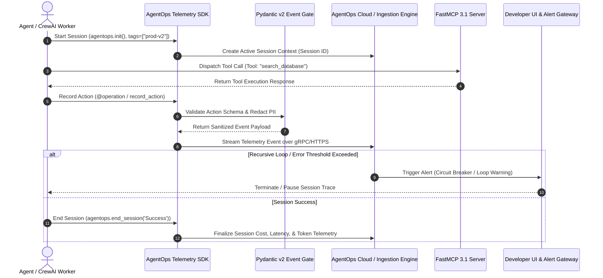

# AgentOps

## What it is
AgentOps is a specialized, enterprise-grade observability, telemetry, session replay, and evaluation platform engineered specifically for autonomous AI agents, multi-agent teams, and LLM tool execution pipelines. It provides a comprehensive suite of tools for tracking agent performance, debugging complex multi-step reasoning workflows, visualizing prompt chains, and monitoring production agent deployments across frontier model ecosystems in early 2027.

Rather than treating LLM interactions as simple request/response text pairs, AgentOps models agent execution as directed graphs of state transitions, tool invocations, recursive loops, and agent-to-agent task handoffs.

## System Architecture & Telemetry Pipeline

```
+-----------------------------------------------------------------------------------+
|                              AgentOps Observability Stack                         |
|                                                                                   |
|  +-----------------------------------------------------------------------------+  |
|  | Agentic Framework Layer (CrewAI, AutoGen, LangGraph, FastMCP 3.1 Tools)      |  |
|  +-----------------------------------------------------------------------------+  |
|                                        ||                                         |
|                                        \/                                         |
|  +-----------------------------------------------------------------------------+  |
|  | AgentOps SDK / Decorator Tracing Engine (@agent, @operation, OpenTelemetry) |  |
|  +-----------------------------------------------------------------------------+  |
|           ||                                                   ||                 |
|           \/                                                   \/                 |
|  +----------------------------------+        +---------------------------------+  |
|  | Session Replay & Directed Graphs |        | Token & Cost Management Gateway |  |
|  | (Recursive Loop / Fail Detector) |        | (400+ LLM Provider Analytics)   |  |
|  +----------------------------------+        +---------------------------------+  |
|                                        ||                                         |
|                                        \/                                         |
|  +-----------------------------------------------------------------------------+  |
|  | Guardrail & Security Engine (PII Redaction, Prompt Injection Detection)      |  |
|  +-----------------------------------------------------------------------------+  |
+-----------------------------------------------------------------------------------+
```

### Detailed Agent Telemetry & FastMCP Tracing Sequence



## What problem it solves
Developing autonomous agents is uniquely challenging due to their non-deterministic execution paths, recursive loops, and the high complexity of multi-turn tool interactions. AgentOps solves the "black box" problem by providing:
- **Execution Transparency**: Step-by-step agent execution graphs, trace nesting, and complete session replays.
- **Reliability Tracking**: Direct identification of infinite loops, recursive thought anti-patterns, and tool selection failures.
- **Cost Management**: Real-time tracking of token spend across 400+ LLM providers via gateways like [LiteLLM](../../services/litellm.md).
- **Benchmarking & Guardrails**: Rigorous evaluation metrics to measure agent task success, tool utilization rates, and compliance against guardrail policies.

## Where it fits in the stack
**Category**: [Process Understanding](../process_understanding/index.md) / AI Observability & Telemetry. AgentOps sits in the **AI Observability and Developer Tooling** layer, providing first-class support for multi-agent orchestration frameworks (CrewAI, AutoGen, LangGraph) and **FastMCP 3.1 / Model Context Protocol** tool calls.

## Key Technical Specifications & Architectural Standards

| Dimension | Standard / Specification | Production Requirement |
| :--- | :--- | :--- |
| **Telemetry Standard** | OpenTelemetry / AgentOps Protocol | Asynchronous streaming via gRPC or HTTPS POST |
| **Data Contract Validation** | Pydantic v2 Models | Strict payload typing and PII redaction rules |
| **Tool Integration Protocol** | FastMCP 3.1 / Model Context Protocol | Automatic event capturing on tool parameters and latencies |
| **Provider Analytics** | LiteLLM Gateway / Native Provider SDKs | Cost and token tracking for 400+ LLM endpoints |

## Typical use cases
- **Multi-Agent Orchestration**: Monitoring interactions and task handoffs between agents in frameworks like [CrewAI](../frameworks/crewai.md), AG2 ([AutoGen](../frameworks/autogen.md)), or [LangGraph](../frameworks/langgraph.md).
- **FastMCP Tool Observability**: Tracking calls to [MCP](../automation_orchestration/mcp.md) servers to identify tool latency, payload sizes, and failure rates under FastMCP 3.1.
- **Debugging Tool Failures**: Investigating exact model inputs and tool responses when agents fail or select incorrect parameters.
- **Production Session Analysis**: Replaying user-agent interactions powered by models like **Claude 3.5/3.7** or **GPT-4o/O1** to identify edge cases and improve agent reliability.
- **Token and Bill Tracking**: Monitoring real-time token spend across long-running autonomous tasks across multiple model providers.

## Feature Matrix & Comparison

| Feature Capability | AgentOps Platform | Standard Logging (Winston/Loguru) | Request Proxies (Helicone/LiteLLM) |
| :--- | :--- | :--- | :--- |
| **Agent Session Replays** | Full graphical step-by-step trace | Text logs only | API call logs |
| **Multi-Agent Handoffs** | Graph topology tracking | Manual tagging | Basic metadata |
| **FastMCP 3.1 Tool Tracing** | Native payload & latency breakdown | Unstructured string | HTTP level |
| **Recursive Loop Detection** | Automatic alert triggers | None | None |
| **PII & Guardrail Defense** | Native redactor & prompt defender | Custom Regex | Proxy level |

## Strengths
- **Framework Native**: Deep, multi-framework integrations with [CrewAI](../frameworks/crewai.md), [AutoGen](../frameworks/autogen.md), LangChain, LlamaIndex, and Smolagents.
- **Agent-Centric UI**: A dedicated dashboard designed for agentic flows, featuring session replays, directed event graphs, and structured agent metadata.
- **Fine-tuning Support**: Ability to export successful multi-turn agent execution traces to fine-tune specialized open-weights models (e.g., Llama 4, Qwen 3.8), reducing operational costs by up to 30%.
- **PII & Guardrail Security**: Built-in security features including honeypot detection, PII redacting, and prompt injection defenses via PromptArmor integration.

## Limitations
- **Specialization**: Designed specifically for multi-step agentic workflows; may introduce unnecessary overhead for static RAG or simple single-prompt applications.
- **Cloud-Centric**: While self-hosting options exist, the full feature set and analytics suite are optimized for the AgentOps cloud environment.
- **Instrumentation Overhead**: Detailed tracing requires properly instrumenting custom agent classes, decorators, and tool execution functions.

## When to use it
- When building multi-agent systems that require detailed tracking of agent handoffs and collaborative task execution.
- When you need a persistent "Flight Recorder" for autonomous agents to debug non-deterministic failures in production.
- When using popular agent frameworks like [CrewAI](../frameworks/crewai.md), [AutoGen](../frameworks/autogen.md), or [LangGraph](../frameworks/langgraph.md) and requiring instant observability.
- When monitoring and controlling LLM costs across a variety of providers within a unified management dashboard.

## When not to use it
- For basic chat applications where standard request/response logging (like [Helicone](helicone.md)) is sufficient.
- If you require an entirely local, offline observability tool without any external dependencies or cloud components.
- If your application does not follow agentic patterns (no autonomous tool use or multi-step reasoning).

## System Configuration & Operational Parameters

| Environment Variable | Default Value | Description |
| :--- | :--- | :--- |
| `AGENTOPS_API_KEY` | None | API key required for authenticating telemetry streaming to AgentOps. |
| `AGENTOPS_PORT` | `8094` | Network listener port for local AgentOps exporter proxy. |
| `AGENTOPS_AUTO_START_SESSION` | `true` | Automatically initialize session upon SDK import. |
| `AGENTOPS_LOG_LEVEL` | `INFO` | SDK logging verbosity (`DEBUG`, `INFO`, `WARNING`, `ERROR`). |

## Getting started

### Installation
```bash
pip install "agentops>=0.3.0" "pydantic>=2.7.0" "mcp[cli]>=3.1.0"
```

### Basic Integration
AgentOps can be integrated with minimal setup by initializing the client session.

```python
import os
import agentops

# Initialize the AgentOps client
agentops.init(api_key=os.getenv("AGENTOPS_API_KEY", "your-api-key"), tags=["production-v2"])

# Your agentic execution logic here...
# e.g., executing agent workflows with CrewAI or AutoGen

# End session with explicit status reporting
agentops.end_session('Success')
```

### Using Decorators for Custom Agents
For custom agent implementations, use decorators to maintain a rich trace hierarchy with Pydantic v2 validation.

```python
from agentops.sdk.decorators import agent, operation
from pydantic import BaseModel, Field

class ResearchRequest(BaseModel):
    query: str = Field(description="Search topic query")
    max_results: int = Field(default=5, ge=1, le=20)

@agent
class ResearchAgent:
    def __init__(self, name: str):
        self.name = name

    @operation
    def search_topic(self, request: ResearchRequest) -> str:
        # Custom research execution logic...
        return f"Retrieved {request.max_results} results for query: '{request.query}'"

def run_research() -> str:
    my_agent = ResearchAgent("SeniorResearcher")
    req = ResearchRequest(query="FastMCP 3.1 protocol advancements", max_results=10)
    return my_agent.search_topic(req)
```

## CLI examples

### 1. Environment & API Key Verification
```bash
# Verify API key configuration and connectivity
python3 -c "import agentops; print(f'AgentOps API Key set: {bool(agentops.get_api_key())}')"
```

### 2. Session Data Export
```bash
# Export session trace data for offline evaluation
agentops export --session_id "sess_abc123" --format json
```

## API examples

### 1. Recording FastMCP 3.1 Tool Calls with Pydantic v2 Validation
Track specific FastMCP 3.1 tool invocations using Pydantic v2 structured payload validation:

```python
from typing import Dict, Any
import agentops
from pydantic import BaseModel, Field, field_validator
from mcp.server.fastmcp import FastMCP
import logging

logging.basicConfig(level=logging.INFO)
logger = logging.getLogger("AgentOpsMCP")

mcp = FastMCP("AgentOpsFastMCPBridge")

class FastMCPToolCall(BaseModel):
    tool_name: str = Field(description="Name of the MCP tool")
    server_id: str = Field(description="ID of the target FastMCP 3.1 server")
    parameters: Dict[str, Any] = Field(default_factory=dict)

    @field_validator("tool_name")
    def validate_name(cls, v: str) -> str:
        if not v.strip():
            raise ValueError("Tool name cannot be blank")
        return v

@mcp.tool(description="Track and execute FastMCP 3.1 tool calls with AgentOps telemetry.")
def execute_mcp_tool(payload: Dict[str, Any]) -> str:
    """Validates payload and records action in AgentOps telemetry stream."""
    validated = FastMCPToolCall.model_validate(payload)

    # Record structured FastMCP action in AgentOps session trace
    agentops.record_action(
        f"Calling FastMCP Tool: {validated.tool_name}",
        params={"server": validated.server_id, "args": validated.parameters}
    )
    return f"Execution of tool '{validated.tool_name}' logged in AgentOps session trace."

if __name__ == "__main__":
    mcp.run()
```

### 2. Multi-Model Session Tracking
Track performance and cost across **Claude 3.7** and **GPT-4o** within a single session:

```python
import agentops

def run_multi_model_session() -> None:
    # Initialize session with model comparison tags
    agentops.init(tags=["multi-model-eval", "claude-3-7", "gpt-4o"])

    # Step 1: Execute Claude 3.7 reasoning task
    agentops.record_action("Reasoning Step", params={"model": "claude-3-7-sonnet"})

    # Step 2: Execute GPT-4o code generation task
    agentops.record_action("Code Generation Step", params={"model": "gpt-4o"})

    # Complete session with explicit status
    agentops.end_session('Success')

if __name__ == "__main__":
    run_multi_model_session()
```

## Production Systemd Service Unit Configuration

To host a local AgentOps telemetry exporter or proxy as a background daemon, create `/etc/systemd/system/agentops-exporter.service`:

```ini
[Unit]
Description=FastMCP 3.1 AgentOps Telemetry Exporter Daemon
After=network.target

[Service]
Type=simple
User=agentops
Group=agentops
WorkingDirectory=/opt/agentops-exporter
Environment="PATH=/opt/agentops-exporter/venv/bin:/usr/local/bin:/usr/bin"
Environment="AGENTOPS_PORT=8094"
Environment="AGENTOPS_LOG_LEVEL=INFO"
ExecStart=/opt/agentops-exporter/venv/bin/python3 -m agentops.exporter_server
Restart=always
RestartSec=5
LimitNOFILE=65536

# Security Hardening
ProtectSystem=full
ProtectHome=true
NoNewPrivileges=true
PrivateTmp=true

[Install]
WantedBy=multi-user.target
```

Enable and start the service using systemctl:
```bash
sudo systemctl daemon-reload
sudo systemctl enable --now agentops-exporter.service
sudo systemctl status agentops-exporter.service
```

## Diagnostic Troubleshooting Matrix

| Symptom / Issue | Primary Cause | Diagnostic Command | Remediation Strategy |
| :--- | :--- | :--- | :--- |
| **Missing Trace Sessions** | `AGENTOPS_API_KEY` missing or invalid in execution runtime. | `python3 -c "import agentops; print(agentops.get_api_key())"` | Export valid `AGENTOPS_API_KEY` in systemd unit or shell environment. |
| **Session Truncation / Drop** | High-frequency agent tool calls exceeding rate limit. | `journalctl -u agentops-exporter.service -n 50` | Enable async batching in SDK initialization (`agentops.init(batch_mode=True)`). |
| **PII Leakage in Dashboard** | Redaction regex rules disabled or missing custom parameter masks. | `agentops config view` | Enable native PII masking via `agentops.init(mask_pii=True)`. |
| **FastMCP Tool Span Detachment** | Tool call executed outside active `agentops.init()` session scope. | `openclaw trace view --session <ID>` | Wrap tool execution within `@operation` decorator or pass explicit session context. |

## Related tools / concepts
- [Langfuse](langfuse.md) - Open-source observability and evaluation platform.
- [Helicone](helicone.md) - Proxy-based LLM observability and gateway.
- [Arize AI](arize-ai.md) - Enterprise-grade ML observability and evaluation.
- [W&B Weave](wandb-weave.md) - Lightweight tracing for ML workflows.
- [MCP](../automation_orchestration/mcp.md) - Model Context Protocol for connecting agents to tools.
- [Claude](../ai_knowledge/claude.md) - Frontier model suite powering complex agent systems.
- [CrewAI](../frameworks/crewai.md) - Multi-agent framework with native AgentOps integration.
- [AutoGen](../frameworks/autogen.md) - Microsoft's multi-agent conversational framework.
- [LiteLLM](../../services/litellm.md) - Gateway integrating with AgentOps for unified cost tracking.

## Sources / references
- [AgentOps Official Website](https://www.agentops.ai/)
- [AgentOps Documentation](https://docs.agentops.ai/introduction)
- [AgentOps GitHub Repository](https://github.com/AgentOps-AI/agentops)

---
## Contribution Metadata
- Last reviewed: 2027-01-07
- Confidence: high
