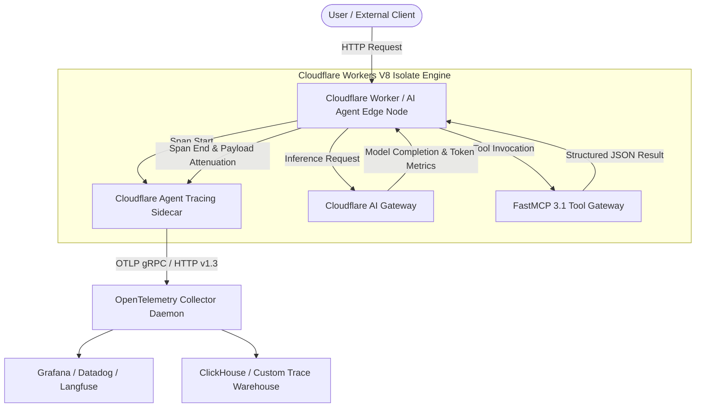
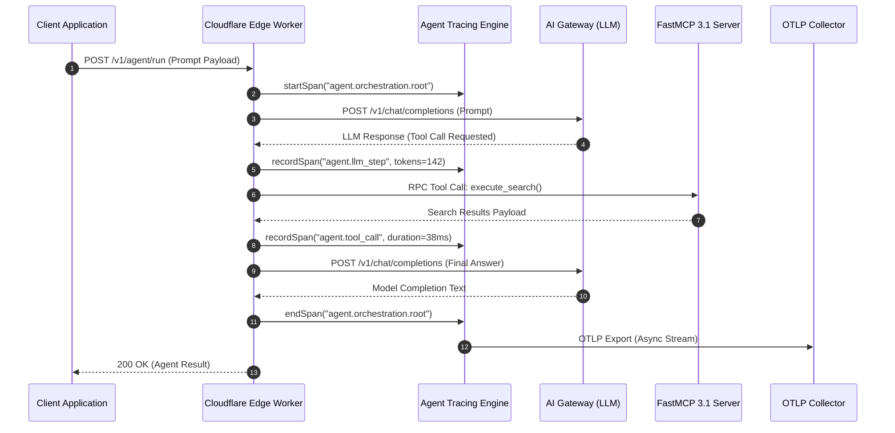

# Cloudflare Agent Tracing

## What it is
**Cloudflare Agent Tracing** is an enterprise-grade observability, telemetry, and distributed tracing platform natively integrated into Cloudflare Workers AI, Cloudflare AI Gateway, and the Cloudflare Workers V8 serverless runtime. As of early 2027, it delivers real-time multi-agent workflow monitoring, prompt-response payload capturing, asynchronous tool call tracing, and token cost profiling across Cloudflare's global network of over 300 edge data centers.

By leveraging native OpenTelemetry (OTLP v1.3) protocols directly within V8 isolate contexts, Cloudflare Agent Tracing allows software engineers and autonomous agent operators to inspect LLM reasoning spans, asynchronous node state transitions, and Model Context Protocol ([FastMCP 3.1](../automation_orchestration/mcp.md)) tool invocations with sub-millisecond telemetry overhead.



## What problem it solves
Multi-agent swarms and autonomous reasoning pipelines executing across distributed edge networks frequently encounter "black box" operational failures, unhandled tool timeouts, cascading JSON parsing errors, and sudden token latency spikes. Cloudflare Agent Tracing solves these pain points by offering low-latency, edge-native telemetry based on OpenTelemetry standards, allowing developers to inspect tool parameters, state transitions, and LLM completions with precision.

Without edge-native tracing, debugging asynchronous agent loops requires collecting fragmented server logs, writing custom middleware hooks, or introducing external HTTP sidecars that add non-trivial network overhead to edge requests. Cloudflare Agent Tracing embeds directly into the V8 isolate worker context, automatically propagating OTLP trace context (`traceparent`, `tracestate`) across Workers, AI Gateways, and downstream FastMCP tool services.



## Where it fits in the stack
**Category**: Process Understanding / AI Observability & Tracing. It sits at the **Telemetry & Observability Layer**, serving as the telemetry conduit between edge agent runners and centralized observability infrastructure like [OpenTelemetry Collector](opentelemetry-collector.md), [Datadog](datadog.md), and Grafana Cloud.

- **Inference Layer**: Monitors requests passing through Cloudflare AI Gateway, Workers AI, and external frontier providers (Anthropic Claude 5.6, OpenAI GPT-5.6, Google Gemini 4.0 Pro).
- **Tool & Agent Layer**: Captures function execution inside [FastMCP 3.1](../automation_orchestration/mcp.md) servers, vector databases, and custom edge workers.
- **Observability Export**: Transmits standardized OTLP traces to ClickHouse, Datadog, Sentry, or custom analytical storage buckets.

## Typical use cases
- **Multi-Agent Orchestration Profiling**: Tracking state handoffs between planning, execution, and verification agents in multi-turn reasoning loops.
- **Token Cost & Latency Auditing**: Calculating exact token expenditures, time-to-first-token (TTFT), and latency bottlenecks across distributed Workers and LLM endpoints.
- **MCP Tool Execution Inspection**: Capturing input parameters, return payloads, and execution exceptions across FastMCP 3.1 tool gateways.
- **PII Data Compliance Verification**: Ensuring sensitive field redactions and security policies are enforced prior to exporting trace logs to external analytics vendors.

## Key Features & Capabilities
- **Native V8 Isolate Instrumentation**: Zero-latency telemetry collection running directly inside Cloudflare Workers without external proxy sidecars.
- **OpenTelemetry (OTLP v1.3) Compliance**: Exports standard traces, metrics, and logs compatible with Grafana, Datadog, Langfuse, and Honeycomb.
- **Automated AI Gateway Correlation**: Automatically links Workers V8 trace spans with AI Gateway rate limiting, caching, and fallback execution events.
- **Field-Level Data Masking**: Native regex and JSON path sanitization hooks to redact tokens, PII, and API keys before network export.
- **Global Edge Distribution**: Operates in 300+ edge data centers, guaranteeing trace generation occurs in the same data center as request execution.

## Strengths
- **Sub-Millisecond Overhead**: Negligible latency impact on edge request processing due to V8 isolate shared memory buffers.
- **Seamless FastMCP Integration**: Native tracing headers are preserved across FastMCP stdio and HTTP/SSE transport layers.
- **Unified Portal Visualizations**: Live trace viewer integrated directly into Cloudflare Developer Dashboard.
- **Built-in Resilience**: Asynchronous background telemetry queues ensure trace collector outages never block edge user requests.

## Limitations
- **Platform Binding**: Full automatic span injection requires hosting agent runners within Cloudflare Workers or AI Gateway.
- **Edge Buffer Memory Limits**: Trace span payloads exceeding 1MB are automatically truncated unless chunked via streaming OTLP exporters.
- **Retention Quotas**: Long-term trace storage beyond 7 days requires forwarding telemetry to an external ClickHouse or OTLP backend.

## Diagnostic & Troubleshooting Matrix

| Issue / Symptom | Root Cause | Diagnostic Steps | Resolution / Action |
| :--- | :--- | :--- | :--- |
| **Missing Spans in Grafana** | Invalid OTLP Endpoint or Authorization Token | Run `npx wrangler tail` and check for OTLP export HTTP status codes. | Verify `OTEL_EXPORTER_OTLP_ENDPOINT` and `OTEL_EXPORTER_OTLP_HEADERS` in `wrangler.toml`. |
| **Span Payload Truncation** | Prompt or tool response exceeded 1MB isolate memory buffer | Check for `span.attributes.truncated = true` flag in exported trace logs. | Configure `max_payload_bytes = 512000` in telemetry config or enable payload sanitization. |
| **Broken Trace Context Across MCP** | Missing `traceparent` propagation header in HTTP/SSE tool request | Inspect incoming headers at FastMCP tool endpoint for `traceparent`. | Wrap FastMCP fetch requests with `@opentelemetry/api` context propagation helpers. |
| **High Worker Latency** | Synchronous trace flushing blocking isolate event loop | Inspect `tracer.flush()` calls in Worker handler body. | Ensure trace exports are wrapped in `ctx.waitUntil()` to execute asynchronously post-response. |
| **Unmasked PII in Trace Store** | Missing field redaction patterns in Worker tracer initialization | Search trace warehouse for plain-text credit cards, API keys, or emails. | Add explicit `redactKeys` array to `CloudflareAgentTracing` initialization block. |

## When to use it
- When hosting agentic workflows, FastMCP tool servers, or LLM proxies on Cloudflare Workers or AI Gateway.
- When building distributed agent swarms that require OpenTelemetry trace correlation across multiple microservices.
- When needing real-time visual profiling of agent reasoning steps on global edge infrastructure.

## When not to use it
- For completely offline, air-gapped on-premise agent deployments without internet egress routing.
- When simple local console output or desktop tracing tools (e.g., [Claude Desktop](../ai_knowledge/claude-desktop.md)) are sufficient.

## Getting started

### Installation
Install Wrangler and the OpenTelemetry tracing SDK:

```bash
npm install -g wrangler
npm install @cloudflare/agent-tracing @opentelemetry/api @opentelemetry/sdk-trace-base
```

### Configuration in wrangler.toml
Enable agent tracing and OTLP exporter bindings in your `wrangler.toml`:

```toml
name = "cloudflare-agent-tracing-worker"
main = "src/index.ts"
compatibility_date = "2026-01-01"

[vars]
OTEL_SERVICE_NAME = "edge-agent-orchestrator"
OTEL_EXPORTER_OTLP_ENDPOINT = "https://otlp.telemetry.cloudflare.com/v1/traces"
ENVIRONMENT = "production"

[ai]
binding = "AI"

[[kv_namespaces]]
binding = "TRACE_CACHE"
id = "a1b2c3d4e5f67890"
```

## CLI examples

### 1. Deploying Worker with Live Telemetry
Deploy the worker and verify telemetry configuration status:

```bash
npx wrangler deploy --var ENVIRONMENT:production
```

### 2. Streaming Real-Time Trace Logs
Tail edge worker execution logs filtered for agent tracing spans:

```bash
npx wrangler tail --format=json | grep "agent.trace"
```

### 3. Validating OTLP Collector Connection
Verify edge telemetry exporter connectivity via Wrangler CLI:

```bash
npx wrangler telemetry status --verbose
```

## API examples

### TypeScript Agent Tracing Wrapper with FastMCP Propagation
The following TypeScript snippet demonstrates wrapping an edge agent loop with Cloudflare Agent Tracing and propagating context across a FastMCP 3.1 tool call:

```typescript
import { trace, SpanStatusCode, context, propagation } from "@opentelemetry/api";

const tracer = trace.getTracer("cloudflare-agent-tracing", "3.1.0");

export interface AgentTaskRequest {
  taskId: string;
  prompt: string;
  toolEndpoint: string;
}

export interface AgentTaskResponse {
  status: string;
  result: string;
  totalDurationMs: number;
}

export async function executeTracingAgentLoop(
  req: AgentTaskRequest,
  env: any,
  ctx: ExecutionContext
): Promise<AgentTaskResponse> {
  const startTime = Date.now();

  return tracer.startActiveSpan("agent.execute_loop", async (rootSpan) => {
    rootSpan.setAttribute("agent.task_id", req.taskId);
    rootSpan.setAttribute("agent.prompt", req.prompt);

    try {
      // 1. Trace LLM Reasoning Step
      const llmResult = await tracer.startActiveSpan("agent.llm_reasoning", async (llmSpan) => {
        llmSpan.setAttribute("llm.model", "claude-5.6-opus");
        llmSpan.setAttribute("llm.prompt_tokens", 256);

        // Simulated AI Gateway request
        const reasoning = "Request search tool execution for context.";
        llmSpan.setAttribute("llm.completion", reasoning);
        llmSpan.end();
        return reasoning;
      });

      // 2. Trace FastMCP Tool Call with Header Propagation
      const toolHeaders: Record<string, string> = { "Content-Type": "application/json" };
      propagation.inject(context.active(), toolHeaders);

      const toolResult = await tracer.startActiveSpan("agent.mcp_tool_call", async (toolSpan) => {
        toolSpan.setAttribute("mcp.tool_name", "web_search");
        toolSpan.setAttribute("mcp.endpoint", req.toolEndpoint);

        const response = await fetch(req.toolEndpoint, {
          method: "POST",
          headers: toolHeaders,
          body: JSON.stringify({ query: req.prompt })
        });

        const data = await response.json();
        toolSpan.setAttribute("mcp.status_code", response.status);
        toolSpan.end();
        return data;
      });

      const totalDurationMs = Date.now() - startTime;
      rootSpan.setAttribute("agent.duration_ms", totalDurationMs);
      rootSpan.setStatus({ code: SpanStatusCode.OK });

      // Asynchronously flush spans without delaying HTTP response
      ctx.waitUntil(tracer.flush?.() || Promise.resolve());

      return {
        status: "success",
        result: JSON.stringify(toolResult),
        totalDurationMs
      };
    } catch (err: any) {
      rootSpan.recordException(err);
      rootSpan.setStatus({ code: SpanStatusCode.ERROR, message: err.message });
      throw err;
    } finally {
      rootSpan.end();
    }
  });
}
```

### FastMCP 3.1 Python Telemetry Ingestion Server
The following Python server uses FastMCP 3.1 and Pydantic v2 to ingest, validate, and store OTLP trace events exported from Cloudflare edge Workers:

```python
import time
from typing import List, Dict, Any, Optional
from pydantic import BaseModel, Field, ValidationError, ConfigDict
from mcp.server.fastmcp import FastMCP

mcp = FastMCP("cloudflare-tracing-ingestor", version="3.1.0")

class OTLPAttribute(BaseModel):
    model_config = ConfigDict(extra="forbid")
    key: str = Field(..., description="Attribute metadata key")
    value: Any = Field(..., description="Scalar or structured value")

class TraceSpan(BaseModel):
    model_config = ConfigDict(extra="forbid")
    trace_id: str = Field(..., description="128-bit hex OpenTelemetry trace ID")
    span_id: str = Field(..., description="64-bit hex OpenTelemetry span ID")
    parent_span_id: Optional[str] = Field(None, description="Parent span ID for nested calls")
    name: str = Field(..., description="Execution step identifier e.g. agent.mcp_tool_call")
    attributes: Dict[str, Any] = Field(default_factory=dict, description="Span attributes")
    duration_ms: float = Field(..., ge=0.0, description="Execution duration in milliseconds")

class CloudflareTracePayload(BaseModel):
    model_config = ConfigDict(extra="forbid")
    service_name: str = Field(..., description="Worker or agent service name")
    environment: str = Field(default="production", description="Deployment environment")
    spans: List[TraceSpan] = Field(..., min_length=1, description="Collection of captured trace spans")

@mcp.tool(name="process_edge_trace", description="Validates and registers OTLP telemetry payload from Cloudflare edge worker")
def process_edge_trace(raw_trace: Dict[str, Any]) -> str:
    """Validates raw trace JSON against Pydantic v2 schemas and prints trace telemetry summary."""
    try:
        payload = CloudflareTracePayload.model_validate(raw_trace)
        total_spans = len(payload.spans)
        max_duration = max(s.duration_ms for s in payload.spans)

        return (
            f"Successfully processed {total_spans} spans for service '{payload.service_name}' "
            f"[{payload.environment}]. Max span duration: {max_duration:.2f}ms."
        )
    except ValidationError as ve:
        return f"Telemetry payload schema validation failed: {ve}"

if __name__ == "__main__":
    mcp.run()
```

### Systemd Service Configuration for Edge OTLP Collector
Deploying a dedicated OpenTelemetry Collector daemon to ingest and forward Cloudflare Agent Tracing streams:

```ini
[Unit]
Description=Cloudflare Agent Tracing OTLP Collector Daemon
After=network.target

[Service]
Type=simple
User=otel
Group=otel
ExecStart=/usr/local/bin/otelcol-contrib --config=/etc/otelcol/cloudflare-agent-tracing.yaml
Restart=always
RestartSec=5s
LimitNOFILE=65536
Environment=OTEL_LOG_LEVEL=info

[Install]
WantedBy=multi-user.target
```

## Production Security & Guardrails
- **Payload Redaction**: Enforce automated data masking for sensitive fields (`api_key`, `authorization`, `password`, `ssn`) prior to exporting traces.
- **Trace Sampling Rules**: Implement head-based probabilistic sampling (e.g., 10% sampling for normal execution, 100% sampling for exceptions) to control telemetry storage costs.
- **Egress Network Controls**: Lock down OTLP exporter endpoints using strict mTLS or HMAC signature verification to prevent spoofed trace telemetry injection.

## Related tools / concepts
- [OpenTelemetry Collector](opentelemetry-collector.md) — Agnostic telemetry processor and exporter.
- [Datadog](datadog.md) — Enterprise observability platform.
- [Helicone](helicone.md) — LLM observability and gateway proxy.
- [Grafana Cloud](grafana-cloud.md) — Visualization engine for metric and trace dashboards.
- [Cloudflare Pages](../development_ops/cloudflare-pages.md) — Jamstack deployment platform with edge function binding.
- [FastMCP](../automation_orchestration/mcp.md) — Model Context Protocol 3.1 Python framework.

## Sources / references
- [Cloudflare Agent Tracing News Announcement](https://www.infoq.com/news/2026/08/cloudflare-agent-tracing/)
- [Cloudflare Workers AI Documentation](https://developers.cloudflare.com/workers-ai/)
- [OpenTelemetry Specification v1.3](https://opentelemetry.io/docs/)

---
## Contribution Metadata
- Last reviewed: 2027-01-07
- Confidence: high
