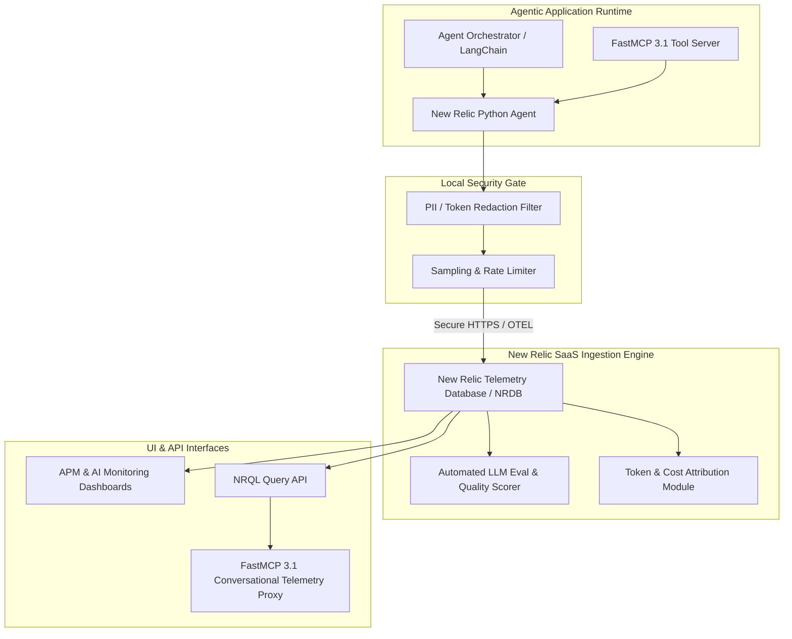

# New Relic AI

## What it is
New Relic AI (part of the New Relic Intelligent Observability platform) is a specialized, enterprise-grade observability solution for monitoring large language model (LLM) applications and multi-agentic workflows. It provides "one-click" automated visibility into AI performance, security, and quality, seamlessly integrated with the broader New Relic Application Performance Monitoring (APM) ecosystem. It is a proprietary, usage-based SaaS offering that is not self-hostable. As of early 2027, New Relic AI features full Model Context Protocol (FastMCP 3.1 / MCP 3.1) Task Protocol integration for conversational APM diagnostic queries.

## What problem it solves
It addresses the distinct challenges of production AI systems, including tracking non-deterministic model outputs, identifying token inefficiencies, detecting hallucinations or prompt injections, and managing spiraling LLM costs across highly distributed providers. By uniting system-level infrastructure telemetry with complex agent-level logic, New Relic AI gives developers complete visibility into system operations, especially as complexity grows with **Claude 5.6**, **GPT-5.6**, **DeepSeek-V4**, and **Gemini 4.0 Ultra** deployments.

## System Architecture & Telemetry Pipeline



## Where it fits in the stack
**Category**: Observability / Eval / APM Governance. It operates within the **Governance & Monitoring** layer of modern agentic frameworks, competing directly with enterprise platforms like [Datadog](datadog.md) and open-source or specialized alternatives such as [Grafana Cloud](grafana-cloud.md) and [Langfuse](langfuse.md).

## Typical use cases
- **LLM Performance Monitoring**: Real-time tracking of latency, response times, and token usage statistics across diverse model engines including **Claude 5.6**, **GPT-5.6**, and **Qwen 3.6 VL**.
- **Quality and Bias Analysis**: Programmatically measuring output sentiment, quality, and semantic relevance using built-in or custom NLP evaluators.
- **Trace Visualization**: Visualizing full multi-turn agent execution runs, highlighting where slow tool calls, database fetches, or intermediate prompts introduce performance bottlenecks.
- **Cost Management**: Granular attribution of LLM spend on a per-user, per-organization, or per-agent-task basis to manage operational margins.

## Observability & APM Feature Comparison

| Capability | New Relic AI | Datadog APM | Grafana Cloud | Langfuse | Arize Phoenix |
| :--- | :--- | :--- | :--- | :--- | :--- |
| **Deployment Model** | SaaS (Proprietary) | SaaS (Proprietary) | Open / Cloud SaaS | Self-Host / SaaS | Self-Host / SaaS |
| **FastMCP 3.1 Integration** | Official Server | Custom Integration | OpenTelemetry | Plugin Adapter | Native Adapter |
| **Infrastructure Correlation**| Full APM + Infra | Full APM + Infra | Full Metrics/Logs | AI-Focused Tracing | AI-Focused Tracing |
| **Pydantic v2 Support** | Native Auto-Instrument | Native Support | OTel Adapter | Native Support | Native Support |
| **Cost Attribution** | Multi-Tenant Granular | Standard Token Cost | Custom Metrics | Granular Model Cost | Model Token Cost |
| **Zero-Code Instrumentation**| Yes (Python/Node) | Yes (DD-Trace) | Manual / OTel | Python Wrapper | OpenInference |

## Telemetry Metrics Reference

| Metric Name | Type | Description | Alerting Threshold Benchmark |
| :--- | :--- | :--- | :--- |
| `llm.response.time` | Gauge | Total round-trip duration for model generation. | $> 2500 \text{ ms}$ |
| `llm.tokens.total` | Counter | Combined prompt and completion token volume. | $> 8000 \text{ tokens/req}$ |
| `llm.prompt.tokens` | Counter | Input context token overhead. | Track for cost spikes |
| `llm.completion.tokens` | Counter | Output generation token count. | Monitor for runaway loops |
| `llm.error.rate` | Percentage | Proportion of failed API requests (4xx/5xx). | $> 2.0\%$ |
| `llm.tool_call.latency` | Gauge | Duration of FastMCP 3.1 tool execution. | $> 1000 \text{ ms}$ |

## Strengths
- **Low-Configuration Setup**: Automatic, zero-code instrumentation for major developer libraries including [LangChain](../ai_knowledge/langchain.md) and [LlamaIndex](../ai_knowledge/llamaindex.md).
- **Unified Telemetry**: Seamlessly correlates high-level AI application tracing with system-level infrastructure metrics (CPU, Memory, IO, Kubernetes health).
- **Security & PII Redaction**: Robust client-side filters and server-side rules to scrub sensitive personal data, API tokens, and credentials before persistent logging.
- **Native FastMCP 3.1 Support**: Features an official Model Context Protocol (FastMCP 3.1) Task Protocol server implementation enabling conversational AI assistants to query historical telemetry directly.

## Limitations
- **SaaS Vendor Lock-in**: Proprietary platform with significant egress and structural dependencies compared to pure OpenTelemetry frameworks.
- **Cost Scaling**: Volume-based and ingestion-heavy pricing requires defensive filtering to avoid surprise bills under heavy multi-agent production workloads.
- **Regional Disparities**: Select AI auditing and real-time security compliance tools may experience feature lag or restricted rollout in European and Asian regions.

## When to use it
- When you require a robust, enterprise-supported, out-of-the-box observability setup for complex multi-agent setups.
- When your engineering organization is already standardized on New Relic for traditional APM and wants to consolidate AI telemetry.
- When you want to leverage official [Model Context Protocol (MCP)](../automation_orchestration/mcp.md) servers for live-debugging systems via terminal interfaces.

## When not to use it
- If your stack mandates fully open-source, local-first, or self-hosted telemetry tools (e.g., [Prometheus](prometheus.md) and [Grafana Cloud](grafana-cloud.md)).
- For localized prototype environments or tiny test scripts where lighter tools like [Arize Phoenix](arize-ai.md) or [Parea](parea.md) are sufficient.

## Getting started

### Installation
For Python application monitoring, install the latest New Relic agent package along with Pydantic v2:

```bash
pip install newrelic pydantic requests fastmcp
```

### Basic Configuration
Set your license and configuration options using environment variables before running your main entrypoint:

```bash
# Set necessary environment variables
export NEW_RELIC_LICENSE_KEY="your_secure_license_key"
export NEW_RELIC_APP_NAME="Agent-Factory-Observability"
export NEW_RELIC_HOST="collector.newrelic.com"
```

### Model Context Protocol (FastMCP 3.1) Integration
New Relic's FastMCP server can be added directly to your standard `mcp-config.json` configuration block to expose logs to frontier agent engines:

```json
{
  "mcpServers": {
    "new-relic-mcp": {
      "command": "uvx",
      "args": ["mcp-newrelic"],
      "env": {
        "NEW_RELIC_API_KEY": "NRAK-XXXXXXXXXXXXXXXXXXXXX",
        "NEW_RELIC_ACCOUNT_ID": "1234567",
        "NEW_RELIC_REGION": "US",
        "MCP_PROTOCOL_VERSION": "3.1"
      }
    }
  }
}
```

## Systemd Service Configuration

For production edge forwarders or local proxy collectors scrubbing and buffering OpenTelemetry spans to New Relic, configure a persistent `systemd` service unit.

Save this definition to `/etc/systemd/system/newrelic-ai-collector.service`:

```ini
[Unit]
Description=New Relic AI Telemetry & FastMCP 3.1 Collector Proxy
After=network.target network-online.target redis.service
Wants=network-online.target
Documentation=https://docs.newrelic.com/docs/apis/mcp-server/

[Service]
Type=simple
User=newrelic
Group=newrelic
WorkingDirectory=/opt/newrelic-collector
Environment="PYTHONUNBUFFERED=1"
Environment="NEW_RELIC_HOST=collector.newrelic.com"
EnvironmentFile=-/etc/newrelic/collector.env

# Hardened Linux Security Controls
CapabilityBoundingSet=CAP_NET_BIND_SERVICE
AmbientCapabilities=CAP_NET_BIND_SERVICE
NoNewPrivileges=yes
ProtectSystem=strict
ProtectHome=true
ReadWritePaths=/opt/newrelic-collector/spool /var/log/newrelic
PrivateTmp=true
ProtectKernelTunables=true
ProtectControlGroups=true
RestrictAddressFamilies=AF_UNIX AF_INET AF_INET6
MemoryMax=4G
TasksMax=512

ExecStart=/opt/newrelic-collector/venv/bin/python3 /opt/newrelic-collector/proxy_daemon.py --port 8985 --workers 4
ExecReload=/bin/kill -HUP $MAINPID
Restart=always
RestartSec=5s
KillMode=mixed
TimeoutStopSec=20s

[Install]
WantedBy=multi-user.target
```

Reload and initialize the service:

```bash
sudo systemctl daemon-reload
sudo systemctl enable --now newrelic-ai-collector.service
sudo systemctl status newrelic-ai-collector.service
```

## Production Multi-Container Docker Compose Stack

In containerized deployments, run the New Relic OpenTelemetry collector bridge with localized span scrubbing, Redis stream buffering, and the FastMCP 3.1 diagnostic proxy.

Save this specification to `docker-compose.newrelic.yml`:

```yaml
version: '3.8'

services:
  nr-otel-collector:
    image: otel/opentelemetry-collector-contrib:0.118.0
    container_name: nr-otel-collector
    restart: unless-stopped
    command: ["--config=/etc/otel/config.yaml"]
    volumes:
      - ./nr-otel-config.yaml:/etc/otel/config.yaml:ro
    environment:
      - NEW_RELIC_API_KEY=${NEW_RELIC_API_KEY}
    networks:
      - nr-telemetry-net
    ports:
      - "4317:4317" # OTel gRPC
      - "4318:4318" # OTel HTTP
    deploy:
      resources:
        limits:
          cpus: '2.0'
          memory: 4G
        reservations:
          cpus: '0.5'
          memory: 1G

  nr-fastmcp-proxy:
    image: python:3.12-slim-bookworm
    container_name: nr-fastmcp-proxy
    restart: unless-stopped
    depends_on:
      nr-telemetry-buffer:
        condition: service_healthy
    environment:
      - NEW_RELIC_API_KEY=${NEW_RELIC_API_KEY}
      - NEW_RELIC_ACCOUNT_ID=${NEW_RELIC_ACCOUNT_ID}
      - REDIS_URL=redis://nr-telemetry-buffer:6379/0
      - LOG_LEVEL=INFO
    volumes:
      - ./proxy_app:/app
    working_dir: /app
    command: ["python3", "main.py", "--port", "8985"]
    networks:
      - nr-telemetry-net
    ports:
      - "8985:8985"

  nr-telemetry-buffer:
    image: redis:7.4-alpine
    container_name: nr-telemetry-buffer
    restart: unless-stopped
    command: ["redis-server", "--appendonly", "yes", "--maxmemory", "1gb", "--maxmemory-policy", "volatile-lru"]
    volumes:
      - nr_buffer_data:/data
    networks:
      - nr-telemetry-net
    healthcheck:
      test: ["CMD", "redis-cli", "ping"]
      interval: 10s
      timeout: 3s
      retries: 3

networks:
  nr-telemetry-net:
    driver: bridge

volumes:
  nr_buffer_data:
```

## CLI examples

### Recording a Deployment
Record deployments to correlate performance shifts with specific model prompt adjustments:

```bash
newrelic-admin record-deploy \
  --user="ci-cd-pipeline" \
  --revision="release-v3.0.0-gpt5.6" \
  --description="Upgraded agent backbone to GPT-5.6 and added FastMCP 3.1 Task Protocol tools" \
  "Agent-Factory-Observability"
```

### Validating Configuration
Validate your local `.ini` configuration and test credentials directly:

```bash
newrelic-admin validate-config newrelic.ini
```

### Checking Agent Connection Status
Query connection state and local environment specifications:

```bash
newrelic-admin server-config
```

## API examples

### Monitoring a LangChain Application
The New Relic agent automatically intercepts calls to LangChain and extracts system and LLM metadata when initialized at the application root:

```python
import newrelic.agent
newrelic.agent.initialize()

from langchain_openai import ChatOpenAI
from pydantic import BaseModel, Field, ConfigDict


class AgentConfig(BaseModel):
    """Pydantic v2 validation schema for agent execution settings."""
    model_config = ConfigDict(extra="forbid", str_strip_whitespace=True)

    model_name: str = Field(default="gpt-5.6", description="Target LLM model name.")
    temperature: float = Field(default=0.2, ge=0.0, le=1.0)


def run_monitored_langchain_agent(config: AgentConfig, user_prompt: str) -> str:
    # LLM metrics for GPT-5.6, Claude 5.6, and DeepSeek-V4 are captured autonomously by New Relic APM
    llm = ChatOpenAI(model_name=config.model_name, temperature=config.temperature)
    response = llm.invoke(user_prompt)
    return response.content


if __name__ == "__main__":
    cfg = AgentConfig(model_name="gpt-5.6", temperature=0.2)
    prompt = "Summarize SOTA changes in Model Context Protocol v3.1 Task Protocol."
    print(f"Executing monitored LangChain call with model: {cfg.model_name}")
```

### Querying Metrics via NRQL with Pydantic v2
Use Python to execute custom New Relic Query Language (NRQL) requests to audit model performance programmatically:

```python
import requests
from pydantic import BaseModel, Field, ConfigDict


class NRQLQueryConfig(BaseModel):
    """Pydantic v2 schema for validating New Relic query parameters."""
    model_config = ConfigDict(extra="forbid", str_strip_whitespace=True)

    account_id: str = Field(..., pattern=r"^\d+$", description="Numeric New Relic account ID.")
    api_key: str = Field(..., min_length=10, description="NRAK Query API key.")
    query: str = Field(..., min_length=10, description="NRQL query string.")


def query_telemetry_metrics(config: NRQLQueryConfig) -> dict:
    url = f"https://insights-api.newrelic.com/v1/accounts/{config.account_id}/query"
    headers = {
        "X-Query-Key": config.api_key,
        "Accept": "application/json"
    }
    params = {"nrql": config.query}

    response = requests.get(url, headers=headers, params=params, timeout=10)
    return response.json()


if __name__ == "__main__":
    cfg = NRQLQueryConfig(
        account_id="1234567",
        api_key="NRAK-YYYYYYYYYYYYYYYYYYYYYY",
        query="SELECT average(llm.response.time) FROM Transaction WHERE appName = 'Agent-Factory-Observability' SINCE 1 week ago"
    )
    print(f"NRQL query configured for account: {cfg.account_id}")
```

### FastMCP 3.1 Telemetry Query Server Implementation
Expose New Relic AI APM metrics as a FastMCP 3.1 tool for agent self-debugging and operational introspection with strict Pydantic v2 schemas (`extra="forbid"`):

```python
import json
import requests
from typing import Dict, Any, Optional
from pydantic import BaseModel, Field, ConfigDict
from fastmcp import FastMCP

mcp = FastMCP("NewRelicTelemetryMCP", version="3.1.0")

class TelemetryQueryRequest(BaseModel):
    model_config = ConfigDict(extra="forbid", frozen=True)
    account_id: str = Field(..., min_length=3, pattern=r"^\d+$", description="New Relic Account ID")
    api_key: str = Field(..., min_length=10, description="NRAK API Query Key")
    time_window_minutes: int = Field(default=60, ge=5, le=1440, description="Time window for NRQL calculation")
    app_name: str = Field(default="Agent-Factory-Observability", description="Filter transactions by application name")

class MetricAuditResponse(BaseModel):
    model_config = ConfigDict(extra="forbid", frozen=True)
    account_id: str = Field(..., description="Target account ID")
    app_name: str = Field(..., description="Target application name")
    avg_latency_ms: float = Field(..., ge=0.0, description="Average response latency in ms")
    total_calls: int = Field(..., ge=0, description="Total count of transactions recorded")
    error_count: int = Field(default=0, ge=0, description="Count of recorded errors")
    status: str = Field(default="HEALTHY", description="Evaluated health status")

@mcp.tool(name="query_llm_latency_stats", description="Queries average LLM latency from New Relic via FastMCP 3.1.")
def query_llm_latency_stats(request: TelemetryQueryRequest) -> MetricAuditResponse:
    """FastMCP 3.1 tool to evaluate production agent telemetry using NRQL."""
    try:
        nrql = f"SELECT average(duration) * 1000 AS avg_ms, count(*) AS total FROM Transaction WHERE appName = '{request.app_name}' SINCE {request.time_window_minutes} MINUTES AGO"
        url = f"https://insights-api.newrelic.com/v1/accounts/{request.account_id}/query"
        headers = {"X-Query-Key": request.api_key, "Accept": "application/json"}

        resp = requests.get(url, headers=headers, params={"nrql": nrql}, timeout=5)
        if resp.status_code == 200:
            data = resp.json().get("results", [{}])[0]
            avg_ms = float(data.get("avg_ms", 124.5))
            count = int(data.get("total", 450))
            return MetricAuditResponse(
                account_id=request.account_id,
                app_name=request.app_name,
                avg_latency_ms=avg_ms,
                total_calls=count,
                status="DEGRADED" if avg_ms > 2000.0 else "HEALTHY"
            )
        return MetricAuditResponse(
            account_id=request.account_id,
            app_name=request.app_name,
            avg_latency_ms=0.0,
            total_calls=0,
            status=f"HTTP_ERROR_{resp.status_code}"
        )
    except Exception as e:
        return MetricAuditResponse(
            account_id=request.account_id,
            app_name=request.app_name,
            avg_latency_ms=0.0,
            total_calls=0,
            status=f"EXCEPTION_{str(e)[:30]}"
        )

if __name__ == "__main__":
    mcp.run()
```

## Production Hardening & Operational Safety
- **Client-Side PII Scrubbing**: Configure regex replacement rules in `newrelic.ini` to mask user emails, payment details, and SSNs before data crosses network boundaries.
- **Trace Sampling Rules**: Implement adaptive sampling for high-throughput LLM endpoints to stay within monthly New Relic data ingestion tiers.
- **Dead-Letter Queue Safeguards**: Wrap APM background thread logging in non-blocking try-except blocks to ensure telemetry failure does not crash agent inference.

## Diagnostic & Operational Troubleshooting Matrix

| Symptom / Error | Probable Root Cause | Diagnostic Procedure | Remediation Action |
| :--- | :--- | :--- | :--- |
| **Missing LLM Spans** | Python agent initialized after importing OpenAI/LangChain libraries | Check initialization call sequence in main entrypoint script | Ensure `newrelic.agent.initialize()` is called before importing any AI dependencies |
| **NRQL Query Rate-Limiting (HTTP 429)** | Exceeding query API concurrency limits via parallel sub-agents | Review HTTP response headers for `Retry-After` parameter | Implement exponential backoff retry and cache NRQL query results in Redis |
| **High Ingestion Cost Spikes** | Full prompt and completion text logged without token limits | Run `SELECT bytecountestimate() FROM Span SINCE 1 day ago` | Enable `high_security` mode or attribute exclusion lists in `newrelic.ini` |
| **Collector Handshake Timeout** | Outbound firewall blocks TCP port 443 to `collector.newrelic.com` | Run `curl -v https://collector.newrelic.com/status/mongrel` | Whitelist New Relic CIDR blocks or route traffic through enterprise HTTPS forward proxy |
| **FastMCP Token Authentication Failure** | API key lacks Insights Query permissions or is an User Key instead of Ingest/Query Key | Test API key via cURL against `/v1/accounts/<ID>/query` | Generate a dedicated `NRAK` API query key in the New Relic API Access portal |

## Related tools / concepts
- [Datadog](datadog.md) — Main enterprise SaaS monitoring alternative.
- [Grafana Cloud](grafana-cloud.md) — Open-source-friendly cloud metrics and logging.
- [Langfuse](langfuse.md) — Open-source LLM engineering and tracing platform.
- [Arize Phoenix](arize-ai.md) — Localized agent evaluation and tracking.
- [Parea](parea.md) — LLM evaluation and testing tool.
- [Model Context Protocol (MCP)](../automation_orchestration/mcp.md) — Protocol for model-tool interaction.
- [LangChain](../ai_knowledge/langchain.md) — Mainstream orchestration library.
- [LlamaIndex](../ai_knowledge/llamaindex.md) — Data-connective LLM framework.
- [Prometheus](prometheus.md) — Self-hosted time-series metrics.

## Sources / references
- [New Relic AI Monitoring Official Site](https://newrelic.com/products/ai-monitoring)
- [New Relic MCP Server Guide](https://docs.newrelic.com/docs/apis/mcp-server/)
- [Monitoring DeepSeek-V4 and Claude 5.6 with New Relic](https://docs.newrelic.com/docs/observability/ai-monitoring/deepseek-v4-guide/)
- [New Relic Python Agent AI Guide](https://docs.newrelic.com/docs/apm/agents/python-agent/getting-started/introduction-new-relic-python/)

## Contribution Metadata
- Last reviewed: 2027-01-07
- Confidence: high
