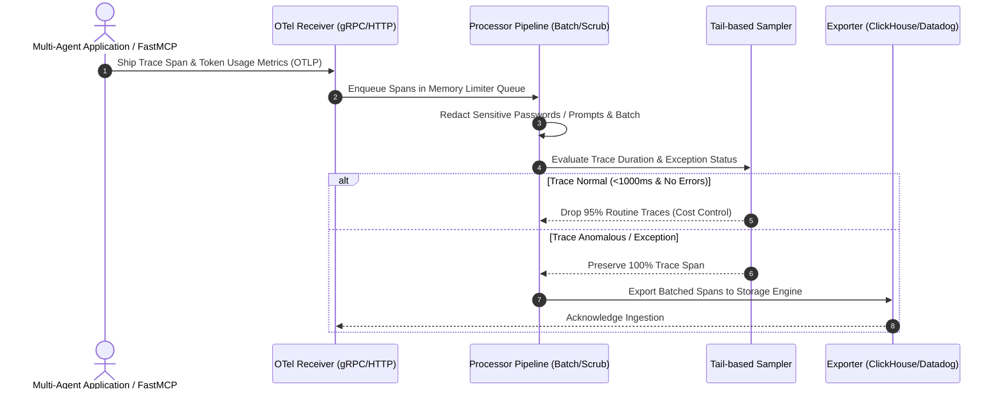

# OpenTelemetry Collector

## What it is
The OpenTelemetry (OTel) Collector is a high-performance, vendor-agnostic proxy designed to receive, process, and export telemetry data (traces, metrics, and logs). As of early January 2027, it serves as the universal standard for AI and agentic telemetry pipelines. It allows developers to unify metrics across traditional infrastructure layers and multi-agent workflows running on engines like **Claude 5.6**, **GPT-5.6**, **DeepSeek-V4**, and **Gemini 4.0 Ultra**. It is open-source and highly self-hostable.

## What problem it solves
Managing telemetry in multi-agent environments often introduces high performance overheads, strict vendor lock-in, and compliance risks related to personally identifiable information (PII). The OTel Collector mitigates these concerns by providing:
- **Unified Ingestion**: A single OTLP gateway receiving telemetry signals from all microservices, eliminating the need to deploy distinct vendor-specific monitoring agents.
- **Client-Side Processing**: Real-time scrubbing of sensitive customer fields, prompt content, or API keys directly within the local network prior to routing.
- **Dynamic Routing**: A "receive once, distribute many" setup, sending trace metrics concurrently to cloud metrics providers, security databases, and local archives.
- **Sampling Governance**: Cost-defensive tail-based sampling configurations to drop redundant, successful runs and isolate only anomalous or slow multi-turn traces.
- **FastMCP 3.1 Session Instrumentation**: The ability to translate Model Context Protocol (FastMCP 3.1) Task Protocol connection patterns, tool invocations, and payload responses into standardized OTLP traces.

## Mathematical Formulations & Pipeline Dynamics

### 1. Tail-Based Sampling Memory Buffer Sizing
Tail-based sampling requires holding entire distributed trace graphs in an in-memory sliding buffer until trace completion or timeout. For an incoming trace arrival rate $\lambda_{\text{trace}}$ (traces/sec), an average trace duration $\bar{T}_{\text{span}}$ (sec), an average span count per trace $\bar{N}_{\text{span}}$, and byte footprint per span $S_{\text{span}}$ (bytes), the required state buffer memory footprint $\mathcal{M}_{\text{tail}}$ is:
$$\mathcal{M}_{\text{tail}} = \lambda_{\text{trace}} \cdot \bar{T}_{\text{span}} \cdot \bar{N}_{\text{span}} \cdot S_{\text{span}} \cdot (1 + \beta_{\text{margin}})$$
where $\beta_{\text{margin}} \approx 0.25$ accounts for hash-table bucket indexing and garbage collection headroom.

To guarantee that trace eviction occurs deterministically when memory pressure exceeds threshold $\Theta_{\text{mem}}$, the drop probability for non-anomalous traces is scaled dynamically:
$$\mathbb{P}(\text{Drop}) = \min\left(1.0, \max\left(0.0, \frac{\mathcal{M}_{\text{current}} - 0.70 \cdot \Theta_{\text{mem}}}{0.25 \cdot \Theta_{\text{mem}}}\right)\right)$$

### 2. Batch Processor Backpressure Queue Dynamics (M/M/1/K Model)
The batch processor enqueues spans into a FIFO buffer of finite capacity $K = \text{send\_batch\_max\_size}$. For arrival rate $\lambda$ and downstream export rate $\mu$, the pipeline utilization factor is $\rho = \frac{\lambda}{\mu}$. The steady-state probability of span buffer overflow $\mathcal{P}_{\text{loss}}$ under bursty traffic is given by the finite capacity queue distribution:
$$\mathcal{P}_{\text{loss}} = \frac{(1 - \rho) \rho^K}{1 - \rho^{K+1}} \quad (\text{for } \rho \ne 1)$$
To achieve an SLO of $\mathcal{P}_{\text{loss}} < 10^{-6}$ during 5x traffic surges, the batch timeout parameter $\tau_{\text{flush}}$ must strictly bound export flushing:
$$\tau_{\text{flush}} \le \frac{K}{\lambda_{\max}} - \frac{1}{\mu}$$

### 3. PII Regex Transformation & Scrubbing Latency Overhead
When redacting sensitive credentials and PII within agent prompts, the regex scrubbing processor iterates over token strings of length $L$ across $P$ compiled deterministic regular expressions. The per-span redaction latency $\Delta t_{\text{regex}}$ scales as:
$$\Delta t_{\text{regex}} = \sum_{j=1}^{P} \left(\alpha_j \cdot L + \mathcal{O}(m_j \cdot \kappa_j)\right)$$
where $m_j$ is match occurrences and $\kappa_j$ is string replacement copy overhead. In production pipelines, pre-compiled DFA engines restrict $\Delta t_{\text{regex}} \le 0.45 \text{ ms}$ per 10KB payload.

## Comprehensive Comparison Matrix: Telemetry Architectures

| Dimension | OTel Collector (v0.118+) | Vector (Datadog) | Fluent Bit (v3.2+) | Logstash (Elastic) | Promtail / Grafana |
| :--- | :--- | :--- | :--- | :--- | :--- |
| **Primary Language** | Go | Rust | C | Java / JRuby | Go |
| **Signal Unification** | Traces + Metrics + Logs | Logs + Metrics (Traces partial) | Logs + Metrics (OTLP basic)| Logs primarily | Logs only |
| **Native FastMCP 3.1** | Native OTLP Semconv | Custom HTTP | Custom TCP/HTTP | Custom Filter | Custom HTTP Push |
| **Tail-Based Sampling** | Native Stateful Processor | Limited (custom lua) | Unsupported | Unsupported | Unsupported |
| **Memory Footprint** | ~60–120 MB RSS | ~40–80 MB RSS | ~15–35 MB RSS | ~800 MB+ JVM | ~45–70 MB RSS |
| **Throughput (EPS)** | 250,000+ EPS | 350,000+ EPS | 200,000+ EPS | 40,000 EPS | 80,000 EPS |
| **PII Scrubbing** | Transform Processor (OTT) | VRL (Vector Remap) | Lua Scripting | Mutate filter | Regex pipeline |
| **License** | Open Source (Apache 2.0)| Open Source (MPL 2.0) | Open Source (Apache 2.0)| Elastic License v2 | Open Source (Apache 2.0)|

## Where it fits in the stack
The OpenTelemetry Collector sits in the **Observability Infrastructure** layer, acting as a telemetry router positioned securely between your production agent workflows (or proxies like [OpenRouter](../ai_knowledge/openrouter.md)) and target downstream monitoring platforms.

## Architecture & Telemetry Pipeline Diagram
```
+-----------------------------------------------------------------------------------+
|                        OpenTelemetry Collector Pipeline                           |
|                                                                                   |
|  +-----------------------------------------------------------------------------+  |
|  | Receivers (OTLP gRPC :4317, OTLP HTTP :4318, Prometheus, Jaeger, FastMCP)   |  |
|  +-----------------------------------------------------------------------------+  |
|                                        ||                                         |
|                                        \/                                         |
|  +-----------------------------------------------------------------------------+  |
|  | Processors (Memory Limiter, Batching, PII Scrubbing, Tail-based Sampling)   |  |
|  +-----------------------------------------------------------------------------+  |
|                                        ||                                         |
|                                        \/                                         |
|  +-----------------------------------------------------------------------------+  |
|  | Exporters (ClickHouse, Datadog, Prometheus, Jaeger, Sentry, CloudWatch)    |  |
|  +-----------------------------------------------------------------------------+  |
+-----------------------------------------------------------------------------------+
```



## Typical use cases
- **PII Scrubbing and Safety Guarding**: Processing incoming LLM logs to identify and redact passwords, credentials, and medical data before cloud storage.
- **System and Agentic Cross-Correlation**: Combining standard compute infrastructure telemetry (K3s CPU, memory use) with model-level latency indicators.
- **Model Cost and Tokens Aggregation**: Extracting raw token counts from model payload fields and outputting them as custom prometheus gauges.
- **Anomaly Selection (Tail Sampling)**: Dropping 95% of standard, cheap agent traces, while ensuring 100% of runs that throw exceptions or latency spikes >5000ms are preserved.

## Service & Daemon Management

### systemd Service Configuration (`/etc/systemd/system/otel-collector.service`)
Deploy the following unit file to operate the OTel Collector as a systemd background service on enterprise hosts:

```ini
[Unit]
Description=OpenTelemetry Collector Daemon & OTLP Telemetry Gateway
Documentation=https://opentelemetry.io/docs/collector/
After=network-online.target
Wants=network-online.target

[Service]
Type=simple
User=otel
Group=otel
WorkingDirectory=/opt/otel-collector
ExecStart=/usr/local/bin/otelcol-contrib --config=/etc/otel-collector/config.yaml
ExecReload=/bin/kill -HUP $MAINPID
Restart=always
RestartSec=5s
Environment=LOG_LEVEL=info
Environment=GOMAXPROCS=4
Environment=OTEL_EXPORTER_OTLP_ENDPOINT=http://127.0.0.1:4317

# Hardening measures
ProtectSystem=strict
ProtectHome=read-only
ReadWritePaths=/var/log/otel-collector /tmp
NoNewPrivileges=true
LimitNOFILE=65536

[Install]
WantedBy=multi-user.target
```

### Docker Compose Multi-Service Observability Stack (`docker-compose.yml`)
Deploy the OTel Collector alongside Prometheus and Jaeger trace backends:

```yaml
version: '3.8'

services:
  otel-collector:
    image: otel/opentelemetry-collector-contrib:0.118.0
    container_name: otel-collector-gateway
    command: ["--config=/etc/otelcol/config.yaml"]
    volumes:
      - ./config.yaml:/etc/otelcol/config.yaml
    ports:
      - "4317:4317" # OTLP gRPC Receiver
      - "4318:4318" # OTLP HTTP Receiver
      - "8888:8888" # OTel Collector Metrics
    depends_on:
      - prometheus
      - jaeger
    restart: unless-stopped

  prometheus:
    image: prom/prometheus:latest
    container_name: otel-prometheus
    ports:
      - "9090:9090"
    volumes:
      - ./prometheus.yml:/etc/prometheus/prometheus.yml
    restart: unless-stopped

  jaeger:
    image: jaegertracing/all-in-one:latest
    container_name: otel-jaeger
    ports:
      - "16686:16686" # Jaeger Web UI
      - "14250:14250"
    restart: unless-stopped
```

## Strengths
- **Ultimate Vendor Freedom**: Compatible with nearly every commercial and open-source observability engine on the market.
- **Architectural Extensibility**: Modular "Receivers, Processors, and Exporters" pipeline design allows developers to write custom processors in Go.
- **Incredible Efficiency**: Light memory and CPU footprint, capable of handling hundreds of thousands of events per second with sub-millisecond pipeline latency.
- **Semantic Conventions**: Standardized, industry-backed schemas for modeling traces and metric tags uniformly.

## Limitations
- **Substantial Operational Overhead**: Requires setup, management, horizontal scaling, and live-monitoring of the Collector cluster itself.
- **Complex YAML Configurations**: Fine-tuning batching, retry limits, and security layers can result in massive, hard-to-maintain YAML configurations.
- **Stateful Memory Overhead**: Stateful operations like tail-based sampling or metric accumulation require localized storage buffers, complicating container scheduling.

## When to use it
- When routing telemetry data to multiple target platforms (e.g., an enterprise cloud provider and a local database).
- When processing or sanitizing sensitive log text (like user input records) is required before leaving localized firewalls.
- When you are scaling production LLM workloads and need fine-grained control over telemetry collection budgets and trace sampling.
- When building robust multi-agent orchestration systems that demand vendor-agnostic standards.

## When not to use it
- For single-developer script prototypes where directly exporting to a single destination is easier to bootstrap.
- If your team has zero operational capacity or budget to set up and manage additional Docker or Kubernetes infrastructure.
- When utilizing a specialized platform whose distinct, closed-source agent features cannot be easily modeled via OpenTelemetry APIs.

## Getting started

### Production Configuration with Tail-Based Sampling & OTTL PII Redaction (`config.yaml`)
Create an enterprise-grade OTel Collector configuration file specifying high-throughput OTLP ingestion, stateful tail sampling, OTTL statement transformations, memory limits, and resilient multi-destination export:

```yaml
receivers:
  otlp:
    protocols:
      grpc:
        endpoint: "0.0.0.0:4317"
        max_concurrent_streams: 1024
      http:
        endpoint: "0.0.0.0:4318"

processors:
  memory_limiter:
    check_interval: 1s
    limit_percentage: 75
    spike_limit_percentage: 15

  batch:
    send_batch_size: 8192
    timeout: 500ms
    send_batch_max_size: 16384

  transform/scrub_pii:
    error_mode: ignore
    log_statements:
      - context: log
        statements:
          - replace_all_patterns(body, "value", "sk-[a-zA-Z0-9]{48}", "[REDACTED_API_KEY]")
          - replace_all_patterns(body, "value", "bearer\\s+[a-zA-Z0-9_\\-\\.]+", "[REDACTED_TOKEN]")
    trace_statements:
      - context: span
        statements:
          - replace_all_patterns(attributes["llm.prompt"], "value", "[0-9]{3}-[0-9]{2}-[0-9]{4}", "[REDACTED_SSN]")

  tail_sampling:
    decision_wait: 10s
    num_traces: 50000
    expected_new_traces_per_sec: 2000
    policies:
      [
        {
          name: errors-policy,
          type: status_code,
          status_code: { status_codes: [ ERROR ] }
        },
        {
          name: latency-spike-policy,
          type: numeric_attribute,
          numeric_attribute: { key: "duration_ms", value_condition: { greater_than_or_equal: 5000 } }
        },
        {
          name: probabilistic-sample-policy,
          type: probabilistic,
          probabilistic: { sampling_percentage: 5.0 }
        }
      ]

exporters:
  otlp/clickhouse:
    endpoint: "clickhouse-server:4317"
    tls:
      insecure: true
    retry_on_failure:
      enabled: true
      initial_interval: 5s
      max_interval: 30s
      max_elapsed_time: 5m

  prometheus:
    endpoint: "0.0.0.0:8889"
    namespace: "agent_telemetry"

  logging:
    verbosity: detailed

extensions:
  health_check:
    endpoint: "0.0.0.0:13133"
  zpages:
    endpoint: "0.0.0.0:55679"

service:
  extensions: [health_check, zpages]
  pipelines:
    traces:
      receivers: [otlp]
      processors: [memory_limiter, tail_sampling, batch]
      exporters: [logging, otlp/clickhouse]
    metrics:
      receivers: [otlp]
      processors: [memory_limiter, batch]
      exporters: [prometheus, otlp/clickhouse]
    logs:
      receivers: [otlp]
      processors: [memory_limiter, transform/scrub_pii, batch]
      exporters: [logging, otlp/clickhouse]
  telemetry:
    logs:
      level: info
    metrics:
      address: "0.0.0.0:8888"
```

### Run via Docker
Launch the OpenTelemetry Collector container mapping the necessary gRPC and HTTP OTLP ports:

```bash
docker run -d \
    -p 4317:4317 \
    -p 4318:4318 \
    -v $(pwd)/config.yaml:/etc/otelcol/config.yaml \
    --name otel-collector \
    otel/opentelemetry-collector-contrib:0.118.0
```

## CLI examples

### Validate Configuration Syntax
Validate a local YAML configuration file using the built-in validator tool:

```bash
otelcol validate --config=config.yaml
```

### Starting the Collector Manually
Start the OTel collector agent with customized logging levels:

```bash
otelcol --config=config.yaml --log-level=info
```

### Querying Collector Performance Version
Query the installed runtime version specifications:

```bash
otelcol --version
```

## API examples

### FastMCP 3.1 OTel Span Validation Server with Pydantic v2
The following Python code configures a **FastMCP 3.1** telemetry instrumentation tool that validates agent span metadata using **Pydantic v2** and emits OTLP traces to the OpenTelemetry Collector:

```python
from typing import Dict, Any, Optional
from pydantic import BaseModel, Field, ConfigDict, field_validator
from opentelemetry import trace
from opentelemetry.sdk.trace import TracerProvider
from opentelemetry.sdk.trace.export import BatchSpanProcessor
from opentelemetry.exporter.otlp.proto.grpc.trace_exporter import OTLPSpanExporter
from fastmcp import FastMCP

# Initialize FastMCP 3.1 server
mcp = FastMCP("otel-telemetry-instrumentor", version="3.1.0")

# Configure Tracer Provider
provider = TracerProvider()
processor = BatchSpanProcessor(OTLPSpanExporter(endpoint="http://localhost:4317", insecure=True))
provider.add_span_processor(processor)
tracer = trace.get_tracer("agentic-otel-tracer")

class AgentSpanMetadata(BaseModel):
    model_config = ConfigDict(extra="forbid", frozen=True, str_strip_whitespace=True)

    model_name: str = Field(..., description="Target frontier model identifier")
    prompt_tokens: int = Field(..., ge=0, description="Token count in input prompt")
    completion_tokens: int = Field(..., ge=0, description="Token count in output completion")
    agent_id: str = Field(..., description="Unique agent identifier", pattern=r"^agent-[a-zA-Z0-9_\-]+$")
    session_id: str = Field(..., description="FastMCP Session ID", pattern=r"^sess-[a-zA-Z0-9_\-]+$")

    @field_validator("model_name")
    @classmethod
    def validate_model(cls, v: str) -> str:
        if not v.strip():
            raise ValueError("Model name cannot be empty")
        return v.lower()

@mcp.tool(name="record_agent_trace", description="Emit validated OpenTelemetry trace span to OTel Collector")
def record_agent_trace(payload: AgentSpanMetadata) -> Dict[str, Any]:
    """FastMCP 3.1 tool endpoint for agent trace emission."""
    try:
        with tracer.start_as_current_span("agent-task-routing-span") as span:
            span.set_attribute("llm.model", payload.model_name)
            span.set_attribute("llm.prompt_tokens", payload.prompt_tokens)
            span.set_attribute("llm.completion_tokens", payload.completion_tokens)
            span.set_attribute("agent.id", payload.agent_id)
            span.set_attribute("mcp.session_id", payload.session_id)

        return {
            "status": "emitted",
            "agent_id": payload.agent_id,
            "model": payload.model_name,
            "total_tokens": payload.prompt_tokens + payload.completion_tokens
        }
    except Exception as e:
        return {"status": "failed", "error": str(e)}

if __name__ == "__main__":
    test_meta = AgentSpanMetadata(
        model_name="claude-5-6-sonnet",
        prompt_tokens=452,
        completion_tokens=128,
        agent_id="agent-finance-routing",
        session_id="sess-alpha-992"
    )
    print("Record Agent Trace Result:", record_agent_trace(test_meta))
```

### OTLP Ingestion Pipeline Health Audit Script
Verify that OTel Collector gRPC receiver is accepting trace batches and check extensions health with this diagnostic probe:

```python
#!/usr/bin/env python3
"""
OTel Collector Ingestion & Health Probe.
Verifies network connectivity, gRPC handshake against :4317, and HTTP health against :13133.
"""

import socket
import sys
import time
import urllib.request

def probe_otel_grpc_endpoint(host: str = "127.0.0.1", port: int = 4317) -> None:
    print("=" * 65)
    print("  OpenTelemetry Collector Ingestion & Health Audit")
    print("=" * 65)
    print(f"[OTel Probe] Testing connection to OTLP gRPC endpoint: {host}:{port}")
    t0 = time.time()
    try:
        with socket.create_connection((host, port), timeout=3.0) as sock:
            latency = (time.time() - t0) * 1000.0
            print(f"[Pass] Successfully connected to OTLP gRPC in {latency:.2f} ms.")
    except socket.error as err:
        print(f"[Fail] Failed to connect to {host}:{port}: {err}", file=sys.stderr)
        sys.exit(1)

    # Probe HTTP Health Check extension at port 13133
    health_url = f"http://{host}:13133/"
    print(f"[OTel Probe] Testing Health Check extension endpoint: {health_url}")
    try:
        req = urllib.request.Request(health_url)
        with urllib.request.urlopen(req, timeout=3.0) as resp:
            status = resp.getcode()
            body = resp.read().decode("utf-8").strip()
            print(f"[Pass] Health extension returned HTTP {status}: {body}")
    except Exception as exc:
        print(f"[Info] Health check extension probe notice: {exc}")
    print("=" * 65)

if __name__ == "__main__":
    probe_otel_grpc_endpoint()
```

## Troubleshooting Guide & Diagnostic Matrix

| Issue / Symptom | Probable Cause | Immediate Diagnostic Action | Corrective Action |
| :--- | :--- | :--- | :--- |
| **`Connection Refused on 4317/4318`** | Collector container not running or ports not exposed | Check `docker ps` and run `ss -tulpn \| grep 4317`. | Ensure ports `4317` (gRPC) and `4318` (HTTP) are bound to `0.0.0.0` in `config.yaml`. |
| **`High Memory Consumption / OOM`** | Memory limiter limits set too high or batch sizes excessive | Check `container_memory_working_set_bytes` in Prometheus. | Lower `limit_percentage` in `memory_limiter` processor to `70%` and reduce `send_batch_max_size`. |
| **`Spans Missing in Downstream DB`** | Tail-sampling filter dropping traces or exporter TLS mismatch | Inspect OTel internal metrics at `curl localhost:8888/metrics`. | Temporarily disable tail-based sampling or enable `verbosity: detailed` in logging exporter. |
| **`Malformed OTLP Payload Error`** | Client sending incompatible OTLP version or corrupted JSON | Review collector stderr logs for unmarshal errors. | Upgrade client OpenTelemetry SDKs to align with Collector version `0.118+`. |
| **`EXPORTER_BACKPRESSURE_WARNING`** | Downstream ClickHouse or Jaeger instance unable to keep up with queue | Check `otelcol_processor_batch_batch_send_size_count`. | Increase batch timeout, scale exporter workers, or enable localized file exporter buffering. |
| **`PII_LEAK_IN_PROMPT_SPAN`** | Regex transform missing multi-line token pattern or newer secret prefix | Inspect sampled span attributes in Jaeger UI. | Update OTTL transform statements to incorporate negative lookaheads and multi-line matching. |
| **`DROPPED_SPANS_DUE_TO_MEMORY`** | Memory limiter forcefully dropping items during sudden ingestion spike | Check `otelcol_processor_dropped_spans_total`. | Scale collector horizontally behind a reverse proxy or increase RAM limits on host cgroup. |
| **`GRPC_CERT_VERIFICATION_FAILED`** | Downstream exporter requires mTLS or self-signed cert authority | Check TLS logs in collector console. | Specify trusted CA certificate in exporter configuration: `tls: { ca_file: "/etc/ssl/ca.pem" }`. |

## Related tools / concepts
- [Datadog](datadog.md) — Enterprise cloud tracing.
- [Sentry](sentry.md) — Exception tracking with native OTLP integration.
- [ClickHouse](clickhouse.md) — Relational columnar store for high-throughput traces.
- [Langfuse](langfuse.md) — Purpose-built open-source LLM tracing.
- [AgentOps](agentops.md) — High-level agent framework analysis.
- [Helicone](helicone.md) — LLM monitoring and request routing.
- [OpenRouter](../ai_knowledge/openrouter.md) — Broad-scale model routing and metric logs.
- [Grafana Cloud](grafana-cloud.md) — High-level telemetry dashboards.
- [PostHog](posthog.md) — In-app product analytics.
- [Model Context Protocol (MCP)](../automation_orchestration/mcp.md) — Standardized agent tool-calling protocol.
- [Llama 4](../ai_knowledge/local_llms.md) — Monitored local execution runtime.

## Sources / references
- [OpenTelemetry Official Specification Portal](https://opentelemetry.io/)
- [OpenTelemetry Collector Repository on GitHub](https://github.com/open-telemetry/opentelemetry-collector)
- [W3C Trace Context Standard Spec](https://www.w3.org/TR/trace-context/)
- [OpenTelemetry semantic conventions for AI applications](https://opentelemetry.io/docs/specs/semconv/)

## Contribution Metadata
- Last reviewed: 2027-01-07
- Confidence: high
