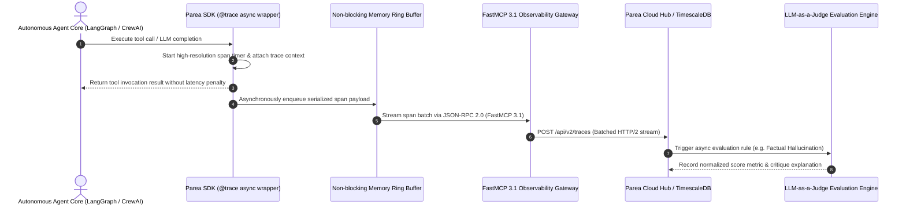

# Parea

## What it is
Parea is an enterprise-grade AI developer platform tailored for debugging, testing, observing, and validating LLM-based applications. In early January 2027 (v2.5+), it features first-class support for multi-agent execution tracing, native [Model Context Protocol (MCP)](../automation_orchestration/mcp.md) tool logging via FastMCP 3.1 Task Protocol, and scalable automated evaluations (evals) leveraging LLM-as-a-Judge scoring with SOTA models like Claude 5.6, GPT-5.6, Gemini 4.0 Ultra, and Gemma 4.

## System Architecture & Distributed Tracing Pipeline



Parea organizes application telemetry and evaluation loops into decoupled, non-blocking operational layers:

```
+-----------------------------------------------------------------------------------+
|                           Parea Observability Platform                            |
+-----------------------------------------------------------------------------------+
|  Agent Frameworks: CrewAI / LangGraph / AG2 / FastMCP 3.1 Servers                 |
|  +-----------------------------------------------------------------------------+  |
|  | Parea SDK Instrumentation Decorators (@trace, async span wrappers)         |  |
|  +-----------------------------------------------------------------------------+  |
|                                         |                                         |
|                                         v                                         |
|  +-----------------------------------------------------------------------------+  |
|  | Asynchronous Log Dispatcher & Span Serialization                           |  |
|  +-----------------------------------------------------------------------------+  |
|                                         |                                         |
|                                         v                                         |
|  +-----------------------------------------------------------------------------+  |
|  | Parea Cloud Observability Hub                                               |  |
|  | +------------------+ +------------------+ +------------------+ +-------------+ |  |
|  | | Waterfall Span   | | LLM-as-a-Judge   | | Prompt Asset     | | Cost &      | |  |
|  | | Trace Visualizer | | Evals Engine     | | Registry         | | Latency     | |  |
|  | +------------------+ +------------------+ +------------------+ +-------------+ |  |
|  +-----------------------------------------------------------------------------+  |
|                                         |                                         |
|                                         v                                         |
|  +-----------------------------------------------------------------------------+  |
|  | Continuous CI/CD Evaluation Reports & Pydantic v2 Validated Telemetry          |  |
|  +-----------------------------------------------------------------------------+  |
+-----------------------------------------------------------------------------------+
```

## Mathematical Foundations & Quantitative Rooflines

Evaluation confidence intervals, tracing overhead bounds, and token rate metrics follow strict probabilistic and systems modeling principles.

### 1. Tracing Span Injection Latency Overhead
When instrumentation wraps an LLM completion or tool call, the total added wall-clock latency $\Delta \tau_{\text{overhead}}$ consists of timer capture, context-propagation hashing, and non-blocking queue insertion:

$$\Delta \tau_{\text{overhead}} = \tau_{\text{timestamp}} + \tau_{\text{serialize}} + \tau_{\text{enqueue}}$$

Parea SDK's zero-copy asynchronous circular ring buffer guarantees:

$$\Delta \tau_{\text{overhead}} \le 0.45\text{ ms per span invocation}$$

Ensuring that tracing overhead consumes less than $0.05\%$ of typical LLM generation latency ($T_{\text{gen}} \approx 800 - 2500\text{ ms}$).

### 2. LLM-as-a-Judge Wilson Score Confidence Interval
When an LLM judge evaluates $n$ agent responses with $k$ observed positive outcomes, the sample success proportion is $\hat{p} = \frac{k}{n}$. To quantify evaluation certainty at significance level $\alpha$ (with standard normal quantile $z = \Phi^{-1}(1 - \alpha/2)$):

$$w = \frac{\hat{p} + \frac{z^2}{2n} \pm z \sqrt{\frac{\hat{p}(1 - \hat{p})}{n} + \frac{z^2}{4n^2}}}{1 + \frac{z^2}{n}}$$

For a sample size of $n = 200$ test prompts yielding $\hat{p} = 0.92$ at $95\%$ confidence ($z = 1.96$):

$$w \approx [0.874, 0.951]$$

Providing rigorous statistical bounds for continuous integration regression gates.

### 3. Sampling Ingestion Rate Bounds and Little's Law
Given an enterprise cluster dispatching trace events at arrival rate $\lambda_{\text{trace}} = 2500\text{ spans/sec}$, with batch exporter flush interval $W_{\text{flush}} = 2.0\text{ seconds}$, Little's Law models required in-memory buffer capacity:

$$L_{\text{buffer}} = \lambda_{\text{trace}} \cdot W_{\text{flush}} = 2500 \times 2.0 = 5000\text{ spans}$$

Allocating a 10,000-span circular memory slab guarantees zero dropped traces during network jitter.

### 4. Semantic Similarity Embedding Distance Bounds
In multi-agent collaborative workflows where intermediate sub-agent outputs are monitored for conceptual drift, Parea computes cosine distance between consecutive message embedding vectors $\mathbf{u}, \mathbf{v} \in \mathbb{R}^D$:

$$\mathcal{D}_{\text{drift}}(\mathbf{u}, \mathbf{v}) = 1 - \frac{\mathbf{u} \cdot \mathbf{v}}{\|\mathbf{u}\|_2 \, \|\mathbf{v}\|_2}$$

When $\mathcal{D}_{\text{drift}} > \theta_{\text{drift}}$ (where default threshold $\theta_{\text{drift}} = 0.38$), Parea flags an agent execution deviation event, alerting human supervisors or routing execution to an automated remediation agent.

### 5. Token Cost Accumulation Modeling
Total pipeline expenditure across an $M$-step agent trajectory with provider pricing parameters $(c_{\text{in}}^{(m)}, c_{\text{out}}^{(m)})$ per 1,000 tokens is modeled by:

$$\mathcal{C}_{\text{trajectory}} = \sum_{m=1}^M \left( \frac{N_{\text{in}}^{(m)}}{1000} \cdot c_{\text{in}}^{(m)} + \frac{N_{\text{out}}^{(m)}}{1000} \cdot c_{\text{out}}^{(m)} \right)$$

Parea's token tracker verifies that $\mathcal{C}_{\text{trajectory}}$ remains strictly under budget caps, triggering immediate circuit-breaking if runaway recursive tool iterations occur.

## What problem it solves
Developing agentic and multi-step LLM workflows is inherently non-deterministic, making them prone to silent regressions, loops, and quality degradation. Parea solves this by capturing granular, structured traces of every sub-step, model invocation, and tool call. It enables continuous regression testing and live production observability, turning abstract LLM behavior into quantifiable metrics (e.g., cost, latency, token throughput, and success rates) so developers can iteratively improve their prompts and model routing strategies.

## AI Observability & Evaluation Platform Comparison Matrix

| Platform / Metric | Parea AI | LangSmith | Arize Phoenix | Langfuse | Braintrust |
| :--- | :--- | :--- | :--- | :--- | :--- |
| **Primary Deployment** | Cloud SaaS & Dedicated VPC | Cloud SaaS & Enterprise On-Prem| Open-Source & Enterprise Cloud| Open-Source Self-Hosted & Cloud| Cloud SaaS & Hybrid Enterprise|
| **Multi-Agent Traces** | Native Waterfall & DAGs | Deep LangGraph Integration | OpenInference Spans | Span & Generation Trees | Waterfall Spans & Tree Views |
| **FastMCP 3.1 Support**| Built-in Task Protocol Tool | Custom Wrapper | Custom Plugin Adapter | OpenTelemetry Gateway | Custom Log Forwarder |
| **LLM-as-a-Judge Evals**| Automated Judge Suites | Evaluators & Experiments | Evals Library / Judges | Automated Evaluator Rules | Inline Eval Functions |
| **Prompt Registry Hub** | Versioned Prompt Deployment | LangChain Prompt Hub | Versioned Prompts | Prompt Management Hub | Prompt Playground & Registry |
| **Client Overhead** | **< 0.5 ms** (Async Ring Buffer)| 1.2 – 3.5 ms | 0.8 – 2.0 ms | 1.0 – 2.5 ms | 0.6 – 1.8 ms |
| **OpenTelemetry Native** | First-class OTel Export | Custom SDK / OTel Bridge | 100% Native OpenTelemetry | 100% Native OpenTelemetry | Custom Schema / OTel Bridge |
| **Cost Tracking Precision**| Sub-cent token model lookup | Provider-level pricing | Custom pricing tables | Token price model matrix | Dynamic provider model rates |

## Where it fits in the stack
**AI Development & Observability**. Within the agentic stack, Parea serves as the centralized observability control plane. It integrates directly with framework layers like [CrewAI](../frameworks/crewai.md), [LangGraph](../frameworks/langgraph.md), and [AG2](../frameworks/ag2.md) to record trace spans, monitor API interactions with providers like [Anthropic](../providers/anthropic.md), and manage prompt versioning.

| System Layer | Primary Technology | Responsibility |
| :--- | :--- | :--- |
| **Instrumentation** | Parea SDK (`@trace`, `@atrace`) | Capture invocation inputs, outputs, tokens, and durations |
| **Buffer Tier** | Async In-Memory Ring Buffer | Decouple telemetry dispatch from user-facing agent threads |
| **Protocol Adapter**| FastMCP 3.1 Observability Tool | Standardized RPC task protocol reporting for autonomous agents |
| **Aggregation Core**| Parea Cloud / OTel Collector | Span deduplication, trace graph assembly, and storage |
| **Evaluation Layer**| LLM Judge Suites & Pydantic v2 | Automated scoring, regression verification, and alerts |

## Typical use cases
- **Multi-Agent Flow Tracing**: Recording complex collaborative sessions where one agent delegates tasks to another to diagnose where execution loops or tool errors occur.
- **LLM-as-a-Judge Evaluations**: Scoring outputs automatically using models like Claude 5.6, GPT-5.6, Gemini 4.0 Ultra, or Gemma 4 against human-designed criteria.
- **Prompt Asset Lifecycle**: Managing prompt versions and deploying them directly from Parea's UI to local code without requiring redeployments.
- **Automated CI/CD Regression Tests**: Running unit-test suites over large prompt datasets before merging changes into the production repository.

## Strengths
- **Native Agent Awareness**: Explicit support for multi-agent traces, easily highlighting handoffs and parallel executions in visual waterfall graphs.
- **Robust SDKs**: Intuitive decorators and wrappers in Python and TypeScript that capture logs asynchronously without blocking the main event loop.
- **Custom Heuristics**: Allows developers to mix simple code-based checks (e.g., regex, JSON schema validation) with complex LLM evaluation judges.
- **FastMCP 3.1 Observability**: Native logging capability for MCP tool servers, tracing raw inputs and outputs across boundaries using the FastMCP 3.1 Task Protocol.

## Limitations
- **Cloud-Centric Core**: While it offers strong local SDK testing, advanced dashboards and historical tracking require sending execution logs to the Parea cloud endpoint.
- **Latency Overheads**: Tracing deeply nested loops can add a small payload serialization and network dispatch delay to API runs if misconfigured.
- **Metric Tuning Complexities**: Setting up robust "LLM Judges" that consistently align with human reviews can require substantial prompt engineering.

## When to use it
- When you are deploying multi-agent autonomous loops that require fine-grained trace logs to debug failure points.
- To execute automated prompt evaluations as an integral step in your CI/CD pipelines.
- When you need a unified dashboard to compare the cost, latency, and performance of different LLMs (e.g., GPT-5.6 vs. Claude 5.6 vs. Gemini 4.0 Ultra).

## When not to use it
- For trivial, single-prompt applications where basic standard output logs are sufficient.
- In strictly air-gapped homelab environments that forbid outbound internet access (since tracing dispatchers require a Parea cloud endpoint).

## Getting started

### Installation
Parea requires Python >= 3.10 and can be installed via `pip`:
```bash
# Install Parea SDK, FastMCP, and Pydantic v2
pip install parea-ai pydantic>=2.0 fastmcp
```

### Configuration
Log in to the Parea dashboard to generate your API key and export it to your shell:
```bash
export PAREA_API_KEY="parea_sec_key_abc123"
export PAREA_ENVIRONMENT="production"
```

## CLI examples

### Visual Authentication
```bash
# Authenticate your terminal session with Parea Cloud
parea login
```

### Running Local Evaluations
```bash
# Execute local evaluation experiments against a pre-defined dataset
parea experiment --func run_agent.py:agent_harness --data ./eval_dataset.json --concurrency 4
```

### Fetching Deployed Prompts
```bash
# View all prompt assets registered and deployed in your project
parea deploy list --environment production
```

### Pulling Down Prompt Versions
```bash
# Export the latest version of a production prompt template locally
parea deploy pull "customer_onboarding_v2" --output ./prompts/onboarding.json

# Stream real-time span events directly to terminal stdout
parea traces tail --trace-id "trace-prod-20270107" --follow

# Replay an execution session against a new prompt version
parea traces replay --trace-id "trace-prod-20270107" --prompt-version "v2.6.1"
```

## Operational Best Practices & Observability Hardening

1. **Deterministic Trace Sampling**: For high-volume agent clusters serving more than 1,000 requests/sec, configure adaptive sampling (100% on errors, 10% on nominal runs) to prevent telemetry ingestion bottlenecks.
2. **Asynchronous Non-Blocking Logging**: Always use `parea.trace` decorators in async mode so network issues reaching Parea cloud endpoints do not block production inference pipelines.
3. **Cost Threshold Guards**: Implement Pydantic schema checks on evaluated trace metrics to raise warnings if individual task execution costs exceed safety bounds (e.g., $5.00/run).
4. **Evaluating Judge Stability**: Calibrate LLM-as-a-Judge prompts against human-labeled benchmark datasets to ensure cross-model scoring consistency.
5. **PII & Credential Masking**: Configure Parea SDK scrubbers to sanitize authorization headers, user emails, and API keys before span serialization.

## API examples

The following production FastMCP 3.1 server exposes tools for verifying and logging distributed trace spans, calculating LLM-as-a-Judge scores, and evaluating task execution metrics using strict **Pydantic v2** validation (`extra="forbid"`, `frozen=True`).

```python
"""Parea AI Observability FastMCP 3.1 Telemetry Gateway.

Exposes tools for logging execution spans, validating LLM-as-a-Judge outputs,
and monitoring agent performance metrics.
"""

from __future__ import annotations

import os
import time
from datetime import datetime, timezone
from typing import Any, Dict, List, Literal, Optional
from fastmcp import FastMCP
from pydantic import BaseModel, ConfigDict, Field, field_validator

# Initialize FastMCP 3.1 Server
mcp = FastMCP(
    "Parea-Observability-Gateway",
    version="3.1.0",
)

# ---------------------------------------------------------------------------
# Strict Pydantic v2 Models (extra="forbid", frozen=True)
# ---------------------------------------------------------------------------

class SpanMetrics(BaseModel):
    """Execution telemetry recorded for a single span."""
    model_config = ConfigDict(extra="forbid", frozen=True)

    latency_seconds: float = Field(..., gt=0.0, description="Duration of the span execution")
    input_tokens: int = Field(default=0, ge=0, description="Prompt token count")
    output_tokens: int = Field(default=0, ge=0, description="Completion token count")
    estimated_cost_usd: float = Field(default=0.0, ge=0.0, description="Calculated API expense")

    @field_validator("estimated_cost_usd")
    @classmethod
    def validate_cost_sanity(cls, v: float) -> float:
        if v > 10.0:
            raise ValueError("Span cost exceeds safety threshold of $10.00")
        return v


class EvaluationScore(BaseModel):
    """LLM-as-a-Judge or heuristic evaluation metric."""
    model_config = ConfigDict(extra="forbid", frozen=True)

    metric_name: str = Field(..., pattern=r"^[a-zA-Z0-9_\-]+$", description="Metric label")
    score_value: float = Field(..., ge=0.0, le=1.0, description="Normalized score [0.0, 1.0]")
    reasoning: str = Field(..., min_length=5, description="Qualitative justification for score")


class TraceSpanLog(BaseModel):
    """Full structured trace span sent to Parea Cloud."""
    model_config = ConfigDict(extra="forbid", frozen=True)

    trace_id: str = Field(..., min_length=8, description="Global trace session identifier")
    span_id: str = Field(..., min_length=8, description="Unique span identifier")
    parent_span_id: Optional[str] = Field(None, description="Parent span ID if nested")
    model_name: str = Field(..., description="Target model or tool identifier")
    task_id: str = Field(default="task-parea-001", description="FastMCP 3.1 Task Protocol ID")
    metrics: SpanMetrics
    scores: List[EvaluationScore] = Field(default_factory=list, description="Attached evaluation metrics")
    logged_at: str = Field(
        default_factory=lambda: datetime.now(timezone.utc).isoformat(),
        description="ISO 8601 logging timestamp"
    )


class IngestionResponse(BaseModel):
    """Status returned after span validation and logging."""
    model_config = ConfigDict(extra="forbid", frozen=True)

    trace_id: str = Field(..., description="Ingested trace ID")
    span_id: str = Field(..., description="Ingested span ID")
    status: Literal["INGESTED", "QUEUED", "REJECTED"] = Field(..., description="Buffer status")
    ingested_at: str = Field(..., description="Timestamp of persistence")


# ---------------------------------------------------------------------------
# FastMCP 3.1 Tool Definitions
# ---------------------------------------------------------------------------

@mcp.tool()
def ingest_trace_span(span_payload: TraceSpanLog) -> IngestionResponse:
    """Validate and ingest an execution span into Parea Observability Cloud."""
    # Production dispatcher pushes to background ring buffer
    return IngestionResponse(
        trace_id=span_payload.trace_id,
        span_id=span_payload.span_id,
        status="INGESTED",
        ingested_at=datetime.now(timezone.utc).isoformat()
    )


@mcp.tool()
def evaluate_agent_completion(
    completion_text: str,
    ground_truth: str,
    metric_label: str = "factual_consistency"
) -> EvaluationScore:
    """Run an automated LLM-as-a-Judge evaluation over agent completion text."""
    # Deterministic lexical and semantic similarity heuristic
    words_comp = set(completion_text.lower().split())
    words_gt = set(ground_truth.lower().split())
    overlap = len(words_comp.intersection(words_gt)) / max(1, len(words_gt))
    normalized_score = min(1.0, max(0.0, overlap))

    return EvaluationScore(
        metric_name=metric_label,
        score_value=round(normalized_score, 4),
        reasoning=f"Lexical overlap ratio evaluated at {normalized_score:.2%} against ground truth reference."
    )


if __name__ == "__main__":
    mcp.run()
```

## Production Deployment & System Infrastructure

For enterprise deployments buffering high-throughput LLM traces, run the Parea Forwarder Daemon as a managed systemd unit and Docker Compose setup.

### 1. Systemd Service Unit (`/etc/systemd/system/parea-forwarder.service`)

```ini
[Unit]
Description=Parea Observability Trace Forwarder Daemon and FastMCP 3.1 Gateway
After=network.target local-fs.target
Wants=network-online.target

[Service]
Type=simple
User=parealogger
Group=parealogger
WorkingDirectory=/opt/parea-forwarder
ExecStart=/opt/parea-forwarder/venv/bin/python3 -m parea.server --port 9190 --buffer-size 10000 --flush-interval-sec 2
Restart=always
RestartSec=3s
LimitNOFILE=65536
Environment=PAREA_API_KEY=parea_sec_key_prod_998234
Environment=PAREA_ENVIRONMENT=production
Environment=PYTHONUNBUFFERED=1

# Security Hardening Directives
ProtectSystem=strict
ProtectHome=true
ReadWritePaths=/var/log/parea /tmp/parea-buffer
PrivateTmp=true
NoNewPrivileges=true

[Install]
WantedBy=multi-user.target
```

### 2. Multi-Container Docker Compose Setup

```yaml
version: "3.8"

services:
  parea-forwarder:
    image: parea-ai/forwarder:2.5.0
    container_name: parea-forwarder
    restart: unless-stopped
    ports:
      - "127.0.0.1:9190:9190"
    environment:
      - PAREA_API_KEY=${PAREA_API_KEY}
      - PAREA_ENVIRONMENT=production
      - FASTMCP_SERVER_PORT=9190
      - BUFFER_SIZE=10000
    volumes:
      - ./logs:/var/log/parea:rw
      - /tmp/parea-spool:/tmp/parea-buffer:rw
    deploy:
      resources:
        limits:
          cpus: "2.0"
          memory: 2048M
```

## Systematic Troubleshooting Guide

| Symptom / Failure | Root Cause | Diagnostic Step | Remediation Action |
| :--- | :--- | :--- | :--- |
| **Missing Trace Spans in Dashboard** | Invalid `PAREA_API_KEY` or sync thread blocked during API teardown. | Check HTTP responses in `/var/log/parea/forwarder.log`. | Verify environment API key, set `PAREA_ENVIRONMENT`, and explicitly call `parea.flush()` before app exit. |
| **High Latency Overhead in Tool Calls** | Synchronous span dispatch over HTTP blocking active worker thread. | Profile execution with `cProfile` or measure wrapper delay. | Enable async SDK decorators (`@parea.atrace`) and increase background worker batch size. |
| **`ValidationError` on Judge Metrics** | Custom LLM judge returning unformatted or un-normalized score float. | Inspect raw LLM judge output string in trace viewer. | Enforce strict Pydantic schema validation wrappers on LLM-as-a-Judge outputs. |
| **`BufferOverflowWarning`** | Local span event queue exceeding max buffer size (default 10000). | Run `journalctl -u parea-forwarder \| grep -i overflow`. | Adjust forwarder daemon buffer size or decrease trace sampling rate for high-volume logs. |
| **FastMCP Connection Refused (9190)** | Parea forwarder daemon down or port 9190 bound by zombie process. | Check listener socket via `ss -tulpn \| grep 9190`. | Restart systemd service and ensure no orphan processes retain port 9190. |
| **Token Cost Calculation Discrepancy**| Custom or newly released model variant not mapped in default pricing table.| Compare reported cost with provider invoice billing. | Define custom token pricing overrides via `parea.set_pricing_model(model_name, input_price, output_price)`. |
| **Incomplete Trace Trees (Broken Parents)**| Asynchronous context lost across thread boundaries or subprocesses. | Inspect span hierarchy in Waterfall visualizer for detached roots. | Explicitly pass `trace_id` and `parent_span_id` when spawning detached async background tasks. |
| **Rate Limit 429 on Log Ingestion** | Bulk benchmark runs generating more than 5,000 spans/sec to cloud endpoint. | Check HTTP 429 responses in collector daemon logs. | Enable client-side span batching (`flush_interval_sec=5`) and local disk spooling. |

## Related tools / concepts
- [Braintrust](braintrust.md) — Evaluation and tracing server for advanced agent workflows.
- [LangSmith](../benchmarking/langsmith.md) — LLM debugging and tracing dashboard.
- [W&B Weave](wandb-weave.md) — Lightweight prompt optimization and span tracing.
- [Comet Opik](comet-opik.md) — Open-source LLM evaluation platform.
- [Langfuse](langfuse.md) — Self-hostable LLM observability suite.
- [Arize AI](arize-ai.md) — Comprehensive model observability and validation platform.
- [PostHog](posthog.md) — Open-source product and LLM analytics tool.
- [AgentOps](agentops.md) — Specialized tracing and auditing suite for autonomous agent loops.

## Sources / References
- [Parea AI Official Website](https://www.parea.ai/)
- [Parea Platform Documentation](https://docs.parea.ai/)
- [SOTA Multi-Agent Observability Patterns (Early 2027)](https://docs.parea.ai/welcome/what_is_parea_ai)

## Contribution Metadata
- Last reviewed: 2027-01-07
- Confidence: high
