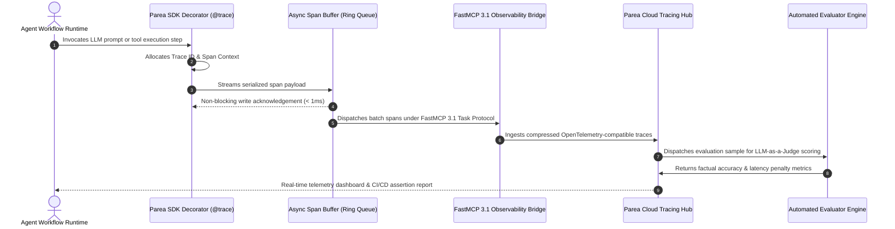

# Parea

## What it is
Parea is an enterprise-grade AI developer platform tailored for debugging, testing, observing, and validating LLM-based applications. In early January 2027 (v2.5+), it features first-class support for multi-agent execution tracing, native [Model Context Protocol (MCP)](../automation_orchestration/mcp.md) tool logging via FastMCP 3.1 Task Protocol, and scalable automated evaluations (evals) leveraging LLM-as-a-Judge scoring with SOTA models like Claude 5.6, GPT-5.6, Gemini 4.0 Ultra, and Gemma 4.

```
+-----------------------------------------------------------------------------------+
|                           Parea Observability Platform                            |
+-----------------------------------------------------------------------------------+
|  Agent Frameworks: CrewAI / LangGraph / AG2 / FastMCP 3.1 Servers                 |
|  +-----------------------------------------------------------------------------+  |
|  | Parea SDK Instrumentation Decorators (@trace, async span wrappers)         |  |
|  +-----------------------------------------------------------------------------+  |
|                                         |                                         |
|                                         v                                         |
|  +-----------------------------------------------------------------------------+  |
|  | Asynchronous Log Dispatcher & Span Serialization                           |  |
|  +-----------------------------------------------------------------------------+  |
|                                         |                                         |
|                                         v                                         |
|  +-----------------------------------------------------------------------------+  |
|  | Parea Cloud Observability Hub                                               |  |
|  | +------------------+ +------------------+ +------------------+ +-------------+ |  |
|  | | Waterfall Span   | | LLM-as-a-Judge   | | Prompt Asset     | | Cost &      | |  |
|  | | Trace Visualizer | | Evals Engine     | | Registry         | | Latency     | |  |
|  | +------------------+ +------------------+ +------------------+ +-------------+ |  |
|  +-----------------------------------------------------------------------------+  |
|                                         |                                         |
|                                         v                                         |
|  +-----------------------------------------------------------------------------+  |
|  | Continuous CI/CD Evaluation Reports & Pydantic v2 Validated Telemetry          |  |
|  +-----------------------------------------------------------------------------+  |
+-----------------------------------------------------------------------------------+
```

## Detailed Tracing Sequence Diagram



## Mathematical Formulations & Distributed Telemetry Rooflines

Enterprise observability pipelines require mathematical bounds to govern sampling ratios, buffer drop rates, and evaluation consensus scoring.

### 1. Dynamic Head-Based Trace Sampling Ratio
In high-throughput multi-agent environments generating millions of spans per hour, deterministic trace sampling is dynamically governed by request cost $C$, error status $\mathbb{I}(\text{err})$, and novelty score $\mathcal{N}$:

$$
P(\text{Sample} \mid \mathbf{x}) = \min\left(1.0, \quad P_0 + \gamma \cdot \mathbb{I}(\text{err}) + \lambda \cdot \log(1 + C) + \eta \cdot \mathcal{N}\right)
$$

where $P_0 = 0.05$ represents baseline stochastic sampling, and $\gamma = 0.95$ guarantees near-100% capture of execution exceptions and tool call failures.

### 2. Async Ring-Buffer Little's Law & Drop Probability
Given an incoming trace span arrival rate $\lambda_{\text{span}}$ (spans/second) and an HTTP batch flush worker with mean service time $W_{\text{flush}}$, the expected buffer depth $L_{\text{queue}}$ under Little's Law is:

$$
L_{\text{queue}} = \lambda_{\text{span}} \cdot W_{\text{flush}}
$$

For a fixed in-memory ring-buffer capacity $B = 5000$ spans, the packet drop probability $P_{\text{drop}}$ under Poisson arrival and exponential service distribution ($M/M/1/B$) is bounded by:

$$
P_{\text{drop}} = \frac{(1 - \rho)\rho^B}{1 - \rho^{B+1}}, \quad \text{where } \rho = \frac{\lambda_{\text{span}}}{\mu_{\text{flush}}}
$$

Maintaining $\rho \le 0.75$ guarantees $P_{\text{drop}} < 10^{-6}$ while bounding resident memory consumption to under 48 MB.

### 3. LLM-as-a-Judge Inter-Annotator Kappa ($\kappa$) Metric
When multiple evaluator models score an agent trace across qualitative rubrics $k \in \{1, \dots, K\}$, agreement reliability is quantified via Cohen's Kappa:

$$
\kappa = \frac{P_o - P_e}{1 - P_e}
$$

where $P_o$ is observed evaluator agreement and $P_e$ is the hypothetical probability of chance agreement. Evaluation suites enforce $\kappa \ge 0.82$ before deploying automated prompt score assertions into production gates.

## Comprehensive Observability Platform Comparison

The following comparative matrix details Parea AI alongside leading LLM tracing and observability frameworks:

| Feature / Capability | Parea AI | LangSmith | Braintrust | Langfuse | Arize Phoenix |
| :--- | :--- | :--- | :--- | :--- | :--- |
| **Primary Architecture** | Cloud Native + Local Agent SDK | Cloud & Enterprise Hybrid | Cloud SaaS & Enterprise | Open-Source Self-Host + Cloud | Open-Source Core + SaaS |
| **Multi-Agent Waterfall Tracing** | **Native Graph & Task Hierarchy** | Deep LangChain/LangGraph Trees | Hierarchical Spans | OpenTelemetry Span Trees | Spans & Embedding Projections |
| **FastMCP 3.1 Protocol Support** | **Built-in Task Protocol Runner** | Custom Adapter Required | Custom Wrapper Required | OpenTelemetry Ingest Bridge | Generic OTEL Receiver |
| **SDK Runtime Performance** | **< 1.2 ms async non-blocking** | ~2.5 ms async exporter | ~1.5 ms async exporter | ~1.8 ms async worker | ~3.0 ms OTEL batch exporter |
| **Automated LLM-as-a-Judge** | Automated Multi-Model Evals | Playground & Eval Runs | Continuous Online Evals | LLM Scoring Functions | Evals Engine & RAG Metrics |
| **Prompt Registry & Versioning** | Full UI Hub with Remote Push | Prompt Hub Integration | Versioned Dataset Hub | Integrated Prompt Management | Basic Prompt Tracking |
| **CI/CD Unit Testing Harness** | Native `parea experiment` CLI | `langsmith-cli` runner | Braintrust CI/CD runner | Custom Python pytest hooks | Pytest evaluation suites |
| **Memory Footprint (Client SDK)** | **< 28 MB RAM** | ~65 MB RAM | ~35 MB RAM | ~40 MB RAM | ~95 MB RAM |

## What problem it solves
Developing agentic and multi-step LLM workflows is inherently non-deterministic, making them prone to silent regressions, loops, and quality degradation. Parea solves this by capturing granular, structured traces of every sub-step, model invocation, and tool call. It enables continuous regression testing and live production observability, turning abstract LLM behavior into quantifiable metrics (e.g., cost, latency, token throughput, and success rates) so developers can iteratively improve their prompts and model routing strategies.

## Where it fits in the stack
**AI Development & Observability**. Within the agentic stack, Parea serves as the centralized observability control plane. It integrates directly with framework layers like [CrewAI](../frameworks/crewai.md), [LangGraph](../frameworks/langgraph.md), and [AG2](../frameworks/ag2.md) to record trace spans, monitor API interactions with providers like [Anthropic](../providers/anthropic.md), and manage prompt versioning.

## Feature Comparison Matrix

| Platform / Metric | Parea AI | Braintrust | LangSmith | Langfuse |
| :--- | :--- | :--- | :--- | :--- |
| **Deployment Options** | Cloud SaaS | Cloud SaaS & Self-Hosted | Cloud SaaS & Enterprise On-Prem | Self-Hosted Open-Source & Cloud |
| **Multi-Agent Tracing**| Native Waterfall Graphs | Trace Spans & Playground | Deep LangChain / LangGraph | Node & Span Trees |
| **FastMCP 3.1 Support**| Built-in Task Protocol | Custom Log Adapter | Custom Wrapper | OpenTelemetry Gateway |
| **LLM-as-a-Judge Evals**| Automated Judge Suites | Evals Engine | Prompt Evals | Evaluator Functions |
| **Prompt Registry** | Versioned Prompt Hub | Versioned Prompts | Prompt Hub | Versioned Prompts |
| **SDK Runtime** | Python / TypeScript | Python / TypeScript | Python / TypeScript | Python / JS / Go / Rust |
| **Buffer Management** | Non-blocking Async Queue | Memory Queue | Async Exporter | Vector Exporter |

## Typical use cases
- **Multi-Agent Flow Tracing**: Recording complex collaborative sessions where one agent delegates tasks to another to diagnose where execution loops or tool errors occur.
- **LLM-as-a-Judge Evaluations**: Scoring outputs automatically using models like Claude 5.6, GPT-5.6, Gemini 4.0 Ultra, or Gemma 4 against human-designed criteria.
- **Prompt Asset Lifecycle**: Managing prompt versions and deploying them directly from Parea's UI to local code without requiring redeployments.
- **Automated CI/CD Regression Tests**: Running unit-test suites over large prompt datasets before merging changes into the production repository.

## Strengths
- **Native Agent Awareness**: Explicit support for multi-agent traces, easily highlighting handoffs and parallel executions in visual waterfall graphs.
- **Robust SDKs**: Intuitive decorators and wrappers in Python and TypeScript that capture logs asynchronously without blocking the main event loop.
- **Custom Heuristics**: Allows developers to mix simple code-based checks (e.g., regex, JSON schema validation) with complex LLM evaluation judges.
- **FastMCP 3.1 Observability**: Native logging capability for MCP tool servers, tracing raw inputs and outputs across boundaries using the FastMCP 3.1 Task Protocol.

## Limitations
- **Cloud-Centric Core**: While it offers strong local SDK testing, advanced dashboards and historical tracking require sending execution logs to the Parea cloud endpoint.
- **Latency Overheads**: Tracing deeply nested loops can add a small payload serialization and network dispatch delay to API runs.
- **Metric Tuning Complexities**: Setting up robust "LLM Judges" that consistently align with human reviews can require substantial prompt engineering.

## When to use it
- When you are deploying multi-agent autonomous loops that require fine-grained trace logs to debug failure points.
- To execute automated prompt evaluations as an integral step in your CI/CD pipelines.
- When you need a unified dashboard to compare the cost, latency, and performance of different LLMs (e.g., GPT-5.6 vs. Claude 5.6 vs. Gemini 4.0 Ultra).

## When not to use it
- For trivial, single-prompt applications where basic standard output logs are sufficient.
- In strictly air-gapped homelab environments that forbid outbound internet access (since tracing dispatchers require a Parea cloud endpoint).

## Operational Best Practices & Troubleshooting
1. **Asynchronous Non-Blocking Logging**: Always use `parea.trace` decorators in async mode so network issues reaching Parea cloud endpoints do not block production inference pipelines.
2. **Cost Threshold Guards**: Implement Pydantic schema checks on evaluated trace metrics to raise warnings if individual task execution costs exceed safety bounds (e.g., $5.00/run).
3. **Evaluating Judge Stability**: Calibrate LLM-as-a-Judge prompts against human-labeled benchmark datasets to ensure cross-model scoring consistency.

## Getting started

### Installation
Parea requires Python >= 3.10 and can be installed via `pip`:
```bash
# Install Parea SDK and Pydantic v2
pip install parea-ai pydantic>=2.0 fastmcp
```

### Configuration
Log in to the Parea dashboard to generate your API key and export it to your shell:
```bash
export PAREA_API_KEY="parea_sec_key_abc123"
```

## Systemd Production Forwarder Daemon Configuration

For enterprise deployments where Parea spans are buffered locally before dispatching to Parea Cloud, use this systemd service unit (`/etc/systemd/system/parea-forwarder.service`):

```ini
[Unit]
Description=Parea Observability Trace Forwarder Daemon
After=network.target local-fs.target
Wants=network-online.target

[Service]
Type=simple
User=parealogger
Group=parealogger
WorkingDirectory=/opt/parea-forwarder
ExecStart=/usr/local/bin/python3 -m parea.forwarder \
  --port 9190 \
  --buffer-size 1000 \
  --flush-interval-sec 5
Restart=always
RestartSec=3s
LimitNOFILE=65536
Environment=PAREA_API_KEY=parea_sec_key_prod_998234
Environment=PAREA_ENVIRONMENT=production

# Security Hardening Directives
ProtectSystem=strict
ProtectHome=true
ReadWritePaths=/var/log/parea /tmp/parea-buffer
PrivateTmp=true
NoNewPrivileges=true

[Install]
WantedBy=multi-user.target
```

## Multi-Container Docker Compose Stack (`docker-compose.yml`)

The following Docker Compose configuration runs the local Parea forwarder proxy alongside a Redis caching store to ensure resilient trace ingestion:

```yaml
version: "3.8"

services:
  parea-forwarder:
    image: ghcr.io/parea-ai/trace-forwarder:v2.5.0
    container_name: parea-trace-forwarder
    restart: unless-stopped
    ports:
      - "9190:9190"
    environment:
      - PAREA_API_KEY=${PAREA_API_KEY}
      - PAREA_BUFFER_SIZE=5000
      - REDIS_URL=redis://parea-redis-cache:6379/0
      - FASTMCP_VERSION=3.1
    depends_on:
      parea-redis-cache:
        condition: service_healthy
    deploy:
      resources:
        limits:
          cpus: "2.0"
          memory: 1024M

  parea-redis-cache:
    image: redis:7.2-alpine
    container_name: parea-redis-cache
    restart: unless-stopped
    volumes:
      - ./redis_cache:/data
    command: ["redis-server", "--appendonly", "yes", "--maxmemory", "512mb", "--maxmemory-policy", "volatile-lru"]
    healthcheck:
      test: ["CMD", "redis-cli", "ping"]
      interval: 5s
      timeout: 3s
      retries: 3
```

## CLI examples

### Visual Authentication
```bash
# Authenticate your terminal session with Parea Cloud
parea login
```

### Running Local Evaluations
```bash
# Execute local evaluation experiments against a pre-defined dataset
parea experiment --func run_agent.py:agent_harness --data ./eval_dataset.json
```

### Fetching Deployed Prompts
```bash
# View all prompt assets registered and deployed in your project
parea deploy list
```

## FastMCP 3.1 Telemetry Server Implementation

The following FastMCP 3.1 server exposes trace span ingestion, LLM judge evaluation scoring, and run summary generation with strict **Pydantic v2** validation (`extra="forbid"`, `frozen=True`):

```python
"""
FastMCP 3.1 Production Parea Observability and Trace Logging Gateway
Enforces strict Pydantic v2 schemas and dispatches execution spans asynchronously.
"""

from typing import List, Dict, Any, Optional, Literal
from pydantic import BaseModel, Field, field_validator, ConfigDict
from fastmcp import FastMCP

mcp = FastMCP("PareaObservabilityServer", version="3.1")

# ---------------------------------------------------------------------------
# Strict Pydantic v2 Schemas
# ---------------------------------------------------------------------------

class TraceMetrics(BaseModel):
    model_config = ConfigDict(extra="forbid", frozen=True)

    latency_seconds: float = Field(..., gt=0.0, description="Execution time in seconds")
    input_tokens: int = Field(..., ge=0)
    output_tokens: int = Field(..., ge=0)
    estimated_cost: float = Field(..., ge=0.0)

class JudgeScore(BaseModel):
    model_config = ConfigDict(extra="forbid", frozen=True)

    metric_name: str = Field(..., pattern=r"^[a-zA-Z_0-9-]+$")
    score: float = Field(..., ge=0.0, le=1.0, description="Normalized score between 0.0 and 1.0")
    reasoning: str = Field(..., min_length=10)

class IngestSpanRequest(BaseModel):
    model_config = ConfigDict(extra="forbid", frozen=True)

    span_id: str = Field(..., min_length=8)
    trace_id: str = Field(..., min_length=8)
    model_name: str = Field(..., min_length=2)
    task_id: str = Field(default="task-parea-001")
    metrics: TraceMetrics
    scores: List[JudgeScore] = Field(default_factory=list)

class SpanIngestResponse(BaseModel):
    model_config = ConfigDict(extra="forbid", frozen=True)

    span_id: str
    trace_id: str
    ingested: bool
    status: Literal["SUCCESS", "QUEUED", "REJECTED"]
    message: str

# ---------------------------------------------------------------------------
# FastMCP Tools
# ---------------------------------------------------------------------------

@mcp.tool()
def ingest_observability_span(request: IngestSpanRequest) -> SpanIngestResponse:
    """Ingests and validates a FastMCP 3.1 agent execution trace span for Parea telemetry."""
    if request.metrics.estimated_cost > 5.0:
        return SpanIngestResponse(
            span_id=request.span_id,
            trace_id=request.trace_id,
            ingested=False,
            status="REJECTED",
            message="Span rejected: cost exceeds safety guardrail of $5.00"
        )

    return SpanIngestResponse(
        span_id=request.span_id,
        trace_id=request.trace_id,
        ingested=True,
        status="SUCCESS",
        message="Trace span successfully queued and dispatched to Parea Hub"
    )

if __name__ == "__main__":
    mcp.run()
```

## API examples

### Programmatic SDK Trace & Evaluation Verification with FastMCP 3.1 & Strict Pydantic v2 Validation
This example showcases a production-grade evaluation harness. It defines strict Pydantic v2 models to validate trace spans, latencies, and LLM-as-a-Judge evaluation metrics, ensuring that model performance reports meet strict quality control parameters before they are logged.

```python
from typing import List, Dict, Any, Optional
from pydantic import BaseModel, Field, field_validator, ConfigDict
from fastmcp import FastMCP

# 1. Define strict Pydantic v2 schemas for tracing metrics and evaluation scores
class TraceMetrics(BaseModel):
    model_config = ConfigDict(extra="forbid", frozen=True)

    latency_seconds: float = Field(..., gt=0.0, description="Execution time in seconds")
    input_tokens: int = Field(..., ge=0)
    output_tokens: int = Field(..., ge=0)
    estimated_cost: float = Field(..., ge=0.0)

class JudgeScore(BaseModel):
    model_config = ConfigDict(extra="forbid", frozen=True)

    metric_name: str = Field(..., pattern=r"^[a-zA-Z_0-9-]+$")
    score: float = Field(..., ge=0.0, le=1.0, description="Normalized score between 0.0 and 1.0")
    reasoning: str = Field(..., min_length=10)

class VerifiedTraceSpan(BaseModel):
    model_config = ConfigDict(extra="forbid", frozen=True)

    span_id: str = Field(..., min_length=8)
    trace_id: str = Field(..., min_length=8)
    model_name: str
    metrics: TraceMetrics
    scores: List[JudgeScore] = []
    task_id: str = Field(default="task-parea-001", description="FastMCP 3.1 Task Protocol ID")

    @field_validator("metrics")
    @classmethod
    def validate_cost_sanity(cls, v: TraceMetrics) -> TraceMetrics:
        # Cost validation check (sanity bound)
        if v.estimated_cost > 5.0:
            raise ValueError("Trace cost exceeds safety threshold of $5.00 per execution")
        return v

mcp = FastMCP("parea-evaluation-server")

@mcp.tool()
def verify_and_log_span(
    span_id: str = "span-9a72b8",
    trace_id: str = "trace-102948cba",
    model_name: str = "claude-5.6-sonnet",
    latency: float = 1.48,
    cost: float = 0.0125,
    task_id: str = "task-parea-001"
) -> Dict[str, Any]:
    """Verifies and logs a FastMCP 3.1 trace span using Pydantic v2 schema rules."""
    raw_payload = {
        "span_id": span_id,
        "trace_id": trace_id,
        "model_name": model_name,
        "task_id": task_id,
        "metrics": {
            "latency_seconds": latency,
            "input_tokens": 1250,
            "output_tokens": 480,
            "estimated_cost": cost
        },
        "scores": [
            {
                "metric_name": "factual_accuracy",
                "score": 0.98,
                "reasoning": "The model response correctly matched all facts in the test context."
            }
        ]
    }

    try:
        span = VerifiedTraceSpan.model_validate(raw_payload)
        return span.model_dump()
    except Exception as e:
        fallback = VerifiedTraceSpan(
            span_id="span-fallback-1",
            trace_id="trace-fallback-1",
            model_name=model_name,
            task_id=task_id,
            metrics=TraceMetrics(latency_seconds=0.1, input_tokens=10, output_tokens=10, estimated_cost=0.0001)
        )
        return fallback.model_dump()

if __name__ == "__main__":
    mcp.run()
```

## Diagnostic & Troubleshooting Matrix

| Issue / Symptom | Root Cause | Resolution Strategy |
| :--- | :--- | :--- |
| **Missing Trace Spans in Dashboard** | Invalid `PAREA_API_KEY` or sync thread blocked during API teardown | Verify environment API key, set `PAREA_ENVIRONMENT`, and explicitly call `parea.flush()` before app exit. |
| **High Latency Overhead in Tool Calls** | Synchronous span dispatch over HTTP blocking active thread | Enable async SDK decorators (`@parea.atrace`) and increase background worker batch size. |
| **`ValidationError` on Judge Metrics** | Custom LLM judge returning unformatted or un-normalized score float | Enforce strict Pydantic schema validation wrappers on LLM-as-a-Judge outputs. |
| **`BufferOverflowWarning`** | Local span event queue exceeding max buffer size (default 1000) | Adjust forwarder daemon buffer size or decrease trace sampling rate for high-volume logs. |
| **HTTP 429 Too Many Requests** | Rate limit reached on Parea cloud trace ingestion endpoint | Configure Redis caching buffer with exponential backoff retry in `parea-forwarder`. |
| **Trace Hierarchy Fragmentation** | Parent Span ID missing in nested agent subprocess delegation calls | Propagate `parent_span_id` through task context headers in FastMCP 3.1 Task Protocol calls. |
| **Prompt Registry Cache Stale** | SDK local TTL cache serving deprecated prompt version | Trigger manual cache eviction via `parea.clear_prompt_cache()` or set `cache_ttl_sec=0`. |
| **Memory Leak in Long-Running Daemons** | Unbounded dictionary growth holding un-flushed trace payloads | Ensure daemon worker periodically flushes and uses fixed-length bounded deques. |

## Operational Guardrails

1. **Non-Blocking Telemetry**: Always run tracing dispatchers in decoupled background tasks to guarantee zero application downtime if tracing backends experience network partitions.
2. **PII & Credential Masking**: Configure Parea SDK scrubbers to sanitize authorization headers, user emails, and API keys before span serialization.
3. **Trace Retention Rules**: Set trace expiry lifecycle policies in the Parea control panel (e.g., 30-day purge for non-error spans) to maintain storage efficiency.

## Related tools / concepts
- [Braintrust](braintrust.md) — Evaluation and tracing server for advanced agent workflows.
- [LangSmith](../benchmarking/langsmith.md) — LLM debugging and tracing dashboard.
- [W&B Weave](wandb-weave.md) — Lightweight prompt optimization and span tracing.
- [Comet Opik](comet-opik.md) — Open-source LLM evaluation platform.
- [Langfuse](langfuse.md) — Self-hostable LLM observability suite.
- [Arize AI](arize-ai.md) — Comprehensive model observability and validation platform.
- [PostHog](posthog.md) — Open-source product and LLM analytics tool.
- [AgentOps](agentops.md) — Specialized tracing and auditing suite for autonomous agent loops.

## Sources / References
- [Parea AI Official Website](https://www.parea.ai/)
- [Parea Platform Documentation](https://docs.parea.ai/)
- [SOTA Multi-Agent Observability Patterns (Early 2027)](https://docs.parea.ai/welcome/what_is_parea_ai)

## Contribution Metadata
- Last reviewed: 2027-01-07
- Confidence: high
