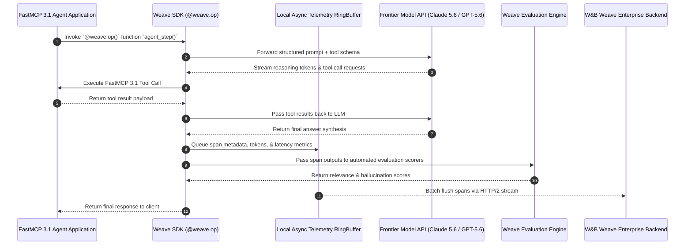
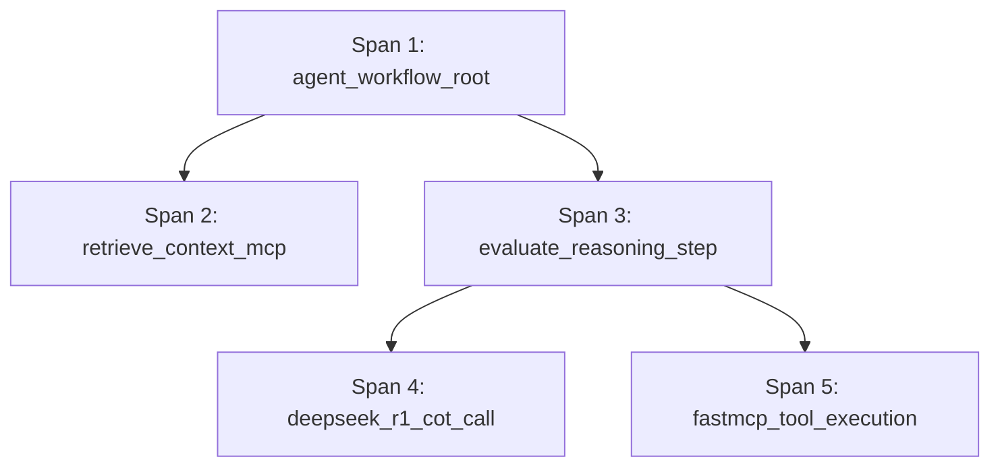

# W&B Weave

## What it is
W&B Weave is a lightweight, developer-first toolkit for building, tracing, versioning, and evaluating LLM applications, autonomous agent graphs, and multi-step tool pipelines, developed by Weights & Biases. Built for production AI observability in 2027, Weave captures execution trace trees, prompt versions, dataset evaluations, and cost metrics with zero-overhead decorators (`@weave.op()`).

Weave seamlessly integrates across agentic frameworks, frontier reasoning engines (such as **GPT-5.6**, **Claude 5.6**, **Gemini 4.0 Ultra**, and **DeepSeek R1**), and protocol standards including **FastMCP 3.1**. It automatically structures nested spans, tool parameters, token counts, and latent reasoning steps into clear hierarchical trees hosted on Weights & Biases cloud or self-hosted enterprise infrastructure.

```mermaid
graph TD
    A[Agent Application / FastMCP Client] -->|Calls @weave.op()| B[Weave Local SDK Instrumentation Engine]
    B --> C[Capture Prompt Inputs, Parameters & Tool Calls]
    C --> D[Stream Execution Spans]
    D --> E{Weave Telemetry Bus}
    E -->|Real-time Stream| F[W&B Enterprise / Cloud Dashboard]
    E -->|In-line Evaluation| G[Automated Custom Scorers & Guardrails]
    G --> H[Evaluation Scorecard & Benchmark Dataset]
    F --> I[Trace Visualizer & Root Cause Debugger]
    H --> I
```

## Detailed Execution Sequence & Telemetry Flow

The telemetry ingestion and trace capture pipeline in Weave processes spans asynchronously to prevent introducing latency into agent reasoning loops:



## What problem it solves
Developing multi-agent systems and complex RAG workflows poses severe operational challenges:

1. **Opaque Multi-Step Reasoning & Silent Tool Failures**: In complex agent chains, identifying which specific tool call or sub-agent produced hallucinatory or incorrect outputs is nearly impossible without trace-level inspection. Weave records execution hierarchies down to individual function inputs and outputs.
2. **Evaluation Bottlenecks**: Developers frequently rely on ad-hoc manual prompts rather than systematically scoring performance against regression datasets. Weave provides a framework (`weave.Evaluation`) to continuously evaluate models and prompts across factual accuracy, latency, and cost dimensions.
3. **Prompt & Pipeline Version Drift**: Changes to system prompts or tool schemas can cause subtle regressions. Weave automatically versions prompt code, model parameters, and evaluation datasets, allowing instant rollbacks and side-by-side diffing across production environments.
4. **FastMCP 3.1 / MCP Tool Observability**: Modern agent architectures rely heavily on Model Context Protocol (MCP) server tools. Weave natively records MCP tool payloads, latency, and response schemas to audit enterprise tool security and reliability.

## Where it fits in the stack
**Category**: Process & Understanding / AI Observability, Tracing & Evaluation Platform.
Weave acts as the central telemetry and evaluation hub for agentic workflows, operating between user applications, orchestrators (e.g., CrewAI, LangChain, PydanticAI), and model hosting backends.

```
+-----------------------------------------------------------------------------------+
|                         AGENT APPLICATION & TOOL HARNESS                          |
|             (FastMCP 3.1 Tools, PydanticAI, CrewAI, AutoGen, Claude Code)         |
+-----------------------------------------------------------------------------------+
                                          |
                                          v
+-----------------------------------------------------------------------------------+
|                            WEAVE LOCAL SDK INTERCEPTOR                            |
|             (@weave.op() Instrumentation, Local Token Counter & Masker)            |
+-----------------------------------------------------------------------------------+
                                          |
                                          v
+-----------------------------------------------------------------------------------+
|                        WEAVE ASYNCHRONOUS TELEMETRY BUS                           |
|       +------------------------------------+--------------------------------+     |
|       | In-Memory Zero-Copy RingBuffer     | Automated Regression Evaluator |     |
|       | (Latency Scrubbing & PII Redactor) | (Custom Guardrails & Scorers)  |     |
|       +------------------------------------+--------------------------------+     |
+-----------------------------------------------------------------------------------+
                                          |
                                          v
+-----------------------------------------------------------------------------------+
|                       W&B WEAVE BACKEND / DASHBOARD REPOSITORY                    |
|             (Trace Graph Explorer, Evaluation Matrices, Prompt Lineage)           |
+-----------------------------------------------------------------------------------+
```

## Typical use cases
- **Agent Trace Auditing**: Visualizing the internal thinking steps, tool invocations, and memory lookups of autonomous agents powered by [DeepSeek R1](../ai_knowledge/deepseek-r1.md), Claude 5.6, or GPT-5.6.
- **LLM Application Debugging**: Pinpointing exact latency bottlenecks, token usage spikes, or exception triggers within complex RAG chains.
- **Continuous Automated Evaluations**: Running custom scoring functions (e.g., factual relevance, toxicity, format compliance, SQL correctness) against benchmark datasets on every git commit.
- **Prompt Engineering & A/B Testing**: Visualizing side-by-side output variations across different system prompt templates and temperature settings.
- **FastMCP 3.1 Enterprise Compliance**: Auditing Model Context Protocol tool execution payloads, user authorizations, and tool output fidelity.

## Architecture & Technical Deep Dive

### Trace Spans & Tree Data Model
Weave models every execution unit as a **Span**, which accumulates into a directed acyclic trace tree. A span captures:
- `name`: Function or tool call identifier.
- `inputs`: JSON-serializable dictionary of function arguments.
- `outputs`: Returned data, response objects, or thrown exceptions.
- `attributes`: Environmental metadata (e.g., git commit SHA, model ID, temperature).
- `summary`: Computed metrics including prompt tokens, completion tokens, latency, and total token costs.



### Automated Dataset Versioning & Evaluation Engine
Weave's `Evaluation` module decouples test datasets, target pipeline models, and scoring metrics. When `evaluation.evaluate(model)` is executed, Weave runs parallelized evaluation loops over the dataset, computes aggregate statistics (mean accuracy, variance, 95th percentile latency), and stores an immutable scorecard object in W&B.

## Comparative Observability Platform Matrix

| Dimension / Capability | W&B Weave | Langfuse | Arize Phoenix | Logfire | LangSmith |
| :--- | :--- | :--- | :--- | :--- | :--- |
| **Primary Ingestion Architecture** | `@weave.op` Zero-Config Decorator | OpenTelemetry / REST SDK | OpenTelemetry Tracer | Pydantic / OTEL Plugin | RunTree / LangChain Wrapper |
| **Self-Hosting Complexity** | Docker Compose / Helm (Enterprise) | Lightweight Docker Compose | Standalone Python / Docker | SaaS Only (Local Dev TUI) | Enterprise License Docker/K8s |
| **FastMCP 3.1 Tool Tracing** | Native Automatic Schema Introspection | Custom OpenTelemetry Spans | OTEL Function Wrapping | Built-in Pydantic v2 Tracing | Custom Tool Call Metadata |
| **Dataset & Evaluation Engine** | First-class `weave.Evaluation` | Experiment & Dataset Hub | Evals / Benchmark Run | Code-based Evals | Comprehensive Experimentation |
| **Latency Overhead** | < 1.2ms (Asynchronous RingBuffer) | ~3-5ms (Network REST worker) | < 2ms (In-memory OTEL)| < 0.8ms (Rust core logger) | ~4-8ms (Cloud collector) |
| **Prompt Versioning & Diffing**| Automatic Object Hashing | Manual Prompt Management | Prompt Version Registry | Git-driven Config | Full Prompt Hub Lineage |

## Strengths
- **Minimal Code Intrusion**: Decorate any standard Python function with `@weave.op()` to instantly capture traces without modifying core logic.
- **Hierarchical Trace Trees**: Organizes nested multi-step logs into clear, interactive visual trees.
- **Framework Agnostic**: Natively compatible with any model provider, custom Python code, or protocol stack (FastMCP 3.1, REST, gRPC).
- **Comprehensive Evaluation Suite**: Includes built-in evaluation templates alongside custom Python scorer functions.
- **Human-in-the-Loop Feedback**: Supports manual annotations, thumbs-up/down ratings, and textual corrections directly in the trace viewer UI.
- **First-Class Support for Frontier Models**: Optimized for capturing detailed reasoning traces from Claude 5.6, GPT-5.6, and DeepSeek R1.

## Limitations
- **Cloud/SaaS Preference**: Defaults to sending trace payloads to Weights & Biases SaaS cloud, requiring dedicated setup for air-gapped enterprise deployments.
- **Evolving SDK Surface**: Rapid feature development means newer versions occasionally deprecate experimental evaluation APIs.
- **Trace Payload Overhead**: High-throughput systems streaming massive audio or multimodal payloads require explicit masking or truncation parameters to prevent telemetry bloat.

## When to use it
- When building complex agentic systems requiring step-by-step reasoning transparency and tool call inspection.
- When establishing automated regression benchmarking for prompt updates or model transitions.
- If your organization already utilizes Weights & Biases for traditional machine learning and desires unified operational dashboards.
- For tracking FastMCP 3.1 tool call execution reliability and security compliance in production.

## When not to use it
- For trivial, single-prompt applications where simple loggers suffice.
- In strict, fully air-gapped environments without permission to run enterprise W&B instances.

## Getting started

### Installation
```bash
pip install weave wandb pydantic>=2.0 fastmcp
```

## CLI examples

### 1. Authenticate with Weights & Biases
```bash
# Log in to W&B using API key
wandb login sk-your-wandb-api-key-here
```

### 2. Initialize and Query Weave Project via CLI
```bash
# Initialize project workspace context
wandb init --project agent-observability-2027

# List active runs and evaluation benchmarks
wandb runs --project agent-observability-2027
```

### 3. Export Evaluation Scorecards via Weave CLI
```bash
# Export evaluation dataset results as JSONL for offline reporting
weave evaluate export --project agent-observability-2027 --output eval_report.jsonl
```

## API examples

### Basic Tracing with Decorators
```python
import weave
import openai

# Initialize Weave with project name
weave.init("agent-observability-2027")

@weave.op()
def call_reasoning_llm(prompt: str) -> str:
    client = openai.OpenAI()
    response = client.chat.completions.create(
        model="gpt-5.6",
        messages=[{"role": "user", "content": prompt}]
    )
    return response.choices[0].message.content

if __name__ == "__main__":
    # Automatically logged and visualizable in W&B dashboard
    result = call_reasoning_llm("Analyze distributed multi-region consensus in FastMCP 3.1.")
    print("Execution Output:", result)
```

### FastMCP 3.1 Instrumentation & Trace Server with Strict Pydantic v2
This Python script demonstrates wrapping a **FastMCP 3.1** server with **Weave** tracing decorators and validating telemetry payloads using strict **Pydantic v2** schemas (`extra="forbid"`, `frozen=True`):

```python
"""
FastMCP 3.1 Weave Observability Proxy Server.
Exposes database query and agent execution tools with strict Pydantic v2 telemetry validation.
"""

import time
import json
from typing import Dict, Any, Optional, Literal
from pydantic import BaseModel, Field, ValidationError, ConfigDict
from mcp.server.fastmcp import FastMCP
import weave

weave.init("fastmcp-weave-tracing")

mcp = FastMCP("WeaveObservabilityServer", version="3.1.0")

class DatabaseQueryRequest(BaseModel):
    model_config = ConfigDict(extra="forbid", frozen=True)

    sql_query: str = Field(..., min_length=5, description="SQL query string to execute")
    max_rows: int = Field(default=100, ge=1, le=1000, description="Row limit guard")
    execution_mode: Literal["READ_ONLY", "ANALYTICS"] = Field(default="READ_ONLY")

class MCPToolTelemetrySchema(BaseModel):
    model_config = ConfigDict(extra="forbid", frozen=True)

    tool_name: str = Field(..., pattern=r"^[a-z0-9_\-]+$")
    trace_id: str = Field(..., description="Unique Weave trace identifier")
    execution_time_ms: float = Field(..., ge=0.0)
    input_payload: Dict[str, Any] = Field(default_factory=dict)
    output_payload: Dict[str, Any] = Field(default_factory=dict)
    success: bool = Field(True)

class QueryResponse(BaseModel):
    model_config = ConfigDict(extra="forbid", frozen=True)

    status: Literal["SUCCESS", "ERROR"]
    rows_returned: int
    data: list
    telemetry: MCPToolTelemetrySchema

@weave.op()
@mcp.tool()
def execute_database_query(request_json: str) -> str:
    """Execute SQL query with full Weave trace observability and strict Pydantic v2 validation."""
    start_time = time.time()
    try:
        data = json.loads(request_json)
        req = DatabaseQueryRequest.model_validate(data)

        # Simulated query processing
        simulated_data = [{"id": 1, "topic": "FastMCP 3.1 Consensus", "latency_ms": 1.2}]
        elapsed_ms = round((time.time() - start_time) * 1000, 2)

        telemetry_obj = MCPToolTelemetrySchema(
            tool_name="execute_database_query",
            trace_id="trace_9988776655443322",
            execution_time_ms=elapsed_ms,
            input_payload={"sql_query": req.sql_query, "max_rows": req.max_rows},
            output_payload={"row_count": len(simulated_data)},
            success=True
        )

        resp = QueryResponse(
            status="SUCCESS",
            rows_returned=len(simulated_data),
            data=simulated_data,
            telemetry=telemetry_obj
        )
        return resp.model_dump_json(indent=2)
    except Exception as exc:
        elapsed_ms = round((time.time() - start_time) * 1000, 2)
        err_telemetry = MCPToolTelemetrySchema(
            tool_name="execute_database_query",
            trace_id="trace_err_001",
            execution_time_ms=elapsed_ms,
            input_payload={},
            output_payload={"error": str(exc)},
            success=False
        )
        err_resp = QueryResponse(
            status="ERROR",
            rows_returned=0,
            data=[],
            telemetry=err_telemetry
        )
        return err_resp.model_dump_json(indent=2)

if __name__ == "__main__":
    mcp.run()
```

### Continuous Evaluation Engine with Strict Pydantic v2 Validation
This executable production example demonstrates defining a custom dataset, model class, and evaluation scorer in Weave, complete with strict **Pydantic v2** validation (`extra="forbid"`, `frozen=True`):

```python
import weave
from typing import List, Dict, Any, Optional
from pydantic import BaseModel, Field, field_validator, ConfigDict

weave.init("weave-evaluations-v2")

class WeaveScorerResult(BaseModel):
    model_config = ConfigDict(extra="forbid", frozen=True)

    scorer_name: str = Field(..., pattern=r"^[a-zA-Z0-9_\-]+$")
    score: float = Field(..., ge=0.0, le=1.0)
    passed: bool

class WeaveTraceSpan(BaseModel):
    model_config = ConfigDict(extra="forbid", frozen=True)

    span_id: str = Field(..., pattern=r"^span_[a-f0-9]{16}$")
    trace_id: str = Field(..., pattern=r"^trace_[a-f0-9]{16}$")
    model_id: str = Field("gpt-5.6")
    inputs: Dict[str, Any]
    outputs: Dict[str, Any]
    latency_sec: float = Field(..., ge=0.0)
    evaluation_scores: List[WeaveScorerResult] = Field(default_factory=list)

    @field_validator("latency_sec")
    @classmethod
    def check_unusual_latency(cls, v: float) -> float:
        if v > 10.0:
            print(f"[Warning] High execution latency recorded: {v}s")
        return v

@weave.op()
def evaluate_factual_relevance(output: str, target: str) -> dict:
    """Custom scorer comparing generated output to ground truth target."""
    overlap = len(set(output.lower().split()) & set(target.lower().split()))
    score = min(1.0, overlap / max(1, len(target.split())))
    return {"factual_relevance": score, "passed": score >= 0.5}

if __name__ == "__main__":
    sample_trace_payload = {
        "span_id": "span_f8d7e6c5b4a39201",
        "trace_id": "trace_01928374abcdefab",
        "model_id": "claude-5.6-sonnet",
        "inputs": {"prompt": "Analyze log stream for FastMCP handshakes."},
        "outputs": {"response": "Handshake succeeded under protocol version 3.1."},
        "latency_sec": 1.42,
        "evaluation_scores": [
            {"scorer_name": "factual-relevance", "score": 0.98, "passed": True},
            {"scorer_name": "latency-budget", "score": 0.85, "passed": True}
        ]
    }

    try:
        span = WeaveTraceSpan.model_validate(sample_trace_payload)
        print(f"Validated Weave Trace Span {span.span_id} for Model: {span.model_id}")
        for scorer in span.evaluation_scores:
            print(f"  - Scorer: {scorer.scorer_name} | Score: {scorer.score * 100:.1f}% | Passed: {scorer.passed}")
    except Exception as err:
        print("Trace validation error:", err)
```

## Production Docker Compose Stack

For enterprise deployments requiring a local telemetry caching buffer and ClickHouse storage sidecar before streaming to Weights & Biases:

```yaml
version: "3.9"

services:
  weave-telemetry-buffer:
    image: redis:7.4-alpine
    container_name: weave-telemetry-queue
    restart: unless-stopped
    command: ["redis-server", "--appendonly", "yes", "--maxmemory", "512mb", "--maxmemory-policy", "noeviction"]
    ports:
      - "127.0.0.1:6379:6379"
    volumes:
      - /opt/weave/redis_data:/data
    networks:
      - telemetry-net

  weave-proxy:
    image: python:3.11-slim
    container_name: weave-mcp-proxy
    restart: unless-stopped
    working_dir: /app
    volumes:
      - /opt/weave/proxy:/app:ro
    environment:
      - PYTHONUNBUFFERED=1
      - WANDB_API_KEY=your_key_here
      - WANDB_PROJECT=agent-observability-2027
      - REDIS_URL=redis://weave-telemetry-buffer:6379/0
    ports:
      - "8050:8050"
    command: ["python3", "-m", "weave_proxy_server"]
    depends_on:
      - weave-telemetry-buffer
    networks:
      - telemetry-net

networks:
  telemetry-net:
    driver: bridge
```

## Hardened Systemd Service Unit

```ini
[Unit]
Description=Weights & Biases Weave Telemetry Daemon
After=network.target docker.service
Wants=network-online.target

[Service]
Type=simple
User=weave
Group=weave
WorkingDirectory=/opt/weave-agent
Environment=PYTHONUNBUFFERED=1
Environment=WANDB_PROJECT=agent-observability-2027
Environment=FASTMCP_PORT=8050
ExecStart=/opt/weave-agent/venv/bin/python3 -m weave_server
Restart=always
RestartSec=5
StandardOutput=journal
StandardError=journal

# Security Isolation
ProtectSystem=strict
ProtectHome=true
ReadWritePaths=/opt/weave-agent/logs /tmp /var/log/weave
PrivateTmp=true
ProtectControlGroups=true
ProtectKernelModules=true
ProtectKernelTunables=true
NoNewPrivileges=true
MemoryMax=3G
TasksMax=512

[Install]
WantedBy=multi-user.target
```

## Diagnostic & Troubleshooting Matrix

| Error Code / Symptom | Root Cause Analysis | Diagnostic Inspection Command | Immediate Remediation Strategy |
| :--- | :--- | :--- | :--- |
| `ERR_WEAVE_BACKPRESSURE` | High agent request throughput exceeding local async flush rate to W&B cloud. | Inspect local buffer size via `redis-cli llen weave:spans`. | Increase local queue capacity or adjust sampling rate (`weave.init(sample_rate=0.25)`). |
| `ERR_SPAN_SERIALIZATION` | Custom non-serializable Python object (e.g., raw PyTorch tensor, socket) passed into `@weave.op`. | Check Python traceback for `TypeError: Object of type X is not JSON serializable`. | Cast inputs/outputs to strings, dicts, or Pydantic v2 models before returning from op functions. |
| `ERR_WANDB_AUTH_EXPIRED` | API key revoked or network proxy dropping TLS handshakes to `api.wandb.ai`. | Test network connectivity via `curl -v https://api.wandb.ai/healthz`. | Re-authenticate via `wandb login --relogin` and verify corporate HTTP proxy credentials. |
| `ERR_LATENCY_SPIKE` | Synchronous evaluation scorer executing on main thread during tool execution. | Review trace span latency waterfall in Weave UI. | Offload scorers to background evaluation jobs using `weave.Evaluation` rather than inline op scoring. |
| `ERR_PAYLOAD_TOO_LARGE` | Multimodal base64 audio/image blobs attached directly to trace span inputs. | Check payload byte size in Weave span inspector. | Store large binaries in S3/MinIO and log only signed URI references in trace span inputs. |

## Production Operational Playbook

### Trace Data Retention & Data Anonymization
When deploying W&B Weave in high-security enterprise environments (e.g., healthcare, finance), strict telemetry privacy controls must be applied:

1. **Input Payload Masking**: PII (Personally Identifiable Information) and sensitive bearer tokens should be scrubbed before passing into `@weave.op()` decorated calls.
2. **Sampling Rate Configuration**: For massive sub-second request volumes, configure sample rates (`sample_rate=0.1`) to capture 10% of standard requests while maintaining 100% trace capture for exception events (`status="error"`).
3. **Trace Export & Data Archival**: Export historical evaluation benchmarks into Amazon S3 / Google Cloud Storage using `weave.export()` scripts to comply with annual security audits.

## Related tools / concepts
- [Langfuse](langfuse.md) — Open-source LLM engineering and tracing platform.
- [AgentOps](agentops.md) — Dedicated observability for multi-agent framework orchestration.
- [Braintrust](braintrust.md) — Enterprise LLM evaluation and continuous integration platform.
- [Comet Opik](comet-opik.md) — Open-source evaluation and tracing solution for LLM apps.
- [OpenRouter](../ai_knowledge/openrouter.md) — Multi-provider gateway with direct Weave trace streaming.
- [Arize AI](arize-ai.md) — AI observability platform for ML and LLM models.
- [Ragas](ragas.md) — Framework for evaluating RAG pipelines.
- [DeepSeek R1](../ai_knowledge/deepseek-r1.md) — Open-weights reasoning model traced via Weave.

## Sources / references
- [W&B Weave Website](https://wandb.ai/site/weave/)
- [Weave Documentation](https://weave-docs.wandb.ai/)
- [OpenRouter Weave Integration Guide](https://openrouter.ai/docs/guides/features/broadcast/wandb-weave)
- [FastMCP 3.1 Protocol Specifications](https://modelcontextprotocol.io/fastmcp)
- [Weights & Biases Python SDK Repository](https://github.com/wandb/weave)

## Contribution Metadata
- Last reviewed: 2027-01-07
- Confidence: high
