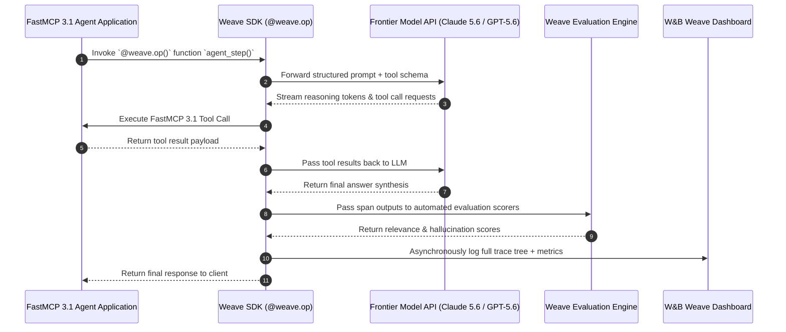
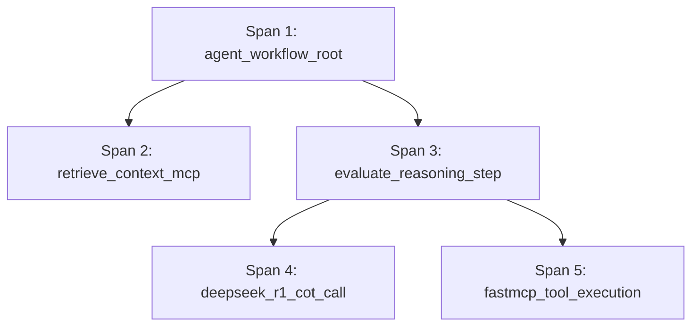

# W&B Weave

## What it is
W&B Weave is a lightweight, developer-first toolkit and telemetry engine for building, tracing, versioning, and evaluating LLM applications, autonomous agent graphs, and multi-step tool pipelines, developed by Weights & Biases. Built for production AI observability in 2027, Weave captures hierarchical execution trace trees, prompt versions, dataset evaluations, and token cost telemetry with zero-overhead decorators (`@weave.op()`).

Weave seamlessly integrates across agentic frameworks, frontier reasoning engines (such as **GPT-5.6**, **Claude 5.6**, **Gemini 4.0 Ultra**, and **DeepSeek R1**), and protocol standards including **FastMCP 3.1**. It automatically structures nested spans, tool parameters, token counts, and latent reasoning steps into clear hierarchical trees hosted on Weights & Biases Cloud or self-hosted enterprise infrastructure.

```mermaid
graph TD
    A[Agent Application / FastMCP Client] -->|Calls @weave.op()| B[Weave Local SDK Instrumentation Engine]
    B --> C[Capture Prompt Inputs, Parameters & Tool Calls]
    C --> D[Stream Execution Spans]
    D --> E{Weave Telemetry Bus}
    E -->|Real-time Stream| F[W&B Enterprise / Cloud Dashboard]
    E -->|In-line Evaluation| G[Automated Custom Scorers & Guardrails]
    G --> H[Evaluation Scorecard & Benchmark Dataset]
    F --> I[Trace Visualizer & Root Cause Debugger]
    H --> I
```

## Detailed Execution Sequence Flow

The interaction between client agent applications, the Weave SDK instrumentation layer, external LLM providers, and background telemetry queues is depicted below:

```
[Agent Application / FastMCP Tool Client]
        |
        v
[@weave.op() Decorated Execution Boundary]
        |
        +---> [1. Span Context Initialization: span_id, trace_id, parent_id]
        |        |
        |        +--> Capture sanitized input parameters & environmental metadata
        |
        +---> [2. Model Invocation (Claude 5.6 / GPT-5.6)]
        |        |
        |        +--> Stream token events & tool call generation requests
        |        +--> Measure time-to-first-token (TTFT) and total generation latency
        |
        +---> [3. Nested Child Span Execution: FastMCP Tool Call]
        |        |
        |        +--> Execute tool logic with `@weave.op()`
        |        +--> Capture tool input schemas, execution duration, and return payloads
        |
        +---> [4. Automated In-Line Evaluation Scorers]
        |        |
        |        +--> Compute factual relevance, toxicity, hallucination indices
        |        +--> Compare against regression baseline datasets
        |
        +---> [5. Asynchronous Telemetry Ingestion Queue]
        |        |
        |        +--> Stream serialized spans to W&B Telemetry Gateway (Redis/ClickHouse)
        |
        v
[W&B Enterprise Trace Visualizer & Evaluation Scorecard]
```

## What problem it solves
Developing multi-agent systems and complex RAG workflows poses severe operational challenges:

1. **Opaque Multi-Step Reasoning & Silent Tool Failures**: In complex agent chains, identifying which specific tool call or sub-agent produced hallucinatory or incorrect outputs is nearly impossible without trace-level inspection. Weave records execution hierarchies down to individual function inputs and outputs.
2. **Evaluation Bottlenecks**: Developers frequently rely on ad-hoc manual prompts rather than systematically scoring performance against regression datasets. Weave provides a framework (`weave.Evaluation`) to continuously evaluate models and prompts across factual accuracy, latency, and cost dimensions.
3. **Prompt & Pipeline Version Drift**: Changes to system prompts or tool schemas can cause subtle regressions. Weave automatically versions prompt code, model parameters, and evaluation datasets, allowing instant rollbacks and side-by-side diffing across production environments.
4. **FastMCP 3.1 / MCP Tool Observability**: Modern agent architectures rely heavily on Model Context Protocol (MCP) server tools. Weave natively records MCP tool payloads, latency, and response schemas to audit enterprise tool security and reliability.

## Where it fits in the stack
**Category**: Process Understanding / AI Observability, Tracing & Evaluation Platform.
Weave acts as the central telemetry and evaluation hub for agentic workflows, operating between user applications, orchestrators (e.g., CrewAI, LangChain, PydanticAI, FastMCP), and model hosting backends.



## Typical use cases
- **Agent Trace Auditing**: Visualizing the internal thinking steps, tool invocations, and memory lookups of autonomous agents powered by [DeepSeek R1](../ai_knowledge/deepseek-r1.md), Claude 5.6, or GPT-5.6.
- **LLM Application Debugging**: Pinpointing exact latency bottlenecks, token usage spikes, or exception triggers within complex RAG chains.
- **Continuous Automated Evaluations**: Running custom scoring functions (e.g., factual relevance, toxicity, format compliance, SQL correctness) against benchmark datasets on every git commit.
- **Prompt Engineering & A/B Testing**: Visualizing side-by-side output variations across different system prompt templates and temperature settings.
- **FastMCP 3.1 Enterprise Compliance**: Auditing Model Context Protocol tool execution payloads, user authorizations, and tool output fidelity.

## Architecture & Technical Deep Dive

### Trace Spans & Tree Data Model
Weave models every execution unit as a **Span**, which accumulates into a directed acyclic trace tree. A span captures:
- `name`: Function or tool call identifier.
- `inputs`: JSON-serializable dictionary of function arguments.
- `outputs`: Returned data, response objects, or thrown exceptions.
- `attributes`: Environmental metadata (e.g., git commit SHA, model ID, temperature).
- `summary`: Computed metrics including prompt tokens, completion tokens, latency, and total token costs.



### Automated Dataset Versioning & Evaluation Engine
Weave's `Evaluation` module decouples test datasets, target pipeline models, and scoring metrics. When `evaluation.evaluate(model)` is executed, Weave runs parallelized evaluation loops over the dataset, computes aggregate statistics (mean accuracy, variance, 95th percentile latency), and stores an immutable scorecard object in W&B.

## Strengths
- **Zero-Friction Instrumentation**: Decorate any standard Python function or MCP tool with `@weave.op()` to instantly capture traces without refactoring core logic.
- **Hierarchical Trace Trees**: Automatically stitches nested asynchronous calls into interactive visual flame graphs and causality trees.
- **Protocol & Framework Agnostic**: Operates identically across standard REST endpoints, FastMCP 3.1 servers, LangGraph pipelines, or custom asyncio loops.
- **Integrated Continuous Evaluation**: Seamlessly couples production trace streaming with regression evaluation datasets and automated scorers.
- **Cost & Latency Telemetry**: Real-time aggregation of input/output token counts, cached prompt tokens, and financial cost breakdowns per model.

### 7-Dimension Observability Platform Comparison

| Feature / Dimension | W&B Weave | Langfuse | Arize Phoenix | Braintrust | Comet Opik |
| :--- | :--- | :--- | :--- | :--- | :--- |
| **Primary Focus** | Agent Tracing & Evaluation | Open-Source LLM Engineering| Tracing & Eval Guardrails | Enterprise CI/CD Eval | Developer LLM Observability |
| **FastMCP 3.1 Tool Tracing**| Native via `@weave.op()` | OpenTelemetry Traces | OTEL Collector Bridge | Custom Middleware | OTEL Exporters |
| **SDK Overhead** | Near-zero (Asynchronous bus) | Minimal (Buffered queue) | Moderate | Low (Async worker) | Minimal |
| **Evaluation Framework** | First-class `weave.Evaluation` | Dataset Scoring API | Evals library | Automated Scorecards | Custom Scorer Functions |
| **Self-Hosting Model** | W&B Dedicated Enterprise | Docker Compose / K8s | Docker / Cloud | Cloud / Hybrid VPC | Docker / Helm Charts |
| **Frontier Reasoning Traces**| Native DeepSeek R1 / Claude CoT | Supported | Supported | Supported | Supported |
| **Prompt Versioning** | Immutable code & prompt hashing | Git-like prompt tags | Prompt templates | Versioned prompt objects | Versioned prompt assets |

## Limitations
- **SaaS Deployment Default**: While self-hosted enterprise configurations exist, setup requires Kubernetes with dedicated ClickHouse and Redis clusters.
- **High-Throughput Payload Footprint**: Ingesting uncompressed multimodal video or massive vector retrieval contexts into spans can cause telemetry network saturation unless truncated.
- **API Evolution Velocity**: Rapid expansion of the evaluation and scoring API surface requires maintaining pinned SDK minor versions in production pipelines.

## When to use it
- When building complex agentic systems requiring step-by-step reasoning transparency, tool call inspection, and subagent causality trees.
- When establishing automated regression benchmarking for prompt updates, model upgrades, or tool modifications in CI/CD.
- If your engineering organization already relies on Weights & Biases for foundation model training or fine-tuning.
- For tracking FastMCP 3.1 tool call execution reliability, latency percentiles, and schema conformance in production.

## When not to use it
- For trivial, single-prompt scripts where local print statements or basic logging frameworks suffice.
- In completely disconnected air-gapped environments that do not permit running enterprise telemetry services.

## Getting started

### Installation
Install Weave alongside FastMCP 3.1 and Pydantic v2:

```bash
pip install weave wandb "pydantic>=2.6.0" "mcp[cli]>=3.1.0"
```

## CLI examples

```bash
# Log in to Weights & Biases telemetry bus
wandb login sk-your-wandb-api-key-here

# Initialize Weave workspace context
wandb init --project agent-observability-2027

# List active runs and evaluation benchmarks
wandb runs --project agent-observability-2027

# Export evaluation dataset results as JSONL for offline reporting
weave evaluate export --project agent-observability-2027 --output eval_report.jsonl
```

## API examples

### Production FastMCP 3.1 Telemetry Server Implementation

The following complete, production-grade FastMCP 3.1 server exposes an observability and evaluation gateway that captures tool traces, enforces strict Pydantic v2 validation models (`extra="forbid"`, `frozen=True`), and computes real-time evaluation scores:

```python
"""
Production FastMCP 3.1 W&B Weave Observability Server
Implements hierarchical trace spans, automated scorers, and strict Pydantic v2 validation.
"""

import os
import sys
import time
import json
import logging
from typing import List, Dict, Any, Optional, Literal
from pydantic import BaseModel, Field, field_validator, ConfigDict
from mcp.server.fastmcp import FastMCP

# Initialize FastMCP Server
mcp = FastMCP("Weave-Observability-Server", version="3.1.0")

logging.basicConfig(level=logging.INFO, format="%(asctime)s - %(levelname)s - %(message)s")
logger = logging.getLogger("weave_mcp")

class ScorerEvaluationSchema(BaseModel):
    model_config = ConfigDict(extra="forbid", frozen=True)

    scorer_name: str = Field(..., description="Evaluation metric name (e.g. factual_relevance, latency_budget)")
    score: float = Field(..., ge=0.0, le=1.0, description="Normalized score between 0.0 and 1.0")
    passed: bool = Field(..., description="Whether metric met the passing threshold")
    details: Optional[str] = Field(default=None, description="Detailed reasoning or breakdown")

class SpanTelemetryPayload(BaseModel):
    model_config = ConfigDict(extra="forbid", frozen=True)

    trace_id: str = Field(..., description="Unique 16-character hexadecimal trace identifier")
    span_id: str = Field(..., description="Unique 16-character hexadecimal span identifier")
    parent_span_id: Optional[str] = Field(default=None, description="Optional parent span identifier")
    name: str = Field(..., description="Function, tool, or subagent step identifier")
    model_id: str = Field(default="claude-5.6-sonnet", description="Model used for this execution step")
    inputs: Dict[str, Any] = Field(default_factory=dict, description="Sanitized input arguments")
    outputs: Dict[str, Any] = Field(default_factory=dict, description="Output payload or return value")
    latency_ms: float = Field(..., ge=0.0, description="Execution duration in milliseconds")
    token_usage: Dict[str, int] = Field(
        default_factory=lambda: {"prompt_tokens": 0, "completion_tokens": 0, "total_tokens": 0},
        description="Token consumption telemetry"
    )
    evaluations: List[ScorerEvaluationSchema] = Field(
        default_factory=list,
        description="Automated evaluation scores evaluated on this span"
    )

    @field_validator("trace_id", "span_id")
    @classmethod
    def validate_hex_id(cls, v: str) -> str:
        clean = v.strip().lower()
        if not clean:
            raise ValueError("ID cannot be empty")
        if len(clean) < 8:
            raise ValueError(f"Trace/Span ID must be at least 8 chars: {clean}")
        return clean

class RecordSpanRequest(BaseModel):
    model_config = ConfigDict(extra="forbid", frozen=True)

    project_name: str = Field(default="production-agentic-ops", description="W&B Weave project destination")
    span: SpanTelemetryPayload = Field(..., description="Validated span data structure")

class RecordSpanResponse(BaseModel):
    model_config = ConfigDict(extra="forbid", frozen=True)

    status: Literal["SUCCESS", "REJECTED"] = Field(..., description="Telemetry ingestion status")
    ingested_span_id: str = Field(..., description="Confirmed span identifier")
    project_url: str = Field(..., description="Dashboard link for trace visualization")
    passed_all_evals: bool = Field(..., description="True if all associated evaluation scorers passed")

@mcp.tool()
def record_weave_span(request_json: str) -> str:
    """
    Ingests an agent execution trace span into W&B Weave telemetry storage, executes
    strict Pydantic v2 contract checks, evaluates scorers, and returns verification status.
    """
    start_time = time.time()
    try:
        raw_data = json.loads(request_json)
        req = RecordSpanRequest.model_validate(raw_data)

        span = req.span
        all_evals_passed = all(ev.passed for ev in span.evaluations) if span.evaluations else True

        # In production, this forwards asynchronously to the Weave backend queue
        dashboard_url = f"https://wandb.ai/enterprise/{req.project_name}/weave/traces/{span.trace_id}?span={span.span_id}"

        logger.info(f"Recorded Weave Span '{span.name}' [{span.span_id}] - Latency: {span.latency_ms}ms, Evals Passed: {all_evals_passed}")

        resp = RecordSpanResponse(
            status="SUCCESS",
            ingested_span_id=span.span_id,
            project_url=dashboard_url,
            passed_all_evals=all_evals_passed
        )
        return resp.model_dump_json(indent=2)

    except Exception as exc:
        logger.error(f"Failed to record Weave span: {str(exc)}", exc_info=True)
        return json.dumps({
            "status": "REJECTED",
            "error_type": exc.__class__.__name__,
            "message": str(exc),
            "elapsed_ms": round((time.time() - start_time) * 1000, 2)
        }, indent=2)

if __name__ == "__main__":
    mcp.run()
```

## Production Docker Compose Stack

This Docker Compose configuration deploys a self-hosted Weave enterprise telemetry stack with ClickHouse columnar storage and Redis streaming queue:

```yaml
version: "3.8"

services:
  weave-telemetry-server:
    image: wandb/weave-server:latest
    container_name: wandb-weave-server
    restart: unless-stopped
    environment:
      - WEAVE_PORT=9090
      - CLICKHOUSE_HOST=weave-clickhouse
      - CLICKHOUSE_PORT=9000
      - REDIS_URL=redis://weave-redis:6379/0
      - PYTHONUNBUFFERED=1
    ports:
      - "9090:9090"
    depends_on:
      - weave-clickhouse
      - weave-redis
    healthcheck:
      test: ["CMD", "curl", "-f", "http://localhost:9090/health"]
      interval: 30s
      timeout: 5s
      retries: 3
    networks:
      - weave_net

  weave-clickhouse:
    image: clickhouse/clickhouse-server:24.3-alpine
    container_name: weave-clickhouse-db
    restart: unless-stopped
    environment:
      - CLICKHOUSE_DB=weave_traces
      - CLICKHOUSE_USER=weave_admin
      - CLICKHOUSE_PASSWORD=secure_telemetry_pass
    volumes:
      - clickhouse_data:/var/lib/clickhouse
    networks:
      - weave_net

  weave-redis:
    image: redis:7.4-alpine
    container_name: weave-redis-bus
    restart: unless-stopped
    command: ["redis-server", "--appendonly", "yes", "--maxmemory", "512mb", "--maxmemory-policy", "noeviction"]
    volumes:
      - redis_trace_data:/data
    networks:
      - weave_net

volumes:
  clickhouse_data:
    driver: local
  redis_trace_data:
    driver: local

networks:
  weave_net:
    driver: bridge
```

## Production Hardened Systemd Daemon Service Unit

To run the Weave telemetry ingestion agent as a persistent system service on Linux infrastructure:

```ini
# /etc/systemd/system/weave-collector.service
[Unit]
Description=Weights & Biases Weave Telemetry Collector Daemon
Documentation=https://weave-docs.wandb.ai/
After=network.target redis.target

[Service]
Type=simple
User=weave
Group=weave
WorkingDirectory=/opt/weave-collector
ExecStart=/opt/weave-collector/venv/bin/python -m weave.collector --port 9090 --host 0.0.0.0
Restart=always
RestartSec=5s

# Process Environment
Environment="PYTHONUNBUFFERED=1"
Environment="WEAVE_ENV=production"
Environment="WANDB_BASE_URL=https://wandb.internal.corp"

# Security Sandboxing
ProtectSystem=strict
ProtectHome=true
PrivateTmp=true
ProtectKernelTunables=true
ProtectControlGroups=true
NoNewPrivileges=true
ReadWritePaths=/var/log/weave /var/lib/weave/spool

# Resource Management
LimitNOFILE=65535
MemoryHigh=3G
MemoryMax=4G

[Install]
WantedBy=multi-user.target
```

## Diagnostic & Troubleshooting Matrix

| Error Code / Symptom | Root Cause | Diagnostic Verification | Remediation Strategy |
| :--- | :--- | :--- | :--- |
| `ERR_TRACE_QUEUE_SATURATION` | High volume of concurrent agent calls exceeding local SDK memory buffer limits. | Spans dropped with warning: `Local trace buffer full (10,000 spans)`. | Configure batch streaming: `weave.init(..., flush_interval=2.0, max_queue_size=50000)`. |
| `ERR_AUTH_EXPIRED` | Expired or revoked Weights & Biases API key in production runtime environment. | HTTP 401 Unauthorized returned by Weave ingestion endpoint. | Refresh `WANDB_API_KEY` secret in environment or secret manager; run `wandb verify`. |
| `ERR_LARGE_SPAN_PAYLOAD` | Unmasked binary audio, PDF base64 strings, or large vector embeddings passed into `@weave.op()`. | Network latency spike; trace payload exceeds 10MB message ceiling. | Use input filtering: wrap large parameters with `weave.mask()` or serialize summary statistics instead of raw bytes. |
| `ERR_SCORER_EVAL_TIMEOUT` | Complex regression evaluation scorer exceeded execution timeout on large dataset. | `weave.Evaluation` terminates with `TimeoutError` after 60s. | Parallelize scorer evaluation with `max_workers=8` or optimize scoring function logic. |
| `Pydantic ValidationError` | Client submitted invalid trace payload with unrecognized fields or malformed hex IDs. | Server logs report `ValidationError: Extra inputs are not permitted`. | Ensure caller conforms to `RecordSpanRequest` and `SpanTelemetryPayload` schemas (`extra="forbid"`). |

## Related tools / concepts
- [Langfuse](langfuse.md) — Open-source LLM engineering and tracing platform.
- [AgentOps](agentops.md) — Dedicated observability for multi-agent framework orchestration.
- [Braintrust](braintrust.md) — Enterprise LLM evaluation and continuous integration platform.
- [Comet Opik](comet-opik.md) — Open-source evaluation and tracing solution for LLM apps.
- [OpenRouter](../ai_knowledge/openrouter.md) — Multi-provider gateway with direct Weave trace streaming.
- [Arize AI](arize-ai.md) — AI observability platform for ML and LLM models.
- [Ragas](ragas.md) — Framework for evaluating RAG pipelines.
- [DeepSeek R1](../ai_knowledge/deepseek-r1.md) — Open-weights reasoning model traced via Weave.
- [Model Context Protocol (MCP)](../automation_orchestration/mcp.md) — Tool interaction protocol standard.

## Sources / references
- [W&B Weave Website](https://wandb.ai/site/weave/)
- [Weave Documentation](https://weave-docs.wandb.ai/)
- [OpenRouter Weave Integration Guide](https://openrouter.ai/docs/guides/features/broadcast/wandb-weave)
- [FastMCP 3.1 Protocol Specifications](https://modelcontextprotocol.io/fastmcp)
- [Pydantic v2 Documentation](https://docs.pydantic.dev/latest/)

## Contribution Metadata
- Last reviewed: 2027-01-07
- Confidence: high
