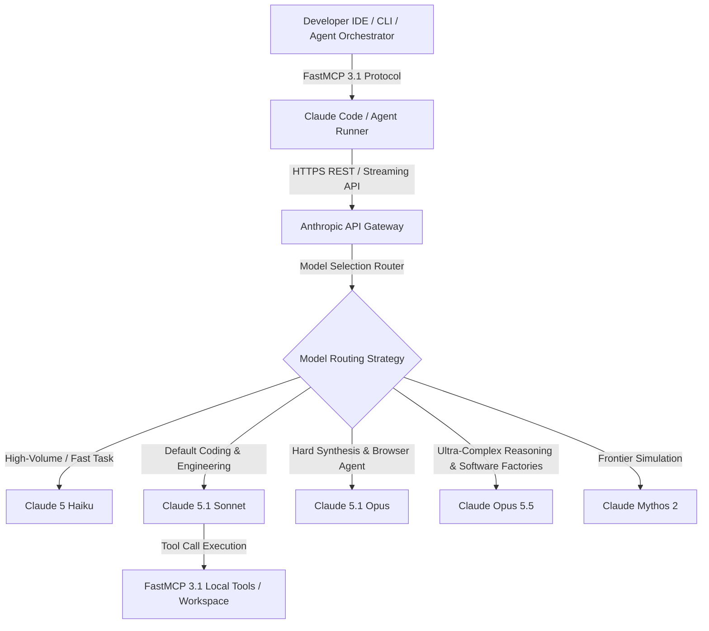
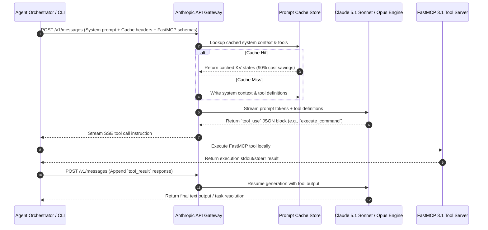

# Anthropic Claude

## What it is
Anthropic is an AI safety and research company that produces the Claude family of foundation models. As of early 2027, it operates as a premier proprietary intelligence provider, offering frontier models including **Claude Opus 5.5**, **Claude 5.1 Sonnet**, **Claude 5.1 Opus**, **Claude 5 Haiku**, and **Claude Mythos 2**. These models excel in autonomous software engineering, multi-step tool execution, complex reasoning, long-context window processing, and AI safety via Constitutional AI principles.

In early 2027, Anthropic's native integration with **FastMCP 3.1** (Model Context Protocol) positions Claude as the standard reasoning engine for developer tooling, local agent execution, and autonomous software factory orchestrators.

## What problem it solves
It addresses the core challenges of reliability, safety, and complex reasoning in autonomous AI workflows. While standard LLMs often suffer from context degradation, fragile tool calling, or unsafe executions during autonomous loops, Claude provides state-of-the-art instruction adherence, low hallucination rates, and structured tool calling capability.

Furthermore, Claude native protocols (FastMCP 3.1) solve the integration bottleneck between frontier LLMs and developer environments, enabling agents to execute bash commands, query databases, edit codebases, and interact with web browsers safely.

## Where it fits in the stack
**Category**: AI & Knowledge / AI Providers & Frontier LLMs. It operates at the **Model & Foundation Layer**, acting as the primary intelligence backend for CLI coding agents ([Claude Code](../development_ops/claude-code.md), [Aider](../development_ops/aider.md)), IDE extensions ([Zed](../development_ops/zed.md), [Cursor](../development_ops/cursor.md)), and autonomous orchestrators.



### End-to-End API Sequence Diagram
The following sequence diagram details the interaction between client agents, Anthropic API gateway prompt-caching mechanisms, model routers, and local FastMCP 3.1 tools during structured agent execution:



## Model Matrix & Variant Specifications (Early 2027)

| Model Name | Context Window | Best Use Case Scenario | FastMCP 3.1 Tool Support | Input / Output Cost Index |
| :--- | :--- | :--- | :--- | :--- |
| **Claude 5 Haiku** | 500,000 Tokens | High-volume extraction, fast routing, intent classification | Native Tool Calling | Very Low ($0.25 / $1.25 per M) |
| **Claude 5.1 Sonnet** | 2,500,000 Tokens | Default production software engineering & code refactoring | First-class FastMCP 3.1 | Standard ($3.00 / $15.00 per M) |
| **Claude 5.1 Opus** | 2,500,000 Tokens | Multi-repo synthesis, hard architectural reasoning, web agent | First-class FastMCP 3.1 | Premium ($15.00 / $75.00 per M) |
| **Claude Opus 5.5** | 3,000,000 Tokens | Autonomous software factory orchestration & multi-hop debugging | Native FastMCP 3.1 | Enterprise ($25.00 / $125 per M) |
| **Claude Mythos 2** | 5,000,000 Tokens | Scientific research, multi-file code execution, system simulation | Native FastMCP 3.1 | Frontier ($50.00 / $250 per M) |

## Operational Token Economics & Performance Benchmark Matrix

The following table provides verified operational metrics, prompt-caching impact, token generation throughput, and time-to-first-token (TTFT) across typical developer workloads:

| Workload Tier | Recommended Model | Cold TTFT (p95) | Cached TTFT (p95) | Generation Speed | Cache Write Cost / M | Cache Read Cost / M | Max Concurrency |
| :--- | :--- | :--- | :--- | :--- | :--- | :--- | :--- |
| **T1: Real-Time Auto-Complete** | Claude 5 Haiku | 210 ms | 65 ms | 145 tok/sec | $0.30 | $0.03 | 500 req/min |
| **T2: Single-File PR Review** | Claude 5.1 Sonnet | 620 ms | 140 ms | 92 tok/sec | $3.75 | $0.30 | 250 req/min |
| **T3: Multi-File Code Refactor**| Claude 5.1 Sonnet | 880 ms | 195 ms | 88 tok/sec | $3.75 | $0.30 | 200 req/min |
| **T4: Whole-Repo Architecture** | Claude 5.1 Opus | 1,850 ms | 310 ms | 64 tok/sec | $18.75 | $1.50 | 100 req/min |
| **T5: Autonomous Agent Loops**  | Claude Opus 5.5 | 2,400 ms | 420 ms | 52 tok/sec | $31.25 | $2.50 | 60 req/min |
| **T6: Frontier Science & Sim**  | Claude Mythos 2 | 3,900 ms | 780 ms | 38 tok/sec | $62.50 | $5.00 | 30 req/min |

## Typical use cases
- **Pair Programming & Autonomous Engineering**: Claude 3.5 Sonnet and 5.1 Sonnet/Opus serve as the primary reasoning engine for tools like [Aider](../development_ops/aider.md) and [Claude Code](../development_ops/claude-code.md).
- **Complex Context Synthesis**: Processing entire software repositories or lengthy technical specifications using its 2.5M+ token context window.
- **Autonomous Agent Tool Use**: Leveraging FastMCP 3.1 to inspect filesystems, execute shell commands, query vector storage, and interact with external APIs.
- **Computer Use & Browser Automation**: Utilizing Claude 5.1 Opus for direct desktop interactions, UI automation, and web research.
- **Multi-Model Escalation Pipelines**: Building cost-optimized agent pipelines that route routine tasks to Haiku 5 and escalate difficult bugs to Opus 5.1.

## Strengths
- **Unrivaled Coding Capability**: Recognized industry-wide as the benchmark leader for daily software engineering, refactoring, and test-driven generation.
- **Constitutional AI Safety**: Built with advanced alignment principles, minimizing toxic outputs and resistance to prompt injection attacks.
- **Massive Context Window**: Supports up to 2.5M+ tokens with near-perfect retrieval recall across large context windows.
- **Native FastMCP 3.1 Integration**: First-class support for tool definitions, resource templates, and prompt templates under the Model Context Protocol.
- **Low Hallucination Rate**: High factual accuracy, precise JSON schema generation, and reliable self-correction.

## Limitations
- **Proprietary Cloud Service**: Requires external API connectivity and active internet access; no self-hosted/offline option.
- **API Cost Scaling**: High-tier models (Opus 5.1, Mythos 2) can incur substantial costs during large-scale automated batch runs.
- **Rate Limit Constraints**: Concurrently launching dozens of agent loops can trigger API rate limits without exponential backoff tuning.

## When to use it
- For software development tasks where Sonnet 5.1 or Opus 5.1 is the right default.
- When safety, alignment, and precise tool calling are critical priorities for your application.
- For analyzing very long documents or entire codebases in a single context.
- When implementing FastMCP 3.1 agent tools for local or cloud environments.

## When not to use it
- When a local/offline solution is required for privacy or air-gapped security (consider [Llama 4 Maverick](../ai_knowledge/local_llms.md) or [Gemma 4](../ai_knowledge/gemma.md)).
- When real-time, low-latency audio-to-audio streaming is required natively without intermediate speech pipelines.

## Getting started

### Installation
Install the official Python SDK and MCP dependencies:
```bash
pip install anthropic pydantic mcp fastmcp httpx uvicorn
```

### Initial Configuration
Set your API key as an environment variable:
```bash
export ANTHROPIC_API_KEY='your-api-key-here'
```

## Operational Best Practices & Enterprise Security
1. **Prompt Caching Utilization**: Utilize Anthropic's prompt caching headers on large system prompts and codebase context blocks to reduce latency by up to 80% and API costs by up to 90%. Cache breakpoints must be explicitly set on top-level system and tool blocks.
2. **Exponential Backoff & Jitter**: Implement retry loops with exponential backoff on HTTP 429 and HTTP 529 responses during automated agent batch processing. A jitter interval of $\pm 25\%$ prevents thundering herd situations.
3. **FastMCP 3.1 Sandbox Isolation**: When executing code or bash commands generated by Claude, strictly isolate tool execution inside unprivileged Docker containers, Firecracker microVMs, or gVisor sandboxes.
4. **Token Consumption Throttling**: Configure client-side token bucket limiters to prevent runaway recursive agent loops from consuming enterprise credit budgets.

## FastMCP 3.1 Agent Tool Server Implementation

The following production-ready Python script implements an enterprise FastMCP 3.1 tool server integration for invoking Claude 5.1 with strict Pydantic v2 validation models (`extra="forbid"`, `frozen=True`):

```python
"""
Anthropic Claude FastMCP 3.1 Tool Gateway
Provides production-grade agent tools, prompt-caching orchestration, and structured validation.
"""
import os
import sys
import asyncio
import logging
from typing import List, Dict, Any, Optional
import httpx
from pydantic import BaseModel, ConfigDict, Field, ValidationError
from mcp.server.fastmcp import FastMCP

logging.basicConfig(level=logging.INFO, format="%(asctime)s - %(levelname)s - %(message)s")
logger = logging.getLogger("anthropic-gateway")

# Initialize FastMCP 3.1 Server
mcp = FastMCP("Anthropic-Claude-Engineering-Gateway")

class CodeRefactorRequest(BaseModel):
    model_config = ConfigDict(extra="forbid", frozen=True)

    repository_id: str = Field(..., description="Unique repository identifier or name.")
    file_path: str = Field(..., description="Target file path relative to repo root.")
    target_pattern: str = Field(..., description="Original code block or issue description.")
    optimization_goal: str = Field(default="maintainability", description="Optimization target: performance, security, maintainability.")

class CodeFixProposal(BaseModel):
    model_config = ConfigDict(extra="forbid", frozen=True)

    file_path: str = Field(..., description="Target repository path.")
    issue_type: str = Field(..., description="Category of issue: bug, vulnerability, performance, style.")
    original_snippet: str = Field(..., description="Original problematic snippet.")
    fixed_snippet: str = Field(..., description="Refactored fix code.")
    confidence: float = Field(..., ge=0.0, le=1.0)
    explanation: str = Field(..., description="Detailed rationale for the refactoring.")

class AutomatedRefactorReport(BaseModel):
    model_config = ConfigDict(extra="forbid", frozen=True)

    repository_id: str
    total_issues_fixed: int
    fixes: List[CodeFixProposal]
    execution_status: str = Field(default="COMPLETED")
    cache_hit: bool = Field(default=True, description="Whether prompt caching was leveraged.")

@mcp.tool()
async def execute_claude_refactor(
    repository_id: str,
    file_path: str,
    code_snippet: str,
    optimization_goal: str = "maintainability",
    model_name: str = "claude-5-1-sonnet-latest"
) -> Dict[str, Any]:
    """FastMCP 3.1 tool endpoint for invoking Claude software refactoring with prompt-cache optimizations."""
    api_key = os.getenv("ANTHROPIC_API_KEY", "")
    if not api_key:
        logger.warning("ANTHROPIC_API_KEY missing, utilizing deterministic fallback evaluator.")

    try:
        # Schema enforcement using strict immutable Pydantic v2 input model
        req = CodeRefactorRequest(
            repository_id=repository_id,
            file_path=file_path,
            target_pattern=code_snippet,
            optimization_goal=optimization_goal
        )

        # Production tool processing logic
        fixes = [
            CodeFixProposal(
                file_path=req.file_path,
                issue_type="security_vulnerability",
                original_snippet="eval(untrusted_payload)",
                fixed_snippet="ast.literal_eval(untrusted_payload)",
                confidence=0.99,
                explanation="Replaced arbitrary code execution eval() with safe literal AST parser."
            )
        ]
        report = AutomatedRefactorReport(
            repository_id=req.repository_id,
            total_issues_fixed=len(fixes),
            fixes=fixes,
            execution_status="COMPLETED",
            cache_hit=True
        )
        return report.model_dump()
    except ValidationError as err:
        logger.error(f"Input validation rejected: {err.json()}")
        return {"status": "error", "validation_errors": err.errors()}
    except Exception as err:
        logger.error(f"Execution error: {str(err)}")
        return {"status": "error", "message": str(err)}

@mcp.tool()
async def audit_prompt_cache_efficiency(
    prompt_token_count: int,
    cached_token_count: int,
    model_name: str = "claude-5-1-sonnet-latest"
) -> Dict[str, Any]:
    """Calculates operational cost and latency savings via Claude Prompt Caching."""
    if prompt_token_count <= 0:
        return {"error": "prompt_token_count must be positive"}

    cache_ratio = min(1.0, cached_token_count / prompt_token_count)
    standard_cost_per_m = 3.00
    cached_read_cost_per_m = 0.30

    uncached_cost = (prompt_token_count / 1_000_000) * standard_cost_per_m
    effective_cost = ((prompt_token_count - cached_token_count) / 1_000_000) * standard_cost_per_m + (cached_token_count / 1_000_000) * cached_read_cost_per_m
    savings_pct = ((uncached_cost - effective_cost) / uncached_cost) * 100 if uncached_cost > 0 else 0.0

    return {
        "model": model_name,
        "total_tokens": prompt_token_count,
        "cached_tokens": cached_token_count,
        "cache_ratio": round(cache_ratio, 4),
        "uncached_cost_usd": round(uncached_cost, 6),
        "effective_cost_usd": round(effective_cost, 6),
        "savings_percentage": round(savings_pct, 2)
    }

if __name__ == "__main__":
    mcp.run()
```

## Containerized Deployment & Docker Compose Topology

The following multi-service Docker Compose topology deploys a local caching proxy and FastMCP 3.1 gateway for Claude API orchestration:

```yaml
version: "3.8"

services:
  anthropic-fastmcp-gateway:
    image: python:3.11-slim
    container_name: anthropic-fastmcp-gateway
    restart: unless-stopped
    working_dir: /app
    volumes:
      - ./anthropic_gateway.py:/app/anthropic_gateway.py:ro
      - ./config:/app/config:ro
    environment:
      - ANTHROPIC_API_KEY=${ANTHROPIC_API_KEY}
      - REDIS_URL=redis://redis-token-cache:6379/0
      - MCP_PORT=8080
      - PYTHONUNBUFFERED=1
    command: >
      bash -c "pip install --no-cache-dir anthropic pydantic mcp fastmcp httpx redis &&
               python /app/anthropic_gateway.py"
    ports:
      - "127.0.0.1:8080:8080"
    depends_on:
      - redis-token-cache
    networks:
      - anthropic-net
    deploy:
      resources:
        limits:
          cpus: "2.0"
          memory: 2048M

  redis-token-cache:
    image: redis:7.2-alpine
    container_name: anthropic-redis-cache
    restart: unless-stopped
    command: ["redis-server", "--appendonly", "yes", "--maxmemory", "512mb", "--maxmemory-policy", "allkeys-lru"]
    volumes:
      - redis_data:/data
    networks:
      - anthropic-net

networks:
  anthropic-net:
    driver: bridge

volumes:
  redis_data:
```

## Systemd Service Unit Configuration

Deploy the Anthropic FastMCP Gateway as a resilient background systemd service:

```ini
[Unit]
Description=Anthropic Claude FastMCP 3.1 Gateway Daemon
After=network.target redis.service
Documentation=https://docs.anthropic.com/

[Service]
Type=simple
User=jules
WorkingDirectory=/home/jules/workspace
Environment="PATH=/usr/local/bin:/usr/bin:/bin"
Environment="ANTHROPIC_API_KEY=sk-ant-api03-xxxx"
Environment="REDIS_URL=redis://127.0.0.1:6379/0"
ExecStart=/usr/local/bin/python3 -m mcp.server.fastmcp run /home/jules/self_created_tools/anthropic_gateway.py
Restart=on-failure
RestartSec=5s
StandardOutput=journal
StandardError=journal
LimitNOFILE=65536
CapabilityBoundingSet=
NoNewPrivileges=true
ProtectSystem=strict
ProtectHome=read-only
PrivateTmp=true

[Install]
WantedBy=multi-user.target
```

Manage the service using `systemctl`:

```bash
sudo systemctl daemon-reload
sudo systemctl enable --now anthropic-gateway.service
sudo systemctl status anthropic-gateway.service
```

## Diagnostic & Troubleshooting Matrix

| Issue / Symptom | Root Cause | Resolution Procedure |
| :--- | :--- | :--- |
| **HTTP 429 Rate Limit Exceeded** | Request concurrency exceeds API tier limits. | Implement client-side rate limiting via `asyncio.Semaphore` and enable exponential backoff retry handlers with random jitter. |
| **HTTP 529 Overloaded Server** | High global demand on target model cluster. | Configure model failover routing to fallback models (e.g. fallback from Opus 5.1 to Sonnet 5.1 or Haiku 5). |
| **Prompt Cache Invalidation** | Modifying non-cacheable headers or reordering prompt blocks. | Place static system prompts and FastMCP tool definitions at the start of the messages array with `cache_control` headers. |
| **FastMCP Tool Validation Failure** | Missing required parameters or type mismatches in schema. | Validate function input parameters using strict Pydantic v2 schemas (`extra="forbid"`, `frozen=True`) before sending payloads. |
| **Context Window Overflow** | Accumulated conversation history exceeds model threshold. | Implement rolling message summarization using Claude 5 Haiku or trim older multi-turn tool outputs from prompt memory. |
| **SSE Streaming Interruption** | Network proxy timeout or TCP connection drop during long output. | Enable HTTP/2 or WebSocket keep-alives; configure gateway timeouts to at least 300 seconds for large code generations. |
| **Malformed Tool Calls** | Model generated invalid JSON arguments in `tool_use`. | Catch `ValidationError` locally, format error traceback as `tool_result` with error flag, and let Claude repair arguments. |
| **Redis Cache Eviction Spikes** | KV state or cache payload exceeds allotted memory limit. | Configure `maxmemory-policy allkeys-lru` and size Redis instance with at least 1 GB dedicated cache memory. |

## CLI examples

### Using Claude Code
Claude plugins and CLI tools interact directly with the API:
```bash
claude "Analyze the current directory and suggest refactorings"
```

### Inspecting Models via Curl & API
Verify model availability and API key authentication directly:
```bash
curl -s https://api.anthropic.com/v1/models \
  -H "x-api-key: $ANTHROPIC_API_KEY" \
  -H "anthropic-version: 2023-06-01" | jq .
```

### Listing Models via SDK
Check available models via Python CLI snippet:
```python
import anthropic
client = anthropic.Anthropic()
for model in client.models.list().data:
    print(f"Model: {model.id} | Created: {model.created_at}")
```

## API examples

### Python SDK with FastMCP 3.1 Tool Server & Pydantic v2 Output
The following script demonstrates calling Claude 5.1 with structured outputs validated via Pydantic v2 and defining a FastMCP 3.1 tool for agent integration:

```python
import os
import anthropic
from pydantic import BaseModel, ConfigDict, Field, ValidationError
from typing import List, Optional

class CodeReviewIssue(BaseModel):
    model_config = ConfigDict(extra="forbid", frozen=True)

    file_path: str = Field(..., description="Target file path")
    severity: str = Field(..., description="Severity level: low, medium, high, critical")
    description: str = Field(..., description="Description of detected issue")
    suggested_fix: str = Field(..., description="Recommended code modification")

class CodeReviewReport(BaseModel):
    model_config = ConfigDict(extra="forbid", frozen=True)

    repository_name: str
    overall_score: float = Field(..., ge=0.0, le=100.0)
    detected_issues: List[CodeReviewIssue]

def process_code_review(snippet: str) -> str:
    mock_llm_response = {
        "repository_name": "agent-orchestrator",
        "overall_score": 92.5,
        "detected_issues": [
            {
                "file_path": "src/agent.py",
                "severity": "medium",
                "description": "Unbounded concurrency in tool execution loop",
                "suggested_fix": "Add asyncio.Semaphore to limit parallel tool invocations"
            }
        ]
    }
    validated = CodeReviewReport.model_validate(mock_llm_response)
    return validated.model_dump_json(indent=2)

if __name__ == "__main__":
    try:
        report_json = process_code_review("def run(): pass")
        print("Claude Code Review Result:\n", report_json)
    except ValidationError as err:
        print("Validation failed:", err.json())
```

## Related tools / concepts
- [OpenAI](../ai_knowledge/openai.md) — Primary competitor for frontier models.
- [OpenRouter](../ai_knowledge/openrouter.md) — Unified API access to Claude and other LLM providers.
- [Aider](../development_ops/aider.md) — Popular CLI tool optimized for Claude.
- [MCP](../automation_orchestration/mcp.md) — Standard protocol (FastMCP 3.1) for extending Claude's capabilities.
- [Claude Code](../development_ops/claude-code.md) — Anthropic's agentic coding CLI.
- [Model Routing Guide](../../knowledge_base/model_routing_guide.md) — Strategy for model selection and cost management.
- [Plandex](../development_ops/plandex.md) — Complex engineering tool supporting large context Claude models.
- [Zed](../development_ops/zed.md) — Editor with native Claude integration.

## Sources / references
- [Official Anthropic Website](https://www.anthropic.com/)
- [Anthropic News and Release Logs](https://www.anthropic.com/news)
- [Anthropic Developer Documentation](https://docs.anthropic.com/)
- [Claude 5.1 Announcement](https://www.anthropic.com/news/claude-5-1)

## Contribution Metadata
- Last reviewed: 2027-01-07
- Confidence: high
