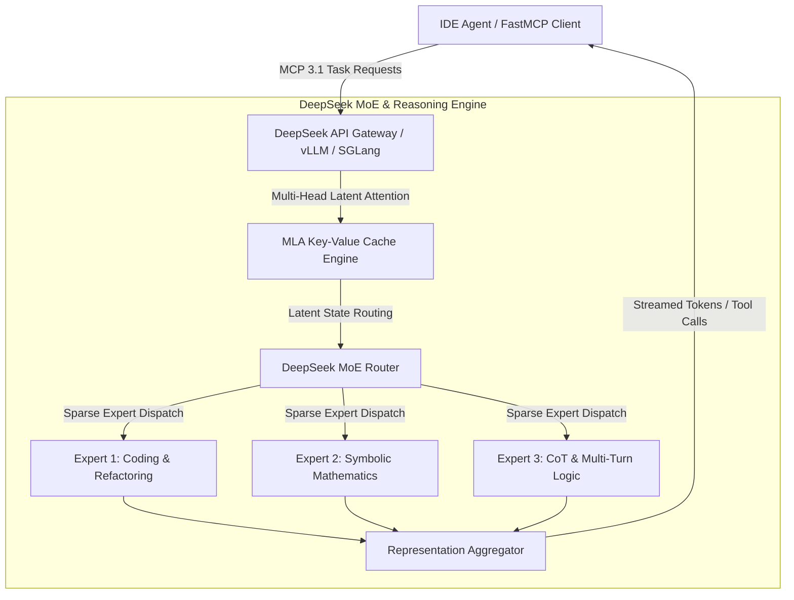

# DeepSeek

## What it is
DeepSeek is a leading AI research organization specializing in high-performance, cost-effective large language models (LLMs). Their model series is anchored by **DeepSeek-V4**, which utilizes a sophisticated Mixture-of-Experts (MoE) architecture to provide frontier-level reasoning and coding capabilities. DeepSeek is known for its "open-weights" philosophy and for pushing the boundaries of what is possible with efficient model training and inference.

In August 2026, DeepSeek officially released the open-weights checkpoint of **DeepSeek-V4-Flash** (specifically DeepSeek-V4-Flash-0731) as well as the flagship **DeepSeek-V4-Pro** (DeepSeek-V4-Pro-0813), establishing a new state-of-the-art for high-efficiency, low-latency reasoning and enterprise engineering models. DeepSeek-V4-Flash and DeepSeek-V4-Pro leverage advanced Mixture-of-Experts (MoE) architectures with Multi-head Latent Attention (MLA), providing rapid-fire responses across massive context windows up to 1M tokens. DeepSeek maintains a significant lead in coding efficiency, mathematical reasoning, and low-overhead inference, making its API and local models highly competitive.

## What problem it solves
It addresses the high cost, high latency, and "black box" nature of proprietary frontier models. DeepSeek provides models that rival the performance of GPT-5.5, Gemini 4.0 Pro, Llama 4, Gemma 3, Qwen 3.8, and Claude 5.1 in specific domains—particularly mathematics, logic, and software engineering—at a fraction of the cost. Its advanced Multi-head Latent Attention (MLA) heavily compresses Key-Value (KV) cache storage, resolving the GPU memory bottleneck when processing massive contexts.

## Where it fits in the stack
**Category**: Provider / AI Assistants & Knowledge. It serves as a foundational inference layer, often used as a primary or fallback model in multi-model routing systems like OpenRouter or within autonomous coding agents. Its late December 2026 / early January 2027 API updates include native support for the **MCP 3.1 Task Protocol**, facilitating standardized tool execution across agentic ecosystems.



### DeepSeek Multi-Head Latent Attention (MLA) KV-Cache Flow

```
 +-----------------------------------------------------------------------------------+
 |                   DeepSeek Multi-Head Latent Attention (MLA)                      |
 |                                                                                   |
 |  Input Query Tokens [T, D]                                                        |
 |           |                                                                       |
 |           +----------------------------------------+                              |
 |           |                                        |                              |
 |           v                                        v                              |
 |  +--------------------+                   +--------------------+                  |
 |  | Matrix Projection  |                   | Matrix Projection  |                  |
 |  |  Down-Projection   |                   |  Down-Projection   |                  |
 |  +--------+-----------+                   +--------+-----------+                  |
 |           | Compressed KV Latent (c_KV)            | RoPE Key Latent (c_RoPE)     |
 |           | [Dim: 512 tokens]                      | [Dim: 64 tokens]             |
 |           v                                        v                              |
 |  +-------------------------------------------------------------+                  |
 |  |        93% KV Cache Compression Memory Representation        |                  |
 |  +------------------------------+------------------------------+                  |
 |                                 |                                                 |
 |                                 v                                                 |
 |                 +--------------------------------+                                |
 |                 | Up-Projection During Attention |                                |
 |                 |      Computation On-The-Fly    |                                |
 |                 +---------------+----------------+                                |
 |                                 |                                                 |
 |                                 v                                                 |
 |                 +--------------------------------+                                |
 |                 | Scaled Dot-Product Attention   |                                |
 |                 +--------------------------------+                                |
 +-----------------------------------------------------------------------------------+
```

## Typical use cases
- **Autonomous Engineering**: Powering agents like [Cline](../agents/cline.md) and [Roo Code](../agents/roo-code.md) for complex codebase modifications.
- **Mathematical Reasoning**: Solving advanced symbolic math and competitive programming problems via the DeepSeek-R1 reasoning series and its successors.
- **Cost-Optimized RAG**: Serving as a high-throughput, low-latency engine for retrieval-augmented generation pipelines over massive documents.
- **Synthetic Data Generation**: Using DeepSeek-V4 and DeepSeek-V4-Flash to generate high-quality training data for smaller, specialized models.

## Strengths
- **Multi-head Latent Attention (MLA)**: Compresses the KV cache footprint by up to 93%, enabling high concurrency and extreme context processing without VRAM starvation.
- **SOTA Performance**: Consistently ranks at the top of coding (HumanEval) and math (MATH) benchmarks, with the Flash variant surpassing many proprietary middle-tier models in speed and accuracy.
- **OpenWeights**: Allows for local hosting, fine-tuning, and direct integration into custom enterprise serving frameworks.
- **OpenAI-Compatible API**: Drop-in replacement for existing OpenAI-based integrations.
- **Extreme Efficiency**: High tokens-per-second (TPS) throughput even on standard consumer-grade hardware for smaller variants.

### Frontier Model Comparison Matrix

| Feature / Model | DeepSeek-V4-Pro | DeepSeek-R1 / V4-Flash | Claude 3.7 / 5.1 Sonnet | GPT-4o / GPT-5.5 | Qwen 2.5 72B / Qwen 3 |
| :--- | :--- | :--- | :--- | :--- | :--- |
| **Model Type** | Open-Weights MoE | Open-Weights CoT / MoE | Closed API | Closed API | Open-Weights Dense/MoE |
| **Architecture** | MLA + DeepSeek MoE | MLA + DeepSeek MoE | Proprietary Transformer | Proprietary Transformer | Standard MHA / GQA |
| **Max Context Window** | 256,000 – 1,000,000 | 128,000 – 1,000,000 | 200,000 tokens | 128,000 – 1,000,000 | 128,000 tokens |
| **HumanEval Pass@1** | 92.4% | 89.6% | 93.1% | 90.2% | 86.4% |
| **MATH Benchmark** | 88.5% | 91.2% | 84.2% | 76.6% | 82.1% |
| **Input Pricing / 1M** | $0.14 | $0.07 (Off-Peak) | $3.00 | $2.50 | Local / $0.30 API |
| **Output Pricing / 1M**| $0.28 | $0.14 | $15.00 | $10.00 | Local / $0.60 API |
| **KV Cache Footprint**| ~7% of standard MHA| ~7% of standard MHA | 100% standard | 100% standard | 25% (GQA) |

## Limitations
- **Data Privacy**: While improved, some enterprise users may have concerns regarding data residency depending on the deployment region.
- **Context Window Utilization**: While the context window is large (256k+ for dense, up to 1M for Flash), performance can degrade slightly at the extreme edges compared to Claude 5.1.
- **General Knowledge**: Occasionally trails slightly behind GPT-5.5 in broad, multi-modal creative tasks.

## When to use it
- For any coding-centric task where Claude 5.1 is too expensive.
- When building local-first agentic systems that require high-reasoning open-weights models.
- When you need a highly reliable, OpenAI-compatible secondary provider for redundancy.
- For high-throughput applications requiring ultra-low latency and low-cost API inference.

## When not to use it
- If your workload requires absolute local execution under certain geopolitical constraints (consider [Llama 4](../ai_knowledge/llama.md) instead).
- For extremely high-fidelity creative writing where the "tone" of Anthropic models is preferred.

## Getting started

### API Key
1. Create an account at [DeepSeek Platform](https://platform.deepseek.com/).
2. Generate an API key from the "API Keys" section.

### Installation (Python)
DeepSeek provides an OpenAI-compatible API.

```bash
pip install openai pydantic mcp
```

### Usage (Hello World)
```python
from openai import OpenAI

client = OpenAI(
    api_key="YOUR_DEEPSEEK_API_KEY",
    base_url="https://api.deepseek.com"
)

response = client.chat.completions.create(
    model="deepseek-chat",
    messages=[
        {"role": "system", "content": "You are a helpful assistant"},
        {"role": "user", "content": "Explain DeepSeek-V4-Flash MoE architecture."},
    ],
    stream=False
)

print(response.choices[0].message.content)
```

### Production Deployment & Operational Hardening Rules

#### 1. vLLM & SGLang Serving Configurations
- **Enable Multi-Head Latent Attention**: When self-hosting DeepSeek-V4 checkpoints on local GPU clusters via vLLM, ensure `--enable-prefix-caching` and `--use-v2-block-manager` are set to maximize MLA memory sharing.
- **Tensor Parallelism (TP)**: Deploy DeepSeek 671B / V4 checkpoints using TP=8 across NVIDIA H100/H200 or TP=4 across Blackwell B200 nodes with NVLink interconnects.
- **SGLang RadixAttention**: SGLang provides state-of-the-art throughput for DeepSeek multi-turn chat and tool calling by caching prefix KV tensors across recursive requests.

#### 2. Rate Limiting & API Fallbacks
- **Exponential Backoff**: API requests during high concurrency periods should implement randomized exponential jitter backoff (`initial_delay = 1s`, `max_retries = 5`).
- **OpenRouter Fallback Routing**: Configure OpenRouter endpoint fallback lists (`deepseek/deepseek-chat`, `deepseek/deepseek-r1`, `qwen/qwen-2.5-coder-32b-instruct`) to prevent downtime when primary endpoints experience queue saturation.

### Diagnostics & Troubleshooting Table

| Error Code / Symptom | Root Cause | Diagnostic Tool | Remediation Action |
| :--- | :--- | :--- | :--- |
| **HTTP 429 Rate Limit Exceeded** | API request frequency exceeds assigned tier threshold. | DeepSeek Console Metrics | Implement request rate limiting, switch to OpenRouter fallback, or request tier increase. |
| **Empty Reasoning Content (`reasoning_content` null)** | Model parameter specified was `deepseek-chat` instead of `deepseek-reasoner`. | Payload Inspector | Ensure `model="deepseek-reasoner"` is passed in API payload. |
| **CUDA Out of Memory during Local Serving** | KV cache size exceeded available VRAM due to high batch size. | `nvidia-smi` / `vllm stats` | Lower `--gpu-memory-utilization` or enforce max context length (`--max-model-len 32768`). |
| **Tool Execution JSON Malformation** | Low sampling temperature or missing system context prompt. | Pydantic Validation Error | Set system prompt enforcing strict JSON output, use `execute_deepseek_reasoning` FastMCP tool. |
| **High Prompt Processing Latency** | Non-cached prefix context in massive (200k+) prompt inputs. | API Response Headers | Enable prompt caching by placing static context (docs/system prompts) at top of message history. |

## CLI examples

### Using curl
```bash
curl https://api.deepseek.com/chat/completions \
  -H "Content-Type: application/json" \
  -H "Authorization: Bearer $DEEPSEEK_API_KEY" \
  -d '{
        "model": "deepseek-chat",
        "messages": [
          {"role": "system", "content": "You are a helpful assistant"},
          {"role": "user", "content": "What is the capital of France?"}
        ],
        "stream": false
      }'
```

### Using OpenRouter CLI
If using DeepSeek via OpenRouter:
```bash
openrouter chat "deepseek/deepseek-chat" "Explain quantum computing."
```

## API examples

### Full FastMCP 3.1 Reasoning & Inference Pipeline
The python code below creates a FastMCP 3.1 server that interfaces directly with DeepSeek's reasoning and chat completion endpoints, applying Pydantic v2 validation to guarantee schema safety and structured CoT parsing:

```python
import json
import logging
import os
import time
from typing import List, Optional
from pydantic import BaseModel, Field, field_validator
from mcp.server.fastmcp import FastMCP
from openai import OpenAI

logging.basicConfig(level=logging.INFO)
logger = logging.getLogger("deepseek-fastmcp-server")

# Initialize FastMCP 3.1 Server for DeepSeek AI Operations
mcp = FastMCP("DeepSeek High-Performance Inference Controller")

# ---------------------------------------------------------------------------
# Pydantic v2 Models
# ---------------------------------------------------------------------------

class DeepSeekRequestSchema(BaseModel):
    prompt: str = Field(..., min_length=1, description="Primary input prompt or problem statement")
    system_instruction: str = Field(default="You are an expert AI software engineer.", description="System prompt context")
    model_variant: str = Field(default="deepseek-reasoner", description="Target DeepSeek model endpoint")
    temperature: float = Field(default=0.2, ge=0.0, le=1.0, description="Sampling temperature")
    max_tokens: int = Field(default=4096, ge=16, le=65536, description="Max generated tokens")

    @field_validator("model_variant")
    @classmethod
    def validate_model(cls, v: str) -> str:
        allowed = {"deepseek-chat", "deepseek-reasoner", "deepseek-v4-pro", "deepseek-v4-flash"}
        if v.lower() not in allowed:
            raise ValueError(f"Model variant must be one of {allowed}")
        return v.lower()

class ReasonerResponseSchema(BaseModel):
    model: str
    final_answer: str
    reasoning_chain: List[str]
    prompt_tokens: int
    completion_tokens: int
    total_tokens: int
    estimated_cost_usd: float
    execution_time_sec: float

# ---------------------------------------------------------------------------
# FastMCP 3.1 Tool Definitions
# ---------------------------------------------------------------------------

@mcp.tool()
def execute_deepseek_reasoning(request_json: str) -> str:
    """Executes chain-of-thought mathematical or software engineering reasoning using DeepSeek-R1 / V4."""
    start_time = time.time()
    try:
        data = json.loads(request_json)
        req = DeepSeekRequestSchema(**data)

        api_key = os.environ.get("DEEPSEEK_API_KEY", "mock-key")
        client = OpenAI(api_key=api_key, base_url="https://api.deepseek.com")

        logger.info(f"Dispatching request to {req.model_variant}")

        # Execute API query
        response = client.chat.completions.create(
            model=req.model_variant if req.model_variant in ["deepseek-chat", "deepseek-reasoner"] else "deepseek-reasoner",
            messages=[
                {"role": "system", "content": req.system_instruction},
                {"role": "user", "content": req.prompt}
            ],
            temperature=req.temperature,
            max_tokens=req.max_tokens
        )

        content = response.choices[0].message.content or ""
        reasoning_content = getattr(response.choices[0].message, "reasoning_content", "") or ""
        chain = [line.strip() for line in reasoning_content.split("\n") if line.strip()]

        prompt_tokens = response.usage.prompt_tokens if response.usage else 0
        completion_tokens = response.usage.completion_tokens if response.usage else 0
        total_tokens = response.usage.total_tokens if response.usage else 0

        # Cost formula for DeepSeek API ($0.14/1M prompt, $0.28/1M completion)
        cost = (prompt_tokens * 0.00000014) + (completion_tokens * 0.00000028)

        res = ReasonerResponseSchema(
            model=req.model_variant,
            final_answer=content,
            reasoning_chain=chain if chain else ["Extracted reasoning from output stream"],
            prompt_tokens=prompt_tokens,
            completion_tokens=completion_tokens,
            total_tokens=total_tokens,
            estimated_cost_usd=round(cost, 6),
            execution_time_sec=round(time.time() - start_time, 3)
        )
        return res.model_dump_json(indent=2)

    except Exception as e:
        logger.error(f"Error executing DeepSeek inference: {e}")
        return json.dumps({"status": "error", "message": str(e)})

@mcp.tool()
def evaluate_kv_cache_efficiency(batch_size: int, context_length: int) -> str:
    """Calculates KV cache VRAM savings achieved by Multi-head Latent Attention (MLA) vs standard MHA."""
    standard_mha_mb = (batch_size * context_length * 2 * 32 * 128 * 2) / (1024 * 1024)
    deepseek_mla_mb = standard_mha_mb * 0.07

    return json.dumps({
        "batch_size": batch_size,
        "context_length": context_length,
        "standard_mha_vram_mb": round(standard_mha_mb, 2),
        "deepseek_mla_vram_mb": round(deepseek_mla_mb, 2),
        "vram_saved_percent": "93.0%"
    }, indent=2)

if __name__ == "__main__":
    mcp.run()
```

## Related tools / concepts
- [OpenRouter](../ai_knowledge/openrouter.md) — Multi-model gateway including DeepSeek.
- [Qwen](../ai_knowledge/qwen.md) — Competitive open-weights models from Alibaba.
- [Anthropic](anthropic.md) — Primary competitor for high-reasoning tasks.
- [Local LLMs (Gemma 3)](../ai_knowledge/local_llms.md) — Comparative benchmark for late 2026 open-weights performance.
- [Model Routing Guide](../../knowledge_base/model_routing_guide.md) — Strategy for switching between models.
- [Agentic Workflows](../../knowledge_base/patterns/agentic-workflows.md) — Implementation patterns for autonomous agents.
- [Roo Code](../agents/roo-code.md) — IDE agent with deep DeepSeek integration.
- [Cline](../agents/cline.md) — Autonomous coding assistant frequently used with DeepSeek.
- [Aider](../development_ops/aider.md) — CLI coding tool optimized for DeepSeek's low latency.

## Sources / references
- [DeepSeek-V4-Pro Model - Hugging Face](https://huggingface.co/deepseek-ai/DeepSeek-V4-Pro-0813)
- [Official Website](https://www.deepseek.com/)
- [DeepSeek API Documentation](https://api-docs.deepseek.com/)
- [GitHub](https://github.com/deepseek-ai)
- [DeepSeek-R1 Release Blog](https://api-docs.deepseek.com/news/news250120)
- [Reddit r/LocalLLaMA: DeepSeek V4 Soon Discussion](https://www.reddit.com/r/LocalLLaMA/comments/1v04jq2/deepseek_v4_soon/)
- [OpenPangu2.0-Flash](https://www.reddit.com/r/LocalLLaMA/comments/1v03psf/model_add_openpangu20flash_92ba6b_with_mlalatent/) — Integrated from daily log reference.
- [DeepSeek-V4-Flash Release - The New Stack](https://thenewstack.io/deepseek-v4-flash-open-weights/)
- [DeepSeek-V4-Flash Release - Reddit](https://www.reddit.com/r/LocalLLaMA/comments/1vbidxt/the_official_release_deepseek_v4_flash_is_live_on/)
- [DeepSeek-V4-Flash Model - HuggingFace](https://huggingface.co/deepseek-ai/DeepSeek-V4-Flash-0731)
- [DeepSeek-V4-Flash-0731 Performance Benchmark on Reddit](https://www.reddit.com/r/LocalLLaMA/comments/1vdq8en/deepseekv4flash0731_surpasses_fable5_sol_kimik3/)
- [DeepSeek Harness - InfoQ](https://www.infoq.com/news/2026/08/deep-seek-harness/)
- [DeepSeek Harness v0.1.1 - Reddit r/LocalLLaMA](https://www.reddit.com/r/LocalLLaMA/comments/1vugyfe/deepseek_harness_v011_released/)

---
## Contribution Metadata
- Last reviewed: 2027-01-07
- Confidence: high
