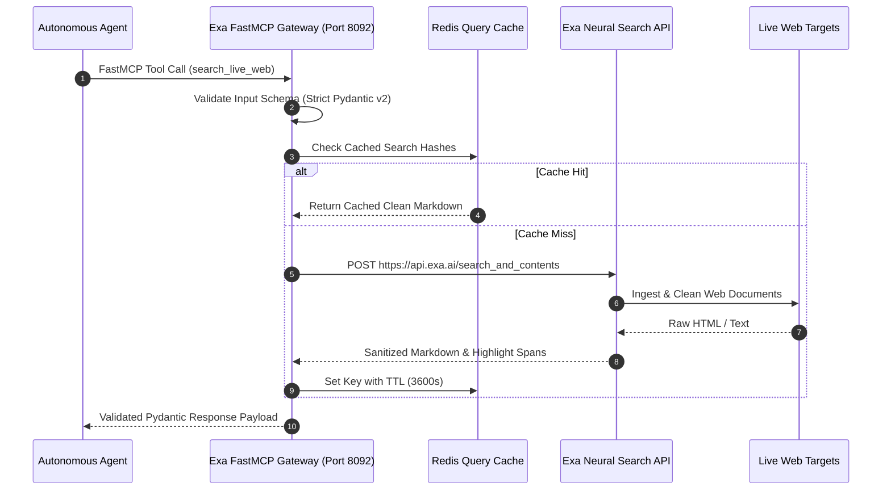

# Exa AI

## What it is
Exa AI is a neural search engine engineered specifically for large language models (LLMs) and autonomous AI agents. Unlike keyword-matching or SEO-biased traditional search platforms, Exa uses transformer-based embedding models to perform semantic searches, finding high-signal web content and delivering it in structured, LLM-clean formats. Operating with native **FastMCP 3.1 Task Protocol** support, Exa empowers frontier agents (Claude 5.6, GPT-5.6, Gemma 4, DeepSeek-V4) to query the live web, extract markdown contents, and ground reasoning without token bloating or HTML scraping failures.

## System & Retrieval Architecture

```
+-----------------------------------------------------------------------------------+
|                            Autonomous AI Agent / MCP Server                        |
+-----------------------------------------------------------------------------------+
                                          |
                                          | FastMCP 3.1 Neural Search Tool Call
                                          v
+-----------------------------------------------------------------------------------+
|                              Exa AI Neural Search API                             |
|  +---------------------+  +---------------------+  +--------------------------+  |
|  | Semantic Vector     |  | Category & Domain   |  | Content Parsing          |  |
|  | Search Engine       |  | Filtering Engine    |  | & Markdown Synthesizer   |  |
|  +---------------------+  +---------------------+  +--------------------------+  |
+-----------------------------------------------------------------------------------+
                                          |
                                          | Vector Index Scan & Live Web Extraction
                                          v
+-----------------------------------------------------------------------------------+
|                        Web Content / Research Sources                             |
|        [ Personal Blogs | Academic Papers | Company Sites | News Portals ]        |
+-----------------------------------------------------------------------------------+
                                          |
                                          | Sanitized LLM-Ready Markdown & Highlights
                                          v
+-----------------------------------------------------------------------------------+
|                          Pydantic v2 Contract Validation                          |
+-----------------------------------------------------------------------------------+
                                          |
                                          v
+-----------------------------------------------------------------------------------+
|                          Agent RAG / Knowledge Base Grounding                      |
+-----------------------------------------------------------------------------------+
```

## Feature Matrix & Provider Comparison

| Feature / Metric | Exa AI | Traditional Search APIs (Bing/Google) | Headless Scraping (Puppeteer) |
| :--- | :--- | :--- | :--- |
| **Search Mechanism** | Neural Embeddings (Intent-based) | Lexical / Keyword matching | N/A (Requires direct URL) |
| **Output Format** | Clean Markdown / Text / Highlights | HTML Snippets / Heavy JSON | Raw HTML / JS Rendered DOM |
| **Parsing Overhead** | Zero (Handled by Exa) | Medium (HTML stripping needed) | High (Custom parsers required) |
| **Token Efficiency** | Optimized for LLM contexts | Moderate noise | High noise / Ads / Modals |
| **Category Filters** | Native (Blogs, Papers, News, Company) | Domain-level only | Custom custom scrapers |
| **FastMCP 3.1 Native** | Fully Supported | Requires custom wrapper | Requires custom wrapper |

## What problem it solves
Standard search engines optimize results for human browsers, often cluttering responses with sponsored ads, heavy javascript elements, and SEO-bloated pages. These structures consume massive token volume and introduce irrelevant noise into agent pipelines. Exa solves this by retrieving clean, pre-parsed markdown directly from the web, drastically decreasing latency, parsing errors, and input token overhead for agent reasoning loops.

By providing category filters (`company`, `research paper`, `news`, `personal site`) and subpage crawling options, Exa transforms unstructured web data into deterministic, type-safe JSON objects validated against strict Pydantic v2 schemas before reaching agent contexts.

## Where it fits in the stack
**Data Ingestion / Web-Intelligence Provider**. It acts as the web-grounding layer for agentic retrieval-augmented generation (RAG) workflows, research-centric multi-agent pipelines, and dynamic information synthesis platforms.



## Typical use cases
- **Agentic Deep-Research**: Powering agents running on frontier models (e.g., Claude 5.6, GPT-5.6, Llama 4, Gemma 4, Qwen 3.8, DeepSeek-V4) to execute complex, multi-query research missions over the live web.
- **Dynamic Context Grounding**: Supplying real-time, high-fidelity context slices into enterprise RAG systems to keep corporate knowledge bases dynamically up to date.
- **Automated Lead and Market Synthesis**: Aggregating structured company, academic, or product information via custom domain and timestamp filters.
- **Factual Claims Verification**: Querying reference documents and extracting clean source texts to cross-examine and ground agent-generated responses.
- **Autonomous Tool-Driven Fact-Checking**: Allowing FastMCP 3.1 workflows to verify breaking changes or technical documentation releases dynamically.

## Systemd Service Unit Configuration

### Production Exa FastMCP Gateway Service (`/etc/systemd/system/exa-mcp-gateway.service`)
```ini
[Unit]
Description=Exa AI FastMCP 3.1 Web Intelligence Gateway
After=network-online.target redis.service
Wants=network-online.target redis.service

[Service]
Type=simple
User=examcp
Group=examcp
WorkingDirectory=/opt/exa-mcp
Environment="EXA_API_KEY=exa_prod_key_live_xxxx"
Environment="FASTMCP_PORT=8092"
Environment="FASTMCP_HOST=0.0.0.0"
Environment="REDIS_CACHE_URL=redis://127.0.0.1:6379/1"
ExecStart=/opt/exa-mcp/venv/bin/python3 /opt/exa-mcp/server.py
Restart=always
RestartSec=5s
LimitNOFILE=65536
MemoryMax=4G

# Sandboxing & Security
ProtectSystem=strict
ProtectHome=true
ReadWritePaths=/var/log/exa-mcp /tmp
NoNewPrivileges=true
PrivateTmp=true
ProtectKernelTunables=true
ProtectControlGroups=true

[Install]
WantedBy=multi-user.target
```

To enable and monitor the service:
```bash
sudo systemctl daemon-reload
sudo systemctl enable --now exa-mcp-gateway.service
sudo systemctl status exa-mcp-gateway.service
journalctl -u exa-mcp-gateway.service -f --output=short-iso
```

## Multi-Container Docker Compose Stack

The following production-grade `docker-compose.yml` deploys the Exa FastMCP Gateway with an integrated Redis query cache and rate limiter:

```yaml
version: "3.8"

services:
  exa-gateway:
    build:
      context: .
      dockerfile: Dockerfile
    container_name: exa-fastmcp-gateway
    restart: always
    ports:
      - "8092:8092"
    environment:
      - EXA_API_KEY=${EXA_API_KEY}
      - FASTMCP_PORT=8092
      - FASTMCP_HOST=0.0.0.0
      - REDIS_CACHE_URL=redis://redis:6379/1
      - LOG_LEVEL=info
    depends_on:
      - redis
    networks:
      - exa-net
    healthcheck:
      test: ["CMD", "curl", "-f", "http://localhost:8092/healthz"]
      interval: 15s
      timeout: 5s
      retries: 3

  redis:
    image: redis:7.2-alpine
    container_name: exa-redis-cache
    restart: unless-stopped
    command: redis-server --save 60 1 --loglevel warning --maxmemory 1gb --maxmemory-policy allkeys-lru
    volumes:
      - redis-data:/data
    networks:
      - exa-net

networks:
  exa-net:
    driver: bridge

volumes:
  redis-data:
```

## Strengths
- **Clean Markdown Delivery**: Returns sanitized, readable markdown or raw text directly, bypassing the need for custom headless scrapers or proxy layers.
- **High-Signal Neural Search**: Uses semantic vector representations to locate relevant pages based on exact intent rather than literal keyword occurrences.
- **Flexible Filter Controls**: Supports precise filtering by domain, category (e.g., personal blogs, academic papers, news, company sites), and exact publish dates.
- **Robust SDKs & FastMCP 3.1 Integration**: Native libraries for Python and TypeScript, alongside fully compliant Model Context Protocol (FastMCP 3.1 Task Protocol) servers for drag-and-drop tool integration.

## Limitations
- **Key-Based API Billing**: Requires a paid subscription and charges based on monthly search volumes and token retrieval size.
- **Web-Only Index**: Focuses strictly on publicly available web content, necessitating custom database connections for internal or private data ingestion.
- **Rate-Limiting on Basic Plans**: Concurrency and request-per-minute ceilings on lower tiers can require robust retry mechanics in high-throughput production.

## When to use it
- When autonomous agents need to conduct open-ended, high-precision web browsing or fact-finding tasks.
- To reduce developer maintenance overhead for internal scraping, JavaScript rendering, and HTML-to-Markdown processing pipelines.
- When executing high-accuracy, long-horizon research workloads where source credibility and token conservation are prioritized.

## When not to use it
- For searching local, on-premises private codebases or file shares (use [ripgrep](../development_ops/ripgrep.md) or custom local embeddings instead).
- If your system operates in a completely air-gapped, offline, or strictly zero-trust environment.
- For extremely high-volume, low-value generic web crawling tasks where cost is the absolute limiting factor.

## Getting started
Exa AI can be integrated into your applications using the official python library and a registered developer API key.

### 1. Installation
Install the official Exa PyPI package and FastMCP 3.1 dependencies:
```bash
pip install exa_py fastmcp pydantic
```

### 2. Configure API Key
Register and obtain an API key from the [Exa Developer Console](https://dashboard.exa.ai/) and set it:
```bash
export EXA_API_KEY="your-exa-api-key"
```

## CLI examples

### Querying the Semantic API with Curl
Search for specialized articles on Model Context Protocol developments:
```bash
curl -X POST https://api.exa.ai/search \
  -H "Content-Type: application/json" \
  -H "x-api-key: $EXA_API_KEY" \
  -d '{
    "query": "Model Context Protocol FastMCP 3.1 implementation patterns",
    "useAutoprompt": true,
    "numResults": 3
  }'
```

### Fetching Parsed Page Contents
Extract the clean markdown representation of a targeted web address using the REST API:
```bash
curl -X POST https://api.exa.ai/contents \
  -H "Content-Type: application/json" \
  -H "x-api-key: $EXA_API_KEY" \
  -d '{
    "urls": ["https://docs.exa.ai/introduction"],
    "text": true
  }'
```

## API examples

### FastMCP 3.1 Exa Search Server with Strict Pydantic v2 Contracts
The following complete Python script creates a **FastMCP 3.1** server that exposes Exa AI neural search tools to agentic clients, validating inputs and outputs with strict **Pydantic v2** models (`extra="forbid"`):

```python
#!/usr/bin/env python3
"""
Exa AI FastMCP 3.1 Neural Search Server.
Exposes validated neural web search and content retrieval tools with extra="forbid".
"""

import os
import logging
from typing import List, Optional, Dict, Any
from pydantic import BaseModel, Field, ConfigDict, HttpUrl, ValidationError
from fastmcp import FastMCP
from exa_py import Exa

# Setup logging
logging.basicConfig(level=logging.INFO, format="%(asctime)s [%(levelname)s] %(message)s")
logger = logging.getLogger("exa-fastmcp")

# Initialize FastMCP 3.1 Server
mcp = FastMCP(
    name="Exa-Neural-Search-MCP",
    version="3.1.0",
    description="FastMCP 3.1 web intelligence server utilizing Exa AI for neural semantic retrieval."
)

# Strict Pydantic v2 Contracts
class ExaSearchQuery(BaseModel):
    model_config = ConfigDict(extra="forbid", populate_by_name=True)

    query: str = Field(..., min_length=3, description="Semantic search query phrase")
    num_results: int = Field(default=3, ge=1, le=10, alias="numResults", description="Number of web documents to retrieve")
    category: Optional[str] = Field(None, description="Optional category filter (e.g. 'company', 'research paper', 'news')")
    use_autoprompt: bool = Field(default=True, alias="useAutoprompt", description="Enable automatic query refinement")
    include_domains: Optional[List[str]] = Field(None, alias="includeDomains", description="Domain whitelist filters")

class WebDocumentResult(BaseModel):
    model_config = ConfigDict(extra="forbid")

    title: str = Field(..., description="Document title")
    url: str = Field(..., description="Source web URL")
    published_date: Optional[str] = Field(None, description="ISO publication date if available")
    score: float = Field(default=0.0, description="Semantic similarity score")
    summary: Optional[str] = Field(None, description="Extracted content text or highlights")

class ExaSearchResponse(BaseModel):
    model_config = ConfigDict(extra="forbid")

    status: str = Field(..., description="Status string: 'success' or 'error'")
    query_processed: str = Field(..., description="Executed query string")
    documents: List[WebDocumentResult] = Field(default_factory=list, description="List of validated web document results")
    error_message: Optional[str] = Field(None, description="Error details if query failed")

@mcp.tool(
    name="search_live_web",
    description="Executes neural web search via Exa AI and returns validated document summaries with strict Pydantic v2 schemas."
)
def search_live_web(query_spec: ExaSearchQuery) -> Dict[str, Any]:
    """Executes neural web search via Exa AI and returns validated document summaries."""
    api_key = os.getenv("EXA_API_KEY")
    if not api_key:
        logger.error("EXA_API_KEY environment variable is missing")
        return ExaSearchResponse(
            status="error",
            query_processed=query_spec.query,
            error_message="EXA_API_KEY environment variable is missing on gateway server."
        ).model_dump()

    try:
        exa = Exa(api_key=api_key)
        kwargs: Dict[str, Any] = {
            "num_results": query_spec.num_results,
            "use_autoprompt": query_spec.use_autoprompt
        }
        if query_spec.category:
            kwargs["category"] = query_spec.category
        if query_spec.include_domains:
            kwargs["include_domains"] = query_spec.include_domains

        logger.info("Executing Exa search for query: %s", query_spec.query)
        search_res = exa.search_and_contents(query_spec.query, text=True, **kwargs)

        docs = []
        for r in getattr(search_res, "results", []):
            docs.append(WebDocumentResult(
                title=getattr(r, "title", "Untitled"),
                url=getattr(r, "url", ""),
                published_date=getattr(r, "published_date", None),
                score=float(getattr(r, "score", 0.0) or 0.0),
                summary=getattr(r, "text", "")[:400] + "..." if getattr(r, "text", None) else None
            ))

        response = ExaSearchResponse(
            status="success",
            query_processed=query_spec.query,
            documents=docs
        )
        return response.model_dump()

    except Exception as ex:
        logger.exception("Exa search execution error")
        return ExaSearchResponse(
            status="error",
            query_processed=query_spec.query,
            error_message=f"Exa Execution Error: {str(ex)}"
        ).model_dump()

if __name__ == "__main__":
    mcp.run()
```

## Production Hardening & Operational Guidelines

1. **API Key Isolation**: Never hardcode Exa API keys in client code or store them in repository files; ingest via environment variables or secret vaults.
2. **Category Pre-Filtering**: When conducting specialized agent tasks (e.g. market research), always set category parameters (`company`, `research paper`) to reduce search space and token costs.
3. **Response Length Clipping**: Truncate raw page text payloads to target token limits before feeding results into LLM prompts.
4. **Retry Circuit Breakers**: Wrap Exa API calls in standard exponential-backoff retry blocks to handle occasional HTTP 429 rate limit spikes gracefully.

## Troubleshooting Matrix

| Issue / Symptom | Root Cause | Diagnostic Inspection Command | Remediation Procedure |
| :--- | :--- | :--- | :--- |
| **`401 Unauthorized`** | Invalid or missing `EXA_API_KEY`. | `echo $EXA_API_KEY \| cut -c1-6` | Verify `export EXA_API_KEY="your-key"` is correctly set in environment or service configuration. |
| **`HTTP 429 Too Many Requests`** | API rate limit exceeded on current subscription tier. | `journalctl -u exa-mcp-gateway.service \| grep 429` | Implement exponential backoff, enable Redis query cache, or upgrade Exa developer plan. |
| **`Zero Search Results Returned`** | Overly specific keyword constraints or invalid domain filter. | Test query manually with curl CLI example. | Enable `use_autoprompt=True` or broaden query phrase syntax and check domain spellings. |
| **`Empty Text Payload in Contents`** | Target web page protected by paywall or anti-scraping block. | Inspect target URL with curl header probe. | Use semantic highlights fallback or query alternative domains in search results. |
| **`Tool Call Rejected: extra field`** | Agent passed undeclared arguments to strict FastMCP tool. | Review client tool calling payload. | Enforce strict Pydantic v2 schemas across both agent caller and FastMCP server. |

## Related tools / concepts
- [Tavily](tavily.md) — Semantic search tailored specifically for LLM agents.
- [Firecrawl](../process_understanding/firecrawl.md) — Conversion of entire websites to LLM-ready markdown.
- [Crawl4AI](../process_understanding/crawl4ai.md) — Open-source automated crawling and markdown parsing.
- [Perplexity](perplexity.md) — Conversational AI search engine and search API provider.
- [Google Search](../ai_knowledge/google-search.md) — Broad-spectrum search engines supporting modern agent integrations.
- [RAG Pattern](../../knowledge_base/patterns/rag-pattern.md) — Architecture powering generative web-grounded models.
- [LangChain](../ai_knowledge/langchain.md) — LLM orchestration framework natively supporting Exa integrations.
- [MultiOn](../agents/multion.md) — Autonomous browser control agent capable of interactive search.
- [LocalAI](../infrastructure/localai.md) — OpenAI-compatible local multi-modal inference server.

## Licensing and cost
- **Open Source**: The SDKs and integration wrappers are open source (MIT License).
- **Cost**: Accessing the Exa search engine requires an API key. Exa offers a free starter tier with credits, moving to flexible pay-as-you-go or tier-based monthly enterprise billing.

## Sources / references
- [Exa AI Official Website](https://exa.ai/)
- [Exa AI Developer Documentation](https://docs.exa.ai/)
- [Exa Python Client GitHub Repository](https://github.com/exa-labs/exa-py)
- [Agentic Search Best Practices](https://exa.ai/blog/agentic-search)
- [FastMCP Protocol Specification](https://modelcontextprotocol.io)

## Contribution Metadata
- Last reviewed: 2027-01-07
- Confidence: high
