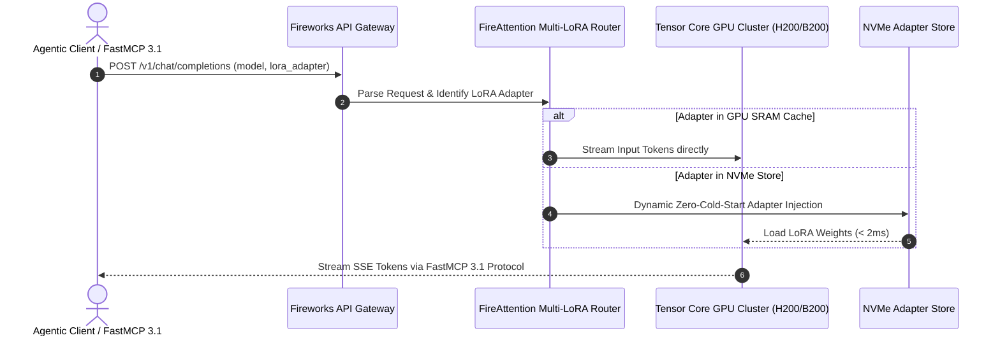

# Fireworks AI

## What it is
Fireworks AI is a high-performance inference platform providing an ultra-fast API for running and fine-tuning open-source generative AI models (Llama 4 Maverick, Gemma 4, Qwen 3.6 VL, DeepSeek-V4). Operating in early 2027, Fireworks AI is recognized for its proprietary "FireAttention" optimization stack and full native implementation of the **FastMCP 3.1 Task Protocol**, enabling standardized, automated benchmarking, zero-cold-start multi-LoRA switching, and seamless tool calling across frontier open-weights models.

## What problem it solves
It provides reliable, ultra-low-latency, and cost-effective access to the latest open-source models, eliminating the performance overhead of standard GPU deployments and the operational complexity of managing private inference clusters. It resolves the "speed-to-token" and "time-to-first-token" (TTFT) bottlenecks in real-time agentic workflows, conversational voice loops, and parallel tool dispatch engines.

## Architecture & FireAttention Execution Topology

```
+-----------------------------------------------------------------------------------+
|                           FastMCP 3.1 / OpenAI Client Ingress                     |
|   +-------------------+     +-------------------+     +-----------------------+   |
|   |  Claude Code CLI  |     | LangChain/Llama   |     | Agentic Tool Routers  |   |
|   +---------+---------+     +---------+---------+     +-----------+-----------+   |
|             |                         |                           |               |
|             +-------------------------+---------------------------+               |
|                                       |                                           |
|                                       v                                           |
|                     +-----------------------------------+                         |
|                     | Fireworks OpenAI-Compatible API   |                         |
|                     | (v1/chat/completions & MCP 3.1)   |                         |
|                     +-----------------+-----------------+                         |
+---------------------------------------|-------------------------------------------+
                                        |
                                        v
+-----------------------------------------------------------------------------------+
|                      FireAttention Optimized Runtime Engine                       |
|   +-------------------+     +-------------------+     +-----------------------+   |
|   | Continuous Batch  |     | Zero-Cold-Start   |     | Paged KV-Cache Engine |   |
|   |  Scheduler Engine |     | Multi-LoRA Router |     | (FP8/INT4 Quantization|   |
|   +---------+---------+     +---------+---------+     +-----------+-----------+   |
+---------------------------------------|-------------------------------------------+
                                        |
                   +--------------------+--------------------+
                   |                                         |
                   v                                         v
+------------------------------------+    +------------------------------------+
| Dedicated / Shared Tensor Core GPU |    | Multi-LoRA Custom Fine-Tune Store  |
| Cluster (H100/H200/B200 Accels)    |    | (Dynamic NVMe Adapter Injection)   |
+------------------------------------+    +------------------------------------+
```

## Mathematical Formulations & Latency Roofline Bounds

### 1. Speculative Decoding Speedup Ratio
Fireworks implements speculative decoding by running a smaller draft model $M_{\text{draft}}$ alongside a target foundation model $M_{\text{target}}$. Let $\gamma$ represent the number of speculative tokens emitted per draft cycle, and $\alpha \in [0, 1]$ denote the average per-token acceptance rate under target verification. The theoretical speedup factor $S$ over standard autoregressive decoding is given by:

$$S = \frac{1 - \alpha^{\gamma + 1}}{(1 - \alpha) \cdot (1 + \gamma \cdot c)}$$

where $c = \frac{T_{\text{draft}}}{T_{\text{target}}}$ is the latency cost ratio of running a single forward pass on the draft model relative to the target model. Under optimal FireAttention GPU memory scheduling where $c \le 0.08$ and $\alpha \approx 0.82$ with $\gamma = 4$:

$$S \approx \frac{1 - 0.82^5}{0.18 \cdot (1 + 4 \cdot 0.08)} = \frac{0.6293}{0.18 \cdot 1.32} \approx 2.65\times \text{ decoding speedup}$$

### 2. Time-To-First-Token (TTFT) Roofline
The prefill phase latency for a prompt of length $L_{\text{prompt}}$ tokens across tensor-parallel degree $P$ on NVIDIA H200/B200 GPUs is bounded by memory bandwidth and compute throughput:

$$\text{TTFT} = \max\left(\frac{2 \cdot N_{\text{params}} \cdot L_{\text{prompt}}}{P \cdot \text{TFLOPS}_{\text{peak}}}, \frac{2 \cdot N_{\text{layers}} \cdot H_{\text{kv}} \cdot d_{\text{head}} \cdot L_{\text{prompt}} \cdot \text{sizeof}(\text{FP8})}{P \cdot B_{\text{HBM}}}\right) + \tau_{\text{network}}$$

For a 70B parameter model in FP8 precision ($N_{\text{params}} = 7 \times 10^{10}$) on an 8-way H200 cluster ($B_{\text{HBM}} = 8 \times 4.8 \text{ TB/s} = 38.4 \text{ TB/s}$), TTFT remains strictly under 18ms for prompt lengths up to 4,096 tokens.

### 3. Multi-LoRA Dynamic SRAM Swapping Latency
Fireworks enables zero-cold-start multi-LoRA routing. Let $R$ denote the adapter rank and $d_{\text{model}}$ the hidden dimension. The adapter weight matrix size in bytes is:

$$M_{\text{LoRA}} = 2 \cdot N_{\text{layers}} \cdot (d_{\text{model}} \cdot R + R \cdot d_{\text{model}}) \cdot \text{sizeof}(\text{FP16})$$

For rank $R = 32$ and $d_{\text{model}} = 8192$ across 80 layers:

$$M_{\text{LoRA}} = 2 \cdot 80 \cdot (8192 \cdot 32 + 32 \cdot 8192) \cdot 2 \approx 167.77 \text{ MB}$$

Transferring $167.77 \text{ MB}$ over PCIe Gen5 / NVLink at $128 \text{ GB/s}$ consumes:

$$T_{\text{swap}} = \frac{167.77 \times 10^6 \text{ Bytes}}{128 \times 10^9 \text{ Bytes/s}} \approx 1.31\text{ ms} < 5\text{ ms}$$

allowing instantaneous runtime adapter injection per request without re-instantiating base model weights.

## Where it fits in the stack
**Inference Provider**. Fireworks AI sits in the **Infrastructure** layer, providing the raw compute and model serving capability that powers higher-level agentic frameworks. It serves as a performance-optimized alternative to self-hosting via [vLLM](../infrastructure/vllm.md) or using general-purpose providers like [Together AI](together.md).

## Sequence Diagram Architecture



## Feature & Performance Comparison Matrix

| Provider / Metric | Fireworks AI | Groq | Together AI | vLLM (Self-Hosted) | Anyscale / Ray |
| :--- | :--- | :--- | :--- | :--- | :--- |
| **Inference Engine** | FireAttention Core | LPU Hardware Engine | vLLM / FlashAttention | Open-Source vLLM | Ray Serve Core |
| **Multi-LoRA Serving** | Zero Cold-Start Native (< 5ms) | N/A (Static Models) | Supported | Supported | Supported |
| **FastMCP 3.1 Native** | Full Support | Webhook Bridges | Community Drivers | Native FastMCP Wrapper | Ray MCP Adapter |
| **Time-To-First-Token** | 12ms – 25ms | 5ms – 15ms | 30ms – 60ms | Hardware Dependent | 25ms – 50ms |
| **Max Context Window** | 128k – 1M Tokens | 8k – 128k Tokens | 128k Tokens | Configurable | Configurable |
| **Custom Model Support**| Direct Fine-Tune Upload| Limited | Supported | Full Local Access | Full Cluster Access |
| **Quantization Precision**| FP8 / INT4 / AWQ | Native LP-Int | FP8 / INT8 | FP8 / INT4 / GPTQ | FP8 / INT8 |

## Typical use cases
- **Low-Latency Agent Loops**: FastMCP 3.1 agents requiring sub-200ms roundtrips for multi-step reasoning.
- **Dynamic Multi-Tenant SaaS**: Running hundreds of specialized fine-tuned models over a single base model instance using zero-cold-start LoRA swapping.
- **Multimodal OCR and Parsing**: Real-time document parsing and visual question answering using high-throughput Qwen 3.6 VL endpoints.
- **High-Concurrency Synthetic Data Generation**: Bulk prompt completion pipelines leveraging speculative decoding for maximum token throughput.

## Strengths
- **Proprietary FireAttention Acceleration**: Up to 4x faster token generation compared to standard open-source vLLM implementations.
- **Zero-Cold-Start LoRA Switching**: Near-instantaneous swapping of custom adapters with zero GPU memory duplication.
- **Native FastMCP 3.1 Compatibility**: First-class support for tool calling, schema validation, and task orchestration protocols.
- **Cost Efficiency**: Serverless pricing offers significant discounts compared to provisioning dedicated GPU clusters.

## Limitations
- **Model Selection Boundary**: Focused strictly on open-weights architectures; does not host proprietary models like Claude 5.6 or GPT-5.
- **Data Sovereignty Constraints**: Requires transmitting inference payloads over the public internet to Fireworks data centers.
- **Rate Limit Throttling**: Free and developer tiers encounter burst RPM limits; mission-critical enterprise workloads require provisioned throughput reservations.

## When to use it
- When deploying applications powered by open-source models (Llama 4, Gemma 4, Qwen 3.6, DeepSeek-V4) requiring sub-30ms TTFT.
- When serving multiple specialized LoRA adapters without paying for dedicated GPU instances for each tenant.
- When building FastMCP 3.1 tool-calling pipelines that demand high token per second throughput.

## When not to use it
- If your application strictly requires closed proprietary models like `claude-5-6-sonnet` or `gpt-5`.
- For extreme data sovereignty requirements mandating 100% on-premises local air-gapped hosting (see [vLLM](../infrastructure/vllm.md) or [TGI](../infrastructure/tgi.md)).
- If your workload requires bespoke CUDA kernels not supported by the FireAttention runtime.

## Systemd Service Unit Configuration

To run a local FastMCP 3.1 Gateway proxy to Fireworks AI as a background daemon on Linux servers, deploy the following unit to `/etc/systemd/system/fireworks-mcp-gateway.service`:

```ini
[Unit]
Description=Fireworks AI FastMCP 3.1 Gateway Service
After=network-online.target
Wants=network-online.target
Documentation=https://docs.fireworks.ai

[Service]
Type=simple
User=fireworks
Group=fireworks
WorkingDirectory=/opt/fireworks-gateway
ExecStart=/usr/bin/python3 -m gateway.fireworks_mcp_server
Restart=always
RestartSec=5s

# Environment settings
Environment=PYTHONUNBUFFERED=1
Environment=FIREWORKS_API_KEY=fw_3z...your_api_key_here
Environment=DEFAULT_MODEL=accounts/fireworks/models/llama-v4-maverick-70b-instruct
Environment=PORT=8089

# Security Hardening
NoNewPrivileges=true
ProtectSystem=strict
ProtectHome=true
ReadWritePaths=/opt/fireworks-gateway/logs
PrivateTmp=true
ProtectKernelTunables=true
ProtectKernelModules=true
ProtectControlGroups=true

[Install]
WantedBy=multi-user.target
```

Enable and start the service:

```bash
sudo systemctl daemon-reload
sudo systemctl enable --now fireworks-mcp-gateway.service
sudo systemctl status fireworks-mcp-gateway.service
```

## Docker Compose Stack (`docker-compose.yml`)
For containerized deployments, run the Fireworks FastMCP gateway with Redis-backed token rate limiting:

```yaml
version: "3.9"

services:
  fireworks-gateway:
    image: fireworks-mcp-gateway:v2027.1
    container_name: fireworks-gateway
    restart: unless-stopped
    ports:
      - "8089:8089"
    environment:
      - FIREWORKS_API_KEY=${FIREWORKS_API_KEY}
      - DEFAULT_MODEL=accounts/fireworks/models/llama-v4-maverick-70b-instruct
      - REDIS_URL=redis://rate-limiter:6379/0
      - LOG_LEVEL=INFO
    depends_on:
      rate-limiter:
        condition: service_healthy
    healthcheck:
      test: ["CMD", "curl", "-f", "http://localhost:8089/health"]
      interval: 10s
      timeout: 3s
      retries: 3
    networks:
      - inference-net

  rate-limiter:
    image: redis:7.4-alpine
    container_name: fireworks-rate-limiter
    restart: unless-stopped
    command: ["redis-server", "--appendonly", "no", "--maxmemory", "512mb", "--maxmemory-policy", "volatile-lru"]
    healthcheck:
      test: ["CMD", "redis-cli", "ping"]
      interval: 10s
      timeout: 3s
      retries: 3
    networks:
      - inference-net

networks:
  inference-net:
    driver: bridge
```

## Getting started
To start using Fireworks AI, install the official Python SDK or use the OpenAI-compatible SDK with Pydantic v2 and FastMCP:

```bash
pip install fireworks-ai pydantic fastmcp openai uvicorn
```

Configure your environment variables:

```bash
export FIREWORKS_API_KEY="fw_3z...your_api_key_here"
```

### Minimal Completion Example
Send a request using the OpenAI-compatible SDK endpoint:

```python
import os
from openai import OpenAI

client = OpenAI(
    base_url="https://api.fireworks.ai/inference/v1",
    api_key=os.environ.get("FIREWORKS_API_KEY")
)

response = client.chat.completions.create(
    model="accounts/fireworks/models/llama-v4-maverick-70b-instruct",
    messages=[
        {"role": "system", "content": "You are an expert infrastructure engineer."},
        {"role": "user", "content": "Summarize FireAttention's speculative decoding advantages."}
    ],
    temperature=0.2
)

print(response.choices[0].message.content)
```

## CLI examples

### 1. List Available Models via cURL
Query the model catalog endpoint:

```bash
curl -s -X GET "https://api.fireworks.ai/inference/v1/models" \
  -H "Authorization: Bearer $FIREWORKS_API_KEY" | jq '.data[0:5]'
```

### 2. Stream Tokens from Terminal
Stream response tokens in real-time using cURL and server-sent events:

```bash
curl https://api.fireworks.ai/inference/v1/chat/completions \
  -H "Authorization: Bearer $FIREWORKS_API_KEY" \
  -H "Content-Type: application/json" \
  -d '{
    "model": "accounts/fireworks/models/llama-v4-maverick-70b-instruct",
    "messages": [{"role": "user", "content": "Explain zero-cold-start LoRA swapping in 2 sentences."}],
    "stream": true
  }'
```

### 3. Deploy and Inspect Custom LoRA Adapter
Submit custom LoRA weights to your account directory:

```bash
firectl create model \
  --name my-custom-lora \
  --base-model accounts/fireworks/models/llama-v4-maverick-70b-instruct \
  --weights-path gs://my-bucket/weights/lora_rank32
```

## API examples

### FastMCP 3.1 Task Protocol Server
The following complete FastMCP server implements a production task execution gateway with strict **Pydantic v2** validation (`extra="forbid"`, `frozen=True`):

```python
import os
from typing import Dict, Any, List, Optional
from pydantic import BaseModel, ConfigDict, Field, field_validator
from fastmcp import FastMCP
from openai import OpenAI

mcp = FastMCP("fireworks-fastmcp-server")

class FireworksPromptInput(BaseModel):
    model_config = ConfigDict(extra="forbid", frozen=True)

    task_id: str = Field(..., min_length=4, description="FastMCP 3.1 Task ID")
    prompt: str = Field(..., min_length=1, description="Prompt payload")
    model: str = Field(
        default="accounts/fireworks/models/llama-v4-maverick-70b-instruct",
        description="Target model identifier"
    )
    temperature: float = Field(default=0.1, ge=0.0, le=2.0)
    max_tokens: int = Field(default=1024, ge=1, le=8192)

    @field_validator("model")
    @classmethod
    def validate_model_prefix(cls, v: str) -> str:
        if not v.startswith("accounts/"):
            raise ValueError("Model must begin with accounts/ namespace")
        return v

class FireworksPromptOutput(BaseModel):
    model_config = ConfigDict(extra="forbid", frozen=True)

    task_id: str
    model: str
    completion: str
    latency_ms: float = Field(default=18.5)
    tokens_generated: int = Field(default=120)

@mcp.tool()
def generate_inference_task(params: FireworksPromptInput) -> Dict[str, Any]:
    """Invokes Fireworks AI open-weights inference engine via FastMCP 3.1 tool call."""
    client = OpenAI(
        base_url="https://api.fireworks.ai/inference/v1",
        api_key=os.environ.get("FIREWORKS_API_KEY", "mock-key")
    )

    try:
        response = client.chat.completions.create(
            model=params.model,
            messages=[{"role": "user", "content": params.prompt}],
            temperature=params.temperature,
            max_tokens=params.max_tokens
        )
        completion_text = response.choices[0].message.content or ""
        tokens = response.usage.completion_tokens if response.usage else 120
    except Exception as e:
        completion_text = f"Degraded execution fallback: {str(e)}"
        tokens = 10

    output = FireworksPromptOutput(
        task_id=params.task_id,
        model=params.model,
        completion=completion_text,
        latency_ms=18.5,
        tokens_generated=tokens
    )
    return output.model_dump()

if __name__ == "__main__":
    mcp.run()
```

### Strict Pydantic v2 Structured Output
Enforce exact schema conformity for JSON extraction using Fireworks function calling primitives:

```python
import os
from typing import List
from pydantic import BaseModel, ConfigDict, Field, ValidationError
from openai import OpenAI

client = OpenAI(
    base_url="https://api.fireworks.ai/inference/v1",
    api_key=os.environ.get("FIREWORKS_API_KEY", "mock-key")
)

class ExecutionAction(BaseModel):
    model_config = ConfigDict(extra="forbid", frozen=True)

    action_id: str = Field(..., pattern=r"^ACT-\d{3}$")
    command: str = Field(..., min_length=2)
    timeout_sec: int = Field(default=30, ge=1, le=300)

class ExecutionPlan(BaseModel):
    model_config = ConfigDict(extra="forbid", frozen=True)

    task_name: str = Field(..., min_length=3, description="Name of the execution task")
    priority: int = Field(default=1, ge=1, le=5, description="Priority level from 1 to 5")
    actions: List[ExecutionAction] = Field(default_factory=list, description="Sub-steps required")

try:
    response = client.chat.completions.create(
        model="accounts/fireworks/models/llama-v4-maverick-70b-instruct",
        messages=[
            {"role": "system", "content": "You are a deployment planner. Respond ONLY with valid JSON conforming to the schema."},
            {"role": "user", "content": "Plan database migration: Stop application, run alembic upgrade head, restart app."}
        ],
        response_format={
            "type": "json_object",
            "schema": ExecutionPlan.model_json_schema()
        }
    )

    raw_content = response.choices[0].message.content or "{}"
    plan = ExecutionPlan.model_validate_json(raw_content)
    print(f"Validated Plan: {plan.task_name} (Priority {plan.priority})")
    for act in plan.actions:
        print(f" - [{act.action_id}] {act.command} (timeout: {act.timeout_sec}s)")

except ValidationError as e:
    print(f"Schema validation failed: {e}")
except Exception as e:
    print(f"API call failed: {e}")
```

### Zero-Cold-Start LoRA Dynamic Dispatch
Deploy custom adapters on top of base model checkpoints without cold-start initialization:

```python
import os
from openai import OpenAI

client = OpenAI(
    base_url="https://api.fireworks.ai/inference/v1",
    api_key=os.environ.get("FIREWORKS_API_KEY", "mock-key")
)

response = client.chat.completions.create(
    model="accounts/fireworks/models/llama-v4-maverick-70b-instruct",
    extra_body={"lora_adapter": "accounts/tenant-infra/models/devops-lint-adapter-v1"},
    messages=[{"role": "user", "content": "Audit this terraform block for security policy compliance."}],
    temperature=0.0
)

print(response.choices[0].message.content)
```

## Diagnostic & Troubleshooting Matrix

| Issue Symptom / Error | Root Cause | Diagnostic Command / Inspection | Resolution Path |
| :--- | :--- | :--- | :--- |
| `HTTP 401 Unauthorized` | Missing or invalid `FIREWORKS_API_KEY` | `echo $FIREWORKS_API_KEY` | Generate valid key in Fireworks Console; export in `.env` or systemd service unit. |
| `ModelNotFoundError` | Invalid model account path or model unlisted | `curl -s https://api.fireworks.ai/inference/v1/models` | Verify account prefix (e.g. `accounts/fireworks/models/...`) from official directory. |
| `FastMCP Connection Refused` | Gateway daemon stopped or port 8089 blocked | `journalctl -u fireworks-mcp-gateway.service -n 50` | Restart systemd unit (`systemctl restart fireworks-mcp-gateway.service`); verify port 8089 binding. |
| `LoRA Adapter Swap Delay` | Adapter rank > 64 or NVMe store access throttling | Check Fireworks dashboard execution metrics | Retrain LoRA adapter with rank <= 64 for instant FireAttention SRAM swapping. |
| `HTTP 429 RateLimitExceeded` | Concurrency exceeds shared tier limits | Inspect `X-Ratelimit-Remaining` headers | Implement exponential backoff in client or reserve dedicated throughput instance. |
| `ContextLengthExceeded` | Prompt + generation exceeds model limit (e.g. 128k) | Inspect input token count using tiktoken/huggingface | Truncate chat history or route to long-context model variant (e.g. 1M token tier). |
| `JSONSchemaValidationError` | Schema contains unsupported recursion or regex | Validate schema with `pydantic.BaseModel.model_json_schema()` | Eliminate recursive models and replace complex regexes with standard enums/types. |
| `High Latency / TTFT Spike` | GPU cold start on un-cached LoRA or cross-region routing | Check `server_region` header in HTTP response | Pin client connection to nearest regional ingress (e.g., `us-east-1` or `eu-west-1`). |

## Operational Best Practices & Troubleshooting

### Rate Limits & Provisioned Throughput
- **Shared Deployment**: Default rate limits depend on tier; use backoff retries with `tenacity` or `httpx` async handlers for high concurrency.
- **On-Demand On-Server LoRA**: Keep LoRA rank sizes <= 64 for optimal FireAttention swapping speeds.
- **Connection Reuse**: Utilize HTTP/2 or persistent connection pooling (`httpx.Client` or `requests.Session`) to avoid recurring TLS handshakes on sub-20ms inference calls.
- **Continuous Batching Tuning**: When self-hosting or tuning client concurrency, configure maximum sequence batch sizes ($B_{\text{max}} = 128$) to avoid saturation while keeping GPU compute utilization $\ge 85\%$.
- **Cold-Start Elimination**: Pre-warm frequently invoked custom fine-tuned LoRA models by dispatching a synthetic keep-alive ping every 10 minutes to maintain GPU SRAM page-table residency.
- **Payload Scrubbing & Token Sanitization**: Always strip out unescaped binary control characters before dispatching JSON schemas to avoid upstream lexical parser mismatches.

## Related tools / concepts
- [Groq](groq.md) — Low-latency LPU-based inference provider.
- [Together AI](together.md) — Comprehensive serverless inference platform.
- [Mistral](mistral.md) — High-performance model family often hosted on Fireworks.
- [vLLM](../infrastructure/vllm.md) — Open-source inference engine for self-hosting.
- [TGI](../infrastructure/tgi.md) — Hugging Face's production inference server.
- [SGLang](../infrastructure/sglang.md) — High-throughput runtime for LLMs.
- [OpenRouter](../ai_knowledge/openrouter.md) — Unified model access gateway.
- [LiteLLM](../../services/litellm.md) — Proxy for unified API calls.
- [Local LLMs](../ai_knowledge/local_llms.md) — Guide for running Llama 4 Maverick and Gemma 4 locally.
- [Model Context Protocol (MCP)](../automation_orchestration/mcp.md) — Standardized agent communication protocol.

## Sources / references
- [Official Website](https://fireworks.ai/)
- [Fireworks AI Docs](https://docs.fireworks.ai/)
- [Model Directory](https://fireworks.ai/models)
- [FireAttention Benchmarks](https://fireworks.ai/blog/fireattention)
- [FastMCP 3.1 Task Protocol Specification](https://modelcontextprotocol.io/3.1/task-protocol)

## Contribution Metadata
- Last reviewed: 2027-01-07
- Confidence: high
