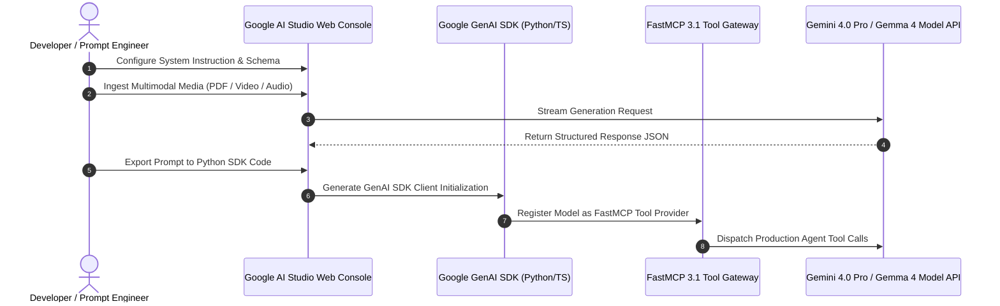

# Google AI Studio

## What it is
**Google AI Studio** is Google's premier web-based developer prototyping environment and API management platform for Gemini and Gemma foundation models (including Gemini 4.0 Pro, Gemini 4.0 Flash, Gemma 4, and Gemini 2.5). It provides rapid prompt engineering, system instruction tuning, multimodal input testing, structured output generation, and API key management in a streamlined console.

In early 2027, Google AI Studio serves as the primary sandbox for developers testing long-context reasoning across text, audio, image, and 4K video inputs. It allows instant exportation of playground prompts directly into production code across Python, TypeScript, cURL, and **FastMCP 3.1** server endpoints.



## What problem it solves
Developing agentic applications and optimizing multimodal LLM prompts often requires complex local runtime setups or expensive cloud deployment cycles. Google AI Studio eliminates setup overhead by offering a zero-friction web sandbox alongside production-ready REST and SDK endpoints:
- **Prototyping Friction**: Eliminates complex environment setup by granting immediate web access and instant API key issuance.
- **Multimodal Testing Bottlenecks**: Allows drag-and-drop testing of multi-gigabyte video files, audio streams, and PDFs inside context windows reaching up to 2M+ tokens.
- **Schema Misalignment**: Integrates real-time Pydantic v2 and OpenAPI schema validation engines directly into the web playground to ensure output structure fidelity.
- **Agent Integration Latency**: Bridges developer prompt experiments directly into autonomous agent frameworks through structured FastMCP 3.1 server templates.
- **Context Caching Cost Inefficiencies**: Solves redundant billing overheads for massive multi-turn conversation logs and reference corpora by allowing one-click explicit context caching with sub-second retrieval.

## Where it fits in the stack
**Category**: Provider / Development & Ops / AI Developer Portal. It sits at the **Intelligence & API Gateway Layer**, providing developer tooling and API access to Google's foundation models alongside Vertex AI, competing with OpenAI Platform and Anthropic Console.

```
+-----------------------------------------------------------------------+
|                       Google AI Studio Web Console                    |
|          - Prompt Sandbox & Multimodal Media Ingestion                |
|          - Structured Output Schema Builder & Tuning Workspace        |
|          - Context Cache Manager & Token Profiling Engine             |
+-----------------------------------------------------------------------+
                                   |
                         One-Click Code Export
                                   v
+-----------------------------------------------------------------------+
|                        Google GenAI SDK Layer                         |
|             (Python SDK / TypeScript SDK / cURL REST)                 |
+-----------------------------------------------------------------------+
                                   |
                                   v
+-----------------------------------------------------------------------+
|                    FastMCP 3.1 Gateway Integration                    |
|             (Pydantic v2 Schema Enforcement & Tool Calling)           |
|             (Multi-Model Routing & Token Consumption Metrics)         |
+-----------------------------------------------------------------------+
                                   |
                                   v
+-----------------------------------------------------------------------+
|                      Google Foundation Models                         |
|      (Gemini 4.0 Pro / Gemini 4.0 Flash / Gemma 4 / Gemini 2.5)       |
+-----------------------------------------------------------------------+
```

## Typical use cases
- **Rapid Prompt Engineering**: Iterating on system instructions, temperature settings, and safety parameters for Gemini 4.0 models.
- **Multimodal Document Analysis**: Drag-and-dropping PDFs, video frames, or audio files into the playground for long-context reasoning.
- **Structured Output Schema Prototyping**: Defining and validating JSON schemas for structured model responses.
- **API Key & Rate Limit Management**: Generating developer keys and monitoring quota usage for backend integrations.
- **Context Caching Evaluation**: Measuring latency and token cost reductions using explicit context caching policies for multi-megabyte corpora.
- **Function Calling & Agent Handshakes**: Defining JSON tool declarations and testing real-time parameter extraction before wiring into FastMCP 3.1 gateways.

## Strengths
- **Zero-Setup Prototyping**: Instant web access with immediate API key generation.
- **Native Multimodal Handling**: Ingestion of text, images, video, and audio directly within context windows up to 2M+ tokens.
- **Code Export Capabilities**: One-click export of playground prompts into Python, TypeScript, cURL, or REST code snippets.
- **Generous Free Tier**: High rate limits for prototyping and testing prior to commercial deployment.
- **Context Caching Support**: Up to 75% cost reduction on large repeated documents or audio prompts.
- **Low First-Token Latency**: Tuned streaming endpoints designed for interactive coding agents and voice agent pipelines.

## Limitations
- **Cloud-Only Execution**: Requires active internet connectivity and cloud API access.
- **Enterprise Scaling Transition**: Enterprise-grade VPC isolation, SLA guarantees, and custom fine-tuning require upgrading to Google Cloud Vertex AI.
- **Data Privacy Terms on Free Tier**: Inputs on free tier endpoints may be subject to quality review unless converted to paid usage.
- **Strict Rate Quotas on Pro Models**: Free tier RPM limits can lead to quick exhaustion during parallelized batch testing.

## When to use it
- When prototyping applications powered by Gemini 4.0 Pro, Gemini 4.0 Flash, or Gemma 4.
- When generating API keys and validating structured JSON responses using Google AI SDKs.
- When needing to rapidly test long-context multimodal inputs without building a local ingestion pipeline.
- When evaluating context caching cost-efficiency across static document repositories.
- When building prototype tool-calling loops for autonomous agents using FastMCP 3.1.

## When not to use it
- For enterprise workloads requiring strict data residency, custom VPC boundaries, or HIPAA compliance (use Google Cloud Vertex AI).
- For local offline LLM serving (use [ollama](../../services/ollama.md) or [vLLM](../infrastructure/vllm.md)).
- When confidential PII or trade secret datasets must remain completely isolated from public cloud telemetry.
- When ultra-low deterministic millisecond latency is required without cloud transit jitter.

## Getting started

### Installation
Install the official Google GenAI Python SDK and Pydantic v2:

```bash
pip install google-genai pydantic>=2.0 fastmcp httpx
```

### Initial Configuration
Export your API key obtained from [Google AI Studio](https://aistudio.google.com/):

```bash
export GEMINI_API_KEY="your-google-ai-studio-api-key"
```

### Basic Generation Call
Run a minimal text generation call in Python:

```python
import os
from google import genai

client = genai.Client(api_key=os.environ.get("GEMINI_API_KEY"))
response = client.models.generate_content(
    model="gemini-2.5-flash",
    contents="Hello world! Explain Google AI Studio in one sentence.",
)
print(response.text)
```

## CLI examples

### 1. Direct cURL Prompt Call
Generate text via cURL directly to the Google AI Studio REST API:

```bash
curl https://generativelanguage.googleapis.com/v1beta/models/gemini-2.5-flash:generateContent?key=$GEMINI_API_KEY \
  -H "Content-Type: application/json" \
  -d '{"contents": [{"parts": [{"text": "Summarize Google AI Studio capabilities."}]}]}'
```

### 2. Querying Available Foundation Models
List active Gemini and Gemma model endpoints:

```bash
curl "https://generativelanguage.googleapis.com/v1beta/models?key=$GEMINI_API_KEY"
```

### 3. Token Budget Counting Call
Verify token consumption prior to dispatching large multi-megabyte prompts:

```bash
curl https://generativelanguage.googleapis.com/v1beta/models/gemini-2.5-flash:countTokens?key=$GEMINI_API_KEY \
  -H "Content-Type: application/json" \
  -d '{"contents": [{"parts": [{"text": "Analyze long context window performance across 1M tokens."}]}]}'
```

### 4. Direct Streaming with cURL
Stream server-sent events (SSE) chunks from Gemini:

```bash
curl "https://generativelanguage.googleapis.com/v1beta/models/gemini-2.5-flash:streamGenerateContent?alt=sse&key=$GEMINI_API_KEY" \
  -H "Content-Type: application/json" \
  -d '{"contents": [{"parts": [{"text": "Stream response in real time."}]}]}'
```

### 5. Inspect Model Cache Quotas
Inspect active cached context blocks to audit memory allocation:

```bash
curl "https://generativelanguage.googleapis.com/v1beta/cachedContents?key=$GEMINI_API_KEY"
```

## API examples

### Python Integration with Gemini 4.0 Pro, FastMCP 3.1 & Pydantic v2 Schema
The following script demonstrates structured output generation using the Google GenAI SDK and Pydantic v2 validation integrated into an enterprise FastMCP 3.1 tool server:

```python
import os
import sys
import time
from typing import List, Dict, Any, Optional
from google import genai
from google.genai import types
from pydantic import BaseModel, Field, ConfigDict, field_validator
from fastmcp import FastMCP

# 1. Define strict Pydantic v2 validation models
class SafetySettingConfig(BaseModel):
    model_config = ConfigDict(extra="forbid", frozen=True)
    category: str = Field(..., description="Harm category (e.g. HARM_CATEGORY_HATE_SPEECH)")
    threshold: str = Field("BLOCK_MEDIUM_AND_ABOVE", description="Harm threshold policy")

class MultimodalAnalysisRequest(BaseModel):
    model_config = ConfigDict(extra="forbid", frozen=True)
    model_name: str = Field("gemini-2.5-flash", pattern="^gemini-(2\.5|4\.0)-(flash|pro)$")
    prompt_text: str = Field(..., min_length=5, description="Input instructions or query")
    media_url: Optional[str] = Field(None, description="Optional public URL to image, audio, or video stream")
    temperature: float = Field(0.2, ge=0.0, le=2.0)
    safety_settings: List[SafetySettingConfig] = Field(default_factory=list)

class ModelPerformanceMetrics(BaseModel):
    model_config = ConfigDict(extra="forbid", frozen=True)
    latency_ms: float = Field(..., ge=0.0, description="Time to first token in milliseconds")
    tokens_per_second: float = Field(..., gt=0.0, description="Output token generation speed")
    context_tokens_used: int = Field(..., ge=0, description="Total input prompt token count")

class GeminiStudioAnalysis(BaseModel):
    model_config = ConfigDict(extra="forbid", frozen=True)
    platform_name: str = Field("Google AI Studio", description="Name of the platform")
    supported_models: List[str] = Field(..., description="Key supported foundation models")
    max_context_window: int = Field(..., gt=0, description="Maximum context length")
    is_multimodal: bool = Field(True, description="Native multimodal support status")
    metrics: ModelPerformanceMetrics = Field(..., description="Execution telemetry")

# 2. Context Cache Request Schema
class ContextCacheRequest(BaseModel):
    model_config = ConfigDict(extra="forbid", frozen=True)
    model_name: str = Field("gemini-2.5-flash", description="Target model for caching")
    display_name: str = Field(..., min_length=3, description="Label for cached token corpus")
    system_instruction: str = Field(..., description="System prompt or corpus to cache")
    ttl_seconds: int = Field(3600, ge=300, le=86400, description="Time-to-live for cache")

# 3. Instantiate FastMCP 3.1 server wrapping Google AI Studio API
mcp = FastMCP("GoogleAIStudio-ToolGateway", version="3.1.0")

@mcp.tool(description="Analyzes text and multimodal queries using Google AI Studio Gemini API.")
def analyze_gemini_capabilities(request: MultimodalAnalysisRequest) -> Dict[str, Any]:
    """Queries Gemini model via Google GenAI SDK and validates structured response."""
    start_time = time.perf_counter()
    api_key = os.environ.get("GEMINI_API_KEY", "mock-key")
    client = genai.Client(api_key=api_key)

    try:
        response = client.models.generate_content(
            model=request.model_name,
            contents=request.prompt_text,
            config=types.GenerateContentConfig(
                temperature=request.temperature,
                response_mime_type="application/json",
                response_schema=GeminiStudioAnalysis,
            ),
        )
        validated = GeminiStudioAnalysis.model_validate_json(response.text)
        return validated.model_dump()
    except Exception as err:
        return {"error": f"Gemini Query Failed: {str(err)}", "latency_ms": round((time.perf_counter() - start_time) * 1000, 2)}

@mcp.tool(description="Counts prompt tokens for a given multimodal payload prior to execution.")
def count_prompt_tokens(prompt: str, model_name: str = "gemini-2.5-flash") -> Dict[str, Any]:
    """Retrieves exact token consumption using count_tokens API."""
    api_key = os.environ.get("GEMINI_API_KEY", "mock-key")
    client = genai.Client(api_key=api_key)

    try:
        res = client.models.count_tokens(model=model_name, contents=prompt)
        return {"model": model_name, "total_tokens": res.total_tokens}
    except Exception as e:
        return {"error": f"Token count failed: {str(e)}"}

@mcp.tool(description="Creates an explicit context cache in Google AI Studio for repeated queries.")
def create_context_cache(request: ContextCacheRequest) -> Dict[str, Any]:
    """Caches long reference text or system instructions to drastically lower input latency and token costs."""
    api_key = os.environ.get("GEMINI_API_KEY", "mock-key")
    client = genai.Client(api_key=api_key)
    try:
        cache = client.cached_contents.create(
            model=request.model_name,
            config=types.CreateCachedContentConfig(
                display_name=request.display_name,
                contents=[request.system_instruction],
                ttl=f"{request.ttl_seconds}s"
            )
        )
        return {"cache_name": cache.name, "expire_time": str(cache.expire_time), "model": cache.model}
    except Exception as e:
        return {"error": f"Context cache creation failed: {str(e)}"}

if __name__ == "__main__":
    mcp.run()
```

## Deployment & Containerization

### Docker Compose Architecture
Deploy a containerized FastMCP gateway to route agentic requests to Google AI Studio securely:

```yaml
version: "3.8"

services:
  gemini-mcp-gateway:
    image: python:3.12-slim
    container_name: gemini-ai-studio-gateway
    restart: unless-stopped
    ports:
      - "8420:8420"
    environment:
      - GEMINI_API_KEY=${GEMINI_API_KEY}
      - PYTHONUNBUFFERED=1
      - MCP_PORT=8420
    volumes:
      - ./gateway:/app
    working_dir: /app
    command: >
      bash -c "pip install google-genai fastmcp pydantic &&
               python /app/mcp_server.py"
```

### Systemd Service Daemon (`/etc/systemd/system/gemini-ai-studio.service`)
Configure a dedicated systemd service to manage the production Google AI Studio FastMCP bridge:

```ini
[Unit]
Description=Google AI Studio FastMCP 3.1 Gateway Daemon
After=network.target

[Service]
Type=simple
User=mcpagent
Group=mcpagent
WorkingDirectory=/opt/gemini-studio-gateway
EnvironmentFile=/etc/default/gemini-studio
ExecStart=/usr/local/bin/python3 /opt/gemini-studio-gateway/mcp_server.py
Restart=always
RestartSec=5s

# Hardening
ProtectSystem=strict
ProtectHome=true
NoNewPrivileges=true
PrivateTmp=true

[Install]
WantedBy=multi-user.target
```

## Developer & AI Provider Comparison Matrix

| Dimension / Provider | Google AI Studio | Google Cloud Vertex AI | OpenAI Developer Platform | Anthropic Console | Azure OpenAI Service |
| :--- | :--- | :--- | :--- | :--- | :--- |
| **Primary Audience** | Developers / Rapid Prototypers | Enterprise IT / Cloud Engineers | AI Application Developers | AI Application Developers | Enterprise Cloud Architecture |
| **Core Models** | Gemini 4.0 Pro/Flash, Gemma 4 | Gemini 4.0, Imagen 3, Claude 3.5 | GPT-5.5, GPT-5.6, O3, O4 | Claude 5.1, Claude 5.6 Sonnet | GPT-5.5, GPT-5.6 Enterprise |
| **Max Context Window** | 2,000,000+ Tokens | 2,000,000+ Tokens | 200,000 Tokens | 200,000–500,000 Tokens | 200,000 Tokens |
| **Multimodal Inputs** | Text, Audio, Image, 4K Video, PDF | Text, Audio, Image, Video, PDF | Text, Audio, Image | Text, PDF, Image | Text, Audio, Image |
| **Free Tier Access** | Generous free tier with key generation | Free trial credits ($300) | Pay-as-you-go | Pay-as-you-go | Pay-as-you-go / Subscription |
| **Data Privacy Policy** | Free tier may review non-paid inputs | Strictly private (No human review) | Paid Tier Private | Paid Tier Private | Enterprise Isolated |
| **MCP 3.1 / FastMCP** | Native FastMCP Python/TS export | Vertex AI Extension Protocol | OpenAI Function Calling / MCP | Native MCP Desktop & Server | Azure API Management MCP |
| **Context Caching** | Native API & UI Context Caching | Native Enterprise Caching | Prompt Caching (Automated) | Prompt Caching (Ephemeral) | Prompt Caching |

## Security & Operational Guardrails

| Security Dimension | Requirement / Policy | Implementation Mechanism | Enforcement Level |
| :--- | :--- | :--- | :--- |
| **API Key Protection** | Never commit raw API keys into source code or repos | `GEMINI_API_KEY` environment variable injection | Automated repo secret scanner block |
| **Safety Thresholds** | Apply harm category filtering to prevent output violations | `SafetySettingConfig` schema in GenAI SDK payload | Built-in Gemini API safety filter |
| **Free Tier Compliance** | Free tier inputs subject to reviewer access; do not send PII | Local PII filter or upgrade to Vertex AI | Mandatory for private home data |
| **Rate Limit Guardrails** | Respect RPM and TPM quotas on free tier endpoints | Client-side backoff exponential retry policy | Rate limit error retry logic |
| **Output Schema Sanitization** | Guarantee generated output matches Pydantic definitions | Strict `extra="forbid"` models with `model_validate_json` | In-flight JSON serialization gate |
| **Context Cache TTL Invalidation** | Prevent lingering stale data in shared cloud caches | Explicit TTL timestamps (`ttl_seconds <= 86400`) | Google GenAI SDK cache expiration |

## Diagnostic & Troubleshooting Matrix

| Symptom / Failure Mode | Root Cause Analysis | Diagnostic Step | Mitigation / Resolution Strategy |
| :--- | :--- | :--- | :--- |
| `429 Too Many Requests` | Exceeded RPM/TPM rate limits on Google AI Studio key | Check request frequency in console dashboard | Implement exponential backoff retry with jitter or upgrade to paid tier |
| `400 Invalid Argument / Schema Mismatch` | JSON schema definition incompatible with GenAI SDK | Validate Pydantic v2 schema against OpenAPI v3 rules | Ensure nested objects use standard primitive types and no cyclic references |
| Response blocked due to `SAFETY` | Prompt triggered default safety category threshold | Inspect `response.prompt_feedback` for safety block code | Adjust `SafetySettingConfig` harm thresholds in request or sanitize input tokens |
| Multimodal file upload error | Exceeded maximum single file size or unsupported format | Check media mime-type and file size in request | Transcode video to MP4/WebM or split audio files into 20MB chunks |
| `ContextWindowExceeded` Error | Video or document corpus exceeded 2,097,152 token limit | Run `count_tokens` endpoint prior to generation | Chunk documents or downsample video frame rates to 1 FPS |
| `IncompleteJSONStream` Output | Generation hit token length limit before JSON closed | Verify `finish_reason` in response candidate object | Increase `max_output_tokens` or narrow target output schema complexity |
| `ContextCacheExpired` Error | Attempted to query an expired cached content identifier | Query `cachedContents.get()` to inspect expiry | Recreate context cache with fresh TTL or refresh cache reference |

## Related tools / concepts
- [Gemini](../ai_knowledge/gemini.md) — Google's flagship multimodal model family.
- [Gemma](../ai_knowledge/gemma.md) — Lightweight open-weights models from Google.
- [Google Stitch](../development_ops/google-stitch.md) — UI prototyping and workflow automation tool.
- [OpenAI](../ai_knowledge/openai.md) — Creator of ChatGPT and GPT models.
- [Anthropic](anthropic.md) — Creator of Claude 5.6 and desktop agents.

## Sources / references
- [Google AI Studio Official Portal](https://aistudio.google.com/)
- [Google AI Studio Documentation](https://ai.google.dev/docs)
- [Google GenAI SDK Repository](https://github.com/google-gemini/generative-ai-python)

## Contribution Metadata
- Last reviewed: 2027-01-07
- Confidence: high
